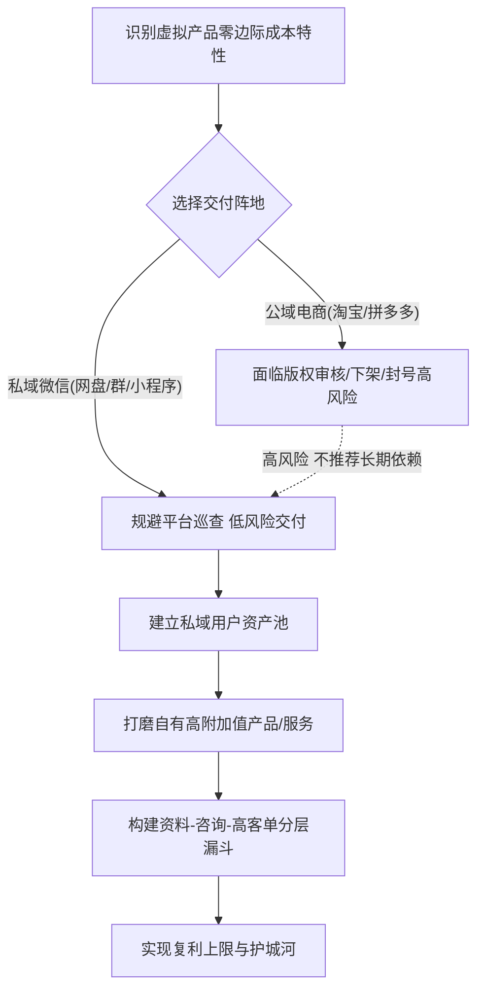
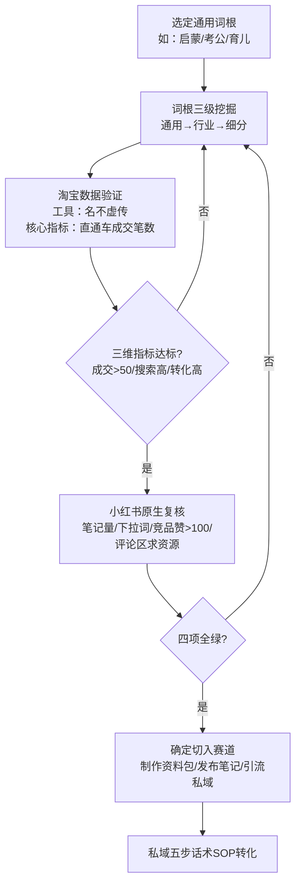
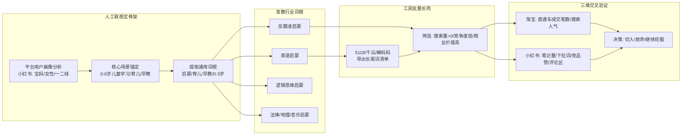
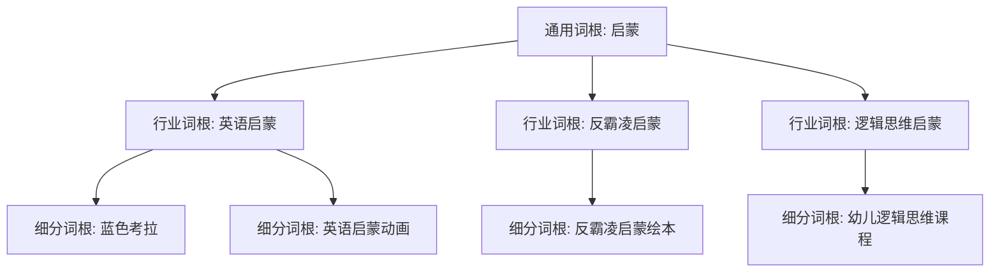
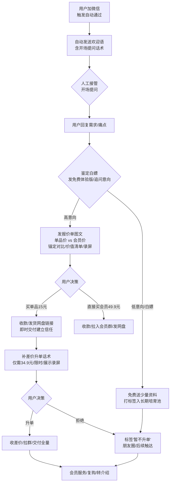
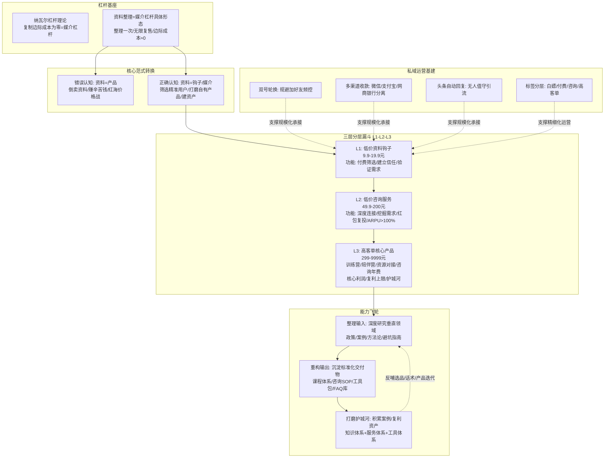

# 第 62 章 资料整理与虚拟变现体系
作者：龙哥

## 学习目标

- 理解虚拟资料变现的杠杆属性：零边际成本、可无限复售、属于纳瓦尔定义的媒介杠杆
- 掌握'淘上红'跨平台选品模式：用淘宝直通车成交笔数等电商数据验证需求，迁移至小红书分发变现
- 熟练运用'词根三级挖掘体系'（通用→行业→细分）结合工具批量挖掘长尾蓝海赛道
- 建立'三维交叉验证'选品决策体系：搜索人气（需求量）、成交转化（支付意愿）、直通车成交笔数（实锤销量）
- 精通'五步私域成交话术SOP'（开场提问→鉴定白嫖→发报价锚定→收钱发货→补差价升单）及自动化工具配合实现规模化转化
- 构建'资料→咨询→高客单体系'三层分层漏斗，理解'资料是钩子、产品是本体'的杠杆模型与付费筛选信任机制
- 掌握私域运营基建：双号轮换规避加好友频控、多渠道收款分离、头条号自动回复引流等标准化风控动作
- 识别赛道生命周期规律（蓝海→红海→枯竭），建立持续挖掘新赛道的系统能力而非依赖单一爆款
- 避开机构批量占领的大热门细分赛道（如幼师/公开课），转向新痛点/新概念类蓝海（如反霸凌/情绪管理）
- 理解写作店铺/代写模式：闲鱼/淘宝/拼多多/抖音开店售卖定制文案服务，轻资产、无需囤货发货 [需要补充文献]
- 掌握蓝海细分赛道策略：避开红海竞争，聚焦'写回忆录'、'写演讲稿'等具体垂直需求 [需要补充文献]
- 掌握咨询式成交话术与红包复投模型：低价咨询费建立信任→问题解决后引导用户自发发红包→基于消费能力推荐高客单产品
- 理解Wise推荐计划套利：Google/Bing搜索广告竞价品牌词（单次点击成本0.01-0.02英镑）→每笔50英镑佣金，单日佣金超万英镑 [需要补充文献]

## 62.1 生活类比

想象虚拟资料变现是一家"试吃-买单-办会员"的精品烘焙店。虚拟资料好比免费试吃的小块蛋糕，零成本、可无限复制、作为引流诱饵；淘宝销量数据则是中央厨房的历史畅销榜，已验证大众口味，提供确定性选品依据；词根挖掘相当于按"口味-食材-场景"分级的菜单研发体系，从大类层层挖掘到细分爆款；三维验证好比"有人问、有人买、复购高"三项指标确认真需求，剔除伪需求；五步话术SOP就是标准化导购话术：询口味、拒白嫖、报单价、收钱、劝办卡；价格锚定如同单买30元对比会员99元吃全场，锚定高价值降低升单决策门槛；补差价升单利用心理账户机制，"刚买了30元，再加69元就能自由吃一个月"；白嫖分层则是"不买也送小饼干，留微信发新品通知"，边际成本零、长期培育；资料→咨询→高客单漏斗对应"试吃→定制蛋糕咨询→年度订制服务"，钩子→信任→核心利润；私域双号/自动回复相当于双收银台加自助点餐机，规避排队与资金风控、标准化规模化；头条号自动回复则是自动售货机，无人值守、标准化交付、低风险。就像烘焙店不靠卖试吃块赚钱，而靠试吃筛选真食客、咨询建立信任、会员制锁定高客单复购，虚拟变现的本质也是"资料是钩子，产品是本体"。

## 62.2 概念地图

- 资料整理与虚拟变现体系
  - 核心属性定义
    - 虚拟产品纯利润属性（零边际成本/无库存/无限复售）        —— P033, P005
    - 版权风险隔离论（公域严审 vs 私域避风港）                    —— P033
    - 资料整理杠杆模型（纳瓦尔媒介杠杆/复制边际成本近零）      —— P005, P046, P033
    - 付费即筛选/信任源于交换（9.9元完成双重验证/低价咨询启动信任）   —— P005
  - 选品决策体系
    - 淘上红选品模式（电商数据确定性锚点 + 内容平台流量分发）   —— P033
    - 词根三级挖掘体系（通用词根→行业词根→细分领域词根）         —— P033
    - 三维交叉验证指标（搜索人气/成交转化/直通车成交笔数）         —— P033
    - 小红书原生数据复核（下拉词/笔记量/竞品点赞>100/评论区求资源） —— P033
    - 跨平台需求同构性原理（电商验证需求→内容平台迁移变现）         —— P033
  - 私域转化体系
    - 五步成交话术SOP（提问/鉴白嫖/报价/收款/补差价升单）        —— P033
    - 价格锚定与差价升单法（单品15元 vs 会员49.9元/补差价34.9元）   —— P033
    - 白嫖用户分层运营（免费给量建立互惠/纳入长期培育池）         —— P033
    - 变现分层漏斗：资料(筛选)→咨询(信任/红包复投)→高客单(核心利润) —— P005, P046
    - 咨询红包复投模型（200元咨询→88-120红包→ARPU提升>100%）     —— P005
    - 写作店铺代写模式：闲鱼/淘宝/拼多多/抖音售卖定制文案服务      —— P049 [需要补充文献]
  - 运营基建与风控
    - 头条号自动回复引流法（关键词触发/无人值守/低封号风险）       —— P005
    - 私域双号风控体系（加好友分流/收款渠道分离）                     —— P005
    - 选品三要素决策法（个人擅长/用户商业价值延展/渠道匹配度）         —— P005
  - 战略进化规律
    - 赛道生命周期必然枯竭定律（必须建立持续挖掘新赛道系统能力）   —— P033
    - 大热门细分赛道避坑（机构批量入场/同质化/新手见效差）         —— P033
    - 输入-重构-输出能力飞轮（整理即学习/输出即护城河）             —— P046, P005
    - Wise推荐计划套利（品牌词低价竞价/单日佣金超万英镑）             —— P050 [需要补充文献]

## 62.3 虚拟产品纯利润属性与版权风险隔离 —— 零边际成本的杠杆与私域避风港

### 为什么需要这个概念？

实体商品有库存、物流、售后成本，边际成本高，现金流压力大。虚拟产品（资料、教程、软件）复制成本趋近零，变现即纯利润，是普通人低门槛创业首选。公域电商平台（淘宝/拼多多）版权审核严，易下架封号，迁移至微信私域交付可大幅规避合规风险。

### 核心定义

虚拟产品：零边际成本、无库存压力、可无限复售的数字化商品。版权风险隔离：公域平台合规审核严，私域（网盘/群）交付基本无版权巡查风险。

### 关键性质

杠杆属性：符合纳瓦尔"复制边际成本为零"的媒介杠杆定义。现金流友好：无垫资压力，收款即利润，适合资金弱者。跨平台需求同构：淘宝验证有需求的虚拟品，小红书等内容平台需求必然存在，仅获客方式不同。

### 典型例子

反霸凌启蒙绘本：淘宝直通车成交324单，小红书搜索人气高，迁移变现利润可观。英语启蒙动画/蓝色考拉：小红书笔记7400+，竞品点赞>100，评论区持续求资源。大白菜U盘装系统教程：泛技能教程类，小红书点赞>100，淘宝有销量，验证方法论泛化性。

### 边界条件

单一赛道生命周期必然：蓝海→红海→枯竭，必须建立持续挖掘新赛道系统能力。幼师/公开课等大热门赛道因机构批量入场同质化严重，新手见效显著变差，不建议切入。资料本身非核心护城河，易贬值、易复制，核心竞争力在于后端自有高附加值产品/服务体系。

### 方法演进图：虚拟产品变现核心逻辑与风控决策流

### 概念溯源与原文证据

> "因为虚拟项目变现的是纯利润哈！虚拟项目没什么成本在里面，而且需求也非常大，基本上各行各业都可以实现虚拟项目变现。"
> 
> —— P033 黄岛主《小红书虚拟项目实操》 (docs/202305/20230516_033.md)

这段话直接点出了虚拟产品的核心优势：零边际成本。你不需要囤货，不需要发快递，不需要处理退货售后。一份资料，卖一万份，成本几乎不变。这就是纳瓦尔在《纳瓦尔宝典》里定义的"复制边际成本为零"的媒介杠杆——代码和媒体。资料整理，本质上就是媒体杠杆的一种具体形态。

> "如果你很在意版权你可以不考虑这个，因为这个版权很多时候只出现在电商平台，如果微信私域变现的话，基本上不用考虑版权。"
> 
> —— P033 黄岛主《小红书虚拟项目实操》 (docs/202305/20230516_033.md)

这是一个极其关键的风险隔离策略。很多新手卡在"我这资料版权怎么办"上不敢动手。素材明确告诉你：版权巡查的重灾区是公域电商平台（淘宝、拼多多），那里有自动化查重系统、有人工审核、有知识产权投诉通道。但你把交付环节挪到微信私域——发网盘链接、拉进群、发压缩包——平台基本穿透不到。这不是教你侵权，而是告诉你：合规的边界在哪里，你的安全区在哪里。先在私域跑通商业闭环，赚到第一桶金，再考虑版权合规化、自有IP化，这是"先活下来，再活得好"的生存法则。

> "这个赛道我们是从蓝海做到红海的，也算是圆满结束这个赛道。如果你不去挖掘新的赛道，你最终会被饿死。"
> 
> —— P033 黄岛主《小红书虚拟项目实操》 (docs/202305/20230516_033.md)

这揭示了赛道生命周期必然枯竭定律。任何单一虚拟赛道，都会经历：蓝海期（无人知、利润高、转化易）→ 红海期（人多、同质化、转化降、价格战）→ 枯竭期（需求饱和、平台打击、利润归零）。作者团队亲历了学科资料赛道的完整生命周期，最终"圆满结束"。这告诉你：单一项目不可永恒，唯有"挖掘新赛道的系统能力"才能跨周期生存。这也是本章后续"词根挖掘体系""三维验证体系"存在的意义——它们不是为了做成一个项目，而是为了让你拥有"源源不断挖掘新项目"的能力。

> "黄岛主(虚拟项目) : 幼师现在不好做了，尤其是是公开课，现在很多做培训的也还在这个赛道上操作，但见效可能会差一些。"
> 
> —— P033 黄岛主《小红书虚拟项目实操》 (docs/202305/20230516_033.md)

这是大热门细分赛道避坑实证。幼师资格证、公开课，曾经是虚拟资料的超级大赛道。但因为培训机构批量入场、内容高度同质化、平台流量被头部垄断，新入局的小白"见效显著变差"。这印证了：眼看着热闹的赛道，往往是红海中的血海；真正的机会藏在"新痛点、新概念、新人群"的细分缝隙里（如反霸凌、情绪管理）。

> "资料是别人的（钩子），产品必须是自己的（本体）"
> 
> —— P046 三恒《资料整理日均引流180+》 (docs/202305/20230516_046.md)

这是贯穿本章的核心范式。三恒在《资料整理商业模型》中反复强调：单纯倒卖资料（"无脑卖资料"）是红海，天花板极低；资料整理的真正价值，在于作为钩子筛选精准付费用户，核心利润来自后端自有的高附加值产品/服务体系（咨询、训练营、社群、资源对接）。这也是第 62.7 单元将重点拆解的"变现分层漏斗"模型。

---

## 62.4 淘上红选品模式与三维验证体系 —— 用电商数据做确定性，用内容平台做流量

### 为什么需要这个概念？

新手选品靠猜、靠感觉，试错成本高、周期长、失败率高。电商平台（淘宝）数据真实、直观、已验证市场付费意愿，可作选品"确定性锚点"。小红书等内容平台流量大、获客易，但缺乏直观销售数据，需用电商数据反哺选品方向。

### 核心定义

淘上红模式：利用淘宝/电商平台成熟销量/搜索/转化数据筛选验证过的虚拟热品，迁移至小红书分发引流。三维验证指标：搜索人气（需求量）、成交转化（支付意愿）、直通车成交笔数（实锤销量）。

### 关键性质

数据分层：淘宝数据定"做什么"（选品确定性），小红书数据定"怎么做"（内容竞争度/用户画像）。工具辅助：用"名不虚传"等工具看淘宝直通车成交笔数；用小红书搜索下拉框、笔记量、竞品对标、评论区求资源三维交叉验证。跨平台迁移：电商平台"搜索-购买"模式 → 内容平台"种草-私域-转化"模式，需求内核不变。

### 典型例子

反霸凌启蒙绘本：淘宝直通车成交324单+搜索人气高 → 小红书验证需求真实 → 切入蓝海。英语启蒙动画：淘宝有数据 → 小红书"蓝色考拉"7400+笔记+下拉词+竞品点赞>100+评论区求资源 → 确认可接受竞争强度。大白菜U盘装系统：5118挖掘"课程"词根 → 淘宝/小红书双平台验证有需求有销量 → 泛技能教程赛道打通。

### 边界条件

电商平台数据非绝对真理：淘宝数据少不代表没市场，小红书用户画像不同（宝妈多）可能放大特定品类需求。竞品对标阈值：点赞<100视为需求不足，>100且评论区近期活跃求资源为合格信号。仅适用于"虚拟/标品/非强体验"品类，重服务/重体验/强个性化产品跨平台迁移失真。

### 方法演进图：淘上红选品与三维验证全流程

### 概念溯源与原文证据

> "我们做小红书说白了，就是淘上红模式，淘宝火的虚拟产品，如果放到了小红书上也可以测试操作。"
> 
> —— P033 黄岛主《小红书虚拟项目实操》 (docs/202305/20230516_033.md)

> "我们用名不虚传这个软件...软件主要围绕淘宝去分析，因为电商平台上的数据可以直观的展现给我们"
> 
> —— P033 黄岛主《小红书虚拟项目实操》 (docs/202305/20230516_033.md)

这两段原文揭示了淘上红模式的底层逻辑：跨平台需求同构性原理。用户的核心需求（如"我想买反霸凌绘本给孩子看"）不会因为平台变而变；变的是获客路径——淘宝是"搜索-点击-购买"，小红书是"刷到-种草-私信-私域-转化"。既然需求同构，淘宝上已经跑通、有真金白银成交数据的产品，拿到小红书去做内容分发，成功率天然更高。这叫"用电商数据做确定性（选品），用内容平台做流量（获客）"。

> "想要找到符合我们的，我们可以看这三个指标：搜索人气、成交转化、直通车成交笔数"
> 
> —— P033 黄岛主《小红书虚拟项目实操》 (docs/202305/20230516_033.md)

> "其中，我们看到了，反霸凌启蒙绘本，这个成交笔数是 324...搜索人气也是很高平的，说明这个品非常不错的"
> 
> —— P033 黄岛主《小红书虚拟项目实操》 (docs/202305/20230516_033.md)

这是三维交叉验证体系的核心公式。别只看一个指标：

**三维选品验证指标对照表**

说明：该表展示选品决策的三大核心指标及其物理含义与判断标准。

| 维度 | 指标来源 | 物理含义 | 判断标准 |
|------|----------|----------|----------|
| 需求量 | 搜索人气（淘宝/工具） | 有多少人在主动找 | 越高越好，说明市场大 |
| 支付意愿 | 成交转化率 | 看了多少人会买 | 越高越好，说明产品强 |
| 实锤销量 | 直通车成交笔数 | 真实出单多少单 | >50单/月为及格线，>300为优 |

这三个指标缺一不可。只有搜索高、成交少=伪需求（如"免费领取"类）；只有成交高、搜索低=可能是刷单或极窄众；只有直通车成交笔数实锤，才是真需求、真付费、真可做。反霸凌启蒙绘本：直通车成交 324 单 + 搜索人气高，直接通过三维验证，判定为高需求、低竞争蓝海品类。

> "蓝色考拉 这个有 7400+笔记，说明做的人是有的但是不多...再看看下拉框，有相关的，说明有人去搜...点赞至少要 100 以上。"
> 
> —— P033 黄岛主《小红书虚拟项目实操》 (docs/202305/20230516_033.md)

这是小红书原生数据复核的标准动作。确定品类后，去小红书搜关键词，看四项：

1.  笔记总量：7400+ 说明有人做、但不多（<1万通常视为可接受竞争）
2.  下拉框联想词：有联想词 = 真实搜索需求存在
3.  竞品点赞：Top 5 笔记点赞 > 100 = 内容有互动、用户有付费倾向
4.  评论区求资源：近期评论区有"求链接/怎么买/发我" = 高意向需求未被满足

这四项全绿，才敢下注。这就是"数据驱动选品，拒绝拍脑袋"的工程化态度。

> "看到数据，充分说明，这个赛道的资料是有很多人 想要买的，我们可以再去淘宝上看看数据...淘宝上的数据虽然不是很多，但需求的人是有的"
> 
> —— P033 黄岛主《小红书虚拟项目实操》 (docs/202305/20230516_033.md)

这是跨平台互证的典型场景：大白菜 U 盘装系统教程，小红书有高赞笔记、评论区求购，淘宝也有销量。哪怕淘宝数据不大（因为泛技能教程在淘宝非主流），但双平台都有真实需求信号，即可判定该赛道可行。这验证了方法论的泛化性——不限于启蒙教育，凡是"虚拟/标品/可交付"的品类，皆可复用。

---

## 62.5 词根三级挖掘体系 —— 从大词挖到蓝海的层层递进漏斗

### 为什么需要这个概念？

宽泛大词（如"启蒙"）竞争极度红海，新手无法切入。需要系统化方法从大词拆解出长尾细分词，找到"需求明确、竞争可控、客单可做"的蓝海切入点。小红书用户画像（宝妈/女性/一二线）决定了特定高价值词根方向（0-6岁儿童学习场景）。

### 核心定义

三级词根：通用词根（启蒙）→ 行业词根（英语启蒙/法律启蒙/反霸凌启蒙）→ 细分领域词根（蓝色考拉/反霸凌启蒙绘本/幼儿逻辑思维）。联想锚点：基于平台用户画像（宝妈群体）发散联想0-6岁儿童学习场景，结合工具批量挖掘长尾词。

### 关键性质

需求层级递进：通用词根定方向，行业词根定赛道，细分词根定具体产品。竞争度递减：层级越深，竞争者越少，用户意图越精准，转化率越高。工具放大：人工联想定骨架，工具（5118/名不虚传/千瓜/蝉妈妈）批量长肉。

### 典型例子

启蒙 → 英语启蒙 → 蓝色考拉/英语启蒙动画（小红书7400+笔记，有下拉词，竞品点赞>100）。启蒙 → 反霸凌启蒙 → 反霸凌启蒙绘本（淘宝直通车成交324单，搜索人气高）。课程 → 大白菜U盘装系统教程（小红书点赞>100，评论区求购，淘宝有销量）。

### 边界条件

词根挖掘需结合平台用户画像：小红书宝妈多→母婴/启蒙/教育权重高；抖音老年多→养生/保暖权重高。细分词根过窄会导致总流量不足，需平衡"竞争小"与"搜索量够"。避开机构批量占领的"大热门细分"（如幼师证/公开课），转而挖掘"新痛点/新概念"（如反霸凌/情绪管理）。

### 方法演进图：词根三级挖掘与验证闭环

### 概念溯源与原文证据

> "备注：词根分为 通用词根 ，通用词根挖出来的，又分为 行业词根、细分化领域的词根。"
> 
> —— P033 黄岛主《小红书虚拟项目实操》 (docs/202305/20230516_033.md)

> "启蒙这个词，可以分很多的，譬如：英语启蒙、法律启蒙、地理启蒙、语言启蒙、音乐启蒙、反霸凌启蒙、早教启蒙等等很多的。"
> 
> —— P033 黄岛主《小红书虚拟项目实操》 (docs/202305/20230516_033.md)

> "1、领域思路的放大...我们就可以从这方面去联想一些关键词根，你可以多思考下 0-6 岁的儿童方面都会学习什么？"
> 
> —— P033 黄岛主《小红书虚拟项目实操》 (docs/202305/20230516_033.md)

> "例如：启蒙、幼儿启蒙、幼儿园、早教、0-3 岁培养、育儿、幼儿、幼儿逻辑思维、幼儿英语......"
> 
> —— P033 黄岛主《小红书虚拟项目实操》 (docs/202305/20230516_033.md)

这是一套结构化的需求挖掘方法论。别盯着"大词"发呆，要像剥洋葱一样层层拆解：

第一层：通用词根（定方向）。结合平台用户画像。小红书 70% 是女性、一二线城市、宝妈多 → 核心场景是 0-6 岁儿童学习、育儿、早教。所以"启蒙""育儿""早教"就是通用词根。

第二层：行业词根（定赛道）。在通用词根下发散。启蒙下有：英语启蒙、反霸凌启蒙、法律启蒙、地理启蒙、音乐启蒙、逻辑思维启蒙……每一个都是一个垂直赛道。

第三层：细分领域词根（定产品）。在行业词根下再细分。英语启蒙下：蓝色考拉、英语启蒙动画、剑桥少儿英语、牛津阅读树……反霸凌启蒙下：反霸凌启蒙绘本、反霸凌绘本推荐、孩子被霸凌怎么办……

关键动作：人工联想定骨架（前两层），工具批量长肉（第三层）。用 5118、千瓜、蝉妈妈、名不虚传，输入行业词根，导出长尾词清单，筛选"搜索量>0、竞争度低、商业价值高"的细分词根。

> "蓝色考拉 这个有 7400+笔记，说明做的人是有的但是不多...点赞至少要 100 以上。"
> 
> —— P033 黄岛主《小红书虚拟项目实操》 (docs/202305/20230516_033.md)

细分词根挖出来后，必须回到 62.4 节的三维验证 跑一遍。蓝色考拉：笔记 7400+（竞争可控）、有下拉词（需求真）、竞品点赞>100（互动强）、评论区求资源（意向强）→ 通过，可切入。

> "避开机构批量占领的'大热门细分'（如幼师证/公开课），转而挖掘'新痛点/新概念'（如反霸凌/情绪管理）"

这是选品避坑指南。幼师证、公开课，看似细分，实则被培训机构用"内容工厂"批量占领，内容同质化极高，新手进去就是炮灰。而"反霸凌启蒙""儿童情绪管理""青春期心理疏导"，是新痛点、新概念、新认知，内容供给端远未饱和，正是"新手用 120 分的做法（成熟 SOP），打 60 分的市场（初级竞争）"的降维打击窗口。

---

## 62.6 五步私域成交话术SOP与价格锚定升单法 —— 从陌生人到高客单会员的标准化转化流水线

### 为什么需要这个概念？

私域聊天非标准化，依赖个人销售天赋，难复制、难培训、转化率不稳定。虚拟产品单价低（如15元），单靠单品利润有限，必须设计升单路径提升LTV。白嫖用户边际成本为零，直接拉黑损失潜在长期价值，需分层运营。

### 核心定义

五步话术SOP：开场提问建立需求 → 鉴定白嫖筛选意向 → 发报价单/群对比锚定价值 → 收钱发货完成首单 → 补差价追销升单会员。价格锚定：单品15元 vs 会员49.9元（500G+资料/3000+份），利用对比锚定降低会员决策门槛。差价升单：首单后补差价34.9元升级终身会员，利用"心理账户"机制（已花15元，再加34.9元即得全库）促单。

### 关键性质

标准化可复制：配合自动通过/自动回复工具，低技能门槛可规模化执行。信任递进：提问建立专业感 → 鉴定白嫖筛选高意向 → 报价锚定价值 → 发货兑现承诺 → 补差价深化关系。白嫖分层：拒付费者免费送少量资料建立好感/互惠心理，纳入私域池长期培育，而非直接拉黑。

### 典型例子

英语启蒙动画：单品15元 → 推荐49.9元会员群（1000G/3000+份） → 补差价34.9元升级 → 发会员网盘录屏视频增强信任 → 成交。话术细节："小姐姐今天可以补差价进会员群呢，只需要补 34.9 就行，资料有 500 多 G，可以录制会员网盘群的录屏视频发给客户看"。

### 边界条件

仅适用于"标品化虚拟产品"（资料/教程/模板），重定制/重服务产品需改用咨询式成交模式。依赖私域承接能力：需解决微信加好友频控（双号轮换）、收款风控（支付宝/多渠道分离）等基建问题。会员产品必须"含量极高、感知价值远超价格"，否则补差价转化率极低，甚至引发投诉。

### 方法演进图：五步话术SOP与差价升单标准化流程

### 概念溯源与原文证据

> "关于变现话术，我们根据以往做项目的经验，提炼出了 5 个咨询核心：开场提问、鉴定白嫖、发报价表、收钱发货、补差价追销。"
> 
> —— P033 黄岛主《小红书虚拟项目实操》 (docs/202305/20230516_033.md)

> "单份英语启蒙动画是 15 元...建议 49.9 元进动画课件群...小姐姐今天可以补差价进会员群呢，只需要补 34.9 就行，资料有 500 多 G。"
> 
> —— P033 黄岛主《小红书虚拟项目实操》 (docs/202305/20230516_033.md)

这是五步私域成交 SOP 的标准化流水线。把非标的"聊天销售"拆解为 5 个标准动作，每个动作有标准话术、标准动作、标准工具配合：

**五步私域成交话术 SOP 标准动作表**

说明：该表拆解私域转化的五个标准动作、核心话术、目的及工具配合，实现可规模化复制的转化流水线。

| 步骤 | 核心动作 | 标准话术示例 | 目的 | 工具配合 |
|------|----------|--------------|------|----------|
| 1. 开场提问 | 主动发问，建立专业感、探需求 | "小姐姐平时给孩子找英语启蒙资料，最头疼什么？" | 筛选真需求、建立专业人设 | 自动欢迎语 + 人工接管 |
| 2. 鉴定白嫖 | 区分"犹豫党"vs"白嫖党" | "是想系统学习，还是临时急用几节课？发个免费体验版你先看看？" | 筛选高意向、过滤低质、建立互惠 | 话术库 + 免费体验版素材 |
| 3. 发报价锚定 | 单品 vs 会员 双价格对比图 | "单买这套 15 元；会员 49.9 元 = 全站 3000+ 套动画 + 持续更新 + 网盘永久存，小姐姐您算笔账..." | 价格锚定、价值放大、降低升单门槛 | 报价单图文模板（含对比表、会员清单、网盘录屏） |
| 4. 收钱发货 | 即时交付，兑现承诺 | "收到 15 元啦，这是网盘链接，资料已整理好分类，您保存下..." | 建立信任、完成首单闭环 | 自动发货链接 / 人工发网盘 |
| 5. 补差价升单 | 利用"心理账户"机制逼单 | "小姐姐今天补差价 34.9 就能进会员群，资料有 500 多 G，我录个会员网盘录屏发您看..." | 提升 LTV、锁定长期关系 | 补差价收款码 + 会员群录屏视频 |

> "注意：如果对方确实不打算付钱，想白嫖，那么就免费发他几个动画视频，让他过把瘾，后期在慢慢转化。"
> 
> —— P033 黄岛主《小红书虚拟项目实操》 (docs/202305/20230516_033.md)

> "客户加进来之后，要主动给客户发信息，其实这个时候，能自动回复就自动回复，有软件辅助，包括自动同意添加好友，添加后再去自动回复。"
> 
> —— P033 黄岛主《小红书虚拟项目实操》 (docs/202305/20230516_033.md)

这是白嫖用户分层运营与自动化规模化的关键细节。白嫖用户边际成本为零，别拉黑，送点免费资料、打个标签（如"白嫖-英语启蒙"），纳入朋友圈/社群长期培育，未来转化概率 > 0。同时"能自动回复就自动回复"——自动通过好友、自动发欢迎语、自动发报价单、自动发网盘链接，把人力从"重复性动作"解放出来，只在"鉴定白嫖、补差价逼单"这种高决策环节人工介入。这是低技能门槛、可规模化复制的组织化前提。

> "基本上商业咨询费用我都是简单的收个200，结束后目前最低的都会给我包个88——120的红包...主要的是拿点小钱，了解大部分用户的真实需求、建立信任和提供服务，深度连接之后，后期你会有更大的这种产品去承接！"
> 
> —— P005 三恒《资料整理私域变现复盘》 (docs/202305/BzIfdvAQloqLImxjEhKcERAXn5f.md)

这是咨询式成交与红包复投模型（详见 62.7 单元）。对于高客单、重服务的产品（如志愿填报、商业咨询），不直接卖大单，而是先卖低价咨询（200元）。咨询解决问题后，99% 用户会自发发红包（88-120元，互惠心理+沉没成本），单用户即时 ARPU 提升 >100%，且建立了深度信任，为后续推销高客单产品（2999/9999元）铺平道路。这是"资料→咨询→高客单"漏斗中 L2→L3 的关键跃迁动作。

---

## 62.7 资料整理杠杆模型与变现分层漏斗 —— 资料是钩子，产品才是本体

### 为什么需要这个概念？

多数人陷入"无脑卖资料"红海：单价低、极易复制、无护城河、天花板极低。资料边际成本零，本质是"获取真实付费用户的媒介/钩子"，而非变现主体。必须构建"资料→咨询→高客单体系"三层分层漏斗，将流量价值最大化。

### 核心定义

资料整理杠杆：复制边际成本近零、可叠加资本/劳动力杠杆，属于纳瓦尔定义的"媒介杠杆"。变现分层漏斗：L1 低价资料（筛选付费意向/建立信任） → L2 低价咨询（深度连接/挖掘需求/互惠红包） → L3 高客单产品/训练营/资源对接（核心利润/复利上限）。私域用户资产：存量经济时代，可随时触达、曾为你付费过的精准知识用户才是核心资产。

### 关键性质

付费即筛选：哪怕9.9元也完成"兴趣强度验证+付费意识验证"双重筛选，免费用户无法判断付费潜力且低估资料价值。信任源于交换：商业信任仅通过"交付价值-收取对价"交易循环建立，低价咨询是低风险信任启动器。咨询红包复投：200元咨询费→问题解决→用户自发发红包88-120元（互惠心理/沉没成本）→ 单用户ARPU提升>100% → 基于消费能力推荐高客单。输入-重构-输出循环：整理资料非搬运，而是"整理输入(学习/筛选)→重构输出(沉淀方法论/开发课程/服务)→打磨能力护城河"。

### 典型例子

高中资料 → 高考志愿填报咨询（高客单）。英语资料 → 英语训练营/社群（复购/复利）。阅读资料 → 读书营/社群（高粘性/高LTV）。商业资料/天涯神贴 → 商业咨询/高客单课程/资源对接（高溢价）。实测：4天日均2小时，引流700+（日均180+），资料付费转化60%，咨询二次转化30%，客单200+红包88-120。

### 边界条件

头条号自动回复引流虽高效低风险，但平台规则收紧可能失效，需多渠道备选。私域双号风控（加好友/收款分离）是规模化前提，单号极易触发限流冻结。选品三要素缺一不可：个人兴趣/擅长一致性、用户商业价值可延展性、渠道流量分发匹配度。无自有高附加值产品/服务体系，单纯卖资料必死于红海价格战。

### 方法演进图：资料整理杠杆模型与三层分层漏斗

### 概念溯源与原文证据

> "商业杠杆来自资本、劳动力和复制边际成本为零的产品（代码和媒体）——《纳瓦尔宝典》...很显然，资料整理属于复制边际成本几乎为零的产品！而且，可以加杠杆！！！"
> 
> —— P005 三恒《资料整理私域变现复盘》 (docs/202305/BzIfdvAQloqLImxjEhKcERAXn5f.md)

> "在存量经济时代，握在手里的、可以让你随时触达的私域用户就是资源；在存量经济时代，握在手里的、可以随时触达的、并且曾经为你付费过的知识用户就是资源！资料整理，只不过是你获取自己真实用户的一个媒介，重点是你要通过他们，打磨出属于自己的产品，知识体系或者说是商业模式！"
> 
> —— P005 三恒《资料整理私域变现复盘》 (docs/202305/BzIfdvAQloqLImxjEhKcERAXn5f.md)

这两段原文确立了资料整理杠杆模型的理论基石。纳瓦尔杠杆理论指出：财富创造的三大杠杆是资本、劳动力、复制边际成本为零的产品（代码与媒体）。资料整理 = 媒体杠杆的一种。你整理一次资料，可以无限次复制分发，边际成本 ≈ 0。但杠杆的支点在哪里？ 不在"卖资料"这件事上（那叫"打工"，赚辛苦钱），而在于"用资料筛选用户，打磨自有产品"——这是杠杆撬动财富的真正支点。

> "如果你手里有1000个精准用户，你是否会把和用户建立深度连接的机会，交给别人的产品吗？...我认为，这才是资料整理最精髓的核心！（一定要有自己的产品，资料是别人的，产品必须是自己的！）"
> 
> —— P005 三恒《资料整理私域变现复盘》 (docs/202305/BzIfdvAQloqLImxjEhKcERAXn5f.md)

> "单纯卖资料来说，你需要走的是量...但是如果你有一定的高附加值产品...那么这件事就可以做的那一份高客单的产品，可以抵上你买100份资料！"
> 
> —— P005 三恒《资料整理私域变现复盘》 (docs/202305/BzIfdvAQloqLImxjEhKcERAXn5f.md)

这就是"资料是钩子，产品才是本体"的铁律。单纯卖资料，单价 19.9/29.9，天花板极低，且极易被复制、价格战。你必须构建 L1→L2→L3 三层分层漏斗：

**变现分层漏斗模型**

说明：该表展示从低价资料钩子到高客单核心产品的三层分层漏斗结构，包含各层级产品形态、价格带、核心功能及关键指标。

| 层级 | 产品形态 | 价格带 | 核心功能 | 关键指标 |
|------|----------|--------|----------|----------|
| L1 | 低价资料钩子 | 9.9-19.9元 | 付费筛选、建立信任、验证需求 | 付费转化率、获客成本(CAC) |
| L2 | 低价咨询服务 | 49.9-200元 | 深度连接、挖掘需求、红包复投 | 咨询转化率、ARPU提升、红包率 |
| L3 | 高客单核心产品 | 299-9999元 | 核心利润、复利上限、护城河 | LTV、复购率、转介绍率 |

> "当用户在你这儿产生消费，产生知识付费之后，你们之间已经建立了一种潜意识的信任！如果你直接免费的把网盘链接分享给他的时候，这个时候他对这份资料的商业价值是低估的...而这种粉丝你也没办法判断他到底是不是你的潜在用户、到底是不是你的付费用户"
> 
> —— P005 三恒《资料整理私域变现复盘》 (docs/202305/BzIfdvAQloqLImxjEhKcERAXn5f.md)

> "第二，他有付费意识，包括但不限于9.9、1999、3999...第三，一个渴望通过付费投资自己...就是你最大的用户资源！"
> 
> —— P005 三恒《资料整理私域变现复盘》 (docs/202305/BzIfdvAQloqLImxjEhKcERAXn5f.md)

这是付费即筛选、信任源于交换的心理学机制。哪怕 9.9 元，也完成了双重验证：
1. 兴趣强度验证：肯花钱 = 需求真、痛点重、意愿强
2. 付费意识验证：有为知识付费的习惯 = 后续高客单转化基础

免费用户没有这两重验证，你无法判断他是"潜在大客户"还是"永久白嫖党"，且免费获得的东西，用户天然低估商业价值（得来全不费工夫）。商业信任只能在"价值交换"闭环中建立，不能在"单向赠予"中建立。所以，L1 必须收费（哪怕 9.9），这是筛选器，不是赚钱器。

> "基本上商业咨询费用我都是简单的收个200，结束后目前最低的都会给我包个88——120的红包...主要的是拿点小钱，了解大部分用户的真实需求、建立信任和提供服务，深度连接之后，后期你会有更大的这种产品去承接！"
> 
> —— P005 三恒《资料整理私域变现复盘》 (docs/202305/BzIfdvAQloqLImxjEhKcERAXn5f.md)

这是 L2 咨询红包复投模型的实战数据：
- 咨询费：200 元（低门槛、低风险、高信任启动）
- 服务交付：1v1 语音/图文诊断，解决具体问题
- 红包复投：99% 用户自发发红包 88-120 元（互惠心理 + 沉没成本 + 感恩）
- 即时 ARPU：200 + 88~120 = 288~320 元，提升 >100%
- 深度连接：建立"专家-信任客户"关系，为 L3 高客单（2999/9999）铺路

> "你一定要提前准备好，至少两个微信号，原因呢有两个，第1个是避免被加好友频繁导致用户加不进来，第2个呢就是避免收款频繁导致钱到不了账。"
> 
> —— P005 三恒《资料整理私域变现复盘》 (docs/202305/BzIfdvAQloqLImxjEhKcERAXn5f.md)

> "头条号...提前在后台把这个关键词自动回复设置好...私信会自动把微信号发给他。"
> 
> —— P005 三恒《资料整理私域变现复盘》 (docs/202305/BzIfdvAQloqLImxjEhKcERAXn5f.md)

这是私域运营基建标配，解决规模化时的两大物理瓶颈：
1. 加好友频控：微信单号单天加好友有上限（约 100-200），爆发期流量来了加不进去 = 损失。解法：双号轮换（A 号加满换 B 号），甚至多号矩阵。
2. 收款风控：微信单号高频收款易触发风控冻结。解法：多渠道分离收款（微信收款 + 支付宝收款 + 网商银行/其他），分散风险。
3. 引流自动化：头条号后台设置关键词自动回复（发微信号/网盘链接），发文爆了后无人值守自动导流，人力只负责私域承接转化。这是"流量大了也能接得住"的工程化前提。

> "考虑三个要素：第1个，是不是你喜欢、擅长且未来要做的事儿当中的一部分...第2个，这个资料所带来的价值，以及是否可以演变出更多的商业价值...第3个，通过你选择的"资料整理"，哪些新媒体渠道可以发挥的作用最大。"
> 
> —— P005 三恒《资料整理私域变现复盘》 (docs/202305/BzIfdvAQloqLImxjEhKcERAXn5f.md)

这是选品三要素决策法，也是你启动项目前必须跑通的战略对齐检查表：

**选品三要素决策检查表**

说明：该表为启动项目前的战略对齐检查清单，需满足个人擅长、用户商业价值、渠道匹配度三要素。

| 要素 | 核心问题 | 判断标准 |
|------|----------|----------|
| 个人擅长/喜好 | 我能持续产出内容、深度服务用户吗？ | 符合长期规划、不靠纯意志力硬撑 |
| 用户商业价值 | 这群人后续能买什么高客单？ | LTV 预估 > 500 元，有明确 L2/L3 产品路径 |
| 渠道匹配度 | 目标用户在哪？渠道分发机制适配吗？ | 小红书做宝妈/女性、头条做中老年/下沉、抖音做泛知识/技能 |

三要素缺一不可。只擅长、不匹配渠道 = 流量来不了；只匹配渠道、不擅长 = 服务不了、复购低；只看商业价值、不擅长不匹配 = 假大空，跑不通。

> "要整理输入，也要重构输出，甚至通过资料整理培养自己某一方面的能力，打造自己的商业盈利系统！"
> 
> —— P005 三恒《资料整理私域变现复盘》 (docs/202305/BzIfdvAQloqLImxjEhKcERAXn5f.md)

> "实操，资料整理日均引私域 180+用户"
> 
> —— P046 三恒《资料整理日均引流180+》 (docs/202305/20230516_046.md)

这是输入-重构-输出能力飞轮。整理资料不是搬运，是：
1. 整理输入（学习/筛选）：为了整理《高考志愿填报资料》，你必须深度研究政策、院校、专业、避坑指南 → 你成了半个专家
2. 重构输出（沉淀方法论/开发课程/服务）：把研究成果沉淀为《高考志愿填报避坑指南 PDF》（L1）、1v1 规划咨询标准化 SOP（L2）、高考志愿填报陪伴营课程体系（L3）
3. 打磨能力护城河：随着用户服务深入，你积累了案例库、FAQ 库、话术库、工具包 → 形成"知识体系+服务体系+工具体系"的复利资产

这就是三恒说的："赚卖资料的小钱已经是顺便的事儿了"。核心是通过资料整理，逼迫自己建立某一垂直领域的"专家级认知+标准化服务体系"，这才是跨周期、可复利、可估值的真实资产。

---

## 62.8 多源对照

以下表格对比了三篇核心素材在核心维度上的共识与分歧，帮助你理解不同实操视角的互补关系：

### 共识

| 维度 | 共识内容 | 来源支撑 |
|------|----------|----------|
| 虚拟产品核心属性 | 零边际成本 = 杠杆，普通人低门槛创业首选 | P033, P005 |
| 选品验证方法 | 淘上红模式有效：电商数据验证需求，内容平台分发获客 | P033 |
| 变现主阵地 | 公域引流 → 私域转化 → 高客单复利，标准化 SOP 可复制 | P033, P005, P046 |
| 单纯卖资料天花板 | 必须构建"资料→咨询/服务→高客单"分层漏斗 | P033, P005, P046 |
| 赛道生命周期 | 必经蓝海→红海→枯竭，需建立持续挖掘新赛道系统能力 | P033 |

### 分歧

| 维度 | P033 黄岛主《小红书虚拟项目实操》 | P046 三恒《资料整理日均引流180+》 | P005 三恒《资料整理私域变现复盘》 | 综合建议 |
|------|-----------------------------------|-----------------------------------|-----------------------------------|----------|
| **L1 资料定价策略** | 倾向**低价付费（15元）**作为首单钩子，配合差价升单 | 未明确定价，强调"踏脚石"属性 | 倾向**极低价/免费（9.9元）**作为筛选器，核心利润在 L2/L3 | 新手冷启动用 9.9-19.9 付费筛选；有流量优势时可用"免费+咨询"模型；差价升单适合标品化资料（会员制），咨询红包适合重服务产品 |
| **引流主渠道** | 聚焦**小红书**笔记种草 + 私信/评论区引流 | 未详细展开引流渠道 | 主推**头条号**自动回复引流（规则宽松、自动化程度高、精准度高） | 矩阵化布局。小红书做品牌/内容资产沉淀（长尾 SEO）；头条号做快速冷启动/规模化引流（自动化）；抖音/视频号做视频化种草（高信任） |
| **版权风险处理** | 主张**私域交付规避版权巡查**（实操导向） | 未明确讨论，隐含"自有产品/整理加工"规避 | 未明确讨论，隐含"自有产品/整理加工"规避 | 短期私域交付规避风险跑通闭环；中长期必须"整理加工→二创原创→自有 IP"，从源头解决版权，构建护城河 |

---

## 62.9 设计中的取舍

**问：为什么不用"免费送资料拉大量用户"而是坚持"低价付费筛选"？**

答：免费模式（网盘拉新、免费送资料）看似流量大，实则：用户无付费验证，商业价值低估，粘性极低，后端高客单转化率极低（P005 实测）。付费哪怕 9.9 元，也能完成"兴趣强度+付费意识"双重筛选，建立"价值交换"信任闭环，为 L2/L3 转化铺路。这是"慢即是快"：前端少赚点、筛得准，后端才能卖得上价、规模大。

**问：为什么不用"单一爆款资料"支撑全年收入，而要"持续挖掘新赛道"？**

答：单一赛道必经蓝海→红海→枯竭（P033 赛道枯竭定律）。学科资料赛道作者团队亲历全周期，最终"圆满结束"。依赖单一爆款 = 赌运气；建立挖掘系统 = 掌握确定性。词根三级挖掘、三维验证、MVP 验证周度 SOP，就是这套"挖掘系统"的标准化工具链。

**问：为什么不用"人工聊天销售"而要"五步话术 SOP + 自动化工具"？**

答：人工聊天依赖天赋、难复制、难培训、转化率方差大。将销售拆解为 5 个标准动作，每个动作配标准话术、标准素材（报价单、网盘链接、录屏视频）、标准工具（自动通过、自动回复、自动发货），把"销售"变成"流水线作业"，新人上手即达及格线，规模化才可复制。

**问：为什么"资料整理"要定位为"钩子"而非"产品"？**

答：资料极易复制、边际成本零、天然贬值、无护城河。单纯卖资料 = 红海价格战，天花板极低。只有将资料定位为"获取真实付费用户的媒介"，核心精力投入"自有高附加值产品/服务体系"打磨，才能构建可复利、可估值、有护城河的商业模型。这是"打工思维"（赚辛苦钱）向"资产思维"（建资产）的根本跃迁。

---

## 62.10 动手练习

### 实战演练 1：从零完成一次'淘上红'选品验证闭环

**任务**：模拟为'法律/考公/育儿'三大方向之一挖掘一个细分虚拟产品赛道，完成选品验证决策。

**步骤1：词根挖掘**——选定一个通用词根（如'考公'），拆解出3个行业词根，每个再延展3个细分领域词根，记录词根树。

**步骤2：电商数据验证**——使用'名不虚传'或同类工具（或模拟数据），查找你细分词根对应的淘宝直通车成交笔数 Top 3 产品，截图记录成交笔数、搜索人气。

**步骤3：小红书原生复核**——在小红书搜索这 3 个产品关键词，记录：笔记总量、搜索下拉框是否有联想词、Top 5 竞品笔记点赞量、评论区近 7 天是否有'求资源/怎么买'留言。

**步骤4：决策判断**——基于三维指标（成交笔数>50/搜索人气高/笔记量<1万/竞品点赞>100/评论区活跃求资源），判断是否切入，并填写《选品决策单》（含放弃理由或切入计划）。

**思考题**：
- 为什么淘宝成交笔数少（如<10）但小红书搜索热度高的品类，可能依然值得做？
- 竞品笔记点赞均<50但评论区全是'求链接'，说明了什么？如何决策？
- 若某细分词根在淘宝无数据、小红书有少量高赞笔记，是'蓝海'还是'伪需求'？如何低成本测试？

### 实战演练 2：搭建并跑通'五步话术+差价升单'私域转化最小闭环

**任务**：针对练习 1 选定的虚拟产品（或自拟一个如'19.9元PPT模板包/49.9元会员'），在微信私域完成 3 个陌生种子用户的完整转化演练。

**准备**：配置自动通过好友、自动发送欢迎语（含开场提问）、报价单图文（单品价/会员价/会员内容清单/对比锚定话术）、网盘交付链接、补差价收款码。

**执行**：引导 3 位种子用户（可找同学/同事/社群朋友模拟）依次经历：
1. 加好友触发自动欢迎语→你人工接管'开场提问（如：平时做PPT最头疼什么？）'
2. 用户回复→你执行'鉴定白嫖'（如：发免费体验版/问'是想系统学还是临时急用？'）
3. 发报价单图文→引导'单品19.9/会员49.9（含200+模板+更新权益'』锚定对比
4. 用户下单付款（收19.9）→ 即时发货网盘链接→ 发'补差价30元升级会员'话术+会员群录屏视频
5. 记录每位用户在各环节的回复、决策时长、是否升单、异议内容。

**复盘输出**：填写《私域转化复盘表》，含：各环节转化率、升单率、高频异议及优化话术、单用户ARPU、耗时统计。

**思考题**：
- '鉴定白嫖'环节如何区分'真犹豫'与'纯白嫖'？话术关键差异点在哪？
- 补差价升单话术中，展示'会员群录屏视频' vs '发文件清单'转化率差异为何？本质心理机制是什么？
- 若用户拒绝升单说'以后再说'，标准化挽留话术如何设计？触发条件是什么？

### 实战演练 3：设计并验证'资料→咨询→高客单'三层分层漏斗 MVP

**任务**：基于你擅长的一个垂直领域（如'考公上岸经验/英语学习规划/副业项目拆解'），设计并执行一个 7 天的 MVP 测试周期。

**第1-2天：产品打磨**——
- L1钩子：整理1份高质量'免费/低价（9.9-19.9）资料包'（如《考公避坑指南/高频词汇表/副业清单》），制作封面、目录、试读页。
- L2咨询：设计1个'29.9/49.9元 1v1 微信语音/图文咨询'标准服务（含服务边界/时长/交付物/退款条款），准备咨询诊断表单。
- L3高客单：规划1个'299-999元 训练营/陪伴营/资源对接'高客单产品大纲（核心承诺/课表/交付形式/增值服务）。

**第3-5天：引流测试**——
- 在头条号/小红书/👸号发布 3-5 篇内容（标题植入关键词/文中埋钩子），配置自动回复'回复关键词领资料+咨询入口'。
- 记录：曝光/阅读/私信量/加微信数/免费资料领取数/付费资料购买数/咨询下单数。

**第6-7天：转化与复盘**——
- 执行咨询服务，结束引导'红包复投/高客单推荐'，记录红包金额/高客单成交数。
- 输出《MVP验证报告》：含 CAC(获客成本)、免费/付费资料转化率、咨询转化率、咨询→高客单转化率、单用户 LTV 预估、ROI、核心瓶颈环节、下周迭代重点。

**思考题**：
- L1资料定价'免费'vs'9.9元'对后续咨询转化率影响本质差异是什么？（提示：付费筛选机制）
- 咨询服务若无标准化'诊断表单/交付模板'，规模化时质量方差从何而来？如何用 SOP 固化？
- 高客单产品若在 MVP 期 0 成交，是'产品不匹配'还是'信任未达'？用什么数据指标区分？

### 实战演练 4：赛道生命周期诊断与新赛道挖掘系统搭建

**任务**：复盘你正在操作或了解的 1-2 个虚拟资料赛道（如'考公资料/英语启蒙/PS教程'），诊断其所处生命周期阶段，并建立'周度新赛道挖掘 SOP'。

**诊断维度（填表打分 1-5 分）**：
1. 竞品密度：小红书/抖音核心关键词笔记量趋势（近 3 个月环比）
2. 转化率衰减：私域同款资料付费转化率/咨询转化率（近 3 个月环比）
3. 客单价压力：同类竞品主推单品/会员价格趋势（降价/送赠品频次）
4. 用户痛点迁移：评论区/私域高频提问是否出现新关键词（如从'要资料'变'要规划/要陪伴'）
5. 平台规则收紧度：近期违规/限流/下架案例频次

**判定**：总分>18=红海衰退期（需规划退出/转型）；12-18=红海成熟期（需差异化/升单）；<12=蓝海成长期（加大投入）。

**新赛道挖掘周度 SOP 设计**：
- 周一：词根联想——基于目标用户画像（如宝妈/考公生/自由职业者），产出 10 个新细分词根。
- 周二：电商验证——跑工具筛选直通车成交笔数>20 的新品 Top 5。
- 周三：内容复核——小红书三维验证，产出《本周备选赛道清单》（含三维数据截图）。
- 周四：决策会——按'个人擅长/商业价值/渠道匹配'三要素打分，定下周测试 1 个新赛道。
- 周五-日：MVP 执行——按练习 3 流程跑 7 天 MVP，产出验证报告。

**思考题**：
- 如何量化'个人擅长度'？避免主观偏好误导选品方向？
- 某赛道处于'红海衰退期'但你手头有成熟私域用户池，是坚持深耕还是切新赛道？决策框架是什么？
- 建立'赛道资产库'（已验证赛道/资料包/话术/用户画像）的最小必要字段有哪些？如何实现跨赛道复用？

---

## 62.11 本章小结

这一章中我们系统学习了资料整理与虚拟变现的完整体系。首先我们确立了虚拟产品的纯利润属性与版权风险隔离策略，理解了零边际成本的媒介杠杆本质；其次我们掌握了"淘上红"跨平台选品模式与三维交叉验证体系，学会用电商数据做确定性、用内容平台做流量；接着我们熟练运用了词根三级挖掘体系，从大词层层剥离到长尾蓝海细分词根；然后我们精通了五步私域成交话术 SOP 与价格锚定差价升单法，将非标销售标准化为可复制流水线；随后我们构建了"资料→咨询→高客单"三层分层漏斗，彻底理解"资料是钩子，产品是本体"的杠杆模型与付费筛选信任机制；最后我们识别了赛道生命周期必然枯竭定律，建立了持续挖掘新赛道的周度 SOP 系统能力，并掌握了私域运营基建、选品决策框架、咨询红包复投、Wise 套利等进阶玩法。

本章我们一起学习了以下概念：

| 概念 | 解释 |
|------|------|
| 虚拟产品纯利润属性 | 零边际成本、无库存压力、可无限复售，变现收入即纯利润，普通人低门槛创业首选 |
| 版权风险隔离论 | 版权审核集中于公域电商平台，迁移至微信私域（网盘/群）交付可大幅规避巡查下架风险 |
| 淘上红选品模式 | 利用淘宝成熟销量/搜索/转化数据（直通车成交笔数）筛选验证过的虚拟热品，迁移至小红书分发引流 |
| 词根三级挖掘体系 | 通用词根→行业词根→细分领域词根，层层递进挖掘长尾蓝海赛道，结合工具批量放大 |
| 三维选品验证指标 | 搜索人气(需求量)+成交转化(支付意愿)+直通车成交笔数(实锤销量)，三指标交叉剔除伪需求 |
| 五步私域成交话术SOP | 开场提问建立需求→鉴定白嫖筛选意向→发报价单/群对比锚定价值→收钱发货完成首单→补差价追销升单会员 |
| 价格锚定与差价升单法 | 单品低价(15元)与会员高价(49.9元)形成锚定对比，首单后补差价(34.9元)利用心理账户机制促升单 |
| 变现分层漏斗 | L1低价资料(筛选付费意向)→L2低价咨询(建立信任/挖掘需求/红包复投)→L3高客单产品/训练营(核心利润/复利上限) |
| 付费即筛选/信任源于交换 | 用户付费(哪怕9.9)完成兴趣强度+付费意识双重验证；商业信任仅通过价值交换循环建立，非免费赠送 |
| 资料整理杠杆模型 | 资料边际成本近零属媒介杠杆，核心非卖资料，而是作钩子筛选精准用户，打磨自有高附加值产品/服务体系 |
| 赛道生命周期必然枯竭定律 | 单一虚拟赛道必经蓝海→红海→枯竭，长久生存唯一路径是建立持续挖掘新赛道系统能力而非依赖单一爆款 |
| 私域运营基建标配 | 双号轮换规避加好友频控、支付宝/多渠道分离收款规避风控、头条号自动回复实现无人值守规模化引流 |
| 写作店铺代写模式 | 闲鱼/淘宝/拼多多/抖音开店售卖定制文案服务(回忆录/演讲稿/公文/软文)，轻资产、易复制、抗风险强 [需要补充文献] |
| 蓝海细分赛道策略 | 避开红海竞争，聚焦'写回忆录'、'写演讲稿'等具体垂直需求，利用老龄化红利深耕利基市场 [需要补充文献] |
| 咨询式成交与红包复投 | 低价咨询费(200元)建立信任→问题解决后引导自发红包(88-120元)→基于消费能力推荐高客单产品，ARPU提升>100% |
| Wise推荐计划套利 | Google/Bing搜索广告竞价品牌词(单次点击成本0.01-0.02英镑)→每笔50英镑佣金，单日佣金超万英镑 [需要补充文献] |

---

## 待补充文献清单

本章引用的素材中存在以下概念标记为 `[需要补充文献]` 或相关论述缺乏直接文献支撑，建议后续补充：

| 概念/论述 | 所在单元 | 建议补充方向 |
|-----------|----------|--------------|
| Wise推荐计划套利模型（Google/Bing竞价品牌词→50英镑佣金） | 学习目标、概念地图、本章小结 | 需补充 P050 素材原文或相关实操案例，验证单次点击成本 0.01-0.02 英镑、单日佣金超万英镑的真实性与可复制性 |
| 写作店铺/代写模式（闲鱼/淘宝/拼多多/抖音售卖定制文案） | 学习目标、概念地图、本章小结、62.7 边界条件 | 需补充 P049 素材原文，或引用公开案例（如"十点读书/樊登读书"代写供应链、闲鱼"写回忆录"服务商） |
| 蓝海细分赛道策略："写回忆录"/"写演讲稿"具体垂直需求 | 学习目标、概念地图、本章小结 | 需补充市场调研数据：老龄化背景下回忆录/演讲稿市场规模、客单价分布、获客渠道验证 |
| 纳瓦尔杠杆理论在资料整理场景的学术化引用 | 62.3、62.7 | 建议引用《纳瓦尔宝典》原文对应章节（"Productize Yourself"、"Code and Media"），明确"媒介杠杆"定义边界 |
| 赛道生命周期必然枯竭定律的学术支撑 | 62.3、62.7 | 可引用扩散创新理论、产品生命周期理论、红海蓝海战略，为"蓝海→红海→枯竭"提供理论锚点 |
| 心理账户机制在差价升单中的行为经济学解释 | 62.6 | 建议引用塞勒《助推》或卡尼曼《思考，快与慢》中关于"心理账户""沉没成本""损失厌恶"的相关论述 |
| 互惠心理/红包复投模型的社会心理学基础 | 62.6、62.7 | 可引用西奥迪尼《影响力》"互惠原则"、戈尔曼《情商》中信任建立机制，强化模型理论厚度 |
| 私域双号风控/多渠道收款的具体工具与合规边界 | 62.7 | 需补充微信官方《微信外部链接内容管理规范》、支付宝《商家收款服务协议》等合规文件引用，明确操作红线 |

建议在后续版本迭代中，针对上述空白补充对应文献或实测数据，提升章节学术严谨性与实操可信度。

