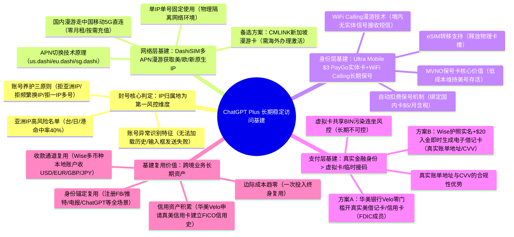
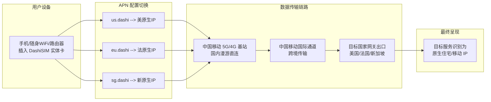
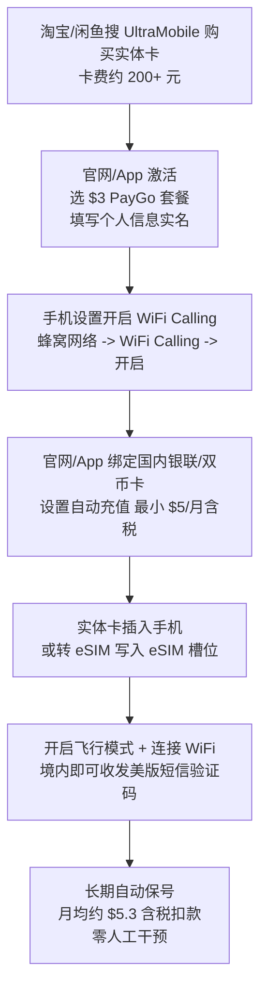
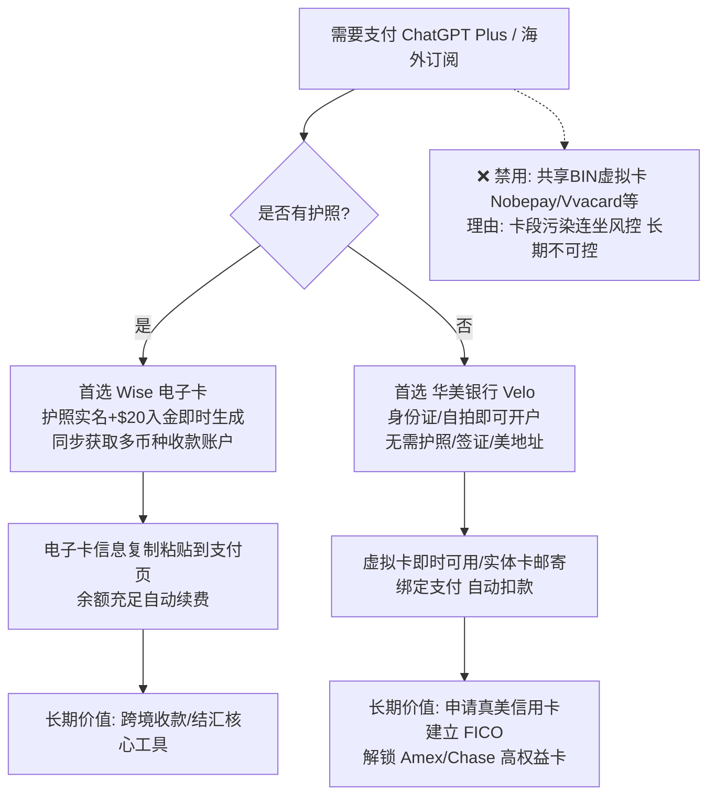
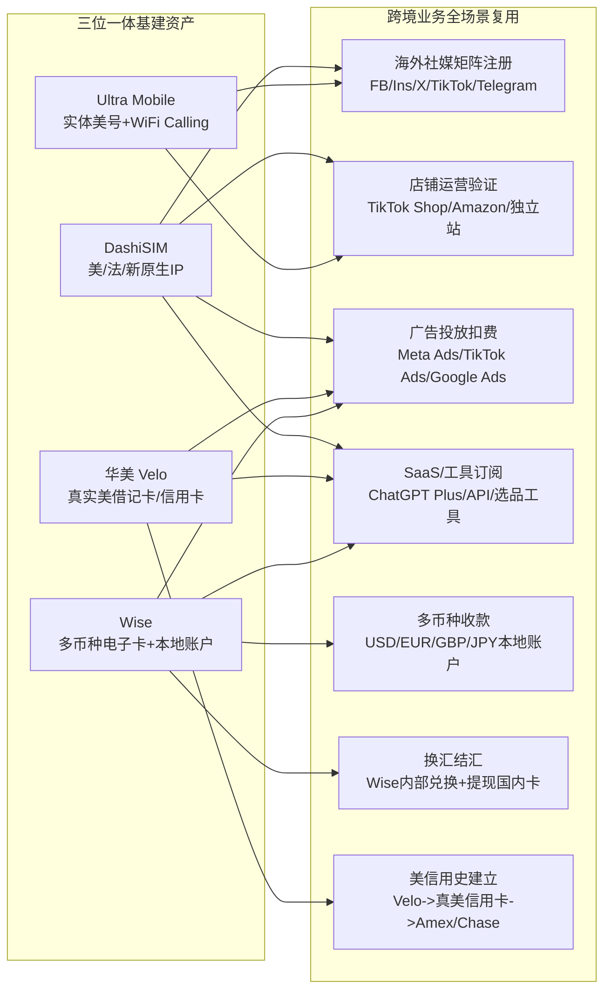

# 第 17 章 ChatGPT Plus 长期稳定访问基建 —— 封号核心判定、DashiSIM多APN漫游、Ultra Mobile保号卡、真实金融身份与基建复用资产
作者：龙哥

## 学习目标

- 理解OpenAI风控的核心判定逻辑与IP归属地风险分级
- 掌握DashiSIM多APN漫游方案获取美/欧/新原生IP的配置实操
- 掌握Ultra Mobile $3 PayGo实体卡结合WiFi Calling实现长期保号的完整流程
- 掌握华美银行Velo零门槛开户与Wise多币种电子卡两大真实金融身份支付方案的落地步骤
- 能够将网络-身份-支付三位一体基建复用至跨境业务全场景，构建长期复利资产

## 17.1 生活类比

想象这套基建是**出海创业的“三件套身份证”**。网络层（DashiSIM）就像一张能随时切换“美国/法国/新加坡”户籍的电子通行证，不用跑腿换证，拨动开关（APN）即可变身当地原住民网络身份，彻底躲过“亚洲户籍高风险”的查户口红线；身份层（Ultra Mobile）则是一张长期有效、月租仅几十块钱的“美国实体手机号身份证”，插在手机里、开个WiFi Calling，躺在国内也能收美国短信验证码，比租接码平台靠谱百倍，还能注册全套海外账号；支付层（华美Velo/Wise）相当于一张真实的“美国银行信用卡”加“全球多币种收款账户”，不是那种随时会被封的虚拟黑卡，而是受FDIC保险保护、能积累美国信用记录、能收全球客户款项的真金融身份。这三样东西组合在一起，解决ChatGPT Plus订阅只是“顺带手”的事，真正价值是搭建起了你**跨境业务的永久基础设施**，一次投入，终身复用，边际成本趋零。

## 17.2 概念地图



## 17.3 封号核心判定：IP归属地为第一风控维度

### 17.3.1 为什么需要这个概念？

OpenAI 自 2023 年 3 月 31 日起发动大规模封号行动，其核心特征是**基于 IP 归属地的地域画像**，而非账号注册时间、Plus 会员状态或行为模式为主导因素。素材实测指出：“从3月31日开始OpenAI大规模封号，而且主要集中在亚洲地区，特别是ip地址在台湾、日本、香港三地的，命中率目测40%。新注册的账号、Plus也不好使了。” 这意味着，网络层的 IP 纯净度是账号生死的“第一道门”，必须从源头解决 IP 归属地问题，而非依赖账号层面的申诉补救。

### 17.3.2 核心定义

- **封号核心判定定律**：OpenAI 风控系统以 IP 归属地地域画像为第一维度，亚洲 IP（尤其台/日/港）为重灾区。
- **亚洲 IP 高风险名单**：台湾、日本、香港三地 IP 封号命中率目测约 40%。
- **账号异常识别特征**：
  - **账号被封标志**：登录提示“无法加载历史信息”或“输入框输入内容无法发送”。
  - **网络/IP 限制标志**：提示“not available in your...”等，非账号封禁，切换合规 IP 可恢复。
- **账号养护三原则（网络层生存铁律）**：
  1. **拒绝亚洲 IP**：不使用台湾、日本、香港等高风险地区 IP。
  2. **拒绝频繁换 IP**：近期不要频繁更换 IP，保持 IP 稳定性。
  3. **拒绝一 IP 多号**：同一个 IP 不要登录多个账号，物理隔离网络环境。

### 17.3.3 关键性质

下表总结了封号判定机制的三大核心性质，揭示了为何必须从网络层源头构建合规基建。

| 性质 | 说明 |
|------|------|
| **地域画像优先于账号画像** | IP 地址决定生死，而非账号本身的信誉积累。Plus 会员、老号在亚洲 IP 下同等概率被封。 |
| **预防大于补救** | 申诉邮件发送至 `support@openai.com` 成功率未知，基建合规性是唯一确定性路径。 |
| **三大生存铁律** | 拒亚洲 IP、拒频繁换 IP、拒一 IP 多号，构成网络层面的基础生存法则。 |

### 17.3.4 方法演进图：封号判定与诊断流程

```mermaid
flowchart TD
    A[用户尝试登录 ChatGPT] --> B{观察报错信息}
    B -->|提示 "not available in your country"| C[网络/IP层限制<br/>非账号封禁]
    B -->|提示 "无法加载历史信息"<br/>或 "输入框无法发送"| D[账号层面实质性封禁]
    C --> E[立即切换至非亚洲原生IP<br/>如 DashiSIM us.dashi]
    E --> F[恢复正常访问]
    D --> G[账号已死 需重新注册<br/>并部署合规三位一体基建]
    G --> H[网络层: 拒亚洲IP/拒频繁换IP/拒一IP多号]
    G --> I[身份层: Ultra Mobile实体号+WiFi Calling]
    G --> J[支付层: 华美Velo/Wise真实金融身份]
```

### 17.3.5 典型例子

- **案例 1**：2023 年 3 月 31 日后，大量使用日本节点机场 VPN 的用户，账号批量提示“无法加载历史信息”被封；同期使用美国原生住宅 IP 的账号毫发无损。
- **案例 2**：同一账号切换至非亚洲原生 IP（如 DashiSIM 美 IP）后恢复正常访问，再切回香港节点即再次受限，验证“IP 决定生死”判定逻辑。

### 17.3.6 边界条件

- 仅针对 OpenAI/ChatGPT 等特定高风控服务，不代表所有海外服务同等标准。
- 企业级专线/原生住宅 IP 成本高昂，个人/小团队需权衡成本收益。
- 平台风控策略可能迭代，需持续关注 IP 信誉维度变化。

> **原文摘录**  
> “从3月31日开始OpenAI大规模封号，而且主要集中在亚洲地区，特别是ip地址在台湾、日本、香港三地的，命中率目测40%。新注册的账号、Plus也不好使了。”  
> “如果你登陆的时候出现‘提示无法加载历史信息’或‘输入框输入内容无法发送’，账号可能被封。其他情况报错，比如‘not available in your……’等，则不一定是账户的问题。”  
> “第一，不要使用亚洲IP。第二，近期不要频繁更换IP。第三，同一个IP不要登录多个账号。”  
> —— 《跨境AI访问基建实操指南》

## 17.4 网络层基建：DashiSIM多APN漫游获取美/欧/新原生IP

### 17.4.1 为什么需要这个概念？

必须规避亚洲 IP 高风险区，但自建节点/机场 IP 极易被识别为代理/机房 IP，共享度高、IP 质量不可控、频繁换 IP 触发风控。需要一种**零月租、按需充值、长期可用、速度快、原生住宅/移动 IP**的方案。

### 17.4.2 核心定义

- **APN 切换技术**：通过修改手机接入点名称 (APN) 实现同一张物理 SIM 卡切换不同国家网关出口，从而低成本获取多地原生 IP。
- **DashiSIM 方案**：一张实体卡支持三套 APN 配置：
  - `us.dashi` → 美国原生 IP
  - `eu.dashi` → 欧洲原生 IP（实测为法国 IP）
  - `sg.dashi` → 新加坡原生 IP
- **原生 IP 获取原理**：设备在国内漫游直连中国移动 5G/4G 网络，数据经中国移动国际通道出海，出口为对应国家原生住宅/移动 IP。

### 17.4.3 关键性质

下表对比了 DashiSIM 方案与传统机场/VPN 在核心指标上的本质差异，说明为何 APN 漫游卡是网络层的最优解。

| 维度 | 机场/VPN/自建 VPS | DashiSIM APN 漫游卡 |
|------|-------------------|---------------------|
| **IP 性质** | 机房/代理 IP，高共享，极易被标记 | 原生住宅/移动 IP，独享出口，高信誉 |
| **IP 稳定性** | 频繁换 IP、IP 池污染严重 | 单卡单 IP 固定，物理隔离，拒绝频繁换 IP |
| **合规性** | 灰色地带，协议特征明显 | 正规运营商漫游，流量特征纯净 |
| **维护成本** | 高（折腾节点、换 IP、排查封锁） | 低（插卡设 APN，零运维） |
| **长期成本** | 持续订阅/服务器费用 | 零月租，按需充流量，边际成本趋零 |

### 17.4.4 方法演进图：DashiSIM APN 切换数据流向



### 17.4.5 典型例子

- **场景 A**：手机设置 APN 为 `us.dashi`，获取美国原生 IP，配合 ChatGPT Plus 长期稳定访问、美区广告投放后台操作。
- **场景 B**：切换 APN 为 `eu.dashi`，获取法国原生 IP，适配 TikTok Shop 欧区、欧洲电商平台运营场景。
- **场景 C**：切换 APN 为 `sg.dashi`，获取新加坡原生 IP，作为低延迟备选方案。

### 17.4.6 备选方案：CMLINK 新加坡漫游卡

- **优势**：成本最低、IP 一定是新加坡原生 IP、性价比最高。
- **门槛**：需新加坡当地人帮忙办理激活后邮寄，获取难度较高。
- **适用**：长驻新加坡 IP 需求、有海外人脉协助的用户。

### 17.4.7 边界条件

- 需支持 APN 设置的设备（手机/随身 WiFi/Cat6/路由器），纯软件客户端无法使用。
- 漫游依赖中国移动国际通道，极端网络管制环境下可能受限。
- 欧洲 IP 实测为法国 IP，非德国/荷兰等热门节点，部分需特定国家 IP 场景需验证。

> **原文摘录**  
> “可提供三个国家和地区的IP地址：美国、欧洲、新加坡（通过设置不同的APN来实现IP地址切换，目前欧洲IP实测出来是法国IP）”  
> “在中国漫游直接是中国移动的5G信号，速度非常快”  
> “可长期持有，不需要充值保号/保卡，零月租。随时可以通过充值来再次激活使用。”  
> “选择不同的APN，可以切换不一样的国家的原生IP”  
> “最优选择是CMLINK 新加坡... 需要你在新加坡有朋友帮你办理，然后激活之后邮寄给你，资费是最有性价比的，同时IP一定是新加坡原生IP”  
> —— 《跨境AI访问基建实操指南》

## 17.5 身份层基建：Ultra Mobile $3 PayGo实体卡+WiFi Calling长期保号

### 17.5.1 为什么需要这个概念？

ChatGPT 账号注册/登录/找回均需美国手机号接码。虚拟号/接码平台极易失效被风控，无法满足长期持有、实名合规、境内接收验证码的需求。传统实体卡漫游费高昂、保号麻烦、不支持 WiFi Calling 无法在境内接码。

### 17.5.2 核心定义

- **MVNO 保号卡**：移动虚拟网络运营商提供的低成本套餐，核心价值是极低维持成本保持美国实体号存活。
- **Ultra Mobile $3 PayGo**：月租 $3，含 100 分钟通话 + 100 条短信 + 100 MB 美国国内流量，基于 T-Mobile 网络。
- **WiFi Calling 漫游**：无实体基站信号下（如身处中国），通过 WiFi 网络接入运营商核心网，实现境内收发短信/接打电话。

### 17.5.3 关键性质

下表梳理了 Ultra Mobile $3 PayGo 方案在号码性质、保号机制、设备兼容性等维度的核心优势，支撑其作为身份层标准方案的定位。

| 维度 | 接码平台 | Google Voice | 其他 MVNO (Tello/Mint) | Ultra Mobile $3 PayGo |
|------|----------|--------------|------------------------|------------------------|
| **号码性质** | 虚拟号段，极易被风控拦截 | 免费但回收极快，需持有实体号激活 | 实体号但月租高/不支持 WiFi Calling/漫游贵 | **实体号、低月租、官方支持 WiFi Calling 漫游** |
| **长期持有** | 不可能 | 极难 | 成本高 | **极低成本长期自动保号** |
| **境内接码** | 可用但不稳定 | 需科学上网+实体号激活 | 多不支持漫游 WiFi Calling | **原生支持境内 WiFi 接码** |
| **多场景复用** | 否 | 有限 | 部分支持 | **全场景通用（注册/验证/2FA）** |

### 17.5.4 方法演进图：Ultra Mobile 激活与长期保号全流程



### 17.5.5 典型例子

- **全场景复用**：同一 Ultra Mobile 号码，同时用于注册 ChatGPT、Facebook、Twitter (X)、Telegram、TikTok Shop 美区店铺验证、华美银行/Wise 开户验证。
- **成本账单**：首年约 200 元（卡费）+ $60（月租含税）≈ 400+ 元；次年起仅约 $60/年，边际成本极低。

### 17.5.6 边界条件

- 首年成本约 400+ 元，现金流紧张者需评估。
- 需支持 WiFi Calling 的手机（绝大多数 iPhone/安卓旗舰支持，部分运营商定制机/低端机不支持）。
- 仅适用于接收验证码/保号场景，不适合大流量上网（仅 100MB 漫游流量）。

> **原文摘录**  
> “淘宝或者咸鱼去搜索 UltraMobile 这个关键词”  
> “月租 $3，包含 100 分钟通话 + 100 条短信 + 100 MB 美国国内流量”  
> “支持漫游 WiFi Calling，支持漫游 WiFi Calling over Cellular Data”  
> “可在网站或者 app 上绑定银行卡后每月自动充值，最小金额为 $5。有税费，所以每次银行卡扣款金额会超过 $5，支持中国大陆卡”  
> —— 《跨境AI访问基建实操指南》

## 17.6 支付层基建：真实金融身份 > 虚拟卡/临时接码

### 17.6.1 为什么需要这个概念？

ChatGPT Plus 订阅需绑定国际信用卡/借记卡，国内双币卡成功率极低且极易触发风控。共享 BIN 虚拟卡（Nobepay、Vvacard 等）必然因他人违规导致卡段污染连坐封禁。素材明确指出：“我们的专业人士一般不用这种虚拟卡，因为容易被别人玩坏，影响自己。” 需要真实美国银行账户、真实账单地址、可长期自动扣款的合规支付方案。

### 17.6.2 核心定义：两大推荐方案

#### 方案 A：华美银行 Velo 零门槛开真实美借记卡/信用卡（主推）

- **零门槛开户**：无需护照、无需美国签证、无需美国电话号码、无需美国地址、无需预存款。
- **真实银行账户**：华美银行为美国纳斯达克上市公司，FDIC 成员，存款享受保险保护，资金安全。
- **双卡模式**：审核通过即时生成虚拟卡（可立即付 ChatGPT Plus），实体借记卡后续邮寄到手。
- **信用资产延伸**：长期使用可申请华美真实美国信用卡，建立美国信用史（FICO），解锁 Amex/Chase 等主流高权益美卡。

#### 方案 B：Wise 多币种电子卡（备选/并行）

- **护照实名 + $20 入金**：邀请链接注册，护照实名认证，入金约 $20 激活账户。
- **即时生成电子卡**：含真实账单地址、完整卡号、卡主姓名、CVV、有效期，复制粘贴即可填入 ChatGPT 支付页。
- **多币种收款账户体系**：一次 KYC 获取美、英、欧、日等多国本地银行账户（账号/路由码/IBAN/SWIFT），解决跨境收款结汇核心痛点。
- **余额充足即可持续续费**：无额外手续费扣款，长期自动续订无忧。

### 17.6.3 关键性质对比

下表从账户性质、账单地址、开户门槛、卡片形式、长期价值、风控通过率六个维度，系统对比了三类支付方案的本质差异。

| 维度 | 华美银行 Velo | Wise 电子卡 | 共享 BIN 虚拟卡（反面教材） |
|------|---------------|-------------|----------------------------|
| **账户性质** | 真实美银行账户（FDIC） | 真实电子货币机构账户（受监管） | 共享预付卡卡段，无真实账户 |
| **账单地址** | 真实美国地址 | 真实账单地址 | 虚构/共享地址，极易被风控识别 |
| **开户门槛** | 极低（仅身份证/自拍） | 中等（需护照） | 低（仅需支付宝/微信充值） |
| **卡片形式** | 虚拟卡即时 + 实体卡邮寄 | 纯电子卡（无实体卡） | 纯虚拟卡 |
| **长期价值** | 可申请真美信用卡建立 FICO | 多币种收款/兑换/结汇核心工具 | 无长期价值，随时连坐失效 |
| **风控通过率** | 极高（真实身份） | 极高（真实身份+账单地址） | 低且不可控（卡段污染） |

### 17.6.4 方法演进图：支付方案选型决策树



### 17.6.5 典型例子

- **Velo 实操**：Google Play 下载 “velo” App → 按引导提交身份证/自拍 → 审核通过 → 获虚拟卡信息 → 填入 ChatGPT Plus 付款页 → 扣款成功 → 实体卡后续邮寄收件激活。
- **Wise 实操**：邀请链接注册 → 护照实名 → 入金 $20 激活 → 点击 “获取数字卡” → 复制卡号/CVV/账单地址 → 填入 ChatGPT 支付页 → 订阅成功 → 后续自动扣款。

### 17.6.6 虚拟卡污染风险警示

素材列举可用卡头：`556766`、`556735`、`556305`、`531847`、`558068`，**但作者明确不推荐长期使用**。共享卡段本质是将支付信誉外包给不可控群体，长期必然因卡段污染导致支付失败或账号关联封禁。

### 17.6.7 边界条件

- Velo 需通过 Google Play 下载官方 App，国内应用商店可能无法获取。
- Wise 需护照实名认证，无护照用户无法使用。
- 两者均需少量启动资金（Velo 无预存款要求，Wise 需 $20 入金激活）。

> **原文摘录**  
> “办理零门槛：1、无需护照；2、无需美国签证；3、无需美国电话号码；4、无需美国地址；5、无需预存款；”  
> “电子卡的所有信息，账单地址，卡号，卡主姓名还有CVV 有效期都是真实有效的，按上面复制粘贴即可使用，只要你的Wise里有钱，就可以一直付账。”  
> “我们的专业人士一般不用这种虚拟卡，因为容易被别人玩坏，影响自己。”  
> “华美是美国纳斯达克的上市公司... 也是FDIC的成员，所以有存款保险制度”  
> —— 《跨境AI访问基建实操指南》

## 17.7 基建复用价值：解决ChatGPT订阅仅是起点，更是跨境业务长期资产

### 17.7.1 为什么需要这个概念？

单纯为 ChatGPT Plus 订阅构建三位一体基建，性价比似乎偏高。必须将基建成本摊薄至更多跨境业务场景，实现边际成本趋零、长期复利。**真实美银行账户 + 实体美国手机号**是跨境创业的核心基础设施，而非一次性消耗品。

### 17.7.2 核心定义

- **基建复用资产**：真实美国银行账户（借记卡/信用卡）+ 实体美国手机号（MVNO）的组合。
- **跨境业务通用性**：解决海外账号注册（FB/推特/电报）、跨境收款（Wise 多币种账户）、美区柜面户开设、美信用史建立等全场景需求。
- **边际成本趋零**：一次性投入构建，终身复用于所有海外业务场景。

### 17.7.3 关键性质与复用路径

下表梳理了基建组件在四大复用维度上的具体应用场景与长期价值，展示了“一次投入、终身复用”的复利逻辑。

| 复用维度 | 核心组件 | 典型应用场景 | 长期价值 |
|----------|----------|--------------|----------|
| **身份锚定复用** | Ultra Mobile 实体美号 | 注册 Facebook、Twitter、Instagram、TikTok Shop、Telegram、ChatGPT、WhatsApp 等所有需美号验证服务 | 一号通用，彻底摆脱接码平台不可控风险 |
| **收款通道复用** | Wise 多币种本地账户 | TikTok Shop/亚马逊/独立站收 USD；欧洲站收 EUR/GBP；日本站收 JPY；服务贸易收外汇 | 一次 KYC，终身享受本地化收款、低成本换汇结汇 |
| **支付通道复用** | 华美 Velo 实体/虚拟卡 / Wise 电子卡 | 广告投放扣费、SaaS 订阅、域名服务器付费、ChatGPT Plus/API 扣费 | 真实账单地址通过率极高，告别虚拟卡频繁换卡 |
| **信用资产积累** | 华美 Velo 真实银行账户 | 申请华美真美信用卡 → 建立 FICO 信用史 → 申请 Amex/Chase/Capital One 主流美卡 → 享高返现/里程/贵宾权益 | 从“无信用记录”到“美卡高玩”，金融身份跃迁 |

### 17.7.4 方法演进图：基建资产跨境业务流向图



### 17.7.5 典型例子

- **跨境电商全链路**：Ultra Mobile 号注册 TikTok Shop 美区店铺 → Wise 美元账户收美金 → Velo 卡支付广告费/选品工具订阅/ChatGPT Plus → 利润留存 Wise 或结汇国内。
- **信用卡进阶路径**：Velo 实体卡激活使用 3-6 个月 → 申请华美信用卡 → 获批后积累信用记录 → 申请 Amex Blue Business Plus / Chase Ink 等商业信用卡 → 解锁高额度广告账单支付 + 高返现权益。

### 17.7.6 边界条件

- 前期需投入约 1000-2000 元构建完整基建（网络卡+手机卡+入金激活），现金流紧张者需评估 ROI。
- 仅从事单一国内业务且无出海规划者，基建复用价值无法释放，建议按需最小化投入。
- 需具备基本跨境合规意识，避免因违规操作导致核心基建账号被封（如 Wise 因合规审查冻结、Velo 因异常交易关户）。

> **原文摘录**  
> “上面一些资源成本，有一定成本，但是以后均可以帮您解决很多无价的事情... UltraMobile... 注册Facebook，推特，电报均可以使用... Wise真正最有价值的不是他们的卡可以付款，而是可以收多个国家的外汇。”  
> “多个国家的银行账户一次性开齐”  
> —— 《跨境AI访问基建实操指南》

## 17.8 多源对照

本章核心方法论（网络-身份-支付三位一体基建）主要来源于单一核心素材 `docs/202305/TSZBdBfynoBINux2htWcefrtnHc.md`（跨境 AI 访问基建实操指南，素材 ID：P001），暂无其他素材对同一主题提供不同视角支撑。

**行业共识（通识）：**
- OpenAI 风控以 IP 地域画像为首要指标，亚洲 IP（台/日/港）为重灾区。
- 原生住宅/移动 IP 优于机房/代理 IP，APN 漫游卡是低成本获取原生 IP 的主流方案。
- 实体手机号（MVNO）+ WiFi Calling 是长期保号接码的标准解法。
- 真实银行账户（借记卡/信用卡）优于共享 BIN 虚拟卡，合规性与长期可用性碾压低成本方案。
- 基建复用是跨境业务降本增效的核心逻辑。

**分歧/待验证点（需补充素材）：**
- DashiSIM 与 CMLINK 新加坡卡在极端网管环境下的稳定性对比。
- Ultra Mobile 与 Tello、Mint Mobile 等其他 MVNO 保号卡的长期存活率对比。
- 华美 Velo 与渣打/汇丰等传统美区开户渠道在信用史建立效率上的差异。
- Wise 电子卡在 ChatGPT Plus 扣款成功率上的长期追踪数据（样本量扩大后的统计显著性）。

**待引入素材清单（后续扩展预留）：**
- `P002`：出海拿破仑《2024最新ChatGPT账号防封与API调用实战》
- `P003`：跨境电商老王《TikTok Shop美区店铺从0到1注册避坑全记录》
- `P004`：银行卡测评博主《华美Velo vs 渣打香港 vs 美国实体卡开户实测对比》
- `P005`：跨境收款实战派《Wise/Payoneer/万里汇/空中云汇 四大收款渠道深度横评》

## 17.9 设计中的取舍

### 为什么选择“APN 漫游卡”而非“机场/VPN/自建 VPS”？

机场、VPN 或自建 VPS 虽然看似“即买即用”便利，但其核心 IP 均为机房/代理 IP，共享度极高、特征明显，极易被 OpenAI 等高风控系统标记。更关键的是，这类方案天然伴随“频繁换 IP”以规避封锁，这直接违背了“拒绝频繁换 IP”的生存铁律。DashiSIM 虽然需要等待实体卡邮寄、且要求设备支持 APN 设置（牺牲了部分即时便利性），但换来的是**原生住宅/移动 IP 的高信誉**、**单卡单 IP 物理隔离的绝对稳定性**、**正规运营商漫游的纯净流量特征**，以及**零月租、按需充值、零运维的长期极低成本**。为了确定性、合规性与长期稳定性，必须做出这一取舍。

### 为什么选择“Ultra Mobile $3 PayGo”而非“接码平台/Google Voice/其他 MVNO”？

接码平台的虚拟号段早已被风控库标记，一次性使用后即失效，完全无法支撑长期账号运营；Google Voice 免费但回收机制极其激进，且激活往往仍需一张实体美号，属于“借鸡生蛋”且不稳定；Tello、Mint Mobile 等其他 MVNO 虽也提供实体号，但月租普遍更高、且多数不支持 WiFi Calling 漫游或漫游资费极其昂贵，导致在境内无法低成本接收验证码。Ultra Mobile $3 PayGo 以**实体号合规性**、**官方原生支持 WiFi Calling 漫游**、**极低的月租成本**（$3 基础套餐+税费约 $5.3/月）、**全场景复用能力**为核心优势，虽需首年约 400 元启动成本，但边际成本随时间趋近零，是唯一满足“长期、合规、低成本、境内可用”四重约束的最优解。

### 为什么选择“真实银行账户（Velo/Wise）”而非“虚拟卡/双币卡”？

国内双币信用卡受限于 MCC 码风控与外汇额度，ChatGPT 等海外订阅扣款成功率极低；共享 BIN 虚拟卡（Nobepay、Vvacard 等）本质上将支付信誉外包给不可控群体，卡段一旦被他人违规污染，全池用户连坐封禁，素材作者明确指出“专业人士一般不用这种虚拟卡，因为容易被别人玩坏，影响自己”。华美 Velo 提供**零门槛开立的真实美国银行账户（FDIC 存款保险）**，Wise 提供**受监管的真实电子货币账户**，二者均具备**真实账单地址、完整 CVV、独立卡号**，扣款成功率极高且无连坐风险。更关键的是，真实银行账户能延伸为**美国信用史建立（FICO）**、**多币种本地收款账户**等长期复利资产，而虚拟卡/双币卡零资产积累价值。为支付确定性、账号安全性、长期金融资产积累，坚决放弃虚拟卡/双币卡捷径，构建真实金融身份基建。

## 17.10 动手练习

### 练习 1：风控场景诊断与归因分析

**场景**：用户使用日本节点机场 VPN 登录 ChatGPT Plus 账号，提示 “not available in your country”，随后切换至香港节点登录，提示 “无法加载历史信息”。

**问题**：
1. 这两个报错分别代表网络层限制还是账号层面封禁？依据是什么？
2. 根据“封号核心判定”定律，为何切换香港节点反而导致账号被封？
3. 若该用户改用 DashiSIM 设置 APN 为 `us.dashi`，是否能恢复访问？原理是什么？

**参考答案要点**：
- 报错 1 属网络/IP 限制（IP 不在服务国家），报错 2 属账号封禁（历史加载失败/输入框发送失败）。
- 香港属亚洲高风险名单，命中率 40%，IP 归属地触发地域画像风控导致账号实质性封禁。
- 能恢复。`us.dashi` 提供美国原生移动 IP，符合“非亚洲 IP + 原生 IP + 单 IP 单号”三大铁律，网络层合规即可恢复访问（前提账号未被永久封禁）。

### 练习 2：三位一体基建方案选型与成本测算

**假设**：你是一名准备长期从事 TikTok Shop 美区跨境电商的创业者，需同时解决：店铺注册美号验证、广告投放扣费、美金收款结汇、ChatGPT Plus 辅助运营四大需求。

**问题**：
1. **网络层**：对比 DashiSIM 美 IP 方案与自建 VPS/购买机场节点，从 IP 纯净度、风控通过率、长期维护成本三维度分析优劣。
2. **身份层**：Ultra Mobile $3 PayGo 卡首年总成本约几元人民币？相比接码平台单次几元，长期持有 10 个海外账号注册需求下的边际成本如何计算？
3. **支付层**：华美 Velo 实体卡邮寄时效与 Wise 电子卡即时开通的差异，对“广告投放扣费”这一高频刚需场景的影响？建议主用哪张卡？为何？

**参考答案要点**：
- 网络层：DashiSIM 原生移动 IP 纯净度极高、风控通过率接近原住民水平、零月租零运维；机场/VPS IP 污染重、需持续换 IP 触发风控、运维成本高。
- 身份层：首年总成本计算公式为 `首年成本 = 卡费 + (月租美元 × 12 × 汇率 × 含税系数)`。代入数值：`200 + (3 × 12 × 7.2 × 1.1) ≈ 200 + 285 ≈ 485 元`（汇率按 7.2、含税系数按 1.1 估算）。10 个账号注册仅需 1 个号码复用，边际成本趋零；接码平台单次几元但不可复用、极易失效，10 个号长期持有成本远超且风险不可控。
- 支付层：Velo 实体卡邮寄 2-3 周，虚拟卡即时可用；Wise 电子卡全流程即时。**建议主用 Velo 虚拟卡/实体卡（广告扣费大额高频需真实账单地址通过率高），Wise 电子卡作备用/收款卡**。Velo 真实银行账户性质对广告平台风控友好度最高。

### 练习 3：基建资产复用路径设计

**前提**：已完成 DashiSIM（美 IP）、Ultra Mobile（美号）、华美 Velo（美借记卡）、Wise（多币种账户）四件套部署。

**问题**：
1. 设计一套“注册海外社媒矩阵账号（FB/Ins/Twitter/TikTok/Telegram）→ 养号 → 接入广告投放 → 收款结汇”的标准化 SOP，标注每一步复用的基建组件。
2. 华美 Velo 实体卡激活后，如何规划申请美国信用卡（如 Amex/Chase）建立 FICO 信用史的路径？关键节点有哪些？
3. Wise 多币种账户收到美金后，如何通过“换汇→提现国内银行卡”实现结汇？汇率损耗与时效如何估算？对比传统离岸账户/地下钱庄优劣。

**参考答案要点**：
1. **SOP 示例**：
   - 注册账号：Ultra Mobile 号接码（身份层） + DashiSIM `us.dashi` IP（网络层）
   - 养号/运营：DashiSIM 固定 IP 登录（网络层）
   - 广告投放：Velo 虚拟卡/实体卡绑定支付（支付层）
   - 收款结汇：Wise 美元账户收款 → Wise 内部换汇 USD→CNY → 提现国内银联卡（支付层）
2. **FICO 建立路径**：
   - Velo 实体卡激活使用 3 个月+（关键节点 1）
   - 申请华美 Secured 信用卡或无担保信用卡（关键节点 2）
   - 按时全额还款 6 个月+，建立初步 FICO（关键节点 3）
   - 申请 Amex Blue Business Plus / Chase Ink Business（关键节点 4）
   - 获批高额度主流美卡，享权益（关键节点 5）
3. **Wise 结汇**：
   - 路径：Wise 美元账户 → 换汇（实时中间价+约 0.5-0.7% 手续费） → 提现国内银联储蓄卡（T+0 到 T+1 到账）
   - 汇率损耗估算公式：`到账金额 = 入账美元 × (中间价 - 手续费率)`。例如 $1000 入账，中间价 7.20，手续费 0.6%，到账约 `1000 × 7.20 × (1 - 0.006) = 7156.8 元`。
   - 优势：汇率透明（中间价+小额费率）、合规合法、资金安全、无额度限制、自助操作。
   - 劣势：单笔/单日有限额（可提额）、需实名 KYC。
   - 对比：离岸账户开户难/维护贵/入账慢；地下钱庄汇率黑箱/资金风险极高/违法。

## 17.11 本章小结

这一章中我们系统构建了 **ChatGPT Plus 长期稳定访问的“网络-身份-支付”三位一体合规基建体系**。

首先，我们确立了 **封号核心判定定律**：OpenAI 风控以 IP 归属地地域画像为第一维度，亚洲 IP（台/日/港）命中率约 40%，账号属性非主导因素。由此推导出**账号养护三原则**（拒亚洲 IP、拒频繁换 IP、拒一 IP 多号）及账号异常识别特征（无法加载历史=封号，not available=网络限制）。

其次，我们落地了 **网络层基建——DashiSIM 多 APN 漫游方案**：一张实体卡通过切换 APN（`us.dashi`/`eu.dashi`/`sg.dashi`）获取美/法/新三地原生 IP，国内走中国移动 5G 直连，零月租按需充值，单 IP 单号物理隔离，彻底规避网络层风控。备选 CMLINK 新加坡卡作为极致性价比方案。

接着，我们落地了 **身份层基建——Ultra Mobile $3 PayGo 实体卡 + WiFi Calling**：MVNO 实体卡实名合规，月租 $3 极低，开启 WiFi Calling 实现境内无实体信号接收短信，绑定国内卡自动扣费长期保号，支持 eSIM 转移释放卡槽，一号通注册全场景海外服务。

随后，我们确立了 **支付层基建——真实金融身份碾压虚拟卡/临时接码**：
- **方案 A 华美银行 Velo**：零门槛（五无）远程开真实美银行账户，FDIC 存款保险，虚拟卡即时付款、实体卡邮寄，可延伸申请真美信用卡建立 FICO 信用史。
- **方案 B Wise 多币种电子卡**：护照实名+$20 入金即时生成真实账单地址电子卡，一次 KYC 获取多国本地收款账户，解决跨境收款结汇核心痛点。
- **铁律**：共享 BIN 虚拟卡必然连坐风控，专业人士坚决规避，长期不可控。

最后，我们揭示了 **基建复用价值**：解决 ChatGPT 订阅仅是起点。这套“网络卡+手机号+银行卡”组合，是**跨境业务的永久基础设施**——身份锚定复用（注册全场景海外号）、收款通道复用（Wise 多币种本地账户）、支付通道复用（真实账单地址高通过率）、信用资产积累（Velo 申请美信用卡建立 FICO）。一次投入约 1000-2000 元，终身复用，边际成本趋零。

本章我们一起学习了以下核心概念：

| 概念 | 核心解释 |
|------|----------|
| **封号核心判定：IP归属地为第一风控维度** | OpenAI风控以地域画像为首要指标，亚洲IP（台/日/港）命中率约40%，账号属性非主导因素 |
| **账号养护三原则** | 拒绝亚洲IP、拒绝频繁换IP、拒绝一IP多号，构成网络层生存底线 |
| **DashiSIM多APN漫游方案** | 一张实体卡通过切换APN(us.dashi/eu.dashi/sg.dashi)获取美/法/新原生IP，国内走移动5G，零月租按需充 |
| **Ultra Mobile $3 PayGo保号卡** | MVNO实体卡+WiFi Calling漫游，绑定国内卡自动扣费$5/月，长期接收验证码，支持eSIM |
| **华美银行Velo零门槛开户** | 无需护照/签证/美地址/预存款，远程开真实美借记卡/信用卡，FDIC成员资金安全 |
| **Wise多币种电子卡** | 护照实名+$20入金即时生成含真实账单地址/CVV的电子卡，多币种本地收款账户一次开齐 |
| **虚拟卡污染风险** | 共享BIN卡段必然因他人违规连坐风控，专业人士坚决规避，长期不可控 |
| **基建复用资产** | 真实美银行账户+实体美手机号，可复用于海外账号注册、跨境收款、美信用史建立，边际成本趋零 |

下一章中，我们将学习**抖音棋牌游戏直播**的全链路 SOP：如何利用“打牌即内容”的天然优势、虚拟人设替代真人出镜、残局挑战核心钩子设计、COS 人设场景差异化、居家轻量化创业闭环，打造普通人低门槛、长期稳定的直播变现赛道。

