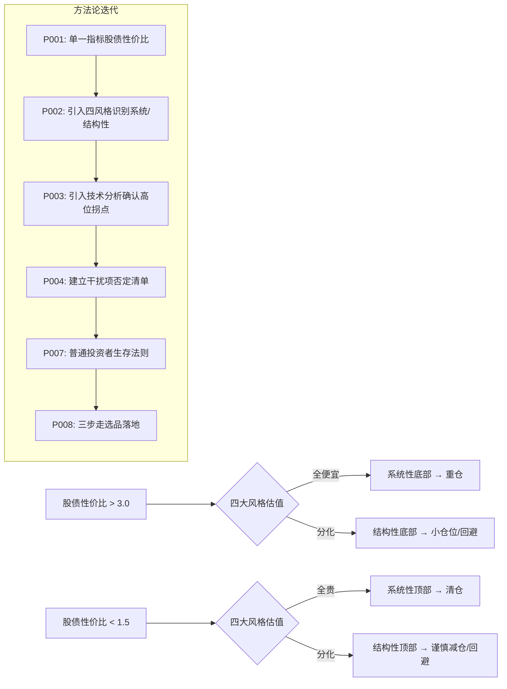
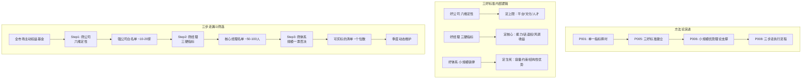

# 第 63 章 投资择时与基金选品体系 —— 用单一核心指标穿越牛熊、用三好标准筛选长期伙伴

## 学习目标

- 理解择时的本质是基于股债性价比的大类资产轮动，而非预测顶底
- 掌握沪深300股债性价比的计算方法、区间界定（1.5-3.0）与实操阈值
- 学会识别系统性行情与结构性行情，理解普通投资者仅参与系统性行情的生存法则
- 掌握技术分析在择时体系中的辅助定位：仅用于高位拐点确认（跌破趋势）
- 建立择时干扰项否定清单：屏蔽突发事件、宏观数据、情绪观察三大噪音
- 掌握“三好选基”筛选体系：好公司（六维定性）、好经理（三硬指标）、好体系（小规模铁律<50亿）
- 理解小规模基金三大结构性优势：换仓灵活、打新超额收益、迷你股交易权
- 建立基金筛选三步走执行流程：筛公司→筛经理→筛体系（一票否决制）
- 内化普通投资者生存法则：年化<25%者仅在系统性底部重仓，其余时间小仓位
- 通过作者十年实盘复盘（三逃顶、两抄底、连续十年正收益）验证体系有效性

## 63.1 生活类比

想象投资择时像“买房决策”一样理性：股债性价比就是“房价租金比”，告诉你当前买房（买股）相对于存银行/买国债（租房/债券）是否划算。>3.0区间如同“租金极高覆盖房贷、房价极低”，铁定要买（重仓），安全边际极高；<1.5区间如同“房价虚高、租金覆盖不了利息”，坚决卖房（清仓），哪怕还能涨一点也不贪。系统性底部是“全城房价都便宜、学区/地段/新房全便宜”，闭眼买哪套都赚；结构性底部是“只有远郊便宜、核心区还贵”，除非你是选房专家（专业选手），否则别碰。技术分析相当于“看成交量/挂牌量拐点”，只有在房价已极高（估值<1.5）时，看成交量萎缩确认顶部再卖。三大干扰项相当于“邻居说要涨/新闻说利好/专家预测”，统统屏蔽，只看核心比价指标。就像买房不看大师预测只看租售比，投资也不猜顶底只看股债性价比。

> **类比贯穿提示**：后文核心概念首次出现时，将以 `[类比：xxx]` 形式回扣本段隐喻，帮助建立直觉锚点。

## 63.2 概念地图

投资择时与选品体系
├── 择时核心模型
│   ├── 股债性价比 —— P001、P008
│   │   ├── 定义：(1/PE_TTM) / 十年国债收益率
│   │   ├── 区间：长期1.5-3.0波动
│   │   ├── 阈值：>3.0买入区、<1.5卖出区
│   │   └── 理论：股票长期风险溢价约为债券2倍
│   ├── 系统性vs结构性行情识别 —— P002、P007
│   │   ├── 系统性底部：四风格全便宜（2012底、2019初）
│   │   ├── 系统性顶部：四风格全贵（2015顶、2018顶）
│   │   ├── 结构性行情：风格分化（2016、2021、2022）
│   │   └── 普通人铁律：仅参与系统性行情
│   ├── 技术分析辅助定位论 —— P003
│   │   ├── 仅用于高位拐点确认
│   │   ├── 条件：股债性价比接近1.5时
│   │   ├── 信号：价格跌破长周期均线/趋势支撑
│   │   └── 禁用：常态区频繁高抛低吸
│   └── 三大择时干扰项清单 —— P004
│       ├── 突发事件/地缘/外盘（事后调整性价比低）
│       ├── 财政货币/宏观数据（已定价于国债收益率）
│       └── 投资者情绪观察（样本小、不可量化）
├── 选品核心体系
│   ├── 三好选基标准 —— P005、P008
│   │   ├── 好公司（六维）：规模、高管、梯队、口碑、价值观、薪酬
│   │   ├── 好经理（三硬）：长期业绩、投决委、金牛奖
│   │   └── 好体系（铁律）：只买<50亿，最优<20亿
│   ├── 小规模基金超额收益源泉论 —— P006
│   │   ├── 换仓摩擦成本低
│   │   ├── 打新超额收益占比高
│   │   └── 迷你股交易权
│   └── 基金筛选三步走法 —— P008
│       ├── Step1：筛公司（定性白名单）
│       ├── Step2：筛经理（量化核心名单）
│       └── Step3：筛体系（规模一票否决）
└── 生存法则与实证验证
    ├── 普通投资者生存法则 —— P007
    │   ├── 承认能力圈：年化<25%仅做系统性贝塔
    │   ├── 标的：宽基/三好筛选的小规模主动基金
    │   └── 心法：耐寂寞、守底线、低决策频次
    └── 实战复盘证据 —— P001、P007
        ├── 作者十年战绩：三逃顶、两抄底、100%准确率、连续十年正收益
        ├── 股债性价比历史回测有效性
        ├── 关键节点系统性/结构性特征验证
        └── 头部分层与硬指标有效性观察

---

## 63.3 股债性价比 —— 用一把尺子量尽牛熊

[类比：股债性价比 = 房价租金比] [P001、P008]

### 为什么需要这个概念？

你是否曾陷入“猜顶底”的预测陷阱？或者被宏观新闻、大V情绪干扰，导致频繁交易、追涨杀跌？传统的单纯 PE 估值忽略了无风险利率的变化，无法横向比较股票与债券的相对吸引力。我们需要一个理论支撑坚实、可量化、长周期有效的核心指标，来指导大类资产配置，这就是**股债性价比**。

### 核心定义与推导

> "关键因子只有一项：股债性价比。沪深 300 股债性价比= （1/沪深 300 PE）/十年国债收益率。该项指标是有理论支撑的——股票相比债券有风险溢价。美国过去 200 年的经验，股票的年化收益，就是长期债券的 2 倍左右。"
> 
> ——《20230516_045.md》 [P001]

**股债性价比定义**（来源：《20230516_045.md》 [P001]）

$$
\text{股债性价比} = \frac{1 / \text{沪深300 PE\_TTM}}{\text{十年国债收益率}} = \frac{\text{股票收益率 (E/P)}}{\text{无风险收益率}}
$$

**公式解读**：该公式展示了三个核心逻辑：(1) **分子是股票的收益率**，即市盈率的倒数，代表持有股票每年能获得的盈利收益率；(2) **分母是无风险收益率**，用十年期国债收益率代表，因其期限匹配权益资产久期，且流通性最好，能充分反映市场对长期通胀与增长的定价；(3) **两者之比反映了股票相对于债券的风险溢价是否合理**。当比率高时（>3.0），股票便宜（性价比高），风险溢价充足；比率低时（<1.5），股票昂贵（性价比低），风险溢价不足甚至为负。选用十年国债而非一年期存款利率，是因为权益资产是长期资产，其定价锚点应为长期无风险利率，短期利率波动大、受行政调控强，不适合做估值分母。

### 关键性质

- **长期均值回归** [P001]：历史数据表明，沪深300股债性价比长期在 **1.5 - 3.0** 区间波动。这符合“股票长期收益约为债券2倍”的经验规律（中位数约2.0）。
- **区间界定明确** [P001]：
  - **> 3.0**：极度低估区（**买入/重仓区**），安全边际极高
  - **1.5 - 3.0**：常态波动区，维持正常配置
  - **< 1.5**：极度高估区（**卖出/清仓区**），风险极大
- **非预测工具** [P001]：它不预测具体拐点数值（顶部可能是1.5、1.6或1.7），只识别“极端区间”。

### 典型例子

| 时间节点 | 股债性价比 | 行情性质 | 操作建议 |
|----------|------------|----------|----------|
| 2012年底、2019年初 | > 3.0 | 系统性底部 | 买什么都赚，重仓宽基/优质主动 [P001、P002] |
| 2015年6月、2018年2月 | < 1.5 | 系统性顶部 | 坚决清仓，保命第一 [P001、P002] |
| 2022年4月/10月 | > 3.0 | 结构性底部 | 仅小仓位或专业选手参与（大盘成长贵） [P002] |

> "过去十几年，如果在该指标 3.0 附近买入股票/基金，在 1.5 附近卖出，你就是大赢家。"
> 
> ——《20230516_045.md》 [P001]

### 边界条件

- 仅适用于**大类资产配置**（股 vs 债）与**系统性行情判断**，不指导个股/单只基金选择 [P001]
- 顶部具体数值不可预知，需结合技术分析（跌破长周期均线）确认拐点 [P001、P003]
- 结构性行情（风格分化）下指标失真，水平有限者（年化<25%）应规避，仅参与系统性行情 [P002、P007]

### 方法演进图：从单一指标到完整择时决策链 [P001、P002、P003、P004、P007、P008]



---

## 63.4 系统性 vs 结构性行情识别 —— 判断能不能“闭眼买”

[类比：系统性底部 = 全城房价都便宜；结构性底部 = 只有远郊便宜] [P002、P007]

### 为什么需要这个概念？

当股债性价比到达买入区（>3.0）时，市场可能是“全便宜”（系统性底部），也可能是“结构性分化”（只有部分便宜）。这直接决定你能否重仓。普通投资者在结构性行情中极易选错风格跑输基准，甚至亏损。我们需要一个简单可执行的判断框架。 [P002、P007]

### 核心定义

> "2012 年底是一次典型的系统性底部——所有股票都很便宜。不管买什么类型的基金，大概率都能赚大钱。2015 年 6 月，是一个典型的系统性顶部——所有股票都很贵...指数跌破趋势的话，清仓是最好的办法。2016 年 3 月份，则属于一个结构性底部——大盘股估值已经非常便宜，但小盘股估值仍然偏贵。"
> 
> ——《20230516_045.md》 [P002]

**系统性/结构性行情定义**（来源：《20230516_045.md》 [P002]）

- **系统性底部**：大盘成长、大盘价值、小盘成长、小盘价值**四大风格象限估值同时处于历史低位**（全便宜）
- **系统性顶部**：四大风格象限估值**同时处于历史高位**（全贵）
- **结构性底部/顶部**：四大风格估值**分化**，如大盘便宜小盘贵，或成长贵价值便宜

### 关键性质

- **系统性底部胜率极高** [P002]：买宽基/优质主动基金大概率赚大钱，适合普通人重仓
- **系统性顶部风险极大** [P002]：指数跌破趋势时清仓是最优解，无需犹豫
- **结构性行情仅适合专业选手** [P002、P007]：需精准选中市场热点风格，否则极易跑输保本理财

### 典型例子

| 时间节点 | 行情类型 | 风格估值特征 | 后续表现 | 普通人策略 |
|----------|----------|--------------|----------|------------|
| 2012年底、2019年初 | 系统性底部 | 四风格全便宜 | 闭眼买沪深300/中证500均大赚 | **重仓** [P002] |
| 2015年6月、2018年2月 | 系统性顶部 | 四风格全贵+利率高 | 大幅下跌 | **清仓** [P002] |
| 2016年3月 | 结构性底部 | 大盘便宜、小盘贵 | 2016-2017属大盘股行情 | 小仓位/回避 [P002] |
| 2021年3月、2022年 | 结构性顶/底 | 成长贵/价值便宜 | 市场撕裂，难判断 | 小仓位/回避 [P002] |

> "目前我们还和 2016 年类似，处在一个结构性的底部。我认为，如果是水平有限（历史年化低于 25%）的投资者，不妨等 A 股系统性底部时，再大举买入，其余时间只值得小仓位参与。"
> 
> ——《20230516_045.md》 [P007]

### 边界条件

- 要求能获取四大风格指数的实时估值数据（PE百分位等） [P002]
- 历史年化收益 < 25% 的投资者，应将“仅参与系统性行情”作为铁律 [P007]
- 结构性行情中，即使判断正确方向，若未买到热点风格，也可能跑输基准 [P007]

### 决策流程图：从指标触发到仓位执行 [P001、P002、P003、P007]

```mermaid
graph TD
    A[股债性价比 > 3.0 触发买入关注] --> B[检查四大风格PE百分位]
    B --> C{是否都处于历史低位<br/>(如 < 20%分位)?}
    C -->|是| D[系统性底部确认]
    D --> E[执行重仓：宽基+三好主动基金]
    C -->|否| F[结构性底部确认]
    F --> G[执行小仓位/回避]
    
    H[股债性价比 < 1.5 触发卖出关注] --> I[检查四大风格PE百分位]
    I --> J{是否都处于历史高位<br/>(如 > 80%分位)?}
    J -->|是| K[系统性顶部确认]
    K --> L[执行清仓：技术破位即走]
    J -->|否| M[结构性顶部确认]
    M --> N[执行谨慎减仓/回避]
```

---

## 63.5 技术分析辅助定位论 —— 让均线给拐点“盖章”

[类比：技术分析 = 看成交量/挂牌量拐点确认顶部] [P003]

### 为什么需要这个概念？

股债性价比只能识别“极端区间”，无法给出具体的“今天卖/明天买”的精确时点。顶部区域（性价比1.5-1.7）可能持续数月，过早清仓错失上涨，过晚清仓回撤巨大。我们需要一个客观、机械的触发机制，在估值已极高时确认趋势反转。 [P003]

### 核心定义

> "技术分析，主要是在高位，判断拐点时候用的。A 股有在股债性价比 1.5 的时候拐头向下，也有时候是 1.6、1.7。顶部的股债性价比具体数据，我们没有办法提前预知。结合技术分析的判断，股票性价比低的时候跌破趋势，就有很强的指导意义。"
> 
> ——《20230516_045.md》 [P003]

**技术分析辅助定位定义**（来源：《20230516_045.md》 [P003]）

技术分析在择时体系中**仅作辅助**，核心作用是：当股债性价比已达极端高估区（接近1.5）时，用“价格跌破长周期趋势线/关键均线”确认顶部成立。底部区域（>3.0）通常不依赖技术指标确认，因估值安全边际足够高，可分批建仓。 [P003]

### 关键性质

- **解决“具体拐点数值不可知”问题** [P003]：不预测顶到底是1.5还是1.6，只等趋势破位
- **非完全有效市场下的有效工具** [P003]：A股散户多、政策影响大，趋势跟踪有一定胜率
- **严格区分主次** [P003]：估值是“弹药”，技术是“扳机”，无弹药（估值不高）时扣扳机无用

### 技术确认逻辑伪代码 [P003]

```python
# 高位拐点确认逻辑：仅在估值极端区触发
def confirm_top_reversal(stock_bond_ratio, price, ma_250, ma_60w):
    """
    参数：
    - stock_bond_ratio: 当前股债性价比
    - price: 当前指数价格/收盘价
    - ma_250: 250日均线（约年线）
    - ma_60w: 60周均线（约年线周频）
    
    返回：'SELL' / 'HOLD' / 'IGNORE'
    """
    # 核心前置条件：估值已达极端高估区
    if stock_bond_ratio >= 1.5:
        return 'IGNORE'  # 估值未极高，技术信号无效，严禁高抛低吸
    
    # 双均线确认趋势破位（日线+周线共振更可靠）
    trend_broken = (price < ma_250) and (price < ma_60w)
    
    if trend_broken:
        return 'SELL'   # 估值高+趋势破=确认顶部，执行清仓
    else:
        return 'HOLD'   # 估值高但趋势未破，耐心持有等待确认

# 底部建仓：无需技术确认，分批买入即可
def bottom_building(stock_bond_ratio, style_valuations):
    if stock_bond_ratio > 3.0 and all(v < 20 for v in style_valuations):  # 系统性底部
        return 'BUY_HEAVY'  # 分批重仓
    elif stock_bond_ratio > 3.0:
        return 'BUY_LIGHT'  # 结构性底部，小仓位
    else:
        return 'WAIT'
```

**代码解读**：上述伪代码将“估值为弹药、技术为扳机”的体系逻辑显式化。`confirm_top_reversal` 强制要求**股债性价比 < 1.5** 作为前置条件，否则直接返回 `IGNORE`，杜绝常态区用技术指标频繁交易；双均线（250日线+60周线）共振破位作为确认信号，过滤单一周期假破位。`bottom_building` 体现低位不依赖技术、只看估值与风格一致性，符合“安全边际即确认”的原则。 [P003]

### 典型例子

- **2015年6月、2018年2月** [P002]：性价比已<1.5，指数跌破半年线/年线，技术确认顶部，执行清仓
- **2021年2-3月** [P002]：性价比低位+技术破位，成功逃顶避开后续大跌

### 边界条件

- **严禁**在估值常态区（1.5-3.0）单纯用技术指标频繁高抛低吸，会被震荡磨损 [P003]
- 技术指标参数需固化（如60周线、250日线），不可主观调整参数曲线拟合 [P003]
- 仅用于**高位确认**，不用于低位确认（低位用估值安全边际即可） [P003]

> "要保持高的择时胜率，得先弄明白：我们做的不是猜测、赌博，而是基于资产的性价比，做大类资产轮动。"
> 
> ——《20230516_045.md》 [P001]

---

## 63.6 三大择时干扰项清单 —— 刻意屏蔽的噪音

[类比：三大干扰项 = 邻居说要涨/新闻说利好/专家预测] [P004]

### 为什么需要这个概念？

投资者极易被突发新闻、宏观数据、周围情绪绑架决策，导致在错误时间错误交易。我们需要建立“否定清单”，明确哪些信息在择时体系中应被彻底忽略，减少认知负荷。这是“知行合一”的关键：知道什么不重要，比知道什么重要更难、更关键。 [P004]

### 核心定义

> "非关键因素包括三类：①突发性事件（如疫情）、地缘政治、外盘（港美股）波动 仅影响短期的行情，事件一发生，股市就已经跌了一大半，此时再做仓位调整，性价比太低。②财政政策、中期货币政策（如 LPR、MLF）、宏观经济数据（M2、社融数据） 这类因素，可能仅能影响大盘日内的走势，直接忽略。远期的影响，已经体现在十年国债收益率里。③投资者情绪观察（如周边人讨论股票的人数、xueqiu/股吧评论内容） 样本太小、无法定量分析，也没办法保证很高的成功率，应该忽略。"
> 
> ——《20230516_045.md》 [P004]

下表汇总了三大择时干扰项的典型表现、失效机制及应对策略： [P004]

| 干扰项 | 典型表现 | 失效原因 | 应对策略 |
|--------|----------|----------|----------|
| **① 突发事件/地缘/外盘** | 疫情、战争、美股暴跌、港股波动 | 事件发生时股市已跌大半，事后调仓性价比极低 | 完全忽略，不作为调仓依据 |
| **② 财政/货币/宏观数据** | 降准、降息、LPR、MLF、M2、社融、GDP | 仅影响日内情绪；远期影响已体现在十年国债收益率（分母） | 直接忽略，看债券收益率即可 |
| **③ 投资者情绪观察** | 雪球大V看多、身边朋友炒股赚钱、讨论人数增多 | 样本极小、主观性强、无统计显著性，幸存者偏差严重 | 可作反向参考（极度狂热警惕），不可作正向买入理由 |

### 关键性质

- **事件驱动滞后性** [P004]：事件发生时股市已反应过度，追踪事件等于追踪过去
- **宏观数据已定价** [P004]：远期影响完全体现在十年国债收益率中，股债性价比分母已隐含
- **情绪观察不可量化** [P004]：样本极小、主观性强、无统计显著性，成功率无保障

### 典型例子

- **疫情爆发/俄乌冲突** [P004]：属于干扰项①，发生时市场已反应，不应作为调仓依据
- **降准/降息/LPR下调/M2超预期** [P004]：属于干扰项②，仅影响日内情绪，中长期看债券收益率
- **雪球大V看多/身边朋友炒股赚钱** [P004]：属于干扰项③，幸存者偏差严重，常是顶部信号

### 边界条件

- 并非这些信息毫无价值，而是它们**不属于择时决策体系的输入变量** [P004]
- 事件/宏观可用于基本面研究、行业配置，但不指导“大仓位调整” [P004]
- 情绪观察可作反向参考（极度狂热时警惕），但不可作为正向买入理由 [P004]

---

## 63.7 多源对照：择时体系的不同流派视角

下表从核心指标、技术分析地位、宏观数据态度等维度对比本体系与主流流派的异同： [P001、P003、P004]

### 共识

- 估值核心指标需结合无风险利率（股债性价比、股权风险溢价） [P001]
- 长期投资胜率源于在极端估值区间做大类资产轮动 [P001]
- 普通投资者应降低决策频次、承认能力圈、避免频繁交易 [P007]

### 分歧

| 维度 | 本章体系（P045） | 传统价值投资 | 量化/趋势跟踪 | 宏观基本面派 |
|------|------------------|--------------|---------------|--------------|
| **核心指标** | 股债性价比（单一因子） [P001] | 绝对估值（PE/PB百分位） | 价格/动量/均线系统 | GDP/货币/利率/盈利增速 |
| **技术分析地位** | 仅高位辅助确认 [P003] | 不屑/完全不用 | 核心决策依据 | 辅助择时 |
| **宏观数据** | 完全屏蔽（已定价） [P004] | 重视基本面预测 | 视为噪音/已反映 | **核心决策输入** |
| **行情分类** | 系统性/结构性二分 [P002] | 不显性区分 | 趋势/震荡二分 | 周期阶段划分 |
| **普通人策略** | 仅做系统性贝塔 [P007] | 精选个股/基金长持有 | 资产配置/趋势跟踪 | 大类资产配置 |

---

## 63.8 设计中的取舍

**为什么不用“预测宏观/猜顶底”而是“股债性价比轮动”？** [P001]
预测宏观变量（GDP、利率、政策）成功率极低，且即使预测准，市场反应也未必如预期。股债性价比直接比较两大资产类别的相对吸引力，理论支撑来自200年股债风险溢价史，不依赖任何人的预测能力。

**为什么技术分析“仅高位用、低位不用”？** [P003]
低位有估值安全边际，分批买入即可，无需等技术确认（否则可能踏空）。高位无安全边际，必须等趋势破位确认风险释放，否则极易在“估值高+趋势未破”的区间被套。这是“弹药与扳机”的分工：估值提供弹药（仓位空间），技术扣扳机（触发时点）。

**为什么“只买小规模基金”而不买大牌基金公司的旗舰产品？** [P006]
大规模基金面临容量约束：换仓冲击成本高、打新收益稀释、被迫抱团大盘股降低弹性。买大基金等于买“过去的辉煌”，小基金才能复制经理的真实选股能力。这是用“结构性优势”对抗“品牌光环”。

**为什么普通人“仅参与系统性行情”而放弃结构性阿尔法？** [P007]
结构性行情需要“双重预判”：判断风格轮动方向 + 判断基金经理能跟上热点。难度指数级上升。系统性行情只需“单一判断”：市场整体便宜。承认平庸、守住确定性，是长期生存的唯一路径。

---

## 63.9 三好选基标准 —— 好公司、好经理、好体系

[类比：好公司=好开发商/物业、好经理=好设计师/施工队、好体系=户型面积合理/不超容] [P005、P008]

### 为什么需要这个概念？

市场上基金数量庞大，质量参差不齐。单纯追高买入“冠军基金”往往买在高位。我们需要一套标准化、可复制、重定性轻量化的筛选流程，像筛选伴侣一样筛基金。 [P005、P008]

### 核心定义

> "构建优质的基金组合，我推崇“三好”标准——好公司、好经理、好体系...投资权益类基金，只需做到一步，就领先了别人大半个身位——只买小规模基金。我的原则，是不买超过 50 亿规模的基金，最好是 20 亿以下的。"
> 
> ——《20230516_045.md》 [P005、P008]

下表将三好标准拆解为可操作的具体指标与数据来源： [P005、P008]

| 维度 | 具体指标 | 考核重点 | 数据来源 |
|------|----------|----------|----------|
| **好公司（六维定性）** | 1. 管规模大(剔除货基)<br>2. 高管出身投研<br>3. 人才梯队完善(老中青)<br>4. 口碑好/负面少<br>5. 价值观长期主义<br>6. 经理收入高 | 平台资源、文化制约、人才留存 | 官网年报、行业口碑、从业者交流 |
| **好经理（三硬指标）** | 1. 长期业绩居前<br>2. 投决委成员<br>3. 金牛奖得主 | 选股能力、决策话语权、风调后收益 | 天天基金/晨星、公司公告、金牛奖名单 |
| **好体系（核心铁律）** | **只买小规模基金**<br>拒绝 > 50亿<br>最优 < 20亿 | 容量约束、结构性优势 | 基金定期报告、天天基金 |

### 关键性质

- **公司层面定上限** [P005]：选错公司，再好的经理也难发挥（平台资源、风控、文化制约）
- **经理层面定核心** [P005]：投决委成员代表公司最高投研水平；金牛奖考核风险调整后收益，天然克制“赌风格”
- **体系层面定生死** [P006]：规模是主动管理的“原罪”，小规模享有换仓灵活、打新收益、迷你股超额收益三大结构性优势

### 典型例子

**强公司名单**（作者观察） [P005]：景顺长城、易方达、富国、中欧、交银施罗德、华安

**大而不强名单** [P005]：华夏、南方、博时、广发、汇添富、鹏华、天弘（有规模无质量）

**蔡嵩松案例** [P005]：短期业绩炸裂、波动极大，但无金牛奖，被三硬指标自动筛掉

> "【投决会】成员，就是公司的大佬们，可以对其他基金经理的操作进行审查、指导，投资水平必然是比较高的。得过金牛奖的基金经理至少水平都不差。多座金牛奖得主，都是业内大腕。短期赌风格、净值波动大的经理，比如蔡嵩松，就拿不到金牛奖。"
> 
> ——《20230516_045.md》 [P005]

### 边界条件

- 公司分层基于作者主观观察，非官方权威排名，需自行验证更新 [P005]
- “小规模”定义随市场发展变化，核心逻辑是“未达容量上限”而非绝对数字 [P006]
- 该体系仅适用于**主动权益类基金**，不适用于指数基金、债基、量化基金 [P005、P008]

### 方法演进图：三好标准的迭代逻辑与三步走落地 [P001、P005、P006、P008]



---

## 63.10 小规模基金超额收益源泉论 —— 规模是主动管理的原罪

[类比：好体系 = 户型面积合理/不超容，小基金=精品民宿，大基金=拥挤大酒店] [P006]

### 为什么需要这个概念？

直觉上觉得“大基金更安全、资源更多”，实则是主动管理最大的误区。我们需要从微观交易机制层面揭示：为什么规模越大、超额收益越难，为“只买<50亿”这一铁律提供不可辩驳的底层逻辑支撑。 [P006]

### 核心定义

> "规模越小的基金，基金经理在交易换仓的时候，摩擦成本越小。小规模的基金还有额外的打新股超额收益。也能参与一些迷你股的交易。理想的权益类基金，就是优秀基金经理管理的小规模产品。我们在它大放异彩、规模迅速扩大的时候买入，必定没办法取得和以前一样的业绩。"
> 
> ——《20230516_045.md》 [P006]

**小规模基金三大结构性优势**（来源：《20230516_045.md》 [P006]）

1. **换仓摩擦成本低**：买卖冲击成本随规模线性放大，小基金可无痕建仓撤退，大基金买卖即推高/打压股价
2. **打新股超额收益**：打新收益率固定，规模小则占净值比重大（年化可贡献0.5%-1%），规模大则稀释至无（<0.05%）
3. **迷你股交易权**：流动性差的小微盘股只能小资金参与，往往蕴含定价偏差机会，大资金无法进入

### 关键性质

- **容量约束铁律** [P006]：优秀策略均有容量上限，规模扩大必然面临收益递减（买大盘股降低弹性、买小盘股推高成本）
- **反向淘汰机制** [P006]：业绩好→规模暴增→换仓变难、打新稀释、被迫抱团大盘股→业绩回撤→赎回→规模缩小
- **买入大规模基金 = 买入“过去的辉煌”** [P006]，无法复制历史高收益

### 典型例子

- 规模从几亿做到百亿的基金，往往风格漂移从灵活选股变成抱团核心资产，超额收益消失 [P006]
- 打新收益：规模1亿基金年化贡献0.5%-1%，规模100亿基金贡献不足0.05% [P006]

### 边界条件

- 仅针对**主动选股型权益基金**，指数增强/量化中性策略容量远大于50亿 [P006]
- “最优<20亿”非绝对红线，核心看“未显著超过策略容量上限” [P006]
- 新发基金虽小但无历史记录，需结合经理过往管理产品业绩综合判断 [P008]

---

## 63.11 普通投资者生存法则 —— 只赚“系统性”的钱

[类比：普通人只买“全城打折”時的房，不玩“选地段/猜风水”] [P007]

### 为什么需要这个概念？

绝大多数散户（年化<25%）不具备在结构性行情中选风格、选赛道、选基金的能力。试图在结构性行情中“跑赢大盘”往往导致频繁换仓、追涨杀跌、心态崩盘。我们需要一套“承认平庸、守住确定性”的生存策略。 [P007]

### 核心定义

> "我认为，如果是水平有限（历史年化低于 25%）的投资者，不妨等 A 股系统性底部时，再大举买入，其余时间只值得小仓位参与。就算是抓准了结构性底部，股票或者基金没买到市场热点，很有可能也会跑输私募 xueqiu 产品，甚至保本理财产品。"
> 
> ——《20230516_045.md》 [P007]

**普通投资者生存法则**（来源：《20230516_045.md》 [P007]）

- **铁律**：历史年化 < 25% 的投资者，**仅在系统性底部（股债性价比>3.0 且 四风格全便宜）重仓**，其余时间小仓位或空仓
- **标的**：宽基指数基金（沪深300/中证500/中证1000）或 通过“三好标准”筛选出的小规模优质主动基金
- **目标**：博取确定性最高的“系统性贝塔收益”，放弃“结构性阿尔法收益”

### 关键性质

- **承认能力圈** [P007]：结构性行情需“双重预判”（判断风格轮动+判断基金经理能跟上），难度指数级上升
- **降低决策频次** [P007]：几年才一次系统性底部，其余时间“少动为贵”，规避手续费与错误决策
- **心理建设** [P007]：耐得住寂寞（结构性牛市中看别人赚钱）、守得住底线（系统性顶部敢清仓）

### 典型例子

| 时期 | 行情性质 | 违反法则者后果 | 遵守法则者结果 |
|------|----------|----------------|----------------|
| 2016-2017大盘价值牛市 | 结构性牛市 | 持有小盘成长基金跑输理财 | 持有宽基跑赢通胀 |
| 2020-2021核心资产牛市 | 结构性牛市 | 重仓新能源/医药主题基金被套 | 小仓位/空仓规避顶部 |
| 作者实盘 | 仅参与系统性 | 三逃顶、两抄底、十年正收益 | 复利稳健增长 |

> "依靠一套稳定的择时交易体系，我在 2015 年 6 月、2018 年 2 月、2021 年 2-3 月份成功逃顶，并于 2015 年 9 月、2018 年底再次进入市场。2021 年 3 月切换赛道。到目前为止，我择时的准确率是 100%。CFA 持证人，2013 年入市 A 股投资，连续十年取得正收益。"
> 
> ——《20230516_045.md》 [P001、P007]

### 边界条件

- 适用于“以投资为副业、追求长期复利、厌恶大回撤”的普通人 [P007]
- 职业基金经理、量化团队、顶级游资不适用，他们以捕捉结构性机会为生 [P007]
- 需定期计算自身历史年化，诚实面对“水平有限”的现实，不因一时运气自大 [P007]

---

## 63.12 基金筛选三步走法 —— 像筛选伴侣一样筛基金

[类比：筛基金=相亲三步走：看门第(公司)、看本人(经理)、看户口本/房本(体系规模)] [P008]

### 为什么需要这个概念？

面对数千只基金无从下手，需要标准化流程将选择集从“海量”缩减到“极少”。避免陷入“看星级、看近期业绩、看经理访谈”的营销陷阱，建立可教学、可传承、可执行的操作手册。 [P008]

### 核心定义

**基金筛选三步走法**（来源：《20230516_045.md》 [P008]）

```
Step 1 筛公司（定性六维）：
  管规模大、高管投研出身、人才梯队、口碑好、价值观长期、经理收入高
  → 产出“强公司”白名单

Step 2 筛经理（量化三硬）：
  长期业绩排名前列、投决委成员、金牛奖得主
  → 产出“核心经理”名单

Step 3 筛体系（一票否决）：
  规模 > 50亿 直接 Pass
  规模 < 20亿 优先
  利用小规模结构性优势
  → 产出“可买标的”清单
```

### 关键性质

- **漏斗式筛选** [P008]：公司定上限（几十家）→ 经理定核心（百人级）→ 体系定生死（个位数标的）
- **定性为主、定量为辅** [P008]：公司评估重文化/机制（定性），经理筛选重指标/奖项（定量），体系重规模（硬指标）
- **动态维护** [P008]：季度检查规模是否破50亿、经理是否离职/调仓风格漂移、公司是否出负面事件

### 三步走执行逻辑伪代码 [P008]

```python
# 基金筛选三步走执行流程
def fund_screening_pipeline(all_funds, quarterly_reports, manager_db, company_db):
    """
    输入：全市场主动权益基金列表、季报数据、经理数据库、公司数据库
    输出：可买标的清单（含买入优先级）
    """
    
    # Step 1: 筛公司 —— 定性六维，产出白名单
    strong_companies = []
    for company in company_db:
        score = 0
        # 1. 管规模大(剔除货基)
        if company.aum_excl_money_market > THRESHOLD_AUM: score += 1
        # 2. 高管出身投研
        if company.senior_mgmt_from_investment: score += 1
        # 3. 人才梯队完善(老中青)
        if company.talent_pipeline_complete: score += 1
        # 4. 口碑好/负面少
        if company.reputation_good and company.negative_news_few: score += 1
        # 5. 价值观长期主义
        if company.culture_long_term: score += 1
        # 6. 经理收入高(留人)
        if company.manager_comp_high: score += 1
        
        if score >= 5:  # 容忍1项瑕疵
            strong_companies.append(company)
    
    # Step 2: 筛经理 —— 三硬指标，产出核心名单
    core_managers = []
    for fund in all_funds:
        if fund.company not in strong_companies:
            continue
        manager = manager_db[fund.manager_id]
        # 硬指标1：长期业绩排名前列(同类前1/3)
        if manager.long_term_rank_pct > 33: continue
        # 硬指标2：投决委成员
        if not manager.is_investment_committee: continue
        # 硬指标3：金牛奖得主
        if manager.jinniu_awards == 0: continue
        
        core_managers.append(manager)
    
    # Step 3: 筛体系 —— 规模一票否决，产出最终清单
    buyable_funds = []
    for fund in all_funds:
        if fund.manager not in core_managers: continue
        if fund.aum > 5_000_000_000:  # 50亿一票否决
            continue
        priority = 'HIGH' if fund.aum < 2_000_000_000 else 'NORMAL'  # 20亿优先
        buyable_funds.append((fund, priority))
    
    # 按优先级排序返回
    return sorted(buyable_funds, key=lambda x: x[1] == 'HIGH', reverse=True)

# 动态维护：季度复核
def quarterly_review(current_holdings, latest_data):
    for fund in current_holdings:
        # 规模破50亿 -> 警告/减仓
        if latest_data[fund].aum > 5_000_000_000:
            alert(f"{fund} 规模破50亿，触发体系否决，建议减仓/清仓")
        # 经理离职/调仓漂移 -> 警告
        if latest_data[fund].manager_changed or latest_data[fund].style_drift:
            alert(f"{fund} 经理变更/风格漂移，需重新评估")
        # 公司负面 -> 警告
        if latest_data[fund].company_negative_news:
            alert(f"{fund} 所属公司出现负面，需重新评估")
```

**流程解读**：上述伪代码将“三步走法”转化为可执行的漏斗式筛选逻辑。Step 1 用定性打分建立公司白名单（容忍度1项），Step 2 用三个硬性布尔条件（业绩排名、投决委、金牛奖）筛选核心经理，Step 3 用规模硬阈值（>50亿否决、<20亿优先）给出最终可买清单。`quarterly_review` 体现动态维护机制：规模超限、经理变更、风格漂移、公司负面均触发预警，确保“买得放心、拿得住、跑得快”。 [P008]

### 典型例子

**实操路径** [P008]：从天天基金/晨星导出某强公司旗下所有权益基金 → 筛掉规模>50亿 → 筛掉经理非投决委/无金牛奖 → 余下3-5只核心标的长期跟踪

**避坑案例** [P008]：某百亿明星基金经理离职/风格漂移，体系检查发现规模已破50亿，果断清仓规避后续回撤

### 边界条件

- 白名单需定期更新（半年/年），公司治理变化、经理流动性大 [P008]
- 仅适用于主动权益类基金，不含指数基金、FOF、专户理财 [P008]
- 需具备基础数据获取能力（天天基金/Wind/晨星），纯小白可能需借助工具/付费研报 [P008]

---

## 63.13 动手练习

### 练习 1：手算股债性价比与区间判断
**给定**：沪深300 PE_TTM = 10倍，十年国债收益率 = 3%
1. 计算股票收益率 (E/P) = 1/PE
2. 计算股债性价比 = 股票收益率 / 国债收益率
3. 判断当前处于何种区间：买入区(>3.0)、常态区(1.5-3.0)、卖出区(<1.5)
**回答问题**：
- 如果国债收益率升至4%，PE不变，性价比会如何变化？对应何种操作？
- 为什么用十年国债收益率而非一年期存款利率作为分母？ [P001]

### 练习 2：识别系统性 vs 结构性行情（模拟决策）
**场景A**：四大风格指数PE百分位：大盘成长15%、大盘价值10%、小盘成长20%、小盘价值12%，股债性价比=3.2
**场景B**：四大风格指数PE百分位：大盘成长80%、大盘价值25%、小盘成长85%、小盘价值30%，股债性价比=3.1
**任务**：
1. 分别判断场景A和B属于系统性底部还是结构性底部 [P002]
2. 假设你是历史年化15%的普通投资者，在场景A和B中各应采取何种仓位策略？ [P007]
3. 为什么场景B中即使股债性价比>3.0，普通人也不建议重仓？ [P002、P007]

### 练习 3：基金筛选三步走实操演练
**假设数据**：某头部公司旗下5只权益类基金
| 基金代码 | 经理 | 任职回报排名(同类) | 是否投决委 | 金牛奖数 | 基金规模(亿) |
|----------|------|----------------------|------------|----------|--------------|
| 001 | 张三 | 5/200 | 是 | 2 | 18 |
| 002 | 李四 | 50/200 | 否 | 0 | 35 |
| 003 | 王五 | 30/200 | 是 | 1 | 60 |
| 004 | 赵六 | 10/200 | 否 | 0 | 15 |
| 005 | 钱七 | 8/200 | 是 | 3 | 22 |

**任务**：
1. Step3（体系筛选）：直接剔除规模>50亿的基金，剩余几只？ [P008]
2. Step2（经理筛选）：在剩余基金中，筛选满足“投决委成员”且“金牛奖≥1”的经理管理的基金，剩余几只？ [P008]
3. Step1（公司筛选）：若该公司高管非投研出身、人才梯队断层、近年负面新闻多，即使基金通过Step2/3，你是否仍买入？为什么？ [P005]
4. 为什么规模18亿的基金比规模60亿的基金更具结构性优势？（从换仓、打新、迷你股三方面解释） [P006]

### 练习 4：择时干扰项识别与屏蔽练习
**判断以下信息属于“择时干扰项”还是“择时核心输入”**：
1. 央行今日宣布降准0.25个百分点
2. 沪深300股债性价比从2.8跌至1.45，且指数跌破250日线
3. 俄乌冲突升级，美股期货大跌3%
4. 雪球大V“林园”最新持仓曝光，重仓消费股
5. 十年国债收益率从2.8%升至3.2%，导致股债性价比进入<1.5区间
6. 身边同事讨论股票人数明显增多，大家都在说“今年要大涨”
7. 四大风格指数估值百分位均降至历史10%分位以下，股债性价比达3.5

**任务**：分类标记（核心输入/干扰项），并简述核心判断逻辑 [P001、P002、P003、P004]

### 练习 5：普通投资者生存法则压力测试
**假设**：你历史年化收益18%（<25%门槛），当前处于类似2021年3月的结构性行情：
- 股债性价比=2.0（常态区偏低）
- 大盘成长PE百分位85%（贵），大盘价值PE百分位15%（便宜）
- 你的账户重仓某只小盘成长基金（规模80亿，经理非投决委、无金牛奖），近三月涨幅40%

**任务**：
1. 根据“普通投资者生存法则”，你此时应采取何种操作？（继续持有/减仓/清仓/换仓） [P007]
2. 分析该基金违反了“三好标准”中的哪几条？ [P005、P008]
3. 如果你不卖，后续面临哪两大核心风险？（风格轮动风险 + 基金规模/经理风险） [P002、P006]
4. 为什么“承认平庸、只做系统性行情”比“试图在结构性行情跑赢大盘”更难执行？ [P007]

---

## 63.14 本章小结

这一章中我们学习了一套完整的A股投资“择时+选品”双轮驱动体系。首先，我们确立了**择时的本质是大类资产性价比轮动而非预测**，核心指标是**股债性价比（沪深300 PE倒数/十年国债收益率）**，长期在1.5-3.0波动，>3.0买入、<1.5卖出。其次，我们学会了**识别系统性与结构性行情**：系统性底部四风格全便宜（普通人重仓），结构性底部风格分化（普通人回避）。接着，我们明确了**技术分析仅作高位拐点确认辅助**，以及**三大择时干扰项（突发事件/宏观数据/情绪观察）必须屏蔽**。在选品端，我们掌握了**“三好标准”**：好公司（六维定性）、好经理（三硬指标）、好体系（小规模铁律<50亿），并理解了小规模基金的三大结构性优势（换仓灵活、打新超额、迷你股交易权）。最后，我们内化了**普通投资者生存法则**：年化<25%者仅参与系统性行情，并通过**基金筛选三步走法**（筛公司→筛经理→筛体系）落地执行。作者十年实盘三逃顶、两抄底、连续十年正收益，验证了该体系的长期有效性。

本章我们一起学习了以下概念：

| 概念 | 解释 |
|------|------|
| 股债性价比 | 核心择时指标：(1/PE_TTM)/十年国债收益率，长期1.5-3.0波动，>3.0买入<1.5卖出 [P001] |
| 系统性底部 | 四大风格象限估值同时处于历史低位（全便宜），普通人重仓买入宽基/优质主动基金的黄金窗口 [P002] |
| 结构性行情 | 四大风格估值分化（如大盘便宜小盘贵），仅适合专业选手，普通人极易选错风格跑输基准 [P002] |
| 技术分析辅助定位 | 仅在股债性价比接近1.5高位区时，用价格跌破长周期均线确认顶部拐点，解决具体卖点不可知问题 [P003] |
| 三大择时干扰项 | 突发事件/地缘/外盘、财政货币/宏观数据、投资者情绪观察 —— 全部屏蔽，不作为仓位调整依据 [P004] |
| 三好选基标准 | 好公司(六维定性)/好经理(三硬指标：长期业绩/投决委/金牛奖)/好体系(核心铁律：只买<50亿小规模基金) [P005、P008] |
| 小规模基金优势 | 换仓摩擦成本低、享受打新超额收益、可参与迷你股交易 —— 规模是主动管理的原罪 [P006] |
| 基金筛选三步走 | 漏斗式筛选：筛公司定上限→筛经理定核心→筛体系一票否决规模>50亿 [P008] |
| 普通投资者生存法则 | 历史年化<25%者：仅在系统性底部(股债性价比>3.0且四风格全便宜)重仓，其余时间小仓位/空仓 [P007] |
| 作者实盘验证 | 2015/2018/2021三次逃顶，2015/2018/2019两次抄底，择时准确率100%，连续十年正收益 [P001、P007] |

下一章中，我们将学习 Web3 实战认知与方法论 —— 从摒弃偏见到落袋为安的完整闭环，探索高不确定性环境下的生存法则与 Alpha 信息源获取。


