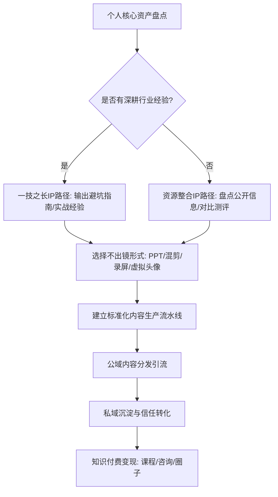
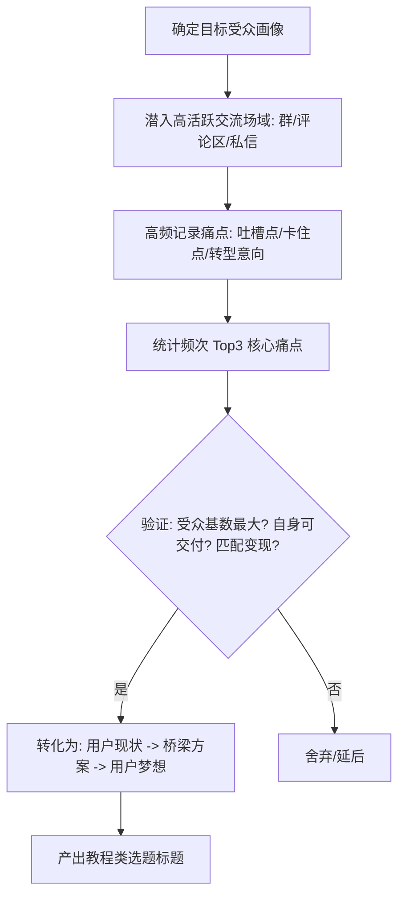
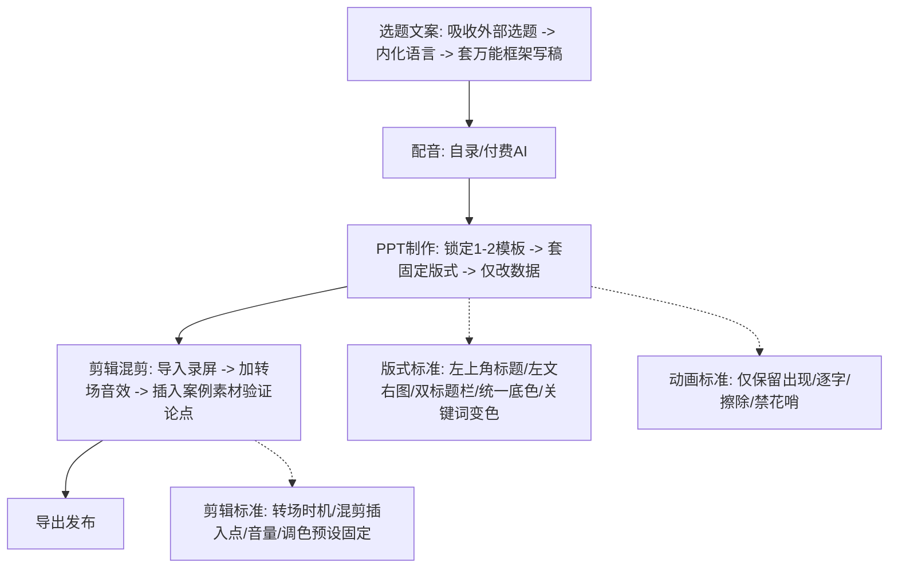
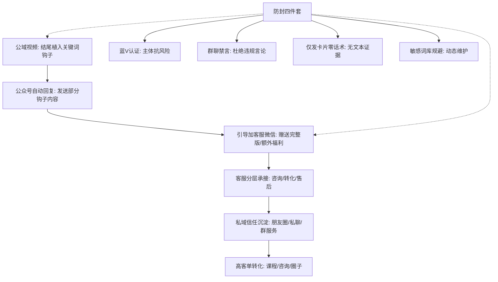
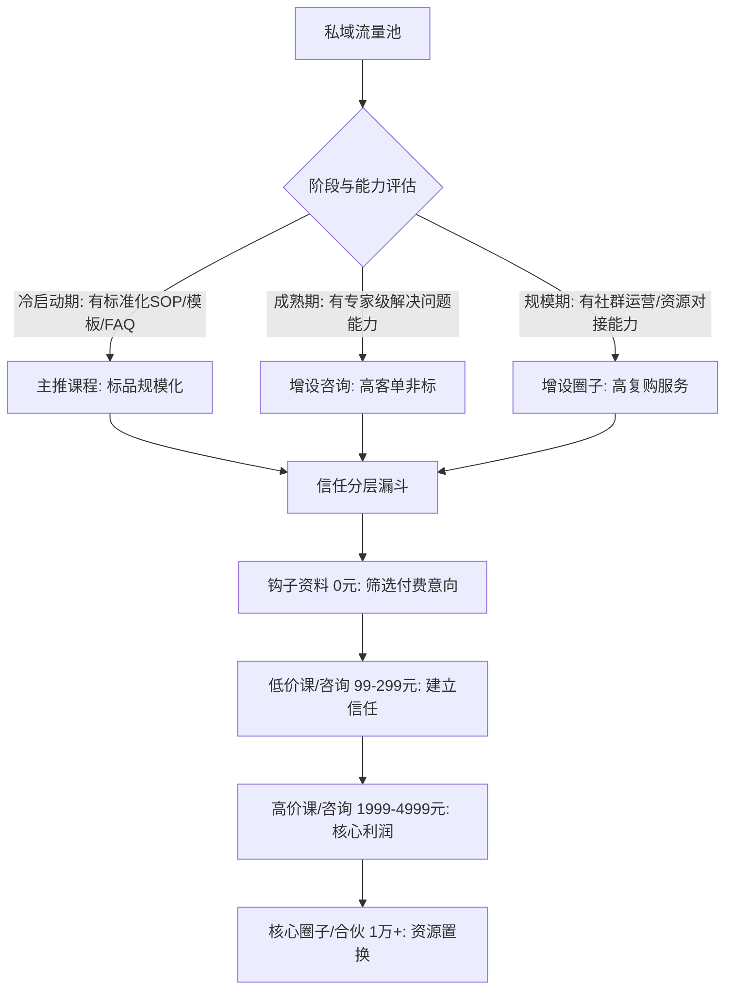

# 第 31 章 不出镜个人IP —— 普通人低门槛、高复利的商业化跃迁路径

## 学习目标

1. 理解不出镜个人IP的双重成长路径（一技之长IP与资源整合IP）及适用场景
2. 掌握低粉爆款对标起号法的操作流程与底层算法逻辑
3. 掌握核心需求桥梁理论的选题挖掘与验证方法
4. 掌握短视频万能内容框架（爆点前置+项目简述+流量形式+变现评价+钩子引流）的脚本结构设计
5. 掌握像素级模仿SOP：将PPT排版、剪辑节奏、配色字体固化为标准化生产流水线
6. 掌握私域为王引流防封体系：钩子设计、公众号中转、合规卡片、蓝V+禁言+零话术四件套
7. 能根据私域流量体量与交付能力，在课程/咨询/圈子三角模型中选择最优变现组合
8. 理解IP本质为“利他降低交易成本”，建立长期信任资产而非短期收割心态

## 31.1 生活类比

想象不出镜个人IP是一家**隐形冠军工厂**。这家工厂不挂招牌、老板不露面，只靠产品质量说话——这便是“不出镜形式”的本质：剥离个人颜值与表演天赋的干扰，将竞争力纯粹聚焦于专业内容的“产品力”上。工厂派工程师去拆解同行刚上市的爆款样机，1:1复刻工艺再微创新——这正是“低粉爆款对标”的逻辑：不盲目仰望头部巨头，而是蹭同类新品上市的算法红利期，以最低试错成本验证市场。研发部只攻克用户“最痛、最广、最急”的那个卡脖子技术难题——这就是“核心需求桥梁”理论：在用户现状与梦想之间搭建最高效的连接通道，而非自嗨式堆砌参数。产品说明书按“痛点场景-核心参数-对比测评-购买指引-售后承诺”五段式标准撰写——对应“短视频万能内容框架”，让每一条内容都成为标准化、可复制、有迹可循的销售话术。生产线每个工位动作、螺丝扭矩、质检标准都固化成作业指导书，新工人上手即合格——这就是“像素级模仿SOP”，将PPT排版、剪辑节奏、配色字体固化到像素级，把“制作怎么做”变成确定性动作，把认知带宽全部留给“内容内核的差异化创新”。不靠广告吆喝，靠老客户口碑转介绍、微信群深度服务，把客户装进自己口袋——这就是“私域为王”引流防封体系，构建“公域钩子→公众号中转→微信转化”的合规漏斗，实现流量资产的私有化与确定性变现。卖标品（课程）铺规模、卖定制（咨询）赚高利、卖会员（圈子）锁长期——这是“知识付费三角变现模型”，根据阶段与能力动态组合，最大化现金流与生命周期价值。就像隐形冠军不上市、不炒作、深耕细分领域三十年，不出镜IP也靠“专业内容+标准化生产+私域信任”做长周期生意，其本质正如刘润所言：“顶尖高手都是极致的利他者，他们总是想方设法给，而不是想方设法拿。因为做IP最大的势能就在于，能降低交易的决策成本，而赚钱的前提则是交易。”

## 31.2 概念地图

不出镜个人IP
├── 核心认知
│   ├── 不出镜个人IP：降维打击式的普通人创业路径  —— docs/202305/20230516_013.md
│   ├── 个人IP成长双路径：一技之长IP与资源整合IP  —— docs/202305/GUHld91qQobms8x35tbcOUlSnZb.md
│   └── IP本质即利他降低交易成本  —— docs/202305/GUHld91qQobms8x35tbcOUlSnZb.md
├── 运营模式
│   ├── 低粉爆款对标起号法：蹭算法同频红利  —— docs/202305/20230516_013.md、docs/202305/GUHld91qQobms8x35tbcOUlSnZb.md
│   ├── 核心需求桥梁理论：锁定受众最广痛点  —— docs/202305/GUHld91qQobms8x35tbcOUlSnZb.md
│   ├── 短视频万能内容框架：五段式标准化结构  —— docs/202305/GUHld91qQobms8x35tbcOUlSnZb.md
│   ├── 像素级模仿SOP：形式标准化服务内容高产出  —— docs/202305/GUHld91qQobms8x35tbcOUlSnZb.md
│   └── 私域为王引流防封体系：四件套组合拳  —— docs/202305/20230516_013.md、docs/202305/GUHld91qQobms8x35tbcOUlSnZb.md
└── 变现决策
    ├── 知识付费三角变现模型：课程/咨询/圈子阶梯式组合  —— docs/202305/20230516_013.md、docs/202305/GUHld91qQobms8x35tbcOUlSnZb.md
    └── 私域转化测算模型：量化决策变现模式优劣  —— docs/202305/GUHld91qQobms8x35tbcOUlSnZb.md

## 31.3 不出镜个人IP —— 让普通人不用露脸也能建影响力

### 为什么需要这个概念？

普通人缺乏颜值、才艺、表达力，真人出镜门槛极高、焦虑感强。传统认知认为做IP必须露脸，导致大量有知识、有经验的人不敢起号。我们需要一种降低门槛、聚焦内容价值、可规模化复制的IP建设路径。

### 核心定义

**不出镜个人IP**（来源：《docs/202305/20230516_013.md》、《docs/202305/GUHld91qQobms8x35tbcOUlSnZb.md》）

不依赖真人面部出镜，以PPT动画、混剪、录屏、虚拟头像等形式为载体，核心资产是垂直领域的专业知识输出或资源整合能力，而非个人颜值才艺。通过标准化内容生产建立专业人设，经由私域流量沉淀实现知识付费变现。

### 关键性质

- **双路径适配**：“一技之长IP”（深耕经验输出避坑）与“资源整合IP”（盘点公开信息节省决策时间）任选其一。素材指出：“以下是我观察了上百位‘素人博主’后，总结出的两个最适合普通人的【个人IP成长路径】：1.有一技之长的IP…… 2.资源整合性ip…… 其实这个事的底层逻辑很简单，就是两个字——盘点。”
- **九大可对标形式**：PPT混剪、虚拟头像、录屏解说、手绘动画、图文动态等，均有几十万粉实证案例。作者强调：“上面那些行业，肯定有一款是适合你，但并不代表只有这些赛道可以做，顺便说一句，这里面除了我，人家都是几十、几百万的粉丝体量。”
- **生产标准化**：将选题、文案、配音、PPT排版、剪辑固化为像素级SOP，单人日产3-5小时高产出。
- **私域为王**：唯一核心指标盯私域流量增长，构建“公域钩子→公众号中转→微信转化”防封漏斗。

### 方法演进图

### 典型例子

作者账号“不讲李的笔记”定位项目拆解赛道，采用PPT不出镜形式，10个月累计变现7位数(100-999万)，全程零投流。作者宣称已累计帮助1000+群友从0-1做出能变现账号，验证方法论可教性。同赛道头部对标显示，列举9类不出镜形式(如PPT混剪、虚拟主播)均有几十万至百万粉丝体量，充分验证了该模式的普适性与上限。

### 边界条件

核心前提：必须具备“热爱+擅长”一个领域，纯蹭热点无内核不可持续。作者反复强调：“普通人想要打造个人IP，我自认为最核心的就两点【热爱+擅长】。”形式标准化不等于内容低质：内核需为原创深度拆解/避坑指南/资源盘点，拒绝纯搬运。私域运营能力为上限：无私域承接转化体系，公域流量再大也难高客单变现。平台风控红线：需配合蓝V认证、群聊禁言、商加加卡片零话术引流等组合拳规避封号。

## 31.4 低粉爆款对标法 —— 蹭同类新号算法红利的起号捷径

### 为什么需要这个概念？

新号冷启动无粉丝基础、无权重，完全原创大概率无人看、数据难看、心态崩盘。模仿头部大V因团队制作、粉丝粘性、账号权重差异过大，新号极难复制其爆款逻辑。我们需要一种低成本、高成功率、符合算法冷启动机制的起号策略。

### 核心定义

**低粉爆款对标法**（来源：《docs/202305/20230516_013.md》、《docs/202305/GUHld91qQobms8x35tbcOUlSnZb.md》）

起号初期不找头部大V，专寻粉丝1-2万、近期新起且有单条爆款视频的“低粉爆款”账号。深度拆解其选题角度、前3秒钩子、内容结构、标题封面、呈现形式，进行像素级模仿。利用双方均为新号、无粘性、制作简单、算法标签高度同频的特性，蹭同类话题红利快速破播打标。

### 关键性质

- **算法同频性**：新号标签判定依赖同类新号近期表现，模仿低粉爆款蹭的是算法对该话题的当下推流红利。素材揭示：“大家都是新号起步，粉丝没有粘性，主页视频也没什么播放量，制作也简单，就靠着一条或几条涨了几万粉，你蹭着人家视频话题，大概率也能爆发一波。”
- **资源对等性**：双方制作成本、团队规模、账号生命周期相当，新号复制门槛极低。
- **标签固化快**：连更3-5条同结构内容，算法快速打上垂直标签，获得稳定推流。
- **微创新原则**：起号期完全照搬结构/形式，跑通流程后再在选题细节/呈现细节上微创新。

### 关键方法

**低粉爆款对标起号法**（来源：《docs/202305/GUHld91qQobms8x35tbcOUlSnZb.md》）

操作步骤：1.准备备用机，大量关注/完播垂直领域同行 → 算法推荐相似新号；2.筛选粉丝1-2万、近期有单条高赞爆款的新号；3.拆解其爆款选题、结构、标题、封面；4.保证基础制作质量前提下，模仿形式与话题，蹭算法推流红利；5.连更3-5条固化账号标签。

这个伪代码展示了如何利用算法推荐机制，通过“以新号模仿新号”的方式，在冷启动期以最低成本获取精准流量标签。作者实操中“我自己会额外准备一个手机，大批量关注和完播已知的相似博主”，正是这一流程的物理映射。

### 方法演进图

### 典型例子

作者教学员起不同领域账号均用此法“屡试不爽”。自身账号“不讲李”早期即通过对标同类新号快速打标起量。中视频赛道痛点内容：对标影视解说群痛点(想转型/过不了审核)输出教程，首条涨粉8000+，连更3天打标成功。

### 边界条件

仅适用于冷启动期(0-1万粉)，账号成熟后需建立差异化护城河。必须保证基础制作质量(清晰度、配音、排版)，烂片模仿不来爆款。选题需匹配自身赛道，不可跨领域硬蹭热门话题导致标签混乱。规避版权风险：混剪素材需注意授权，建议优先用PPT/自制素材规避侵权投诉。

## 31.5 核心需求桥梁理论 —— 在用户痛点与梦想间搭建内容桥梁

### 为什么需要这个概念？

选题决定流量上限，新手常陷入“自嗨式选题”(只分享自己想讲的)而非“用户视角选题”。同质化内容泛滥，唯有精准击中受众最广、最痛、最急的核心需求，才能以小博大引爆流量。我们需要一套系统化的选题挖掘与验证方法论。

### 核心定义

**核心需求桥梁理论**（来源：《docs/202305/GUHld91qQobms8x35tbcOUlSnZb.md》）

锁定目标受众群体，深入其高活跃交流场域(群/评论区/私信)挖掘高频痛点。核心公式：用户现状(不会/卡住/痛苦) + 核心需求桥梁(教程/方法/路径) = 用户梦想(变现/成长/解决)。选题优先级：受众基数最大、痛点最强、未被充分解决、自身可交付的核心需求。

### 关键性质

- **需求挖掘源**：潜入同行交流群、评论区、私信，记录高频“吐槽点/卡住点/想转型方向”。素材实操：“混到影视解说的交流群，观察他们每天的聊天话题，看看他们还有什么痛点是没有被解决的。”
- **广度验证**：优先制作覆盖面最大的痛点内容(如中视频玩家基数大于某细分工具用户)。
- **桥梁属性**：内容本质是连接现状与梦想的工具，而非单向知识灌输。
- **选题即产品**：每个选题对应一个具体解决方案，天然具备后端变现产品雏形。

### 关键方法

**核心需求挖掘与选题法**（来源：《docs/202305/GUHld91qQobms8x35tbcOUlSnZb.md》）

1.确定目标受众群体（如中视频玩家、影视解说者）；2.潜入其高活跃交流群/评论区/私信；3.高频记录“吐槽点”、“卡住点”、“想转型方向”；4.将高频痛点转化为“如何从现状达成梦想”的教程选题；5.验证受众广度（如中视频玩家基数大），优先制作覆盖面最大的痛点内容。

这个伪代码展示了如何从用户真实对话中提炼出“最大公约数”式的核心痛点，并转化为具有天然流量属性和变现潜力的选题。

### 方法演进图

### 典型例子

中视频运营拆解：潜入影视解说群发现“想转型/过不了审核/收益低”高频痛点，输出教程首条涨粉8000+。素材复盘：“最终发现他们做影视解说的也很卷……想换赛道但不知道换什么，还有人始终过不去中视频的审核。那我就以此为创作话题，开始了我的中视频运营拆解，结果一发入魂，一条视频涨粉8000+，接着就这话题连更3天，直接就打上了账号标签，流量至此稳定了下来。”项目拆解赛道：锁定“想搞副业但不知道做什么/怕被割”核心需求，输出避坑指南/拆解案例。国货美妆对比：锁定“学生党/敏感肌想平替大牌”需求，盘点成分平替方案节省决策时间。

### 边界条件

痛点必须真实高频：伪需求/个例需求做成内容无流量。自身必须有交付能力：挖到痛点但无法给出有效解决方案，会透支IP信任。受众画像需匹配变现路径：引来的用户必须具备后端产品付费潜力(如中视频玩家有付费学习意愿)。避免过度宽泛：“想赚钱”太泛，“中视频审核不通过怎么办”才是可执行的桥梁。

## 31.6 短视频万能内容框架 —— 让爆款视频有迹可循、有章可依

### 为什么需要这个概念？

新手不会写脚本、不懂节奏、不知如何开头留人、结尾引流，内容生产随意性大、爆款率低。知识付费类短视频缺乏标准化结构模板，导致产能低、质量不稳定、难批量化。我们需要一个通用的、经过验证的、可直接套用的脚本结构模板。

### 核心定义

**短视频万能内容框架**（来源：《docs/202305/GUHld91qQobms8x35tbcOUlSnZb.md》）

PPT类知识付费视频的标准化五段式结构：【爆点前置】+【项目简述/优势】+【流量来源/内容形式】+【变现方式/项目评价】+【钩子引流】。每个模块有明确心理设计：开头筛客/制造冲突，中间干货/建立权威，结尾升华/引流转化。

### 关键性质

- **爆点前置(黄金3秒)**：制造认知冲突/利益诱惑/痛点直击，同时用“劝退话术”筛选高质量受众(如“月入三千别看”)。
- **项目简述/优势**：用通俗语言1句话讲清是什么、适合谁、核心优势是什么，建立理性认知。
- **流量来源/内容形式**：拆解具体从哪搞流量、什么形式产内容，提供可模仿的执行路径。
- **变现方式/项目评价**：客观拆解变现模式、周期、难度、收益上限，建立专业可信人设(含避坑指南)。
- **钩子引流**：植入关键词钩子(资料/模板/名单)，引导公域用户进私域领取，完成公私域流量转化。
- **感性收尾**：结尾用“良言忠告/人生感悟”触动共鸣，强化IP温度与信任，实现“理性拆解+感性共鸣”双重留存。作者指出：“人同时是理性和感性的动物，但主要是感性动物，用户是能感觉到你在为他着想的，这样就能起到升华主题、强化IP的作用。”

### 方法演进图

### 典型例子

作者所有项目拆解视频均沿用此框架：开头“这个项目90%的人不适合做”→项目简述→流量拆解→变现测算→引流钩子→结尾“普通人逆袭最核心是执行力”。学员完全套用此框架制作PPT视频，实现日更稳定产出。

### 边界条件

框架是骨架，内容内核(选题深度/案例真实性/数据准确性)决定血肉质量。非万能公式：娱乐/剧情/带货类视频不完全适用，核心适用于知识付费/项目拆解/教程类内容。严禁标题党：爆点前置必须为内容服务，过度标题党吸引低质粉丝破坏账号模型。素材警示：“但这种方式吸引来的一定是急功近利的小白居多……打造IP的第一步，就是要学会劝退一部分人。”

## 31.7 像素级模仿SOP —— 把制作流程标准化到每一个像素

### 为什么需要这个概念？

个人/小团队内容产能低、质量波动大、易卡在制作细节(配色/字体/转场/节奏)上耗时过长。缺乏标准化导致无法复制、难外包、难规模化，单人上限极低。我们需要将制作流程固化为可执行、可考核、可替换的工业化标准。

### 核心定义

**像素级模仿SOP**（来源：《docs/202305/GUHld91qQobms8x35tbcOUlSnZb.md》）

将PPT排版布局(左上角固定标题、左文右图/双标题栏、统一底色)、字体规范、配色体系、剪辑节奏(转场音效时机、混剪素材插入位置)、字幕样式等全部固化为标准。核心口号：“找好模板直接套用、不求原创求效率、像素级模仿”，形式标准化服务内容高产出。

### 关键性质

- **模板锁定**：推荐1PPT.com等平台锁定1-2个通用付费模板，禁止频繁换模板。
- **版式固化**：左上角标题栏、左文字右案例/图、双标题栏结构、统一底色/配色方案、关键词加粗变色。
- **动画标准**：智能动画/逐字动画/图表可视化，禁止花哨无意义动画。
- **剪辑节奏**：页面切换空隙固定加转场音效、混剪案例视频插入时机标准化、背景音量固定、调色预设。
- **产出效能**：单人日更3-5小时高产出，质量下限有保障，新人上手极快。

### 关键方法

**PPT视频标准化生产流水线**（来源：《docs/202305/GUHld91qQobms8x35tbcOUlSnZb.md》）

1.选题文案：吸收生财有术/抖音高赞选题 → 内化为自有语言体系 → 按万能框架写稿（含开头钩子、互动指令）；2.配音：自录或付费AI（贵即是好）；3.PPT制作：锁定1-2个通用模板（推荐1ppt.com） → 套用“左标题、左文右图、双标题栏”固定版式 → 仅改文字数据；4.剪辑混剪：剪映导入PPT录屏 → 加转场音效 → 插入案例原视频/素材库素材验证论点 → 导出发布。

这个伪代码展示了如何将视频制作拆解为四个标准化工序，每个工序都有固定的输入输出标准，实现“流水线式”生产。作者演示：“下面给大家演示一下我视频的制作顺序~ PPT怎么制作我就不教了……找一个好看的模板，直接套着用。剪辑方面的话，直接把录制好的PPT导入到剪映就可以了，在页面切换的空隙加入转场和音效。”

### 方法演进图

### 典型例子

作者PPT排版/配色/结构被大量后来者“像素级模仿”(附对比图)，成为项目拆解赛道事实标准。素材记录：“后来做项目拆解的朋友，也都统一沿用了我的方式，包括排版也一样……对我做到了像素级的模仿。”作者未维权反鼓励：“共建生态、助人上道”反强化自身标杆地位。原文感叹：“原本我在互联网上就是一个籍籍无名之辈，现在因为输出的内容还算有点价值，突然能成为了大家的标杆……对我来说是一件特别欣慰的事情。”学员套用模板后制作效率大幅提升，内容质量基础线显著提高。

### 边界条件

形式标准化 ≠ 内容同质化：核心观点/案例/数据/语言风格必须个性化、差异化。模板需定期迭代：平台审美变化、用户审美疲劳需每季度微调模板细节。仅适用于PPT/混剪/图文类知识内容，真人出镜/Vlog类另需标准。版权合规：模板需购买正版授权，素材库需自建或购买商用授权。

## 31.8 私域为王引流防封体系 —— 把公域流量装进自己的口袋且不被封号

### 为什么需要这个概念？

公域流量归平台、不稳定、难直接高客单成交，且平台严打站外引流(违规封号/限流)。无私域沉淀则流量资产归零，有私域但无防封体系则账号随时可能报废。我们需要一套合规、高转化、可规模化的公私域流量转化闭环方案。

### 核心定义

**私域为王引流防封体系**（来源：《docs/202305/20230516_013.md》、《docs/202305/GUHld91qQobms8x35tbcOUlSnZb.md》）

以私域流量增长为唯一核心指标(北极星指标)，构建全链路引流转化漏斗。组合拳：内容端钩子设计 + 转化端公众号中转/客服分层 + 工具端合规外链卡片 + 防封端蓝V+行为规范。

### 关键性质

- **内容端**：视频结尾植入“关键词钩子”(如回复“素材”领取)，引导公众号自动回复获取部分资料。素材明确：“内容：抓人的开场话题+项目流程讲解+素材的混剪/PPT图片。引流：找到用户最大痛点—结尾设置关键词钩子—引导公众号回复领取部分—加客服领取完整版资料。”
- **转化端**：公众号自动回复再引导加客服微信(赠送额外玩法)，客服分层承接(咨询/售后/转化)。
- **工具端**：使用“商加加”等合规外链工具搭建引流卡片，比直发微信号/谐音词稳定得多。
- **防封端四件套**：①主体蓝V认证(抗风险超乎想象) ②群聊全员禁言(杜绝违规言论) ③引流仅发卡片零话术(无文本违规证据) ④敏感词库规避(自建/工具查违禁词)。作者实测：“抖音蓝V的抗风险能力超乎你的想象……我都被封2个号。抖音群我一般禁言……引流就是自己转发卡片，不说任何的引导话术。用卡片跳转聪明人自己会过来找你。”
- **信任建设**：“免费资料不设防、超值交付、言必行行必果”建立长期信任资产，而非一次性收割。

### 关键方法

**私域引流防封组合拳**（来源：《docs/202305/GUHld91qQobms8x35tbcOUlSnZb.md》）

1.内容端：视频结尾植入“关键词钩子”（如“视频素材”“文案模板”），引导公众号回复领取部分资料；2.转化端：公众号自动回复引导加客服微信（赠送额外项目玩法）；3.工具端：使用“商加加”等合规外链工具搭建引流卡片（比直发微信号稳）；4.防封端：主体蓝V认证 → 群聊全员禁言 → 引流仅发卡片零话术 → 规避敏感词。

这个伪代码展示了一个四层防御的引流体系：内容层留钩子、转化层分级承接、工具层合规跳转、行为层规避风控，形成“进可攻退可守”的私域获客闭环。

### 方法演进图

### 典型例子

作者实测：蓝V+卡片+禁言+零话术组合拳，全年稳定引流未封号(早期不规范操作被封2个号)。私域日进峰值过千，10个月累计变现7位数，验证私域承接转化模型商业可行性。客单价测算：私域日增200-500粉时，卖课程(2000元/2%转化)月入24-60万 > 卖社群(500元/5%)月入15-37.5万。

### 边界条件

蓝V认证需企业主体，个人号无法开通，个人号引流风险显著高于蓝V号。卡片工具(商加加等)需付费且依赖平台接口政策，有失效风险需备选方案。零话术引流依赖用户主动性，转化率低于话术引导，需用钩子价值补偿。群聊禁言牺牲社群活跃度换安全，需通过私聊/朋友圈补足运营触点。严禁诱导分享/转发/评论违规词，平台算法持续升级需动态维护敏感词库。

## 31.9 知识付费三角变现模型 —— 课程/咨询/圈子的组合拳与选择逻辑

### 为什么需要这个概念？

知识变现单一模式天花板低：只卖课难复购、只卖咨询难规模、只卖圈子易变冷群。不同阶段、不同流量体量、不同交付能力的创作者，需要差异化的变现组合策略。我们需要一个可量化测算、可动态调整的变现决策模型。

### 核心定义

**知识付费三角变现模型**（来源：《docs/202305/20230516_013.md》、《docs/202305/GUHld91qQobms8x35tbcOUlSnZb.md》）

将知识变现抽象为三种基础模式及其组合：
1. **卖课程(标品)**：低边际成本、一锤子买卖、规模化强、但易挨骂/退款率高、信任要求相对低。
2. **卖咨询(非标)**：高客单价、高信任要求、时间杠杆弱(卖时间)、但现金流极佳、利润率高。
3. **卖圈子(服务)**：高复购、资源聚合、社交属性强、但运营难度大、易变冷群、需持续投入服务。

素材总结：“一般知识博主的变现路径有3种，卖课程，卖咨询，卖圈子，我分别说下他们的优缺点吧。”

### 关键性质

- **阶梯匹配**：冷启动期卖课程(标品易交付、信任要求低)→ 成熟期加咨询(高客单、深度服务头部用户)→ 规模期加圈子(聚合高净值用户、资源变现)。
- **流量转化测算**：私域日增200-500粉假设下，卖课程(2000元/2%转化)月入24-60万 > 卖社群(500元/5%)月入15-37.5万，高客单课程现金流更优。作者测算：“我们可以算一笔账：假设私域每日进量200-500粉……如果你是卖社群的……如果你是卖课程的……高客单咨询没做过，我就不太清楚了~ 以上数值是指你把公域全部导入到微信，还有能力做好营销转化的前提下。”
- **信任分层**：资料/低价课(筛选付费意向) → 中价课/咨询(建立深度信任/挖掘需求) → 高价咨询/圈子/合伙(核心利润/资源置换)。
- **交付能力门槛**：课程需标准化SOP/模板/FAQ；咨询需专家级解决问题能力；圈子需社群运营/资源对接/持续服务能力。

### 方法演进图

### 典型例子

作者变现路径：项目拆解课程(299-999元) → 1对1陪跑(2999-4999元) → 核心圈子/合伙人模式，验证阶梯式进阶。木子田PPT IP：课程299/599/999元 + 陪跑2999/4999元，47天变现16.7万，高客单课程为主。漫漫雅思IP：广告变现 → 知识付费训练营 → 矩阵/卖号/高阶合伙人，年变现40万+。

### 边界条件

新手严禁上来卖圈子/高价咨询：无信任背书、无标准化交付体系、极大概率退款投诉、毁IP。虚拟资料/低价课仅作钩子：边际成本零、利润极低，核心功能是筛选付费用户非赚钱。咨询/圈子依赖个人时间/精力：非标服务难规模化，必须控制接纳人数、建立助理/合伙人分级交付体系。合规风险：承诺收益/包过/包赚等违规承诺严禁出现在任何变现产品宣传中。

## 31.10 设计中的取舍

### 为什么不用“头部大V模仿”而是“低粉爆款模仿”？

头部大V拥有成熟团队、深厚粉丝粘性、高账号权重，其爆款视频往往包含大量隐性制作成本(专业灯光、多机位、专业剪辑团队、选题策划会议)。新号模仿其“形式”却缺乏其“资源”，极难复制其“结果”。低粉爆款账号处于相同生命周期、资源投入相当、算法标签高度同频，模仿其结构与话题，是在“复制算法当下的推流逻辑”，而非“复制大V的历史荣光”。这是用确定性换取概率性的理性选择。素材直指本质：“这个世界上聪明人很多，作为新手我们没必要什么都自己创新。”

### 为什么要“先标准化形式，再差异化内容”？

如果不先固化形式，每条视频都在重新决策“用什么字体、什么配色、什么转场、什么结构”，决策成本会吞噬全部精力。形式标准化是工业化的前提：把“制作怎么做”变成确定性动作，把“认知资源”全部释放给“内容内核的差异化创新”。这不是扼杀创意，而是为创意腾出带宽。作者实践证明：“他们不成功都不可能，因为这是最适合一个人制作的方式。”

### 为什么“私域为王”而不是“公域变现”？

公域流量具有“非资产性、非确定性、低信任度”三重属性：算法一变流量归零、平台一封账号报废、用户一滑即走无连接。私域流量则是“资产化、确定性、高信任度”：用户关系归自己、触达率可控、复购率指数级高于公域。对于知识付费这类高决策成本产品，公域只负责“筛选”，私域才负责“成交”。作者铁律：“我盯得指标只有一个，就是私域流量的增长。”

### 为什么“新手禁卖圈子/高价咨询”？

圈子模式的本质是“服务+资源聚合”，其核心壁垒在于“持续的高质量运营能力”和“强社交关系维护能力”，这需要创作者具备成熟的团队、完善的SOP、丰富的资源库。新手没有这些积累，上来卖圈子等同于“预售无法兑现的承诺”，极易引发维权毁IP。高价咨询同理，其交付高度依赖“专家级解决问题能力”，无标准化SOP可复制，新人极易翻车。

## 31.11 动手练习

1. **寻找你的‘低粉爆款’对标账号**
   - 1. 确定你想切入的垂直细分领域（如：考公资料整理、家庭收纳技巧、AI工具测评）
   - 2. 准备一个备用手机，在抖音/视频号搜索该领域核心关键词
   - 3. 连续3天：每天关注20个相关账号，完播其前5个视频，点赞评论收藏
   - 4. 观察算法推荐出的‘1-2万粉丝、近期发布、单条点赞>1万’的新号
   - 5. 记录3个最符合条件的对标账号，拆解其爆款视频的：选题角度、前3秒钩子、内容结构、标题文案、封面风格
   - 回答问题：
     - 为什么模仿这类‘低粉爆款’比模仿百万粉大V更容易起号？
     - 如果对标账号用的是真人出镜，而你只会PPT，如何进行‘形式迁移’式模仿？

2. **设计你的‘核心需求桥梁’选题清单**
   - 1. 确定目标受众群体画像（如：想做副业的宝妈、想转行的程序员、备考公务员的大学生）
   - 2. 潜入该群体高活跃的3个交流场域（QQ群/微信群/知乎话题/小红书评论区/抖音评论区）
   - 3. 连续7天，每天记录10个高频出现的‘吐槽点/卡住点/想要的结果’
   - 4. 统计频次最高的Top 3痛点，判断：受众基数是否最大？自身是否有解决方案？是否匹配后端变现？
   - 5. 按‘用户现状 → 核心桥梁（你的教程/方法/资源） → 用户梦想’结构，写出3个选题标题
   - 回答问题：
     - 如何区分‘伪需求’与‘真高频痛点’？
     - 选题确定后，如何用‘万能内容框架’在30分钟内产出第一版脚本大纲？

3. **搭建你的‘像素级模仿’PPT生产模板**
   - 1. 在1PPT.com或类似平台购买1-2套通用付费模板（要求：左上角固定标题区、左文右图/双标题栏结构、统一底色风格）
   - 2. 固化版式标准：标题字体/大小/颜色、正文字体/行距/段距、关键词加粗变色规则、图片占位框比例、页脚版权/Logo位置
   - 3. 固化动画标准：仅保留‘出现/逐字/擦除’三类，禁用飞入/旋转等花哨动画，切换页面统一用‘推入/淡入’转场
   - 4. 固化配色体系：主色/辅助色/强调色/背景色HEX值锁定，建立配色表备用
   - 5. 用某个已验证选题，按‘万能内容框架’套用模板制作第1条视频PPT，计时记录耗时
   - 回答问题：
     - 为什么说‘形式标准化 ≠ 内容同质化’？核心差异化应体现在哪里？
     - 模板上线运行1个月后，发现用户审美疲劳，如何在不破坏SOP前提下微调模板？

4. **推演你的私域引流防封组合拳**
   - 假设你已有日产优质内容能力，现需设计公域→私域转化漏斗：
   - 1. 设计3个不同价值梯度的‘关键词钩子’（如：回复‘大全’送资料包、回复‘工具’送软件、回复‘群’进交流群）
   - 2. 规划公众号自动回复话术：即时回复（含部分钩子内容） → 引导加客服微信领完整版/额外福利
   - 3. 配置客服分层：咨询客服（答疑）、转化客服（成单）、售后客服（交付/维权）
   - 4. 申请蓝V认证（如无企业主体，规划个人号防封备选：群聊禁言、零话术引流、敏感词库自查）
   - 5. 申请‘商加加’等合规外链工具，制作引流卡片替代直发微信号
   - 回答问题：
     - 为什么‘蓝V+卡片+禁言+零话术’组合拳能实现‘全年稳定不封号’？各环节缺一不可吗？
     - 零话术引流转化率低于话术引导，如何用‘钩子价值’补偿转化率损失？

5. **三角变现模型测算与决策**
   - 假设你的私域日增精准粉丝300人（通过前四题练习验证可行），请测算：
   - 1. 卖社群模式：客单价500元，转化率5%，月收入 = 300×30×5%×500 = 22.5万
   - 2. 卖课程模式：客单价2000元，转化率2%，月收入 = 300×30×2%×2000 = 36万
   - 3. 卖咨询模式：客单价5000元，转化率0.5%，月收入 = 300×30×0.5%×5000 = 22.5万
   - 4. 结合自身交付能力（有无标准化SOP/模板/FAQ、有无专家级解决问题能力、有无社群运营精力），判断当前阶段主推哪种模式？
   - 5. 设计‘资料钩子(0元)→ 低价课/咨询(99-299元)→ 高价课/咨询(1999-4999元)→ 核心圈子/合伙(1万+)’的信任阶梯漏斗
   - 回答问题：
     - 为什么‘新手严禁上来卖圈子/高价咨询’？风险边界在哪里？
     - 虚拟资料/低价课仅作钩子，边际成本为零，其核心KPI是什么而非利润？

## 31.12 本章小结

这一章中我们学习了如何通过“不出镜个人IP”这一低门槛路径，实现普通人的商业化跃迁。首先，我们确立了“不出镜”并不意味着“无门槛”，而是将门槛从“颜值才艺表演”转移到了“专业知识输出/资源整合能力”上，提供了“一技之长IP”与“资源整合IP”两条可选赛道。其次，我们掌握了“低粉爆款对标起号法”，利用算法对新号冷启动的同频推荐机制，以最低成本快速打标起量。接着，我们学习了“核心需求桥梁理论”，在用户现状与梦想间搭建内容桥梁，实现选题的精准爆发。然后，我们构建了“短视频万能内容框架”与“像素级模仿SOP”，将视频制作从“艺术创作”降维为“工业化流水线”，单人即可实现日更3-5小时的高产出。随后，我们建立了“私域为王引流防封体系”，通过“钩子-公众号-客服-卡片-蓝V”组合拳，在合规前提下实现公域流量的私域化沉淀。最后，我们用“知识付费三角变现模型”量化测算不同变现模式的现金流效率，明确了“课程为主、咨询为辅、圈子为果”的阶梯式进阶路径，并确立了“IP本质即利他降低交易成本”的长期主义商业逻辑。

本章我们一起学习了以下概念：

| 概念 | 解释 |
|------|------|
| 不出镜个人IP | 普通人通过PPT/混剪/录屏等非真人形式，输出垂直专业内容建立影响力并变现的低门槛路径 |
| 双重成长路径 | 一技之长IP（深耕经验输出避坑）与资源整合IP（盘点公开信息节省决策时间）任选其一 |
| 低粉爆款对标法 | 新号模仿1-2万粉、有单条爆款的同类新号，蹭算法同频红利快速打标起量 |
| 核心需求桥梁理论 | 在用户现状（不会/卡住）与梦想（变现）间搭桥梁，选题锁定受众最广、痛点最强的未被解决需求 |
| 短视频万能内容框架 | 爆点前置+项目简述/优势+流量来源/内容形式+变现方式/项目评价+钩子引流，兼顾筛客与留客 |
| 像素级模仿SOP | 将PPT版式、配色、字体、剪辑节奏、转场音效固化到像素级，单人日产3-5小时高产出 |
| 私域为王引流防封体系 | 内容端钩子+转化端公众号中转+工具端合规卡片+防封端蓝V/禁言/零话术四件套，全年稳定不封号 |
| 知识付费三角变现模型 | 课程（标品规模化）、咨询（高客单非标）、圈子（高复购服务）三模式按阶段组合，私域日增200-500粉测算课程现金流最优 |
| IP本质即利他降低交易成本 | 持续高价值输出建立专业可信标签，大幅降低后续交易决策成本与信任成本，实现长期复利 |

