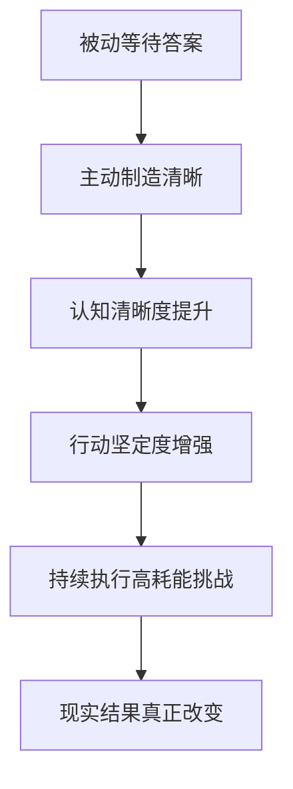
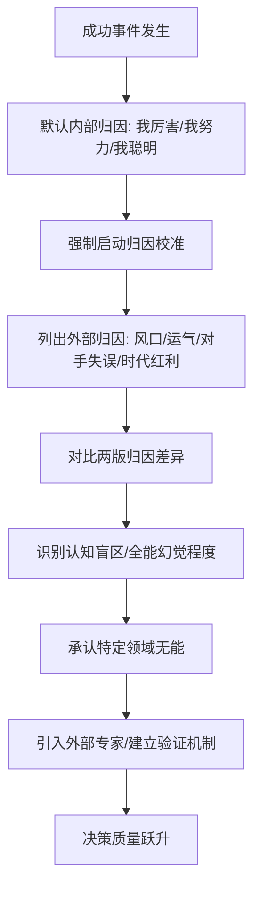
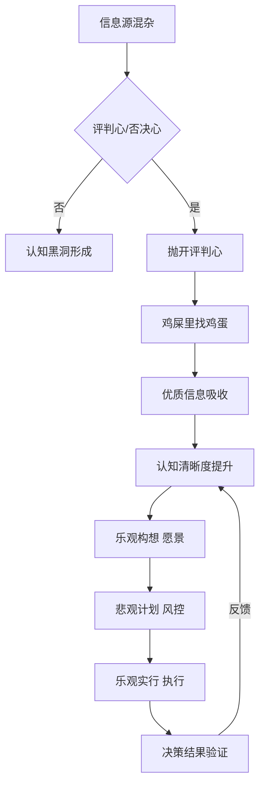
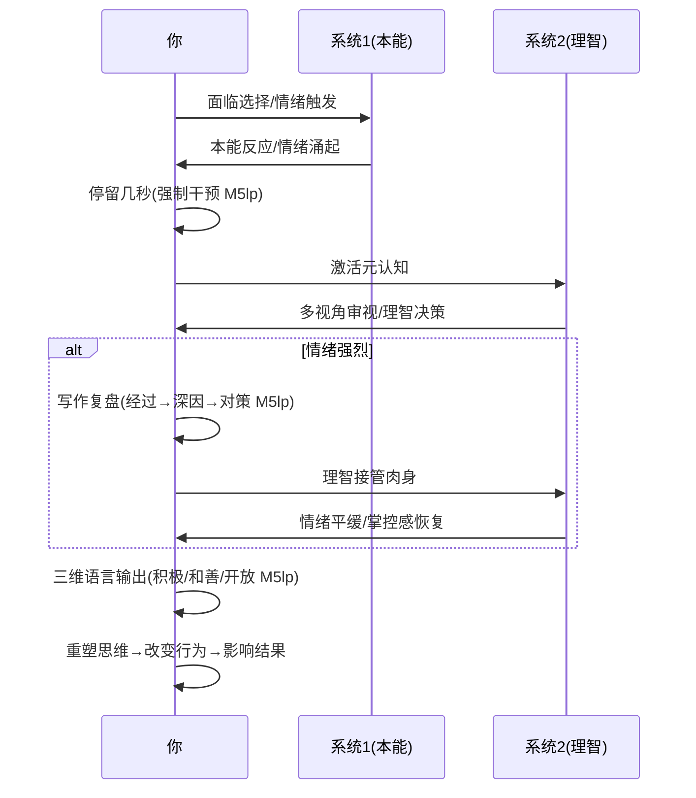
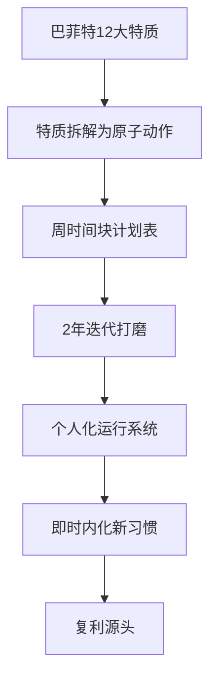
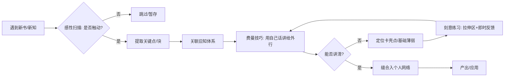
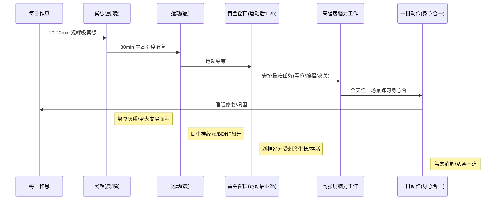

# 第 2 章 认知突破与决策力 —— 制造清晰、承认无知、修补认知黑洞

## 学习目标

- 理解“混沌源于认知模糊而非环境复杂”的底层因果逻辑
- 掌握“认知清晰度→行动坚定度→高耗能执行”的耦合传导机制
- 识别“身居高位的脑损伤”与“全能幻觉”的生理与认知双重陷阱
- 掌握“承认无知→归因校准→看人看事验证”的管理者认知进阶三步法
- 理解“认知黑洞”成因与“抛开评判心、鸡屎里找鸡蛋”的信息吸收术
- 掌握“乐观构想-悲观计划-乐观实行”三阶段决策模型
- 掌握“停留几秒激活元认知”、“写作复盘疏解情绪”、“三维语言重塑思维”三大微操作
- 理解高手习惯“即时内化”与“周计划表迭代”的系统化落地范式
- 掌握“关键点触发式读书”、“费曼技巧”、“刻意练习缝合知识”的高效学习工具箱
- 理解冥想增厚灰质、运动后黄金窗口促生神经元、身心合一缓解焦虑的身心底层升级协议

## 2.1 生活类比

想象认知突破是一次登山远征。站在山脚时，笼罩全山的浓雾让人迷失方向，这浓雾不是山太高、环境太复杂，而是认知的模糊；只有主动吹散雾气、制造清晰，手中的高精度地图与指南针才能生效，清晰度越高，登顶的决心（行动坚定度）越强，才敢挑战垂直岩壁般的高耗能任务。登到半山腰若自以为熟知全山地形，实则是镜像神经元退化导致无法感知队友疲惫——这便是“身居高位的脑损伤”与“全能幻觉”的双重陷阱。若因嫌弃某条路烂（评判心）而永久封死路口，便错失了可能通往山顶的捷径，这就是“认知黑洞”。科学的决策如同三阶段登山法：乐观构想山顶风光（愿景）→ 悲观规划物资与逃生路线（风控）→ 乐观享受攀登过程（执行）。途中走岔路前强制停3秒看指南针（停留几秒激活元认知），迷路时坐下画图复盘（写作复盘），满嘴抱怨改成“这段坡能练腿”（三维语言重塑）。高手不看登山攻略（鸡汤），而是把向导的背包打法、呼吸节奏立刻照搬练成肌肉记忆（即时内化），并打印成每日行程表（周计划表）贴在胸前。高效学习不是背全套百科全书，只撕下“触动你”的页（关键点触发），用自己话讲给路人听（费曼），在陡坡反复练同一个动作直到自动化（刻意练习缝合）。身心升级则是每晚冥想增厚大脑皮层（硬件升级）、晨跑后1小时攻克最难技术路段（黄金窗口）、攀登时只感受脚下岩石温度不想“何时到顶”（身心合一）。就像登山者必须主动吹散迷雾、修炼硬件、内化肌肉记忆、享受当下每一步，认知突破也需主动制造清晰、升级底层算力、即时内化高手范式、在行动中体验成长。

## 2.2 概念地图

认知突破与决策力
├── 核心定理
│   ├── 混沌根源定理：模糊源于认知不清而非环境复杂  —— P004
│   ├── 认知-行动耦合律：清晰度决定行动坚定度支撑高耗能挑战  —— P004, M5lp
│   ├── 成长即克服天性定律  —— M5lp
│   └── 痛苦即成长信号论  —— M5lp
├── 管理者认知陷阱与破局
│   ├── 身居高位的脑损伤（镜像神经元减少/共情下降）  —— P055
│   ├── 全能幻觉（运气内归因于能力）  —— P055
│   ├── 认知无知悖论（识别无知需高阶认知）  —— P055
│   ├── 归因校准法（外部归因替代内部归因）  —— P055
│   ├── 看人看事验证法（观行果而非听言）  —— P055
│   └── 自知之明跨时空铁律  —— P055
├── 认知黑洞与决策力升级
│   ├── 认知黑洞：否决即关上认知大门  —— P056
│   ├── 抛开评判心/鸡屎里找鸡蛋信息吸收术  —— P056, M5lp
│   ├── 乐观构想-悲观计划-乐观实行三阶段决策模型  —— P056, M5lp
│   ├── 理性局限与感性互补论（感性-理性-感性三明治）  —— M5lp
│   └── 态度-行为-结果因果链  —— M5lp
├── 元认知微操作体系
│   ├── 停留几秒激活元认知/理智脑  —— M5lp, P056
│   ├── 写作复盘疏解情绪/外化书写  —— M5lp, P056
│   ├── 三维语言重塑（积极/和善/开放语言强制输出）  —— M5lp
│   └── 标准化复盘三步法（经过/深因/对策）  —— M5lp
├── 高手习惯即时内化系统
│   ├── 巴菲特12大特质提炼  —— M5lp
│   ├── 个人周计划表2年迭代实物化  —— M5lp
│   └── 知行合一+习惯即时内化=复利源头  —— M5lp
├── 高效学习与内化工具箱
│   ├── 学习本质：关联旧知+刻意缝合  —— M5lp
│   ├── 关键点触发式读书（感性筛选+理性拆解）  —— M5lp
│   ├── 费曼技巧（用自己语言讲给外行听）  —— M5lp
│   ├── 刻意练习（拉伸区+即时反馈+自动化）  —— M5lp
│   ├── 番茄工作法/精力桶管理  —— M5lp
│   ├── 黄金时间攻克难事  —— M5lp
│   └── 预案式规划（心中有数而非死板执行）  —— M5lp
├── 身心底层硬件升级
│   ├── 冥想增大皮层面积/增厚灰质  —— M5lp
│   ├── 运动促生神经元+运动后1-2h黄金脑力窗口  —— M5lp
│   └── 身心合一（专注并享受当下）缓解焦虑  —— M5lp
└── 价值交换与影响力
    ├── 价值交换规律：生产价值内容=生产价值，做有价值的人=成长，贡献社会价值=成功  —— M5lp
    ├── 利他之心是成功唯一路径  —— M5lp
    ├── 内向者创造优势（专注创造吸引连接）  —— M5lp
    ├── 影响力第六奇迹（知名度100倍→价值1000倍）  —— M5lp
    └── 改变他人唯一路径：改变自己创造价值  —— M5lp

## 2.3 混沌根源定理 —— 模糊源于认知不清而非环境复杂

### 为什么需要这个概念？

很多人一生陷入混沌迷茫，误以为是外部环境太复杂、机会太少。实际上根源在于主观上对未来缺乏清晰认知（模糊）。只有看清“混沌=认知模糊”这个因果链，才能从被动焦虑转为主动破局。

### 核心定义与推导

**混沌根源定理**（来源：P004, M5lp）

**定义**：
- **人生混沌**：个体因对未来认知模糊、缺乏清晰方向而陷入的迷茫无序状态
- **认知清晰度**：通过学习不断加深对事物本质理解，消除内心模糊、形成确定性判断的状态
- **制造清晰**：主动通过学习深化认知来消除模糊，而非被动等待答案降临

**核心公式推导**：

我们从观察出发：人生混沌程度（$C$）并不随环境复杂度（$E$）线性增高，而是取决于主观认知模糊度（$M$）。即 $C = f(M) \neq f(E)$。要消除混沌，必须降低 $M$。认知清晰度（$K$）是模糊度的倒函数 $K = 1/M$。清晰度不会自动产生，它是“学习输入量”（$L$）与“深度加工强度”（$D$）随时间（$t$）累积的结果：

$$
K(t) = \int_0^t L(\tau) \cdot D(\tau) \, d\tau
$$

**推导逻辑**：
1. 环境复杂是客观常量，不可控；认知模糊是主观变量，可控。
2. 被动等待（$L=0$ 或 $D=0$）导致积分为零，清晰度永远为零。
3. 只有主动投入学习（$L>0$）并进行深度加工（$D>0$），积分随时间增长，清晰度才能提升。
4. 清晰度提升直接驱动行动坚定度，进而支撑高耗能执行。

> “为什么许多人的人生都难免陷入混沌之中？因为对未来充满模糊。”
> 
> —— P004

> “而只有制造清晰，才能消除你心中的模糊。从混沌到清晰，关键在于，通过学习不断地加深自己对事物的认知……”
> 
> —— P004

**公式作用说明**：该积分公式将“制造清晰”从模糊口号转化为可量化的工程过程：学习输入与深度加工的乘积随时间累积，揭示了“听课不等于学会、读书不等于内化”的本质——若缺乏深度加工（$D \approx 0$），再多输入也难以积分出清晰度。

### 关键性质

因果倒置是核心：环境复杂是表象，认知模糊才是混沌的本质原因。主动性是前提：清晰度不会自然产生，必须主动“制造”（通过学习）。传导性是闭环：认知清晰 → 行动坚定 → 持续执行高耗能挑战任务，形成完整闭环。

### 典型例子

素材作者通过23个环环相扣的问题，引导读者一步步从混沌走向清晰。巴菲特等高手通过终身学习构建极高认知清晰度，支撑跨周期的高难度决策。

### 边界条件

仅靠“听课/读书”不等于制造清晰，必须以“现实结果是否发生真正改变”为评判标准。认知清晰度有层级，低认知者陷入“不知不觉”双重诅咒，难以自主识别盲区。环境剧变时，旧认知清晰度可能失效，需持续更新迭代。

### 方法演进图



## 2.4 认知-行动耦合律 —— 清晰度决定行动坚定度，坚定度支撑高耗能挑战

### 为什么需要这个概念？

很多人“做不到”不是懒惰，而是认知不清导致行动不坚定。只有深度认知产生的清晰感，才能支撑穿越周期的困难任务（高耗能、高挑战）。打通“认知→行动”传导链路，是普通人逆袭的核心机制。

### 核心定义与推导

**认知-行动耦合律**（来源：P004, M5lp）

**定义**：
- **认知清晰度**：对事物本质、规律及未来走向的清晰认知程度
- **行动坚定度**：基于认知清晰产生的、能抵抗干扰和诱惑持续执行的意志力水平
- **高耗能挑战性行动**：在认知清晰指引下，持续执行的、具有高认知负荷和高难度、能带来实质性成长的行动

**传导机制公式推导**：

设认知清晰度为 $K$，行动坚定度为 $R$，可执行的高耗能挑战难度上限为 $H$。实证观察发现：$R$ 不是 $K$ 的线性函数，而是存在阈值 $\theta$ 的阶跃函数特征；且 $H$ 由 $R$ 决定上限。可建模为：

$$
R = 
\begin{cases}
0, & K < \theta \\
\alpha (K - \theta)^\beta, & K \ge \theta
\end{cases}
\quad
H = \gamma \cdot R
$$

**推导逻辑**：
1. **必要前置性**：当 $K < \theta$ 时，$R=0$。认知未达阈值，行动全靠意志力硬撑，极难持续。这解释了“知行不合一”中“知不够”的根因。
2. **能级匹配**：$H \propto R$。认知清晰度的高低，决定了能支撑的行动难度上限。低清晰度只能支撑低难度舒适区行动；高清晰度才能支撑“写百万字”“听3351小时课”级别的高耗能挑战。
3. **正向反哺**：持续执行高耗能行动产生新经验，经复盘转化为新认知输入，反哺 $K$ 的积分增长，形成飞轮。

> “只有认知越清晰，你的行动才会越坚定，然后再去持续做那些高耗能、有挑战的事情。”
> 
> —— P004

> “懂得百点不如改变一点。真正的成长不在于自己懂得了多少道理，而在于自己真正改变了多少。”
> 
> —— M5lp

**公式作用说明**：该分段函数模型揭示了“认知阈值”$\theta$ 的存在——低于阈值的认知投入对行动几乎零贡献，只有穿透阈值的深度认知才能转化为坚定行动力。这指导我们：与其广撒网浅层学习，不如聚焦核心领域把清晰度推过 $\theta$，撬动行动飞轮。

### 关键性质

单向传导：认知清晰是行动坚定的必要前置条件，反之不成立。能级匹配：认知清晰度的高低，决定了能支撑的行动难度上限。复利效应：持续的高耗能行动积累新经验，反哺深化认知清晰度。

### 典型例子

作者坚持“日更/周更”长价值写作，源于对“影响力复利”认知的极度清晰。云蔓“3.5天赚首个1000万”，核心动作是“把一件小事做好”+“80%时间吸收新知”，认知清晰支撑极致执行。

### 边界条件

认知清晰但不行动＝假清晰（知行不合一）。行动坚定但认知模糊＝盲目蛮干，易在错误道路上狂奔。高耗能行动需配合精力管理（番茄工作法、运动后黄金窗口），否则不可持续。

### 传导流程图

```mermaid
graph LR
    A[学习输入 L] --> B[深度加工 D]
    B --> C[认知清晰度 K = ∫L·D dt]
    C --> D{是否超阈值 θ?}
    D -- 否 --> E[行动坚定度 R ≈ 0]
    D -- 是 --> F[行动坚定度 R = α(K-θ)^β]
    F --> G[高耗能挑战上限 H = γ·R]
    G --> H[执行产生新经验]
    H --> B
```

## 2.5 承认无能是进阶前提 —— 身居高位的“脑损伤”、全能幻觉与归因校准法

### 为什么需要这个概念？

管理者/创业者身处高位极易产生“全能幻觉”，误把运气归因于能力。长期高位会生理性导致“镜像神经元减少、共情下降”（脑损伤），加剧认知盲区。不承认无能就听不进建议、不知进退，导致决策失误甚至组织崩塌。

### 核心定义与推导

**身居高位的脑损伤**（来源：P055）

**定义**：长期处于高权力职位导致镜像神经元减少、共情能力下降的神经生理机制。

> “这个学术上有个概念，叫身居高位产生的脑损伤，做高管做老板久了，他的镜像神经元会减少，共情能力会下降。”
> 
> —— P055

这个发现揭示了权力的生理代价：镜像神经元是共情的生理基础，其减少会导致管理者无法感知他人状态，从而产生认知盲区。

**全能幻觉**（来源：P055）

**定义**：管理者误将运气、风口归因于自身决策正确、勤奋聪明，认为自己无所不能、无所不知。

> “做老板的人，常常会产生一种幻觉，觉得自己伟光正，什么都能，什么都懂……其实有的时候，你发了财不过就是赶上了风口，又因为运气好……但我们自己往往会觉得是因为自己决策正确，勤奋努力，聪明决定。”
> 
> —— P055

**归因校准法**（来源：P055）

**方法**：将成功归因从“内部归因”（能力、努力）显性校准为“外部归因”（风口、运气），打破幻觉。

1. 列出成功项目
2. 写下内部归因理由（我的战略眼光、勤奋、聪明）
3. 强制改写为外部归因（赶上风口、竞争对手失误、运气好）
4. 对比两版归因，识别盲区

这个方法展示了如何通过显性的归因重写，将隐性的“全能幻觉”显性化并校准。

**认知无知悖论**（来源：P055）

**定义**：识别自身无知的前提是拥有相当程度的认知能力（不知者无畏）。

> “但这个死结在于，要认识的自己的无知，往往需要相当程度的认知能力。”
> 
> —— P055

**看人看事验证法**（来源：P055）

**方法**：鉴别人才真伪不听其言，观其行果（做没做、做得如何）。

> “所以看一个人不要只听他说，还要看他做没做，以及做得如何。”
> 
> —— P055

这个方法展示了如何用过往实绩对冲“被忽悠”风险。

### 共识与分歧

**共识**：管理者普遍存在将运气内归因于能力的系统性偏差；承认无知是听取建议、知进退的前提。

**分歧深度分析**：

P055 强调“镜像神经元减少”是生理机制，属于不可逆的硬件损伤，暗示管理者需靠外部机制（如董事会、教练）强制纠偏；M5lp 则更侧重“认知偏差”层面，认为通过元认知训练（停留几秒、写作复盘）可部分逆转，强调个体主观能动性。评论区共识：“越成功越难发现盲区”、“认识自己难，认识不足更难”，印证悖论的普遍性。这种分歧反映了“外部约束 vs 内部修炼”两条破局路径的张力：生理损伤说提醒我们设计制度防火墙，认知偏差说鼓励我们练就元认知肌肉。成熟的管理者应双管齐下——既建立“看人看事”的外部验证机制，又日练“归因校准”的内部心法。

### 设计中的取舍

为什么不直接“保持谦虚”？因为谦虚是态度，归因校准是认知手术，只有显性重写归因逻辑才能物理切除幻觉。这种设计的 trade-off 是什么？校准过度可能导致“习得性无助”，需配合“看人看事验证法”保留判断力。

### 归因校准流程图



## 2.6 认知黑洞与决策力 —— 抛开评判心、吸收优质信息、乐观构想-悲观计划-乐观实行

### 为什么需要这个概念？

人生拼的是决策能力（选择最优解），而非运气。“否决即关上认知大门”会形成认知黑洞，导致吸收优质信息能力丧失。一切大亏钱源于认知缺陷（黑洞），必须修补黑洞提升决策确定性。

### 核心定义与推导

**认知黑洞**（来源：P056）

**定义**：因评判心/否决心导致的认知吸收能力缺失区，一旦否决一事，就关上了该事所有相关认知的大门。

> “当你否决一件事时，就等同于关上了这件事所有相关的认知的大门，这会成为一个认知黑洞。”
> 
> —— P056

**鸡屎里找鸡蛋**（来源：P056, M5lp）

**方法**：信息源混杂优劣时，抛开评判，仅提取对决策有用的高价值信息（鸡蛋），摒弃无用部分（鸡屎）。

> “优质信息怎么找，要先抛开评判心... 你不要评判我，你只要从我今天的内容中，找优质的信息，对你有用的，那些对你没用的，摒弃就行。”
> 
> —— P056

**三阶段决策模型**（来源：P056, M5lp）

**模型**：乐观构想（感性设定愿景） → 悲观计划（理性规避风险） → 乐观实行（感性执行落地）。

决策质量 $Q$ 可建模为三阶段成功概率的乘积：

$$
Q = P_{\text{vision}} \times P_{\text{plan}} \times P_{\text{exec}}
$$

其中：
- $P_{\text{vision}}$：愿景清晰度/吸引力（感性驱动）
- $P_{\text{plan}}$：风控覆盖率/计划鲁棒性（理性驱动）
- $P_{\text{exec}}$：执行持续度/抗挫折力（感性驱动）

**推导逻辑**：
1. 理性思维局限于“仅信已知、排斥未知”（M5lp），若纯理性决策，$P_{\text{vision}} \approx 0$（不敢设定超越已知的愿景），$Q=0$。
2. 纯感性决策缺乏风控，$P_{\text{plan}} \approx 0$（风险未覆盖），$Q=0$。
3. 三阶段乘法结构要求三个概率均 $>0$：感性提供突破已知边界的愿景与执行韧性，理性提供落地风控。
4. “抛开评判心”修补认知黑洞，扩大信息吸收带宽，提升 $P_{\text{plan}}$ 的信息基础质量。

> “因此，按照乐观构想（感性）、悲观计划（理性）、乐观实行（感性）的路径，就可以巧妙地避开理性思维的局限。”
> 
> —— M5lp

**公式作用说明**：乘法模型揭示了“短板效应”——任何一阶段为零，决策质量归零。它指导实操：先用感性敢想（$P_{\text{vision}}$），再用理性敢怕（$P_{\text{plan}}$），最后用感性敢干（$P_{\text{exec}}$），缺一不可。

### 数据流图：决策力构建闭环



**图表作用说明**：该流程图展示了从“信息输入”到“决策输出”的完整数据流向。关键节点 B 的分叉决定了是陷入黑洞（C）还是进入吸收通道（D→E→F）。闭环反馈（K→G）体现了决策验证对认知的迭代更新，形成“决策力复利”。

### 关键性质

否决成本极高：一次情绪化否决可能永久切断一个认知领域的学习通道。理性局限：理性仅信已知、排斥未知，必须引入感性补全决策闭环。吸收力可训练：通过“抛开评判心”、“停留几秒激活元认知”等微操作可物理重塑大脑决策回路。

### 典型例子

比高：“人所有亏的大钱，都是认知缺陷导致的”，通过“抛开评判心”从混杂信息中提炼决策养分。作者：面对烦心事通过“写作复盘”外化情绪，利用理智接管肉身，化解焦虑恢复掌控感。

### 边界条件

非盲目接受一切信息，核心是“对决策有用”这一实用主义筛选标准。三阶段决策模型中“悲观计划”必须基于真实风险评估，非杞人忧天。元认知激活需“强制停留几秒”，违背本能惯性，初期执行阻力大。

## 2.7 元认知训练 —— 停留几秒激活理智脑、写作复盘疏解情绪、三维语言重塑思维

### 为什么需要这个概念？

大脑默认走“系统1”（快思考/本能/惯性），导致重复低级错误、情绪失控、思维僵化。元认知（感受自己在想什么）是激活“系统2”（慢思考/理智/逻辑）的开关。仅靠“懂道理”无效，必须通过生理层面的微操作重塑大脑决策回路。

### 核心定义与推导

**元认知**（来源：M5lp）

**定义**：感受自己在想什么、在思考什么的能力，是情绪控制、多视角思考的核心机制。

> “我认为就是感受自己在想什么、在思考什么的能力。”
> 
> —— M5lp

**停留几秒法**（来源：M5lp, P056）

**定义**：面对选择时强制停留几秒，启动元认知审视思维，打破本能默认选择。

> “每当遇到需要选择的情况时，你要是能先停留几秒思考一下，就有可能激活自己的理智脑，启用元认知来审视当前的思维，然后做出不一样的选择。”
> 
> —— M5lp

这个方法展示了如何通过微小的时间干预，切换大脑运行模式。

**写作复盘法**（来源：M5lp, P056）

**定义**：情绪失控时通过书写将内心情绪外化，利用理智掌控肉身，使情绪平缓。

> “假如真的碰到一件烦心事，可以通过写作复盘来疏解自己的烦心事，当你写下来的时候，你会发现也没什么大不了的，利用理智将内心的情绪‘写下来’，情绪就会平缓下来，而你的理智就能够把控肉身、掌控全局。”
> 
> —— M5lp

**三维语言重塑**（来源：M5lp）

**定义**：强制输出积极/和善/开放语言，禁用消极/刻薄/绝对语言，通过语言重塑思维进而影响行为与结果。

> “注意你自己的语言，语言会影响你的思维：无论遇到什么事情，说积极的话，不说消极的话；无论遇到什么人物，说和善的话，不说刻薄的话；无论遇到什么问题，说开放的话，不说绝对的话。”
> 
> —— M5lp

### 时序图：三大微操作执行流程



**图表作用说明**：该时序图精确刻画了三大微操作在“触发-干预-输出”时间轴上的协同机制：停留几秒是“切换开关”（系统1→系统2），写作复盘是“情绪缓冲器”（强情绪时启动），三维语言是“输出规范器”（全天候运行）。三者覆盖了决策前、情绪中、表达后三个关键时段，构成全天候元认知防御体系。

### 关键性质

生理可塑性：微操作（停留、书写、说话）可物理改变大脑神经回路（神经可塑性）。即时生效：每次执行即刻生效，无需等待长期积累。复利叠加：三套微操作相互强化，形成“元认知→情绪稳定→语言积极→思维开放”正向飞轮。

### 典型例子

作者：“每当遇到需要选择的情况，先停留几秒思考，就有可能激活理智脑，做出不一样的选择”
作者：“假如碰到烦心事，通过写作复盘疏解，写下来就发现没什么大不了，理智把控全局”
作者：“无论遇到什么，说积极/和善/开放的话，避免被坏情绪侵蚀”

### 边界条件

停留几秒≠拖延症，是极短时间的强制认知介入。写作复盘≠日记流水账，核心是“挖掘深层原因、制定改进措施”。三维语言≠毒鸡汤/强行乐观，是基于“态度-行为-结果”因果链的理性选择。需配合“痛苦即成长信号”心态，将不适转化为升级动力。

## 2.8 高手习惯即时内化 —— 巴菲特12大特质与个人周计划表

### 为什么需要这个概念？

普通人与高手认知差距小，核心差异在“做到了”及“即时内化好习惯”。知行不合一是最大鸿沟：看过的都是鸡汤，做到的才是干货。需要可视化、可执行、可迭代的个人运行系统（周计划表），而非抽象原则。

### 核心定义与推导

**巴菲特12大特质**（来源：M5lp）

**定义**：从电影《成为沃伦·巴菲特》观察提炼的成功特质清单。

1. 孤独独立
2. 兴趣驱动
3. 胜负欲
4. 大量阅读
5. 简朴环境
6. 思考能力
7. 好奇心
8. 耐心
9. 圈内能力
10. 复盘
11. 情绪控制
12. 影响力打造

> “下面👇，是电影中关于巴菲特成功的12个特质与我的一些思考：孤独独立、兴趣驱动、胜负欲、大量阅读、简朴环境、思考能力、好奇心、耐心、圈内能力、复盘、情绪控制、影响力打造。”
> 
> —— M5lp

**即时内化**（来源：M5lp）

**定义**：发现他人好习惯立刻拿来变成自己的，通过即时实践内化，而非停留在“知道”层面。

> “高手们一旦发现别人的好习惯，就会立刻将这个习惯变成自己的，将其内化为自身之中。”
> 
> —— M5lp

**个人周计划表**（来源：M5lp）

**定义**：将高手特质内化为可执行的周时间块计划，持续打磨迭代，形成个人化运行系统。

> “这份周时间计划表，是我经过了2年的持续实践与复盘，长期打磨而成的作品。”
> 
> —— M5lp

### 架构分层图：高手习惯内化系统



**图表作用说明**：该分层图揭示了从“抽象特质”到“可执行系统”的工程化路径：特质（A）无法直接执行，必须拆解为原子动作（B）；原子动作编排为周时间块（C）解决资源冲突；2年迭代（D）将计划表进化为适配个人的“活文档”（E）；成熟系统再成为新习惯即时内化的接口（F），最终形成复利源头（G）。

### 关键性质

执行力＞认知量：复利源于执行力而非认知储备量。系统集成：零散习惯整合为周计划表，解决“时间分配/精力管理/优先级冲突”工程问题。迭代进化：基于2年实践复盘持续打磨，计划表本身是会进化的“活文档”。

### 典型例子

巴菲特：通过自传电影观察提炼12大特质，作者实践融入日常计划表。作者周计划表：经历2年持续实践与复盘打磨而成，附4张实物图，验证方法论落地性。

### 边界条件

12大特质非天赋不可及，均可通过后天实践培养（如复盘、阅读、情绪控制）。周计划表非死板时间表，核心是“心中有数的预案”，便于临时任务后快速拉回正轨。即时内化需克服“下次再做”的拖延本能，建议配合“5秒法则”执行。

## 2.9 学习本质与高效内化工具箱 —— 费曼技巧、关键点触发读书、刻意练习缝合知识

### 为什么需要这个概念？

传统“精读全书/囤积笔记”效率极低，导致“收藏夹吃灰、学不进去、卡壳放弃”。学习本质非知识搬运，而是“关联旧知+刻意缝合”，卡壳根源是基础不熟练。需要一套低门槛、高产出、可标准化的学习工具链。

### 核心定义与推导

**学习本质：关联与缝合**（来源：M5lp）

**定义**：把新知识关联到旧知识体系，再通过刻意练习将链接处深度缝合。

> “学习就是把新知识关联到旧的知识体系中，然后再通过刻意练习将链接处的地方进行深度缝合。”
> 
> —— M5lp

**关键点触发式读书**（来源：M5lp）

**定义**：不求全书精读，仅捕捉触动感性的关键点/块，打碎重组为个人知识网络。

> “你只需学习那些让你深深触动的知识，尝试去打碎各家的知识体系，只取其中最触动自己的点或块，然后将其拼接成自己的知识网络。”
> 
> —— M5lp

**费曼技巧**（来源：M5lp）

**定义**：用自己的语言、最简单的话讲清楚复杂概念，让外行也能听懂，以此检验并深化理解。

> “最后，利用费曼技巧，通过自己的语言，用最简单的话把一件事情讲清楚，让外行人也能听懂。”
> 
> —— M5lp

**刻意练习**（来源：M5lp）

**定义**：在“拉伸区”针对薄弱环节重复训练，配合即时反馈，达成自动化熟练度。

> “凡是当你遇到卡壳、学不下去的情况时，只有一个原因：那就是你对此前学过的基础不熟练，没有达到掌握的程度。”
> 
> —— M5lp

### 关键性质

感性先行：感性能力远大于理性能力，先用感性筛选触动点，再用理性深度拆解整合。关联为王：孤立知识点无价值，必须关联进个人既有网络才能被吸收。产出导向：读书时产生“关联思考”即立刻记录，这些才是真正能被吸收的精华。

### 典型例子

作者阅读时只取“最触动自己的点或块”，拼接成自己的知识网络，配合费曼技巧内化。云蔓：加入得到7年听课3351小时，核心是“把一件小事做好”+“大量学习输入”。

### 边界条件

关键点触发法不适合系统性建立新学科知识体系（如学医学/法学），适合跨域迁移、解决具体问题。费曼技巧需“用自己语言讲给外行听”，自言自语或写笔记效果打折。刻意练习必须针对“拉伸区”（略超当前能力），舒适区练习无效，恐慌区练习崩溃。

### 学习工具箱流程图



## 2.10 身心底层升级 —— 冥想增厚灰质、运动后黄金窗口强化神经元、身心合一缓解焦虑

### 为什么需要这个概念？

认知升级受限于大脑硬件（灰质体积、神经元数量、皮层面积）。焦虑/烦躁本质是理智被情绪挟持（身心分离），需从生理层面修复。存在科学验证的“物理变强”协议，可显著提升认知算力与情绪稳定性。

### 核心定义与推导

**冥想训练**（来源：M5lp）

**定义**：通过集中注意力冥想，物理增大大脑皮层表面积、增厚灰质，从硬件层面提升智力。

> “科学研究表明，通过这种集中注意力的冥想练习，人大脑皮层表面积增大，大脑灰质变厚，意味着练习冥想可以从物理上让你变得更加聪明。”
> 
> —— M5lp

**研究支撑**：Lazar 等 (2005) 利用 MRI 发现，长期冥想者前额叶皮层、岛叶等区域皮层厚度显著大于对照组（NeuroReport, 16, 1893–1897）；Tang 等 (2015) 综述证实冥想可重塑大规模脑网络，增强注意控制与情绪调节（Nature Reviews Neuroscience, 16, 213–225）。这些实证确立了“集中注意力冥想 → 皮层结构改变 → 认知升级”的因果链条。

**运动后黄金窗口**（来源：M5lp）

**定义**：运动促生新神经元，运动后1-2小时内进行高强度脑力活动，刺激新神经元生长。

> “科学研究证明，运动能够使大脑长出更多新的神经元，这意味着运动可以在物理上让你变得更‘聪明’。然后，在运动后的1~2小时内进行高强度、高难度的脑力活动...可以让你的新神经元受到刺激，不断生长。”
> 
> —— M5lp

**研究支撑**：Erickson 等 (2011) 的随机对照试验显示，有氧运动使老年人海马体积增大 2%，相当于逆转 1-2 年的萎缩，并改善空间记忆（PNAS, 108, 3017–3022）；Cotman & Berchtold (2002) 综述阐述 BDNF（脑源性神经营养因子）在运动诱导神经发生、突触可塑性中的核心机制（Trends in Neurosciences, 25, 295–301）。这些研究确立了“有氧运动 → BDNF↑ → 神经发生/突触强化 → 运动后 1-2h 认知窗口期”的生理机制。

**身心合一**（来源：M5lp）

**定义**：专注并享受当下行动（工作、学习、跑步等）的状态，是缓解焦虑、实现从容不迫的关键要领。

> “让你的感受回归你当下的行动，工作、学习、跑步、睡觉、吃饭。身心合一的要领不仅是专注于当下，更是享受当下。”
> 
> —— M5lp

### 关键性质

硬件级升级：冥想/运动直接改变大脑物理结构，非心理暗示，效果永久累积。时窗特异性：脑力强化必须在运动后1-2小时内进行，错过窗口期效果大减。双向调节：身心合一既缓解焦虑（软件层面），又提升专注力（硬件层面）。

### 典型例子

科学研究：冥想组大脑皮层表面积增大、灰质变厚；运动组大脑长出更多新神经元。作者实践：运动后1-2小时安排高强度写作/编程，利用新神经元生长窗口期。作者焦虑时：“让感受回归当下行动”，工作/学习/跑步/睡觉/吃饭皆可练习。

### 边界条件

冥想需“集中注意力”型（如观呼吸），非发呆/走神，初期极难坚持。运动强度需达“促生神经元”阈值（通常建议中高强度有氧），散步效果有限。身心合一≠单纯专注，核心是“享受当下”，抗拒/忍受当下反而加重内耗。

### 身心升级协议时序图



## 2.11 多源对照

### 共识

认知清晰度是行动力的前置条件，混沌源于认知模糊而非环境复杂。管理者易陷入“全能幻觉”，需通过归因校准破局。认知黑洞由评判心/否决心形成，修补需抛开评判心吸收优质信息。决策力需感性（愿景/执行）与理性（风控）结合，单一模式失效。元认知可通过微操作（停留、书写、语言）训练激活。高手与常人差异在于“即时内化”而非认知储备量。学习本质是关联旧知+刻意缝合，非知识囤积。身心升级有物理协议（冥想、运动、黄金窗口），非单纯心理建设。

### 分歧

以下表格对比了两份核心素材在关键维度上的侧重差异：

| 维度 | P004/P055/P056 强调 | M5lp 强调 |
|------|---------------------|-----------|
| 认知突破起点 | 制造清晰、承认无能 | 成长即克服天性、痛苦即成长信号 |
| 管理者陷阱 | 镜像神经元减少(生理) | 认知偏差+元认知缺失(心理) |
| 决策模型 | 三阶段(乐观-悲观-乐观) | 三阶段+态度-行为-结果因果链 |
| 学习方法 | 未系统展开 | 关键点触发+费曼+刻意练习全套工具箱 |
| 身心升级 | 未涉及 | 冥想/运动/身心合一完整物理协议 |

**分歧深度分析**：P 系列素材侧重“商业实战复盘视角”，强调生理约束（脑损伤）、生存法则（决策力即命运）、极简工具（三阶段决策、鸡屎找鸡蛋）；M5lp 侧重“个人成长系统工程视角”，提供完整可执行的微操作库（停留几秒、写作复盘、三维语言）、学习工具箱、身心硬件升级协议、周计划表迭代范式。两者互补：P 系列给出“为了什么、怕什么”，M5lp 给出“怎么练、怎么用”。教科书整合两者，旨在构建“认知诊断→生理升级→微操作→系统落地”的完整链路。

## 2.12 设计中的取舍

为什么不用“正念冥想APP”而是“观呼吸集中注意力冥想”？APP易陷入形式主义，观呼吸是最原始、门槛最低、最易验证专注度的硬核训练。为什么不用“全书精读”而是“关键点触发式读书”？精读是知识搬运，触发式是知识缝合，前者产出“笔记”，后者产出“认知网络”。为什么不用“死板时间表”而是“预案式周计划表”？死板表一旦打破即崩溃，预案式表核心是“心中有数”，临时任务后可快速拉回正轨。这种设计的 trade-off 是什么？触发式读书可能遗漏系统性知识；预案式规划需更强自律；物理升级协议需长期坚持才见效。

## 2.13 动手练习

### 练习 1：认知清晰度自测与‘制造清晰’行动设计

1. 列出你当前最焦虑/迷茫的3个领域（如职业、投资、人际），对每个领域打分（1-10分）评估‘认知清晰度’。
2. 针对得分最低的一个领域，设计一个‘制造清晰’的微行动：本周内完成1个具体学习动作（如读完1篇深度长文、复盘1个失败案例、请教1位过来人）。
3. 执行后记录：行动前后‘清晰度’分数变化？是否产生了‘想去做高耗能挑战’的冲动？

回答问题：
- 为什么‘被动等待答案’无法制造清晰？
- 你的‘高耗能挑战’是什么？认知清晰度提升后，是否敢于启动？

### 练习 2：管理者‘全能幻觉’归因校准实战

1. 回顾近1年你主导的1个‘成功’项目/决策，列出你认为的成功原因（如：我的战略眼光、团队执行力、我熬夜加班）。
2. 强制归因校准：将每个‘内部归因’改写为‘外部归因’（如：赶上了行业风口、竞争对手失误、客户预算恰好充足、运气好）。
3. 对比两版归因，回答：如果全是外部归因，我下一步该‘承认无能’放弃/外包哪些环节？需要‘看人看事’验证哪些关键人/建议？

回答问题：
- ‘承认无能’为何不是示弱，而是防范决策盲区的护城河？
- 如何在‘空杯心态’与‘防范忽悠’之间建立动态平衡？

### 练习 3：认知黑洞排查与‘鸡屎里找鸡蛋’训练

1. 回顾近1周你‘直接否决/拉黑/骂垃圾’的3个信息源（文章/视频/人的建议），记录否决理由。
2. 重新审视这3个源，强制提取1个‘对你当前决策有用’的碎片信息（鸡蛋），哪怕只有1句话。
3. 练习‘三阶段决策’：针对一个待定大事（如换工作/投资/创业），分别写出：乐观愿景、悲观风控清单、乐观执行首步。

回答问题：
- 一次情绪化否决可能切断什么？如何量化‘认知黑洞’的机会成本？
- ‘悲观计划’若过度悲观会陷入杞人忧天，如何界定‘基于真实风险’的边界？

### 练习 4：元认知三大微操作21天打卡设计

设计一张21天打卡表，每天必须完成三件事并记录感受：
1. 【停留几秒】：每天至少3次‘面对选择时强制停3秒’（如打开手机前、回复微信前、决定午吃什么前），记录‘停留前本能选项’vs‘停留后实际选择’的差异。
2. 【写作复盘】：睡前10分钟手写复盘当天1个‘烦心/焦虑/冲动’时刻，按‘经过→深因→对策’三步法书写，记录‘情绪平缓度’（1-10分）。
3. 【三维语言】：全天禁用1个高频消极词（如‘麻烦/不可能/垃圾’），强制替换为积极/和善/开放表达，记录‘被迫改口’次数与对方反应变化。

21天后复盘：哪个微操作最难坚持？哪个带来的‘掌控感’提升最明显？

### 练习 5：高手习惯即时内化：周计划表原型设计

1. 从巴菲特12大特质中选3个你最欠缺的，为每个特质设计1个本周可执行的‘原子动作’（如：好奇心→每天追问1个‘为什么’并记录；复盘→周日固定30分钟按三步法书写）。
2. 结合‘黄金时间攻克难事’、‘番茄工作法’、‘运动后黄金窗口’、‘预案式规划’，画出你的‘理想周时间块图’（含睡眠、工作、学习、运动、冥想、缓冲），标注‘心中有数的预案’应急区块。
3. 本周执行并每日打分（0-1分），周末复盘：实际执行率？哪个时间块冲突最多？下周如何迭代？

回答问题：
- 为什么周计划表是‘活文档’而非死时间表？
- ‘即时内化’与‘下次再做’的复利差距在1年后会有多大？

### 练习 6：身心底层升级协议：冥想+运动+黄金窗口7天实验

1. 冥想：每天固定时段（建议晨起）做10分钟‘观呼吸’集中注意力冥想，记录‘思绪游离次数’与‘专注时长’。
2. 运动：每天完成30分钟中高强度有氧（跑步/游泳/跳绳等），记录心率区间。
3. 黄金窗口：运动结束后1-2小时内，安排1个高难度脑力任务（如写核心文案、攻克技术难题、背诵复杂知识），记录‘产出质量/时长’对比平时。
4. 身心合一：全天在1个日常动作中（洗碗/走路/敲代码/吃饭）练习‘只感受当下、享受当下’，记录‘焦虑感’变化。

7天后回答：
- 冥想‘思绪游离’是否减少？专注力是否迁移到工作中？
- 黄金窗口期产出是否显著优于常规时段？
- ‘享受当下’与‘忍受当下’的主观体验差异在哪里？

## 2.14 本章小结

这一章中我们学习了认知突破与决策力的完整操作体系。首先，我们确立了**混沌根源定理**：人生混沌源于认知模糊而非环境复杂，唯有主动制造清晰才能破局。其次，我们揭示了**认知-行动耦合律**：认知清晰度决定行动坚定度，唯有深度认知能支撑穿越周期的高耗能挑战。接着，我们识别了管理者的双重陷阱——**身居高位的脑损伤**（镜像神经元减少）与**全能幻觉**（运气内归因），并提供了**归因校准法**与**看人看事验证法**作为破局工具。然后，我们定义了**认知黑洞**（否决即关门）与**三阶段决策模型**（乐观构想-悲观计划-乐观实行），传授了**鸡屎里找鸡蛋**的信息吸收术。最后，我们给出了三大**元认知微操作**（停留几秒、写作复盘、三维语言）、**高手习惯即时内化系统**（巴菲特12大特质+周计划表）、**高效学习工具箱**（关键点触发+费曼+刻意练习）以及**身心底层升级协议**（冥想+运动黄金窗口+身心合一），构建了从认知到行动、从心理到生理的完整进化闭环。

本章我们一起学习了以下概念：

| 概念 | 解释 |
|------|------|
| 混沌根源定理 | 人生混沌源于对未来认知模糊，而非环境复杂；唯有主动制造清晰才能破局 |
| 认知-行动耦合律 | 认知清晰度决定行动坚定度，唯有深度认知能支撑穿越周期的高耗能挑战 |
| 身居高位的脑损伤 | 长期处于高权力位导致镜像神经元减少、共情下降，是全能幻觉的生理基础 |
| 全能幻觉 | 管理者误将运气/风口归因于自身能力/决策，产生‘无所不知、无所不能’的系统性偏差 |
| 归因校准法 | 将成功归因从‘内部归因（能力/努力）’显性校准为‘外部归因（风口/运气）’，打破幻觉 |
| 认知无知悖论 | 识别自身无知的前提是拥有相当认知能力；低认知者陷入‘不知不觉’双重诅咒 |
| 看人看事验证法 | 鉴别人才真伪不听其言，观其行果（做没做、做得如何），对冲被忽悠风险 |
| 认知黑洞 | 因评判心/否决心导致的认知吸收能力缺失区；一次否决永久关上相关认知大门 |
| 鸡屎里找鸡蛋 | 面对混杂信息源，抛开评判仅提取对决策有用的高价值信息（鸡蛋），摒弃无用部分（鸡屎） |
| 三阶段决策模型 | 乐观构想（感性愿景）→ 悲观计划（理性风控）→ 乐观实行（感性执行），规避理性对未知的排斥 |
| 元认知 | 感受自己在想什么的能力；是激活理智脑、情绪控制、多视角思考的核心开关 |
| 停留几秒法 | 面对选择强制停留几秒，启动元认知审视思维，打破本能默认选择 |
| 写作复盘法 | 情绪失控时通过书写外化情绪，利用理智接管肉身，使情绪平缓、复得掌控感 |
| 三维语言重塑 | 强制输出积极/和善/开放语言，禁用消极/刻薄/绝对语言，通过语言重塑思维进而影响结果 |
| 高手12大特质 | 孤独独立、兴趣驱动、胜负欲、大量阅读、简朴环境、思考能力、好奇心、耐心、圈内能力、复盘、情绪控制、影响力打造 |
| 即时内化 | 发现好习惯立刻拿来变成自己的，通过即时实践内化而非停留在‘知道’层面 |
| 个人周计划表 | 将高手特质内化为可执行周时间块计划，经2年实践复盘迭代成个人化运行系统 |
| 学习本质：关联与缝合 | 把新知识关联到旧知识体系，再通过刻意练习深度缝合链接处；卡壳根源是基础不熟练 |
| 关键点触发式读书 | 不求全书精读，仅捕捉触动感性的关键点/块，打碎重组为个人知识网络 |
| 费曼技巧 | 用自己的语言、最简单的话讲清楚复杂概念，让外行也能听懂，以此检验并深化理解 |
| 刻意练习 | 在‘拉伸区’针对薄弱环节重复训练，配合即时反馈，达成自动化熟练度 |
| 冥想物理升级 | 集中注意力冥想可增大大脑皮层表面积、增厚灰质，从硬件层面提升智力 |
| 运动后黄金窗口 | 运动促生新神经元，运动后1-2小时内进行高强度脑力活动可刺激新神经元生长 |
| 身心合一 | 专注并享受当下行动的状态，是缓解焦虑、实现从容不迫的关键；核心是‘享受’而非单纯‘专注’ |
| 价值交换规律 | 生产有价值内容即生产价值，做有价值的人即成长，为社会贡献价值即成功；核心是利他之心 |
| 内向者创造优势 | 内向者社交弱但创造强，应专注创造价值吸引连接而非硬拼社交 |
| 影响力第六奇迹 | 知名度扩大100倍可带来社会价值1000倍提升；世界不缺传播缺价值 |

下一章中，我们将学习**商业模式进化论** —— 从淘客衰退到快团团私域分销闭环，看如何通过商业模式重构实现利润分配与用户资产权的根本性跃迁。

