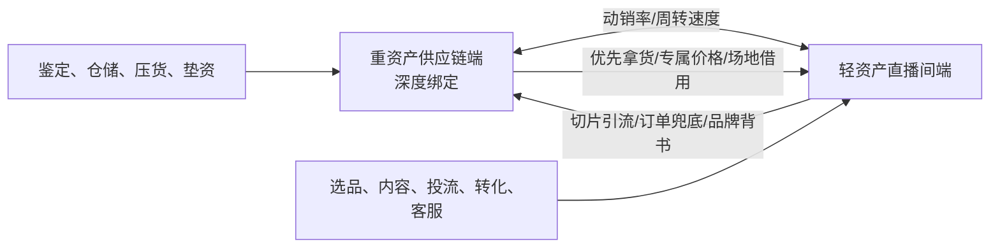
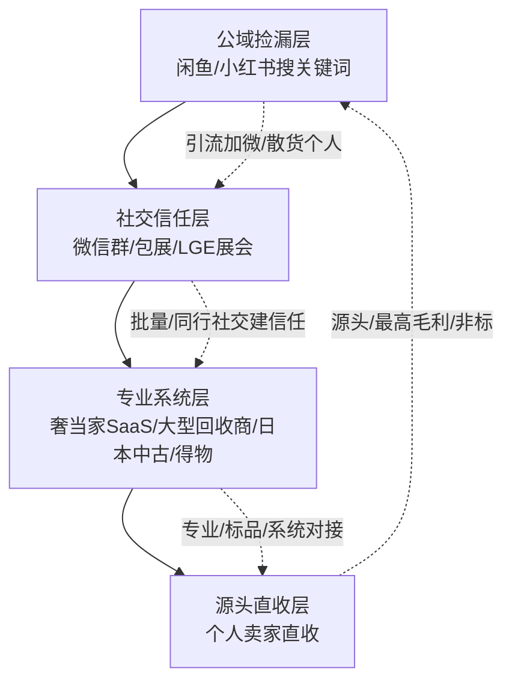

# 第 58 章 二奢创业体系 —— 重轻资产协同与资金周转杠杆的生死博弈

## 学习目标

- 理解二奢行业“同行贸易（B2B）”与“直播带货（B2C）”双轨运营的互补性与博弈性
- 掌握三分货盘分层理论（全新爆款、中古深库存、二奢利润品）及其资金/能力匹配逻辑
- 会用“资金周转杠杆模型”（月利润=自有资金×周转次数×单次毛利率）测算业务上限
- 理解“轻重资产协同生存法则”：直播间解决动销率，供应链解决货源成本
- 掌握同行社交裂变增长法、鉴定师证书准入资产、全渠道货源地图构建法等核心获客与供应链方法论
- 能识别“崩盘源于重轻失衡与资源错配”等典型死亡陷阱，建立现金流优先的风控红线
- 掌握分层出货分销策略、风控三重防线、直播间标准化复制模板等落地执行 SOP

## 58.1 生活类比

想象二奢创业是一场**“接力赛兼拔河赛”**：同行贸易（B2B）是**短跑接力棒**，跑得快（周转快）、换手频（动销率高）、掉棒即死（断供/资金链断），是“现金奶牛”保命；直播带货（B2C）是**拔河长绳**，力气大（毛利高）、赢了立威（建品牌）、但极耗体力（烧现金、周期长），是“品牌资产”谋远。三分货盘就是**三种重量的哑铃**：全新爆款=轻哑铃（高频快周转）、中古深库存=重哑铃（高毛利靠眼力）、二奢利润品=中哑铃（核心主力）。资金周转杠杆是**杠杆原理**：支点（自有资金）固定，力臂（周转次数）越长，撬起的利润越大，但杠杆过长（压货比例超3:1）会折断。轻重协同是**赛车手（直播间）+修车厂（供应链）**：赛车手跑得快需要修车厂随时换胎加油（动销率），修车厂买零件要钱需要赛车手赢比赛分红（现金流），俩人签“终身绑定合同”（深度绑定）才敢互相投入。同行社交是**摆地摊的老乡群**：大家都在一个大集市（微信群/包展），谁家货好谁家价低大家心知肚明，天天吆喝（发朋友圈）、换摊位（换群）、拉新人（拉群），信任比广告管用。鉴定师证书是**行业通行的“防伪水印”**：买卖双方都认这张纸（小绿牌），有了它交易摩擦趋零，没有它每笔交易都得花钱验货（78-90元）。崩盘教训是**把拔河绳系在接力棒上，结果两头都没抓住**：资源全给拔河（直播），接力棒（供应链）没人接，队友（骨干）跑了，比赛（公司）直接结束。

## 58.2 概念地图

- 二奢创业体系
  - 核心商业模型
    - 二奢双轨运营模式（B2B同行贸易+B2C直播带货）  —— P001
    - 三分货盘分层理论（全新爆款/中古深库存/二奢利润品）  —— P002
    - 资金周转杠杆模型（月利润=资金×周转×毛利，资金比3:1）  —— P003
  - 组织与生存法则
    - 轻重资产协同生存法则（重供应链+轻直播间，深度绑定）  —— P004
    - 崩盘源于重轻失衡与资源错配（现金流业务优先保障）  —— P004
    - 革命友谊>商业契约（共同经历生死的信任关系是穿越周期根因）  —— P004
  - 渠道与供应链方法论
    - 同行社交裂变增长法（建60+群，避封SOP，同行即客户/供应商/情报源）  —— P005
    - 全渠道货源地图构建法（闲鱼/小红书→微信群/包展→SaaS/展会/日本中古→个人卖家）  —— P008
    - 分层出货分销策略（标品走闲鱼/得物/直播间；非标走包展/私域；尾货清仓）  —— P009
    - 鉴定师证书准入资产（小绿牌=标准化信任货币，降低风控成本）  —— P006
  - 管理与风控体系
    - 飞阅会决策机制（高频结构化会议，解决服务/收费/方向/分工）  —— P007
    - 风控三重防线体系（验货宝78元→本地鉴定30/90元→关系免检0元）  —— P010
    - 直播间标准化复制模板（精品标品号2人可复制 vs 达人流量号不可复制）  —— P011
  - 赛道判断与切入门槛
    - 二奢赛道‘下行期红利’判断（经济下行催生需求、全球40%流入中国、头部家族企业天花板低）  —— P001
    - 资金门槛即唯一硬门槛（无技术/品牌/渠道壁垒，唯缺资金或信用卡额度）  —— P001
    - 动销率决定生死定律（源头供应链资金压运输途中15天，极度渴望快速套现）  —— P003

## 58.3 二奢双轨运营模式 —— 同行贸易造血，直播带货造品牌

### 为什么需要这个概念？

你想做二奢创业，首先面临一个残酷现实：这个行业**没有技术壁垒、没有品牌壁垒、没有渠道绝对壁垒**，唯一的硬门槛是**资金**（或信用卡额度）[P001, 定理“资金门槛即唯一硬门槛论”]。但光有钱还不够，如果你只做B2B同行贸易，你只是个搬运工，赚辛苦钱，天花板低、无品牌溢价；如果你只做B2C直播带货，你又极易死在“烧钱长周期、断货无货源、库存积压”的坑里。

> "我们制定了直播带货+同行贸易的经营战略。同行贸易的销售业绩达到了 300 万，直播间销售 GMV 也呈现快速增长趋势，达到了 200 万。将公司资源倾向于直播部门，导致供应链销售部门出现无货可卖的情况。"
> 
> ——《docs/202305/20230516_104.md》

作者凡响的一年创业史，就是一部**“双轨并行 → 资源错配崩盘 → 轻重分离重生”**的教科书级实证。

### 核心定义（来源：《docs/202305/20230516_104.md》）

**二奢双轨运营模式** = **同行贸易（B2B批发/供应链）** + **直播带货（B2C零售）**。下表对比了两条业务线在核心目标、周转速度、资金占用、人才需求与风险点上的本质差异，帮助创业者在资源分配时做动态平衡决策。

| 维度 | 同行贸易（B2B） | 直播带货（B2C） |
|------|----------------|----------------|
| **核心目标** | 资金快速周转、薄利多销、造血（现金流） | 高毛利、建立品牌护城河、谋远（品牌资产） |
| **周转速度** | 极快（天/周级） | 慢（月/季级） |
| **资金占用** | 低（压货少、回款快） | 高（备货多、回款周期长） |
| **人才需求** | 鉴定、供应链整合、销售 | 主播、运营、投流、切片 |
| **风险点** | 无品牌溢价、易被替代 | 烧现金、依赖算法、库存积压风险 |

### 关键性质：互补、博弈、协同

1. **互补性**：同行贸易是“现金奶牛”保障生存，直播间是“品牌资产”谋长远。前期作者公司：**同行贸易月销300万（现金流）、直播间GMV 200万（品牌）**，双轨并行，现金流健康。
2. **博弈性**：**有限库存与资金分配给谁，直接决定生死**。7月管理层将资源全倾斜直播，导致供应链无货可卖、核心骨干离职、资金链断裂 —— 这是典型的“杀鸡取卵”。
3. **协同性**：直播间解决供应链**“动销率”**难题，供应链解决直播间**“货源稳定性与成本”**难题。这是轻重资产协同的基石（详见 58.6 节）。

### 典型演进路径（数据实证）

下表记录了作者团队从双轨并行、到资源错配崩盘、再到破釜沉舟转型、最终轻量化复制的完整演进路径，每一阶段的关键数据均来自实操复盘。

| 阶段 | 时间 | 同行贸易 | 直播带货 | 关键事件 |
|------|------|----------|----------|----------|
| 野蛮生长 | 2022.1-6 | 月销300万 | GMV 200万 | 双轨并行，现金流健康 |
| 资源错配 | 2022.7 | **断奶**（无货可卖） | 吞噬资源 | 供应链骨干离职、资金链断裂 |
| 破釜沉舟 | 2022.8-10 | 外包/深度绑定 | 裁至2主播+最低配 | 砍掉90人团队，外部供应链绑定 |
| 轻量化复制 | 2022.11-2023.1 | 4小团队分裂 | 精品标品号复制 | 单月GMV 700万→1500万、月利稳30万+ |

### 边界条件（非常重要）

- **仅适用于**“重资产供应链+轻资产直播间”可剥离绑定的非标/半标品行业（二奢、珠宝、名表等）。
- **必须具备**极强的供应链整合能力与直播运营能力，**单一能力无法驾驭双轨**。
- **铁律**：现金流业务（同行贸易）必须优先保障，品牌业务（直播）必须在现金流安全垫之上建设。**这是作者用崩盘买来的教训**。

---

## 58.4 三分货盘分层理论 —— 全新爆款周转、中古深库存毛利、二奢利润品核心

### 为什么需要这个概念？

二奢货品**非标性强、SKU极碎**，不分层运营会导致：库存积压、资金沉淀、动销率崩塌。不同货品对资金占用、鉴定能力、周转速度要求完全不同，**一套打法必死**。

> "直播间的货盘可以分为全新爆款、中古深库存和二奢利润品。入局全新爆款的方式是先找到全新爆款的供货方，比如联系欧洲的买手...物流大约 15 天...3 天内抛售，每件货可获得约 1000 多的利润。中古深库存团...每件货只有 10% 的利润，一个月有 60 万的利润。"
> 
> ——《docs/202305/20230516_104.md》

### 核心定义（来源：《docs/202305/20230516_104.md`）

**三分货盘分层理论**：将直播间货品划分为三层，根据**资金实力与团队能力**选择匹配的货盘结构。下表详细对比了三层货盘在典型特征、资金占用、周转速度、核心能力要求、适合资金量与典型利润模型上的差异，是货盘决策的核心参考工具。

| 货盘层级 | 典型特征 | 资金占用 | 周转速度 | 核心能力要求 | 适合资金量 | 典型利润模型 |
|----------|----------|----------|----------|--------------|------------|--------------|
| **全新爆款** | 最新款、海外买手/专柜折扣、标品 | 低（15天物流+3天抛售） | 极快（周级） | 海外渠道、选品判力、标品化管理 | 100-150万 | 单件净利~1000元，月转2-3圈 |
| **中古深库存** | 非标、成色参差、依赖鉴定眼光 | 高（需长期压货） | 慢（月/季级） | 顶级鉴定能力、高净值客群、买手眼光 | >500万 | 月转300万资金2圈，月利60万 |
| **二奢利润品** | 现代款、标准化程度中、核心主力 | 中 | 中 | 精细化直播运营、垂类选品、供应链绑定 | 100-500万 | 精品标品号2人月利10万，可复制 |

### 关键性质：资金/能力匹配是生死线

- **全新爆款** = “轻哑铃”：资金占用短、标品易管、周转极快，**100-150万资金中间商的最优切入标品**。实测：桐庐同行闲鱼模式月GMV 200万、利润20万，资金需100万。
- **中古深库存** = “重哑铃”：极度依赖鉴定师眼力，人才复制难、标准化难，但单件毛利高（3000元+），**月转300万资金2圈、月利60万**，前员工中古团实测验证。
- **二奢利润品** = “中哑铃”：现代款、标准化程度中、核心利润来源，**精品标品直播间垂类包包，2人配置月利10万，可标准化复制**，这是作者重生后的主力模板。

### 典型例子：资金300万团队的分配决策（见动手练习2）

### 边界条件

- 全新爆款依赖海外买手渠道稳定性与专柜折扣政策，**不可控因素多**。
- 中古深库存极度依赖鉴定师眼力，**人才复制难、标准化难**。
- 资金量<100万建议仅做全新爆款；100-500万可做二奢利润品；>500万可布局中古深库存。

---

## 58.5 资金周转杠杆模型 —— 月利润=自有资金×周转次数×单次毛利率

### 为什么需要这个概念？

二奢中间商本质是**“资金周转效率”的生意**。传统电商只看ROI、毛利率，忽略周转次数，在二奢这种高客单、长周期行业会**死得很惨**。作者用崩盘和重生两次实证，证明**动销率（周转速度）是决定收益上限的唯一变量**。

> "比如，如果你有 150 万资金...一个月内你可以完成 300 万的业务，利润 10% 即 30W。作为源头供应链和直播间之间的供货商，你的资金流动比例是 3:1。假设你有 150 万资金...如果每天出货速率是 3 件，一个月就能转一次，利润为 5 W；如果每天出货速率是 9 件，就是 15W 的利润。"
> 
> ——《docs/202305/20230516_104.md》

### 核心定义（来源：《docs/202305/20230516_104.md`）

**核心公式**：

$$
\text{月利润} = \text{自有资金} \times \text{周转次数/月} \times \text{单次毛利率}
$$

**关键约束**：

$$
\text{资金流动比例} = 3:1 \quad (\text{压货资金} : \text{流动采购资金})
$$

**变量拆解与推导逻辑**：

该公式基于资金在“压货”与“流动”两种状态下的流转速度推导而来。二奢中间商的资金结构呈现**3:1固定比例**：即每4元总资金中，3元处于“在途/库存/待售”压货状态，仅1元（25%）为可自由支配的流动采购资金。这1元流动资金每完成一次“采购→验货→发货→回款”的闭环，即为1次周转。周转次数取决于**动销率**（日出货件数×客单价/流动资金），毛利率由市场议价能力决定。三个变量呈乘法关系，意味着任一变量归零，利润即归零；在自有资金与毛利率相对固定的短周期内，**提升周转次数（即动销率）是唯一可操作的杠杆**。

| 变量 | 含义 | 典型值 | 优化杠杆 |
|------|------|--------|----------|
| 自有资金 | 真实可支配现金（非杠杆融资） | 150万/300万/1000万 | 融资成本vs周转收益权衡 |
| 周转次数/月 | 动销率决定，受限于物流/鉴定/转化 | 1-3圈/月 | **核心优化变量**：选品、供应链、直播转化 |
| 单次毛利率 | 市场竞争决定，长期下行 | 5%-15% | 非标品溢价能力、议价权 |

### 关键性质：杠杆放大与崩塌边界

杠杆放大效应显著：以150万自有资金为例，按3:1比例计算，流动采购资金为37.5万。若日出货3件（客单价约1万元），月周转约1圈，月利润约5万元；若日出货9件，月周转3圈，月利润跃升至15万元。**周转率每提升1倍，利润即翻倍，资金量未变而收益倍增，这就是“资金周转杠杆”的本质。**

资金结构红线不可逾越：必须保持3:1流动比例。一旦压货比例失控（如囤积滞销中古货导致流动资金不足3:1），将面临“买不到新货、旧货卖不出、利息压垮现金流”的死亡螺旋。作者崩盘期即因资源倾斜直播导致供应链动销率归零，流动资金断流，3:1结构瞬间崩塌。

动销率大于规模：头部供应链资金压在运输途中15天，极度渴望快速套现，中间商核心价值是提供“快速出口”[P001, 定理“动销率决定生死定律”]。**不看GMV规模，只看动销率（周转天数/出货件数），这是生存的物理定律。**

### 实证数据验证

下表汇总了作者不同阶段及同行案例的实测数据，验证了模型在不同资金量、周转率、毛利率组合下的预测准确性。

| 场景 | 资金 | 周转/月 | 毛利率 | 月利润 | 验证来源 |
|------|------|---------|--------|--------|----------|
| 作者初期 | 150万 | 2圈 | 10% | 30万 | 作者推演 |
| 桐庐同行 | 100万 | 2圈 | 10% | 20万 | 闲鱼模式实测 |
| 中古团 | 300万 | 2圈 | 10% | 60万 | 前员工创业实测 |
| 崩盘期 | - | **归零** | - | **负** | 供应链断奶 |
| 重生期 | 轻资产 | 高周转 | 稳定 | 30万+ | GMV 1500万峰值 |

### 公式在业务决策中的指导作用

该模型直接指导三类核心决策：
1. **采购量决策**：流动资金额度=总资金÷4，采购总额不得超过流动资金额度，否则破坏3:1结构。
2. **动销率红线设定**：倒推日出货件数=（目标月利润÷毛利率÷自有资金）÷30天×客单价，作为直播间与供应链的共同KPI。
3. **融资边界判断**：若融资成本（年化）高于（周转次数×毛利率×12），则融资增加资金反而降低净利，必须拒绝高成本融资。

### 边界条件

- 仅适用于“有稳定货源渠道+确定性出货渠道”的中间商模式，**纯投机炒货不适用**。
- 周转次数受限于物流周期（海运15天）、鉴定周期、直播间转化率，**不可无限提升**。
- 毛利率受市场竞争压缩，长期看**周转率是唯一可持续优化的变量**。

---

## 58.6 轻重资产协同生存法则 —— 重资产供应链解决货，轻资产直播间解决销

### 为什么需要这个概念？

重资产（压货/鉴定/仓储）与轻资产（流量/转化/客服）若**合二为一，必死于“既要周转又要品牌”的资源撕裂**。行业演变趋势是**剥离并深度绑定**：专业供应链做供应链，专业直播团队做直播，中间商赚“信息差+资金周转效率差”。

> "现在随着直播的发展，一些公司开始专注于轻资产运营，专做直播，争夺 C 端流量，这为重资产供应链提供了机会。重资产供应链的关键在于动销率，而动销率受到前端直播间需求和后端源头供应链的影响。我们找到了一家行业内的头部供应链以赋能直播 + 深度绑定的方式进行合作。"
> 
> ——《docs/202305/20230516_104.md》

### 核心定义（来源：《docs/202305/20230516_104.md`）

**轻重资产协同模型**通过以下流程图呈现：重资产供应链端与轻资产直播间端通过“动销率”与“ROI/GMV”双向驱动，核心能力分层解耦，利益深度绑定。

**协同机制**：
- 直播间解决供应链**“动销率”**难题（帮他们快速出货回笼资金）
- 供应链解决直播间**“货源稳定性与成本”**难题（优先拿货、专属价格、场地/人员借调）
- **深度绑定 ≠ 松散合作**：通过“赋能直播+深度绑定”话术锁定头部供应链，实现货源优先权、场地借用、人员借调

### 关键性质：分离性、绑定性、标准化

下表对比了重资产供应链与轻资产直播间在组织架构、核心指标、激励机制、标准化输出上的差异，揭示“物理分离、利益绑定”的组织设计逻辑。

| 维度 | 重资产供应链 | 轻资产直播间 | 协同机制 |
|------|--------------|--------------|----------|
| **组织架构** | 独立核算、独立团队 | 独立核算、极简团队(2人) | 物理分离、利益绑定 |
| **核心指标** | 动销率、周转天数 | ROI、GMV、转化率 | 互为因果 |
| **激励机制** | 分成/保底+超额奖 | 无底薪纯分成、绩效奖 | 共担风险、共享收益 |
| **标准化输出** | 小绿牌鉴定、SOP发货 | 精品标品号模板(可复制) | 复制放大 |

### 典型演进对比（作者实证）

下表对比了崩盘前（90人耦合）、重生后（轻重分离+绑定）、前员工拆分（4小团队）三种组织形态的关键指标，**数据证明：轻量化协作的人均效能与利润率显著优于大公司病耦合模式**。

| 指标 | 崩盘前（90人耦合） | 重生后（轻重分离+绑定） | 前员工拆分（4小团队） |
|------|-------------------|------------------------|----------------------|
| 团队规模 | 90人 | 2主播+最低配 | 3-5人/团队 |
| 组织形态 | 重轻耦合、大公司病 | 外部供应链深度绑定 | 完全独立小团队 |
| 月GMV | 崩盘 | 700万→1500万 | 300万/团队(中古团) |
| 月利润 | **亏损** | **稳定30万+** | 60万/月(中古团) |
| 人均效能 | 低 | 高 | **最高** |

**关键洞见**：前员工拆分为4个小团队（各3-5人）后，**反而实现了更高人均效能与利润率**，印证“轻量化协作优于大公司病”[P001, finding“前员工拆分创业的‘小而美’验证”]。

### 谈判话术实战：如何“赋能直播+深度绑定”锁定头部供应链？（见动手练习3）

### 边界条件

- 要求供应链方有“动销率焦虑”且愿意让利换周转，**纯坐地起价供应链无法绑定**。
- 直播间必须具备稳定的内容生产与投流能力，**否则无法兑现“赋能”承诺**。
- 适用于非标/半标品、高客单、强鉴定需求行业；标品强供应链行业（如3C）不适用。

---

## 58.7 同行社交裂变增长法 —— 同行即客户、即供应商、即情报源

### 为什么需要这个概念？

二奢渠道**极度分散、隐蔽**，平台流量昂贵且不精准，传统广告获客成本极高。但**同行群体天然聚集了双向流量需求**：既是买家也是卖家，也是最懂行情的情报源。

> "我建了 60 多个同行群，在同行中产生影响力。很多新人通过我找到了合作伙伴。现在他们也是我了解行情的眼睛。解决供应链端的流量问题是赚钱的关键，同行资源最容易获取。建议每个账号至少养一个月，加好友每 24 小时不超过 12 人...长期更新朋友圈，每天可更新 100 条。"
> 
> ——《docs/202305/20230516_104.md》

### 核心定义（来源：《docs/202305/20230516_104.md`）

**同行社交裂变增长法** = **微信群/朋友圈/包展** 同行社交网络 × **高频价值输出**

**核心逻辑**：同行即客户、即供应商、即情报源 → 通过“建群-拉群-换群-输出价值”建立渠道护城河。

### 关键性质：避封SOP + 价值交换 + 渠道分层

#### 1. 微信生态避封SOP（实测有效参数）

下表汇总了作者实测有效的微信生态操作红线，**每一项参数突破都将导致封号/封群，归零一切社交资产**，必须作为铁律执行。

| 操作 | 限制参数 | 目的 |
|------|----------|------|
| 养号 | **≥1个月** | 建立账号权重 |
| 加好友 | **≤12人/24小时** | 规避频控 |
| 换群 | **间隔3小时/次≤10人** | 规避群封禁 |
| 发广告图 | **≤3张/4小时** | 规避内容审核 |
| 朋友圈 | **日更100条，描述词详细** | 同行搜索朋友圈是找货第一步 |

#### 2. 价值交换飞轮

- **新人**通过作者找到合作伙伴（获客/找货）
- **作者**获取行业眼睛与渠道影响力（情报/话语权）
- **形成正向飞轮**：影响力越大 → 吸引更多同行 → 渠道越宽 → 成交越多 → 影响力越大

#### 3. 渠道分层漏斗（从公域到源头）

### 典型例子：作者建60+同行群，成行业节点

- 朋友圈日更100条详细描述词，**因同行搜索朋友圈是找货第一步**
- 微信生态避封参数实测有效，支撑低成本、高信任度的双向渠道建设
- 新人通过他找伙伴，他通过他们了解行情，**双向赋能**

### 边界条件

- 仅适用于“同行高频互动、信息不对称大、信任成本高”的非标品行业。
- 需投入大量时间维护社群、产出内容、做撮合服务，**非一次性投入**。
- 微信生态规则收紧（加好友限制、群封禁）可能随时失效，**需持续迭代避封SOP**。

---

## 58.8 鉴定师证书准入资产 —— 小绿牌是正品流通的标准化信任货币

### 为什么需要这个概念？

二奢核心痛点是**假货风险**。平台验货宝贵且赔付慢，自建鉴定团队成本高、信任度低。行业缺乏统一标准，“小绿牌”作为**准入门槛与信任背书**，能显著降低收货风控成本、提升货品流通效率。

> "正品有流通价值，小绿牌是正品的标准，鉴定师培训费用约为 2 万元，培训 6 天 + 考试 1 天发证书。学个鉴定师证书吧，只需 7 天脱产学习，终身服务带你入行...证书会越来越难获取随着行业发展。"
> 
> ——《docs/202305/20230516_104.md》

### 核心定义（来源：《docs/202305/20230516_104.md`）

**鉴定师证书准入资产** = **行业核心准入门槛** + **标准化信任货币** + **可积累隐性资产**

- 新人必须考证（7天脱产、2万学费），不仅为了技能，更为了建立“小绿牌”标准化信任体系
- 证书随行业规范化升值，是**可积累、可复用的隐性资产**

### 关键性质：信任货币 + 风控分层 + 准入壁垒

#### 1. 信任货币：小绿牌 = 正品流通标准

下表对比了三种身份在单次验货成本、时效、适用场景上的差异，**持证/深度绑定者享受零成本、分钟级验货特权，这是“小绿牌”作为信任货币的直接体现**。

| 身份 | 单次验货成本 | 时效 | 适用场景 |
|------|--------------|------|----------|
| 无证/普通商家 | 78元（验货宝含赔） | 天级 | 标品/中小单 |
| 本地鉴定师 | 30元(不包赔)/90元(包赔) | 小时级 | 非标/大单 |
| **持证/深度绑定** | **0元（免费/优先）** | **分钟级** | **高频/核心供应链** |

#### 2. 风控三重防线（详见 58.12 节）

#### 3. 准入壁垒随时间升高

- 证书获取难度随行业发展递增（考试更严、学费更高）
- **早考早享受红利**，作者建议新人入行第一件事就是考证

### 典型例子

- 作者亲历：崩盘重组后依靠鉴定师证书体系快速建立信任，与头部供应链达成深度绑定
- 前员工创业：中古团、定向找货团均以鉴定能力为核心竞争力，月利十几万到60万
- 行业趋势：鉴定师培训费约2万、6天培训+1天考试，证书含金量随规范化上升

### 边界条件

- 证书仅解决“鉴定能力背书”，**不解决“货源渠道、销售渠道、资金周转”等核心商业问题**。
- 适用于二奢、珠宝、名表等强鉴定需求行业；标品弱鉴定行业无此刚需。
- 随着AI鉴定技术发展，人工鉴定师证书价值可能面临**长期贬值风险**。

---

## 58.9 飞阅会决策机制 —— 高频结构化会议从混沌中提取确定性

### 为什么需要这个概念？

早期创业团队**认知不统一、决策拖沓、试错周期长**，缺乏强制对齐机制会死在内耗中。关键节点（服务定价、业务方向、人员分工）若无结构化决策流程，极易拍脑袋决策导致资源错配。

> "我们立即开了个飞阅会，解决了提供哪些服务以及如何收费的问题...于是我们每天开会复盘，不断调整业务方向，开始尝试分出一部分人来找货，分出一部分人来卖货...真正厉害的是这个人，他的系统性思考，高效率的组织飞阅会，我一直在学习他，复制他做到的事情。"
> 
> ——《docs/202305/20230516_104.md》

### 核心定义（来源：《docs/202305/20230516_104.md`）

**飞阅会** = **团队高频、结构化的快速决策会议机制**

- 用于解决：“提供什么服务、如何收费、业务方向调整、人员分工”等关键节点
- **强制对齐认知、压缩试错周期**，是早期小团队混沌中提取确定性的核心管理工具

### 关键性质：高频性 + 结构化 + 决策导向

下表拆解了飞阅会的三大核心特性及其具体执行标准、产出物，**会议纪要必须落笔成文、追踪执行，否则形同虚设**。

| 特性 | 具体做法 | 产出物 |
|------|----------|--------|
| **高频性** | 早期每天开会复盘，不断调整业务方向 | 每日行动清单 |
| **结构化** | 固定议程：复盘数据→对齐目标→决策分工→定责任人→设截止期 | 会议纪要+执行清单 |
| **决策导向** | 不讨论大方向，**只解决当下阻塞问题** | 可执行的行动清单 |

### 典型应用节点

下表记录了飞阅会在作者创业不同阶段解决的关键问题与结果，**每次会议都直接改变了资源配置方向，是生死转折的指挥中枢**。

| 阶段 | 解决的关键问题 | 结果 |
|------|----------------|------|
| 野蛮生长期 | “提供哪些服务以及如何收费” | 确立双轨运营战略 |
| 崩盘期 | 每天复盘，决定砍掉所有人只留2主播 | 极致精简、外包供应链 |
| 重生期 | 复制精品标品直播间模板 | 规模化扩张、GMV 1500万峰值 |

### 边界条件

- 仅适用于“高不确定性、小团队、快速迭代”的0-1/1-10阶段，**成熟期需转为周会/月会制**。
- 依赖核心决策者具备**系统性思考与高效组织能力**，无此类人才飞阅会易变成吐槽大会。
- 会议纪要必须**落笔成文、追踪执行**，否则形同虚设。

---

## 58.10 全渠道货源地图构建法 —— 从闲鱼捡漏到日本中古交易所的分层渠道体系

### 为什么需要这个概念？

二奢货源**极度碎片化、隐蔽化**，无官方统一批发市场，不建立地图等于盲人摸象。不同层级渠道（个人卖家/回收商/买手/展会/平台）价格、周转、品控差异巨大，**需分层匹配**。

> "商品流通链路包括：工厂→专柜→第一位买家→回收二奢商家→出货二奢商家→最后一位买家。闲鱼：搜索 LV、Gucci、香奈儿等品牌...索要微信联系方式。小红书：搜索“二奢”、“包包”...微信群：添加通群好友...包展：关注 LGE 👸号...奢当家 APP...大型回收商...大型洗护商...日本中古交易所。"
> 
> ——《docs/202305/20230516_104.md》

### 核心定义（来源：《docs/202305/20230516_104.md`）

**全渠道货源地图构建法** = **系统性梳理并实操的二奢上游货源获取方法**，建立“渠道-品类-价格-周转”数据库，实现定向找货。

#### 渠道分层漏斗（4层递进）

下表构建了从公域捡漏到源头直收的四层渠道体系，每层渠道的货品特征、信任成本、适合阶段差异巨大，**创业者需根据自身资金与能力选择切入层级，并逐步向上游渗透**。

| 层级 | 渠道类型 | 典型渠道 | 货品特征 | 信任成本 | 适合阶段 |
|------|----------|----------|----------|----------|----------|
| **L1 公域捡漏** | 闲鱼/小红书搜关键词引流加微 | 闲鱼/小红书 | 散货、个人、价格参差 | 高（需验货） | 0-1冷启动 |
| **L2 社交信任** | 微信群/包展/LGE展会线下 | 同行群/包展/展会 | 批量、同行、可看货 | 中（需社交） | 1-10规模化 |
| **L3 专业系统** | SaaS/平台/交易所系统对接 | 奢当家/大型回收商/洗护平台/日本中古/得物 | 专业、标品、系统对接 | 低（平台背书） | 10-100成熟期 |
| **L4 源头直收** | 个人卖家(首位买家)直收 | 一手个人卖家 | 源头、最高毛利、非标 | 极高(需极强信任) | 头部玩家 |

### 关键性质：漏斗筛选 + 动态维护 + 双向赋能

1. **漏斗筛选**：广撒网（L1）获取线索 → 深度社交（L2）建立信任 → 系统对接（L3）规模化采购 → 源头直收（L4）极致利润
2. **动态维护**：建立专人/专团队持续更新渠道库，标记每渠道擅长品类、报价体系、发货周期、退换货政策
3. **双向赋能**：帮供应链解决动销率（直播带货），换取优先拿货权、专属价格、联合选品

### 典型例子：作者团队分工验证

- **第二团队**：专做定向找货，对接大量收货上游渠道，几个人在闲鱼、微信群找专门品类供货商
- **崩盘后**：零资源状态下通过“赋能直播+深度绑定”话术说服头部供应链提供货源、场地、人员
- **供应链视角**：作者团队影响下其两个直播间业绩翻倍增长，验证“帮供应链解决动销率”最大杠杆

### 边界条件

- 需具备极强的**社交穿透力与谈判能力**，纯内向技术型创业者极难跑通。
- 渠道信息时效性极强（爆款周期短、价格波动大），**数据库不更新即失效**。
- 线下展会/包展需实地跑动，时间成本高，**非本地创业者参与门槛高**。

---

## 58.11 分层出货分销策略 —— 标品走量、非标走价、尾货清仓的渠道匹配矩阵

### 为什么需要这个概念？

二奢SKU极碎、非标性强，单一出货渠道必然导致：爆款卖不出去、滞销品占资金、尾货亏本甩卖。不同属性货品对应**完全不同的最优出货路径**。

> "闲鱼是最大的二手市场，低价包包可以在闲鱼上直接卖...即使不用技巧，随意挂卖也会有商家找你购买。与固定的直播间合作，长期提供货源...针对每个直播间，了解他们能卖的包包类型，长期在市场上寻找这些包包类型。在得物上出售商品...流程快速，可轻松多次转卖商品。参加包展...一天就能卖出很多。核心原则：快进快出，资金不沉淀。"
> 
> ——《docs/202305/20230516_104.md》

### 核心定义（来源：《docs/202305/20230516_104.md`）

**分层出货分销策略**：根据货品属性匹配最优出货渠道，**核心原则：快进快出，资金不沉淀，动销率第一、利润率第二**。下表构建了渠道匹配矩阵，明确了不同货品属性的最优出货渠道、核心逻辑、典型周转与利润模型。

| 货品属性 | 最优出货渠道 | 核心逻辑 | 典型周转 | 典型利润 |
|----------|--------------|----------|----------|----------|
| **标品/高周转** (全新爆款) | 闲鱼/得物/同行群批发/固定直播间长供 | 标品流转最快、流程标准、适合批量走量 | 极快(周级) | 薄利多销(单件~1000元) |
| **非标/高毛利** (中古深库存) | 包展/私域高净值/定向直播间 | 非标高毛利品唯一出口，需现场/视频验货、依赖人际信任 | 慢(月/季级) | 高毛利(单件3000+) |
| **积压/尾货** | 包展清仓/同行低收 | 接受低价换现金流，**绝不让库存过夜** | 即时 | 亏本回血 |

### 关键性质：渠道精准匹配

- **闲鱼/得物**：标品流转最快，**即使随意挂卖也有商家主动找你收**，适合批量走量
- **固定直播间长供**：针对每个直播间画像定向备货，建立稳定供需关系，**降低寻品成本**
- **包展/私域高净值**：非标高毛利品唯一出口，单笔利润高但周转慢，依赖人际信任
- **尾货处理**：包展现场清仓/同行低价收割，**亏本也要回笼资金**

### 典型例子：三分货盘的出货闭环

下表展示了三分货盘各层级对应的出货渠道组合、周转周期与利润模型，**形成了从高周转薄利到高毛利慢周转再到尾货清仓的完整资金闭环**。

| 货盘层级 | 出货渠道组合 | 周转周期 | 利润模型 |
|----------|--------------|----------|----------|
| 全新爆款 | 闲鱼/得物/同行群/固定直播间 | 15天物流+3天抛售 | 单件净利1000+ |
| 中古深库存 | 包展/私域高净值/定向直播间 | 月转300万2圈 | 月利60万 |
| 积压尾货 | 包展清仓/同行低收 | 即时 | 亏本回血 |

### 边界条件

- 要求对每个渠道的**用户画像、价格容忍度、结算周期、退货率了如指掌**。
- 固定直播间长供模式需直播间端具备稳定流量与转化，否则会成烂尾供应链。
- 包展/线下渠道受疫情/政策/季节性影响大，**不可作为唯一依赖渠道**。

---

## 58.12 风控三重防线体系 —— 平台担保+本地鉴定+关系免检的假货防御纵深

### 为什么需要这个概念？

二奢假货风险是**行业生死线**，单一验货手段成本高、时效慢、赔付难。随业务规模扩大，假货概率必然上升，必须建立**分层、分级、可量化的风控体系**。

> "防止收到假货的方式：使用闲鱼的验货宝服务，收费 78 元，如鉴定后仍是假货可找闲鱼理赔；或找本地周边鉴定师，收费 30 元不包赔或 90 元包赔，也可选择收费的鉴定软件；与鉴定师建立关系，免费获得鉴定服务。正品有流通价值，小绿牌是正品的标准。"
> 
> ——《docs/202305/20230516_104.md》

### 核心定义（来源：《docs/202305/20230516_104.md`）

**风控三重防线体系** = **平台担保** + **本地鉴定** + **关系免检** + **小绿牌标准化流转**。下表详细定义了三层防线在方式、成本、赔付、时效、适用场景、信任基础上的递进关系，**成本递减、时效递增、信任跃迁是核心演进逻辑**。

| 防线层级 | 方式 | 成本 | 赔付 | 时效 | 适用场景 | 信任基础 |
|----------|------|------|------|------|----------|----------|
| **第1层** | 闲鱼验货宝 | 78元 | 含赔 | 天级 | 标品/中小单 | 平台信任 |
| **第2层** | 本地鉴定师 | 30元(不包赔)/90元(包赔) | 可选 | 小时级 | 非标/大单 | 专家信任 |
| **第3层** | 深度绑定鉴定师 | **0元** | 关系担保 | **分钟级** | 高频/核心供应链 | **关系信任** |
| **终极** | **小绿牌标准** | **内化** | **行业标准** | **零摩擦** | **全渠道流通** | **行业标准信任** |

### 关键性质：成本递减 + 时效递增 + 信任跃迁

1. **成本递减**：单次验货成本从 78元 → 90元 → 30元 → **0元**，随业务规模与关系深度递减
2. **时效递增**：从平台流程（天级）→ 本地上门/寄送（小时级）→ 关系优先（**分钟级**）
3. **信任跃迁**：从“平台信任” → “专家信任” → “关系信任”，最终内化为“小绿牌”**行业标准信任**

### 典型演进路径（作者实操）

下表记录了作者团队从冷启动到行业化的风控演进路径，**每一阶段的主力防线切换都伴随着业务规模跃升与验货成本大幅下降**。

| 阶段 | 主力防线 | 验货成本 | 信任基础 | 业务规模 |
|------|----------|----------|----------|----------|
| 冷启动 | 第1层(验货宝) | 78元/单 | 平台背书 | 小单/标品 |
| 规模化 | 第2层(本地鉴定师网络) | 30-90元/单 | 专家信任+软件辅助 | 非标/大单 |
| 成熟期 | 第3层(核心鉴定师深度绑定) | **0元** | 关系信任/小绿牌互认 | 高频/核心供应链 |
| 行业化 | 小绿牌标准 | 内化 | 行业标准 | 全渠道流通 |

### 边界条件

- 第3层关系免检**仅限极高信任度的核心渠道**，泛滥使用必遭背刺。
- 验货宝/本地鉴定师仅能鉴定“真假”，**无法鉴定“新旧/成色/配件完整度”**，需自建成色把控SOP。
- 随行业规范化，“小绿牌”可能演变为准入牌照，**成本优势消失，需持续构建新护城河**。

---

## 58.13 直播间标准化复制模板 —— 精品标品号可复制，达人流量号不可复制

### 为什么需要这个概念？

直播带货极度依赖**人（主播）、货（选品）、场（运营）**，不标准化**无法规模化、无法复制、无法估值**。盲目复制头部达人模式（全靠个人IP、全品类联盟选品）必死于“人走茶凉、不可复制、成本高”，需提炼可复制的“精品标品号”模板。

> "重新明确了两位主播的不同路线：一位走不可复制的达人路线...每月利润约 15W；另一位走可以复制的精品二奢包包直播间，每月利润约 10W，成本只需 2 人...作为接下来几个月的复制模板，不断复制直播团队。短视频运营每天批量剪辑直播切片视频，直播运营组织团队每天播一场...开始每天两场 12 小时的直播。"
> 
> ——《docs/202305/20230516_104.md》

### 核心定义（来源：《docs/202305/20230516_104.md`）

**直播间双模板SOP**将成熟直播间拆解为两种截然不同的标准化模式：下表对比了**达人流量号**（不可复制、依赖个人IP、全品类联盟选品、10人+团队、月利15万）与**精品标品号**（可复制、2人配置、垂类二奢包包、月利10万）的核心差异，**精品标品号是规模化复制的主力模板**。

| 维度 | **达人流量号（不可复制）** | **精品标品号（可复制·主力模板）** |
|------|---------------------------|----------------------------------|
| **核心依赖** | 个人IP、达人效应 | 标准化流程、垂类专业度 |
| **选品模式** | 全品类联盟选品 | **垂类二奢包包**、自主选品 |
| **人员配置** | 运营+主播+中控+客服+仓储(10人+) | **仅2人：主播+中控** |
| **月利润** | ~15万 | **~10万** |
| **可复制性** | 低（强依赖个人） | **高（标准化SOP）** |
| **供应链** | 自建/松散合作 | **深度绑定头部供应链(外包)** |

### 精品标品号核心SOP（可直接复制的执行清单）

下表将精品标品号的日常运营拆解为五大标准化环节，明确了标准动作、责任人、频次指标，**这是“可复制”的物理载体，新团队入职即按此执行**。

| 环节 | 标准动作 | 责任人 | 频次/指标 |
|------|----------|--------|-----------|
| **短视频引流** | 批量剪辑直播切片→发布抖音/视频号 | 短视频运营 | 日产切片N条、爆款率>5% |
| **直播排期** | 每天1场→每天2场12小时 | 直播运营 | 单场GMV>5万、ROI>1.3 |
| **主播话术** | 专业讲解(材质/工艺/搭配)+互动促单+成交话术 | 主播 | 开口率>30%、转化率>3% |
| **中控操作** | 切片上链接/改价/数据监控/话术提醒/违规规避 | 中控 | 零违规、链接挂载100%准确 |
| **供应链协同** | 选品需求单→备货确认→发货跟踪→退货处理 | 主播/中控+供应链 | 48h发货率100%、退货率<5% |

### 典型实证数据（作者重生后）

下表记录了作者重生后三个月的关键动作与实测数据，**验证了“精品标品号+切片引流+双场12小时+团队复制”模式的可规模化性**。

| 月份 | 关键动作 | GMV | 月利润 | 验证点 |
|------|----------|-----|--------|--------|
| 11月 | 单条爆款视频引流 | 700万 | - | 切片引流有效 |
| 12月 | 双场12小时常态化 | 1000万 | - | 模板跑通 |
| 次年1月 | 规模化复制团队 | **1500万(峰值)** | **30万+** | **可规模化复制** |
| 前员工验证 | 门店对接团单人 | - | **十几万/月** | **极简团队可行** |

### 边界条件

- 仅适用于“垂直品类、标准化程度中、客单价高、供应链可外包”的非标品行业。
- 主播虽不需超强个人IP，但需具备**专业讲解能力、抗压能力、合规意识**，招聘培训有门槛。
- **严重依赖外部供应链稳定性**，供应链断供/涨价/限货直接导致直播间死播。

---

## 58.14 设计中的取舍

**为什么不“自建供应链+自建直播团队”垂直一体化？** 因为“重重耦合”会杀死现金流。作者崩盘前90人大团队就是垂直一体化：既压货又直播，资源在“长周期高投入直播”和“短周期快回笼供应链”撕裂中枯竭。**轻重分离+深度绑定**才是生存法则：供应链专心压货鉴定，直播间专心流量转化，中间用“利益绑定”缝合。

**为什么“全新爆款”虽然利润薄(~10%)却是首选切入标品？** 因为“动销率>利润率”在资金受限时是绝对真理。15天物流+3天抛售=18天回款，资金周转3:1结构下，月转2圈=年化240%收益率。**中古深库存单件利润3000+但周转30-60天**，资金占用巨大，稍有风吹草动即断供。新手**资金量<100万只能做全新爆款**，这是物理定律。

**为什么同行社交要“日更100条朋友圈”这种看似低级的动作？** 因为在非标品行业，“信任成本”远高于“获客成本”。同行搜索朋友圈是找货第一步，**详细描述词=专业度信号=信任降维打击**。避封SOP(养号1月/加好友≤12/换群间隔3h)是微信生态生存的**物理底线**，突破即封号归零。这是用“笨功夫”换“信任护城河”。

**为什么“鉴定师证书”要花2万/7天去考，而不是直接找人合伙？** 因为“小绿牌”是行业通行的“防伪水印”，是可积累的准入资产。合伙人可能离职、分家，证书永归你有。单次验货省78-90元，月验100单=省1万，半年回本。**更重要的是**：持证=行业话语权、供应链谈判筹码、直播间专业人设背书，**复利远超学费**。

**为什么“精品标品号”只有2人(主播+中控)，敢于外包供应链/客服/仓储？** 因为“核心能力只做不可外包的事”。供应链(重资产)外包给头部绑定，客服/仓储外包给专业团队，**自己只留“流量转化”这把刀**。2人成本极低(无底薪纯分成)、决策链极短(主播+中控即时决策)、可复制性极强，**这是“组织进化三阶段”中从“设计者”到“带将者”的最小闭环单元**。

---

## 58.15 动手练习

### 练习 1：资金周转杠杆实战测算

假设你有 200 万自有资金，计划切入“全新爆款”赛道（单件毛利 1000 元，毛利率约 10%，物流周期 15 天+销售周期 3 天）：

1. 计算理论最大月周转次数（提示：资金流动比例 3:1，即 25% 流动资金用于采购）
2. 估算月利润上限
3. 若实际日出货仅 2 件，月利润是多少？动销率瓶颈在哪里？

**回答问题**：
- 为何“资金量翻倍 ≠ 利润翻倍”？结合“动销率决定生死定律”解释
- 如果供应链端突然延迟发货 10 天，你的资金周转模型会如何崩塌？

### 练习 2：三分货盘资源分配决策

某二奢团队资金 300 万，核心成员 3 人（1 懂鉴定、1 懂直播、1 懂供应链），面临以下货源机会：

- **A. 欧洲买手渠道**：最新款 LV 包，专柜 5 折，15 天后到货，预估 3 天售罄，单件利润 1500 元，需预付全款
- **B. 本地回收商批量货**：中古 Chanel 包 20 只，成色参差，需逐只鉴定定价，预估单件毛利 3000 元，周转周期 30-60 天
- **C. 同行群转让**：现代款 Gucci 包 10 只，成色极新，单件利润 800 元，7 天可周转

**任务**：
1. 根据三分货盘理论，判断 A/B/C 分别属于哪一层？
2. 基于团队能力与资金 3:1 流动比例，制定本月采买分配方案（金额+数量）
3. 设定止损线：若 A 货延迟 20 天到货，或 B 货鉴定出 5 只假货，如何触发熔断机制？

### 练习 3：轻重协同谈判实战推演

你运营一个“精品标品直播间”（2 人团队，日均 GMV 10 万，ROI 1.3），想深度绑定一家头部供应链（月销 500 万，自建直播间亏损，动销率焦虑）：

1. 设计“赋能直播+深度绑定”谈判话术三步走（切入痛点→展示能力→锁定利益），要求包含具体数据承诺
2. 列出双方必须约定的 5 项核心 SLA（服务等级协议），如：备货响应时长、假货赔付标准、切片视频交付频次、专属价格折扣、优先拿货权
3. 识别 3 个最大谈判风险点（如：供应链自建直播间转好后反悔、货源被截胡、鉴定标准不一），并给出预案

**回答问题**：
- 为何“供应链借房间给你开播”属于深度绑定的核心信号？
- 如何用“飞阅会决策机制”快速响应供应链端突发断货？

---

## 58.16 本章小结

这一章中我们学习了二奢创业的完整体系：从宏观赛道判断到微观执行 SOP，核心贯穿一条主线——**“资金周转效率是生死线，轻重协同是生存法则，标准化复制是规模化路径”**。

首先，我们拆解了**二奢双轨运营模式**：同行贸易（B2B）造血、直播带货（B2C）造品牌，两者互补博弈，**现金流业务必须优先保障**，这是作者用崩盘买来的铁律。其次，我们掌握了**三分货盘分层理论**：全新爆款(轻/快周转)、中古深库存(重/高毛利)、二奢利润品(中/核心主力)，**根据资金/能力匹配货盘结构**，而非贪多求全。接着，我们推导了**资金周转杠杆模型**：月利润=自有资金×周转次数×毛利率，**3:1资金流动比例**与**动销率**是核心约束与唯一优化杠杆。然后，我们深度剖析了**轻重资产协同生存法则**：重资产供应链解决“货”，轻资产直播间解决“销”，**剥离组织、深度绑定利益**，实测前员工拆分小团队人均效能更高。随后，我们掌握了**同行社交裂变增长法**：建群/养号/发圈/避封 SOP，将同行变为“客户/供应商/情报源”的低成本双向渠道。紧接着，我们理解了**鉴定师证书准入资产**：“小绿牌”作为标准化信任货币，将单次验货成本从 78 元降至 0 元，是行业准入的隐性资产。接着，我们学习了**飞阅会决策机制**：高频结构化会议，从混沌中提取确定性，解决服务/收费/方向/分工关键节点。然后，我们构建了**全渠道货源地图**：L1公域捡漏→L2社交信任→L3专业系统→L4源头直收，建立“渠道-品类-价格-周转”动态数据库。随后，我们制定了**分层出货分销策略**：标品走闲鱼/得物/直播间(快)、非标走包展/私域(价)、尾货清仓(命)，**快进快出、资金不沉淀**。最后，我们建立了**风控三重防线**与**直播间标准化复制模板**(精品标品号2人可复制)，形成从防守到进攻的完整作战体系。

本章我们一起学习了以下概念：

| 概念 | 解释 |
|------|------|
| 二奢双轨运营模式 | B2B同行贸易造血(现金流)+B2C直播带货造品牌(护城河)，两者互补博弈，资源倾斜需动态平衡 |
| 三分货盘分层理论 | 全新爆款(高周转薄利)、中古深库存(非标高毛利)、二奢利润品(标准化核心利润)，按资金/能力匹配货盘结构 |
| 资金周转杠杆模型 | 月利润=自有资金×周转次数/月×单次毛利率；资金流动比例3:1(压货:流动)，动销率是核心杠杆 |
| 轻重资产协同生存法则 | 重资产供应链(货/鉴定/仓)与轻资产直播间(流量/转化/客服)剥离深度绑定，互解动销率与货源难题 |
| 同行社交裂变增长法 | 同行即客户/供应商/情报源；建群/拉群/换群/发圈(日更100条)+避封SOP，低成本构建双向渠道护城河 |
| 鉴定师证书准入资产 | 小绿牌=正品流通标准化信任货币；考证(7天/2万)是准入门槛，可将单笔验货成本从78元降至0元 |
| 全渠道货源地图构建法 | 闲鱼/小红书捡漏→微信群/包展社交→SaaS/展会/日本中古/得物系统对接→个人卖家直收；建立‘渠道-品类-价格-周转’数据库 |
| 分层出货分销策略 | 标品/高周转→闲鱼/得物/同行批发/固定直播间；非标/高毛利→包展/私域高净值/定向直播；积压尾货→包展清仓/同行低收；核心：快进快出 |
| 风控三重防线体系 | 第1层平台验货宝(78元含赔)→第2层本地鉴定师(30/90元)→第3层深度绑定关系(免费优先)；配合小绿牌标准化流转 |
| 直播间标准化复制模板 | 精品标品号(2人：主播+中控，垂类包包，月利10万，可复制)vs 达人流量号(依赖个人IP，月利15万，不可复制)；以精品号为模板规模化 |
| 飞阅会决策机制 | 高频结构化会议，解决服务/收费/方向/分工关键节点，早期小团队从混沌提取确定性的核心管理工具 |
| 崩盘源于重轻失衡 | 资源错误倾斜重运营/长周期/低毛利直播部门，导致现金奶牛(供应链)断奶、资金链断裂、核心骨干离职；教训：现金流优先保障 |
| 革命友谊>商业契约 | 共同经历生死、相互补位、系统性思考高效执行的信任关系，是穿越周期实现反转的根本原因，胜过法律条款 |

下一章中，我们将学习 **Mediabuy 品牌词套利** —— 如何利用 Google Ads 竞价商家品牌词（CPC 近 0.01 当地货币）直链联盟追踪链接，实现单人年入百万的近零成本套利模型，以及 Wise 推荐计划同构案例的跨平台复用逻辑。

