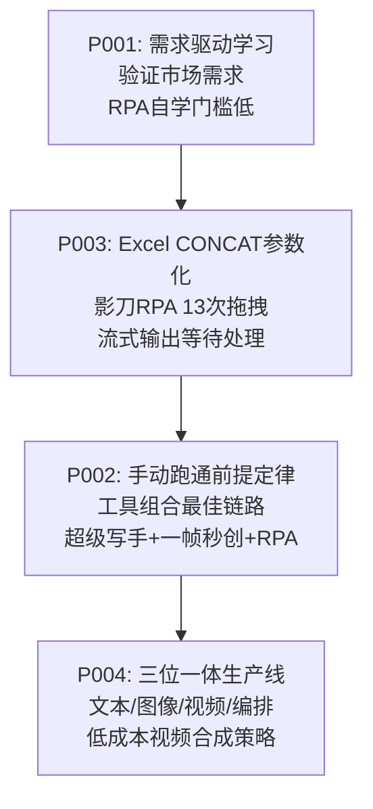
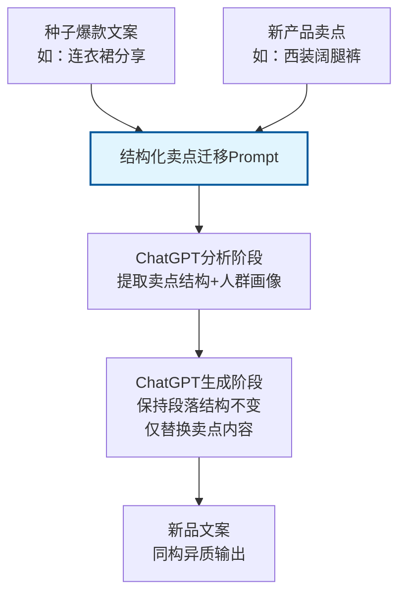
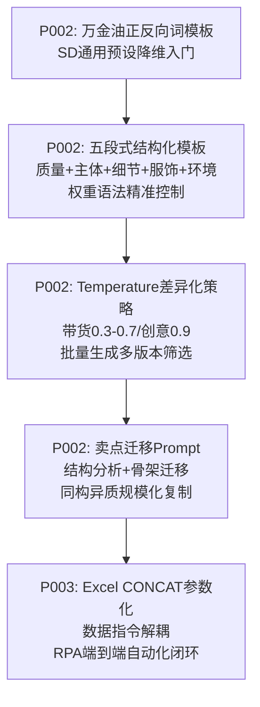
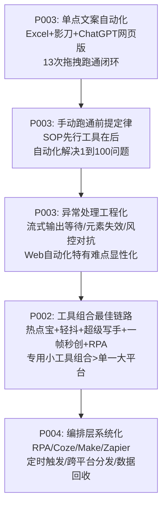
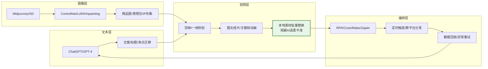
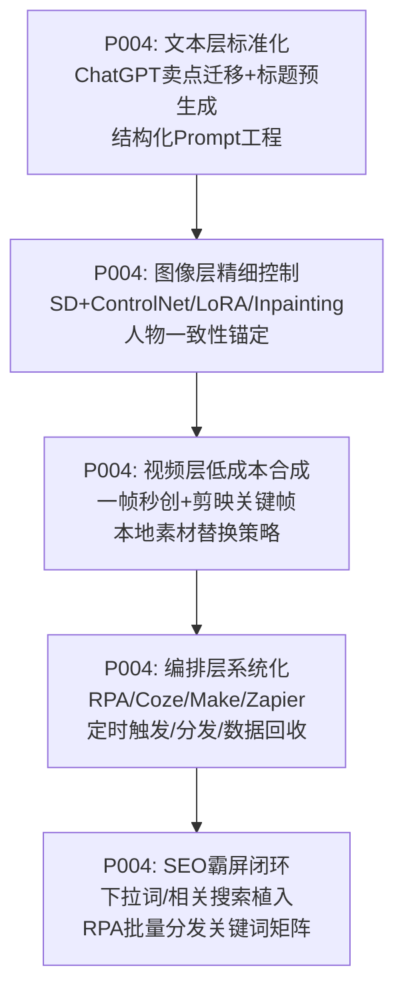

# 第 10 章 RPA + AI 协同自动化 —— 把重复劳动装进生产线

## 学习目标

- 理解ChatGPT+RPA协同自动化架构的核心原理：内容引擎+执行器模式
- 掌握结构化提示词工程方法：五段式模板、权重语法、Temperature差异化策略、卖点迁移Prompt
- 熟练构建RPA端到端自动化闭环：可视化拖拽开发、Excel数据驱动、流式输出等待处理
- 建立AI内容自动化生产线全景认知：文本/图像/视频三位一体工具链集成与编排层设计
- 确立AI赚钱第一性原理：AI是放大器而非救世主，执行力>完美主义，方法论资产>单个项目收益
- 掌握低成本验证与避坑指南：手动跑通是自动化前提、工具组合替代单一平台、赛道分层生存法则

## 10.1 生活类比

想象AI自动化生产线是一家智能餐厅的中央厨房系统：ChatGPT（大语言模型）是总厨（内容引擎），根据菜单（Prompt）设计菜品（文案/代码/分析），掌握核心配方（结构化提示词），能按要求变换口味（Temperature/卖点迁移）；RPA（机器人流程自动化）是传送带+分拣机器人（执行器），负责搬运食材（Excel数据）、摆盘（填表）、上菜（发布分发）、回收反馈（数据回填），不碰核心烹饪但决定上菜速度；结构化Prompt模板是标准化菜谱（SOP），固定“主料+调料+火候+摆盘+装饰”五步骤，新菜（新品文案）只需换主料（变量）保持流程不变；Temperature参数是出品一致性控制阀：带货菜设“标准化出品”（0.3-0.7），创意菜开“厨师发挥”（0.9），批量出多版本供食客（筛选机制）挑选；自动化流水线（文本/图像/视频/编排）是中央厨房+冷链物流+前台点餐系统一体化：从选题（点单）→生产（烹饪）→发布（上菜）→数据（反馈）全程无人值守；手动跑通前提定律 = 先有标准后厨出品流程，再上自动化设备：没跑通的菜谱上传送带只会批量生产废品；工具组合替代单一平台 = 专用设备组合（切菜机/绞肉机/真空包装/传送带）优于全能但笨重的单一大机器或全人工后厨。就像餐厅要想规模化复制，必须‘菜谱标准化（Prompt工程）→后厨流程固化（SOP）→设备自动化（RPA）→前端分发（多平台矩阵）’，AI自动化也是同理：先把‘怎么做’变成标准动作，再交给机器批量跑。

## 10.2 概念地图

```mermaid
mindmap
  root((RPA+AI协同自动化))
    核心架构
      ChatGPT+RPA协同自动化架构
        内容引擎(LLM生成文案/代码/分析)
        执行器(RPA数据搬运/跨应用交互/流程编排)
        标准化接口(剪贴板/文件/API解耦)
      结构化提示词工程
        正向词五段式模板[质量+主体+细节+服饰+环境]
        权重语法(词:权重)精准控制
        负向词万能预设(60+标签抑制缺陷)
        Temperature差异化策略(带货0.3-0.7/创意0.9)
        卖点迁移Prompt(结构保持迁移新品)
        Excel参数化批量生成(CONCAT函数解耦数据指令)
      ChatGPT中文调教12步法
        基于模仿的少样本微调范式
        结构化中文指令替代代码实现人设固化
    RPA端到端自动化闭环
      可视化拖拽式开发(影刀RPA 13次拖拽成流程)
      标准化流程编排(获取句柄→打开表格→循环遍历读Prompt→发送→等待流式输出→抓取回复→写回)
      Excel数据驱动(CONCAT批量生成Prompt)
      手动跑通前提定律(SOP先行工具在后)
      异常处理(流式输出等待/元素失效/风控对抗)
      工具组合替代单一平台(热点宝/轻抖/超级写手/一帧秒创/RPA)
    AI内容自动化生产线全景图
      文本层(ChatGPT/GPT-4文案生成/改写/卖点迁移)
      图像层(Midjourney/SD+ControlNet/LoRA/Inpainting)
      视频层(剪映/CapCut/一帧秒创关键帧动态化/素材替换)
      编排层(RPA/Coze/Make/Zapier定时触发/跨平台分发/数据回收)
      低成本视频合成策略(不在意AI素材质量后期替换真实素材)
      人物一致性锚定(Prompt固定核心外貌特征词)
      SEO霸屏布局(下拉词/相关搜索系统性植入+RPA批量发布)
    AI赚钱第一性原理与避坑指南
      放大器而非救世主(AI降低技能门槛提高标准化要求)
      赛道分层生存法则(女频批量vs男频风格化vs短剧CPSvs解压素材)
      执行力>完美主义(0-1完成比完美重要先发布再修正)
      信息差半衰期法则(发现×产出×分发速度乘积)
      低成本验证优于完美策划(8元模板+废号<1100元跑通闭环)
      方法论资产>单项目收益(像素级拆解/模仿/优化/复制跨周期复利)
      平台风控窗口期利用(快进快出榨取价值非硬刚)
      形式大于内容(直播形式可迁移降低主播门槛)
      复购率核心指标(非标产品LTV覆盖获客成本)
```

## 10.3 ChatGPT+RPA协同自动化架构 —— 内容引擎与执行器模式

### 为什么需要这个概念？

单纯会用ChatGPT不赚钱，必须将业务拆解为标准化SOP，注入Prompt工程，再用RPA串联成自动化流水线。AI降低了‘从0到1’的技能门槛，但提高了‘从1到N’的标准化要求。长尾高频办公自动化需求（如文案批量生成）未被标准SaaS覆盖，需低代码组合方案。

> "通过 ChatGPT+RPA 13 次拖拽实现文案全流程自动化"
>
> "需求是因为平时比较忙，经常需要将文案标题重复粘贴到 ChatGPT 再将文案手动粘贴出来，比较浪费时间"
>
> ——《docs/202305/20230516_070.md》 [素材ID: P001]

> "手动流程梳理清楚了，再利用通过 RPA 文案生成+视频制作+视频上传全部都批量自动化了"
>
> "凡是可以用手动完成，且有一定规律的重复性操作，都可以用 RPA 来自动化实现。前提是手动流程跑通。"
>
> ——《docs/202305/20230516_075.md》 [素材ID: P002]

### 核心定义

**ChatGPT+RPA协同自动化架构**（来源：《docs/202305/20230516_070.md》[素材ID: P001]、《docs/202305/20230516_075.md》[素材ID: P002]、《docs/202305/IZx7dx2CSo9x23xioUFcNaHcnRd.md》[素材ID: P003]）

- **LLM负责内容生成**（文案/代码/分析），**RPA负责数据搬运、跨应用交互、流程编排**
- 两者通过**标准化接口**（剪贴板/文件/API）解耦，形成**‘内容引擎+执行器’**协作模式

这个架构展示了如何将大模型的生成能力与自动化工具的执行能力解耦组合，解决“会用工具”到“驾驭工具”的核心鸿沟。


该流程图直观展示了端到端自动化链路：从Excel数据源读取变量，经CONCAT函数批量构建Prompt，由影刀RPA编排器驱动浏览器完成网页句柄获取、循环遍历、输入框聚焦、内容发送、流式输出等待、回复抓取、结果回写的全过程。其中“等待流式输出结束”节点（高亮显示）是抓取完整回复的关键工程控制点。

### 方法演进图



该演进图展示了从P001的需求验证与自学起步，到P003的单点文案自动化落地，再到P002的全链路标准化与工具组合最佳实践，最终演进为P004的全模态内容自动化生产线的完整方法论迭代路径。

### 关键性质

解决‘从1到100’的规模化执行问题，而非验证可行性（0到1）问题。自动化的本质是将已验证可行的标准化流程放大复制，而非在自动化层面探索业务可行性。

手动流程跑通（SOP先行）是自动化前提，工具在后。任何RPA项目的成功前提是人工标准化流程已跑通并验证可行；若手动流程存在逻辑断点或异常分支未处理，上自动化只会批量放大错误。

可视化拖拽开发（影刀RPA），13次拖拽即可构建端到端文案自动化流程。影刀RPA等轻量工具提供预置组件（获取网页、循环、输入、等待、抓取、写回），业务人员无需编写代码即可像搭积木一样完成流程编排，极大降低了技术门槛与交付周期。

### 典型例子

> "影刀RPA关键节点编排：获取网页句柄→打开表格→循环遍历（读Prompt→聚焦输入框→发送→等待流式输出结束→抓取最后一条回复→写回表格）"
>
> ——《docs/202305/20230516_070.md》 [素材ID: P001]

这个流程展示了RPA如何像搭积木一样，通过预置组件完成从数据读取、模型交互到结果回写的完整闭环。

**Excel数据准备→Prompt批量构建→网页交互自动化（含流式输出等待）→结果回填表格**

### 边界条件

必须显式处理ChatGPT网页版流式输出的‘等待输入完毕’节点，否则抓取不完整回复。适用于高频、重复、规则固定的长尾场景，非标准化决策环节仍需人工介入。工具组合（热点宝选品/轻抖提取/超级写手生成/一帧秒创视频/RPA分发）成本效率优于单一大平台依赖。

## 10.4 结构化提示词工程 —— 从万金油模板到卖点迁移范式

### 为什么需要这个概念？

对话式零散提问效率低、结果不可控，无法支撑批量化、标准化生产。需要将‘会聊天’升级为‘写程序’：用结构化模板、权重语法、参数控制实现工程化复用。解决‘同质化查重’与‘卖点表达不精准’的核心痛点。

> "正向提示词五段式模板：质量词+主体+主体细节+服饰配饰+环境构图光影"
>
> "万能负向词模板含worst quality/bad anatomy/bad hands/extra fingers/watermark等60+标签"
>
> ——《docs/202305/HYrZdLBMRorB0qxKqFFcQ075nWf.md》 [素材ID: P002]

> "结构化卖点迁移Prompt：指令模型先分析种子文案‘卖点表达结构与人群画像’，再迁移至新商品"
>
> ——《docs/202305/20230516_075.md》 [素材ID: P002]

### 核心定义

**结构化提示词五段式模板**（来源：《docs/202305/HYrZdLBMRorB0qxKqFFcQ075nWf.md》[素材ID: P002]）

$$
\text{Prompt} = [\text{质量词}] + [\text{主体}] + [\text{主体细节}] + [\text{服饰配饰}] + [\text{环境/构图/光影}]
$$

每段换行、以英文逗号结尾，配合权重语法 `(词:权重)` 微调。

这个模板展示了如何将模糊的自然语言指令标准化为可复用、可参数化的工程化结构，使大模型输出稳定可控。五段式结构将复杂的视觉意图拆解为质量控制、主体建模、细节刻画、服饰搭配、环境渲染五个正交维度，配合权重语法实现对生成细节的精准干预，是从“玄学调参”走向“工程化复用”的关键一步。

**负向词万能预设**（来源：《docs/202305/HYrZdLBMRorB0qxKqFFcQ075nWf.md》[素材ID: P002]）

包含 `worst quality`、`bad anatomy`、`bad hands`、`extra fingers`、`watermark` 等 60+ 标签，覆盖90%人像/通用生成场景，有效抑制多指、畸形、低画质、水印等高频故障。该预设通过大量负面标签的组合，构建了一个通用的“缺陷免疫层”，使新手无需理解每个缺陷成因即可获得商业可用级的出图稳定性。

**Temperature差异化策略**（来源：《docs/202305/20230516_075.md》[素材ID: P002]）

$$
\text{Temperature} = 
\begin{cases}
0.3-0.7, & \text{带货文案（保守连贯）} \\
0.9, & \text{创意文案（发散）}
\end{cases}
$$

批量设定不同值生成多版本供筛选，规避查重与同质化。

这个策略展示了如何通过单一参数控制大模型输出的确定性与创造性平衡，适配不同业务场景需求。带货文案要求事实准确、逻辑连贯、合规安全，低Temperature收敛输出分布；创意文案追求新颖角度、情绪张力、差异化表达，高Temperature打破常规路径。批量设定多个Temperature值并行生成，再经人工或规则筛选，实现“量产优中选优”的生产策略。

**结构化卖点迁移Prompt**（来源：《docs/202305/20230516_075.md》[素材ID: P002]）

> 请针对上述文本进行分析，学习商品卖点和使用人群的表达方式，并应用于以下商品来编写同样结构的文案

这个方法展示了如何将爆款文案的“骨架”剥离并迁移至新品，实现“套用模版”式改写，保持结构不变、仅替换卖点内容。其核心在于将“写文案”拆解为“分析结构”+“按结构生成”两阶段，强制模型完成结构化抽象，而非直接模仿表层措辞。

**提示词公式化/参数化**（来源：《docs/202305/IZx7dx2CSo9x23xioUFcNaHcnRd.md》[素材ID: P003]）

```excel
=CONCAT("写一篇","“",A2,"”的文章，标题+正文")
```

利用Excel CONCAT函数将固定指令模板与变量数据分离，实现数据与指令解耦的批量化Prompt工程，配合RPA实现端到端自动化。这种方法将Prompt工程降维为表格公式操作，使非技术人员也能批量管理、版本控制、协同编辑提示词库。

**ChatGPT中文调教12步法**（来源：《docs/202305/CBJhdD0dTokH8tx8HKYc1nJSnnc.md》[素材ID: P001]）

```
1. 引入背景
2. 预设角色
3. 输入完整案例
4. 反馈学习效果
5. 反馈优化
6. 拆解教学
7. 反馈学习效果
8. 反馈优化拆解模板
9. 优化笔记
10. 反馈优化学习效果
11. 调教结果
```

基于模仿的少样本微调范式，用结构化中文指令替代代码实现人设固化。该方法将“训练模型”转化为“用自然语言教模型”，通过12步结构化对话流程，引导模型完成案例学习→结构拆解→模板内化→稳定输出的全过程，无需写一行代码即可实现类LoRA的人设固化效果。



该流程图展示了卖点迁移的核心逻辑：以种子文案与新产品卖点为双输入，经结构化Prompt引导ChatGPT先完成结构分析，再按固定骨架生成新文案，实现“同构异质”的规模化复制。

### 方法演进图



该演进图描绘了提示词工程从通用预设模板（P002a），到结构化五段式建模（P002b），再到生成参数策略化（P002c），进而到结构迁移范式（P002d），最终与Excel参数化批量生成（P003）融合形成自动化就绪的Prompt工程体系的完整演进脉络。

### 典型例子

**种子文案‘连衣裙分享’结构迁移至‘西装阔腿裤’**：保持“身材参考→分套描述→卖点穿插→遮肉细节→色彩推荐→侧背展示→总结”七段式结构，仅替换卖点内容与人群描述。

**Midjourney表情包Prompt**：`a cute Husky dog, emoji, anthropomorphic style, Disney style, black strokes, different emotions, white background --niji 5 --style cute`

### 边界条件

结构化迁移仅适用于结构相对固定的带货/种草文案，非叙事类/深度逻辑类内容。Temperature高值（>0.9）易产生幻觉，带货文案需严格限制在0.7以内。负向词库需随模型版本迭代维护，SDXL/Midjourney v6对部分负向词敏感度下降。

## 10.5 RPA端到端自动化闭环 —— 从可视化拖拽到批量化交付

### 为什么需要这个概念？

人工复制粘贴、跨应用切换耗时且易错，成为规模化生产的瓶颈。专业开发成本高、周期长，业务人员需自主交付自动化方案（低代码/无代码）。自动化解决‘从1到100’的规模化复制，而非‘从0到1’的验证。

> "影刀RPA整体来说真心比较简单...过程中基本不用任何代码，有点类似小孩玩儿的编程机器人"
>
> "13次拖拽实现文案全流程自动化"
>
> ——《docs/202305/20230516_070.md》 [素材ID: P001]

> "手动跑通是自动化前提定律：SOP先行，工具在后"
>
> ——《docs/202305/20230516_075.md》 [素材ID: P002]

### 核心定义

**可视化拖拽式RPA开发**（来源：《docs/202305/20230516_070.md》[素材ID: P001]、《docs/202305/IZx7dx2CSo9x23xioUFcNaHcnRd.md》[素材ID: P003]）

影刀RPA等工具提供预置组件（获取网页、循环、输入、等待、抓取、写回），类似积木搭建，13次拖拽完成‘Excel读标题→ChatGPT生文→回填表格’全流程自动化构建。

**标准化流程编排**（来源：《docs/202305/20230516_070.md》[素材ID: P001]）

获取网页句柄 → 打开数据源 → 循环遍历（读取Prompt → 聚焦输入框 → 发送 → 等待生成完成 → 抓取最后一条回复 → 写回目标表）

**Excel数据驱动**（来源：《docs/202305/IZx7dx2CSo9x23xioUFcNaHcnRd.md》[素材ID: P003]）

CONCAT函数批量生成Prompt，数据与指令分离，支撑大规模参数化调用。

```mermaid
flowchart TB
    subgraph 数据准备层
        A1[Excel A列\n原始标题/变量]
        A2[Excel B列\nCONCAT公式\n=CONCAT("写一篇","“",A2,"”的小红书笔记...")]
    end
    
    subgraph RPA执行层
        B1[获取网页句柄\nChatGPT页面]
        B2[打开/激活Excel]
        B3[循环遍历行]
        B4[读取B列Prompt]
        B5[点击元素\n定位输入框]
        B6[输入内容]
        B7[发送Enter键]
        B8[等待元素出现\n重新生成按钮/输出停止]
        B9[获取文本\n最后一条回复]
        B10[写入单元格\nC列目标列]
    end
    
    A1 --> A2
    A2 --> B2
    B1 --> B2
    B2 --> B3
    B3 --> B4
    B4 --> B5
    B5 --> B6
    B6 --> B7
    B7 --> B8
    B8 --> B9
    B9 --> B10
    B10 --> B3
    
    style B8 fill:#fff3e0,stroke:#e65100,stroke-width:2px
```

该流程图将自动化闭环拆解为“数据准备层”与“RPA执行层”两层。数据层通过Excel CONCAT公式实现Prompt参数化批量生成；执行层通过影刀RPA预置组件串联网页句柄获取、循环遍历、输入交互、流式输出等待（高亮节点B8）、结果抓取与回写。这种分层设计实现了数据与指令的解耦，支撑大规模参数化调用。

### 方法演进图



该演进图展示了RPA自动化能力从单点验证（P003a），到方法论固化（P003b），再到工程化异常处理（P003c），进而与上游工具链组合形成最佳实践链路（P002），最终上升为编排层系统化能力（P004）的演进路径。

### 关键性质

手动流程跑通是自动化前提（SOP先行，工具在后）。这是所有RPA项目的铁律：自动化解决的是规模化（1到100）而非验证可行性（0到1）的问题。凡是可以用手动完成、且有一定规律的重复性操作，都可以用RPA来自动化实现，前提是手动流程跑通。

必须显式处理流式输出等待、弹窗拦截、元素定位失效等Web自动化特有异常。ChatGPT网页版的流式逐字输出特性要求RPA必须包含“等待输入完毕”的显式逻辑（如监听“重新生成”按钮出现或输出区域停止变动），否则会抓取到不完整的回复。平台UI变更、反爬弹窗、频控风控均需在流程中预置兜底逻辑。

组合专用小工具（选品/提取/生成/视频/分发）构建最佳链路，优于单一平台依赖。本章实战链路采用“热点宝选品→轻抖/RPA提取文案→超级写手批量改写→一帧秒创视频合成→RPA多平台分发→SEO关键词霸屏”，每个环节选用该细分领域最趁手的专用工具，而非追求全功能一体化平台，实现了成本、效率、稳定性的最优平衡。

### 典型例子

**13次拖拽完成‘Excel读标题→ChatGPT生文→回填表格’全流程自动化构建**

**抖音带货全链路**：热点宝选品 → 轻抖/RPA提取文案 → 超级写手批量改写 → 一帧秒创视频合成 → RPA多平台分发 → SEO关键词霸屏布局

### 边界条件

平台UI变更导致元素选择器失效，需维护选取器或采用OCR/图像识别兜底。高频操作触发平台风控（频率限制、验证码、设备指纹），需引入IP池/设备池/行为模拟对抗。非结构化数据（如长视频剪辑决策）难以完全RPA化，需保留人工审核节点。

## 10.6 AI内容自动化生产线全景图 —— 文本、图像、视频三位一体

### 为什么需要这个概念？

单点工具（仅ChatGPT或仅SD）无法完成商业级内容闭环，需全链路工具链集成。从选题、生产、发布到数据反馈的全自动化系统，是‘从1到N’规模化的核心基建。覆盖短剧解说、表情包、数字人、SEO文章等多元变现场景。

> "结合ChatGPT（文本生成）、Midjourney/SD（图像生成）、RPA/自动化工具（剪映、Coze、Make/Zapier），构建从选题、生产、发布到数据反馈的全自动化内容生产系统"
>
> ——《docs/202305/20230516_075.md》 [素材ID: P002]

### 核心定义

**AI内容自动化生产线三位一体**（来源：《docs/202305/20230516_075.md》[素材ID: P002]、《docs/202305/EL9Fdl8WFoFxaixaJcLcqnXjn7r.md》[素材ID: P004]、《docs/202305/HYrZdLBMRorB0qxKqFFcQ075nWf.md》[素材ID: P002]）

下表展示了AI内容自动化生产线四大层级的核心工具与能力对应关系：

| 层级 | 核心工具 | 核心能力 |
|------|----------|----------|
| **文本层** | ChatGPT/GPT-4 | 文案生成/改写/卖点迁移/标题优化 |
| **图像层** | Midjourney/SD + ControlNet/LoRA/Inpainting | 商品图/表情包/IP形象/小说推文插画精细控制 |
| **视频层** | 剪映/CapCut/一帧秒创/万彩 | 图文成片/关键帧动画/智能匹配素材/批量替换真实素材 |
| **编排层** | RPA/Coze/Make/Zapier | 定时触发/跨平台分发/数据回收/异常重试 |



该流程图描绘了四层工具链的数据流向：文本层生成文案与结构化Prompt，图像层产出受控视觉素材，视频层将文案与素材合成为动态视频并执行“本地素材批量替换”策略（高亮节点V3）规避AI选素不准，编排层负责定时触发、多平台分发与数据回收形成闭环反馈至文本层优化。

### 方法演进图



该演进图展示了生产线从单一模态文本生成（P004a），扩展至图像精细控制（P004b）、视频低成本合成（P004c），再到编排层系统化调度（P004d），最终形成带SEO霸屏数据反馈闭环（P004e）的全模态自动化生产线构建路径。

### 关键性质

**低成本视频合成策略**（来源：《docs/202305/20230516_075.md》[素材ID: P002]）

> "利用一帧妙创用文案一键制作视频，再替换自己的本地素材，不用在意一帧妙创生成的素材不好，后面剪映直接替换即可"

这个策略展示了如何规避AI选素不准的痛点：先用AI跑通流程，后期批量替换真实素材。核心洞见在于将“AI选素准确率”这一不可控变量，转化为“后期替换确定性素材”这一可控工程动作，以极低成本解决视频生产的素材质量瓶颈。

**关键帧动态化**（来源：《docs/202305/R2wRd6dN2oUtkOx9I3WcLHAOnzc.md》[素材ID: P005]）

> "图片配上文字的末尾，往下拉一点再打上关键帧就能发现图片动起来了，不像ppt这么干吧"

在剪映中设置位置/缩放关键帧，使静态AI图产生镜头推拉摇移效果，消除PPT感。该技术通过关键帧插值在时间轴上创造运动感，将静态图文视频升级为具备镜头语言的动态内容，显著提升完播率与观看体验。

**人物一致性锚定**（来源：《docs/202305/R2wRd6dN2oUtkOx9I3WcLHAOnzc.md》[素材ID: P005]）

> "只需要预设好人物的细节特征，比如我心动重启的女主统一关键词都是暗红色眼睛+黑色头发"

无LoRA条件下，Prompt中强制固定核心外貌特征词（发色/瞳色/服饰）维持跨图连续性。这种“软锚定”策略在不训练专用LoRA的前提下，仅通过提示词工程即可实现角色视觉一致性，大幅降低了连载类内容的制作门槛。

**SEO霸屏布局**（来源：《docs/202305/20230516_075.md》[素材ID: P002]）

> "把搜索下拉词+相关搜索+大家都在搜的关键词 统统埋进视频的文案，详情描述，以及标签里"

下拉词/相关搜索/大家都在搜系统性植入文案/描述/标签，配合RPA批量发布构建关键词覆盖矩阵。该策略利用平台搜索推荐机制的长尾关键词分发特性，通过自动化批量覆盖实现“无论用户搜什么关键词都能看到你的作品”的流量截获效果。

### 典型例子

**AI短剧解说/CPS**：ChatGPT改写剧本+剪映自动剪辑+批量发布工具，单人日产50-100条，抖音/快手/视频号多平台分发，新手首月变现1.4万+。

**AI表情包**：MJ批量生成→Remove.bg抠图→改图宝压缩→稿定设计配字→微信平台上架→小红书教程引流私域→售课变现。

**AI小说推文**：文案拆解单句→SD公式化生图（DDIM/20-30步/高清修复）→配音情绪适配→剪映关键帧动态化→发布变现。

### 边界条件

纯原创风格化路线：单条耗时8小时、无法矩阵、收益上限低，仅适合副业，全职需转向标准化矩阵操作。视频号/抖音/小红书平台风控差异大，素材去重、账号隔离、发布频控需分平台定制SOP。算力成本：本地部署需高配N卡（≥8G VRAM），云端部署（Colab/青椒云/RunPod）按时计费需ROI测算。

## 10.7 多源对照：不同素材对“AI自动化落地”的共识与分歧

### 共识

1. **SOP先行，工具在后**：P001、P002、P003 均强调“手动跑通是自动化前提”，自动化解决规模化而非验证可行性。
2. **工具组合优于单一平台**：P002 明确列出“热点宝+轻抖+超级写手+一帧秒创+RPA”的最佳实践链路；P003 用“Excel+影刀+ChatGPT”验证轻量组合可行性。
3. **标准化Prompt是批量化前提**：P002 的“卖点迁移Prompt”、P002 的“五段式模板”、P003 的“Excel CONCAT参数化”均指向结构化、可复用的提示词工程。
4. **AI是放大器非救世主**：P002、P004、P005 均指出“单纯会用工具不赚钱，必须拆解业务注入Prompt串联流水线”。

### 分歧

以下对比表展示了不同来源素材在核心杠杆、验证节奏、风控态度、规模化路径四个维度的分歧：

| 维度 | 来源：P002 (抖音带货视角) | 来源：P004 (👸号写作视角) | 来源：P005 (直播变现视角) |
|------|-------------------------------------|-------------------------------------|-------------------------------------|
| **核心杠杆** | 视频批量合成+SEO霸屏 | 标题预生成+模板化填充 | 直播形式可迁移+废号资产化 |
| **验证节奏** | 手动跑通→RPA放大 | 双号并行→30分钟8篇 | 8元模板→废号→首单回本 |
| **风控态度** | 关键词稀释+矩阵分发 | 个体户执照可能限流 | 快进快出榨取价值，不硬刚平台 |
| **规模化路径** | 多账号矩阵+RPA分发 | 双GPT-4账号并行 | 助理协播+多号轮播 |

不同赛道对核心杠杆、验证节奏、风控策略的侧重差异，反映了“通用方法论”需结合具体平台特性与业务模式落地。

## 10.8 设计中的取舍

为什么不用全能型RPA平台（如UiPath）而选影刀/按键精灵？全能平台学习曲线陡峭、授权昂贵、部署重，适合企业级标准化流程。影刀等轻量RPA“积木式拖拽、免费/低价、B站有官方课”，业务人员周末自学即可交付，ROI极高，适合长尾高频个人/小团队场景。

为什么不直接用API调用大模型，而用RPA驱动网页版ChatGPT？API调用需开发能力、有额度限制、无法利用网页版的“联网/插件/记忆”增强能力。RPA驱动网页版零代码、即开即用、保留完整产品体验，唯一代价是需处理“流式输出等待”与“UI变更失效”两个工程化难点。

这种设计的 trade-off 是什么？得：极低门槛（非程序员可上手）、极快交付（小时级出方案）、极低成本（免费/低价工具链）。失：稳定性依赖前端UI（易失效）、并发受限（单机单号）、合规风险（模拟人工操作易触发风控）。适用边界：月产<10万条、团队<5人、业务逻辑可标准化的长尾场景。超出边界需转向API+代码开发模式。

## 10.9 动手练习

### 练习 1：手工搭建一个ChatGPT+RPA文案自动化微流程

**准备**：安装影刀RPA（或UiBot），准备一个Excel表格（A列放5个测试标题，如“AI写作工具推荐”、“短视频变现技巧”等）

1. 在Excel B列使用CONCAT公式生成Prompt：`=CONCAT("写一篇关于","“",A2,"”的小红书笔记，要求：标题吸睛、正文干货、结尾引导评论，带emoji")`
2. 打开ChatGPT网页版，登录并保持页面激活
3. 在影刀RPA中新建流程，按顺序拖拽以下组件并配置：
   - 获取已打开的网页句柄（指向ChatGPT页面）
   - 打开/激活Excel文件
   - 循环遍历（起始行2，结束行6）
   - 读取单元格（B列，当前行）
   - 点击元素（定位ChatGPT输入框）
   - 输入内容（上一步读取的Prompt）
   - 发送键盘按键（Enter键）
   - 等待元素出现（定位‘重新生成’按钮或输出区域停止流动，作为流式输出结束标志）
   - 获取文本（定位最后一条回复元素，提取文本）
   - 写入单元格（C列，当前行，写入获取的文本）
4. 运行流程，观察C列是否自动填入生成的文案

**回答问题**：
- 如果不加‘等待流式输出结束’步骤，会发生什么？
- 如何让生成的文案风格更统一？（提示词层面 vs Temperature层面）
- 若ChatGPT网页版UI更新导致‘输入框’元素定位失败，如何快速修复？

### 练习 2：设计一个结构化卖点迁移Prompt并测试效果

**任务**：将一篇爆款‘无线蓝牙耳机’带货文案的结构，迁移到新产品‘便携式颈挂风扇’上

种子文案结构参考：【痛点场景引入→核心卖点逐个拆解（降噪/续航/佩戴感）→适用人群画像→对比竞品优势→价格锚定+限时福利→行动号召】

1. 编写结构化迁移Prompt（参考细纲P002概念）：
   - 角色设定：你是资深带货文案专家
   - 任务：分析种子文案的卖点表达结构与人群画像，应用于新产品
   - 输入：种子文案（粘贴一篇真实爆款耳机文案），新产品卖点（挂脖免手/三档风速/静音/续航10h/适合通勤/户外/带娃妈妈），适用人群（地铁通勤/户外遛娃/办公室久坐人群）
   - 输出要求：严格保持种子文案段落结构不变，仅替换卖点内容与人群描述
2. 在ChatGPT中测试该Prompt，对比生成文案与种子文案的段落对应关系

**回答问题**：
- 生成文案中哪个段落最容易出现‘结构偏移’？为什么？
- 如果新产品卖点数量与种子文案不匹配（如种子5个卖点，新品只有3个），Prompt应如何调整？
- Temperature设为0.3 vs 0.7，生成文案的‘可控性’与‘生动度’有何差异？

### 练习 3：规划一个低成本AI短视频自动化生产线最小闭环（MVP）

**场景**：单人、零预算（仅用免费/低成本工具）、目标日产10条同赛道短视频（如‘AI工具测评’或‘书单推荐’），跑通‘选题→文案→图/视频→发布→数据回收’全流程

1. 选赛道：在抖音/视频号/小红书搜索‘AI工具测评’或‘书单推荐’，找3个近期点赞>1w的对标账号，记录其选题方向、文案结构、视频形式（口播/混剪/图文成片）
2. 建文案SOP：提炼对标账号通用文案结构（如‘工具名称+核心功能+实测痛点+避坑指南+免费获取方式’），写成结构化Prompt模板
3. 搭建自动化链路（最小工具集）：
   - 文案生成：ChatGPT网页版+Excel CONCAT批量Prompt+影刀RPA免费版（或Auto.js手机端）
   - 视频制作：剪映专业版（免费）‘图文成片’/‘关键帧动画’+本地素材库替换AI选素
   - 发布分发：手机端手动发布（初期量小）或RPA模拟发布
   - 数据回收：飞书/腾讯文档表格手工记录（播放/点赞/评论/转发/转化）
4. 执行7天测试：每日按SOP产出10条，发布后记录数据，第7天复盘

**回答问题**：
- 哪个环节最耗时？是否可进一步RPA化？
- 视频去重处理（镜像/调色/变速/贴纸/换BGM）在剪映中如何批量操作？
- 若第3天账号被限流（播放<100），如何判断是内容问题还是账号问题？如何低成本验证？
- 该MVP模型的边际成本（时间/金钱）是多少？规模化到日产100条需补充什么基建？

### 练习 4：复盘一个失败的‘风格化AI内容’项目，提炼‘赛道分层生存法则’教训

**回顾/调研**一个因‘单条制作过久、无法矩阵化、收益不稳’而放弃的AI内容项目（可参考细纲P005中‘风格化AI推文’案例或自行寻找）

1. 记录该项目核心参数：
   - 内容形式（纯原创文案/风格化AI图/固定人设/高代入感）
   - 单条制作耗时（文案/生图/配音/剪辑/发布各环节用时）
   - 发布频次与持续天数
   - 变现数据（播放中位数/爆款率/变现金额/ROI）
   - 放弃时的核心痛点
2. 对标‘赛道分层生存法则’（细纲P005定理）：
   - 该项目属于哪一层？（女频批量/男频风格化/短剧CPS/解压素材/其他）
   - 为何该层级特性与‘风格化高耗时’矛盾？
   - 若转向‘标准化矩阵操作’（如模板化文案+批量混剪+多账号分发），预估效率提升多少倍？

**回答问题**：
- ‘精神洁癖’（过度打磨单条质量）在商业变现早期的机会成本如何量化？
- 如何判断一个赛道‘适合风格化’还是‘适合矩阵化’？给出3个判断指标
- 如果重来一次，你会在什么节点（第几条/第几天/什么数据信号）果断转型？

## 10.10 本章小结

这一章中我们学习了如何将大语言模型与流程自动化工具结合，构建低成本、可交付的AI内容自动化生产线。首先我们确立了**ChatGPT+RPA协同自动化架构**的核心范式：LLM作内容引擎，RPA作执行器，标准化接口解耦。其次我们系统掌握了**结构化提示词工程**的五段式模板、权重语法、Temperature差异化策略与卖点迁移Prompt，实现从“会聊天”到“写程序”的工程化跃迁。接着我们拆解了**RPA端到端自动化闭环**的可视化拖拽开发、Excel数据驱动与流式输出等待处理等关键工程细节，确立了“SOP先行、工具在后”的自动化前提定律。然后我们建立了**AI内容自动化生产线全景认知**，覆盖文本/图像/视频三位一体工具链与编排层设计，掌握了低成本视频合成、关键帧动态化、人物一致性锚定、SEO霸屏布局等实战技法。最后我们确立了**AI赚钱第一性原理**：AI是放大器而非救世主，执行力>完美主义，方法论资产>单个项目收益，并给出了赛道分层生存法则、低成本验证优于完美策划、平台风控窗口期利用等避坑指南。

本章我们一起学习了以下概念：

下表展示了本章核心概念及其核心解释：

| 概念 | 解释 |
|------|------|
| ChatGPT+RPA协同自动化架构 | LLM作内容引擎，RPA作执行器，标准化接口解耦，解决长尾高频办公自动化需求 |
| 结构化提示词五段式模板 | 质量词+主体+细节+服饰+环境，配合权重语法实现复杂意图标准化表达 |
| Temperature差异化策略 | 带货文案0.3-0.7保守连贯，创意文案0.9发散，批量设定不同值生成多版本供筛选 |
| 卖点迁移Prompt | 先分析种子文案卖点结构与人群画像，再迁移至新商品保持段落结构不变 |
| Excel参数化批量生成 | CONCAT函数分离固定指令模板与变量数据，实现数据与指令解耦的批量化Prompt工程 |
| 可视化拖拽式RPA开发 | 影刀RPA预置组件积木式搭建，13次拖拽完成端到端文案自动化流程构建 |
| 手动跑通是自动化前提定律 | SOP先行工具在后，自动化解决1到100规模化而非0到1验证可行性 |
| 流式输出等待处理 | 针对ChatGPT网页版逐字输出特性，RPA必须显式等待输入完毕才能抓取完整回复 |
| AI内容自�动化生产线三位一体 | 文本(ChatGPT)+图像(SD/MJ+ControlNet/LoRA)+视频(剪映/一帧秒创)+编排(RPA/Coze) |
| 低成本视频合成策略 | 不在意AI生成素材质量，后期剪映批量替换本地真实素材规避选素不准 |
| 关键帧动态化 | 剪映设置位置/缩放关键帧使静态AI图产生镜头推拉摇移效果消除PPT感 |
| 人物一致性锚定 | 无LoRA条件下Prompt强制固定核心外貌特征词(发色/瞳色/服饰)维持跨图连续性 |
| SEO霸屏布局 | 下拉词/相关搜索/大家都在搜系统性植入文案描述标签，配合RPA批量发布构建关键词覆盖矩阵 |
| AI赚钱第一性原理：放大器而非救世主 | 单纯会用工具不赚钱，必须将业务拆解为SOP注入Prompt工程串联自动化流水线 |
| 赛道分层生存法则 | 女频批量vs男频风格化vs短剧CPSvs解压素材，新手优先跑通闭环再考虑风格化 |
| 执行力>完美主义 | 0-1阶段完成比完美重要，先发布再修正用市场反馈倒逼升级 |
| 信息差半衰期法则 | 信息差商业价值随时间指数衰减，唯有发现×产出×分发速度极致执行力完成变现 |
| 低成本验证优于完美策划 | 8元模板+废号+现有电脑<1100元成本跑通商业闭环，真实交易数据检验需求唯一标准 |
| 方法论资产>单个项目收益 | 内化像素级拆解/模仿/优化/复制方法论、识别流量密码嗅觉可跨周期跨赛道复利 |
| 平台风控红利窗口期 | 不可对抗只能利用，快进快出榨取价值而非硬刚平台(蓝V/开店/保证金) |
| 形式大于内容 | 直播形式可迁移性(AE改文字→AI绘画/AI聊天/虚拟主播)，核心降低主播技能门槛提高产出比 |
| 复购率核心指标 | 非标产品商业模式可行性核心指标，高复购证明情绪价值/社交货币需求真实性与高频性 |

下一章中，我们将学习 **AI 视频内容生产线 —— 从小说推文到短剧CPS的标准化制造**，深入拆解短视频平台算法机制下的AI小说推文、短剧CPS两大主流赛道全流程SOP，以及“风格化原创”与“矩阵化搬运”两条路线的ROI对比与避坑指南。


