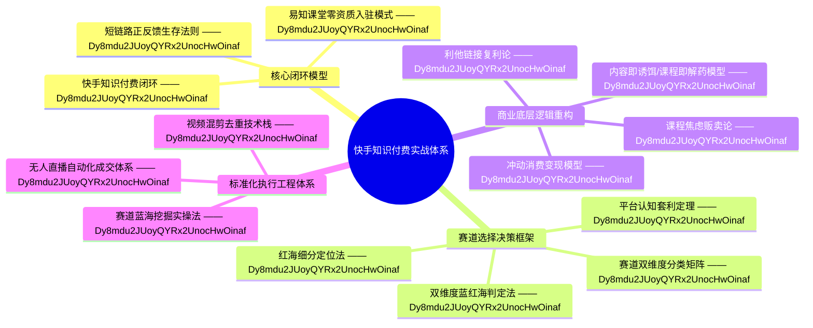
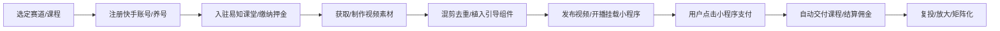
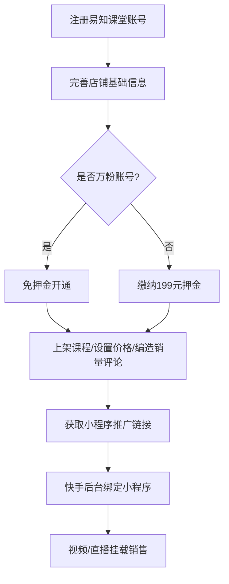
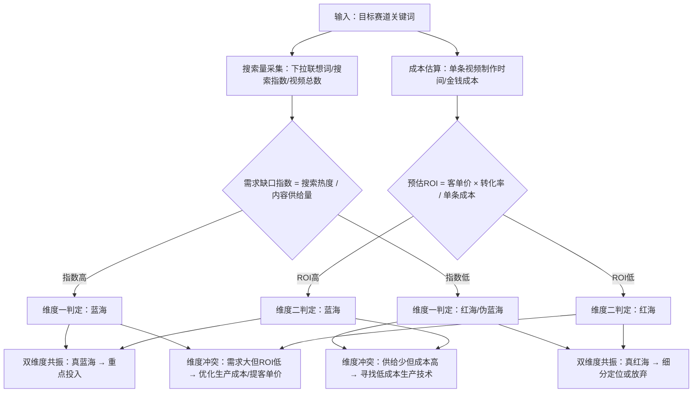
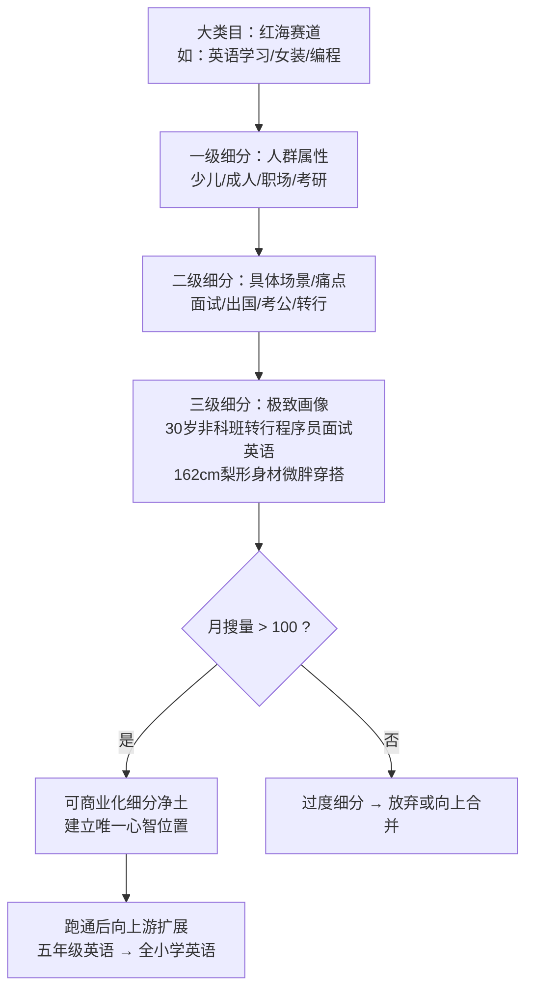
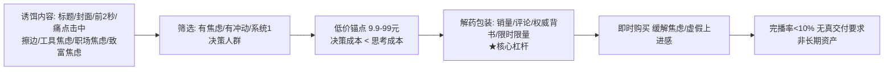
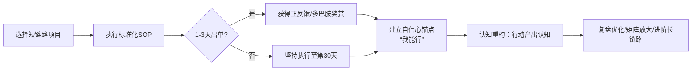
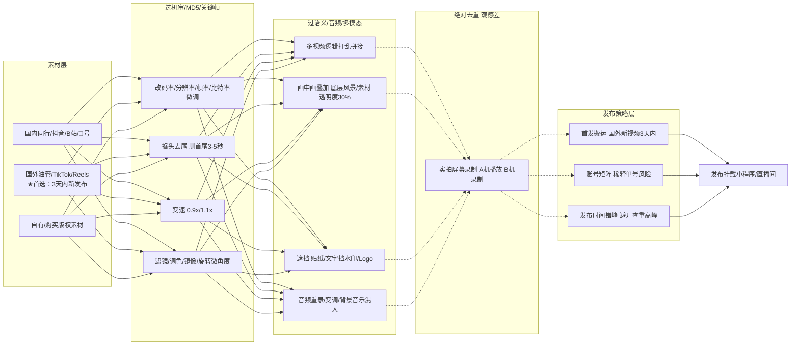
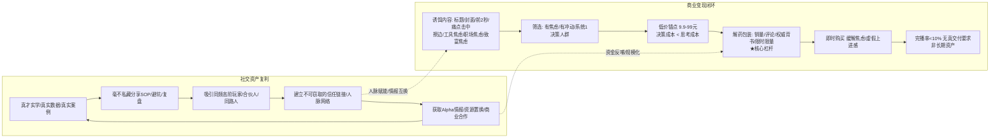
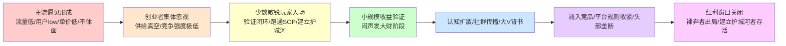

# 第 57 章 快手知识付费实战体系 —— 从摒弃偏见到落袋为安的完整闭环
作者：龙哥

## 学习目标

- 理解快手知识付费闭环的核心优势：无私域、无资质、短链路、快正反馈
- 掌握双维度蓝红海判定法（需求缺口法+ROI法）与赛道双维度分类矩阵的实操筛选逻辑
- 熟练应用红海细分定位法在用户心智中寻找未被占据的净土
- 洞察课程焦虑贩卖论与冲动消费变现模型的底层心理机制与商业本质
- 建立短链路正反馈生存法则，克服新手“频繁切项目-永不出单”的死循环
- 掌握视频混剪去重技术栈与无人直播自动化体系的低成本量产标准化SOP
- 践行利他链接复利论与内容即诱饵/课程即解药模型，重构社交资产与转化逻辑
- 识别平台认知套利定理，利用主流偏见制造的供给真空捕捉结构性红利窗口

## 57.1 生活类比

想象快手知识付费是一个**“路边摊卖止痛药”**的生意：平台（快手）是人流密集但被商场嫌弃的“城乡结合部”夜市（主流偏见：流量低、用户low、单价低）；闭环短意味着顾客路过（刷视频）→ 看到招牌（前两秒爆点）→ 掏钱买药（挂小程序）→ 吃下立竿见影（1-3天出单），全程无需加微信、进群、听销售洗脑（无私域沉淀），正如路边摊无需办会员卡、无需豪华装修即买即走；课程焦虑贩卖则是卖的不是“治病的药”（知识内容），而是“吃了安心”的“安慰剂”（缓解焦虑/获得上进的虚假满足），顾客买完放抽屉里（完播率<10%）也没关系；混剪去重好比药的包装（视频内容）不能跟隔壁摊一模一样（查重），要稍微改个色、换个盒（改码率/画中画/变速），甚至买国外新包装（首发搬运3天内视频）冒充“独家秘方”；认知套利则是大商场（抖音/视频号/小红书）嫌这地段脏乱差不进驻，反而让你独享这批“真疼/真想好”的顾客（结构性红利窗口）。就像路边摊不需要装修豪华（无资质）、不需要会员卡（无私域）、只管卖“安心”（贩卖焦虑缓解），就能在大商场打不下来的缝隙里，用最笨的“吆喝”（混剪量产）赚到第一桶金。

## 57.2 概念地图



## 57.3 快手知识付费闭环 —— 公域直转无私域的短链路变现模型

### 为什么需要这个概念？

传统知识付费模式要求建设私域流量池、精心运营朋友圈、设计复杂转化话术，链路冗长且决策节点众多，极易劝退缺乏运营经验的新手。新手往往因私域运营不善、微信封号风控、不会销售转化而陷入挫败感并最终放弃。我们需要一条“发视频→挂链接→自动成交”的极简闭环，帮助新手以最低认知负荷跑通0-1商业闭环。

### 核心定义

> **快手知识付费闭环定义**（来源：《Dy8mdu2JUoyQYRx2UnocHwOinaf.md》）
>
> 在快手平台内通过短视频/直播直接挂载第三方课程平台（如易知课堂）小程序链接，实现公域流量直接转化变现的完整商业路径。核心特征：无需引流私域、无需营业执照资质、操作步骤极少、正反馈周期短（1-3天出单）。

> "快手知识付费，说白了在快手上卖课，首先选好你要卖什么课（赛道），然后通过发视频带货或直播带货的方式卖课。他的优势是：操作步骤少...不需要资质...闭环路径短（发出去之后自动成交等收钱，不用引流到私域，营造朋友圈等）...正反馈很快（运气好的话1-3天就能出单）"
> 
> ——《Dy8mdu2JUoyQYRx2UnocHwOinaf.md》 素材ID：Dy8mdu2JUoyQYRx2UnocHwOinaf

这个概念展示了三个核心优势：(1) **闭环短**：省去私域沉淀、朋友圈运营、人工销售等重环节，正如路边摊无需办会员卡即买即走；(2) **门槛低**：无需授课资质、无需囤货发货、仅需199元押金（万粉免）；(3) **反馈快**：运气好1-3天出单，快速建立新手信心。

### 方法演进图：快手知识付费闭环流程



### 关键性质

下表梳理了该模型的三大核心性质：

| 性质 | 说明 |
|------|------|
| 矩阵化 | 可批量注册账号、多号多赛道并行测试 |
| 低资产 | 无库存、无物流、无售后压力 |
| 可迁移 | 内容/账号/赛道经验可跨平台复用 |

### 典型例子

- 作者操盘8个账号覆盖4个类目，第25天达成稳定副业收益
- 办公软件赛道：红海但无头部IP，小白照抄对标仍可“喝汤”
- 编程教学赛道：👸号红海内容搬运至快手因搜索需求未满足而“吃肉”

### 边界条件

- 平台规则收紧可能导致小程序挂载受限或封号
- 课程内容同质化严重，长期依赖“编造销量评论”不可持续
- 单价极低(9.9-99元)，需大量出单才能规模化，受限于流量上限
- 核心竞争力在于“混剪去重技术”与“选品判力”，非课程内容本身

---

## 57.4 易知课堂零资质入驻模式 —— 知识付费基建的最小可行性配置

### 核心定义

> **易知课堂零资质入驻模式定义**（来源：《Dy8mdu2JUoyQYRx2UnocHwOinaf.md》）
>
> 一种知识付费分销平台模式，核心优势为无需授课资质门槛、允许销量与评论自主编辑、仅需缴纳199元押金（万粉可免）即可开售任意品类课程，配合快手小程序挂载实现交易闭环。

> "他最核心的优势就是不需要授课资质门槛，想卖啥课卖啥课，并且课程销量和评论都可以自己编。注册到最后会出现让交199押金的部分（易知不需要资质，与此相对的就需要押金，当然如果账号超过1万粉丝的话是不需要押金的）"
> 
> ——《Dy8mdu2JUoyQYRx2UnocHwOinaf.md》 素材ID：Dy8mdu2JUoyQYRx2UnocHwOinaf

这个模式展示了知识付费基建的“最小可行性配置”：(1) **资质豁免**：绕过传统教育平台的教师资格证/营业执照/备案审核；(2) **数据自主**：销量/评论可编，解决新店冷启动“社会证明”缺失；(3) **低押金**：199元可退，万粉免押，资金占用极低。

### 方法演进图：易知课堂开店全流程



### 关键性质

下表梳理了该模式的三大核心性质：

| 性质 | 说明 |
|------|------|
| 资质豁免 | 无需教师资格证、营业执照、ICP备案等传统门槛 |
| 数据自主 | 销量、评论、好评率均可后台自定义，解决冷启动信任缺失 |
| 低成本 | 199元押金可退，万粉免押，资金占用极低 |

### 典型例子

- 作者团队批量注册易知课堂店铺，配合快手矩阵号分发，单店日出单数十单
- 闲鱼几块钱采购课程源文件，上传易知课堂设为自有产品，利润率100%

### 边界条件

- 平台政策收紧可能要求补充资质或取消“销量可编”功能
- 纯依赖虚假数据长期运营易触发平台风控，需逐步过渡到真实交付
- 课程品类受平台审核限制，违规品类（擦边、赌博、医疗等）不可上架

---

## 57.5 双维度蓝红海判定法 —— 打破“人多即红海”的需求供给匹配模型

### 为什么需要这个概念？

传统认知存在误区：认为竞争对手多就是红海，竞争对手少就是蓝海。实际痛点在于：很多“没人做”的赛道是因为“没人搜”（伪需求）；很多“人挤人”的赛道因需求巨大仍有缺口（真蓝海）。新手缺乏一套量化、动态的赛道筛选决策框架，容易陷入“伪蓝海”浪费资源，或因畏惧“红海”错失确定性机会。

### 核心定义

> **双维度蓝红海判定法定义**（来源：《Dy8mdu2JUoyQYRx2UnocHwOinaf.md》）
>
> - **维度一·需求缺口法**：搜索量大但内容产出不足 = 蓝海（需求 > 供给）；搜索量小但内容泛滥 = 红海（供给 > 需求）
> - **维度二·ROI法**：投入精力/金钱成本低但产出比高（ROI高）= 蓝海；投入高产出低 = 红海
> - 两维度交叉验证，拒绝单一维度误判

> "这个赛道是否搜索量很大，而总产出的内容不够多？如果是，那么就是蓝海。这个赛道是否投入的精力/金钱成本很低，但ROI很高？如果是，那么就是蓝海。用这两个方式去区分，你会发现有些你以为是很红海的赛道，其实没那么红海...这几十几百个Up主的内容产出根本满足不了搜索的人群们，那这可能就是蓝海赛道。又或者你以为你找到了没啥人做的蓝海赛道，就三四个UP在搞，但其实压根都没啥人搜索这个赛道，这压根都不是真实赛道（需求）"
> 
> ——《Dy8mdu2JUoyQYRx2UnocHwOinaf.md》 素材ID：Dy8mdu2JUoyQYRx2UnocHwOinaf

这个判定法展示了如何从“静态竞争视角”转向“动态供需匹配视角”：不看竞品数量，看搜索需求与内容供给的缺口；不看绝对收益，看单位投入产出比。

### 核心公式

**需求缺口指数** 衡量赛道供需缺口大小：

$$ \text{需求缺口指数} = \frac{\text{搜索热度}}{\text{内容供给量}} $$

**变量定义**：
- **搜索热度**：平台下拉联想词数量、搜索指数、相关话题播放量等综合指标
- **内容供给量**：该关键词下视频总数、活跃创作者数、近30天新增视频数

**推导逻辑**：分子代表用户真实需求强度，分母代表现有内容满足能力。指数越大，说明单位内容承载的需求越多，竞争越缓和，越容易获取流量。

**预估ROI** 衡量单位投入商业回报：

$$ \text{预估ROI} = \frac{\text{客单价} \times \text{预估转化率}}{\text{单条视频制作成本}} $$

**变量定义**：
- **客单价**：课程售价（通常9.9-99元）
- **预估转化率**：视频播放→点击小程序→支付的全链路转化率（行业基准0.5%-2%）
- **单条视频制作成本**：含时间成本（小时×时薪）、工具会员费、素材采购费、账号摊销费

**推导逻辑**：分子为单条视频预期产出的收入，分母为投入成本。ROI>1即盈利，ROI越高抗风险能力越强，越属于“蓝海”属性。

**公式作用说明**：这两个公式将主观的“红海/蓝海”判断转化为可量化、可对比的指标。需求缺口指数解决“有没有机会”，预估ROI解决“值不值得做”。两者结合，避免了“只有需求无变现”或“只有高ROI无需求”的单一维度误判。

### 方法演进图：双维度判定决策流程



### 关键性质

下表梳理了该判定法的三大核心性质：

| 性质 | 说明 |
|------|------|
| 动态性 | 随平台算法、用户需求、竞品入场实时变化，需持续监测 |
| 相对性 | 蓝海非绝对无人，而是“供给暂时无法满足需求”的窗口期 |
| 可操作性 | 提供具体验证动作：搜关键词看视频数/搜索量、算ROI |

### 典型例子

- 办公软件赛道：表面红海（Up主多），实则内容同质化严重、用户痛点未被精准解决，小白照抄仍有边际机会
- 编程教学赛道：👸号红海，搬运至快手因用户画像不同、搜索需求未被满足而成蓝海
- 海外短视频+工具课：利用“擦边冲动”引流、“安装焦虑”变现，近2-3个月兴起的小蓝海

### 边界条件

- 仅适用于“搜索流量”与“推荐流量”并存的内容电商平台
- 依赖平台数据透明度（搜索量、视频数），数据不公开平台失效
- ROI计算需含隐性成本（时间、账号损耗、违规风险），仅算显性成本易误判
- 窗口期短：一旦头部玩家涌入、平台打击，蓝海极速变红海

[需要补充文献]

---

## 57.6 赛道双维度分类矩阵 —— 竞争程度×流量来源的战略地图

### 为什么需要这个概念？

同一赛道（如红海）因流量来源不同（推荐/搜索），打法截然不同。新手资源有限，无法同时铺开推荐流量（需量大）与搜索流量（需精）。需要一张地图，根据自身资源（内容产能/SEO能力/资金）选对象限，避免资源错配导致“用推荐流打法做搜索流赛道”乃至“用搜索流打法做推荐流赛道”的战略性失误。

### 核心定义

> **赛道双维度分类矩阵定义**（来源：《Dy8mdu2JUoyQYRx2UnocHwOinaf.md》）
>
> - **纵轴**：竞争程度（红海/小蓝海/蓝海）——由双维度蓝红海判定法得出
> - **横轴**：流量来源（自然流推荐/搜索词主动搜索）——由平台分发机制决定
> - **四大象限对应四类打法**：
>   - 红海推荐流 = 量堆
>   - 红海搜索流 = SEO精打磨
>   - 蓝海推荐流 = 抢首发
>   - 蓝海搜索流 = 长尾词布局

> "根据赛道的竞争程度分类，可以分为三类：红海赛道...小蓝海赛道...蓝海赛道。根据流量来源方式，可以分为两类：自然流推荐...搜索词/主动搜索进入。红海赛道，竞争大，流量大...自然流推荐流量为主的打法，就是要量大...搜索流量为主的打法，就是要精。"
> 
> ——《Dy8mdu2JUoyQYRx2UnocHwOinaf.md》 素材ID：Dy8mdu2JUoyQYRx2UnocHwOinaf

这个矩阵展示了资源配置的战略逻辑：你的内容产能决定走推荐流还是搜索流，你的赛道竞争程度决定走量还是走精。

### 方法演进图：四象限战略地图

```mermaid
quadrantChart
    title 赛道双维度分类矩阵：竞争程度 × 流量来源
    x-axis 低竞争(蓝海) --> 高竞争(红海)
    y-axis 搜索流量(精准/长尾) --> 推荐流量(爆发/泛流)
    quadrant-1 "蓝海+推荐流\n抢首发/内容新颖度为王\n例：AI绘画教程早期"
    quadrant-2 "红海+推荐流\n量堆/矩阵号/无人直播\n例：办公软件/台球教学"
    quadrant-3 "红海+搜索流\nSEO精打磨/长尾词/深度内容\n例：考证资料/专业课程"
    quadrant-4 "蓝海+搜索流\n长尾词布局/垂直深耕/复利\n例：冷门语言/小众技能"
```

### 关键性质

下表梳理了该矩阵的三大核心性质：

| 性质 | 说明 |
|------|------|
| 指导性 | 告诉不同阶段玩家“在哪里”用“什么招” |
| 互补性 | 推荐流爆发快但不稳、搜索流起效慢但长尾，组合可平滑收益曲线 |
| 迁移性 | 账号权重/内容素材可在象限间迁移（如红海推荐流积累权重后转搜索流） |

### 典型例子

- 红海推荐流（办公软件）→ 千篇一律无人直播、靠账号矩阵量堆出单
- 红海搜索流（考证资料）→ 精准长尾词SEO、内容深度打磨、靠精准流量高转化
- 小蓝海推荐流（AI绘画教程）→ 抢首发红利、内容新颖度为核心竞争力
- 蓝海搜索流（冷门语言学习）→ 布局长尾词、内容垂直度极高、长期复利

### 边界条件

- 平台算法迭代可能改变流量来源分布（如快手加大搜索权重）
- 赛道竞争程度随时间单向恶化（蓝海→小蓝海→红海），需动态调仓
- 玩家能力边界：擅长内容生产的走推荐流、擅长结构化思维的走搜索流，强行跨象限胜率低

---

## 57.7 红海细分定位法 —— 在用户心智中寻找未被占据的净土

### 为什么需要这个概念？

红海赛道头部垄断、流量昂贵、转化低，新手硬刚必死。但完全避开红海会错过巨大确定性需求（如办公软件、英语学习）。需要在红海内部“极致细分”，用差异化定位降维打击，在用户心智中占据一个“唯一/首选”位置，而非“众多替代品之一”。

### 核心定义

> **红海细分定位法定义**（来源：《Dy8mdu2JUoyQYRx2UnocHwOinaf.md》）
>
> 在红海大类目下，按“人群属性/使用场景/痛点细节”层层向下钻取。标准路径：大类目 → 细分学科/人群 → 具体年级/身材 → 细分痛点/场景。目标：在用户心智中占据一个“唯一/首选”位置，而非“众多替代品之一”。

> "红海中的细分，就是要你在红海中找到自己的独特定位，能在用户心智空间中找到一片未被占据的净土，然后你住进去。别人都卖小学教材...你去专门做小学英语教材...专门做小学五年级英语教材...继续细分。很多在👸号玩烂的东西都可以搬到快手上，你会发现竟然还能喝到汤甚至吃到肉。"
> 
> ——《Dy8mdu2JUoyQYRx2UnocHwOinaf.md》 素材ID：Dy8mdu2JUoyQYRx2UnocHwOinaf

### 方法演进图：三级细分漏斗



### 关键性质

下表梳理了该方法的三大核心性质：

| 性质 | 说明 |
|------|------|
| 降维打击 | 用专业度/垂直度碾压泛泛之谈的宽泛竞品 |
| 成本可控 | 细分越极致，内容生产标准化程度越高、竞品越少、流量越精准 |
| 可迭代 | 跑通最细分赛道后，可向上游扩展品类（如五年级英语→全小学英语） |

### 典型例子

- 小学教材（红海） → 小学英语 → 五年级英语 → 五年级英语单词速记法（细分净土）
- 女装（红海） → 微胖女装 → 162cm微胖 → 梨形身材微胖穿搭（精准人群标签）
- 编程教学 → Python入门 → 非科班转行Python → 30岁非科班转行Python面试题库

### 边界条件

- 细分过度导致总搜索量过小（月搜<100），商业化空间不足
- 细分赛道易被平台判定为“低质/垃圾内容”限流，需内容深度背书
- 头部玩家随时可用资源优势下沉绞杀（如大V开设子账号专攻细分）
- 要求创作者具备该细分领域真实专业度，否则内容无深度、信任感为零

---

## 57.8 课程焦虑贩卖论与冲动消费变现模型 —— 卖的不是知识是情绪安慰剂

### 为什么需要这个概念？

传统认知认为课程内容质量决定销量，导致创作者投入大量精力打磨课程、录制高清视频。现实残酷：后台完播率<10%，用户“买买意思意思”，极少真学。反转本质：用户付费是为了“缓解焦虑/获得上进的虚假满足”，而非习得技能。这一洞察彻底改变了内容生产与课程设计的资源分配逻辑。

### 核心定义

> **课程焦虑贩卖论定义**（来源：《Dy8mdu2JUoyQYRx2UnocHwOinaf.md》）
>
> 知识付费商品本质是贩卖“缓解焦虑/获得上进心虚假满足”的情绪价值。

> **冲动消费变现模型定义**（来源：《Dy8mdu2JUoyQYRx2UnocHwOinaf.md》）
>
> 诱饵内容（擦边/工具焦虑/致富焦虑）激发冲动 + 低价工具课（即时可得/低决策成本）承接冲动 = 即时购买。课程内容可标准化/外包/甚至搬运，核心竞争力在“包装度”（销量/评论/标题/封面）。

> "首先记住你买课卖的是能缓解人们想要学习课程的心态，而不是课程内容本身。人们通过买课缓解了他的内心焦虑/想学习的冲动/或者是给自己一种上进的舒服感觉。我卖了这么多课后台看总完播率不超过10%，大家都是买买意思意思，没几个真会学的。"
> 
> ——《Dy8mdu2JUoyQYRx2UnocHwOinaf.md》 素材ID：Dy8mdu2JUoyQYRx2UnocHwOinaf

> "海外短视频...就是发海外tiktok的擦边视频然后挂课，课程内容是tiktok安装教学，教你怎么自己去看海外短视频。说白了就是运用人的擦边冲动心理，冲动消费。因为走的是美女擦边的盘子，所以盘子其实很大。课程销量和课程评论都是可以自己编造的，这部分别忘了搞。"
> 
> ——《Dy8mdu2JUoyQYRx2UnocHwOinaf.md》 素材ID：Dy8mdu2JUoyQYRx2UnocHwOinaf

这个模型展示了知识付费的真实转化链路：(1) **非理性决策**：用户购买由系统1（直觉/冲动）主导，非系统2（理性分析），参考卡尼曼《思考快与慢》双系统理论；(2) **低客单价锚点**：9.9-99元决策成本低于“思考一下”的机会成本；(3) **内容即诱饵，课程即解药**：视频/直播只负责筛选“有焦虑”人群，课程负责“安慰”；(4) **可规模化**：情绪价值标准化生产成本极低，易批量复制。

### 方法演进图：诱饵-解药转化漏斗



### 关键性质

下表梳理了该模型的三大核心性质：

| 性质 | 说明 |
|------|------|
| 反直觉 | 内容质量非核心，包装度（销量/评论/标题/封面）才是转化率杠杆 |
| 低门槛 | 课程可搬运/外包/编造，生产边际成本趋近零 |
| 高风险 | 伦理红线低、平台风控严、生命周期短、无复购 |

### 典型例子

- 海外短视频赛道：发TikTok擦边视频（诱饵） + 挂TikTok安装教学课（解药），纯冲动消费
- 办公软件赛道：发“一招搞定XX”短视频（职场焦虑诱饵） + 挂9.9元速成课（安慰剂）
- 编程教学：发“程序员年薪百万”焦虑视频 + 挂“零基础转行大礼包”

### 边界条件

- 伦理红线：纯贩卖焦虑、课程无实质内容属“割韭菜”，长期毁IP、触平台打击
- 平台风控：虚假销量/评论、诱导分享、擦边引流均为违规高危动作
- 客单价天花板低：情绪价值难支撑高客单（>299元），高客单需真交付/真服务
- 生命周期短：用户觉醒后复购率极低，需不断换新诱饵/新赛道，非长期资产

[需要补充文献]

---

## 57.9 短链路正反馈生存法则 —— 新手跨越“认知-行动”鸿沟的物理引擎

### 为什么需要这个概念？

新手最大死因：项目未跑通闭环（0-1）就因“没正反馈”焦虑切换项目，陷入“频繁换赛道-永远不出单”死循环。认知鸿沟：知道“要坚持”但身体不听使唤，需外部物理机制强制输出结果。必须筛选“闭环最短+正反馈最快”的项目作为新手入场标的。

### 核心定义

> **短链路正反馈生存法则定义**（来源：《Dy8mdu2JUoyQYRx2UnocHwOinaf.md》）
>
> - **闭环最短**：少私域（无封号风险）、少资质（无审核门槛）、少步骤（无复杂决策）
> - **正反馈最快**：1-3天出单，用真金白银验证“我能行”，建立自信心锚点
> - **止损线**：强制执行“至少跑一个月”再复盘，屏蔽短期波动干扰

> "对于小白来说少一个步骤就少很多坑，单一个私域封号就能把很多小白封的怀疑人生。正反馈很快（运气好的话1-3天就能出单，能让小白快速挣到第一块钱）。无论什么项目至少你上手跑一个月再去看他到底盈利状况如何，如果看别人当天就出单，自己两三天都不出的就直接删快手换项目了，那这种你大概率是做什么都不会出单的。快手这个项目一天出单也有可能，前3-6天都不出单（目前我带的人里最长的也持续了6天没出单）也有可能。"
> 
> ——《Dy8mdu2JUoyQYRx2UnocHwOinaf.md》 素材ID：Dy8mdu2JUoyQYRx2UnocHwOinaf

这个法则展示了新手成长的心理物理机制：(1) **多巴胺奖赏回路**：正反馈→多巴胺→动力→行动→更多正反馈；(2) **认知重构**：在行动中修正认知，而非空想中完美认知，认知是行动的副产品；(3) **筛选标准**：项目筛选第一性原理=闭环短度×反馈速度，而非市场天花板大小。

### 方法演进图：新手正反馈建立闭环



### 关键性质

下表梳理了该法则的三大核心性质：

| 性质 | 说明 |
|------|------|
| 物理强制 | 用真实现金流打破“认知-行动”鸿沟，非靠意志力 |
| 容错设计 | 允许前6天不出单，强制30天止损线对抗幸存者偏差 |
| 进阶导向 | 0-1跑通后必须向长链路/高客单/品牌化迭代 |

### 典型例子

- 快手知识付费：无私域、无资质、1-3天出单，作者带训样本最快当天出单、最长6天
- 闲鱼无货源：发品挂链接、聊天成交、几天出单，无需建店装修、囤货发货
- AI资料变现：整理资料发笔记、自动回复引流、私域成交，首周即可见款

### 边界条件

- 仅适用于“0-1冷启动期”，跑通后必须向“长链路/高客单/品牌化”进阶
- 短链路项目通常客单价低、护城河浅、易被平台规则/竞品复制击穿
- 过度依赖“快反馈”会养成“功利/短视”习惯，抗挫折能力反而下降
- 必须区分“正反馈”（真实出单）与“假反馈”（点赞/播放/私信），后者不产生现金流

---

## 57.10 视频混剪去重技术栈与无人直播自动化体系 —— 低成本规避查重的工程化组合拳

### 为什么需要这个概念？

平台查重机制严厉：直接搬运必判违规/限流/封号。原创内容生产成本高、门槛高、产出慢，新手无法承担。需要一套“低成本、可标准化、可批量”的技术方案实现“伪原创”量产。

### 核心定义

> **视频混剪去重技术栈定义**（来源：《Dy8mdu2JUoyQYRx2UnocHwOinaf.md》）
>
> 一套低成本规避平台查重的技术组合拳：
> - 多视频改码率拼接
> - 画中画叠加
> - 掐头去尾/变速/遮挡/调色
> - 实拍屏幕录制（绝对去重但观感差）
> - **首发搬运策略**：搬运国外新视频（3天内发布），利用时差规避指纹库收录，获平台原创标签

> **无人直播自动化成交体系定义**（来源：《Dy8mdu2JUoyQYRx2UnocHwOinaf.md》）
>
> 利用快手“不挂车挂小程序不封号”的规则红利，通过淘宝购买软件+教程搭建24小时无人直播间：
> - 播放课程录播/引导视频
> - 植入语音定时唤醒引导点击下方小程序购课
> - 配合投流视频导流，实现高频次转化路径强化

> "常见的去重技术有：把多个视频改码率拼接在一起、视频加上画中画技术、掐头去尾 改速率 加遮挡 调色。最狠的去重：你直接拿A手机播放视频，拿B手机摄像头录A手机 可以说绝对不会被判重。直接去国外视频网站 油管 tiktok找最新发布的与你赛道主题相同的视频，最好是三天内发布的...你可以通过一键下载Tiktok/油管视频这个链接把视频下载下来直接当做你的内容发出去。快手现在不挂车的话，这是单纯挂小程序（也就是挂课）基本上无人直播是不封号的。直播内容可以直接就是你课程的录播（为了转化你要在里面加语音 引导人买课什么的）。具体无人直播的操作方式，淘宝上直接花几块钱买一下，连带教程和软件什么的都有。"
> 
> ——《Dy8mdu2JUoyQYRx2UnocHwOinaf.md》 素材ID：Dy8mdu2JUoyQYRx2UnocHwOinaf

这个体系展示了“技术栈分层防御”逻辑：基础去重（剪辑技巧）过机审 + 首发策略过人审/原创标签 + 无人直播过转化。

### 方法演进图：混剪去重分层防御体系



### 关键性质

下表梳理了该体系的三大核心性质：

| 性质 | 说明 |
|------|------|
| 分层防御 | 基础去重过机审 + 首发策略过原创标签 + 无人直播过转化 |
| 标准化/可外包 | 全流程可拆解为SOP，交给兼职/外包/工具批量执行 |
| 成本极低 | 剪映/CapCut免费版 + 淘宝几块钱无人直播软件 + 免费下载器 |
| 迭代快 | 平台升级查重，仅需调整参数/换素材源，核心框架不变 |

### 典型例子

- 办公软件赛道：千篇一律无人直播，素材源自同行/抖音/国外，混剪后批量分发
- 海外短视频赛道：油管/TikTok一键下载最新视频（3天内）→ 简单剪辑 → 直接发布挂课
- 编程教学赛道：搬运B站/👸号技术教程 → 切片混剪 → 挂载对应语言入门课

### 边界条件

- 平台算法持续升级：MD5/关键帧/语义/音频多模态查重，单一去重手段失效快
- 版权风险：搬运国内头部创作者内容易被投诉/申诉/扣分/封号，首选国外/长尾素材
- 账号权重影响去重通过率：新号/低权重号去重门槛更高，需养号/矩阵稀释风险
- 观感体验下限：过度去重（如实拍屏幕）导致画质差、水印多、用户体验差、转化低

[需要补充文献]

---

## 57.11 利他链接复利论与内容即诱饵/课程即解药模型 —— 社交资产与转化底层逻辑的双重重构

### 为什么需要这个概念？

传统认知认为内容是价值本体、好内容自带流量、信任靠聊天建立。现实悖论：优质内容易被复制/盗版，聊天建信任效率极低、不可规模化。需要重构：社交核心资产是“人与人链接”；转化核心逻辑是“诱饵-解药”而非“价值-交换”。

### 核心定义

> **利他链接复利论定义**（来源：《Dy8mdu2JUoyQYRx2UnocHwOinaf.md》）
>
> 社群核心资产是“人与人的链接”，而非可复制信息。通过“毫不私藏的利他分享”（掏心掏肺）建立信任连接，获取不可窃取的高阶人脉资源（贵人/合伙人/同路人）。真诚是社交最大杀手锏。

> **内容即诱饵/课程即解药模型定义**（来源：《Dy8mdu2JUoyQYRx2UnocHwOinaf.md》）
>
> 短视频/直播内容 = 筛选“有焦虑/有冲动”人群的诱饵；课程 = 缓解焦虑的安慰剂。转化率 = 诱饵精准度 × 安慰剂包装度（销量/评论造假）。

> "生财的内容可以被复制被盗版，但是通过发帖交流、航海行动、以及各种互动中所链接到的人脉，没办法被窃取。大大方方的分享，是一种高效的链接方式。真诚是社交中最大的杀手锏...把心把肺都掏出来...这就是我的全部了"
> 
> ——《Dy8mdu2JUoyQYRx2UnocHwOinaf.md》 素材ID：Dy8mdu2JUoyQYRx2UnocHwOinaf

> "光搬运视频还不行，别忘了咱们核心是卖课，咱们要给课程引流。可以在视频中加一些小尖头指向左下角告诉他记得关注左下角课程链接。首先记住你买课卖的是能缓解人们想要学习课程的心态，而不是课程内容本身。课程销量和课程评论都是可以自己编造的，这部分别忘了搞。"
> 
> ——《Dy8mdu2JUoyQYRx2UnocHwOinaf.md》 素材ID：Dy8mdu2JUoyQYRx2UnocHwOinaf

这个双重模型重构了商业底层逻辑：(1) **资产不可窃取性**：内容可被盗版，但人脉链接/信任关系/隐性知识不可复制；(2) **信任建立机制**：信任非聊天产生，而是“交付价值-收取对价”交易循环中建立；(3) **转化率杠杆**：优化诱饵（标题/封面/前2秒/痛点击中）与包装（销量/评论/权威背书）比优化课程内容ROI高得多；(4) **利他即利己**：公开分享SOP/避坑/数据 → 吸引同频人 → 形成势能 → 获得更高阶资源/合作。

### 方法演进图：利他链接飞轮与诱饵-解药转化漏斗



### 关键性质

下表梳理了该双重模型的三大核心性质：

| 性质 | 说明 |
|------|------|
| 资产不可窃取 | 内容可被复制/盗版，唯有人脉链接/信任关系/隐性知识不可复制 |
| 杠杆不对称 | 优化诱饵与包装的ROI远高于优化课程内容本身 |
| 飞轮效应 | 利他分享→链接高阶人脉→获取Alpha情报→反哺内容质量→更强利他分享 |

### 典型例子

- 作者在生财社群发帖复盘 → 获得版主加精/大佬点评/圈友关注 → 链接高阶玩家 → 获得新赛道Alpha情报
- 课程销量/评论自编 → 提升转化率 → 赚到钱 → 反哺优化素材/投流 → 规模化放大
- 免费分享“快手知识付费全套SOP” → 建立“实战派”人设 → 吸引付费咨询/合伙提议

### 边界条件

- 利他前提：必须有真才实学/真实数据/真实案例，空谈大道理的“伪利他”会被识破反噬
- 诱饵-解药模型伦理争议：长期依赖焦虑贩卖/虚假包装毁个人IP信用，平台严打虚假营销
- 仅适用于“低客单价/标品/冲动型”决策场景，高客单/非标/服务型需真交付建信任
- 社群链接需“高频互动/价值交换”维护，单向输出无回应的链接会衰减归零

[需要补充文献]

---

## 57.12 平台认知套利定理 —— 众人眼中的“劣质平台”实为新手红利洼地

### 为什么需要这个概念？

主流创业者避之不及：快手流量低、用户low、单价低、不体面。新手痛点：抖音/视频号/小红书红海厮杀、门槛高、易劝退。认知套利：大家的偏见制造了供给真空，先入场者独享低竞争红利。

### 核心定义

> **平台认知套利定理定义**（来源：《Dy8mdu2JUoyQYRx2UnocHwOinaf.md》）
>
> 主流偏见（流量低/用户low/单价低）导致创业者集体忽视该平台。实际情况：竞争强度显著低于主流平台、知识付费闭环成熟、用户付费意愿被低估。结构性红利窗口：认知偏见消失前（平台生态成熟/大厂入场/头部垄断前）的时间差。

> "快手这个平台大家从生财里应该很少听过...但快手很少有人提及，其一是因为快手与上述的平台相比确实流量没他们高...其次就是快手给人一种用户群体low，撑不起高单价的感觉。但也正因为如此，据我所知有非常多的人在快手上不断闷声发大财，而我们团队操作下来，发现快手确实是一个非常被低估的赛道"
> 
> ——《Dy8mdu2JUoyQYRx2UnocHwOinaf.md》 素材ID：Dy8mdu2JUoyQYRx2UnocHwOinaf

这个定理展示了“反直觉机会捕捉”逻辑：越是被主流鄙视的平台/赛道/人群，往往藏着最大的确定性机会；认知套利随认知扩散而消失，必须“下场实操”而非“围观分析”。

### 方法演进图：认知套利窗口期生命周期



### 关键性质

下表梳理了该定理的三大核心性质：

| 性质 | 说明 |
|------|------|
| 反直觉 | 越被主流鄙视的平台/赛道/人群，往往藏着最大的确定性机会 |
| 时间窗口 | 认知套利随认知扩散而消失，必须“下场实操”而非“围观分析” |
| 迁移性 | 该定理适用于所有“主流偏见导致供给不足”的平台/赛道/渠道 |

### 典型例子

- 快手知识付费：作者团队实操“非常被低估的赛道”，月入几千-过万副业门槛极低
- 拼多多早期：被淘宝商家鄙视“假货/低价/三四线”，实则捕获下沉市场红利
- 闲鱼无货源：被电商人鄙视“二手/杂乱/无品牌”，实则是低成本测品最优平台

### 边界条件

- 偏见必须是“认知偏差”而非“客观事实”（如平台真违规/真无流量/真不付费则不可入）
- 需具备“快速验证/快速迭代/快速撤退”能力，否则窗口期过后沦为炮灰
- 套利收益随认知扩散指数级衰减，核心优势是“时间差”而非“技术差”
- 进入后需建立真实护城河（供应链/品牌/IP/数据），否则认知红利消失即裸奔

[需要补充文献]

---

## 57.13 多源对照

### 共识

快手知识付费项目的核心优势在于“短链路、低门槛、快反馈”，适合新手0-1冷启动。

### 分歧

下表梳理了不同视角的观点差异：

| 视角 | 观点差异 |
|------|----------|
| 传统知识付费从业者 | 认为“无私域、无资质、编造销量”不可持续、不合规、损害行业声誉 |
| 实操派（作者团队） | 认为这是新手跨越认知-行动鸿沟的“最小可行性闭环”，跑通后再进阶品牌化 |
| 平台治理视角 | 虚假销量/评论、擦边引流、搬运侵权均为重点打击对象，模型生命周期受政策制约 |

---

## 57.14 设计中的取舍

为什么不用“私域沉淀+高客单价”模式？私域模式虽然客单价高、复利强，但对新手要求极高：需懂朋友圈运营、话术转化、社群管理、风控规避。单个“私域封号”就能让新手怀疑人生、放弃项目。快手闭环把最难的“信任转化”外包给平台小程序和低价锚点，新手只需解决“内容生产”和“选品”两件事。

为什么选“混剪去重”而非“原创内容生产”？原创内容虽具长期护城河，但生产门槛高（需专业知识/表达能力/设备/时间），新手试错成本极大。混剪去重虽非长久之计，但成本极低（免费软件+几块钱素材）、可标准化SOP、可批量矩阵操作，能让新手在“技能未就绪”期先跑通商业闭环、赚到第一桶金、建立信心，再逐步过渡到半原创/全原创。

为什么选“低价焦虑贩卖”而非“高客单真交付”？高客单（>299元）要求真交付、真服务、真品牌、真信任，决策周期长、转化链路复杂，新手缺乏交付能力与品牌背书。低价焦虑贩卖利用系统1冲动决策、低决策成本、标准化安慰剂，虽单价低、生命周期短、伦理争议大，但能以最快速度验证“选品判力”与“内容生产力”，为后续进阶积累启动资金与实战数据。

这种设计的 trade-off 是什么？牺牲了“用户资产所有权”（粉丝归平台）、“长期品牌资产积累”（无IP沉淀）、“高客单价天花板”（情绪价值难支撑>299元），换取了“极低准入门槛”、“确定性正反馈”、“可批量复制的标准化SOP”。这是用“时间换空间”的策略：先用短链路跑通商业闭环建立信心，再用积累的资金/经验/认知向长链路进阶。

---

## 57.15 动手练习

### 练习 1：双维度蓝红海判定法实战演练

**任务**：选定一个你感兴趣的垂类（如：PS教程、宠物训练、考公资料），在快手搜索核心关键词：
1. 记录下拉框联想词数量（代表搜索需求广度）
2. 观察前20个视频的发布时间、点赞量、同类视频总数（代表内容供给量）
3. 计算：搜索需求热度 / 内容供给量 = 需求缺口指数
4. 估算：制作一条同质量视频成本（时间/金钱） vs 预估客单价 × 转化率 = 预估ROI

**回答问题**：
- 该赛道落在“需求缺口法”的哪个象限？（高需求/低供给=蓝海；低需求/高供给=伪蓝海）
- 该赛道落在“ROI法”的哪个象限？（低成本/高产出=蓝海；高成本/低产出=红海）
- 两个维度结论是否一致？若不一致，以哪个维度为准？为什么？

### 练习 2：红海细分定位法：从“小学英语”钻到“梨形身材微胖”

**任务**：选一个公认红海大类目（如：英语学习、女装穿搭、创业致富），执行三次细分：
1. 一级细分：按人群属性分（如英语学习→少儿英语/成人英语/职场英语）
2. 二级细分：按具体场景/痛点分（如成人英语→面试英语/出国英语/考研英语）
3. 三级细分：按极致画像分（如面试英语→30岁非科班转行程序员面试英语/外企行政助理面试英语）

**回答问题**：
- 三级细分后的赛道，搜索关键词月搜量预估是多少？（<100视为过度细分）
- 该细分赛道头部账号是谁？其内容形态、更新频率、变现产品是什么？
- 你能否用“专业度/垂直度”碾压现有头部？你的差异化“护城河”在哪里？
- 若跑通最细分赛道，向上游扩展（如覆盖全“非科班转行面试”）的路径是什么？

### 练习 3：课程焦虑贩卖论与冲动消费变现模型拆解

**任务**：找3个快手/抖音上销量>1万的低价知识付费课程（9.9-99元），执行“诱饵-解药”逆向拆解：
1. 诱饵端：分析其引流视频/直播的前3秒钩子、标题关键词、封面设计、评论区引导话术，识别其击中了用户的哪种“焦虑/冲动”（如：职场焦虑/身材焦虑/致富焦虑/工具焦虑）
2. 解药端：购买课程（或观察详情页），记录：课程总时长、核心知识点数量、完播率预估、是否有作业/社群/答疑等“真交付”环节
3. 包装度：记录展示销量、好评率、评论区“好评/求链接”比例、是否有权威背书（名师/大厂/证书）

**回答问题**：
- 该课程的“诱饵精准度”与“包装度”哪个对转化贡献更大？
- 若去掉“编造销量/评论”包装，仅凭课程内容本身，预估转化率会下降多少？
- 该模式能否迁移到高客单价（>299元）场景？为什么？
- 从伦理与长期主义视角，如何评价“贩卖焦虑+虚假包装”的商业模式？

### 练习 4：混剪去重技术栈压力测试

**任务**：下载3条同赛道（如：办公软件技巧）的高赞视频，使用剪映/CapCut免费版完成以下去重组合拳：
1. 基础版：改码率（分辨率/帧率/比特率微调）+ 掐头去尾（删首尾3秒）+ 变速（0.9x/1.1x）+ 滤镜/调色
2. 进阶版：多视频拼接（3条视频按逻辑打乱重组）+ 画中画叠加（底层放风景/素材视频，透明度30%）+ 遮挡（贴纸/文字挡水印）
3. 终极版：手机实拍屏幕录制（A手机播放，B手机录制）

将处理后视频上传至快手/抖音小号（勿发布，仅上传至草稿箱），观察平台“查重/原创度”提示：
- 三个版本分别能否通过“原创”判定？
- 画质/观感/完播率预估如何排序？
- 成本（时间/技能/设备）与通过率的边际收益曲线如何？
- 平台升级“语义/音频/多模态”查重后，哪个版本生存周期最长？

### 练习 5：利他链接复利论：生财社群/行业圈层的“掏心掏肺”实验

1. 点赞/收藏/转发/评论量级
2. 私信/加好友/索要联系方式的数量与质量（是否有高阶玩家/潜在合伙人/同路人）
3. 是否获得社群官方推荐/加精/置顶/邀请分享
4. 后续是否因该帖获得新商机/Alpha情报/资源置换

**回答问题**：
- 对比你过往“提问/求资源/水贴”的帖子，链接质量有何本质差异？
- 你分享的“干货”被复制/盗版了吗？但你获得的“人脉链接”是否因此贬值？
- 持续“利他分享”3个月 vs 持续“索取/推广”3个月，你的社群资产（信任余额/人脉网络/商业机会）会有何不同？
- 如何界定“利他”的边界？何时该停止免费分享转为付费/合作？

---

## 57.16 本章小结

这一章中我们学习/了解/讨论了快手知识付费这一被主流偏见严重低估的新手红利赛道。首先我们拆解了**快手知识付费闭环**与**易知课堂零资质入驻模式**，确立了“无私域、无资质、短链路、快正反馈”的极简变现模型；其次我们掌握了**双维度蓝红海判定法**与**赛道双维度分类矩阵**，打破了“人多即红海”的认知误区，建立了动态供需匹配的赛道筛选框架；接着我们学习了**红海细分定位法**，在红海内部通过极致细分寻找用户心智未被占据的净土；然后我们深度洞察了**课程焦虑贩卖论**与**冲动消费变现模型**，揭示知识付费“卖的不是知识是情绪安慰剂”的商业本质；随后我们确立了**短链路正反馈生存法则**，用物理机制克服新手“频繁切项目-永不出单”的死循环；紧接着我们掌握了**视频混剪去重技术栈**与**无人直播自动化体系**，构建了低成本、可标准化、可批量的“伪原创”量产工程化组合拳；接着我们重构了**利他链接复利论**与**内容即诱饵/课程即解药模型**，将社交核心资产定义为“人与人链接”，将转化逻辑重构为“诱饵-解药”；最后我们识别了**平台认知套利定理**，利用主流偏见制造的供给真空捕捉结构性红利窗口。

本章我们一起学习了以下概念：

下表汇总了本章所有核心概念及其释义：

| 概念 | 解释 |
|------|------|
| 快手知识付费闭环 | 公域直转无私域的极简变现模型：发视频/直播挂小程序→自动成交，无需资质、无需私域、1-3天出单 |
| 易知课堂零资质入驻 | 无需授课资质、销量评论可编、199元押金（万粉免），配合快手小程序实现交易闭环的核心基建 |
| 双维度蓝红海判定法 | 需求缺口法（搜索量大/内容少=蓝海）+ ROI法（投入低/产出高=蓝海），打破“人多即红海”误区 |
| 赛道双维度分类矩阵 | 竞争程度（红海/小蓝海/蓝海）× 流量来源（推荐/搜索）四象限，指导不同资源玩家选对打法 |
| 红海细分定位法 | 大类目→细分人群/场景/痛点层层钻取（如女装→微胖→162cm→梨形），在用户心智占据“唯一”位置 |
| 课程焦虑贩卖论 | 知识付费本质是卖“缓解焦虑/虚假上进感”的情绪安慰剂，完播率<10%证明内容非核心 |
| 冲动消费变现模型 | 诱饵内容（擦边/工具焦虑）激发冲动 + 低价工具课（即时得/低决策成本）承接 = 即时购买 |
| 短链路正反馈生存法则 | 新手项目筛选第一性原理：闭环最短×反馈最快，强制跑满1个月建立信心锚点，避免频繁切项目 |
| 视频混剪去重技术栈 | 改码率拼接+画中画+掐头去尾/变速/遮挡/调色+实拍屏幕录制，配合首发搬运国外新视频（3天内）获原创标签 |
| 无人直播自动化体系 | 利用“不挂车挂小程序不封号”规则：录播+定时语音引导+投流导流，淘宝几块钱软件即可搭建24小时成交 |
| 利他链接复利论 | 核心资产是“人与人链接”而非可复制信息，毫不私藏分享建立信任，获取不可窃取的高阶人脉/合伙人 |
| 内容即诱饵/课程即解药模型 | 视频=筛选“有焦虑”人群的诱饵，课程=缓解焦虑的安慰剂，转化率=诱饵精准度×包装度（销量/评论造假） |
| 平台认知套利定理 | 主流偏见（流量低/用户low/单价低）制造供给真空，先入场者独享低竞争红利，窗口期随认知扩散消失 |

---

## 补充文献建议

为夯实本章理论基础与合规边界，建议在以下位置引入权威文献/政策引用：

1. **57.3/57.4 节（平台规则与准入）**：快手小程序知识付费类目准入规则官方文档、易知课堂开发者协议与服务条款（平台政策类，确保合规操作边界清晰） [需要补充文献]
2. **57.8/57.11 节（心理机制与决策理论）**：卡尼曼《思考快与慢》中系统1/系统2双过程理论、多巴胺奖赏预测误差机制文献（Schultz et al., 1997）、福格行为模型（B=MAP）（心理学/行为科学类，支撑“冲动消费”与“正反馈机制”理论基础） [需要补充文献]
3. **57.10 节（技术与法律风控）**：抖音/快手技术博客公开的视频查重算法演进白皮书、《中华人民共和国著作权法》网络传播权与信息网络传播权条款、最高人民法院关于审理网络服务提供者侵权责任案件适用法律若干问题的规定（技术/法律类，明确去重技术红线与版权风险） [需要补充文献]
4. **57.12 节（战略与商业史视角）**：《行为金融学》中认知偏差与套利限制理论（Shleifer & Vishny, 1997）、拼多多/闲鱼早期发展商业史案例研究（哈佛商学院案例库/清华商业案例中心）、克莱顿·克里斯坦森《创新者的窘境》中低端颠覆/新市场颠覆框架（战略管理/商业史类，支撑“认知套利”与“红利窗口”理论深度） [需要补充文献]

下一章中，我们将学习 Web3 实战认知与方法论 —— 从摒弃偏见到落袋为安的完整闭环。


