# 第 79 章 生财实战体系总论 —— 从认知重构到规模化放大的通用方法论
作者：龙哥

## 学习目标

- 理解生财小航海作为新手0-1跨越执行鸿沟的标准化训练容器的核心机制
- 掌握个人IP复利策略中'百年不改名、全域同名'的品牌资产构建原则与私域转化杠杆作用
- 熟练运用公私域协同模型（蓄水池-提款机），设计钩子-承接-转化标准化链路
- 建立AI自动化流水线思维：业务拆解SOP + 提示词工程 + RPA串联，实现从0到1技能降维与1到N标准化放大
- 掌握平民无货源电商模型的供应链轻量化逻辑、矩阵霸屏策略与设备环境隔离生存底线
- 精通视频号短视频带货投流的'品素决定论(70/30)'、分级测品止损公式与黄金时间窗操盘体系
- 理解知识付费/写作变现的'个人IP信任背书+标准化交付产品+动态定位'三要素及组织进化三阶段
- 掌握海外业务高汇率杠杆下的Mediabuy品牌词套利、B2B独立站冷启动与超轻量化私域SOP
- 内化资料整理商业模型中'引流载体与变现主体分离'、'付费即筛选'、'MVP验证闭环'的核心范式
- 提炼生财通用方法论：像素级拆解/逆向工程、像素级模仿、水土不服人群匹配、废号资产化、方法论资产>单个项目收益

## 79.1 生活类比

想象**生财小航海**是一个**'强制减重训练营'**：导师相当于私教，给出科学食谱与训练计划，监督动作标准、纠正错误姿势；截止节点相当于称重日，必须在规定时间交出结果，无法拖延；同伴监督相当于战友群，早起打卡、互相监督不偷吃、不懈怠；公开承诺相当于朋友圈宣言，违约丢面子、丢信用，倒逼自己执行；标准化SOP相当于科学食谱加训练计划，照着做就能瘦，无需自己研发理论。就像减重不靠"懂理论"靠"强制执行"，商业0-1跨越也不靠"学课程"靠"跑通闭环"。

想象**个人IP**是一棵**'复利树'**：统一ID、头像、简介是树种基因，决定了这棵树的上限与品种；持续产出内容是浇水施肥，前期无果、中期结果、后期丰收；百年不改名就是不挖树换地，频繁改名等于反复移栽，永远长不成大树；私域沉淀是根系网络，看不见但决定抗风能力、吸水能力与结果能力；高客单产品是果实，有根有干，果实年年有、越来越甜。就像种树最好的时间是十年前，其次是现在，个人IP复利同样拒绝"频繁改名"这种"挖树换地"的自毁行为。

想象**公私域协同**是**'水库与水龙头'关系**：公域平台是水库，水量大但不受控、蒸发快、归平台管；引流钩子是取水管，资料、诱饵、活动，管径决定流量大小；私域微信、社群是蓄水池，水归自己、可长期储存、可反复取水；朋友圈、话术、产品是水龙头，开关控制、过滤杂质、决定出水质量与价格。就像农田灌溉不靠"盯着水库发呆"，靠"铺好管道、建好蓄水池、装好水龙头"，生意同理。

想象**AI自动化流水线**是**'中央厨房+外卖小哥'模式**：业务拆解SOP是标准菜谱，把大厨经验拆解为流水线工序；Prompt工程是预制菜包，核心调料包，决定口味上限与标准度；RPA、自动化工具是外卖小哥加自动炒菜机，7x24小时不累、不抖、按单生产；人工是研发新菜、质检、处理异常单，高价值决策，非重复劳动。就像餐饮连锁化不靠"请更多大厨"，靠"标准菜谱+预制包+中央厨房+物流配送"，内容生产同理。

## 79.2 概念地图

```mermaid
graph TD
    A[生财有术实战体系] --> B[认知底座与训练体系]
    A --> C[流量底层架构与AI生产力]
    A --> D[核心实战项目库]
    A --> E[元方法论与心法]
    
    B --> B1[生财小航海]
    B1 --> B1a[核心机制：截止节点/公开承诺/同伴监督/导师点评]
    B1 --> B1b[项目筛选六大标准]
    B1 --> B1c[产出：标准化SOP与MVP验证]
    
    B --> B2[个人IP复利策略]
    B2 --> B2a[百年不改名/全域同名/统一视觉锤]
    B2 --> B2b[不出镜IP形态]
    B2 --> B2c[信任转化杠杆]
    
    B --> B3[执行力优先定理]
    B3 --> B3a[认知突破源于行动反馈]
    B3 --> B3b[解决真正问题/赚钱的事多做十遍]
    
    B --> B4[承认无能是起点]
    B4 --> B4a[接纳无能/无知/无资源]
    B4 --> B4b[从微小确定正反馈动作做起]
    
    C --> C1[公私域协同模型]
    C1 --> C1a[公域蓄水池：SEO/算法推荐]
    C1 --> C1b[私域提款机：深度信任高客单]
    C1 --> C1c[四大关键动作：钩子/诱饵/承接/转化]
    
    C --> C2[资料整理引流法]
    C2 --> C2a[垂直资料零边际成本钩子]
    C2 --> C2b[日均引流180+标准化流程]
    C2 --> C2c[头条号自动回复/私域双号风控]
    
    C --> C3[AI自动化流水线]
    C3 --> C3a[核心公式：业务SOP+Prompt工程+RPA串联]
    C3 --> C3b[ChatGPT+RPA 13步文案自动化]
    C3 --> C3c[SD云端零成本批量出图]
    C3 --> C3d[短剧CPS批量化]
    
    C --> C4[利他思维底层逻辑]
    C4 --> C4a[优先为用户/伙伴创造价值]
    C4 --> C4b[高客单/高复购业务基石]
    
    D --> D1[平民无货源电商模型]
    D1 --> D1a[供应链轻量化：一件代发]
    D1 --> D1b[矩阵霸屏：7-400+店铺]
    D1 --> D1c[生存底线：一机一号一IP]
    D1 --> D1d[核心指标：选品定上限/运营定下限]
    
    D --> D2[视频号短视频带货投流]
    D2 --> D2a[核心优势：稳定/可复制/可放大/不废号]
    D2 --> D2b[品素决定论70/30]
    D2 --> D2c[分级测品：1测/2测]
    D2 --> D2d[止损公式]
    D2 --> D2e[黄金时间窗]
    D2 --> D2f[组织架构：3-6人组+专职投手]
    
    D --> D3[知识付费/写作变现]
    D3 --> D3a[核心三要素：IP信任/标准化交付/持续输出]
    D3 --> D3b[变现分层：资料/咨询/高客单体系课]
    D3 --> D3c[交付原则：暴力交付/选客户]
    D3 --> D3d[认知接口：旧瓶装新酒]
    D3 --> D3e[动态定位]
    D3 --> D3f[组织进化三阶段]
    
    D --> D4[海外业务高汇率杠杆]
    D4 --> D4a[Mediabuy品牌词套利]
    D4 --> D4b[B2B独立站冷启动]
    D4 --> D4c[超轻量化私域]
    D4 --> D4d[资产隔离]
    
    D --> D5[资料整理商业模型]
    D5 --> D5a[引流载体与变现主体分离]
    D5 --> D5b[变现分层漏斗]
    D5 --> D5c[付费即筛选]
    D5 --> D5d[信任源于交换]
    D5 --> D5e[能力建设循环]
    
    E --> E1[生财通用方法论]
    E1 --> E1a[核心工具链：像素级拆解→模仿→匹配→废号→迁移]
    E1 --> E1b[执行铁律：低成本验证优于完美策划]
    E1 --> E1c[反脆弱性：方法论跨周期复利]
    E1 --> E1d[杠杆化：零边际成本复制杠杆]
    
    E --> E2[平台风控窗口期论]
    E2 --> E2a[红利期有窗口不可对抗]
    E2 --> E2b[快进快出榨取价值]
    
    E --> E3[执行力是知识变现关键杠杆]
    E3 --> E3a[相同认知下执行力为核心差异]
    E3 --> E3b[方法论必须结合业务场景落地]
```

## 79.3 生财小航海 —— 普通人跨越"知行鸿沟"的强制执行容器

### 79.3.1 为什么需要这个概念？

大部分人知道赚钱道理却做不到，核心缺口在于执行力而非认知。缺乏外部约束容易陷入拖延、完美主义、频繁切项目的死循环。因此，我们需要一个低成本、有导师、有节点、有同伴监督的标准化训练场。

### 79.3.2 核心定义

> "从 2020 年加入生财的小透明，到 2021 年 9 月份开始行动，再到如今跑通一个项目，并每月净收益约 2w 块。而且每月还保持着近 20%的增长率"
> 
> —— 来源：《小透明如何借助生财航海每月多赚 2 万元》（docs/202305/20230516_014.md）

**生财小航海定义**

社群发起的项目制训练营模式，设定明确目标、时间节点与导师陪跑，强制成员在规定周期（通常21天/1个月）内跑通0-1商业闭环。

核心机制四位一体：
- **截止节点**：硬性时间约束，倒逼交付
- **公开承诺**：社会压力机制，违约丢面子
- **同伴监督**：战友群互相监督，早起打卡、进度对标
- **导师点评**：专业反馈纠偏，避免走弯路

### 79.3.3 关键性质

生财小航海解决"知道却做不到"的执行鸿沟，而非传授新知识。其筛选标准严格，包含六大黄金标准：一是正向现金流快，二是无需复杂供应链或囤货，三是可标准化或SOP化，四是可借力AI工具提效，五是有明确的公域获客路径，六是后端有高复购或高客单产品。该模式的产出是标准化SOP与MVP验证结果，而非完美商业计划书。

### 79.3.4 典型例子

**案例一：应届生两周变现7000元**（来源：docs/202305/SUMMARY.md 与 docs/202305/20230516_014.md）

CBJhdD0dTokH8tx8HKYc1nJSnnc 路径：加入航海 → 闲鱼虚拟资料选品 → 买号/养号/调教 → 分销/写教程/办训练营 → 建星球/账号分销。全流程14天跑通，首月收益7000元。

**案例二：心理咨询师一年从零到年入200万**（来源：docs/202305/Gn5NdifvBorUbdxvGl6ceQgXnpg.md）

Gn5NdifvBorUbdxvGl6ceQgXnpg 路径：依托生财"好文章+对的人"，一年少走弯路，从一无所有到年入200万，印证社群杠杆加速论。

**案例三：8元成本跑通陌生赛道月入2万+**（来源：docs/202305/DGw1dYHSsohHu7x1AXhc4cQVnEN.md）

DGw1dYHSsohHu7x1AXhc4cQVnEN 路径：异常值发现 → 像素级拆解 → 8元AE模板搭建 → 素材调整(美女试驾) → 单场峰值1000+。

### 79.3.5 边界条件

生财小航海仅适用于0-1冷启动阶段，不解决1-N规模化运营问题。它依赖社群组织能力与导师质量，非自发式学习可替代。项目筛选模型需动态更新，过期赛道（如早期ChatGPT注册）失效快。

---

## 79.4 个人IP复利策略 —— 百年不改名，全域用同名的品牌资产飞轮

### 79.4.1 为什么需要这个概念？

普通人缺乏信任背书，获客成本高、转化率低、抗风险弱。频繁改名、跨平台ID不一致导致品牌资产归零、复利中断。我们需要一个可跨周期、跨平台、边际成本趋零的核心杠杆资产。

### 79.4.2 核心定义

> "IP 到最后，最值钱的就是你的名字，所有的个人品牌资产，营销积淀，心智积累，信任累加，口碑传播，都在这一个名字上。你播种的，能否很好的收到回报，取决于任何人任何时候在任何地方看到你的任何内容，都能马上找到到你，和你名字有关的所有东西都因为你的名字勾连着而织成一张巨大的影响力之网。"
> 
> —— 来源：《价值千万的个人 IP 策略-百年不改名，全域用同名》（docs/202305/20230516_057.md）

**个人IP复利策略定义**

统一ID、头像、简介、风格，在所有公域平台（抖音、小红书、微信、B站等）保持一致。核心口号：百年不改名，全域用同名；出名是赚钱的代价，也是获取信任的护城河。不出镜也能打造IP：资料号、工具号、笔记号、虚拟形象号均可。

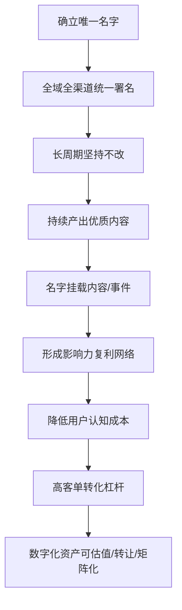

### 79.4.3 关键性质

个人IP复利策略具有复利效应：时间乘以一致性等于品牌资产指数级增长，降低用户认知成本。个人IP背书下的高客单产品（咨询/课程/社群）转化率远超无IP账号，形成信任转化杠杆。个人IP具有资产属性，可估值、可转让、可授权、可矩阵化放大，是数字化资产。

### 79.4.4 典型例子

**粥左罗：12年3000+篇内容织就影响力网络**（来源：docs/202305/20230516_057.md）

粥左罗这个名字，在互联网上存在 12 年了，从未有任何改变。我的微信昵称用了 12 年，👸号用了 8 年。署名粥左罗和分享者粥左罗的文章铺在网上超过 3000 篇。各短视频平台、知识星球、出书、社群社区，都是粥左罗这一个署名。

**漫漫：半年涨粉20万年变现40万**（来源：docs/202305/WX87d3F4SoVZLHxDNGzcDDVRn6R.md）

暴露弱点建立真实人设：功利/自卑/焦虑/孤僻。慢即是快：20万→30万粉速度放缓但吸引高价值合伙人。广告40万/年 + 知识付费10万/2月。

**木子田：PPT赛道47天变现16.7万**（来源：docs/202305/20230516_085.md）

统一封面大字报风格 → 主页转粉率从个位数提至10%+。引流钩子：源文件/模板/素材包/配色表（工具型钩子转化率远高于电子书）。朋友圈三段式：专业/生活/营销 5:3:2。咨询式成交五步法：诊断/痛点/方案/案例/促单。

### 79.4.5 边界条件

前期需忍受"叫好不叫座"的孤独期，拒绝短期流量诱惑（如蹭热点改名）。必须配合"利他思维"持续产出有价值内容，空壳IP无复利。涉及隐私/安全风险时，需物理隔离（小号引流、大号收割）而非实名硬刚。

---

## 79.5 公私域协同模型 —— 蓄水池与提款机的底层通道

### 79.5.1 为什么需要这个概念？

公域流量归平台、脉冲式衰减、不可控，单靠公域变现天花板极低。私域流量归自己、长尾复利、高信任、可反复触达，是变现的核心阵地。缺乏标准化"钩子-承接-转化"链路，公域流量无法沉淀为私域资产。

### 79.5.2 核心定义

**公私域协同模型定义**

所有平台玩法最终归宿：公域引流（蓄水池） → 私域沉淀 → 朋友圈/社群运营 → 高客单/高复购转化（提款机）

核心四大动作标准化：
1. **钩子设计**（资料/诱饵/工具/模板）
2. **诱饵投放**（笔记/视频/直播/SEO）
3. **私域承接**（主页/私信/群聊/企微/自动回复）
4. **后端转化**（话术/产品/服务/分层漏斗）

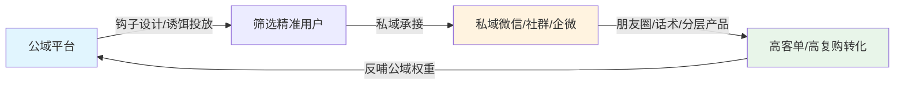

### 79.5.3 关键性质

公私域协同模型的流向单向：公域只负责"筛选精准用户"，私域负责"深度信任与高客单转化"。一份垂直资料（零边际成本）可无限复售、跨平台分发、长期引流，具有杠杆放大效应。闭环标准是公域内容KPI看"精准获客量"而非"爆款阅读量"。

### 79.5.4 典型例子

**三恒：资料整理日均引私域180+**（来源：docs/202305/20230516_046.md、docs/202305/BzIfdvAQloqLImxjEhKcERAXn5f.md）

资料付费转化60% → 咨询二次转化30% → 单用户ARPU超200元。头条号自动回复引流 + 私域双号风控基建。后端匹配：高考咨询/英语训练营/读书营。

**漫漫：小红书半年涨粉20万**（来源：docs/202305/WX87d3F4SoVZLHxDNGzcDDVRn6R.md）

广告40万/年 + 知识付费10万/2月。私域沉淀高价值合伙人：团队核心成员/未来合伙人。

**橘子海：视频号+小红书同步分发**（来源：docs/202305/I8BLdIIfbobzkYxCLGBctYqbnae.md）

放弃直播/小店 → 三个月私域成交20万。素材反推选品：先找IP素材再匹配供应链。多平台分发复利：快手/小红书同步获客。

---

## 79.6 资料整理引流法 —— 垂直资料作零边际成本钩子

### 79.6.1 核心范式

**引流载体与变现主体分离原则**（来源：docs/202305/20230516_046.md、docs/202305/BzIfdvAQloqLImxjEhKcERAXn5f.md）：

> "资料是别人的，产品必须是自己的。既然你再获取客户，那就一定要打磨自己的产品...因为只有做到这一步，我觉得资料整理的价值才算真正的发挥出来，赚卖资料的小钱已经是顺便的事儿了。"

### 79.6.2 标准化流程

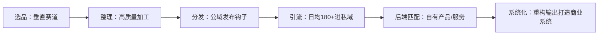

### 79.6.3 典型组合模式

引流资料作为钩子，后端自有产品作为本体，形成多种变现逻辑组合。例如：高中资料引流后端做高考志愿填报咨询；英语资料引流后端做英语训练营或社群；阅读资料引流后端做读书营或社群；商业资料或天涯神贴引流后端做商业咨询、高客单课程或资源对接。资料筛选意向用户，咨询建立信任，高客单服务实现核心利润。

### 79.6.4 核心基建

头条号自动回复机制：发布爆款帖后，后台关键词自动回复微信号或网盘链接，实现无人值守、低封号风险引流。私域双号风控体系：至少两个微信号分流加好友，配合支付宝等多渠道分离收款，规避高频加好友限流及收款风控。

---

## 79.7 AI自动化流水线 —— 从"会用工具"到"建流水线"

### 79.7.1 核心公式

**AI赚钱第一性原理**：

> "单纯会用ChatGPT/MJ不赚钱，必须将业务拆解为标准化SOP，注入Prompt工程，再用RPA/代码/低代码平台串联成自动化流水线。AI降低了'从0到1'的技能门槛，但提高了'从1到N'的标准化要求。"

**核心公式**：AI赚钱 = 业务拆解SOP + 提示词工程 + 自动化串联

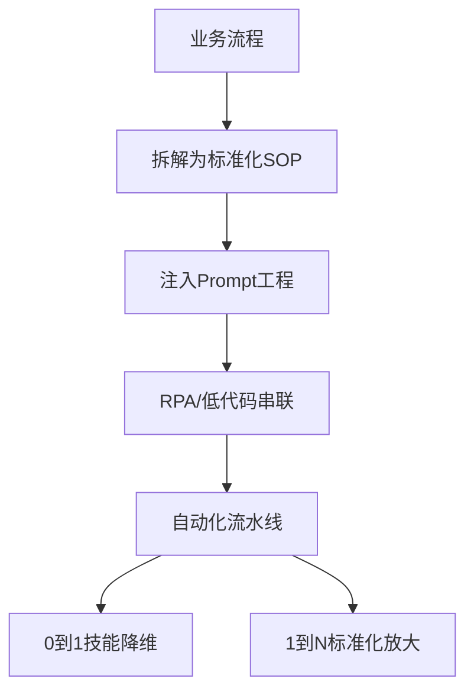

### 79.7.2 三大核心生产线

#### 1. ChatGPT+RPA 13步文案自动化（来源：docs/202305/20230516_070.md）

这是一个包含13个结构化节点的自动化流程：选题、大纲、钩子、正文、标题、标签、配图、发布、数据回收等。工具链使用Excel批量生成Prompt，经ChatGPT生成内容，再通过影刀RPA、Coze或Auto.js定时发布。该流水线将原本需要人工重复操作的文案生产全流程实现了无人值守。

#### 2. SD云端零成本批量出图（来源：docs/202305/HYrZdLBMRorB0qxKqFFcQ075nWf.md）

利用Google Colab免费GPU资源部署SD WebUI（A1111或ComfyUI），配合模型下载脚本、API调用和定时任务。无需本地显卡、无限时长、可编程批量生成图片。适用于表情包、壁纸、电商图、IP形象、短剧配图等场景，实现了真正的零成本、云端化、自动化的批量出图生产线。

#### 3. 短剧CPS批量化（来源：docs/202305/20230516_084.md）

通过ChatGPT改写剧本、剪映智能剪辑或模板批量替换、多平台分发，实现单人日产50-100条视频。新手首月即可变现1.4万+。标准化资产库包括选题表、文案提示词库、配音预设、剪辑模板库、发布清单，将创作过程完全工业化。

### 79.7.3 边界条件

手动跑通是自动化前提：业务未跑通手动SOP前，上自动化工具只会放大混乱。平台风控升级：查重/限流/封号需持续迭代去重/合规策略，非一劳永逸。核心资产管控：核心Prompt/模型/账号需物理隔离与权限管控，防止核心能力外泄。

---

## 79.8 平民无货源电商模型 —— 供应链轻量化的低风险创业范式

### 79.8.1 核心逻辑

**低门槛创业核心主张**（来源：docs/202305/20230516_030.md）：

> "小红书无货源电商是普通人低成本创业的最优解：无需囤货压资金，保证金低至1000元，依靠信息差与执行力即可跑通商业闭环。"

### 79.8.2 三大核心支柱

平民无货源电商模型立足于三大支柱。第一，供应链轻量化：利用1688、拼多多、淘宝、快团团等平台的一件代发模式，单店启动资金仅需3-4千元。第二，矩阵霸屏：通过7-400+店铺布局占据搜索结果前排，单店日出单5-20单可稳定复现。第三，设备环境隔离：执行一机一号一IP的物理隔离策略，这是规避关联封禁的生存底线。

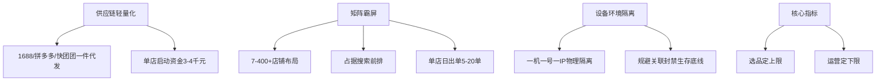

### 79.8.3 三大平台实证对比

| 平台 | 核心玩法 | 实证数据 | 核心壁垒 |
|------|----------|----------|----------|
| 小红书 | 无货源店群+虚拟资料 | 三个月营收50万(营业额)，单店日销5000-8000元 | 封面六大视觉法则、标题关键词公式、双引擎流量 |
| 闲鱼 | 矩阵霸屏+垂直店铺 | 4年运营400+店铺，单店月销千单，7店霸屏前排 | 一机一卡一号、反养号、爆款八要素、蓝海挖掘 |
| 快团团 | 团长模式+大团长推荐 | 二胎宝妈首月GMV 7万+，私域复购极高 | 信任迁移、五维选品、极致售后、危机公关 |

### 79.8.4 选品决定上限，运营决定下限

**三维交叉验证选品法**（来源：docs/202305/20230516_030.md）：

同行选品（站内销量高个人店） + 电商爆款洗品（淘宝/拼多多/抖店榜单→小红书验证销量>500） + 热度词选品（千瓜/蝉妈妈/禅小红查热词→站内搜验证）。三通道交叉验证显著提升选品成功率。

**闲鱼矩阵霸屏策略**（来源：docs/202305/20230516_097.md）：

7-8个店铺布局同一单品，占据搜索前5或前10的多个位置。通过曝光数据预判具体哪个链接会爆单，实现"必定有一个爆单"的确定性收益。

---

## 79.9 视频号短视频带货投流 —— ROI正向闭环的确定性打法

### 79.9.1 核心优势与范式跃迁

**投流玩法优于自然流的稳定性判断**（来源：docs/202305/20230516_082.md）：

> "2 月份我还在做自然流，在被连续限流十几个账号后，彻底退出自然流玩法，开始研究挂车投流...流程跑通之后，真香！稳定、可复制、可放大。而且，不废号！！！"

### 79.9.2 品素决定论 (70/30法则)

**核心定理**（来源：docs/202305/AxQ8duaITowcrCx54hocWSy4nnb.md）：

> "品和素材的重要性占爆品要素的70%以上，投放技巧占比不超过30%。在我们测试过程中遇到的90%问题...都是品和素材导致的。"

### 79.9.3 分级测品止损体系

**1测：验品期**

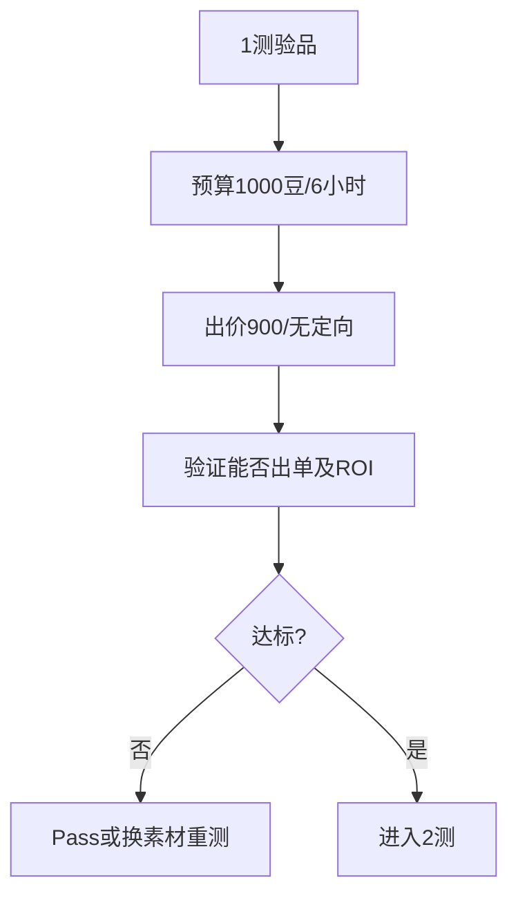

**2测：探价期**

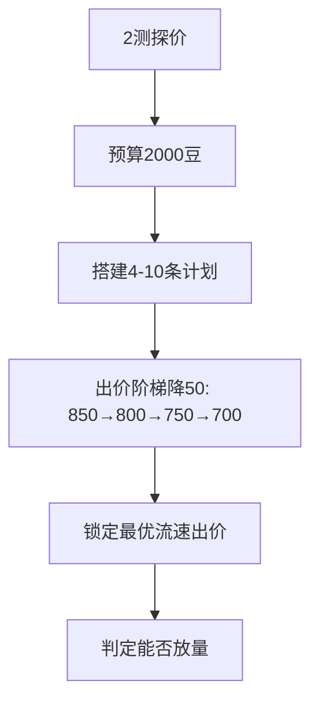

### 79.9.4 关键操盘公式

**止损公式**：

利润大于100元时：消耗达(利润/4 - 5)未出单 → 关停。利润小于100元时：消耗达(利润/3 - 5)未出单 → 关停。核心逻辑：用关停空消耗提高ROI。

**黄金时间窗**：

测品建议在上午9点前进行。放量则在晚上12点建立12小时计划，或凌晨4点建计划效果最佳。这体现了视频号中老年用户活跃规律与流量分发机制的匹配。

### 79.9.5 组织架构标准化

3-6人小组配置，人均5台安卓机（微信多开），专职投手按3组:1投手比例配置。核心指标为"日测品数/素材数"。头部团队日测70-100品，保证高频出爆品。

### 79.9.6 供应链熔断机制

48小时发货红线：延迟3-5天必引发退款。店铺体验分需≥4.2分：新店初始4.5分，低于4分触发隐藏下架。偏远地区预设不发货：物流分易因纠纷拉低。多店铺备选 + 即时催单 + 动态切换：避免"到手鸭子飞了"。

---

## 79.10 知识付费/写作变现 —— 个人IP信任背书下的高客单复利路径

### 79.10.1 核心三要素

个人IP信任背书：内容积累→人设确立→信任资产。标准化交付产品：SOP/模板/社群/咨询（边际成本趋近零）。持续内容输出：公域引流 + 私域沉淀 + 朋友圈运营。

### 79.10.2 变现分层漏斗

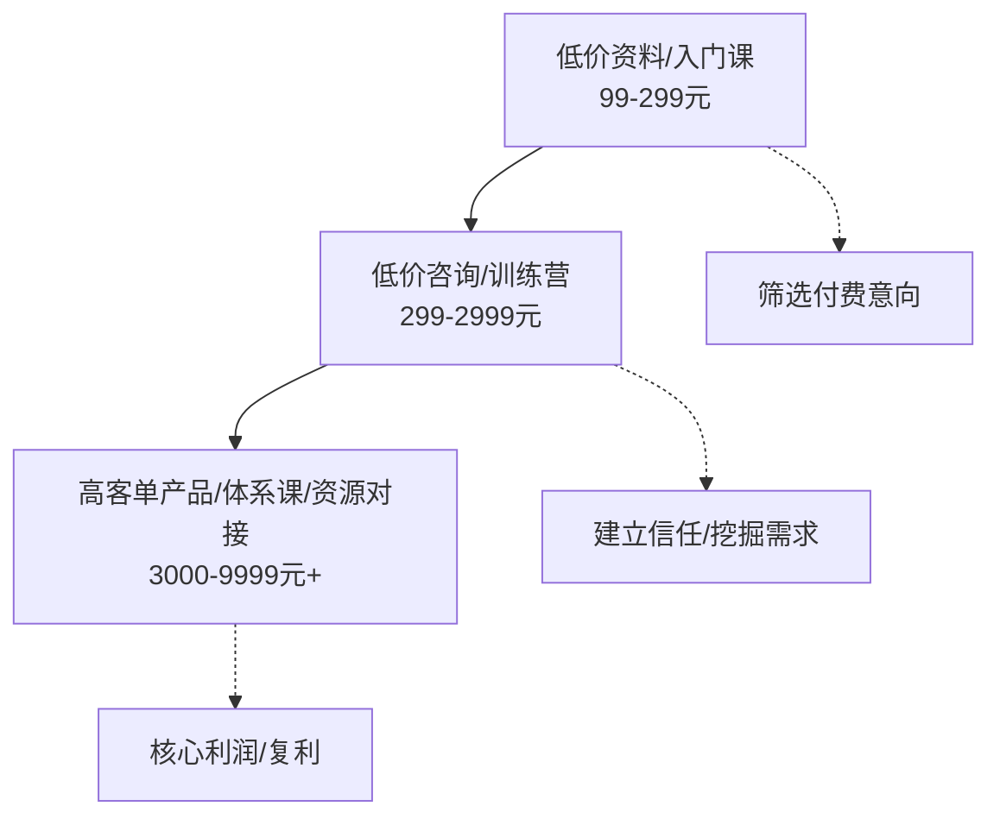

### 79.10.3 核心经营原则

**暴力交付原则**（来源：docs/202305/20230516_041.md）：

> "越是好的交付就越暴力...永远没有最好的交付，只有更好的用户。用户付费是为节省时间买单，交付应在内容产出瞬间完成。"

**选客户比服务客户重要**（99/1法则）：

> "99%成功源于客户自我觉醒，服务者贡献仅1%。筛选'正在觉醒/已觉醒'客户，稍加助力即成。"

**认知接口：旧瓶装新酒**：

> "不教育新概念（成本极高），而在用户既有认知框架内植入新工具/新场景。如ChatGPT课不讲原理，只讲'原流程不变，效率提升10倍'。"

**动态定位**：判断项目赚钱 → 定位服务项目 → 赚钱后升级定位。

**组织进化三阶段**：0-1做零件（勤奋，亲自跑通）；1-N做设计者（懒惰，买时间，外包/机制）；规模化做带将者（合伙人制，搞定牛人）。

---

## 79.11 海外业务高汇率杠杆

### 79.11.1 Mediabuy品牌词套利

**品牌词近零成本定理**（来源：docs/202305/M0hMdjWj3o8WtNxZdv4cLnfenIh.md）：

> "在 Google Ads 中竞价广告主自身的品牌词，由于极高的相关性（质量得分满分）且通常缺乏竞争对手竞价，实际点击成本 (CPC) 可无限接近于 0（实操中稳定在 0.01 当地货币单位）。"

**CPC/EPC套利数学模型**：

CPC压至0.01以下，联盟Offer EPC极少低于0.01。只要CPC < EPC即稳定盈利。三组实盘ROI：359% / 496% / 359%。港币账户成本再降7倍（0.01 HKD ≈ 0.0013 USD）。

这个数学模型的核心在于：品牌词因相关性极高、质量得分满分且缺乏竞争，CPC可压至极低水平；而联盟营销中EPC（每次点击收益）极少低于0.01。只要CPC < EPC，每次点击即为正向套利。三组实盘账户数据分别验证了359%、496%、359%的ROI，港币账户利用汇率差进一步将成本降低7倍，极大拓宽了利润空间。

**三步标准化执行**：

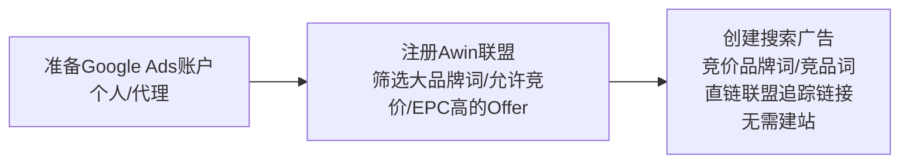

### 79.11.2 B2B独立站冷启动

**核心流程**（来源：docs/202305/VILid7sleoZ6puxkchxcRM9vn6g.md）：

细分Niche选品 → 独立站搭建(Shopify/WP) → 内容SEO/社媒矩阵获客(Ins/FB/LinkedIn/TikTok) → 询盘跟进/留钩子成交 → 收款(Wise/Payoneer) → 复购/转介绍。

**关键动作**：

内容为王，技术为辅：仅靠博客文章获精准流量，2个月拿到精选摘要第0名。极简表单：仅Email+Message必填，降低门槛。首轮回复拒绝自嗨：针对问题→给方案→给价值→留钩子。留钩子成交：主动提供测试文件/模拟建议，锁定高利润成交。

### 79.11.3 超轻量化私域SOP

**启动清单**（来源：docs/202305/Nt9IdI0b0okp1MxGKBacQtxSn3e.md）：

1部手机 + 1张HK卡 + 1台电脑 + 1套FB账号体系。

**核心策略**：

减法启动：不囤货、不建站、不解决复杂物流。INS内容信任前置：40+篇专业贴（4天）建立信任背书 → 再开广告。FB企业户授权个人户：核心资产沉淀私域好友，广告账户视为耗材。低预算FB广告：$20/天、消息目标、宽定向、视频素材。代购人设：天然站在"帮客户省钱/避坑"一方。SPIN简化版四步聊单：介绍产品 → 询问场景 → 询问预算 → 现场比价报价。B端挖掘：从C端零售到批发大单跃迁（门锁2000把案例）。

---

## 79.12 资料整理商业模型 —— 资料是踏脚石，产品必须是自己的

### 79.12.1 核心范式对照

资料整理商业模型的核心在于区分引流载体与变现主体。

| 维度 | 错误认知 | 正确范式 |
|------|----------|----------|
| 资料定位 | 变现主体 | 引流载体/钩子/踏脚石 |
| 产品定位 | 无/依赖资料 | 必须是自己的本体 |
| 变现逻辑 | 单一靠量 | 分层漏斗：资料筛选→咨询建信→高客单转化 |
| 用户筛选 | 免费送/低价卖 | 付费即筛选(9.9元验证双重意向) |
| 信任建立 | 聊天聊出来 | 价值交换建立(低价咨询为信任启动器) |
| 能力建设 | 单纯搬运 | 整理输入→重构输出→打磨护城河 |

### 79.12.2 五步私域成交话术模型（来源：docs/202305/20230516_033.md）

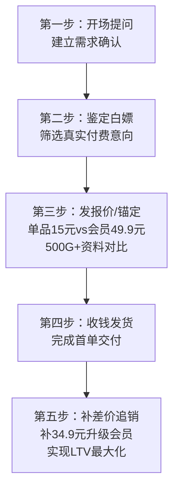

**白嫖用户分层运营**：免费给少量资料 → 建立好感纳入私域池 → 长期培育等待转化时机。

### 79.12.3 实测数据验证（来源：docs/202305/BzIfdvAQloqLImxjEhKcERAXn5f.md）

4天实测：日均投入2小时 → 日均引流180+。资料付费转化60% → 咨询二次转化30%。单用户ARPU超200元。

---

## 79.13 生财通用方法论 —— 像素级拆解、逆向工程、MVP验证

### 79.13.1 核心工具链（全流程）

**全流程说明**：在常态分布中识别异常值（如无人播却高场观高客单）作为机会信号；对标杆进行全链路复现式分析，记录进直播间、扫码、加微、话术、下单、交付、朋友圈每个像素动作；1:1复刻标杆头像/简介/企微/自动回复/直播间搭建/OBS场景/标点符号，降低认知负荷；同产品不同平台/年龄层/场景转化率巨大差异，调整素材实现匹配；违规扣分限流账号作为低成本测试载体，榨取残余流量价值；美女/试驾梗素材跨项目迁移，核心降低技能门槛提高产出比；AE改文字直播→AI绘画/AI聊天/虚拟主播带货；非标产品无高复购则LTV无法覆盖获客成本；可跨周期跨赛道复利。

### 79.13.2 执行铁律

**低成本验证优于完美策划**（来源：docs/202305/DGw1dYHSsohHu7x1AXhc4cQVnEN.md）：

> "8元模板 + 废号 + 现有电脑 < 1100元成本跑通商业闭环(首单/百单)，真实交易数据检验需求唯一标准。"

**数据反馈迭代规模化**：发现有效成交动作 → 归因"踩中痛点运气" → 在该路径上极致重复/标准化/放大。严禁主观执念续投，控制成本提升测品效率。

### 79.13.3 反脆弱性验证

**多项目组合运营**（来源：docs/202305/DGw1dYHSsohHu7x1AXhc4cQVnEN.md）：

> "连续操盘四维预测、碳中和、点歌、陪诊、数藏、鉴渣、相亲盲盒等无关项目均盈利；单项目（碳中和）因天花板停更但整体收益持续，积累'只要出手，必有回响'底气。"

### 79.13.4 杠杆化定位

基于纳瓦尔三种杠杆理论的迁移应用：

| 传统杠杆形式 | 生财数字化迁移 | 零边际成本复制特征 |
|-------------|---------------|-------------------|
| 资本杠杆 | 广告投放/供应链垫资 | 需要资金，有上限 |
| 劳动力杠杆 | 外包执行/兼职团队/模块化交付 | 需要管理，沟通成本高 |
| **零边际成本复制杠杆** | **个人IP/方法论/SOP/自动化流水线** | **一次生产，无限复制，边际成本趋零** |

这个杠杆化定位表展示了为什么生财方法论强调构建个人IP、方法论、代码和媒体资产：它们属于纳瓦尔定义的第三种杠杆——零边际成本复制杠杆。个人IP一旦建立，内容可无限分发；方法论一旦沉淀，可跨项目复用；自动化流水线一旦搭建，可7x24小时生产。这三种传统杠杆中，只有第三种杠杆能实现真正的指数级放大而无需线性投入成本。

---

## 79.14 多源对照：同一概念的不同素材支撑

### 79.14.1 "小航海机制"的多源支撑

| 素材来源 | 核心观点 | 差异点 |
|----------|----------|--------|
| **SUMMARY.md** | 训练营模式，强制跑通0-1，共同孵化器 | 宏观定位 |
| **20230516_014.md** | 四大机制：截止节点/公开承诺/同伴监督/导师点评 | 微观机制拆解 |
| **Gn5NdifvBorUbdxvGl6ceQgXnpg** | 四阶段：锻造武器→明确战场→勇敢行动→放大项目 | 方法论体系化 |
| **DGw1dYHSsohHu7x1AXhc4cQVnEN** | 低成本验证优于完美策划，8元跑通闭环 | 实战验证MVP思维 |

**共识**：小航海是新手0-1跨越执行鸿沟的最优容器，核心在于外部约束强制执行。

**分歧**：
- 014强调"导师点评"为核心
- Gn5N强调"项目筛选模型"为决策前置
- DGw1强调"像素级模仿+数据迭代"为执行核心

### 79.14.2 "个人IP复利"的多源支撑

| 素材来源 | 核心观点 | 独特贡献 |
|----------|----------|----------|
| **SUMMARY.md** | 百年不改名/全域同名/不出镜也能做IP | 战略原则 |
| **057.md** | 唯一名字复利定律/名字优先级判断准则 | 数学化复利模型 |
| **WX87d3F4SoVZLHxDNGzcDDVRn6R** | 缺点即特质/IP核心公式=共性+特性 | 人设构建心理学 |
| **085.md** | 统一封面提升转粉率/私域钩子设计/朋友圈三段式 | 战术级执行标准 |

**共识**：个人IP是普通人最高杠杆资产，一致性是复利前提。

**分歧**：
- 057主张"名字本身不重要，能用一辈子才重要"
- WX87主张"暴露弱点建立真实信任"
- 085主张"视觉一致性=专业信任感"

### 79.14.3 "公私域协同"的多源支撑

| 素材来源 | 核心模型 | 独特视角 |
|----------|----------|----------|
| **SUMMARY.md** | 蓄水池-提款机/四大关键动作 | 顶层架构 |
| **046.md** | 引流载体与变现主体分离/输入-重构-输出 | 商业模型本质 |
| **BzIfdvAQloqLImxjEhKcERAXn5f** | 付费即筛选/信任源于交换/变现分层漏斗 | 心理学与话术 |
| **I8BLdIIfbobzkYxCLGBctYqbnae** | 视频号人群>兴趣/做减法/素材反推选品 | 平台特性适配 |

**共识**：公域筛选精准用户，私域深度转化高客单，资料/钩子为连接媒介。

**分歧**：
- 046强调"资料整理"为核心钩子
- BzIf强调"付费筛选"为信任起点
- I8BL强调"人群标签粘性>内容兴趣标签"的平台特性

---

## 79.15 设计中的取舍

**问：为什么不用"全职自媒体"而是"副业起步+IP资产化"？**

答：全职自媒体面临生存压力大、容错率低、易陷入流量焦虑；副业起步保留主业现金流安全垫，用"小航海"低成本验证，跑通后再All in IP资产化。正如漫漫案例：半年涨粉20万但广告仅40万/年，真正高价值在于知识付费10万/2月+合伙人沉淀，而非广告分成。

**问：为什么不用"原创内容"而是"像素级模仿+微创新"？**

答：原创内容试错成本高、周期长、不确定性大；像素级模仿（1:1复刻标杆头像/简介/直播间/标点符号）将认知负荷降至最低，快速达及格线，再在正反馈路径上微创新。东哥案例：封面统一大字报风格→主页转粉率从个位数提至10%+，验证"视觉一致性=专业信任感"。

**问：为什么不用"自然流"而是"付费投流"做视频号带货？**

答：自然流极不稳定：连续限流、账号易报废、无法复制放大；付费投流具备稳定、可复制、可放大、不废号四大优势。纸壳案例：连续十几个自然流账号被限流后彻底转型投流，新号冷启动3-7天，ROI稳定1.8-2.0。

**问：为什么不用"卖资料"而是"资料作钩子+后端高客单服务"？**

答：单纯卖资料陷入红海：单价低、无复购、易被盗版、无品牌资产；资料本质是零边际成本的"钩子"，核心利润必须来自后端自有高附加值产品。三恒案例：日均引流180+，资料付费转化60%，咨询二次转化30%，单用户ARPU超200元。

**问：这种设计的 trade-off 是什么？**

答：获得确定性闭环（SOP跑通即赚钱），失去创意自由度（需严格按SOP执行）。获得可复制放大（矩阵/团队/自动化），失去个性化表达（标准化要求一致性）。获得低风险试错（MVP/小航海/废号），失去极致爆发上限（放弃了孤注一掷的大博弈）。获得跨周期复利（方法论/IP/自动化），失去短期暴利机会（拒绝了高风险高回报的投机）。

---

## 79.16 动手练习

### 练习 1：设计你的"最小可行性航海项目"

根据"小航海项目筛选六大标准"（快现金流/无囤货/可SOP/借力AI/有获客路径/高后端），从你当前认知范围内挑选3个候选副业项目。

为每个项目填写：预计启动成本、预计首单周期、核心SOP步骤数、公域获客渠道、后端高客单产品设想。

回答问题：
- 哪个项目最符合"低成本验证优于完美策划"原则？为什么？
- 如果只保留一个项目跑21天航海，你会选哪个？你的"公开承诺"内容是什么？
- 该项目的"像素级模仿"对标账号是谁？你要1:1复刻的三个核心动作是什么？

### 练习 2：搭建个人IP"品牌资产飞轮"蓝图

确定你的统一ID/头像/简介/视觉锤(配色/字体/排版模板)，并检查是否在小红书/抖音/视频号/👸号/微信全域一致。

规划前30天内容日历：每天1条垂直内容(解决目标用户1个具体问题)，标注选题来源(评论区/私信/同行爆款/个人经历)。

设计"引流钩子"(资料包/工具/清单/模板)与"后端产品阶梯"(低价资料→低价咨询/训练营→高客单体系课/服务)。

回答问题：
- 你的"不出镜IP"选择哪种形态(资料号/工具号/笔记号/虚拟形象)？核心差异化人设标签是什么？
- 如何用"暴露弱点/人性共通痛点"建立真实信任感(参考漫漫"功利/自卑/焦虑"暴露策略)？
- 前期"叫好不叫座"孤独期如何熬？设定何种"过程指标"(如日更/完成度/素材库积累)而非"结果指标"来正向激励？

### 练习 3：跑通一条"AI自动化内容生产线"最小闭环

选定一个你熟悉的内容赛道(如：行业资讯摘要/工具测评/书单摘录/英语学习/避坑指南)。

拆解该赛道内容生产全流程为5-8个标准化节点(如：选题→大纲→钩子→正文→标题→标签→配图→发布)。

为每个节点编写一个结构化Prompt(含角色/任务/输入格式/输出格式/约束条件/少样本示例)，并在ChatGPT中测试稳定输出。

用Excel/Cortex/Coze/影刀RPA任选一工具，串联至少3个节点实现半自动化(如：Excel批量生成Prompt→复制到ChatGPT→人工复制结果→RPA定时发布)。

回答问题：
- 哪个节点目前AI输出质量最不稳定？如何通过"少样本示例"或"约束条件"固化？
- 手动跑通全流程需多少分钟？半自动化后预计缩短至多少？单人日产上限几条？
- 该流水线迁移到另一平台(如小红书→👸号/视频号)需修改哪些节点？核心Prompt复用率多少？

### 练习 4：推演一个"视频号短视频带货投流"测品计划

在视频号选品广场/巨量百应榜单/蝉妈妈/同行爆品中筛选3个符合"高客单>70%利润/新奇特/非黑五类"标准的商品。

为每个商品寻找1-2条对标爆款视频(抖音/快手/视频号)，拆解其前3秒钩子/中间节奏/结尾CTA/混剪去重手法。

制定"1测验品"计划：预算1000豆/6小时/出价900/无定向，设定"关停止损线"(按利润/4-5)与"及格线"(ROI>1.2/出单≥2单)。

制定"2测探价"计划：预算2000豆/4-10条素材/出价阶梯降50，目标锁定"最优流速出价"与"可放量判定"。

回答问题：
- 若1测"不消耗/不过审/转化低"三大异常全中，你的结构化排查决策树动作是什么？
- 供应链响应速度如何压测？"48小时发货红线"与"店铺体验分≥4.2分"如何通过备选供应链/预设偏远不发货/即时催单机制兜底？
- 单账号日测品数设定为多少？如何用"矩阵号复制"(身份证合规/物理隔离硬件/账号编号体系)放大测品吞吐量？

### 练习 5：构建"资料整理商业模型"MVP验证闭环

利用"词根三级挖掘法"(通用词→行业词→细分词)结合"淘上红选品"(淘宝直通车成交笔数/搜索人气/成交转化)与"小红书原生交叉验证"(下拉词/笔记总量/竞品点赞>100/评论区求资源)，确定1个虚拟资料赛道(如：考公/考证/职称/育儿/创业/技能教程)。

制作"引流资料包"(目录/试读/精华摘录)作为钩子，设计"五步私域成交话术"(开场提问→鉴定白嫖→发报价/锚定→收钱发货→补差价升单会员)。

在小红书发布3-5篇笔记(封面六大视觉法则/标题关键词杂交/文案真情实感/评论区引导关键词领取)，统计：曝光/点击/私信/加微/付费/咨询/升单各环节转化率。

计算单用户ARPU、资料付费转化率、咨询二次转化率、会员升单率，判断是否"跑通闭环"决定是否加大投入。

回答问题：
- 该赛道"版权风险"如何隔离？公域售卖vs私域网盘/群交付的合规成本差异？
- "白嫖用户"如何分层运营？免费给少量资料建立好感纳入私域池的长期培育SOP是什么？
- 单一赛道必然枯竭，你的"持续挖掘新赛道系统能力"由哪三个模块组成(如：词根挖掘自动化/竞品监控雷达/用户需求挖掘闭环)？

---

## 79.17 本章小结

这一章中我们系统梳理了生财有术社群沉淀的完整实战体系：从认知底座的"执行力优先、承认无能、利他思维、个人IP复利"，到训练容器"小航海"的强制执行机制，再到流量架构的"公私域协同模型"与"资料整理引流法"，AI生产力的"业务SOP+Prompt工程+RPA串联"自动化范式，三大核心项目库（平民无货源电商、视频号投流带货、知识付费写作变现）的标准化打法，海外高汇率杠杆下的Mediabuy/B2B独立站/超轻量私域SOP，以及贯穿始终的"生财通用方法论"（像素级拆解→像素级模仿→人群匹配→废号资产化→方法论资产>单项目收益）。首先我们建立了"小航海"作为新手跨越知行鸿沟的强制容器；其次确立了"百年不改名"的个人IP复利策略；接着拆解了"蓄水池-提款机"的公私域协同底层通道；然后推演了AI自动化流水线从0到1技能降维与1到N标准化放大的核心公式；之后对比了三大平台无货源电商的供应链轻量化与矩阵霸屏逻辑；随后精讲了视频号投流的品素决定论、分级测品止损公式与黄金时间窗；再讲解了知识付费的暴力交付、选客户原则、认知接口与组织进化三阶段；紧接着剖析了海外Mediabuy品牌词套利的CPC/EPC数学模型与B2B独立站留钩子成交法；最后内化了资料整理商业模型的引流载体与变现主体分离、付费即筛选、MVP验证闭环三大核心范式。

本章我们一起学习了以下概念：

| 概念 | 解释 |
|------|------|
| 生财小航海 | 新手0-1跨越执行鸿沟的强制容器：截止节点+公开承诺+同伴监督+导师点评，产出标准化SOP与MVP验证 |
| 个人IP复利策略 | 百年不改名、全域同名构建品牌资产飞轮，统一视觉锤降低认知成本，私域沉淀为高客单转化杠杆 |
| 公私域协同模型 | 公域蓄水池(算法/SEO筛选精准用户)→私域提款机(朋友圈/社群深度信任高客单转化)，钩子-承接-转化四大标准化动作 |
| 资料整理引流法 | 垂直资料作零边际成本钩子，日均引私域180+，配合头条自动回复/双号风控基建实现规模化 |
| AI自动化流水线 | 核心公式=业务SOP+Prompt工程+RPA串联，ChatGPT+RPA 13步文案/SD云端零成本/短剧CPS批量化跑通商业化 |
| 平民无货源电商 | 供应链轻量化(一件代发)+矩阵霸屏(7-400+店)+设备隔离(一机一号一IP)，选品定上限/运营定下限 |
| 视频号投流带货 | 品素决定论(70/30)+分级测品(1测验品/2测探价)+止损公式+黄金时间窗+3组:1投手组织架构，ROI正向闭环稳定复现 |
| 知识付费变现 | 个人IP信任背书+标准化交付产品(SOP/模板/社群)+持续内容输出三要素，变现分层+暴力交付筛选+动态定位+组织进化三阶段 |
| 海外高汇率杠杆 | Mediabuy品牌词套利(CPC≈0.01/ROI 359-496%)+B2B独立站冷启动(内容SEO/留钩子)+超轻量化私域(减法启动/资产隔离/SPIN话术) |
| 资料整理商业模型 | 引流载体(资料)与变现主体(产品)分离，分层漏斗(资料筛选→咨询建信→高客单转化)，付费即筛选/信任源于交换/能力建设循环 |
| 生财通用方法论 | 像素级拆解/逆向工程→像素级模仿(1:1复刻)→人群匹配度调整→废号资产化→流量密码迁移→方法论资产>单项目收益，低成本验证优于完美策划 |
| 执行力优先定理 | 认知突破源于行动反馈而非空想，解决真正问题，赚钱的事多做十遍，承认无能是成长起点 |
| 利他思维 | 商业协作底层逻辑：优先为用户/伙伴创造价值，高客单/高复购/高信任业务的基石 |
| 平台风控窗口期 | 红利期有窗口不可对抗只能利用，快进快出榨取价值而非硬刚平台(蓝V/保证金/开店) |

下一章中，我们将学习如何将本章建立的通用方法论与标准化SOP，针对具体的个人禀赋（主业技能/资源/兴趣/可用时间）进行"项目-人匹配筛选"，设计专属的"最小可行性商业闭环"，并在21天航海周期内完成从0到1的实战跃迁。

感谢你读到了这里，恭喜你，你已经完成了生财实战体系总论的核心认知构建。接下来的路，就是在实战中不断打磨、迭代、复利。

