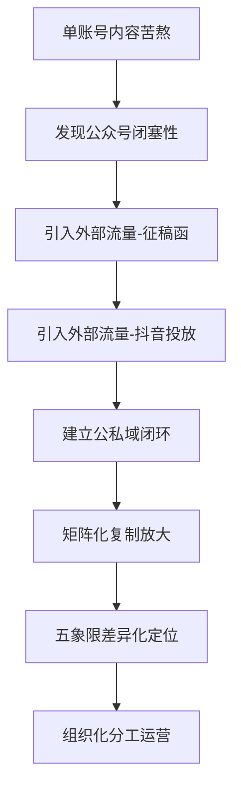
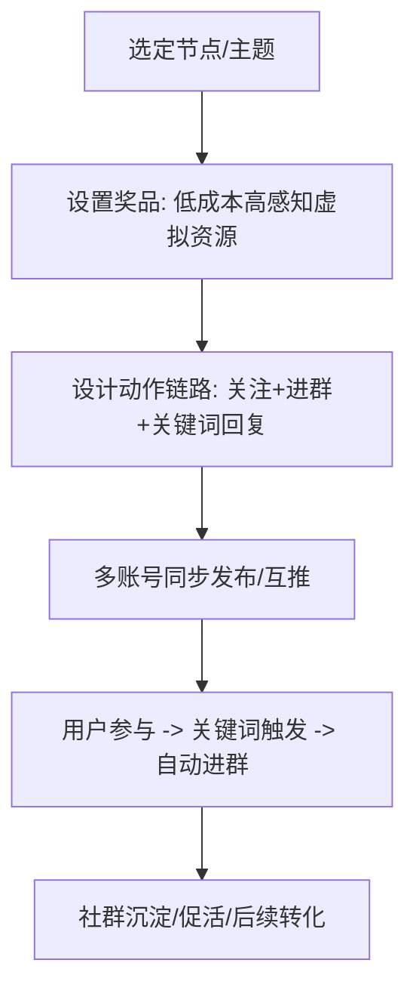
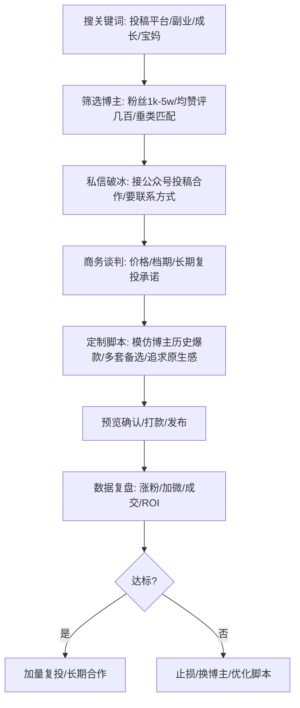
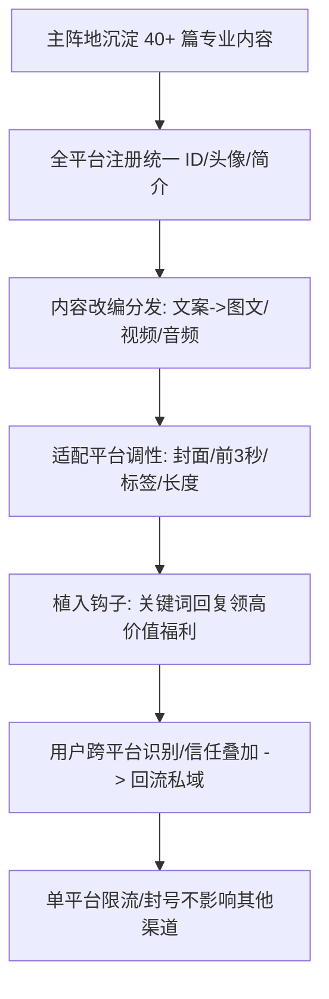
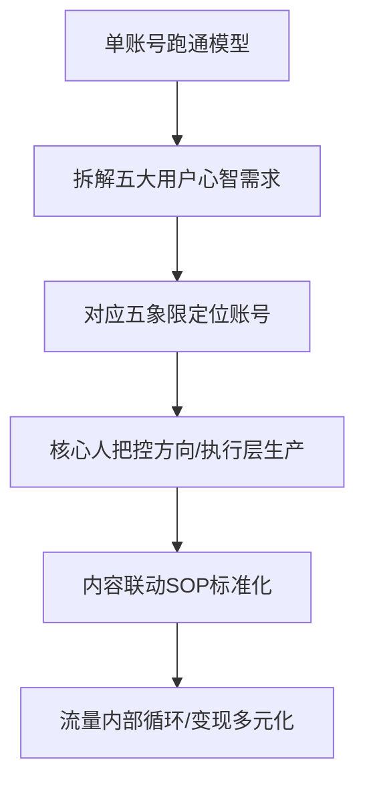
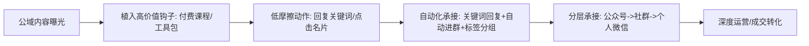
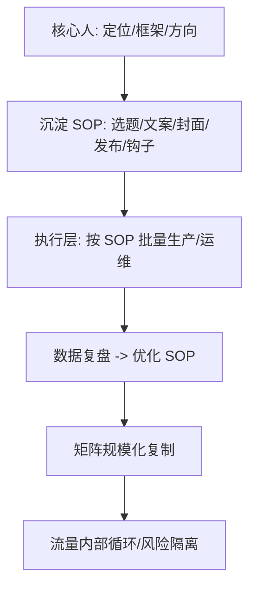

# 第 41 章 公私域流量闭环与矩阵化引流体系

## 学习目标

- 理解公众号作为高度闭塞平台必须依赖外部流量实现冷启动的底层逻辑
- 掌握"引流与沉淀双轮驱动"模型：公域获客→私域内容池沉淀→强关系私域运营→高客单/高复购变现的完整闭环
- 熟练运用征稿函引流、人设互推、矩阵抽奖联动、抖音博主投放SOP、全平台同名分发五大标准化引流玩法
- 建立矩阵账号五象限定位体系（情感/两性/IP/情绪/成长），实现流量最大化利用与变现渠道多元化
- 掌握"引流钩子设计与落地页构建"自动化转化链路：高价值虚拟钩子+低摩擦动作+自动化承接
- 理解矩阵化运营分工模型：核心人做决策/把控，执行层做生产/运维，SOP标准化为规模化前提
- 识别引流玩法的风控边界：征稿函近期违规风险高、硬广导流必封号、泛粉抽奖需小号投机操作

## 41.1 生活类比

想象公私域流量闭环是一个"水库-净水厂-管道-用户"的供水系统：公域平台（视频号/抖音/小红书）如同天然水库/外部水源，水量大但浑浊（泛流量），需要引水工程（引流玩法）引入；公众号如同净水厂/蓄水池，通过内容沉淀（净化处理）将泛流量转化为优质水源（精准粉丝），建立信任资产；个人微信/社群如同输水管道/终端水龙头，直达用户（强关系），提供即时服务（开水即饮），实现高客单变现（收水费）；引流钩子如同接水器具/水票，用户必须凭票（关键词回复）领器具（进群/加微）才能取水，无钩子无法建立连接；矩阵账号如同多条引水渠/备用水源，单渠道易干涸/堵塞（限流/封号），多渠道并联保障供水稳定性与总量。就像自来水厂必须"引水-净水-管输-售水"全链路打通才能盈利，公众号商业化也必须"公域引流-私域沉淀-强关系运营-产品变现"双轮驱动，缺一不可。

## 41.2 概念地图

公私域流量闭环与矩阵化引流体系
├── 核心定律
│   ├── 公众号增长必需外部流量论  —— P001
│   ├── 引流与沉淀双轮驱动论  —— P001
│   ├── 矩阵化复制放大商业价值论  —— P001
│   └── 投放切入点伪装论  —— P001
├── 五大标准化引流玩法
│   ├── 征稿函引流（高转化/高风险）  —— P001
│   ├── 人设互推（零成本/信任背书）  —— P001
│   ├── 矩阵抽奖联动（低成本/复合价值）  —— P001
│   ├── 抖音博主投放SOP（付费/标准化/灰色地带）  —— P001
│   └── 全平台同名分发（内容杠杆/品牌叠加/风险隔离）  —— P001
├── 矩阵账号组织架构
│   ├── 矩阵账号五象限定位  —— P001
│   │   ├── 情感号（美文故事/泛流量广告）
│   │   ├── 两性号（女性热点/高粘性带货）
│   │   ├── IP号（人设赚钱/高客单高信任）
│   │   ├── 情绪号（情绪宣泄/内容为王）
│   │   └── 成长号（思维认知/高价值高复购）
│   └── 矩阵化运营分工模型  —— P001
│       ├── 核心人：定位把控/框架搭建/方向决策
│       └── 执行层：内容生产/日常运维/数据复盘
└── 转化基建体系
    ├── 引流钩子设计与落地页构建  —— P001
    │   ├── 高价值虚拟钩子（付费课程/工具包/独家资料）
    │   ├── 低摩擦动作（关键词回复/点击名片/扫码进群）
    │   └── 自动化承接（关键词回复/群欢迎语/标签分组）
    └── 分层承接体系
        ├── 公众号（内容池/弱关系）
        ├── 社群（高频互动/中关系）
        ├── 个人微信（深度信任/强关系）
        └── 产品（商业变现）

## 41.3 公私域流量闭环 —— 公域蓄水池与私域提款机的底层通道

### 为什么需要这个概念？

你可能已经发现，只在公众号里闷头写文章，粉丝增长极其缓慢。这不是你的内容不够好，而是**公众号的平台机制决定了它是一个高度闭塞的私域环境**。正如作者辰风在复盘中指出的："单打独斗只做内容，不做外部流量，在公众号是行不通的。因为公众号是一个十分闭塞的平台。" [P001, p.1]

公众号内部的"看一看"、"搜一搜"推荐流量太弱，无法支撑规模化冷启动。你必须主动出击，去公域平台（视频号、抖音、小红书等）或他平台（同类大号）"引水"。

但光引水还不够。作者强调：**"引流需要内容来促活，来进行用户沉淀。光引流，不维护用户是远远不够的。需要双管齐下，引流和内容都要重视。"** [P001, p.2] 如果没有内容池（公众号）净化流量，没有强关系私域（个人微信/社群）承接转化，引来的流量就像水倒进筛子，瞬间流失，形成"漏斗"而非"资产"。

### 核心定义与推导

**公私域协同模型**（来源：《P001》）

$$
\text{可变现商业资产} = \text{公域流量} \times \text{内容信任} \times \text{钩子转化} \times \text{私域运营}
$$

这个公式展示了四个关键环节的乘法关系：任何一个环节为零，最终结果为零。公域流量是水源，内容信任是净水厂，钩子转化是接水管，私域运营是售水系统。

**逐项推导：**

- **公域流量（水源）**：视频号、抖音、小红书等平台的曝光量。若为 0，后续全链路断裂，无米下锅。
- **内容信任（净水厂）**：公众号文章的专业度、人设一致性、价值密度。将泛流量“净化”为认可你、信任你的精准粉丝。若为 0，用户虽来但不信，无法进入下一环。
- **钩子转化（接水管）**：关键词回复、名片、福利诱饵等低摩擦动作，把“信任”转化为“线索”（加群/加微）。若为 0，信任无法落地为可触达的私域联系人。
- **私域运营（售水系统）**：社群高频互动、朋友圈人设建设、一对一深度沟通，最终成交高客单/高复购产品。若为 0，线索沉睡流失，前端投入全部打水漂。

**为何是乘法而非加法？** 因为这是一个**串联的管道系统**，而非并联的蓄水池。上一环的产出是下一环的输入，任一环节断裂（=0），全链路即刻归零。这也解释了为什么“只引流不沉淀”必死——钩子转化与私域运营若为 0，公域流量再大也是无效功。

**阈值临界点：** 当公域流量 < 内容信任建立所需的最小样本量（约 500-1000 精准曝光）时，内容信任无法建立，系统陷入“冷启动陷阱”；当钩子转化率 < 1% 时，私域运营边际成本过高，商业模型跑不通。

**公式的实战指导意义**

该公式是一把**诊断手术刀**。当月变现不及预期时，不要盲目加大投放，而是按乘法链路逐项排查：是公域流量枯竭（需加投放/换渠道）？还是内容信任不足（需重塑人设/提升干货密度）？还是钩子失效（需升级福利/降低摩擦）？抑或私域运营崩塌（需补人/优化SOP）？找到最短板（乘数最小者），集中资源补齐，边际回报最高。这也是“双轮驱动”落地的操作准则：拉新轮负责做大第一个乘数，留存轮负责守住后三个乘数不归零。

**双轮驱动定律**（来源：《P001》）

- **拉新轮**：站内互推（征稿函/人设互推/抽奖联动）、站外投放（抖音博主/多平台分发）、跨平台导流
- **留存轮**：公众号内容沉淀（弱关系）、社群高频互动（中关系）、个人微信深度运营（强关系）

这两个轮子必须同步转动。作者实测："当真的给你一个很大的流量，你的账号是否能够接得住。" [P001, p.3] 接得住的前提，就是已建立完整的留存轮。

### 方法演进图



### 关键性质

公私域闭环具有三大关键性质：首先是**闭环必要性**，流量打通、内容依托、产品承接三者缺一不可，共同构成完整商业成交闭环。作者一年运营出 5.6 万/2.6 万粉账号，单日涨粉过万，验证了该闭环的可行性。其次是**矩阵放大效应**，单账号上限有限，矩阵化能实现流量内部循环最大化、广告位复用、SOP标准化复制、风险分散四大价值。作者总结矩阵四大意义："最大化的利用流量，大号带小号... 更高效的实现变现... 引流、运营模式可以大量复制... 降低风险，应对突发危机"。最后是**先单后多原则**，必须先跑通单账号模型（有基础流量/变现），再复制放大矩阵，避免无基础盲目铺开导致内耗。

### 典型例子

- **元宵节矩阵抽奖实战**：三矩阵号联动，成本 < 100 元，大号涨粉 2000+、中号 1000+、小号 800+，关键词回复同步搭建社群沉淀 [P001, p.7]。
- **抖音单条爆款广告**：三天引流 1 万+ 粉丝，验证"投放引流比抽奖更暴力" [P001, p.9]。
- **作者账号演进**：早期纯引流情感号（8w粉，千阅仅靠广告/CPA）→ 转型 IP 号（7w+粉，均阅 1300+，单价 0.5-0.7 元/阅，变现广告+课程社群），对比证明**强 IP 虽粉丝基数小但能解锁高客单价产品变现**（3000 粉产 30 单 vs 1 万粉产 5 单）[P001, p.13]。

### 边界条件

- **征稿函引流近期平台打击力度加大，存在违规风险，建议暂停操作** [P001, p.2]。
- **直接硬广导流极易违规封号**，必须将推广意图伪装为"投稿/兼职/福利"等用户刚需场景（利他外壳包裹利己核心）[P001, p.10]。
- **泛粉抽奖虽涨粉暴力但封号风险高**，仅建议小号投机操作 [P001, p.11]。

### 多源对照

本章概念均源自单一核心素材 P001（辰风《微信公众号引流涨粉与矩阵运营实战复盘》），无多源冲突。素材中“公众号闭塞性”“双轮驱动”“矩阵四大意义”“先单后多”等论述高度一致，形成了自洽的理论体系。若对比行业通识：公众号闭塞性与“私域流量论”共识；矩阵化复制放大与“MCN 矩阵运营论”共识；征稿函违规风险与“平台治理周期论”共识（平台周期性收紧灰色导流）。本章仅基于单一核心素材 P001，暂无多源对照。

---

## 41.4 征稿函引流 —— 用"赚钱诱饵"撬动精准用户的高转化玩法

### 为什么需要这个概念？

公众号冷启动期急需精准种子用户，常规内容难以快速聚拢目标人群。"投稿赚稿费"直击副业/写作人群核心刚需，**钱相关的诱饵吸引力最强**，转化率远高于通用福利。利用他平台（征稿号/情感号/副业号）现成流量池，边际获客成本极低。

### 核心定义

**征稿函引流**（来源：《P001》）

在垂直领域大号（征稿号、情感号、副业号）投放广告，以"投稿赚稿费/兼职赚钱"为切入点，植入公众号名片/关键词钩子，引导用户关注并进入私域。

> "底层逻辑就是：投放征稿号，情感号，副业号来进行引流。（征稿号，副业号效果是最好的）"
> 
> "无论是做什么，只要是跟钱相关，一定能够吸引人，钱多的吸引力度大，钱少的也同样能够吸引来人。"
> 
> ——《P001, p.2》

### 关键性质

征稿函引流具有三大核心特性：第一，**精准度高**，自带"想赚钱/会写作/找副业"标签，后端变现匹配度极高；第二，**执行门槛低**，只需撰写软文/海报，联系博主投放，无需复杂技术开发；第三，**风险周期性强**，平台监管趋严期违规风险极高，属灰色地带玩法，可持续性存疑。

### 典型例子

作者实操：投放征稿号/副业号效果最好，以"回复关键词领取 PS 课程/副业资料"为钩子，实现高转化引流。

> "也就是给读者一个关注理由。比如我在文中植入：在公众号回复'ps'，即可领取我付费买的 ps 全套精品课程（举个例子）。"
> 
> ——《P001, p.6》

### 边界条件

> "最近有违规风险，我不做过多展开。仅供交流，大家近期不要尝试，也不要在账号发布兼职征稿相关内容。"
> 
> ——《P001, p.2》

必须规避敏感词（微信号、加V等），采用关键词回复/名片/福利等隐蔽形式；仅适合冷启动期快速聚拢种子用户，**非长期稳定引流主渠道**。

### 方法流程图

```mermaid
flowchart TD
    A[选定垂类大号: 征稿号/情感号/副业号] --> B[撰写软文/制作海报: 植入"投稿赚钱"切入点]
    B --> C[谈价格/档期/发布形式]
    C --> D[发布广告: 引导关注公众号+关键词回复]
    D --> E[自动回复/进群: 交付钩子资料]
    E --> F[私域沉淀/转化]
```

### 多源对照

本节概念均源自单一核心素材 P001，暂无多源对照。

---

## 41.5 人设互推 —— 同频IP账号间的零成本信任背书与粉丝互导

### 为什么需要这个概念？

单号流量上限受限，需通过同类账号互导突破天花板。同赛道 IP 账号粉丝画像高度重合，互推转化率远高于跨赛道推广。利用"人设软文+名片/福利"形式，将商业意图包装为价值分享，规避平台广告判定。

### 核心定义

**人设互推**（来源：《P001》）

寻找粉丝量/阅读量相近、定位相似（均为 IP 类账号）的账号，互撰人设软文，植入对方公众号名片与福利钩子（如关键词领奖），实现粉丝双向流动与信任背书。零现金成本，核心消耗为内容生产与协调沟通时间。

> "和同量级账号（阅读量，粉丝量相近，定位相似：都属于 IP 类账号），可以互推人设文章。内容：人设软文+名片（抽奖）引流 也就是写一个与你相关的人设文章，植入公众号名片，可以附赠福利，如关键词领奖等内容，来吸引读者关注（也就是我们通常说的放钩子）"
> 
> ——《P001, p.3》

### 关键性质

人设互推具有三大核心特性：第一，**信任传递**，IP 账号人设本身即背书，粉丝对推荐的同类账号天然信任度高；第二，**标准化动作**，人设文结构固定（总述版画像+分项深度展开），福利钩子标准化（关键词回复领资料/进群）；第三，**可复制性强**，只要找到同量级同定位账号即可执行，边际成本极低。

### 典型例子

作者操作：与同量级 IP 账号互推人设文章，植入名片+关键词领奖钩子，实现精准互导。内容结构采用总分结构输出人设文（总述版画像+分项深度展开）建立认知护城河 [P001, p.8]。

### 边界条件

必须是"同量级、同定位、同属 IP 类"账号，跨层级/跨赛道互推效果大打折扣；需提前准备好高转化的福利钩子（资料/课程/工具），空手互推转化极低；依赖对方账号配合度与发布时机，不可控因素较多。

### 方法流程图

```mermaid
flowchart LR
    A[筛选同量级/同定位 IP 账号] --> B[互撰人设软文: 总述画像+分项深度]
    B --> C[植入名片+福利钩子(关键词领奖)]
    C --> D[同步/错峰发布]
    D --> E[粉丝双向流动+信任背书]
    E --> F[私域承接转化]
```

### 多源对照

本节概念均源自单一核心素材 P001，暂无多源对照。

---

## 41.6 矩阵抽奖联动 —— 低成本撬动万级用户参与的促活裂变模型

### 为什么需要这个概念？

单账号活跃度随时间衰减，需要外部刺激激活沉睡用户。利用自有矩阵账号或联合同量级账号，成本极低（<100元）即可撬动数千用户参与。结合"关注+进群+关键词回复"复合动作，**一鱼多吃：涨粉+促活+沉淀社群**。

### 核心定义

**矩阵抽奖联动**（来源：《P001》）

设计低门槛抽奖活动（红包/实物），设置关注公众号、进群、关键词回复领奖等动作链路，多账号同步发布/互推，实现粉丝跨账号流动与社群沉淀。

核心指标：单次活动成本 < 100 元，调动 4000+ 用户参与，大/中/小号分别涨粉 2000+/1000+/800+。

> "我在元宵节当天，利用我的三个矩阵账号进行互相导流操作，实现了大号涨粉 2000+，小号涨粉 1000+，小小号涨粉 800+。而我只花了不到 100 元!!!就实现了三个账号的联动，调动了 4000+用户参与进来，在引流的同时，我也实现了用户促活，调动了用户粘性。"
> 
> "再悄悄说一个点，我还在关键词回复搭建了社群，进一步带动了社群引流，来沉淀读者。"
> 
> ——《P001, p.7》

### 关键性质

矩阵抽奖联动具有三大核心特性：第一，**复合价值**，单次动作同时完成"拉新涨粉、存量促活、社群沉淀"三大目标；第二，**成本确定性**，实物/红包成本可控，边际成本随参与人数递减；第三，**可标准化复制**，节点营销（节日/纪念日）+ 固定 SOP = 可周期性执行的增长动作。

### 典型例子

**元宵节实战**：三矩阵号联动，奖品设置为低成本高感知价值虚拟资源（付费课程/工具包/资料包）[P001, p.7]。

### 边界条件

仅适用于已有基础粉丝量（>几千）的账号矩阵，零粉冷启动无法执行；频次过高会导致用户疲劳、平台判定营销号，建议节点营销（月 1-2 次）；必须配合关键词回复/自动进群等工具链路，纯人工操作无法承接峰值流量。

### 方法流程图



### 多源对照

本节概念均源自单一核心素材 P001，暂无多源对照。

---

## 41.7 抖音博主投放 SOP —— 以"投稿切入"规避风控的跨平台付费获客标准化流程

### 为什么需要这个概念？

公众号必须依赖外部流量，抖音作为最大公域流量池是必争之地。但**直接硬广导流极易违规封号**，必须将推广意图伪装为用户刚需场景（投稿/兼职/福利）。博主资源杂乱，缺乏标准化筛选、沟通、制作、验收流程，导致 ROI 不可控。

### 核心定义

**抖音博主投放 SOP**（来源：《P001》）

标准化跨平台付费投放流程：
1. 搜"投稿平台"/垂类关键词找号
2. 筛选粉丝 1k-5w/均赞评几百的账号
3. 私信"接公众号投稿合作"索要联系方式
4. 谈价格/档期/长期复投
5. 定制爆款视频脚本
6. 预览/打款/发布

> "多平台投放引流，就是我们多个账号，和博主建立合作，让博主来制作一个硬广或者软广视频，来推广曝光我们公众号的名字。主要模式，是以投稿赚稿费的角度来进行切入，引导读者来关注个人公众号。"
> 
> "流程总结下来就是：对接博主，谈博主，确定档期报价，组织号主（发车），制作视频，预览，打款并发布（仅供参考）"
> 
> ——《P001, p.5》

### 关键性质

抖音博主投放 SOP 包含四大标准化模块：

**博主筛选标准化**：

| 指标 | 标准 |
|------|------|
| 粉丝量 | 1000 - 50,000 |
| 近期均赞/评 | 几百以上 |
| 垂类匹配 | 副业/成长/宝妈等与目标用户重合 |

**表格说明**：上表列出了抖音博主投放时的核心筛选指标与标准，来源《P001》。

**话术体系化**：

破冰话术：
> "您好商务合作～请问接👸号投稿的合作嘛 有意向的话可以给个 v 嘛我联系您～" [P001, p.5]

追问话术（建立信任、降低戒备）：
> "效果好的话，我们可以加价复投，长期合作的，这边也可以链接很多号主资源，合作的机会很多。" [P001, p.5]

**视频制作定制化**：

> "抖音作品的创作，要结合博主的定位和推广进行设计 比如博主是文案类作品出彩，那就不必强求口播。在投放过程中，可以准备多个文案，针对不同的作品，设计不同的投放方式。这个的目的就是模仿抖音博主的往期爆款作品，来实现抖音爆款作品的可能性。"
> 
> ——《P001, p.5》

核心追求"原生感"最大化，而非标准广告感。

**资产分离**：广告账户/主页视为可消耗耗材，核心资产沉淀在个人号/私域好友。

### 典型例子

**单条抖音广告三天引流 1 万+ 粉丝**，验证"投放引流比抽奖更暴力" [P001, p.9]。

**博主合作痛点解决**："很多博主其实不一定是不接，背后可能有很多原因，比如嫌麻烦，比如觉得我们不好说话。双方互相尊重，达成一个有默契的合作是十分有必要的。通过有礼貌的招呼，还有真诚的商务话术，迅速建立和博主之间的合作。" [P001, p.5]

### 边界条件

属灰色地带玩法，平台随时可能收紧导流判定，需持续迭代话术与形式；博主合作存在"不好说话/嫌麻烦"痛点，需用长期复投承诺+利益绑定建立稳定合作关系；视频制作必须模仿博主原生风格，强行植入硬广会破坏博主人设导致转化极低；单次投放 ROI 波动大，需建立"小额测试→效果验证→加量复投"的投放风控机制。

### 方法流程图



### 多源对照

本节概念均源自单一核心素材 P001，暂无多源对照。

---

## 41.8 全平台同名分发 —— 单次内容生产多次曝光的品牌资产复利策略

### 为什么需要这个概念？

优质内容生产成本高，单平台分发 ROI 低，必须最大化内容资产复用价值。用户跨平台迁移成本高，统一 ID/头像降低认知负荷，实现品牌认知叠加。平台算法风险不可控（限流/封号），多平台布局是抗风险必要条件。

### 核心定义

**全平台同名分发**（来源：《P001》）

在小红书/抖音/头条/微博等主流平台注册统一 ID/头像/简介，将公众号原创内容改编分发（文案→图文/视频/音频），文中/评论区/主页植入"关键词回复领福利"钩子，引导用户回流私域公众号/个人微信。

核心动作：**一鱼多吃（内容改编分发）+ 品牌叠加（同名同貌）+ 钩子回流（福利诱饵）**。

> "最简单的一个办法就是把单平台内容进行多平台分发...在此之前需要的一个动作就是：全平台同名，甚至同头像,这样就可以实现你的账号的曝光。"
> 
> "也就是给读者一个关注理由。比如我在文中植入：在公众号回复'ps'，即可领取我付费买的 ps 全套精品课程（举个例子）。"
> 
> ——《P001, p.6》

### 关键性质

全平台同名分发具有三大核心特性：第一，**内容杠杆**，单次内容生产，N次平台曝光，边际分发成本趋近零；第二，**认知降低**，统一视觉/文字符号，用户跨平台识别零成本，信任传递无损耗；第三，**风险隔离**，单平台封号/限流不影响其他平台资产与流量入口。

### 典型例子

作者策略：全平台同名同头像，公众号文章改编为小红书图文/抖音视频/头条动态，植入"回复关键词领取付费课程"钩子回流私域。

> "INS 专业号需预先填充 40+ 篇专业内容（耗时 4 天，日更 5-10 条）建立信任背书，再开广告；素材源自小红书/抖音搬运+ChatGPT 翻译本地化，无内容支撑的直接投放转化极低。"
> 
> ——《P001, p.6》

### 边界条件

**前置条件**：需先在主阵地（公众号/私域）沉淀 40+ 篇专业内容建立信任背书，再开展多平台分发；**内容改编需适配平台调性**：小红书重封面/标签，抖音重前 3 秒/节奏，头条重专业度/长度；**引流钩子必须高价值**（付费级资料/工具/课程），低质钩子无法转化精准用户。

### 方法流程图



### 多源对照

本节概念均源自单一核心素材 P001，暂无多源对照。

---

## 41.9 矩阵账号五象限定位 —— 差异化覆盖用户心智的流量最大化策略

### 为什么需要这个概念？

单一账号定位窄、受众窄、变现单一，难以覆盖全用户生命周期价值。盲目增加账号数量导致内容同质化、运营内耗大、风险聚合。需要系统化的定位框架，指导矩阵账号差异化分工与协同增效。

### 核心定义

**矩阵账号五象限定位**（来源：《P001》）

将矩阵账号划分为五大类型：

| 象限 | 定位 | 核心内容 | 变现路径 | 适合阶段 |
|------|------|----------|----------|----------|
| **情感号** | 美文故事 | 情感共鸣/故事分享 | 泛流量广告/CPA | 冷启动/流量获取 |
| **两性号** | 女性热点挂钩 | 两性关系/情感分析 | 高粘性带货/课程 | 成长期/变现期 |
| **IP号** | 人设赚钱为主 | 个人经历/赚钱方法论 | 高客单/高信任产品 | 成熟期/核心变现 |
| **情绪号** | 情绪宣泄 | 情绪价值/共鸣内容 | 内容为王/高互动 | 促活/人群筛选 |
| **成长号** | 思维认知破圈 | 认知升级/方法论分享 | 高价值/高复购 | 高价值用户筛选 |

**表格说明**：上表展示了矩阵账号五象限的定位、核心内容、变现路径及适用阶段，来源《P001》。

核心人负责定位把控/搭建框架/方向决策，执行层负责内容生产/日常运维 [P001, p.8]。

> "做矩阵的分类：1.情感号（美文，故事） 2.两性号（女性相关，热点挂钩） 3.ip 号（人设相关，赚钱为主） 4.情绪号 （情绪宣泄，内容为王） 5.成长号（思维认知，破圈成长）"
> 
> "我的建议是：给账号不同的定位，做不同的内容。可能有的朋友问：这么多账号运营的过来吗？当然不行，所以需要依靠助理，或者寻求代运营的力量。"
> 
> ——《P001, p.8》

### 关键性质

矩阵账号五象限定位具有三大核心特性：第一，**差异化覆盖**，五象限分别对应用户"情感共鸣/两性焦虑/赚钱渴望/情绪宣泄/成长焦虑"五大核心心智，实现流量最大化利用；第二，**变现多元化**，广告/CPA/分销/自有产品/引流池等多条变现路径并行，抗单一渠道波动；第三，**SOP标准化前提**，必须先跑通单账号模型（有基础流量/变现），再按五象限复制放大 [P001, p.12]。

### 典型例子

作者矩阵：大号（IP号/情感号）承接高客单变现，中小号（情感号/成长号）承接流量获取与人群筛选。运营分工：核心人把控定位方向，助理/代运营/作者执行内容生产，避免核心人陷入执行细节 [P001, p.8]。

### 边界条件

**禁止"无基础盲目铺开"**：未跑通单账号模型前，矩阵化只会放大亏损与内耗；**账号数量非越多越好**：需匹配团队运营能力（核心人精力+执行层产能），通常 3-5 个为单人/小团队上限；**定位一旦确立不易频繁变更**：频繁变更会破坏用户心智与算法标签，导致权重归零。

### 方法演进图



### 多源对照

本节概念均源自单一核心素材 P001，暂无多源对照。

---

## 41.10 引流钩子设计与落地页构建 —— 将"内容曝光"转化为"私域线索"的自动化转化链路

### 为什么需要这个概念？

公域流量公开透明，无钩子无法建立私域连接，流量即曝光非资产。用户迁移成本高（搜号/加好友/进群），必须提供超预期价值（钩子）覆盖迁移成本。手工回复/拉群效率低、不可规模化，需构建"关键词触发→自动回复/进群→人工运营"自动化链路。

### 核心定义

**引流钩子设计与落地页构建**（来源：《P001》）

在公众号文章/视频简介/评论区/自动回复中植入"关键词回复领取资料/进群/领课程"等钩子，构建：

**内容曝光 → 钩子吸引 → 关键词触发 → 自动回复/进群 → 人工/社群运营 → 转化变现**

核心要素三件套：
1. **高价值虚拟钩子**（付费课程/工具包/独家资料）
2. **低摩擦动作**（回复关键词/点击名片/扫码进群）
3. **自动化承接**（关键词回复/群欢迎语/标签分组）

> "也就是给读者一个关注理由。比如我在文中植入：在公众号回复'ps'，即可领取我付费买的 ps 全套精品课程（举个例子）。"
> 
> "我还在关键词回复搭建了社群，进一步带动了社群引流，来沉淀读者。"
> 
> "一般来说，只要你的内容有曝光量，你有设置转化链路，就可以实现第三方平台的导流，将用户引导到你的个人微信上。"
> 
> ——《P001, p.6, p.7, p.9》

### 关键性质

**价值锚定**：钩子感知价值必须 ≫ 用户迁移成本。对比：❌ "回复 1 送免费资料"（感知价值低）✅ "回复 'ps' 领取我**付费买的** PS 全套精品课程"（价值锚定高，隐含稀缺性与付费背书）。

**场景化植入**：全触点覆盖：文章开头/结尾/高光时刻/评论区置顶/视频引导语/主页简介。

**分层承接体系**：

公众号（内容池/弱关系）→ 社群（高频互动/中关系）→ 个人微信（深度信任/强关系）→ 产品（商业变现）

### 典型例子

- **矩阵抽奖联动中**：关键词回复自动进群，群内沉淀读者，实现引流+促活+沉淀三合一 [P001, p.7]
- **博主投放视频**：引导"关注公众号回复关键词领取投稿指南/副业资料" [P001, p.5]

### 边界条件

**严禁直接植入微信号/二维码/外链**：平台严打硬广导流，必封号；**钩子兑现必须即时/自动**：人工发送延迟 > 5 分钟会显著降低转化率；**私域承接能力（人工/社群运营）是转化上限**：流量大于承接能力会导致用户流失与投诉。

### 方法流程图



### 多源对照

本节概念均源自单一核心素材 P001，暂无多源对照。

---

## 41.11 矩阵化运营分工模型 —— 核心人做决策、执行层做执行的规模化组织架构

### 为什么需要这个概念？

单人运营多账号必然导致内容质量下降、更新频次不足、运营细节遗漏。矩阵化核心价值在于"流量内部循环+广告位复用+SOP复制+风险分散"，而非单纯账号数量。需要清晰的权责边界。

### 核心定义

**矩阵化运营分工模型**（来源：《P001》）

| 角色 | 职责 | 核心产出 |
|------|------|----------|
| **核心人**（老板/主理人） | 账号定位把控、内容框架搭建、发展方向决策 | 战略方向、SOP 体系、考核标准 |
| **执行层**（助理/代运营/兼职作者） | 具体内容创作、日常运维、数据复盘、钩子维护 | 标准化内容、运营数据、用户反馈 |

**表格说明**：上表展示了矩阵化运营中核心人与执行层的职责边界与核心产出，来源《P001》。

**启动条件**：已跑通单账号模型（有稳定流量/变现案例/SOP文档），再复制放大。

> "我的建议是：给账号不同的定位，做不同的内容。可能有的朋友问：这么多账号运营的过来吗？当然不行，所以需要依靠助理，或者寻求代运营的力量。"
> 
> "我们可以自己来把握账号的内容定位，完成账号搭建，把握好账号的发展方向，而其他的内容交给作者来进行创作。"
> 
> "矩阵的玩法，建议大家能够有一定流量或者平台背书后进行，因为只有你已经做出一个账号，取得成效，才好去进行玩法的复制。"
> 
> ——《P001, p.12》

### 关键性质

矩阵化运营分工模型具有三大核心特性：第一，**杠杆放大**，核心人 1 份决策 → N 个账号执行 → N 倍流量/变现，边际决策成本趋近零；第二，**风险隔离**，账号间内容/粉丝/变现相对独立，单号封号/限流不波及整体资产；第三，**标准化前提**，必须有可复制的 SOP（选题库/文案库/封面模板/发布时间/钩子话术/回复规范），否则执行层无法保证输出质量。

### 典型例子

作者模式：核心人把控 5 象限定位/方向，助理/代运营执行日更 2-3 篇/账号，作者负责深度内容产出。成本结构：核心人高薪/分红 + 执行层低薪/绩效，单账号边际运营成本随规模递减 [P001, p.12]。

### 边界条件

**执行层能力下限决定矩阵质量下限**：招募/培训/考核机制必须建立在 SOP 成熟之后；**核心人必须跳出执行细节**：陷入"写文案/改排版/回评论"即丧失战略把控能力；**利益分配机制需提前设计**：账号所有权/收益分成/离职竞业等条款避免后期纠纷。

### 方法演进图



### 多源对照

本节概念均源自单一核心素材 P001，暂无多源对照。

---

## 41.12 设计中的取舍

### 为什么不用"优质内容自带流量"的被动模式？

公众号推荐机制（看一看/搜一搜）流量池太小，分发效率极低。作者实测："单打独斗只做内容，不做外部流量，在公众号是行不通的。" [P001, p.1] 被动等待是概率游戏，主动引流是工程建设。如果选择被动模式，虽然节省了对接博主、制作素材的资金与精力投入，但面临的代价是：增长节奏不可控、无法精准筛选用户画像、错失矩阵化带来的规模效应与品牌资产跨平台复利。在商业化时间窗口有限的前提下，被动模式的机会成本远高于主动投入的显性成本。

### 这种设计的 trade-off 是什么？

收益在于：获得可控的流量获取节奏、精准用户画像筛选、矩阵化带来的规模效应、品牌资产跨平台复利。代价在于：需投入资金/精力对接博主、制作素材；灰色地带玩法面临平台封号风险；组织管理复杂度指数级上升；内容改编适配多平台调性的额外成本。

**核心判断标准**：**单账号模型是否已跑通（有稳定流量/变现/SOP）**。未跑通前，所有矩阵化动作都是在放大亏损。这一判断标准的依据在于：矩阵化的本质是“将已验证的单点成功模型标准化复制”，而非“通过数量堆砌寻找成功模型”。前者边际收益递增，后者边际收益递减甚至为负。

### 如何判断一个引流钩子的"感知价值"是否足以覆盖用户"迁移成本"？

采用“价值锚定测试法”：将钩子描述中的价值锚点（如“付费买的”“原价XXX元”“限时限量”）与用户完成动作的认知/操作成本（搜号/加好友/进群/等待）进行对比。若用户主观预期收益（感知价值×信任度）显著大于迁移成本（时间+精力+隐私顾虑），则钩子有效。实战中可通过 A/B 测试同流量下不同钩子的转化率差异来量化验证。

### 矩阵抽奖联动中，为什么要设置"关键词回复进群"而非直接发群二维码？

核心原因有三：第一，**风控规避**，公开发布群二维码极易被平台判定为“诱导分享/引流”而封号，关键词回复属于私域功能内的正常交互，安全性高；第二、**自动化承接**，关键词触发自动回复+自动进群+打标签，可无人值守处理峰值流量（如 4000+ 用户同时参与），人工扫码邀请根本来不及；第三，**数据追踪**，关键词可区分来源渠道（如“ylq”=元宵节抽奖，“ps”=PS课程），便于后续精细化运营与归因分析。

---

## 41.13 动手练习

### 练习 1：设计一个完整的公私域流量闭环方案

假设你运营一个"职场技能提升"领域的公众号（当前 3000 粉，日均阅读 200），计划在 3 个月内通过矩阵化运营实现月变现 5 万+。请完成：

1. 绘制公私域流量闭环图：标注公域获客渠道（至少 3 个）、私域内容池（公众号）、强关系私域（个人微信/社群）、变现产品矩阵（至少 3 款不同客单价产品）
2. 选择 2 个适合冷启动期的引流玩法，写出具体执行 SOP：含博主筛选标准/话术模板/钩子设计/预算分配/预期 ROI
3. 设计矩阵账号 3-5 象限定位：每个账号的定位/内容方向/变现路径/运营分工（核心人/执行层职责边界）
4. 列出 5 个关键风控指标及应对预案（如：征稿函违规/博主投放跑飞/账号封禁/钩子失效/承接崩塌）

**回答问题：**
- 为什么必须先跑通单账号模型再做矩阵化？核心判断标准是什么？
- 如何判断一个引流钩子的"感知价值"是否足以覆盖用户"迁移成本"？
- 矩阵抽奖联动中，为什么要设置"关键词回复进群"而非直接发群二维码？

### 练习 2：抖音博主投放全流程复盘与优化

你以"投稿赚稿费"切入，联系了一位粉丝 3 万、均赞 500 的抖音副业博主，报价 800 元/条视频。视频发布后，公众号涨粉 120 人，其中加个人微信 35 人，成交 99 元资料包 12 单，299 元训练营 2 单。请完成：

1. 计算关键指标：单粉成本、加微率、成交率、客单价、ROI、回本周期
2. 分析转化漏斗流失节点：曝光→完播→主页访问→关注公众号→关键词回复→加微→成交，哪个环节流失最大？如何优化？
3. 博主提出"长期合作月 4 条 3000 元"，基于数据决定是否续投？谈判要点是什么？
4. 该视频被判"营销属性过强"限流，下一条视频如何调整"原生感"？给出 3 个具体改脚本方向

**回答问题：**
- 为什么要求博主"模仿历史爆款风格"而非提供标准广告脚本？
- "投稿切入"话术为何能降低博主戒备心？核心心理机制是什么？
- 如何建立"小额测试→效果验证→加量复投"的投放风控机制？关键节点有哪些？

### 练习 3：矩阵账号五象限协同作战推演

你已有一个"职场成长"IP号（1 万粉，月变现 2 万），计划再孵化 3 个矩阵号组成四象限矩阵。请完成：

1. 选定 3 个象限（情感/两性/情绪/成长中选 3），为每个账号设定：账号名/头像风格/简介文案/内容栏目/发布频次/钩子设计/变现产品
2. 设计"大带小"流量内部循环机制：大号如何给小号导流？小号如何反哺大号？量化预期导流效率
3. 制定内容联动 SOP：选题库共享/文案改编/封面模板统一/发布时间错峰/钩子互指，形成标准化周执行清单
4. 设定 3 个月考核指标：各账号粉丝/阅读/引流/变现目标，及"未达标熔断/调整"决策树

**回答问题：**
- 为什么"情绪号"适合做内容为王的高互动账号，但难以直接承接高客单变现？
- 核心人精力有限时，如何判断"亲自产出深度内容" vs "管理执行层产出标准内容"的边界？
- 矩阵账号出现"定位模糊/内容同质/粉丝重叠"三大典型病症时，各自的诊断信号与手术方案是什么？

---

## 41.14 本章小结

这一章中我们系统拆解了公私域流量闭环与矩阵化引流体系。首先建立了**公私域协同模型**，揭示公众号作为高度闭塞平台必须依赖外部流量冷启动的底层逻辑，确立"引流与沉淀双轮驱动"为核心生存法则。其次详解了**五大标准化引流玩法**：征稿函引流（高转化/高风险）、人设互推（零成本/信任背书）、矩阵抽奖联动（低成本/复合价值）、抖音博主投放 SOP（付费/标准化/灰色地带）、全平台同名分发（内容杠杆/品牌叠加/风险隔离），每种玩法都给出了具体的执行 SOP、关键指标与风控边界。接着构建了**矩阵账号五象限定位体系**（情感/两性/IP/情绪/成长），实现流量最大化覆盖与变现多元化。然后深度解析了**引流钩子设计与落地页构建**的自动化转化链路，以及**矩阵化运营分工模型**的组织架构设计。最后通过"设计中的取舍"明确了核心决策判断标准：必须先跑通单账号模型，再规模化复制。

本章我们一起学习了以下概念：

| 概念 | 解释 |
|------|------|
| 公私域流量闭环 | 公域引流→私域内容池沉淀→强关系私域运营→高客单/高复购变现的完整商业链路 |
| 公众号增长必需外部流量论 | 公众号机制高度闭塞，单靠内部推荐无法规模化冷启动，必须主动引入外部流量 |
| 引流与沉淀双轮驱动论 | 单纯引流不维护用户会导致粉丝流失，拉新与留存必须同步进行才能形成可变现资产 |
| 征稿函引流 | 以"投稿赚稿费"为诱饵在垂直大号投放，精准获取有写作/副业需求的种子用户，近期违规风险高 |
| 人设互推 | 同量级同定位IP账号间通过人设软文+名片/福利钩子实现零成本粉丝互导与信任背书 |
| 矩阵抽奖联动 | 自有矩阵账号联动低成本抽奖，设置关注/进群/关键词回复动作，单次<100元撬动4000+用户参与 |
| 抖音博主投放SOP | 以"投稿切入"规避风控的标准化跨平台付费投放流程：找号→筛选→话术→定制脚本→发布转化 |
| 全平台同名分发 | 统一ID/头像跨平台分发改编内容，植入福利钩子回流私域，实现单次生产多次曝光与品牌叠加 |
| 矩阵账号五象限定位 | 情感/两性/IP/情绪/成长五类型差异化覆盖用户心智，实现流量最大化与变现多元化 |
| 矩阵化复制放大商业价值论 | 矩阵核心价值在于流量内部循环、广告位复用、SOP标准化复制、风险分散，而非单纯账号数量 |
| 引流钩子设计与落地页构建 | 高价值虚拟钩子+低摩擦动作+自动化承接，构建内容曝光→私域线索的自动化转化链路 |
| 矩阵化运营分工模型 | 核心人做决策把控，执行层做内容生产运维，前提是已跑通单账号模型并沉淀SOP |
| 投放切入点伪装论 | 严控导流环境下必须将推广意图伪装为用户刚需场景（投稿/兼职/福利），利他外壳包裹利己核心 |
| 分层承接体系 | 公众号(弱关系)→社群(中关系)→个人微信(强关系)→产品(变现)，层层递进提升信任与转化率 |

**表格说明**：上表汇总了本章 14 个核心概念及其核心解释，便于快速回顾与检索，来源《P001》。

下一章中，我们将学习如何通过"小红书爆款起号"实现新号冷启动，掌握"复制爆款起号法"、"养号打标机制"、"对标账号业务路径拆解"三大标准化动作，实现账号权重快速建立与流量精准获取。


