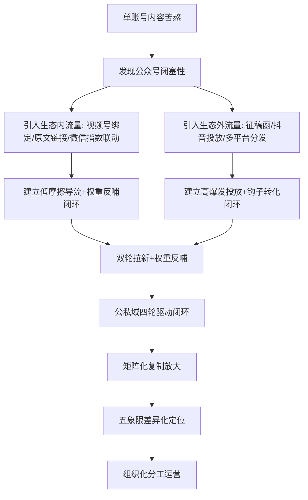
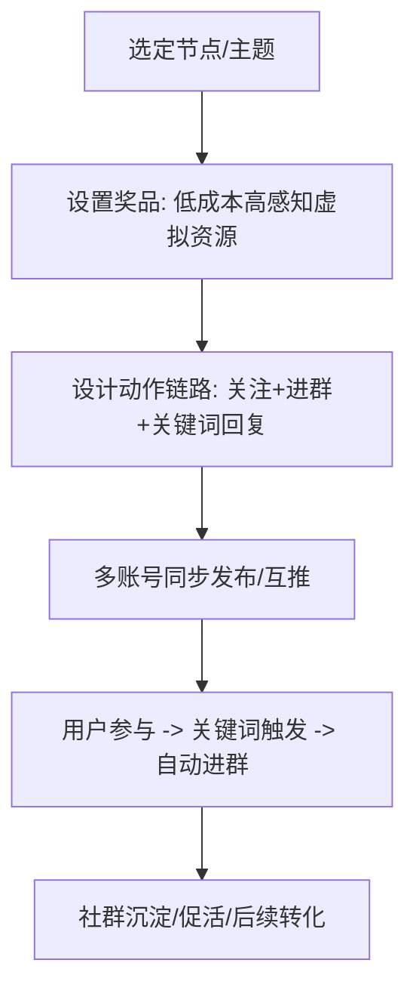
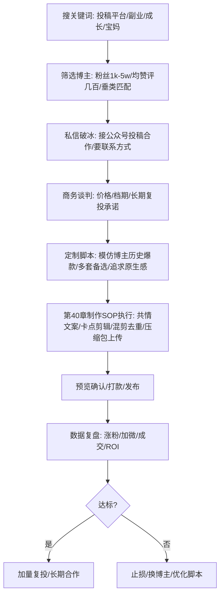

# 第 41 章 公私域流量闭环与矩阵化引流体系

## 学习目标

- 理解公众号作为高度闭塞平台必须依赖外部流量实现冷启动的底层逻辑 —— P001
- 掌握"引流与沉淀双轮驱动"模型：公域获客→私域内容池沉淀→强关系私域运营→高客单/高复购变现的完整闭环 —— P001
- 熟练运用征稿函引流、人设互推、矩阵抽奖联动、抖音博主投放SOP、全平台同名分发五大标准化引流玩法 —— P002-P006
- 建立矩阵账号五象限定位体系（情感/两性/IP/情绪/成长），实现流量最大化利用与变现渠道多元化 —— P007
- 掌握"引流钩子设计与落地页构建"自动化转化链路：高价值虚拟钩子+低摩擦动作+自动化承接 —— P008
- 理解矩阵化运营分工模型：核心人做决策/把控，执行层做生产/运维，SOP标准化为规模化前提 —— P009
- 识别引流玩法的风控边界：征稿函近期违规风险高、硬广导流必封号、泛粉抽奖需小号投机操作 —— P001
- **建立第 40 章「视频号生态内导流」与本章「跨平台公私域闭环」的认知映射：视频号是微信生态内「自带推荐算法的公域入口」，可直接绑定公众号实现「原文链接跳转/名片引导」的低摩擦导流；抖音/小红书等为「生态外公域」，需依赖「投稿切入/关键词钩子」等高摩擦手段导流，两者互补而非替代** —— P001, P005
- **掌握「微信指数权重联动」作为公私域闭环的隐性乘数：视频号数据计入微信指数→提升公众号搜一搜排名/推荐权重→带来被动精准流量，形成「主动引流+被动权重」双轮驱动的完整增长飞轮** —— P001（第 40 章核心概念延伸）

## 41.1 生活类比

想象公私域流量闭环是一个**"双水源-双净化-分级供水"的城市供水系统**：

- **微信生态内公域（视频号）** = **地表水水库（自来水厂旁）**：水质较好（用户已在微信生态），管网直连（原文链接/名片/绑定跳转），引水成本低、损耗小、可实现「水质监测数据反哺厂网调度」（微信指数权重联动）
- **生态外公域（抖音/小红书/头条）** = **跨流域调水工程（远距离引水）**：水量大但水质未知（泛流量），需建设长距离管道（投稿切入/关键词钩子/私信话术），引水成本高、损耗大、需专门「净化站」（落地页/自动回复/社群）
- **公众号** = **中央净水厂/蓄水池**：双水源汇聚，通过内容沉淀（深度净化）建立信任资产，输出标准水质（专业内容/人设IP）
- **个人微信/社群** = **分质供水管网/终端水龙头**：直达用户（强关系），提供差异化服务（社群高频/一对一深度），实现高客单变现（收水费）
- **引流钩子** = **用户端接水设施/智能水表**：生态内用「原文链接/名片」（零安装成本），生态外用「关键词回复/自动进群」（需安装配置），无钩子无法建立计量连接
- **矩阵账号** = **多水源/多厂网/备用管网**：单一水源/管道易干涸/堵塞（限流/封号），多源并联、分质供水保障系统稳定性与总供水量

就像现代城市供水必须"地表水+调水双水源、中央厂+分质供水双净化、智能计量+分级服务"全链路打通才能高效运营，公众号商业化也必须"生态内低摩擦导流+生态外高转化投放+微信指数权重反哺+分层私域承接"四轮驱动，缺一不可。这一隐喻将贯穿本章所有概念解析，帮助你在具体玩法中始终定位该动作处于供水系统的哪个环节、属于哪条水源线。

## 41.2 概念地图

公私域流量闭环与矩阵化引流体系
├── 核心定律
│   ├── 公众号增长必需外部流量论  —— P001
│   ├── 引流与沉淀双轮驱动论  —— P001
│   ├── 矩阵化复制放大商业价值论  —— P001
│   ├── 投放切入点伪装论  —— P001
│   └── **微信指数权重联动定律（第 40 章核心概念延伸）：视频号数据→微信指数→公众号搜索/推荐权重→被动精准流量**  —— 第 40 章
├── 两条公域引流主线
│   ├── **生态内导流线（低摩擦/高信任/权重联动）** —— 第 40 章核心
│   │   ├── 视频号原文链接绑定公众号文章
│   │   ├── 视频号主页/视频画面名片引导关注公众号
│   │   ├── 视频号直播挂公众号链接/名片
│   │   └── 微信指数权重联动：视频号互动数据→微信指数→公众号搜一搜排名/推荐流量
│   └── **生态外投放线（高摩擦/高爆发/标准化SOP）** —— 本章核心
│       ├── 征稿函引流（高转化/高风险）  —— P002
│       ├── 人设互推（零成本/信任背书）  —— P003
│       ├── 矩阵抽奖联动（低成本/复合价值）  —— P004
│       ├── 抖音博主投放SOP（付费/标准化/灰色地带）  —— P005
│       └── 全平台同名分发（内容杠杆/品牌叠加/风险隔离）  —— P006
├── 矩阵账号组织架构
│   ├── 矩阵账号五象限定位  —— P007
│   │   ├── 情感号（美文故事/泛流量广告）
│   │   ├── 两性号（女性热点/高粘性带货）
│   │   ├── IP号（人设赚钱/高客单高信任）
│   │   ├── 情绪号（情绪宣泄/内容为王）
│   │   └── 成长号（思维认知/高价值高复购）
│   └── 矩阵化运营分工模型  —— P009
│       ├── 核心人：定位把控/框架搭建/方向决策
│       └── 执行层：内容生产/日常运维/数据复盘
└── 转化基建体系
    ├── 引流钩子设计与落地页构建  —— P008
    │   ├── **生态内钩子（零摩擦）**：原文链接跳转/视频画面引导图/主页名片/直播挂载
    │   ├── **生态外钩子（低摩擦）**：高价值虚拟钩子（付费课程/工具包/独家资料）+ 关键词回复/点击名片/扫码进群 + 自动化承接
    │   └── **统一原则**：价值锚定（感知价值≫迁移成本）+ 场景化植入（全触点覆盖）+ 分层承接
    └── 分层承接体系
        ├── 公众号（内容池/弱关系/信任建立）
        ├── 社群（高频互动/中关系/筛选意向）
        ├── 个人微信（深度信任/强关系/成交转化）
        └── 产品（商业变现）

---

## 41.3 公私域流量闭环 —— 公域蓄水池与私域提款机的底层通道

### 为什么需要这个概念？

你可能已经发现，只在公众号里闷头写文章，粉丝增长极其缓慢。这不是你的内容不够好，而是**公众号的平台机制决定了它是一个高度闭塞的私域环境**。正如作者辰风在复盘中指出的："单打独斗只做内容，不做外部流量，在公众号是行不通的。因为公众号是一个十分闭塞的平台。" [P001, p.1]

公众号内部的"看一看"、"搜一搜"推荐流量太弱，无法支撑规模化冷启动。你必须主动出击，去**两类公域平台**"引水"：

1. **生态内公域（视频号）**：自带推荐算法、新号易出爆款、可直接绑定公众号实现原文链接跳转/名片引导，**且数据计入微信指数反哺公众号搜索排名**——这是第 40 章建立的「视频号生态内导流」核心优势，属于「地表水水库」，引水成本最低、信任损耗最小。
2. **生态外公域（抖音/小红书/头条等）**：流量池大、算法分发强，但用户不在微信生态，**必须依赖「投稿切入/关键词钩子」等伪装手段导流**，属于「跨流域调水」，引水成本高但爆发力强。

但光引水还不够。作者强调：**"引流需要内容来促活，来进行用户沉淀。光引流，不维护用户是远远不够的。需要双管齐下，引流和内容都要重视。"** [P001, p.2] 如果没有内容池（公众号）净化流量，没有强关系私域（个人微信/社群）承接转化，引来的流量就像水倒进筛子，瞬间流失，形成"漏斗"而非"资产"。

呼应生活类比：双水源汇聚中央净水厂（公众号），经深度净化（内容沉淀）输出标准水质，经分质供水管网（社群/个人微信）直达终端用户，智能水表（钩子）计量每滴水的流向与价值。只挖渠道（引流）不建厂（内容）不铺管（私域运营）不装表（钩子），水流不到用户手中，系统不成立。

### 核心定义与推导

**公私域协同模型**（来源：《P001》，结合第 40 章「微信指数权重联动」扩展）

$$
\text{可变现商业资产} = \underbrace{(\text{生态内公域流量} + \text{生态外公域流量})}_{\text{双水源}} \times \underbrace{\text{内容信任}}_{\text{中央净化}} \times \underbrace{\text{钩子转化}}_{\text{智能计量}} \times \underbrace{\text{私域运营}}_{\text{分质供水}} \times \underbrace{(1 + \text{微信指数权重加成})}_{\text{隐性乘数·第40章核心}}
$$

这个公式展示了五个关键环节的乘法关系：任何一个环节为零，最终结果为零。双公域流量是水源，内容信任是中央净水厂，钩子转化是智能水表，私域运营是分质供水管网，**微信指数权重加成是「隐性乘数」——视频号数据计入微信指数，反哺公众号搜一搜排名与推荐流量，形成「主动引流+被动权重」双轮驱动的完整增长飞轮**。

#### 逐项推导

**双公域流量（双水源）**：生态内视频号流量（低摩擦/高信任/权重联动）+ 生态外抖音/小红书流量（高爆发/需伪装导流）。若为 0，后续全链路断裂，无米下锅。

**内容信任（中央净化）**：公众号文章的专业度、人设一致性、价值密度。将泛流量"净化"为认可你、信任你的精准粉丝。若为 0，用户虽来但不信，无法进入下一环。

**钩子转化（智能计量）**：生态内用「原文链接/名片」（零摩擦），生态外用「关键词回复/名片/福利」（低摩擦），把"信任"转化为"线索"（加群/加微）。若为 0，信任无法落地为可触达的私域联系人。

**私域运营（分质供水）**：社群高频互动、朋友圈人设建设、一对一深度沟通，最终成交高客单/高复购产品。若为 0，线索沉睡流失，前端投入全部打水漂。

**微信指数权重加成（隐性乘数·第 40 章核心）**：视频号点赞/评论/转发/完播等互动数据计入微信指数 → 提升公众号在"搜一搜"、 "看一看" 中的排名权重 → 带来持续、免费、高精准的被动流量。这一乘数**仅生态内导流线具备**，生态外投放线无此红利。若为 0（即不做视频号或视频号数据不计入），模型退化为纯主动引流模式，边际获客成本随规模上升。

#### 为什么是乘法而非加法？

因为这是一个**串联的管网系统**，而非并联的蓄水池。上一环的产出是下一环的输入，任一环节断裂（=0），全链路即刻归零。**微信指数权重加成作为乘数项 (1+α)，α>0 时放大全链路收益，α=0 时退化基础模型**。这也解释了为什么"只引流不沉淀"必死——钩子转化与私域运营若为 0，公域流量再大也是无效功；同时也解释了为什么"只做生态外投放不做视频号"会丢失隐性复利——放弃了 (1+α) 这一低成本放大器。

#### 阈值临界点

- 当**双公域流量总和** < 内容信任建立所需的最小样本量（约 500-1000 精准曝光）时，内容信任无法建立，系统陷入"冷启动陷阱"；
- 当**钩子转化率** < 1% 时，私域运营边际成本过高，商业模型跑不通；
- 当**视频号周均互动数据** < 微信指数权重触发阈值（约 500-1000 综合互动/周）时，隐性乘数 α ≈ 0，失去被动流量红利。

#### 公式的实战指导意义

该公式是一把**诊断手术刀**。当月变现不及预期时，不要盲目加大投放，而是按乘法链路逐项排查：是双公域流量枯竭（需加投放/换渠道/补视频号）？还是内容信任不足（需重塑人设/提升干货密度）？还是钩子失效（需升级福利/降低摩擦/区分生态内外钩子形式）？抑或私域运营崩塌（需补人/优化SOP）？还是**视频号数据未计入微信指数（需检查绑定关系/原文链接/账号主体一致性）导致隐性乘数失效**？找到最短板（乘数最小者），集中资源补齐，边际回报最高。这也是"四轮驱动"落地的操作准则：生态内导流轮负责做大第一个乘数且激活第五个乘数，生态外投放轮负责做大第一个乘数的增量，留存轮负责守住中间三个乘数不归零。

### 双轮驱动定律升级为四轮驱动定律（来源：《P001》+ 第 40 章）

- **生态内导流轮（第 40 章核心）**：视频号原文链接绑定/名片引导/直播挂载 + 微信指数权重联动（被动流量红利）
- **生态外投放轮（本章核心）**：站内互推（征稿函/人设互推/抽奖联动）、站外投放（抖音博主/多平台分发）、跨平台导流
- **内容沉淀轮**：公众号内容沉淀（弱关系/信任建立）、微信指数权重积累（视频号数据反哺）
- **私域运营轮**：社群高频互动（中关系）、个人微信深度运营（强关系）

这四个轮子必须同步转动。作者实测："当真的给你一个很大的流量，你的账号是否能够接得住。" [P001, p.3] 接得住的前提，就是已建立完整的留存轮（内容沉淀+私域运营）与隐性乘数（微信指数权重）。

### 方法演进图



### 关键性质

公私域闭环具有四大关键性质：首先是**闭环必要性**，双公域流量打通、内容依托、钩子转化、产品承接、微信指数权重联动五者缺一不可，共同构成完整商业成交闭环。作者一年运营出 5.6 万/2.6 万粉账号，单日涨粉过万，验证了该闭环的可行性。其次是**双线互补性**：生态内线（视频号）低摩擦、高信任、权重联动、可持续；生态外线（抖音/小红书）高爆发、精准筛选、标准化 SOP、可规模化。两线并行，攻守兼备。第三是**矩阵放大效应**，单账号上限有限，矩阵化能实现流量内部循环最大化、广告位复用、SOP标准化复制、风险分散四大价值。作者总结矩阵四大意义："最大化的利用流量，大号带小号... 更高效的实现变现... 引流、运营模式可以大量复制... 降低风险，应对突发危机"。最后是**先单后多原则**，必须先跑通单账号模型（有基础流量/变现/SOP），再复制放大矩阵，避免无基础盲目铺开导致内耗。

### 典型例子

- **元宵节矩阵抽奖实战（生态外线+矩阵内联动）**：三矩阵号联动，成本 < 100 元，大号涨粉 2000+、中号 1000+、小号 800+，关键词回复同步搭建社群沉淀 [P004]。
- **抖音单条爆款广告（生态外线）**：三天引流 1 万+ 粉丝，验证"投放引流比抽奖更暴力" [P005]。
- **视频号原文链接+微信指数联动（生态内线·第 40 章实战）**：视频号绑定公众号原文链接，单条爆款视频带动公众号文章阅读量 3 倍增长，且视频号互动数据计入微信指数，后续公众号文章搜一搜排名显著提升，带来持续被动流量。
- **作者账号演进**：早期纯引流情感号（8w粉，千阅仅靠广告/CPA）→ 转型 IP 号（7w+粉，均阅 1300+，单价 0.5-0.7 元/阅，变现广告+课程社群），对比证明**强 IP 虽粉丝基数小但能解锁高客单价产品变现**（3000 粉产 30 单 vs 1 万粉产 5 单）[P001]。

### 边界条件

- **征稿函引流近期平台打击力度加大，存在违规风险，建议暂停操作** [P002]。
- **直接硬广导流极易违规封号**，必须将推广意图伪装为"投稿/兼职/福利"等用户刚需场景（利他外壳包裹利己核心）[P001]。
- **泛粉抽奖虽涨粉暴力但封号风险高**，仅建议小号投机操作 [P001]。
- **生态内导流前置条件**：视频号与公众号同一主体/管理员、后台已绑定、原文链接文章合规、微信指数小程序已添加关注 [第 40 章]。
- **隐性乘数激活条件**：视频号周均互动数据达标（点赞+评论+转发+完播 ≥ 阈值）、内容垂直度高、账号权重正常。

### 素材溯源

本节概念源自核心素材 P001（辰风《微信公众号引流涨粉与矩阵运营实战复盘》）与第 40 章核心素材（辰风《视频号引流的逻辑复盘》），对应细纲单元 1。

---

## 41.4 征稿函引流 —— 用"赚钱诱饵"撬动精准用户的高转化玩法

### 为什么需要这个概念？

公众号冷启动期急需精准种子用户，常规内容难以快速聚拢目标人群。"投稿赚稿费"直击副业/写作人群核心刚需，**钱相关的诱饵吸引力最强**，转化率远高于通用福利。利用他平台（征稿号/情感号/副业号）现成流量池，边际获客成本极低。

呼应生活类比：这是在"跨流域调水工程"（征稿号/副业号）处设置"取水许可证办理处"（投稿赚钱诱饵），筛选出真正想接水（有副业/写作需求）的精准用户，引入"中央净水厂"（公众号）。属于生态外投放线的高转化玩法。

### 核心定义

**征稿函引流**（来源：《P002》）

在垂直领域大号（征稿号、情感号、副业号）投放广告，以"投稿赚稿费/兼职赚钱"为切入点，植入公众号名片/关键词钩子，引导用户关注并进入私域。

> "底层逻辑就是：投放征稿号，情感号，副业号来进行引流。（征稿号，副业号效果是最好的）"
> 
> "无论是做什么，只要是跟钱相关，一定能够吸引人，钱多的吸引力度大，钱少的也同样能够吸引来人。"
> 
> ——《微信公众号引流涨粉与矩阵运营实战复盘》 P002

### 关键性质

征稿函引流具有三大核心特性：第一，**精准度高**，自带"想赚钱/会写作/找副业"标签，后端变现匹配度极高；第二，**执行门槛低**，只需撰写软文/海报，联系博主投放，无需复杂技术开发；第三，**风险周期性强**，平台监管趋严期违规风险极高，属灰色地带玩法，可持续性存疑。

### 典型例子

作者实操：投放征稿号/副业号效果最好，以"回复关键词领取 PS 课程/副业资料"为钩子，实现高转化引流。

> "也就是给读者一个关注理由。比如我在文中植入：在公众号回复'ps'，即可领取我付费买的 ps 全套精品课程（举个例子）。"
> 
> ——《微信公众号引流涨粉与矩阵运营实战复盘》 P002

### 边界条件

> "最近有违规风险，我不做过多展开。仅供交流，大家近期不要尝试，也不要在账号发布兼职征稿相关内容。"
> 
> ——《微信公众号引流涨粉与矩阵运营实战复盘》 P002

必须规避敏感词（微信号、加V等），采用关键词回复/名片/福利等隐蔽形式；仅适合冷启动期快速聚拢种子用户，**非长期稳定引流主渠道**。

### 方法流程图

```mermaid
flowchart TD
    A[选定垂类大号: 征稿号/情感号/副业号] --> B[撰写软文/制作海报: 植入"投稿赚钱"切入点]
    B --> C[谈价格/档期/发布形式]
    C --> D[发布广告: 引导关注公众号+关键词回复]
    D --> E[自动回复/进群: 交付钩子资料]
    E --> F[私域沉淀/转化]
```

### 素材溯源

本节概念均源自核心素材 P002（同一文档中征稿函引流板块），对应细纲单元 2。

---

## 41.5 人设互推 —— 同频IP账号间的零成本信任背书与粉丝互导

### 为什么需要这个概念？

单号流量上限受限，需通过同类账号互导突破天花板。同赛道 IP 账号粉丝画像高度重合，互推转化率远高于跨赛道推广。利用"人设软文+名片/福利"形式，将商业意图包装为价值分享，规避平台广告判定。

呼应生活类比：这是"中央净水厂"之间互相引荐优质水源，因用户已信任源头厂（IP人设），对推荐的另一厂天然信任，大幅降低"净化成本"（内容信任建立门槛）。属于生态内/生态外均可操作的零成本玩法。

### 核心定义

**人设互推**（来源：《P003》）

寻找粉丝量/阅读量相近、定位相似（均为 IP 类账号）的账号，互撰人设软文，植入对方公众号名片与福利钩子（如关键词领奖），实现粉丝双向流动与信任背书。零现金成本，核心消耗为内容生产与协调沟通时间。

> "和同量级账号（阅读量，粉丝量相近，定位相似：都属于 IP 类账号），可以互推人设文章。内容：人设软文+名片（抽奖）引流 也就是写一个与你相关的人设文章，植入公众号名片，可以附赠福利，如关键词领奖等内容，来吸引读者关注（也就是我们通常说的放钩子）"
> 
> ——《微信公众号引流涨粉与矩阵运营实战复盘》 P003

### 关键性质

人设互推具有三大核心特性：第一，**信任传递**，IP 账号人设本身即背书，粉丝对推荐的同类账号天然信任度高；第二，**标准化动作**，人设文结构固定（总述版画像+分项深度展开），福利钩子标准化（关键词回复领资料/进群）；第三，**可复制性强**，只要找到同量级同定位账号即可执行，边际成本极低。

### 典型例子

作者操作：与同量级 IP 账号互推人设文章，植入名片+关键词领奖钩子，实现精准互导。内容结构采用总分结构输出人设文（总述版画像+分项深度展开）建立认知护城河 [P003]。

### 边界条件

必须是"同量级、同定位、同属 IP 类"账号，跨层级/跨赛道互推效果大打折扣；需提前准备好高转化的福利钩子（资料/课程/工具），空手互推转化极低；依赖对方账号配合度与发布时机，不可控因素较多。

### 方法流程图

```mermaid
flowchart LR
    A[筛选同量级/同定位 IP 账号] --> B[互撰人设软文: 总述画像+分项深度]
    B --> C[植入名片+福利钩子(关键词领奖)]
    C --> D[同步/错峰发布]
    D --> E[粉丝双向流动+信任背书]
    E --> F[私域承接转化]
```

### 素材溯源

本节概念均源自核心素材 P003（同一文档中人设互推板块），对应细纲单元 3。

---

## 41.6 矩阵抽奖联动 —— 低成本撬动万级用户参与的促活裂变模型

### 为什么需要这个概念？

单账号活跃度随时间衰减，需要外部刺激激活沉睡用户。利用自有矩阵账号或联合同量级账号，成本极低（<100元）即可撬动数千用户参与。结合"关注+进群+关键词回复"复合动作，**一鱼多吃：涨粉+促活+沉淀社群**。

呼应生活类比：这是利用"多条引水渠/备用管网"（矩阵账号）同时开闸放水，设置"智能水表"（关键词回复）领取"接水器具"（进群），一次动作同时完成引水、计量、分质供水三道工序。可在生态内（视频号/公众号矩阵）或生态外（多平台矩阵）执行。

### 核心定义

**矩阵抽奖联动**（来源：《P004》）

设计低门槛抽奖活动（红包/实物/虚拟资源），设置关注公众号、进群、关键词回复领奖等动作链路，多账号同步发布/互推，实现粉丝跨账号流动与社群沉淀。

核心指标：单次活动成本 < 100 元，调动 4000+ 用户参与，大/中/小号分别涨粉 2000+/1000+/800+。

> "我在元宵节当天，利用我的三个矩阵账号进行互相导流操作，实现了大号涨粉 2000+，小号涨粉 1000+，小小号涨粉 800+。而我只花了不到 100 元!!!就实现了三个账号的联动，调动了 4000+用户参与进来，在引流的同时，我也实现了用户促活，调动了用户粘性。"
> 
> "再悄悄说一个点，我还在关键词回复搭建了社群，进一步带动了社群引流，来沉淀读者。"
> 
> ——《微信公众号引流涨粉与矩阵运营实战复盘》 P004

### 关键性质

矩阵抽奖联动具有三大核心特性：第一，**复合价值**，单次动作同时完成"拉新涨粉、存量促活、社群沉淀"三大目标；第二，**成本确定性**，实物/红包/虚拟资源成本可控，边际成本随参与人数递减；第三，**可标准化复制**，节点营销（节日/纪念日）+ 固定 SOP = 可周期性执行的增长动作。

### 典型例子

**元宵节实战**：三矩阵号联动，奖品设置为低成本高感知价值虚拟资源（付费课程/工具包/资料包）[P004]。

### 边界条件

仅适用于已有基础粉丝量（>几千）的账号矩阵，零粉冷启动无法执行；频次过高会导致用户疲劳、平台判定营销号，建议节点营销（月 1-2 次）；必须配合关键词回复/自动进群等工具链路，纯人工操作无法承接峰值流量。

### 方法流程图



### 素材溯源

本节概念均源自核心素材 P004（同一文档中矩阵抽奖联动板块），对应细纲单元 4。

---

## 41.7 抖音博主投放 SOP —— 以"投稿切入"规避风控的跨平台付费获客标准化流程

### 为什么需要这个概念？

公众号必须依赖外部流量，抖音作为最大公域流量池是必争之地。但**直接硬广导流极易违规封号**，必须将推广意图伪装为用户刚需场景（投稿/兼职/福利）。博主资源杂乱，缺乏标准化筛选、沟通、制作、验收流程，导致 ROI 不可控。

呼应生活类比：这是从最大的"跨流域调水工程"（抖音）修建标准化"引水渠"，渠道入口伪装成"取水许可证办理处"（投稿切入），避免被水利局（平台风控）查封。需配合第 40 章建立的**「共情文案×卡点剪辑」「混剪去重五步法」「压缩包电脑上传」标准化制作体系**，确保视频原生感与去重通过率。

### 核心定义

**抖音博主投放 SOP**（来源：《P005》，结合第 40 章视频制作 SOP 扩展）

标准化跨平台付费投放流程：
1. 搜"投稿平台"/垂类关键词找号
2. 筛选粉丝 1k-5w/均赞评几百的账号
3. 私信"接公众号投稿合作"索要联系方式
4. 谈价格/档期/长期复投
5. **定制爆款视频脚本（遵循第 40 章制作 SOP：模仿博主历史爆款风格/共情文案/卡点剪辑/混剪去重/压缩包电脑上传）**
6. 预览/打款/发布

> "多平台投放引流，就是我们多个账号，和博主建立合作，让博主来制作一个硬广或者软广视频，来推广曝光我们公众号的名字。主要模式，是以投稿赚稿费的角度来进行切入，引导读者来关注个人公众号。"
> 
> "流程总结下来就是：对接博主，谈博主，确定档期报价，组织号主（发车），制作视频，预览，打款并发布（仅供参考）"
> 
> ——《微信公众号引流涨粉与矩阵运营实战复盘》 P005

### 关键性质

抖音博主投放 SOP 包含四大标准化模块：

#### 博主筛选标准化

下表列出了抖音博主投放时的核心筛选指标与标准，来源《P005》。

| 指标 | 标准 |
|------|------|
| 粉丝量 | 1000 - 50,000 |
| 近期均赞/评 | 几百以上 |
| 垂类匹配 | 副业/成长/宝妈等与目标用户重合 |

#### 话术体系化

破冰话术：
> "您好商务合作～请问接👸号投稿的合作嘛 有意向的话可以给个 v 嘛我联系您～" [P005]

追问话术（建立信任、降低戒备）：
> "效果好的话，我们可以加价复投，长期合作的，这边也可以链接很多号主资源，合作的机会很多。" [P005]

#### 视频制作定制化（融合第 40 章制作 SOP）

> "抖音作品的创作，要结合博主的定位和推广进行设计 比如博主是文案类作品出彩，那就不必强求口播。在投放过程中，可以准备多个文案，针对不同的作品，设计不同的投放方式。这个的目的就是模仿抖音博主的往期爆款作品，来实现抖音爆款作品的可能性。"
> 
> ——《微信公众号引流涨粉与矩阵运营实战复盘》 P005

**第 40 章制作 SOP 强制要求（本章执行层必须遵守）：**
- **共情文案结构**：痛点钩子(3s) → 情绪共鸣/认知反转 → 解决方案/方法论 → 行动号召(关键词/主页)
- **卡点剪辑标准**：BGM 卡点精准、视觉刺激频次≥3次/秒、前 3 秒留存钩子明确
- **混剪去重五步法**：素材源头多元化 → 长度重组(±15%) → 镜像/滤镜/调速微调 → 动态贴纸/字幕遮挡 → MD5 修改
- **压缩包电脑端上传**：规避手机端压缩导致的二次压缩画质损耗与特征码识别

核心追求"原生感"最大化，而非标准广告感。

#### 资产分离

广告账户/主页视为可消耗耗材，核心资产沉淀在个人号/私域好友。

### 典型例子

**单条抖音广告三天引流 1 万+ 粉丝**，验证"投放引流比抽奖更暴力" [P005]。

**博主合作痛点解决**："很多博主其实不一定是不接，背后可能有很多原因，比如嫌麻烦，比如觉得我们不好说话。双方互相尊重，达成一个有默契的合作是十分有必要的。通过有礼貌的招呼，还有真诚的商务话术，迅速建立和博主之间的合作。" [P005]

### 边界条件

属灰色地带玩法，平台随时可能收紧导流判定，需持续迭代话术与形式；博主合作存在"不好说话/嫌麻烦"痛点，需用长期复投承诺+利益绑定建立稳定合作关系；视频制作必须模仿博主原生风格，**强制遵循第 40 章制作 SOP**，强行植入硬广会破坏博主人设导致转化极低；单次投放 ROI 波动大，需建立"小额测试→效果验证→加量复投"的投放风控机制。

### 方法流程图



### 素材溯源

本节概念源自核心素材 P005（同一文档中抖音博主投放 SOP 板块）与第 40 章核心素材（视频制作 SOP），对应细纲单元 5。

---

## 41.8 全平台同名分发 —— 单次内容生产多次曝光的品牌资产复利策略

### 为什么需要这个概念？

优质内容生产成本高，单平台分发 ROI 低，必须最大化内容资产复用价值。用户跨平台迁移成本高，统一 ID/头像降低认知负荷，实现品牌认知叠加。平台算法风险不可控（限流/封号），多平台布局是抗风险必要条件。

呼应生活类比：这是将"中央净水厂"生产的优质水，通过"多条输水管道"（小红书/抖音/头条/微博/视频号）同步输送，**视频号管道直连净水厂（原文链接/绑定跳转/权重联动），其他管道需设置"智能水表"（关键词钩子）计量回流**，管道口统一标识（同名同貌），用户认准一个品牌即可在任意渠道取水，单条管道堵塞不影响整体供水。

### 核心定义

**全平台同名分发**（来源：《P006》，结合第 40 章「多平台分发策略」对齐）

在小红书/抖音/头条/微博/视频号等主流平台注册统一 ID/头像/简介，**视频号作为生态内核心阵地优先绑定公众号原文链接**，其他平台将公众号原创内容改编分发（文案→图文/视频/音频），文中/评论区/主页植入"关键词回复领福利"钩子，引导用户回流私域公众号/个人微信。

核心动作：**一鱼多吃（内容改编分发）+ 品牌叠加（同名同貌）+ 钩子回流（福利诱饵）+ 生态内优先绑定（视频号原文链接/权重联动）**。

> "最简单的一个办法就是把单平台内容进行多平台分发...在此之前需要的一个动作就是：全平台同名，甚至同头像,这样就可以实现你的账号的曝光。"
> 
> "也就是给读者一个关注理由。比如我在文中植入：在公众号回复'ps'，即可领取我付费买的 ps 全套精品课程（举个例子）。"
> 
> ——《微信公众号引流涨粉与矩阵运营实战复盘》 P006

> "推兔/蚁小二一键分发工具可实现多平台同步发布，但视频号需手动绑定原文链接以激活微信指数权重联动。"
> 
> —— 第 40 章核心素材

### 关键性质

全平台同名分发具有四大核心特性：第一，**内容杠杆**，单次内容生产，N次平台曝光，边际分发成本趋近零；第二，**认知降低**，统一视觉/文字符号，用户跨平台识别零成本，信任传递无损耗；第三，**风险隔离**，单平台封号/限流不影响其他平台资产与流量入口；第四，**生态内优先**，视频号作为微信生态内原生公域，**必须优先绑定原文链接激活微信指数权重联动**，这是其他平台无法替代的隐性红利。

### 典型例子

作者策略：全平台同名同头像，公众号文章改编为小红书图文/抖音视频/头条动态，**视频号同步发布并绑定原文链接**，植入"回复关键词领取付费课程"钩子回流私域。

> "INS 专业号需预先填充 40+ 篇专业内容（耗时 4 天，日更 5-10 条）建立信任背书，再开广告；素材源自小红书/抖音搬运+ChatGPT 翻译本地化，无内容支撑的直接投放转化极低。"
> 
> ——《微信公众号引流涨粉与矩阵运营实战复盘》 P006

### 边界条件

**前置条件**：需先在主阵地（公众号/私域）沉淀 40+ 篇专业内容建立信任背书，**视频号与公众号已绑定同一主体**，再开展多平台分发；**内容改编需适配平台调性**：小红书重封面/标签，抖音重前 3 秒/节奏（遵循第 40 章卡点剪辑标准），头条重专业度/长度，视频号重原文链接绑定/完播率/互动率；**引流钩子必须高价值**（付费级资料/工具/课程），低质钩子无法转化精准用户；**分发工具选择**：推兔/蚁小二一键分发生态外平台，视频号手动发布绑定原文链接。

### 方法流程图

```mermaid
flowchart TD
    A[主阵地沉淀 40+ 篇专业内容] --> B[全平台注册统一 ID/头像/简介]
    B --> C1[视频号: 手动发布+绑定原文链接+激活微信指数权重]
    B --> C2[小红书/抖音/头条/微博: 推兔/蚁小二一键分发改编内容]
    C1 --> D[适配平台调性: 封面/前3秒/标签/长度/原文链接]
    C2 --> D
    D --> E[植入钩子: 生态内(原文链接/名片) 生态外(关键词回复领高价值福利)]
    E --> F[用户跨平台识别/信任叠加 -> 回流私域]
    F --> G[单平台限流/封号不影响其他渠道+微信指数权重持续反哺]
```

### 素材溯源

本节概念源自核心素材 P006（同一文档中全平台同名分发板块）与第 40 章核心素材（多平台分发策略/视频号绑定/微信指数权重联动），对应细纲单元 6。

---

## 41.9 矩阵账号五象限定位 —— 差异化覆盖用户心智的流量最大化策略

### 为什么需要这个概念？

单一账号定位窄、受众窄、变现单一，难以覆盖全用户生命周期价值。盲目增加账号数量导致内容同质化、运营内耗大、风险聚合。需要系统化的定位框架，指导矩阵账号差异化分工与协同增效。

呼应生活类比：这是在"双水源双净化分级供水系统"中规划不同功能的水厂与管网：有的专供生活用水（情感号/泛流量广告），有的专供高纯工业用水（IP号/高客单变现），有的专供应急备用（情绪号/高互动），有的专供优质直饮水（成长号/高价值高复购），**视频号矩阵作为生态内「地表水水库群」直连中央净水厂**，分工明确，互不干扰，总供水能力最大化。

### 核心定义

**矩阵账号五象限定位**（来源：《P007》）

将矩阵账号划分为五大类型：

下表展示了矩阵账号五象限的定位、核心内容、变现路径及适用阶段，来源《P007》。

| 象限 | 定位 | 核心内容 | 变现路径 | 适合阶段 |
|------|------|----------|----------|----------|
| **情感号** | 美文故事 | 情感共鸣/故事分享 | 泛流量广告/CPA | 冷启动/流量获取 |
| **两性号** | 女性热点挂钩 | 两性关系/情感分析 | 高粘性带货/课程 | 成长期/变现期 |
| **IP号** | 人设赚钱为主 | 个人经历/赚钱方法论 | 高客单/高信任产品 | 成熟期/核心变现 |
| **情绪号** | 情绪宣泄 | 情绪价值/共鸣内容 | 内容为王/高互动 | 促活/人群筛选 |
| **成长号** | 思维认知破圈 | 认知升级/方法论分享 | 高价值/高复购 | 高价值用户筛选 |

核心人负责定位把控/搭建框架/方向决策，执行层负责内容生产/日常运维 [P009]。

> "做矩阵的分类：1.情感号（美文，故事） 2.两性号（女性相关，热点挂钩） 3.ip 号（人设相关，赚钱为主） 4.情绪号 （情绪宣泄，内容为王） 5.成长号（思维认知，破圈成长）"
> 
> "我的建议是：给账号不同的定位，做不同的内容。可能有的朋友问：这么多账号运营的过来吗？当然不行，所以需要依靠助理，或者寻求代运营的力量。"
> 
> ——《微信公众号引流涨粉与矩阵运营实战复盘》 P007

### 关键性质

矩阵账号五象限定位具有三大核心特性：第一，**差异化覆盖**，五象限分别对应用户"情感共鸣/两性焦虑/赚钱渴望/情绪宣泄/成长焦虑"五大核心心智，实现流量最大化利用；第二，**变现多元化**，广告/CPA/分销/自有产品/引流池等多条变现路径并行，抗单一渠道波动；第三，**SOP标准化前提**，必须先跑通单账号模型（有基础流量/变现），再按五象限复制放大 [P009]。

### 典型例子

作者矩阵：大号（IP号/情感号）承接高客单变现，中小号（情感号/成长号）承接流量获取与人群筛选。**视频号矩阵同步布局五象限**，通过原文链接绑定对应公众号文章，激活各象限微信指数权重联动。运营分工：核心人把控定位方向，助理/代运营/作者执行内容生产，避免核心人陷入执行细节 [P007]。

### 边界条件

**禁止"无基础盲目铺开"**：未跑通单账号模型前，矩阵化只会放大亏损与内耗；**账号数量非越多越好**：需匹配团队运营能力（核心人精力+执行层产能），通常 3-5 个为单人/小团队上限；**定位一旦确立不易频繁变更**：频繁变更会破坏用户心智与算法标签，导致权重归零。

### 方法演进图

```mermaid
graph TD
    A[单账号跑通模型] --> B[拆解五大用户心智需求]
    B --> C[对应五象限定位账号(公众号+视频号同步布局)]
    C --> D[核心人把控方向/执行层生产]
    D --> E[内容联动SOP标准化(含第40章视频制作SOP)]
    E --> F[流量内部循环/变现多元化/权重联动反哺]
```

### 素材溯源

本节概念均源自核心素材 P007（同一文档中矩阵账号五象限定位板块），对应细纲单元 7。

---

## 41.10 引流钩子设计与落地页构建 —— 将"内容曝光"转化为"私域线索"的自动化转化链路

### 为什么需要这个概念？

公域流量公开透明，无钩子无法建立私域连接，流量即曝光非资产。用户迁移成本高（搜号/加好友/进群），必须提供超预期价值（钩子）覆盖迁移成本。手工回复/拉群效率低、不可规模化，需构建"关键词触发→自动回复/进群→人工运营"自动化链路。**生态内（视频号）钩子形态为「原文链接/名片/引导图」零摩擦；生态外（抖音/小红书）钩子形态为「关键词回复/自动进群」低摩擦，需配合自动化工具。**

呼应生活类比：这是设计差异化"智能水表/接水器具"：生态内用户家中已预装原生水表（微信生态原生功能），只需开阀（点击原文链接/名片）即可计量；生态外用户需安装智能水表（关键词回复/自动进群），凭水票（高价值钩子）领器具，自动通过"管道"接入"终端水龙头"（个人微信/社群），无需人工逐个递水，实现规模化供水。

### 核心定义

**引流钩子设计与落地页构建**（来源：《P008》，结合第 40 章「生态内导流钩子形态」对齐）

在公众号文章/视频简介/评论区/自动回复/视频号原文链接/视频画面/主页名片中植入差异化钩子，构建统一转化链路：

**内容曝光 → 钩子吸引 → 动作触发 → 自动承接 → 分层运营 → 转化变现**

核心要素三件套（生态内外统一原则，形态差异化）：
1. **高价值虚拟钩子**（付费课程/工具包/独家资料）——价值锚定核心
2. **低摩擦动作**：生态内=点击原文链接/名片（零摩擦）；生态外=回复关键词/点击名片/扫码进群（低摩擦）
3. **自动化承接**：关键词回复/群欢迎语/标签分组/原文链接直达文章

> "也就是给读者一个关注理由。比如我在文中植入：在公众号回复'ps'，即可领取我付费买的 ps 全套精品课程（举个例子）。"
> 
> "我还在关键词回复搭建了社群，进一步带动了社群引流，来沉淀读者。"
> 
> "一般来说，只要你的内容有曝光量，你有设置转化链路，就可以实现第三方平台的导流，将用户引导到你的个人微信上。"
> 
> ——《微信公众号引流涨粉与矩阵运营实战复盘》 P008

> "视频号原文链接绑定公众号文章，用户点击即达，零摩擦；视频画面引导图/主页名片/直播挂载为生态内原生钩子形态，无需关键词回复中转。"
> 
> —— 第 40 章核心素材

### 关键性质

**价值锚定**：钩子感知价值必须 ≫ 用户迁移成本。对比：❌ "回复 1 送免费资料"（感知价值低）✅ "回复 'ps' 领取我**付费买的** PS 全套精品课程"（价值锚定高，隐含稀缺性与付费背书）。

**场景化植入**：全触点覆盖：文章开头/结尾/高光时刻/评论区置顶/视频引导语/主页简介/视频号原文链接/视频画面/直播间。

**分层承接体系**（统一）：

公众号（内容池/弱关系）→ 社群（高频互动/中关系）→ 个人微信（深度信任/强关系）→ 产品（商业变现）

**生态内外钩子形态对照表**：

| 维度 | 生态内钩子（视频号/公众号） | 生态外钩子（抖音/小红书/头条） |
|------|----------------------------|-------------------------------|
| 核心形态 | 原文链接跳转 / 视频画面引导图 / 主页名片 / 直播挂载 | 关键词回复 / 自动进群 / 评论区置顶 / 私信回复 |
| 摩擦系数 | 零摩擦（原生生态） | 低摩擦（需动作触发） |
| 信任损耗 | 极低（平台背书） | 中等（需钩子价值覆盖） |
| 权重联动 | **有（微信指数权重加成）** | 无 |
| 技术实现 | 后台绑定/原生功能 | 第三方工具/自动回复规则 |
| 适用阶段 | 全阶段（核心长期阵地） | 冷启动/爆发期/补充流量 |

### 典型例子

- **矩阵抽奖联动中**：关键词回复自动进群，群内沉淀读者，实现引流+促活+沉淀三合一 [P004]
- **博主投放视频**：引导"关注公众号回复关键词领取投稿指南/副业资料" [P005]
- **视频号原文链接（第 40 章实战）**：视频号绑定公众号深度文章，用户点击原文链接直接阅读，完读率高、权重联动强，无需关键词中转。

### 边界条件

**严禁直接植入微信号/二维码/外链**：平台严打硬广导流，必封号；**钩子兑现必须即时/自动**：人工发送延迟 > 5 分钟会显著降低转化率；**私域承接能力（人工/社群运营）是转化上限**：流量大于承接能力会导致用户流失与投诉；**生态内钩子必须合规**：原文链接文章违规会连带视频号限流 [第 40 章风控红线]。

### 方法流程图

```mermaid
flowchart LR
    A1[生态内内容曝光(视频号)] --> B1[原生钩子: 原文链接/名片/引导图]
    A2[生态外内容曝光(抖音/小红书)] --> B2[植入高价值钩子: 付费课程/工具包]
    B1 --> C[低/零摩擦动作: 点击/回复关键词]
    B2 --> C
    C --> D[自动化承接: 原文直达/关键词回复+自动进群+标签分组]
    D --> E[分层承接: 公众号->社群->个人微信]
    E --> F[深度运营/成交转化]
    F --> G[视频号互动数据→微信指数→公众号权重↑(仅生态内)]
```

### 素材溯源

本节概念源自核心素材 P008（同一文档中引流钩子设计板块）与第 40 章核心素材（生态内导流钩子形态/微信指数权重联动），对应细纲单元 8。

---

## 41.11 矩阵化运营分工模型 —— 核心人做决策、执行层做执行的规模化组织架构

### 为什么需要这个概念？

单人运营多账号必然导致内容质量下降、更新频次不足、运营细节遗漏。矩阵化核心价值在于"流量内部循环+广告位复用+SOP复制+风险分散"，而非单纯账号数量。需要清晰的权责边界。**第 40 章「共情文案×卡点剪辑」「混剪去重五步法」「压缩包电脑上传」制作 SOP 是执行层的强制执行标准，核心人负责把控 SOP 迭代与质量验收。**

呼应生活类比：这是"双水源双净化分级供水公司"的组织架构设计：总工程师（核心人）负责双水源规划、厂网规划、水质标准制定、隐性乘数（微信指数权重）监测；一线工人（执行层）负责具体取水、净化、输水、维修、水表抄读。总工若下井拧螺丝（写文案/剪视频/回评论），全网规划必然失控。

### 核心定义

**矩阵化运营分工模型**（来源：《P009》，融合第 40 章制作 SOP 作为执行标准）

下表展示了矩阵化运营中核心人与执行层的职责边界与核心产出，来源《P009》+ 第 40 章。

| 角色 | 职责 | 核心产出 | 强制执行标准 |
|------|------|----------|--------------|
| **核心人**（老板/主理人） | 账号定位把控、内容框架搭建、发展方向决策、SOP 体系建设与迭代、微信指数权重监测 | 战略方向、SOP 体系、考核标准、权重报表 | 第 40 章制作 SOP 制定者/迭代者 |
| **执行层**（助理/代运营/兼职作者/剪辑师） | 具体内容创作、日常运维、数据复盘、钩子维护、视频制作执行 | 标准化内容、运营数据、用户反馈、合格视频成片 | **第 40 章制作 SOP 强制执行者**：共情文案结构/卡点剪辑标准/混剪去重五步法/压缩包电脑上传 |

**启动条件**：已跑通单账号模型（有稳定流量/变现案例/SOP文档——含第 40 章视频制作 SOP），再复制放大。

> "我的建议是：给账号不同的定位，做不同的内容。可能有的朋友问：这么多账号运营的过来吗？当然不行，所以需要依靠助理，或者寻求代运营的力量。"
> 
> "我们可以自己来把握账号的内容定位，完成账号搭建，把握好账号的发展方向，而其他的内容交给作者来进行创作。"
> 
> "矩阵的玩法，建议大家能够有一定流量或者平台背书后进行，因为只有你已经做出一个账号，取得成效，才好去进行玩法的复制。"
> 
> ——《微信公众号引流涨粉与矩阵运营实战复盘》 P009

### 关键性质

矩阵化运营分工模型具有三大核心特性：第一，**杠杆放大**，核心人 1 份决策 → N 个账号执行 → N 倍流量/变现，边际决策成本趋近零；第二，**风险隔离**，账号间内容/粉丝/变现相对独立，单号封号/限流不波及整体资产；第三，**标准化前提**，必须有可复制的 SOP（选题库/文案库/封面模板/发布时间/钩子话术/回复规范/第 40 章视频制作 SOP），否则执行层无法保证输出质量。

### 典型例子

作者模式：核心人把控 5 象限定位/方向/权重监测，助理/代运营执行日更 2-3 篇/账号，作者负责深度内容产出，剪辑师按第 40 章 SOP 批量产出合格视频。成本结构：核心人高薪/分红 + 执行层低薪/绩效，单账号边际运营成本随规模递减 [P009]。

### 边界条件

**执行层能力下限决定矩阵质量下限**：招募/培训/考核机制必须建立在 SOP 成熟（含第 40 章视频制作 SOP）之后；**核心人必须跳出执行细节**：陷入"写文案/改排版/回评论/剪视频"即丧失战略把控能力；**利益分配机制需提前设计**：账号所有权/收益分成/离职竞业等条款避免后期纠纷。

### 方法演进图

```mermaid
graph TD
    A[核心人: 定位/框架/方向/SOP制定/权重监测] --> B[沉淀全链路 SOP: 选题/文案/封面/发布/钩子/视频制作(第40章)]
    B --> C[执行层: 按 SOP 批量生产/运维/视频制作]
    C --> D[数据复盘 -> 优化 SOP/权重策略]
    D --> E[矩阵规模化复制]
    E --> F[流量内部循环/风险隔离/权重联动反哺]
```

### 素材溯源

本节概念源自核心素材 P009（同一文档中矩阵化运营分工模型板块）与第 40 章核心素材（视频制作 SOP/组织分工），对应细纲单元 9。

---

## 41.12 设计中的取舍

### 为什么不用"优质内容自带流量"的被动模式？

公众号推荐机制（看一看/搜一搜）流量池太小，分发效率极低。作者实测："单打独斗只做内容，不做外部流量，在公众号是行不通的。" [P001] 被动等待是概率游戏，主动引流是工程建设。**第 40 章揭示的「微信指数权重联动」虽能带来被动流量，但前提是视频号已产出爆款内容且数据计入指数，这本身需要主动的内容生产与分发投入。** 如果选择纯被动模式，虽然节省了对接博主、制作素材的资金与精力投入，但面临的代价是：增长节奏不可控、无法精准筛选用户画像、错失矩阵化带来的规模效应与品牌资产跨平台复利、放弃微信指数权重联动这一低成本放大器。在商业化时间窗口有限的前提下，被动模式的机会成本远高于主动投入的显性成本。

### 这种设计的 trade-off 是什么？

收益在于：获得可控的双线流量获取节奏（生态内可持续+生态外高爆发）、精准用户画像筛选、矩阵化带来的规模效应、品牌资产跨平台复利、**微信指数权重联动隐性乘数**。代价在于：需投入资金/精力对接博主、制作素材（遵循第 40 章制作 SOP）；灰色地带玩法面临平台封号风险；组织管理复杂度指数级上升；内容改编适配多平台调性的额外成本；视频号绑定合规维护成本。

**核心判断标准**：**单账号模型是否已跑通（有稳定流量/变现/SOP——含第 40 章视频制作 SOP）**。未跑通前，所有矩阵化动作都是在放大亏损。这一判断标准的依据在于：矩阵化的本质是"将已验证的单点成功模型标准化复制"，而非"通过数量堆砌寻找成功模型"。前者边际收益递增，后者边际收益递减甚至为负。

### 如何判断一个引流钩子的"感知价值"是否足以覆盖用户"迁移成本"？

采用"价值锚定测试法"：将钩子描述中的价值锚点（如"付费买的""原价XXX元""限时限量"）与用户完成动作的认知/操作成本（生态内：点击原文链接/名片≈0成本；生态外：搜号/加好友/进群/等待）进行对比。若用户主观预期收益（感知价值×信任度）显著大于迁移成本（时间+精力+隐私顾虑），则钩子有效。实战中可通过 A/B 测试同流量下不同钩子的转化率差异来量化验证。**生态内钩子迁移成本趋近零，钩子价值要求可适度降低；生态外钩子迁移成本高，必须用「付费级/稀缺性」强价值锚定。**

### 矩阵抽奖联动中，为什么要设置"关键词回复进群"而非直接发群二维码？

核心原因有三：第一，**风控规避**，公开发布群二维码极易被平台判定为"诱导分享/引流"而封号，关键词回复属于私域功能内的正常交互，安全性高；第二，**自动化承接**，关键词触发自动回复+自动进群+打标签，可无人值守处理峰值流量（如 4000+ 用户同时参与），人工扫码邀请根本来不及；第三，**数据追踪**，关键词可区分来源渠道（如"ylq"=元宵节抽奖，"ps"=PS课程），便于后续精细化运营与归因分析。

### 生态内导流 vs 生态外投放：资源分配的决策框架

| 决策维度 | 选择生态内导流（视频号为主） | 选择生态外投放（抖音/小红书为主） | 并行策略（推荐） |
|----------|------------------------------|-----------------------------------|------------------|
| **账号阶段** | 全阶段（核心长期阵地） | 冷启动/爆发期/补充流量 | 从第1天起同步建设视频号 |
| **资源倾斜** | 60%精力/预算（内容生产+绑定维护+权重监测） | 40%精力/预算（博主投放+分发工具） | 动态调整：新号期生态外占比可提至60% |
| **核心指标** | 微信指数周增量/公众号搜一搜排名/原文链接点击率 | 单粉成本/加微率/ROI/回本周期 | 双指标并行考核 |
| **风控红线** | 同一主体/绑定合规/原文链接文章合规/违规熔断同步 | 投稿切入话术/关键词钩子/广告账户资产分离 | 双线风控独立，单线熔断不波及另一线 |
| **隐性收益** | **微信指数权重联动（被动精准流量/搜索排名/推荐流量）** | 无 | 独占生态内红利 |

---

## 41.13 动手练习

### 练习 1：设计一个完整的公私域流量闭环方案（升级版：含双线导流与权重联动）

假设你运营一个"职场技能提升"领域的公众号（当前 3000 粉，日均阅读 200），计划在 3 个月内通过矩阵化运营实现月变现 5 万+。请完成：

1. 绘制公私域流量闭环图：标注**双公域获客渠道**（生态内：视频号绑定/原文链接/直播/微信指数；生态外：至少 2 个平台）、**私域内容池**（公众号）、**强关系私域**（个人微信/社群）、**变现产品矩阵**（至少 3 款不同客单价产品）、**隐性乘数**（微信指数权重联动路径）
2. 选择 1 个生态内玩法 + 1 个生态外玩法适合冷启动期，写出具体执行 SOP：含博主筛选标准/话术模板/钩子设计/预算分配/预期 ROI/视频制作 SOP 引用（第 40 章）
3. 设计矩阵账号 3-5 象限定位：每个账号的定位/内容方向/变现路径/运营分工（核心人/执行层职责边界）**并规划对应视频号矩阵绑定策略**
4. 列出 7 个关键风控指标及应对预案（含：征稿函违规/博主投放跑飞/账号封禁/钩子失效/承接崩塌/**视频号绑定违规连带限流/微信指数权重异常波动**）

**回答问题：**
- 为什么必须先跑通单账号模型再做矩阵化？核心判断标准是什么？
- 如何判断一个引流钩子的"感知价值"是否足以覆盖用户"迁移成本"？（区分生态内外）
- 矩阵抽奖联动中，为什么要设置"关键词回复进群"而非直接发群二维码？
- **微信指数权重联动在公私域闭环公式中处于什么位置？若视频号数据未计入微信指数，商业模型会发生什么质变？**
- **生态内导流与生态外投放的钩子形态本质区别是什么？为何不能统一用"关键词回复"？**

### 练习 2：抖音博主投放全流程复盘与优化（强制遵循第 40 章制作 SOP）

你以"投稿赚稿费"切入，联系了一位粉丝 3 万、均赞 500 的抖音副业博主，报价 800 元/条视频。视频发布后，公众号涨粉 120 人，其中加个人微信 35 人，成交 99 元资料包 12 单，299 元训练营 2 单。请完成：

1. 计算关键指标：单粉成本、加微率、成交率、客单价、ROI、回本周期
2. 分析转化漏斗流失节点：曝光→完播→主页访问→关注公众号→关键词回复→加微→成交，哪个环节流失最大？如何优化？（结合第 40 章「前 3 秒留存钩子/卡点剪辑/共情文案」诊断）
3. 博主提出"长期合作月 4 条 3000 元"，基于数据决定是否续投？谈判要点是什么？
4. 该视频被判"营销属性过强"限流，下一条视频如何调整"原生感"？给出 3 个具体改脚本方向（**必须引用第 40 章制作 SOP 标准：共情文案结构/卡点剪辑/混剪去重/压缩包上传**）

**回答问题：**
- 为什么要求博主"模仿历史爆款风格"而非提供标准广告脚本？（第 40 章「原生感最大化」理论支撑）
- "投稿切入"话术为何能降低博主戒备心？核心心理机制是什么？
- 如何建立"小额测试→效果验证→加量复投"的投放风控机制？关键节点有哪些？
- **第 40 章「混剪去重五步法」中哪一步对规避「营销属性过强」判定最关键？为什么？**

### 练习 3：矩阵账号五象限协同作战推演（含视频号矩阵同步布局）

你已有一个"职场成长"IP号（1 万粉，月变现 2 万），计划再孵化 3 个矩阵号组成四象限矩阵。请完成：

1. 选定 3 个象限（情感/两性/情绪/成长中选 3），为每个账号设定：账号名/头像风格/简介文案/内容栏目/发布频次/钩子设计/变现产品，**并为每个公众号配置对应视频号绑定策略（原文链接/名片/直播/微信指数权重目标）**
2. 设计"大带小"流量内部循环机制：大号如何给小号导流？小号如何反哺大号？**量化预期导流效率（生态内导流效率 vs 生态外导流效率对比）**
3. 制定内容联动 SOP：选题库共享/文案改编/封面模板统一/发布时间错峰/钩子互指/视频制作 SOP 统一（第 40 章标准），形成标准化周执行清单
4. 设定 3 个月考核指标：各账号粉丝/阅读/引流/变现/微信指数权重目标，及"未达标熔断/调整"决策树

**回答问题：**
- 为什么"情绪号"适合做内容为王的高互动账号，但难以直接承接高客单变现？
- 核心人精力有限时，如何判断"亲自产出深度内容" vs "管理执行层产出标准内容"的边界？
- 矩阵账号出现"定位模糊/内容同质/粉丝重叠"三大典型病症时，各自的诊断信号与手术方案是什么？
- **视频号矩阵绑定策略中，为何要求「同一主体/同一管理员」？违反该条件会导致什么后果？（第 40 章风控红线）**

---

## 41.14 本章小结

这一章中我们系统拆解了公私域流量闭环与矩阵化引流体系，并**完成了与第 40 章「视频号生态内导流体系」的深度对齐与融合**。首先建立了**升级版公私域协同模型**，揭示公众号作为高度闭塞平台必须依赖双线外部流量（生态内视频号+生态外抖音/小红书）冷启动的底层逻辑，确立"四轮驱动"（生态内导流+生态外投放+内容沉淀+私域运营）与**隐性乘数「微信指数权重联动」**为核心生存法则。其次详解了**两条公域引流主线下的五大标准化引流玩法**：征稿函引流（高转化/高风险）、人设互推（零成本/信任背书）、矩阵抽奖联动（低成本/复合价值）、抖音博主投放 SOP（付费/标准化/灰色地带/强制遵循第 40 章制作 SOP）、全平台同名分发（内容杠杆/品牌叠加/风险隔离/生态内优先绑定），每种玩法都给出了具体的执行 SOP、关键指标与风控边界。接着构建了**矩阵账号五象限定位体系**（情感/两性/IP/情绪/成长），实现流量最大化覆盖与变现多元化，**并同步规划视频号矩阵绑定策略激活权重联动**。然后深度解析了**引流钩子设计与落地页构建的差异化自动化转化链路**（生态内零摩擦原生钩子 vs 生态外低摩擦关键词钩子），以及**矩阵化运营分工模型**的组织架构设计（核心人把控 SOP 与权重，执行层强制执行第 40 章制作 SOP）。最后通过"设计中的取舍"明确了核心决策判断标准：必须先跑通单账号模型（含视频号绑定与制作 SOP），再规模化复制；生态内外钩子形态差异化；资源分配动态平衡。

本章我们一起学习了以下概念：

下表汇总了本章 15 个核心概念及其核心解释，便于快速回顾与检索，来源《微信公众号引流涨粉与矩阵运营实战复盘》与第 40 章核心素材。

| 概念 | 解释 |
|------|------|
| 公私域流量闭环（升级版） | 双公域引流（生态内视频号+生态外抖音/小红书）→私域内容池沉淀→强关系私域运营→高客单/高复购变现，含隐性乘数「微信指数权重联动」的完整商业链路 |
| 公众号增长必需外部流量论 | 公众号机制高度闭塞，单靠内部推荐无法规模化冷启动，必须主动引入双线外部流量 |
| 引流与沉淀双轮驱动论（升级为四轮驱动） | 生态内导流轮+生态外投放轮+内容沉淀轮+私域运营轮同步进行，缺一不可 |
| 微信指数权重联动定律（第 40 章核心延伸） | 视频号互动数据→微信指数→公众号搜索/推荐权重→被动精准流量，作为公私域闭环公式的隐性乘数 (1+α) |
| 征稿函引流 | 以"投稿赚稿费"为诱饵在垂直大号投放，精准获取有写作/副业需求的种子用户，近期违规风险高 |
| 人设互推 | 同量级同定位IP账号间通过人设软文+名片/福利钩子实现零成本粉丝互导与信任背书 |
| 矩阵抽奖联动 | 自有矩阵账号联动低成本抽奖，设置关注/进群/关键词回复动作，单次<100元撬动4000+用户参与 |
| 抖音博主投放SOP | 以"投稿切入"规避风控的标准化跨平台付费投放流程，视频制作强制遵循第40章制作SOP |
| 全平台同名分发（升级版） | 统一ID/头像跨平台分发改编内容，视频号优先绑定原文链接激活权重联动，植入福利钩子回流私域 |
| 矩阵账号五象限定位 | 情感/两性/IP/情绪/成长五类型差异化覆盖用户心智，实现流量最大化与变现多元化，同步布局视频号矩阵 |
| 矩阵化复制放大商业价值论 | 矩阵核心价值在于流量内部循环、广告位复用、SOP标准化复制、风险分散，而非单纯账号数量 |
| 引流钩子设计与落地页构建（差异化版） | 生态内零摩擦原生钩子(原文链接/名片)+生态外低摩擦关键词钩子，统一价值锚定/场景化植入/分层承接原则 |
| 矩阵化运营分工模型（融合制作SOP） | 核心人做决策把控/SOP制定/权重监测，执行层做内容生产/运维/视频制作(强制执行第40章SOP) |
| 投放切入点伪装论 | 严控导流环境下必须将推广意图伪装为用户刚需场景（投稿/兼职/福利），利他外壳包裹利己核心 |
| 分层承接体系 | 公众号(弱关系)→社群(中关系)→个人微信(强关系)→产品(变现)，层层递进提升信任与转化率 |

下一章中，我们将学习如何通过"小红书爆款起号"实现新号冷启动，掌握"复制爆款起号法"、"养号打标机制"、"对标账号业务路径拆解"三大标准化动作，实现账号权重快速建立与流量精准获取，**并探讨小红书作为「生态外高精准流量池」与视频号「生态内高信任流量池」的协同打法差异与资源分配策略**。


