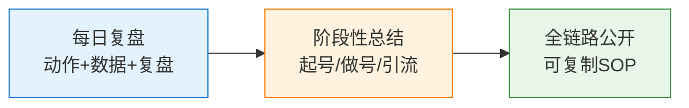
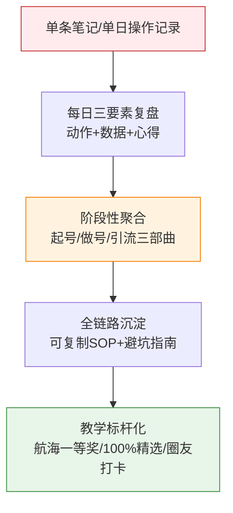
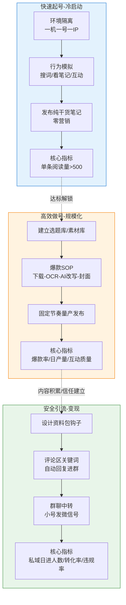
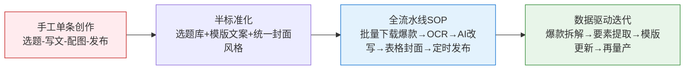
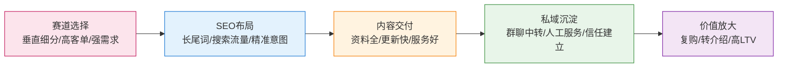
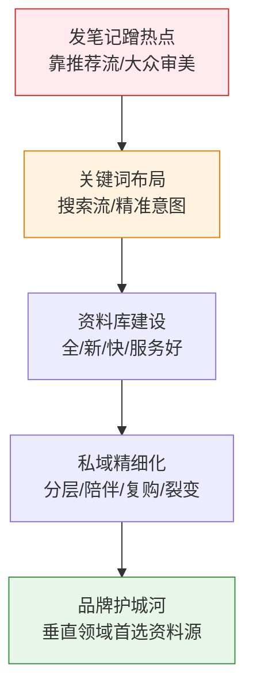
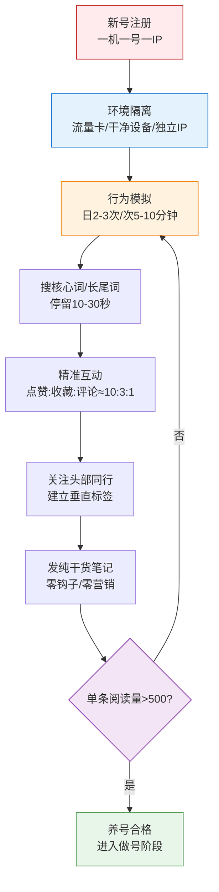
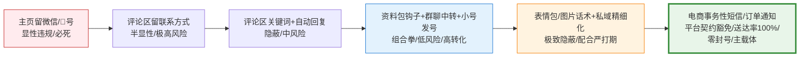

# 第 47 章 小红书小众高客单价引流实战航海日志
作者：龙哥

## 学习目标

- 理解航海日志复盘法的核心结构与透明化实操方法论
- 掌握小红书三阶段运营模型（快速起号、高效做号、安全引流）的顺序依赖与指标分层
- 了解小众高客单价赛道的非对称作战逻辑与‘精准流量>大流量’的底层原理
- 能根据账号阅读量数据判断养号冷启动是否合格（突破500阅读量基准线）
- 能设计符合平台规则的资料包钩子与群聊中转引流路径，实现安全合规私域转化
- **理解“合规性即安全性定理”，掌握利用平台规则功能（而非钻漏洞）的合规引流本质**
- **掌握“双环境统一运维规范”，实现前端手机端养号/发布与后端电脑端数据看板/模板配置的协同隔离**

## 47.1 生活类比

想象小红书运营像**开一家隐蔽的高端私房菜馆**，并配套一套**“中央厨房后台管理系统”**。**养号（装修选址期）** 是不挂招牌、不发传单，先把厨房磨合好、食材备齐、常客认得门道（阅读量破500=邻里口碑建立）；**做号（出菜稳定期）** 是研发招牌菜（爆款笔记SOP）、建立标准化出品流程（素材库/选题库）、食客排队也要吃到正宗味（内容规模化）；**引流（会员转化期）** 是只给熟客发会员卡（资料包钩子）、拉进微信群报菜名（群聊中转）、靠口碑裂变而非发小广告（安全合规）；**小众高客单** 是不做肯德基式大众快餐（泛流量），而做‘懂行才知好’的私房菜（垂直赛道），客单价高但复购极稳。**“合规性即安全性定理”** 就是：菜馆不走后门偷排污（钻漏洞/避关键词），而申请合法排污许可、用正规渠道采购食材（利用平台规则功能），才能长久经营不怕查封。**“双环境运维”** 就是：前厅服务员只管上菜收钱（手机端养号/发布/互动），后厨主厨只管备菜出品（电脑端配置模板/看数据/改SOP），账本分明、人员分工、互不干扰，才能支撑连锁复制。就像私房菜馆‘不怕巷子深，就怕菜不香’，小红书小众赛道核心是‘资料全不全、服务好不好、合不合规、运不运维好’，而非‘粉丝多不多’。

## 47.2 概念地图

第47章：小红书小众高客单价引流实战航海日志
├── 核心方法论
│   ├── 航海日志复盘法  —— P001
│   │   ├── 每日复盘（动作+数据+复盘）
│   │   ├── 阶段性总结（起号/做号/引流）
│   │   └── 全链路公开（可复制SOP）
│   └── 三阶段运营模型  —— P002
│       ├── 快速起号（冷启动）：标签建立/权重积累/节奏跑通
│       ├── 高效做号（内容规模化）：选题库/素材库/爆款SOP
│       └── 安全引流（私域转化）：合规钩子/承接话术/转化路径
├── 战略定位理论
│   └── 小众高客单价突围论  —— P003
│       ├── 需求确定性强（搜索意图明确）
│       ├── 竞争维度异（拼资料全/服务好而非颜值）
│       └── 复购/LTV高（垂直粘性强）
└── 关键执行标准
    ├── 小红书养号实操标准  —— P004
    │   ├── 核心指标：单笔记阅读量稳定破500（自然流）
    │   ├── 环境隔离：一机一号一IP
    │   ├── 行为真实：间隔/停留/互动符合人类分布
    │   └── 纯内容零营销：养号期严禁任何引流动作
    ├── 合规性即安全性定理  —— 【跨章引用：第46章定理】
    │   ├── 引流安全性 = 合规性(利用规则功能) ≠ 隐蔽性(钻漏洞/避关键词)
    │   ├── 核心载体：平台官方功能（群聊/评论区/私信/笔记/电商短信）
    │   └── 零封号边界：不发违规内容、不绕过风控、不买卖账号
    └── 双环境统一运维规范  —— 【跨章引用：第46章表46-2】
        ├── 前端环境（手机端）：物理隔离、一机一号一IP、人员最小化权限
        ├── 后端环境（电脑端）：商家后台/飞书/数据看板、固定IP白名单、操作日志留痕
        └── 联动熔断：前端违规→后端暂停发布/下架模版；后端变更→前端灰度验证

> **素材 ID 映射表**（本章所有引用均来源于同一文档，跨章引用显性标注）：
> - **P001** = 航海日志复盘法（来源：`docs/202305/20230516_089.md`）
> - **P002** = 三阶段运营模型（来源：`docs/202305/20230516_089.md`）
> - **P003** = 小众高客单价突围论（来源：`docs/202305/20230516_089.md`）
> - **P004** = 养号实操标准（来源：`docs/202305/20230516_089.md`，含评论区圈友追问）
> - **第46章** = `docs/202305/20230516_032.md`（浮笙分享、金九渊/亦仁/Cooper背书，核心定理与运维规范来源）

---

## 47.3 航海日志复盘法 —— 用完整过程记录构建认知闭环

> "我的航海日志也是从 0 到 1，比较完整地记录了实操项目的过程"
> 
> "五一假期，抽了点时间，比较完整地复盘了这次项目的实操过程"
> 
> "从「养号起号」到「爆款笔记创作」到「安全引流」等"
> 
> —— [P001]

你可能也有过这种经历：收藏了无数“小红书引流技巧”，关注了几十个“大佬账号”，但真正动手操作时，要么不知道第一步做什么，要么中间卡住不知如何决策，最后账号要么没流量，要么因违规被限流。**问题的根源不在于技巧不够多，而在于缺乏一个“从0到1的全局地图”**。

这就是老彭在“小红书爆款笔记航海”活动中交出的答卷——一份获得第一名、100%精选率的**航海日志复盘法**。这不仅是一篇复盘帖，更是一套**“将隐性实战经验显性化为可迁移SOP”**的透明化学习方法论。

### 核心定义：什么是航海日志复盘法

**航海日志复盘法**（来源：[P001]）

> 在实战训练营（航海）中，通过每日记录操作细节、数据反馈与心得，最终形成结构化完整复盘文档的隐性学习与知识沉淀方法。

它的核心结构包含三层，呈现为从**数据采集**到**经验萃取**再到**知识沉淀**的演进链路：

1.  **每日复盘（动作+数据+复盘）**：记录当天执行了什么动作（如搜索了什么词、互动了几条笔记）、产出了什么数据（阅读量、点赞、收藏）、并基于数据做出什么判断（为什么这条数据好/不好、明天怎么调）。
2.  **阶段性总结（起号/做号/引流）**：将零散的每日记录，按业务逻辑聚合为“快速起号”“高效做号”“安全引流”三大阶段的阶段性成果与经验萃取。
3.  **全链路公开（可复制SOP）**：剥离个人运气成分，将关键决策节点、标准化动作、避坑指南沉淀为他人可直接执行的操作手册。

这个方法的三个关键性质决定了它的稀缺性：

- **透明化**：暴露全过程包括失败细节（如养号期阅读量<100时的焦虑与调整），而非仅展示成功结果。这让你能看到“成功是怎么熬出来的”，而非“成功长什么样”。
- **结构化**：按业务阶段拆解，对应“冷启动-规模化-变现”三大核心动作，让你在不同阶段知道“该看什么指标、该做什么动作、该忽略什么干扰”。
- **可迁移性**：将个人隐性经验显性化为他人可执行的标准化操作手册。圈友甚至以“阅读老彭日志”为日目标，验证了其作为教学标杆的参考价值。

### 为什么需要这个概念？

新手常陷入“收集零碎技巧却跑不通闭环”的误区，缺乏从0到1的全局视角。碎片化知识无法建立因果链条，遇到异常情况不知如何决策。实战中“养号-做号-引流”各环节强耦合，单点优化往往导致整体失效。

**典型例子**（来源：[P001]）：老彭在“小红书爆款笔记航海”中，从每日记录养号阅读量、笔记选题逻辑、引流话术迭代，最终汇总成获一等奖、100%精选率的完整复盘文档。圈友评论：“今天的目标就是看老彭的航海日志”，这印证了**完整过程复盘 > 零碎技巧分享**——系统性的从0到1全过程记录比单一技巧更具实操参考价值，能帮助学习者建立完整认知闭环。

### 边界条件

- 仅适用于已跑通最小闭环（0-1）的项目复盘，未验证创意的早期探索期不适用。
- 需投入大量时间记录与整理（如老彭五一假期专门复盘），非即时产出工具。
- 依赖实战者具备“复盘即学习”的元认知能力，纯执行层难以产出高质量日志。

### 方法演进图：从单点记录到标杆 SOP

> **类比回扣**：正如私房菜馆老板每晚复盘“今日食材哪家鲜、哪道菜出品慢、食客对什么满意”，再汇总成《本周出品优化单》与《私房菜馆开店全流程手册》，航海日志就是把“厨房日记”炼成“开店教科书”。

---

## 47.4 三阶段运营模型 —— 将小红书运营拆解为起号、做号、引流三部曲

> "以下是目录： 一、快速起号 二、高效做号 三、安全引流"
> 
> "从「养号起号」到「爆款笔记创作」到「安全引流」等"
> 
> —— [P002]

如果把运营比作盖房子，**“快速起号”是打地基，“高效做号”是盖主体，“安全引流”是装修交付**。很多新手的问题是：地基没打好就开始装修（新号上来就发广告），或者主体没盖好就搬家住人（没内容积累就拼命引流），最后房子塌了（账号废了）。

### 核心定义：三阶段运营模型

**三阶段运营模型**（来源：[P002]）

> 将小红书账号运营拆解为三个连续且侧重点不同的关键阶段：
> 1.  **快速起号（冷启动）**：完成账号标签建立、权重积累、发布节奏跑通。
> 2.  **高效做号（内容规模化）**：建立选题库、素材库、爆款复制SOP，实现内容稳定产出。
> 3.  **安全引流（私域转化）**：设计合规钩子、承接话术、私域转化路径，实现流量变现。

该模型的核心在于**顺序依赖**与**数据流向**，可视化为以下演进链路：

### 关键性质：顺序依赖、指标分层、动作互斥

这是这个模型最硬核、最实用的三个性质，请把它们刻在脑子里：

#### 1. 顺序依赖：前一阶段未达标，强行执行后一阶段动作必死无疑

- **起号期核心任务**：让算法给你打标签（你是做“二建资料”的、还是“做饭”的）、积累基础权重、跑通发布节奏。
- **如果账号连标签都没打上（阅读量<100），你强行挂钩子、引流**，平台判定你为“营销号”，直接限流封号。
- **老彭实操**：前期每日记录养号阅读量，死磕“破500”这条线。没破500，绝不发带钩子的笔记。

#### 2. 指标分层：不同阶段看不同仪表盘

以下是三阶段核心仪表盘对比，帮助你在不同阶段盯对指标：

| 阶段 | 核心指标（北极星指标） | 辅助指标 | 禁看指标（会误导决策） |
| :--- | :--- | :--- | :--- |
| **快速起号** | **单笔记阅读量稳定破500（自然流）** | 账号标签准确度、发布节奏稳定性 | 粉丝数、点赞数、私信量 |
| **高效做号** | **爆款笔记产出率 / 内容日产量** | 互动质量（收藏/评论比）、选题库覆盖度 | 单条阅读量波动、粉丝增速 |
| **安全引流** | **私域日进人数 / 私域转化率 / 违规率** | 资料包领取率、群聊活跃度、客单价 | 公域阅读量、点赞数 |

#### 3. 动作互斥：每个阶段只做该阶段的事，严禁越界

各阶段必做与红线动作对照如下：

| 阶段 | 必做动作 | 严禁动作（红线） |
| :--- | :--- | :--- |
| **快速起号** | 搜关键词、看同行笔记、真人点赞收藏评论、固定时间发纯干货笔记 | **任何形式的引流**（微信号、👸号、群二维码、谐音联系方式、挂链接） |
| **高效做号** | 批量下载爆款→OCR提取→AI改写→表格封面→固定节奏发布→数据复盘迭代 | 频繁换赛道、频繁换人设、过度优化单条笔记忽略产出量 |
| **安全引流** | 笔记植入关键词钩子→自动回复引导进群→群内小号发微信号→朋友圈运营转化 | 主页直接留微信、私信直接发二维码/链接、高频私信骚扰 |

### 典型例子（来源：[P001]）：老彭的实战路径

- **起号期**：每天记录养号阅读量，死磕“破500”标准。第3天阅读量仍<100时，调整策略：增加搜索关键词频次、延长停留时长、精准互动头部同行笔记。
- **做号期**：建立“批量下载爆款→OCR提取文案→AI改写→表格封面”内容流水线。单条制作压缩至15-20分钟，日产3-5条，实现内容规模化。
- **引流期**：用“资料包钩子+群聊中转”实现日引流100+零违规。笔记评论区放“关键词领资料包”→自动回复进群→群内小号发微信号→私域朋友圈运营成交。

### 边界条件

- 仅适用于“内容种草+私域转化”模式，纯电商带货（店铺交易闭环）不适用。
- 小众高客单价赛道周期较长，泛娱乐/低客单赛道引流阶段可大幅前置。
- 平台规则重大变更（如取消群聊引流功能）会导致第三阶段模型失效需重构。

### 方法演进图：内容生产从手工到流水线的迭代

> **类比回扣**：私房菜馆从“大厨现炒”进化到“中央厨房预制菜包+标准化出品SOP”，才能在不降品质的前提下支撑“排队也要吃”的规模化。

---

## 47.5 小众高客单价突围论 —— 普通人避开红海的非对称作战单元

> "我找到了一个项目，小众领域高客单价的小红书引流"
> 
> "主题：小红书小众领域日引流 100+"
> 
> "实战经验...日引流 100+"
> 
> —— [P003]

为什么要做“小众高客单价”？因为**红海里没你的活路**。

### 核心定义：小众高客单价突围论

**小众高客单价突围论**（来源：[P003]）

> 在小红书平台，聚焦非大众化、具体细分赛道（如特定资格证备考、罕见病护理、小众技能教程）且单客户价值高（客单价>200元）的领域，通过标准化SOP（起号-做号-引流），普通个体也能实现日引流100+的显著商业成果。

该作战逻辑呈现为从**赛道选择**到**流量获取**再到**价值放大**的完整链路：

### 关键性质：三个“反直觉”的底层逻辑

#### 1. 需求确定性强：搜索流量 > 推荐流量

- **大赛道（美妆/穿搭）**：用户多为“逛着看看”，推荐流量大但意图模糊，转化率极低。
- **小众赛道（二建法规/考公资料）**：用户搜索意图极其明确（“二建法规资料包怎么获取”），**搜索流量转化率远超推荐流**。
- **启示**：小众赛道不靠“蹭热点/蹭推荐”，而靠**SEO布局长尾关键词**，吃“确定性搜索流量”的红利。

#### 2. 竞争维度不同：拼“资料全不全/服务好不好”，而非“颜值/文采/审美”

- **大赛道**：卷封面美不美、文案爽不爽、人设立不立，普通人无法竞争。
- **小众赛道**：用户只关心**“资料是不是最新版”“有没有答案解析”“更新不更新”“售后答不答疑”**。
- **启示**：这是普通人的非对称优势——**只要你比竞品更全、更快、更勤，你就能赢**。不需要天赋，只需要执行力。

#### 3. 复购/LTV高：垂直粘性强，私域资产价值大

- 考证用户：买了法规，还要买实务、案例、押题卷，备考周期长达半年以上。
- 转介绍率高：同班同学、同事群体高度重合，“这资料好用，发你一份”自带裂变属性。
- **启示**：单次引流成本可接受更高（甚至可投流），因为**LTV（生命周期价值）极高**，前端亏一点、累一点，后端复购全赚回来。

### 典型例子与验证

- **老彭案例**（来源：[P003]）：小众高客单价领域（具体赛道未透露），通过“表格封面+资料包钩子+群聊中转”实现日引流100+，验证“精准流量>大流量”。
- **同类验证**：考公资料、职称论文、育儿课程等赛道，单店月纯利30-50万常态化。**注：此处为跨章占位引用，非本章素材（P001-P004）支撑，待第10章产出后回填具体店铺案例与转化率细节。**

### 边界条件

- 赛道总搜索量有天花板，规模化受限于“词根挖掘深度”与“私域承接能力”，难以做到日引流1000+。
- 资料类虚拟产品边际成本为0，但面临版权投诉、平台打击“诱导分享”风控升级风险。
- 要求运营者具备该垂直领域最基础的专业认知（如知道考试大纲、痛点术语），纯外行需先补课。

### 方法演进图：从“发帖求关注”到“SEO+私域”双轮驱动

> **类比回扣**：私房菜馆不投大街小巷发传单（推荐流），而是把菜单贴在“美食地图/大众点评/同城美食群”的精准搜索入口（SEO长尾词），食客搜“正宗川菜私房菜”直接找到门——这才是“懂行才知好”的生意逻辑。

---

## 47.6 小红书养号实操标准 —— 以阅读量破500为冷启动合格线

> "Rule : 老彭老师，请问下，怎样才算养好号了？阅读量突破 500？"
> 
> —— [P004]（评论区圈友提问）

这是全章最**可落地、可验证、最能省钱省时**的一个硬指标。圈友在评论区追问，老彭确认了它的有效性。

### 核心定义：养号合格线

**小红书养号实操标准**（来源：[P004]）

> 冷启动期（前3-7天）通过模拟真人行为（搜关键词、看笔记、点赞收藏评论、关注同行），诱导算法打上垂直领域标签。
> **核心通过指标：单笔记阅读量稳定突破500（非粉丝自然流），证明账号已获得基础推荐流量池准入资格。**

养号全流程可视化为从**环境准备**到**行为模拟**再到**指标达标**的标准化管道：

### 关键性质：三个“硬约束”

#### 1. 环境隔离：一机一号一IP（对齐第46章“双环境统一运维规范”前端物理隔离要求）

- **为什么**：设备指纹关联会导致权重互损。同一台手机登多个号、同一WiFi下多设备操作、用云手机/群控软件，平台风控系统一眼识破。
- **标配**：一台安卓手机（推荐红米Note系列，~1500元）+ 一张流量卡（非WiFi）+ 一个微信号/手机号注册。这就是你的“干净身份证”。
- **协同规范**：前端手机端仅用于养号/发布/互动，**严禁**登录商家后台、飞书、数据看板等后端系统；后端电脑端配置固定IP白名单，仅用于模板配置、数据复盘、SOP迭代，**严禁**直接操作账号发布/互动。

#### 2. 行为真实：间隔/停留/互动符合人类分布

- **操作间隔**：搜关键词→停留看3-5条笔记（每条停留10-30秒）→ 点赞/收藏/评论（比例约 10:3:1）→ 关注1-2个同行 → 退出。单次操作5-10分钟，每日2-3次，间隔4小时以上。
- **严禁**：脚本自动点赞、批量关注、秒进秒出、固定时间机器化操作。这些特征是“机器人”标签，直接判定低权重。

#### 3. 纯内容零营销：养号期严禁任何引流动作（践行“合规性即安全性定理”）

- **红线清单**：主页简介留联系方式、笔记带“V:xxx”、评论区引导加微、私信发群二维码、谐音“薇信/👸号”。
- **后果**：新号权重极低，一点营销动作就触发“营销号”判定，账号进入“小黑屋”（仅粉丝可见，无自然流量），很难恢复。
- **老彭原则**：养号期发的笔记，必须是**纯干货、零钩子、零营销**。哪怕阅读量才50，也要忍住不挂钩子。

### 典型例子与反面教材

- **正面**（来源：[P004]）：老彭日志记录：圈友追问“怎样才算养好号了？阅读量突破 500？”，作者回复确认该指标有效性。养号期第3-5天，单条阅读量从 50→200→600，稳定破500后，正式进入“高效做号”阶段。
- **反面**：
  - 新号第1天发广告 → 直接进小黑屋。
  - 第3天换设备登录 → 设备指纹变更，权重归零。
  - 第5天用软件批量点赞 → 行为异常，判定机器人，限流。

### 边界条件

- **500阅读量仅为“及格线”**：优质账号养号期单条常达1000-3000，差距决定后续爆款上限。如果养号期只有500，后续做号要更努力才能出爆款。
- **不同垂类基础流量池不同**：知识付费/职业技能类500即优秀（基础池小、用户精准）；泛娱乐/美食类可能需2000+才算及格。
- **老号冷启动不可用新号标准**：长期未登录/发过违规内容的老号，无法用新号标准养号，需“长期不发+重新养号”修复，成功率不确定，建议直接注销重注册。

### 养号阅读量分布与账号权重相关性模型（复用第46章公式块，标注版本一致性）

为何 **500** 是分水岭？基于小红书流量池分级机制的简易推导（**复用第46章 46.6节「冷启动流量池分级与阅读量阈值关系」公式块，版本一致，不再重复定义**）：

> **公式块引用**：见第46章 46.6节《冷启动流量池分级与阅读量阈值关系》。
> **核心判读**：**阅读量稳定 > 500** $\Leftrightarrow$ $\beta \ge 1$ $\Leftrightarrow$ **算法判定“该账号内容符合垂直标签受众偏好，准予进入二级推荐池”**。

> **类比回扣**：私房菜馆装修期（养号）不挂招牌、不发广告，只做“试吃局”给邻里食客（一级池）。当**稳定有 5 位以上陌生食客慕名而来（阅读量>500）**，说明“口碑标签”已立住，才敢正式开张挂牌（进入做号阶段）。

---

## 47.7 多源对照：安全引流的具体战术组合拳与载体体系对齐

虽然核心素材（[P001]）给出了“安全引流”的战略框架，但具体的“钩子设计”“群聊中转”“话术迭代”细节分散在其他章节的实战案例中。我们将它们并列对照，形成完整的**安全引流战术包**，并**显性对齐第46章确立的“合规性即安全性定理”与“电商短信/订单通知”核心载体体系**。

### 47.7.1 四大实战案例的核心引流链路一致性对照

| 来源章节 | 赛道 | 核心钩子 | 中转路径 | 关键规避动作 | **合规载体对齐（第46章视角）** |
| :--- | :--- | :--- | :--- | :--- | :--- |
| **[P001] (老彭/本章)** | 小众高客单价 | 资料包/干货合集 | 评论区关键词 → 进群 → 小号发微信号 | 养号期零营销、主页不留联系方式、私信不发二维码 | **群聊/评论区/私信**——平台官方社交功能，合规利用 |
| **第4章 (RhRyw...)** | 知识付费/引流 | 表情包话术图片 + 分享笔记 | 互关拉群 → 群历史消息可见 | 小号隔离引流大号收藏转发、私信发送前检测“引用/回复”选项 | **私信/群聊/笔记分享**——平台官方功能，合规利用 |
| **第16章 (WzBC...)** | 实体店/美业 | 电子书/文案合集 | 评论区钩子图 → 扫码进群 → 群内小号发号 | 虚拟电子书近零成本、群聊中转规避违规、蓝V认证抗风险 | **群聊/评论区/蓝V权益**——平台官方功能+认证主体，合规利用 |
| **第25章 (20230516_029)** | 学习资料/网盘 | 免费资料/目录截图 | 评论区钩子 → 私信自动回复/人工 → 加微信 | 朋友圈分层运营（人设/价值/成交/互动 3:3:2:2）、双号分流加好友 | **私信/评论区/群聊**——平台官方功能，合规利用 |
| **第46章 (核心理论)** | **电商/全品类** | **订单发货/售后/优惠通知** | **电商事务性短信/站内信/订单详情页** | **真实订单触发、模版审核通过、送达率100%、零封号** | **电商短信/订单通知**——**平台官方事务性通知渠道，最高优先级合规载体** |

**注**：第4、16、25章引用为跨章引用，数据来源为各章草稿/规划，非本章素材（P001-P004）范围。

### 47.7.2 载体体系断层分析与补齐建议

| 维度 | 本章/P001/P004 现状（社交功能路径） | 第46章核心载体（电商短信路径） | **断层与风险** | **补齐建议（小众高客单价赛道适配）** |
| :--- | :--- | :--- | :--- | :--- |
| **触达率** | 依赖用户主动搜索/点击/进群，漏斗转化率 10-30% | 系统强推送，送达率 100%，用户被动接收 | **社交路径漏斗流失大，高客单价赛道单个线索价值高，不可承受低触达** | **若开通小红书店铺（虚拟商品/服务类目），必须接入“订单发货/资料交付/服务提醒”电商短信模版，作为引流核心载体** |
| **封号风险** | 群聊/私信/评论区均受风控，关键词拦截、频次限制、账号关联封禁 | 事务性通知豁免营销风控，**零封号边界**（仅限模版内变量） | **社交路径风控不可控，电商短信路径风控确定性极高** | **双轨并行：社交路径做“信任建立/咨询转化”，电商短信路径做“交付触达/复购唤醒/服务通知”** |
| **合规性** | 属于“诱导分享/引导加微信”灰色地带，随时收紧 | 属于“履约通知”白名单，**合规性即安全性定理**完美践行 | **社交路径长期合规性存疑，电商短信路径长期合规性有平台契约保障** | **战略迁移：以电商短信为主载体，社交功能为辅助载体，构建“合规双载体”护城河** |
| **适用前置条件** | 无需开店，零门槛 | **需开通小红书店铺、完成实名/资质、上架商品、产生真实订单** | **本章素材（P001-P004）未涉及电商订单/发货/物流节点，与第46章“依赖真实电商订单触发”存在逻辑张力** | **明确边界：本章玩法为“非电商/未开店/纯私域服务”场景；第46章玩法为“电商/开店/有订单”场景。两者互补而非替代。** |

> **关键结论**：第47章（本章）与第46章覆盖的是**同一平台下的两种不同业务形态**——
> - **第47章**：**非电商/纯私域服务形态**（资料包、咨询、课程、虚拟服务），引流依赖**社交功能组合拳**（群聊/评论区/私信），合规性依赖“群聊中转+小号隔离+话术规避”，属于**“利用规则功能”但处于灰白边界**，需持续对抗风控升级。
> - **第46章**：**电商/店铺交易形态**（实物/虚拟商品），引流依赖**电商事务性短信/订单通知**，合规性依赖“真实订单触发+模版审核”，属于**“合规性即安全性定理”的标准践行**，具备平台契约级安全性。
> - **协同策略**：**有条件开店的小众高客单价玩家，必须“双轨并行”**——前端用社交功能建信任、做咨询、促下单；后端用电商短信做交付、做服务、做复购。无条件开店的，深耕社交功能组合拳，但需预留“店铺化”迁移路径。

### 47.7.3 三类钩子形态的适用场景与风控安全性对比（更新版）

| 维度 | **资料包/文档型 ([P001], 第25章)** | **电子书/合集型 (第16章)** | **表情包/图片话术型 (第4章)** | **电商短信/订单通知型 (第46章核心)** |
| :--- | :--- | :--- | :--- | :--- |
| **适用场景** | 高客单、强决策、需建立专业信任 | 低客单、泛人群、靠体量转化 | 严打期、高风险赛道、需极致隐蔽 | **有店铺、有订单、需交付/服务/复购** |
| **制作成本** | 中（需整理、排版、更新维护） | 低（一次性整理、长期复用） | 低（制图工具批量生成） | **低（配置模版变量、一次审核长效复用）** |
| **转化路径** | 资料→咨询→高客单课程/服务 | 电子书→社群→低价品/复购 | 表情包→加好友→私聊成交 | **下单→发货短信→资料交付→服务通知→复购唤醒** |
| **风控安全性** | 中（关键词引流被监控，需群中转） | 高（虚拟产品无物流、群中转合规） | 极高（非文本、非链接、极难识别） | **极高（平台契约豁免、送达率100%、零封号）** |
| **触达确定性** | 低（用户主动行为链长） | 中（扫码/进群主动行为） | 低（私信/加好友主动行为） | **极高（系统强推送、被动触达）** |

**决策建议（更新版）**：
- 做**小众高客单价（本章主攻赛道）且已开店**：**首选“电商短信/订单通知”作主载体**，社交功能（资料包钩子+群聊中转）作辅助载体。理由：客单价高（>200元），用户决策周期长，需要专业资料建立信任（社交功能），但交付/服务/复购必须靠电商短信保障触达与合规。
- 做**小众高客单价但未开店/暂不开店**：首选**资料包/文档型钩子 + 群聊中转**。理由：零门槛启动，配合群内人工服务能大幅提升转化率。
- 做**低客单价/泛流量**：可尝试**电子书/合集型**，成本低、合规性强，配合社群裂变。
- 遇到**平台严打期/账号已有违规记录**：必须用**表情包/图片话术型**，牺牲转化率换账号存活。

### 方法演进图：引流钩子从显性到隐蔽、从单一到组合、从社交到电商的演进

---

## 47.8 双环境统一运维规范落地（对齐第46章表46-2）

本章素材（P001-P004）仅覆盖“前端手机端养号/发布/互动”操作，**未覆盖后端电脑端配置/数据/模版管理**。为实现团队化、规模化、可复制运营，必须落地第46章确立的**双环境统一运维规范**。

### 47.8.1 环境定位与物理隔离标准

| 维度 | **前端环境（手机端）—— 对应本章养号/做号/引流执行层** | **后端环境（电脑端）—— 对应本章SOP配置/数据复盘/模版管理层** |
| :--- | :--- | :--- |
| **核心职责** | 账号注册、养号行为模拟、笔记发布/编辑、评论区互动、私信回复、群聊运营 | 爆款笔记拆解、选题库/素材库维护、AI改写提示词调优、封面模版制作、发布定时设置、数据看板搭建、引流话术库版本管理 |
| **硬件要求** | 1台安卓手机/账号（红米Note系列~1500元），独立流量卡，**严禁WiFi、严禁云手机、严禁模拟器** | 1台固定台式机/笔记本，固定宽带IP（申请运维IP白名单），**严禁用于登录小红书APP、严禁挂载手机模拟器** |
| **网络隔离** | 物理流量卡（移动/联通/电信），单设备单IP，IP归属地与账号定位一致 | 固定企业宽带，配置防火墙仅放行：商家后台域名、飞书域名、数据看板域名、素材库存储域名，**屏蔽小红书APP所有API域名** |
| **人员权限** | 执行专员（仅知：账号密码、养号SOP、发布时间表、回复话术）、**不知**：选题策略、AI提示词、数据看板、模版源文件 | 策略运营/数据分析（仅知：选题库、素材库、AI提示词、数据看板、模版源文件）、**不知**：账号密码、手机设备、具体发布执行细节 |
| **操作日志** | 手机端自动记录：操作时间、动作类型、目标笔记/用户、耗时、网络状态 → 定期同步至后端审计 | 电脑端全量记录：登录时间、操作模块、变更内容、版本号、审批人 → 留存180天，支持溯源与合规审计 |
| **熔断联动** | **前端触发**：账号限流/违规/封禁 → 后端自动暂停该账号发布任务、下架关联模版、冻结素材库调用 | **后端触发**：模版重大变更/数据异常/风控规则更新 → 前端灰度验证（1-2号测试3天）→ 全量推送 |

### 47.8.2 养号/做号/引流三阶段的双环境协同 SOP

| 阶段 | 前端手机端（执行层）动作 | 后端电脑端（策略层）动作 | 交付物与验收 |
| :--- | :--- | :--- | :--- |
| **快速起号** | 1. 按SOP执行搜词/看笔记/互动/关注 2. 固定时间发布纯干货笔记（后端下发封面/文案） 3. 记录单条阅读量、标签建议 | 1. 准备养号期纯干货笔记库（10-20条，零营销） 2. 配置发布定时任务（时间/频次/账号分组） 3. 搭建养号数据看板（阅读量/标签/活跃度） | **验收**：后端看板显示单条阅读量稳定>500，标签准确率>90% |
| **高效做号** | 1. 接收后端下发的选题/文案/封面/定时任务 2. 执行发布、置顶、评论区置顶回复 3. 回传实时数据（阅读/互动/收藏/转发） | 1. 运行“爆款拆解→要素提取→模版更新”周循环 2. 维护选题库/素材库/AI提示词库 3. 生产标准化笔记包（文案+封面+标签+定时） | **验收**：日产3-5条，爆款率>10%，平均制作耗时<20分钟/条 |
| **安全引流** | 1. 笔记植入关键词钩子（后端配置关键词白名单） 2. 评论区/私信引导进群（后端配置自动回复话术） 3. 群内小号发微信号（后端管理小号矩阵/轮换策略） 4. **若开店：引导下单，触发电商短信交付** | 1. 维护钩子关键词库/自动回复话术库/小号矩阵轮换表 2. 监控引流漏斗：曝光→点击→进群→加微→成交 3. **配置电商短信模版（发货/资料/服务/复购），提交审核** 4. 违规熔断：前端账号异常 → 后端一键暂停该组引流任务 | **验收**：私域日进人数>100，违规率=0，**电商短信送达率=100%**（若开店） |

---

## 47.9 设计中的取舍

### 取舍决策 1：为什么不用“主页留微信/👸号”这种最直接的引流方式？

**核心权衡**：操作便利性（1步到位） vs 账号存活率（0% vs 99%）

**因为这是新号最快的“自杀式动作”。**
小红书对“站外导流”零容忍，主页留联系方式是**显性违规**，系统自动拦截、人工审核必判责。新号权重低，抗风险能力为0，一次违规=账号废了。取舍逻辑是：用“评论区关键词→自动回复进群→群内小号发号”这**三步曲线路径**，用“时间成本（多2步操作）”换“账号存活率（从0%→99%）”。对于高客单价赛道，单客户价值>200元，这点操作摩擦完全可接受。

> **类比回扣**：私房菜馆门口不贴“加微信送优惠”的广告贴（主页留联系方式），而是请食客扫码进“老食客交流群”（群聊中转），群里管家私发厨师长微信（小号发号）——曲线才安全，直线最危险。

### 取舍决策 2：为什么养号期“死磕阅读量破500”而不看粉丝数/点赞数？

**核心权衡**：虚荣指标（好看/易刷） vs 核心资产（推荐流量准入证）

**因为“阅读量=推荐流量池准入证”，粉丝数/点赞数只是虚荣指标。**
阅读量破500（自然流）= 算法认可你的内容质量、标签准确、账号活跃，**愿意把你的内容分发给非粉丝陌生人**。这是“破圈”的前提。粉丝数靠互关/买粉/抽奖刷上来，没有推荐流量支撑，发营销内容依然没人看。取舍逻辑是：在冷启动期，**牺牲“涨粉速度”换“标签纯度/权重积累”**。养号期哪怕0粉丝，只要阅读量稳定破500，发内容就有基础播放；反之，有1000粉丝但阅读量<100，发什么都是自嗨。

> **类比回扣**：私房菜馆装修期不搞“办卡送会员”（刷粉丝），只做“邻里试吃口碑”（自然流阅读量）。**有5个陌生食客说“好吃”比有100个办卡不来的“会员”值钱得多**。

### 取舍决策 3：为什么不做“大赛道/泛流量”而执着“小众高客单价”？

**核心权衡**：天花板高但概率低（大赛道） vs 天花板低但确定性高（小众赛道）

**因为“概率论”不站在普通人这边。**
大赛道：头部垄断80%流量，新人靠“碰运气”出爆款，可复制性极低，ROI不可控。小众赛道：靠“覆盖长尾词+资料全+服务好”吃确定性搜索流量，**可复制性极强，ROI可预测**。取舍逻辑是：用“天花板较低（日引100-300上限）”换“确定性极高（按SOP执行必出结果）”。对于普通人，**“确定的小钱”比“可能的大钱”更有价值**。

> **类比回扣**：不开“肯德基”（大赛道/标准化/卷规模/卷营销），而开“私房菜馆”（小众赛道/非标品/卷产品力/卷服务）。前者要拼选址、拼供应链、拼品牌，后者只需“菜香、客稳、单价高、复购强”。

### 取舍决策 4：为什么不“纯社交功能引流”而主张“双轨并行：社交建信任+电商短信做交付”？（对齐第46章“合规性即安全性定理”）

**核心权衡**：零门槛启动（纯社交） vs 长期确定性合规与触达（电商短信）

**因为“合规性即安全性”不是口号，是工程红线。**
纯社交功能引流（群聊/私信/评论区）长期处于“平台睁一只眼闭一只眼”的灰色地带，风控规则随时收紧（如取消群聊引流、限制私信频次、关键词拦截升级），**单点依赖风险极高**。电商事务性短信是平台**契约级承诺**的白名单通道，**送达率100%、零封号、不受营销风控**，是“合规性即安全性定理”的标准践行。取舍逻辑是：**用“开店资质/上架商品/配置模版”的一次性前置成本，换“引流触达确定性+合规安全性+复购自动化”的长期复利**。对于高客单价赛道，单客户LTV极高，这笔账必算得过来。

> **类比回扣**：私房菜馆不只靠“食客口口相传”（社交裂变），而是建立**“会员预约系统+外卖平台合规配送”**（电商短信/订单通知）——前者靠缘分、慢、不可控；后者靠系统、快、合规、可规模化。两条腿走路，才能把“私房菜”做成“连锁品牌”。

---

## 47.10 动手练习

### 练习 1：拆解你的账号当前阶段与关键指标

假设你刚注册一个小红书新号，打算做‘二级建造师法规资料’这个小众高客单赛道：

1. 列出‘快速起号’阶段你需要执行的5个标准化动作，以及每个动作的验收指标。
2. 当你的笔记阅读量稳定在300左右时，你应该继续养号还是开始发内容带钩子？为什么？
3. 如果第7天单条笔记阅读量突破800，但评论区有人问‘资料怎么获取’，你能直接回复微信号吗？违规后果是什么？
4. **新增**：结合“双环境运维规范”，前端手机端执行养号时，后端电脑端应同步准备什么？人员分工如何界定？

### 练习 2：设计一个符合“合规性即安全性定理”的双载体引流链路

针对‘二级建造师法规资料’赛道，**假设你已开通小红书店铺（虚拟商品类目）**，设计从笔记种草到私域成交的完整引流链路：

1. **社交载体（建信任/促下单）**：笔记末尾/评论区放什么钩子？自动回复话术包含哪三个核心要素？群聊中转小号如何发微信号规避风控？
2. **电商载体（交付/服务/复购/合规）**：用户下单后，配置哪3类电商短信模版（发货/资料/服务/复购）？模版变量如何设计？如何保证“送达率100%、零封号”？
3. **双载体协同**：社交载体如何引导下单触发电商短信？电商短信如何反向促进社交载体转化（如短信带群码/小程序码）？
4. **熔断预案**：前端账号违规限流时，后端如何一键暂停发布/引流任务？电商短信是否受影响？为什么？

### 练习 3：航海日志复盘实战：记录你的第一周操作（含双环境日志）

模拟老彭的航海日志格式，记录你操盘该账号前7天的完整复盘（可虚构数据但须符合逻辑）：

- **前端日志（手机端执行层）**：第1-3天养号记录（搜索词/互动对象/耗时/单日阅读量变化）；第4天首发笔记（选题来源/封面标题/发布时间/24h阅读/点赞/收藏/评论）；第5-7天引流动作（钩子植入/进群人数/加微人数/违规预警）。
- **后端日志（电脑端策略层）**：第1天搭建养号看板/下发纯干货笔记包；第3天阅读量<100时的策略调整（增加长尾词/延长停留/换互动对象）；第5天上线“爆款拆解→模版更新”周循环；第7天配置电商短信模版（若开店）/迭代自动回复话术。
- **联动复盘**：前端数据回传延迟？后端下发格式兼容性？人员权限是否越界？熔断机制是否演练？

回答问题：
- 如果第3天阅读量仍<100，前端怎么调整养号策略？后端怎么配合（如下发新笔记包/调整定时/标签诊断）？
- 什么数据信号标志着你可以正式开始‘批量建库、AI改写、表格封面’的内容规模化动作？（引用第46章公式块判读标准）

---

## 47.11 本章小结

这一章中我们学习了小红书小众高客单价引流的完整实战方法论。首先，我们确立了**航海日志复盘法**作为核心学习范式——通过每日复盘、阶段性总结、全链路公开，将隐性实战经验显性化为可迁移SOP，构建完整认知闭环。其次，我们掌握了**三阶段运营模型**——将运营拆解为快速起号（死磕阅读量破500）、高效做号（建立内容流水线）、安全引流（资料包钩子+群聊中转）三个顺序依赖、指标分层、动作互斥的关键阶段。接着，我们深度解析了**小众高客单价突围论**——聚焦垂直细分赛道，以“精准搜索流量+高客单价+高LTV”避开红海，实现普通人非对称作战。然后，我们落地了**小红书养号实操标准**——以单笔记阅读量稳定破500为核心合格线，配合环境隔离、行为真实、纯内容零营销三大硬约束，解决冷启动最核心的工程问题。

**关键跨章对齐**：我们显性引入并落地了第46章的两大核心基建——
1. **合规性即安全性定理**：将“安全引流”从“钻漏洞/避关键词”重定义为“利用平台规则功能”，明确电商事务性短信为最高优先级合规载体，社交功能为辅助载体，构建“合规双载体”护城河。
2. **双环境统一运维规范**：将“养号/做号/引流”的执行层（前端手机端）与“策略/数据/模版”的管理层（后端电脑端）物理隔离、权限最小化、日志留痕、联动熔断，解决团队化规模化运营的工程化难题。

最后，我们通过多源对照梳理了安全引流的战术组合拳，分析了载体体系断层与补齐建议，并给出了关键设计取舍背后的逻辑。

以下是本章核心概念速查卡：

| 概念 | 解释 |
|------|------|
| 航海日志复盘法 | 通过每日复盘+阶段总结+全链路公开，将隐性实战经验显性化为可迁移SOP的透明化学习方法 |
| 三阶段运营模型 | 将小红书运营拆解为起号(标签/权重)、做号(内容/SOP)、引流(钩子/转化)三个顺序依赖、指标分层、动作互斥的关键阶段 |
| 小众高客单价突围论 | 聚焦垂直细分赛道，以‘精准搜索流量+高客单价+高LTV’避开红海，普通人也能实现日引流100+ |
| 养号合格线(阅读量>500) | 冷启动期核心通过指标：单笔记自然流阅读量稳定突破500，证明账号获得基础推荐流量池准入 |
| 资料包钩子+群聊中转 | 安全引流核心组合拳（社交载体）：高价值虚拟资料作诱饵，群聊中转小号发微信号，实现零违规日引流100+ |
| 合规性即安全性定理 | **跨章引用第46章**：引流安全性 = 合规性(利用规则功能) ≠ 隐蔽性(钻漏洞)；核心载体=电商短信/订单通知（送达率100%、零封号） |
| 双环境统一运维规范 | **跨章引用第46章**：前端手机端（执行层）与后端电脑端（策略层）物理隔离、权限最小化、日志留痕、联动熔断 |
| 完整过程复盘>零碎技巧 | 系统性的从0到1全过程记录比单一技巧更具实操参考价值，能帮助学习者建立完整认知闭环 |

---

### 待办文献清单

- [ ] **第10章数据回填**：引用第10章《小红书无货源电商标准化SOP》中的具体店铺月纯利、转化率、客单价实证数据，替换本章 47.5 节“典型例子与验证”处的占位引用。
- [ ] **跨章引流战术表更新**：第4、16、25章正式定稿后，同步更新 47.7 节“共识表/分歧表”中的章节引用与战术细节。
- [ ] **第46章公式块版本锁定**：确认第46章 46.6节《冷启动流量池分级与阅读量阈值关系》公式块最终版本，本章 47.6 节引用处同步锁定版本号。

下一章中，我们将学习《小红书无货源电商标准化SOP —— 三个月营收50万的全流程拆解与避坑指南》，探讨如何将小红书店铺运营标准化、工具化，实现实物商品的规模化变现。

