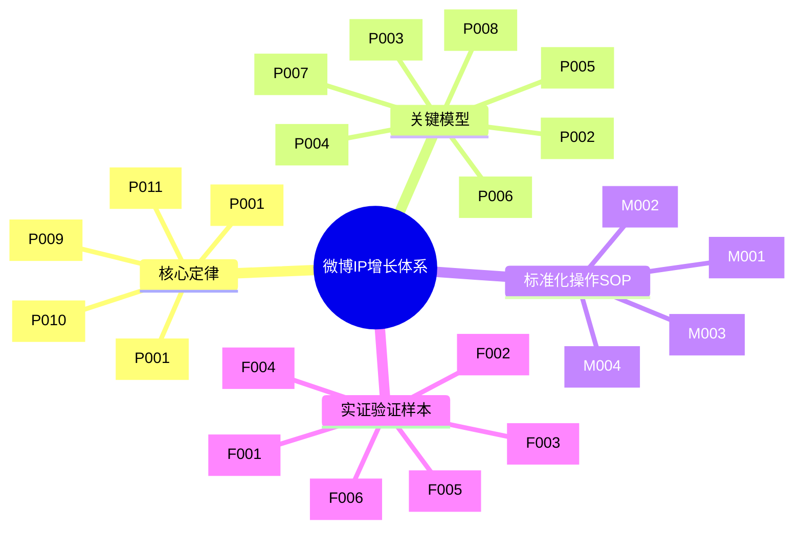

# 第 34 章 微博 IP 增长体系 —— 大V转发冷启动、弱连接价值置换、追热点复用资产与粉丝质量分层

## 学习目标

- 理解微博冷启动依赖外部强分发的平台机制与底层逻辑
- 掌握内容-受众匹配度筛选大V的标准与操作方法
- 熟练运用弱连接价值置换六步法撬动大V注意力资源
- 建立账号识别系统（名字+头像）构建双重记忆锚点
- 组建小V同盟互助圈实现复利增长与隐性大V资源置换
- 掌握追热点选题创作法与热点内容复用资产沉淀机制
- 理解官方运营对接协议将隐性算法转为显性SOP的路径
- 建立联合抽奖粉丝质量控制模型实现涨粉与变现双达标
- 内化社交关系价值对等公理与热点流量转化门槛论
- 确立粉丝质量决定变现上限铁律，按目标变现反向设计涨粉渠道

## 34.1 生活类比

想象微博冷启动是一场“内幕邀请制的高端晚宴”。**大V转发**是主办方（大V）亲自带你入场，但前提是你“穿得体面（内容质量）”且“客群匹配（受众重合）”；**弱连接价值置换**是你没有门票，但能“提供稀缺红酒（身份标签/资源/情绪价值）”换取主办方邀请；**账号识别系统**是你的“名片（名字）+ 穿着风格（头像）”，让主办方在茫茫人海中一眼记住你；**小V复利效应**是结交几位“同级别的潜力股伙伴（小V同盟）”，大家抱团取暖、互通有无、共同成长，远比死缠烂打一个大佬靠谱；**追热点**是晚宴上的“热门话题（全民热点）”，你不蹭没人理，但蹭了只会附和“好喝”（人云亦云）肯定出不了圈，必须“点评酒的年份产地口感（独特观点+深度洞察）”才能被记住；**官方运营对接**是搞定“场地方（平台运营）”，签长期合同（合规SOP），保底流量不愁；**联合抽奖**是办“抽奖活动”引流，但奖品（筛选器）决定来的是“懂酒的行家（精准粉）”还是“冲着免费酒来的黄牛（羊毛党）”；**粉丝质量铁律**是晚宴最后能不能“卖出高价酒（高客单变现）”，全看你邀请来的客人“钱包厚不厚、喝不喝酒（画像/付费力）”。这一连串动作，拆解来看，每一步都是在用确定性的动作，去换取不确定性流量中的最大公约数。

## 34.2 概念地图



## 34.3 微博冷启动依赖外部强分发定律 —— 打破算法分发幻觉，借力大V破零

### 为什么需要这个概念？

微博平台机制决定自然流量极低，新号发布内容几乎无推荐曝光。与抖音/小红书靠内容质量吃算法推荐不同，微博 0-10 万粉阶段必须依赖外部力量介入。不理解此规律会导致新手苦写内容却无人问津，陷入“内容好就有流量”的认知陷阱。

> "微博与其他平台最大的不同在于，前期需要大 V 转发，好处是只要你找对人、有人愿意帮你，可以缩短启动期，坏处是自然流量相对其他平台较低。"
> 
> ——《微博IP增长实战复盘》[P001]

### 核心定义

**微博冷启动定律**（来源：《微博IP增长实战复盘》[P001]）

$$
\text{新号增长} = \text{内容质量} \times \text{外部强分发杠杆}
$$

其中，外部强分发杠杆 = 大V转发 + 付费推广 + 官方运营扶持 + 热点追踪 + 同盟互转 + 抽奖涨粉。

**公式推导逻辑**：微博的分发机制是“社交图谱+订阅制”，新号无社交关系链、无历史权重，内容质量再高也无分发入口（内容质量=0 时增长=0）。但有了内容质量作为基数（门槛），每增加一分外部强分发（大V转发/官方扶持/热点流量），都能以乘法级放大增长。若仅靠内容硬扛算法，外部强分发杠杆≈0，增长永远为 0。因此，内容质量是“必要条件（门槛）”，外部分发是“充分条件（杠杆）”，二者缺一不可。

**指导意义**：该公式量化揭示了微博增长的非对称性——新手应将 80% 精力花在“设计外部强分发组合拳”上，而非盲目打磨内容等算法。实操中，先产出 10-20 篇垂类内容建立标签（满足内容质量门槛），随即启动大V破冰、小V同盟、追热点、对接运营等杠杆动作，形成“内容质量 × 组合拳杠杆”的乘法效应。

### 关键性质

- **非对称性**：内容质量是必要条件（门槛），外部分发是充分条件（杠杆），二者缺一不可。
- **阶段性**：仅适用于 0-10 万粉冷启动期，成熟期账号自带权重可获得自然流量。
- **组合拳属性**：单一手段（仅靠大V转发）易触天花板，需六大手段轮番上阵。

### 典型例子

作者 2019 年 6 月开号，4 个月达 10 万真粉：核心靠风中的厂长、欧成效等大V转发破圈，配合追热点、官方运营扶持[F001]。少年伯爵追疫情热点单篇获转发 6.1 万、点赞 8 万、吸粉 5-10 万，验证热点+大V转发的爆发力[F002]。

### 数据流图：微博冷启动外部强分发组合拳

```mermaid
flowchart LR
    A[新号发布优质内容\n（满足门槛：≥100字/配图/垂直标签）[P001]] --> B{外部强分发杠杆组合拳\n[P001]}
    B --> C1[大V转发\n（匹配度筛选[P002]+弱连接置换[P003]）]
    B --> C2[付费推广\n（粉丝头条真实性存疑[F006]）]
    B --> C3[官方运营扶持\n（万粉后对接显性SOP[P007]）]
    B --> C4[热点追踪\n（选题创作法[M002]+资产复用[P006]）]
    B --> C5[同盟互转\n（小V复利效应[P005]）]
    B --> C6[抽奖涨粉\n（质量控制模型[P008]）]
    C1 --> D[获得种子粉丝\n（精准画像）]
    C2 --> D
    C3 --> D
    C4 --> D
    C5 --> D
    C6 --> D
    D --> E[内容质量沉淀\n（权重提升）]
    E --> F[账号权重提升\n（算法识别标签）]
    F --> G[获得自然流量\n（成熟期自主增长）]
    G --> H[成熟期自主增长\n（进入正向循环）]
```

### 方法演进图：外部强分发组合拳实施路径

```mermaid
flowchart TD
    A[阶段0: 内容基建期\n产出10-20篇垂类内容\n建立账号标签[P001]] --> B[阶段1: 大V破冰期\n执行弱连接六步法[M001]\n开发首批3-5个高匹配大V[P002]]
    B --> C[阶段2: 小V同盟期\n组建10-20人核心圈\n建立高频互动SOP[P005]]
    C --> D[阶段3: 热点爆发期\n捕捉长周期全民热点\n输出独特观点沉淀资产[M002][P006]]
    D --> E[阶段4: 官方对接期\n万粉后主动联系运营\n建立合规发文自检清单[M003][P007]]
    E --> F[阶段5: 组合拳常态化\n按变现模式配置渠道权重\n动态调整组合拳节奏[P011]]
    F --> G[阶段6: 成熟期自主增长\n算法识别标签给自然流量\n外部杠杆转为辅助手段[P001]]
    
    B -.-> H[同步执行: 账号识别系统建设[P004]]
    C -.-> H
    D -.-> H
    E -.-> H
    F -.-> I[同步监控: 粉丝质量分层[P011]\n清洗节点控制[P011]]
```

### 边界条件

- 内容质量不达标（如不足 100 字、无配图、纯营销号），大V转发也无效甚至拒转[P007]。
- 同一大V对同一博主多次转发效果边际递减，需持续开发新大V资源[P001]。
- 微博广告推广（粉丝头条）粉丝真实性存疑，大额投入需谨慎，不建议作为核心手段[F006]。

> "转发即使有用，也不能总让同一个人帮你转...同一个人转发数据会渐渐下滑，因为他粉丝圈里对你内容感兴趣的毕竟有限"
> 
> ——《微博IP增长实战复盘》[P001]

---

## 34.4 内容-受众匹配度 —— 大V转发的“隐形过滤器”，只捞自家鱼

### 为什么需要这个概念？

很多新手盲目追求大V转发，忽略大V粉丝画像与自身内容调性是否重合。粉丝量大、私交好的大V转发若不匹配，不仅无效还浪费宝贵转发机会。必须建立“筛选大V而非寻找大V”的认知，把精力花在匹配度高的目标身上。

### 核心定义

**内容-受众匹配度**（来源：《微博IP增长实战复盘》[P002]）

大V转发效果取决于其粉丝画像与博主内容调性的重合度，而非大V粉丝总量或私交深浅。

判断标准：观察大V历史内容、粉丝评论、商业合作案例，分析其粉丝画像（年龄/性别/兴趣/消费力），预判其是否会对你的内容产生兴趣并关注转化。

### 关键性质

- **决定性**：匹配度是转发转化率的第一决定因子，高匹配的小V优于低匹配的大V。作者早期找行业大V转发“女性创业”内容，因粉丝多为男性/非创业者，转发效果极差；后转向“女性成长/情感/职场”垂类大V（如欧成效），粉丝画像高度重合，单次转发带粉 1000+[P002][F002]。
- **可预判性**：通过分析大V历史内容、粉丝评论、商业合作案例，可提前评估匹配度，避免盲目投入。
- **动态性**：随着账号成长、内容方向调整，匹配的大V群体也会发生变化，需定期复盘更新名单。

### 典型例子

作者早期找行业大V转发“女性创业”内容，因粉丝多为男性/非创业者，转发效果极差。后转向寻找“女性成长/情感/职场”垂类大V（如欧成效），粉丝画像高度重合，单次转发带粉 1000+。水原十口（小V）转发引起欧成效（大V）注意，因内容调性高度匹配，引发大V连锁关注转发[F003]。

> "你要观察他的粉丝和内容，判断他的粉丝会不会喜欢你的内容，效益最大化。"
> 
> "转了也没用...他们的粉丝对我的内容没有感觉，效果就非常差。"
> 
> "真正帮我带来转发粉丝的，反而是原本不认识的博主...内容与帮转博主匹配而带来的效果"
> 
> ——《微博IP增长实战复盘》[P002]

### 方法演进图：大V筛选从盲目寻找到动态管理的演进路径

```mermaid
flowchart LR
    subgraph V1_盲目寻找期
    A1[只看粉丝量大小\n只看私交深浅] --> B1[大量无效转发\n浪费宝贵名额]
    end
    subgraph V2_画像筛选期
    A2[观察大V历史内容/评论/商单\n分析粉丝画像[P002]] --> B2[建立匹配度评估表\n量化重合度评分] --> C2[筛选高匹配大V\n纳入核心攻坚名单]
    end
    subgraph V3_量化模型期
    A3[引入匹配度量化模型\n画像标签权重化打分\n转化率历史数据校准] --> B3[动态匹配度看板\n实时追踪转化效果] --> C3[自动预警失效大V\n推荐备选候补名单]
    end
    subgraph V4_动态管理期
    A4[季度复盘更新名单\n随账号成长调整标准\n新内容方向重新匹配] --> B4[建立大V关系档案库\n记录互动历史/偏好/底价] --> C4[形成组织级大V资产\n新人可复用历史经验]
    end
    V1_盲目寻找期 --> V2_画像筛选期
    V2_画像筛选期 --> V3_量化模型期
    V3_量化模型期 --> V4_动态管理期
```

### 边界条件

- 新号无历史内容积累时，难以精准判断匹配度，需先产出 10-20 篇垂类内容建立标签再出击[P002]。
- 匹配度高但大V拒绝转发（因排期/原则/利益冲突），需准备备选大V名单[P002]。

---

## 34.5 弱连接价值置换 —— 用“身份标签+高质量互动”撬动大V注意力

### 为什么需要这个概念？

微博社交本质是价值交换，单向索取（直接求互转、求关注）必然被拒绝或拉黑。小透明无资源、无名气，必须通过展示“现有价值”或“潜在价值”换取大V关注。这是普通人零成本获取顶级流量资源的核心操作体系。

### 核心定义

**弱连接价值置换**（来源：《微博IP增长实战复盘》[P003]）

$$
\text{大V支持概率} = \frac{\text{你能提供的价值} \times \text{对方感知度}}{\text{对方时间成本} \times \text{信任门槛}}
$$

小博主通过展示身份标签价值、资源置换价值、情绪价值、内容整理价值，与大V建立“互利互惠”的弱连接关系，换取转发/回关/引荐等支持。

**公式推导逻辑**：分子端，“你能提供的价值”包括显性（金钱/资源/渠道）与隐性（身份背书/情绪价值/内容整理/信息差），乘以“对方感知度”（能否在评论区/私信前50字被看到），决定“吸引力”；分母端，“对方时间成本”（大V日均处理互动上限）乘以“信任门槛”（陌生人防御心理），决定“阻力”。要提升支持概率，必须最大化分子（打造高识别度名字头像[P004]、输出高质量留言/私信[M001]、展示身份标签[P003]），最小化分母（利用现实社交引荐降低信任门槛[M001]、避开大V高峰期发私信降低时间成本）。

**指导意义**：该公式揭示了撬动大V注意力的四大杠杆——实操中，新手常只盯着“提供价值”却忽略“感知度”（名字头像没辨识度）、只盯着“求转发”却忽略“信任门槛”（无引荐直接私信）。标准化路径是：先建账号识别系统[P004]提升感知度，再用高质量互动[M001]展示价值，再用现实引荐[M001]降门槛，最后用商业合作[M001]锁强连接。

### 关键性质

- **非对等性**：价值交换不要求绝对平等，但必须“有来有往”，单向索取必死。
- **多元化**：价值不限于金钱，身份背书（如大厂员工/专家）、资源整理（帮大V整理素材）、情绪价值（高质量留言/私信）均可交换。
- **渐进性**：从弱连接（评论/私信/互关）到强连接（现实社交/商业合作/资源置换）是标准化路径。

### 典型例子

作者利用“前大厂员工/创业者”身份标签+高质量长留言/私信（含自我介绍+价值声明+互动意愿），获欧成效等大V回关转发[P003]。通过现实社交关系引荐（共同朋友介绍），将冷启动信任成本降为零，直接获大V朋友圈关注[M001]。付费转发尝试：礼貌私信表达认同+询问付费转发意愿，虽大多拒绝但能筛选出商业化合作意向的大V[M001]。

> "核心：要让他知道你有价值，并且这个价值能在现在或者未来对他形成利益"
> 
> "谈判的本质，是在【你想要的】和【对方想要的】中间，找到一个平衡点。"
> 
> "私信如何发？介绍自己是谁，优势是什么，申明想跟他互动...利用现实中的身份"
> 
> "留言如何写？...含金量很高的留言...表达自己对博主的喜爱之情"
> 
> "付费转发...礼貌措辞，关注人家，介绍自己，表达对内容的认同，然后问是否愿意收费转发"
> 
> "跟同量级甚至还不如我粉丝多的小 V 先互动起来"
> 
> "通过共同朋友...马上表示出强烈的兴趣求引荐"
> 
> "通过合作...把关系带入到现实生活中来...直接转钱给他"
> 
> ——《微博IP增长实战复盘》[P003]

### 方法演进图：弱连接价值置换六步法

```mermaid
flowchart TD
    A[梳理自身可交换价值清单\n（身份/资源/情绪/内容/信息）[P003]] --> B[目标大V画像分析\n（需求/偏好/时间窗口/信任现状）[P002]]
    B --> C[设计高识别度名字头像\n（账号识别系统[P004]）]
    C --> D[步骤1: 高质量留言/私信\n（含自我介绍+价值声明+互动意愿）[M001]]
    D --> E[步骤2: 打造个人标签背书\n（身份/专业/资源/成果显性化）[P003]]
    E --> F[步骤3: 尝试付费转发筛选\n（礼貌询问商业合作意向）[M001]]
    F --> G[步骤4: 深耕小V弱连接网络\n（同盟互助圈[P005]）]
    G --> H[步骤5: 调动现实社交引荐\n（共同朋友/线下活动/同城聚会）[M001]]
    H --> I[步骤6: 商业/资源合作落地强连接\n（付费转发/课程合作/资源置换）[M001]]
    I --> J[建立长期互惠关系\n（动态调整交换比例[P009]）]
    D -.-> K[关键：前50字完成\n“自我介绍+价值声明+诉求”\n（大V时间稀缺[P003]）]
    K --> D
```

### 边界条件

- 价值声明必须真实具体，虚假包装身份/资源一旦被识破信用破产[P009]。
- 高质量互动需耗费大量时间精力，非批量复制粘贴可为，需针对大V近期内容定制化输出[P003]。
- 大V时间极其稀缺，私信/留言必须在前 50 字完成“自我介绍+价值声明+诉求”，否则不被阅读[P003]。

---

## 34.6 账号识别系统 —— 让大V在评论区一眼记住你的“双重记忆锚”

### 为什么需要这个概念？

微博评论区/私信列表信息密度极高，大V每天面对海量互动，无识别度的账号如透明人。名字和头像是唯一两个视觉记忆点，决定大V是否点进主页、是否产生印象、是否回关转发。这是零成本、永久生效的“个人品牌基建”，却被 90% 新手忽视。

### 核心定义

**账号识别系统**（来源：《微博IP增长实战复盘》[P004]）

由“朗朗上口、好记、有辨识度的名字”+“风格统一、传递人设、高对比度的头像”组成的双重记忆锚点系统。

- **命名原则**：2-4 字、无生僻字、朗朗上口、最好自带标签（如“迎十里”暗示情感/陪伴感）。
- **头像原则**：真人/IP形象、风格统一、高辨识度、传递核心人设（专业/温暖/犀利/反差）。

### 关键性质

- **复利性**：识别系统一旦建立，每次互动都在沉淀品牌资产，边际成本为零。
- **传播性**：大V转发时，识别度高的名字头像会被其粉丝二次曝光，形成“被动获客”。
- **筛选性**：识别系统本身就是筛选目标受众的过滤器，吸引同频人群、屏蔽无关人群。

### 典型例子

作者“迎十里”名字+温暖风格头像，被欧成效等多位大V在评论区记住，多次主动转发[P004]。“水原十口”极具辨识度的名字+头像，让作者在众多互动中脱颖而出，建立深度弱连接[F003]。对比：昵称“用户123456”+默认灰头像，即使内容优质，大V也无法建立记忆锚点。

> "名字和头像要有识别力，让人印象深刻...在评论区，你只有两个记忆点，一个是汉字（名字），一个是图形（头像）"
> 
> "我就是被她名字+头像吸引，点进去，才发现她写得非常不错"
> 
> "名字最好：朗朗上口，好记，不要太长，不要有生僻字。"
> 
> "头像最好：真人照片，或者非常有辨识度的插画，风格要统一，最好能传递你的人设。"
> 
> ——《微博IP增长实战复盘》[P004]

### 方法演进图：账号识别系统构建与识别效果放大流程

```mermaid
flowchart TD
    A[明确核心人设标签\n（专业/温暖/犀利/反差）[P004]] --> B[设计名字\n（2-4字/朗朗上口/自带标签/无生僻字）[P004]]
    B --> C[设计头像\n（真人/IP形象/风格统一/高辨识度/传递人设）[P004]]
    C --> D[统一全网同名同貌\n（微博/小红书/公众号/视频号）[P004]]
    D --> E[高频现身评论区/私信\n（大V破冰六步法配合[M001]）]
    E --> F[大V形成视觉记忆锚\n（名字+头像双重锚定）[P004]]
    F --> G[大V主动点进主页/回关/转发\n（识别度转化为注意力）[P004]]
    G --> H[大V转发带来二次曝光\n（其粉丝看到名字头像）[P004]]
    H --> I[被动获客放大\n（新粉形成记忆→关注→互动）[P004]]
    I --> J[识别资产复利增长\n（每次互动都在沉淀品牌）[P004]]
    J --> K[申请黄V/蓝V认证\n（第三重信任锚点加持）[P004]]
    K -.-> A[人设迭代时同步更新\n但核心识别元素保持稳定]
```

### 边界条件

- 频繁改名/换头像会重置识别资产，必须“百年不改名”[P004]。
- 名字头像风格必须与内容调性一致，反差过大（如严肃财经号用卡通萌头）会造成认知失调[P004]。
- 实名认证后的“黄V/蓝V”标识是第三重信任锚点，条件允许务必申请[P004]。

---

## 34.7 小V复利效应 —— 同盟互助圈的“复利账户”，比大V转发更耐用

### 为什么需要这个概念？

大V转发是“一次性买卖”，边际递减且不可控；小V互助是“长期存款”，复利增长且可控。同量级博主互动意愿强、成长同步、隐性大V资源丰富，是冷启动期最稳固的社交护城河。许多新手轻视小V互助，只盯着大V，导致社交网络脆弱、抗风险能力差。

### 核心定义

**小V复利效应**（来源：《微博IP增长实战复盘》[P005]）

同量级或略低量级博主组成“同盟互助圈”，通过高频互动（互赞/互评/互转/私信交流），实现流量互换、情绪支撑、信息共享、大V资源置换的复利增长。

核心指标：同盟成员数量、互动频次、成长速度、隐性大V引荐成功率。

### 关键性质

- **共生性**：成员成长越快，圈子价值越高，形成正向飞轮（如写书哥从几万粉成长为大V，带动全圈受益）[F003]。
- **信息不对称优势**：小V圈子内部流通的“哪个大V愿意转发/收费多少/运营偏好”情报，是外部无法获取的 Alpha 信息。这种信息差让成员能精准规避踩坑、抢占红利期[P005]。
- **抗风险性**：单一大V关系断裂影响有限，但同盟网络提供多重保障和备选路径。独狼型博主单打独斗，大V关系断裂即陷入流量枯竭，无备选增长路径[P005]。

### 典型例子

作者早期与“写书哥”、“水原十口”等小V深度互动，后者成长为大V后持续转发引荐，带来数万精准粉丝[F003]。小V圈子内部情报共享：某大V开放付费转发/偏好什么内容/运营最新规则，让成员避坑提效[P005]。对比：独狼型博主单打独斗，大V关系断裂即陷入流量枯竭，无备选增长路径。

> "你根本也不知道，哪些小 V 会有着十分厉害的大 V 朋友。"
> 
> "倘若，在写书哥只有几万粉丝的时候我不跟他互动...我怎么会有如此巨大的收获？"
> 
> "不要锱铢必较...20 万博主转发给你带的粉丝不一定比 30 万博主转发带来的少"
> 
> "跟水原十口互关...因为他的转发，我的内容引起了欧成效老师的注意，回关了我，从此以后欧老师频繁转发我的文章，为我带了不少粉丝，并吸引了欧老师其他大 V 朋友关注我。"
> 
> ——《微博IP增长实战复盘》[P005]

### 方法演进图：小V同盟构建与复利飞轮

```mermaid
flowchart LR
    subgraph 筛选期
    A[寻找同量级博主\n[P005]] --> B[筛选标准: 正向成长/价值观一致/执行力强\n[P005]]
    B --> C[确定核心层10-20人\n[P005]]
    end
    subgraph 运营期
    C --> D[建立高频互动SOP\n[M001]]
    D --> E[互赞/互评/互转]
    D --> F[高质量留言\n（定制化/非复制粘贴）]
    D --> G[定期私信交流\n（资源/情报/情绪互换）]
    D --> H[资源/情报互换\n（大V偏好/运营规则/避坑指南）]
    end
    subgraph 复利期
    E --> I[流量互换\n（种子用户互导）]
    F --> J[情绪支撑\n（抗挫折/持续产出）]
    G --> K[信息共享\n（Alpha情报/避坑指南）[P005]]
    H --> L[大V资源置换\n（引荐/合作/内推）[F003]]
    I --> M[圈子整体成长\n（正向飞轮）]
    J --> M
    K --> M
    L --> M
    M --> N[成员晋升为大V\n（如写书哥/水原十口）[F003]]
    N --> O[引荐圈内成员\n（链式反应）]
    O --> P[圈子价值指数级跃升]
    P --> M
    end
```

### 边界条件

- 必须筛选“正向成长、价值观一致、执行力强”的小V，混入摸鱼/负面/投机者会拖累圈子质量[P005]。
- 互动不能流于形式（互关不互动、刷赞不看内容），需建立“高质量留言+定期私信+资源互换”的最低标准[M001]。
- 圈子规模不宜过大（建议核心层 10-20 人），超出认知负荷会导致关系稀释、管理失控[P005]。

---

## 34.8 热点内容复用资产 —— 追热点不是赶时髦，是造“知识资产库”

### 为什么需要这个概念？

多数博主追热点只蹭流量，热点过后内容即作废，陷入“持续制造垃圾”的死循环。热点事件是稀缺的“全民注意力窗口”，其中沉淀的观点/金句/框架可跨周期复用。建立复用机制，能让一次热点创作产出长期复利，将“流量成本”转化为“资产投资”。

### 核心定义

**热点内容复用资产**（来源：《微博IP增长实战复盘》[P006]）

将追热点产出的核心观点、经典语句、思考框架、人设故事，结构化沉淀为个人知识库，在后续同类热点/日常创作/商业变现中快速调用复用。

**复用三层**：
1. 观点层（核心洞察/反常识认知）
2. 表达层（金句/段子/比喻/故事）
3. 结构层（分析框架/写作模版/选题方向）

### 关键性质

- **非时效性**：优质观点不随热点过期而贬值，反因验证过“引发共鸣”而增值。
- **组合性**：不同热点的观点/金句可重组拼装成新内容（如“十大人性真相”系列），边际生产成本极低。
- **护城河性**：独家思考框架/金句是个人IP的核心壁垒，竞品难以复制搬运。

### 典型例子

作者追《浪姐》《三十而已》热点产出的“女性成长/婚姻本质”观点，后整理为《女性创业避坑指南》《婚姻本质十问》等长期引流爆款[P006]。“捞女的哲学”热点文中的核心金句“女人最大的本事不是搞定男人，是搞定自己”，被反复引用于课程/咨询/演讲，持续转化[F002]。建立“热点素材库”Notion/飞书文档：按主题（婚恋/职场/成长/商业）标签归类，写新文时直接检索调用[M002]。

> "最后，虽然八卦事件和综艺会过时，但你在其中的思考不会过时，思考永远在这里...其中经典语句也可以反复利用，何乐而不为。"
> 
> "追热点...引起共鸣就已经是很大的收获了，咋的还想名垂千史啊？"
> 
> "首先像浪姐和三十而已这种全民热点，长期热点，长期霸屏，不追简直对不起自己的博主觉悟"
> 
> "你在其中的思考不会过时...举一反三，更为快捷的写出类似的东西。其中经典语句也可以反复利用"
> 
> ——《微博IP增长实战复盘》[P006]

### 方法演进图：热点内容资产化沉淀流程

```mermaid
flowchart TD
    A[捕捉全民长周期热点\n（综艺/大剧/社会事件）[M002]] --> B[输出独特观点+强情绪共鸣内容\n（结构完整：背景/冲突/观点/金句/行动指南）[M002]]
    B --> C[热点期间获取公域流量\n（转发/点赞/涨粉）[F002]]
    C --> D[结构化拆解沉淀\n（建立素材库Notion/飞书）[M002]]
    D --> E[观点层: 核心洞察/反常识\n（可跨周期复用）[P006]]
    D --> F[表达层: 金句/比喻/故事\n（可做海报/文案/课件）[P006]]
    D --> G[结构层: 分析框架/写作模版\n（可做选题模版/咨询工具）[P006]]
    E --> H[存入素材库打标签\n（主题/情绪/适用场景）[M002]]
    F --> H
    G --> H
    H --> I[跨周期复用场景]
    I --> J1[同类热点快速产出\n（举一反三/边际成本递减）[P006]]
    I --> J2[课程/咨询案例素材\n（付费产品核心论据）]
    I --> J3[演讲/分享核心论据\n（个人品牌资产）]
    I --> J4[日常内容拼装重组\n（系列文章/专栏/小册）[P006]]
    J1 --> K[个人IP知识护城河形成\n（竞品难复制）[P006]]
    J2 --> K
    J3 --> K
    J4 --> K
```

### 边界条件

- 仅适用于“深度观点型”热点内容，纯娱乐/八卦/资讯搬运类热点无复用价值[P006]。
- 复用时必须结合当下热点语境微调，生搬硬套会显得陈旧脱节[P006]。
- 核心观点版权归属自身，但引用他人热点素材（图片/视频/数据）需注意版权合规[P006]。

---

## 34.9 官方运营对接协议 —— 把平台算法变成“显性合同”，用合规换稳定分发

### 为什么需要这个概念？

微博算法黑箱不可控，但官方运营掌握“显性分发规则”和“热搜/热门名额分配权”。达到万粉量级后，主动对接运营是从“靠运气吃流量”转向“靠合规拿流量”的关键跃迁。这是将平台规则内化为自身 SOP、实现流量稳定性的唯一正规路径。

### 核心定义

**官方运营对接协议**（来源：《微博IP增长实战复盘》[P007]）

账号达到万级粉丝后，主动联系微博后台运营/大V客服中心，遵守内容生产规范（字数/配图/话题/@规范），换取免费热门/热搜推荐资源，建立长期稳定的分发合作关系。

**核心规范**：
- 文字类 ≥ 100 字
- 图文类 ≥ 2-3 行配图
- 话题标签 ≤ 3 个
- @用户 ≤ 3 个
- 垂直度高、原创度高、互动率高

### 关键性质

- **契约性**：双向承诺，博主守规矩产内容，运营给流量扶持，违约则限流/取消资格。
- **显性化**：将隐性算法规则显性化为可执行的 SOP 清单，消除“不确定性”带来的焦虑和试错成本。
- **长期性**：建立关系后，运营人员变动不影响扶持延续，甚至可获得内测新功能/活动优先权。

### 典型例子

作者粉丝达几万后主动对接运营，长期配合规范产出，获得稳定热门/热搜推荐，实现流量“保底”[F005]。运营明确告知：文字<100字限流、单行图文限流、话题>3个限流、@>3个限流，作者据此建立发文自检清单[P007]。进入大V客服中心后，享受专属运营对接、优先处理申诉、定制化增长建议等特权[F005]。

> "粉丝达到几万量级，就可以跟微博后台运营搭上关系...对接人会帮你把适合的文章投热门，再投热搜"
> 
> "文字类微博，最好在百字以上...图文类的字数也最好不要只写一行，至少也要 2-3 行配图。"
> 
> "加的热门词条话题#，不能超过三个，正文@的用户最好不超过 3 个，否则都会受到限制。"
> 
> ——《微博IP增长实战复盘》[P007]

### 方法演进图：官方运营对接执行清单

```mermaid
flowchart TD
    A[粉丝达万级+垂直内容+无违规\n[P007]] --> B[主动联系后台运营/入驻大V客服中心\n[M003]]
    B --> C[获取显性分发规则SOP\n[F005]]
    C --> D[建立发文自检清单\n[M003]]
    D --> E[文字>=100字\n[P007]]
    D --> F[图文>=2-3行配图\n[P007]]
    D --> G[话题标签<=3个\n[P007]]
    D --> H[@用户<=3个\n[P007]]
    D --> I[垂直度/原创度/互动率达标\n[P007]]
    E --> J[按清单产出合规内容\n[M003]]
    F --> J
    G --> J
    H --> J
    I --> J
    J --> K[运营审核推荐\n[F005]]
    K --> L[获得热门/热搜名额\n[F005]]
    L --> M[稳定公域分发\n（流量保底）]
    M --> N[长期合作关系\n[P007]]
    N --> O[享受内测/优先申诉/定制建议\n[F005]]
    O --> N
```

### 边界条件

- 门槛：通常需万级真粉丝+垂直内容+无违规记录，刷粉/营销号/泛娱乐号难通过审核[P007]。
- 运营人员更迭/平台策略调整可能导致扶持力度波动，不能完全依赖单一渠道[P007]。
- 规范约束可能限制创作自由度（如必须配图、控制字数），需在合规与爆款之间找平衡[P007]。

---

## 34.10 联合抽奖粉丝质量控制模型 —— 抽奖是“双刃剑”，精准切割才能不伤自己

### 为什么需要这个概念？

抽奖涨粉快但粉丝质量参差不齐，盲目抽奖会引入大量“羊毛党”稀释账号商业价值。变现模式不同，对粉丝质量要求截然不同：带货/知识付费需精准粉，广告变现可容忍泛粉。必须建立“抽奖决策框架”，把抽奖从“运气游戏”变成“可控投资”。

### 核心定义

**联合抽奖粉丝质量控制模型**（来源：《微博IP增长实战复盘》[P008]）

基于变现模式反推粉丝画像要求，核验合作方粉丝质量，设计奖品/开奖形式/投放策略，实现“涨粉量与粉丝质量”双达标。

**决策三步法**：
1. 核验合作方粉丝画像（带货博主粉丝 > 纯抽奖博主粉丝）
2. 自主出奖品 + 对方买热搜，在精准粉丝池主页开奖
3. 根据变现模式判断 ROI，带货/知识付费严禁泛抽奖博主

### 关键性质

- **杠杆性**：小成本（奖品成本）撬动大流量（大V粉丝池），ROI 极高但风险同在。
- **筛选性**：奖品选择本身就是筛选器（如送专业书籍筛选学习型粉丝，送 iPhone 筛选泛娱乐粉丝）。
- **复利性**：优质抽奖积累的精准粉丝，后期转化复购产生的收益远超抽奖成本。

### 典型例子

正案例：与带货博主“熊猫大李”联合抽 iPhone12，出资 1 万+，涨粉 3 万，粉丝优质，作者“非常满意”[F004]。反案例：付费专业抽奖博主合作，涨粉数量可观但“垃圾粉很多、无付费意愿、年龄层低、观点偏激”，后期带货/知识付费变现效果极差[F004]。作者后期带货/知识付费变现模式下，严格拒绝泛抽奖合作，仅在广告变现期酌情使用[P008]。

> "操作方式就是找到愿意带你的大 V 一起联合抽奖，你来出钱，对方出热门的钱，在粉丝多的一方主页上抽奖"
> 
> "我操作过的比较好的案例：Iphone12 上市的时候我的朋友熊猫大李带我抽过一次...由于大李也是带货博主，粉丝非常优质。"
> 
> "我操作过比较差的案例：直接付费给一位专门做抽奖的博主...垃圾粉很多...如果你未来的变现是带货是知识付费，效果不好"
> 
> ——《微博IP增长实战复盘》[P008]

### 方法演进图：联合抽奖决策三步法

```mermaid
flowchart TD
    A[明确自身变现模式\n（带货/知识付费/广告/品牌）[P011]] --> B{变现模式判断\n[P008]}
    B -- 带货/知识付费 --> C[严选带货/垂类大V合作\n（拒绝泛抽奖博主）[P008]]
    B -- 广告变现 --> D[可酌情考虑泛抽奖博主\n（但需核算广告单价覆盖成本）[P011]]
    C --> E[步骤1: 核验合作方粉丝画像\n（带货博主粉丝>纯抽奖博主粉丝）[P008]]
    D --> E
    E --> F[步骤2: 自主出奖品+对方买热搜\n（在精准粉丝池主页开奖）[P008]]
    F --> G[奖品本身作为筛选器\n（专业书籍vs iPhone/口红）[P008]]
    G --> H[步骤3: 核算ROI与风控\n[P008]]
    H --> I[预估涨粉量/质量/转化率\n（参考历史对比实验[F004]）]
    I --> J{决策}
    J -- 通过 --> K[执行合作\n（合规公示/真实开奖/留证）]
    J -- 不通过 --> L[拒绝/修改方案\n（换奖品/换合作方/改模式）]
    K --> M[开奖后3天清洗/转化动作\n（私信欢迎/标签分群/引导进私域/首单转化）[P008]]
```

### 边界条件

- 奖品成本不可控（如 iPhone 涨价/缺货），需设置预算上限和备选奖品[P008]。
- 平台打击“诱导互动/虚假抽奖”力度加大，操作需合规（公示规则/真实开奖/保留证据）[P008]。
- 粉丝质量无法 100% 保证，即使带货博主粉丝中也混杂羊毛党，需后续通过内容/活动持续清洗[P008]。

---

## 34.11 社交关系价值对等公理 —— 所有有效连接本质都是价值交换

### 为什么需要这个概念？

多数人社交失败源于“索取思维”：想白嫖大V流量、想不付出就获得资源、想靠关系不用实力。微博商业社交是赤裸裸的价值交换市场，不懂此公理必被收割或边缘化。确立此认知，能将“求人办事”转化为“设计交换方案”，掌握社交主动权。

### 核心定义

**社交关系价值对等公理**（来源：《微博IP增长实战复盘》[P009]）

一切有效的商业/社交连接本质是价值交换，主动方必须先满足对方需求（钱/资源/情绪/内容/信息/背书），再索取自身需求，单向索取必然失败。

交换要素：显性价值（金钱/流量/资源/渠道）+ 隐性价值（情绪价值/信任背书/身份标签/信息差/执行力）。

### 关键性质

- **普适性**：适用于大V破冰、同盟互助、合作谈判、粉丝运营、团队管理等所有社交场景。
- **动态平衡**：交换比例随双方势能变化动态调整，强者话语权大但仍需给弱者“希望值/成长值/尊重值”。
- **信用锚定**：首次交换完成度/体验决定信用额度，违约/过度索取会永久拉黑（微博社交圈层小，信用传播极快）。

### 典型例子

作者求大V转发：不直接说“帮转发”，而说“我是做女性成长的，你的粉丝很匹配，我能提供高质量内容/整理素材/情绪陪伴”，先给价值再提需求[M001]。小V同盟：成员间分享大V情报/运营技巧/素材库，互相转发拉流量，隐性价值交换构建高信任网络[P005]。商业合作：作者付费大V转发/合作课程/资源置换，显性价值交换将弱连接升级为强连接[M001]。

> "谈判的本质，是在【你想要的】和【对方想要的】中间，找到一个平衡点。"
> 
> "很多人跟你不熟，一上来就发私信说我想跟你互转...这跟说“我能不能用十块钱买你店里的真耐克鞋”本质上是没有区别的。"
> 
> "所有的人际关系，内核都是交换，可能不会绝对平等，但终归是交换。"
> 
> ——《微博IP增长实战复盘》[P009]

### 方法演进图：价值交换设计画布

```mermaid
flowchart LR
    subgraph 我方诉求
    A1[想要大V转发\n[P001]]
    A2[想要引荐资源\n[P005]]
    A3[想要官方扶持\n[P007]]
    A4[想要合作变现\n[P008]]
    end
    subgraph 对方需求
    B1[优质内容素材\n[P003]]
    B2[情绪价值/认同感\n[P003]]
    B3[身份背书/社交货币\n[P003]]
    B4[商业利益/资源置换\n[M001]]
    B5[节省时间/信息差\n[P005]]
    end
    subgraph 交换设计
    C[寻找平衡点\n[P009]]
    C1[隐性价值先行投入\n（高质量互动/内容整理/情绪陪伴）[M001]]
    C2[显性价值逐步升级\n（付费转发/商业合作/资源置换）[M001]]
    C3[建立信用锚定\n（首次交换兑现承诺/超预期）[P009]]
    C4[动态调整交换比例\n（随双方势能变化重新谈判）[P009]]
    end
    A1 --> C
    A2 --> C
    A3 --> C
    A4 --> C
    B1 --> C
    B2 --> C
    B3 --> C
    B4 --> C
    B5 --> C
```

### 边界条件

- 非商业社交（纯友情/亲情/师生情）不完全适用此公理，但“情绪价值/陪伴价值”仍是核心交换货币[P009]。
- 价值评估存在主观性，易产生“我给了很多对方不领情”的错觉，需建立“对方视角的价值评估体系”[P009]。
- 初期无显性价值可交换时，必须用“高质量内容/高频互动/真诚态度”作为隐性价值先行投入[M001]。

---

## 34.12 热点流量转化门槛论 —— 热点只给入场券，内容定生死

### 为什么需要这个概念？

许多博主误以为蹭上热点就能涨粉变现，实则热点流量只是“入场券”，留人靠内容。盲目跟风蹭热点产出平庸内容，不仅留不住粉，还稀释账号垂直度、破坏人设标签。必须建立“热点是放大器，内容是被放大物”的认知，无优质内容蹭再多热点归零。

### 核心定义

**热点流量转化门槛论**（来源：《微博IP增长实战复盘》[P010]）

热点流量仅提供曝光入口，能否转化为长期粉丝取决于内容是否提供“独树一帜的观点”+“强情绪共鸣”，平庸内容只能蹭流量无法留存粉丝。

**合格标准**：
- 观点独特性（非人云亦云/反常识/深度洞察）
- 情绪穿透力（引发愤怒/共鸣/恐惧/希望/释然）
- 结构完整性（有背景/有冲突/有观点/有金句/有行动指南）

### 关键性质

- **筛选性**：热点流量是“广撒网”，优质内容是“细筛网”，筛选留存的是同频高价值用户。
- **资产化**：优质热点内容可沉淀为知识资产（见 34.8 节），平庸内容随热点消亡。
- **门槛性**：追热点门槛低（人人可蹭），产出优质观点门槛高（需认知深度/表达能力/素材库），高门槛处竞争最小。

### 典型例子

作者追“绿地陈军”热点写《捞女的哲学》，输出“女性独立/婚姻本质”独特观点，获转发 1550、点赞 1.6 万、涨粉 3000[F002]。少年伯爵追疫情热点写《永生、蝙蝠、冠状病毒》，独特科学视角+人文关怀，获转发 6.1 万、点赞 8 万、涨粉 5-10 万[F002]。反面：同期大量“蹭热点表态文”（如“震惊”“心疼”“支持”），无观点无深度，热点过后零涨粉甚至掉粉[P010]。

> "新粉丝都是在热点词条里看到你的文章，如果你只是无意义的感叹或者写一些大家都看到过的内容，那他们就没有动力关注你。"
> 
> "能不能写出好文章是看能力的，而不是因为热点没深度写的东西就没深度"
> 
> "追热点有哪些不该做的：1、为了追而追...内容过少...2、人云亦云...3、过于极端...4、娱乐类话题可以写，但是要有自己比较独到的见解"
> 
> ——《微博IP增长实战复盘》[P010]

### 方法演进图：追热点选题与创作法

```mermaid
flowchart TD
    A[监测全民长周期热点\n（综艺/大剧/社会事件）[M002]] --> B{热点筛选\n[M002]}
    B -- 社会层面强情绪共鸣 --> C[选题立项\n[M002]]
    B -- 纯娱乐/短周期八卦 --> D[放弃或轻量参与\n（避免稀释垂直标签）[M002]]
    C --> E[深度思考提炼独特观点\n（反常识/深度洞察/人性洞察）[M002]]
    E --> F[构建完整结构\n[M002]]
    F --> G[背景铺垫\n（热点来龙去脉）]
    F --> H[冲突张力\n（核心矛盾/痛点）]
    F --> I[核心观点\n（独树一帜/金句雏形）]
    F --> J[经典金句\n（可复用/可传播）]
    F --> K[行动指南\n（给读者具体做法）]
    G --> L[产出>=100字+配图+<=3话题+<=3@\n（合规规范[P007]）]
    H --> L
    I --> L
    J --> L
    K --> L
    L --> M[发布并追踪数据\n（转发/点赞/涨粉/互动率）[F002]]
    M --> N[沉淀至素材库\n（三层标签归类[P006]）]
    N --> O[跨周期复用\n（举一反三/边际成本递减）[P006]]
    style D fill:#f9f,stroke:#333
    style L fill:#bbf,stroke:#333
```

### 边界条件

- 必须规避四大雷区：①为追而追内容过少；②人云亦云无观点；③过度极端站队引战；④纯八卦无洞见[M002]。
- 长周期全民热点（综艺/大剧/社会事件）复用价值高，短周期娱乐八卦热点复用价值低，需重点布局前者[M002]。
- 账号垂直度限制：财经号强行蹭娱乐热点会破坏标签，需寻找“财经视角解读娱乐热点”的结合点[M002]。

---

## 34.13 粉丝质量决定变现上限铁律 —— 涨粉渠道决定商业天花板

### 为什么需要这个概念？

许多博主沉迷“涨粉数量”忽视“粉丝质量”，导致粉丝几十万却变现困难、接广告报不上价。粉丝来源决定画像，画像决定付费能力/意愿/频次，最终决定变现模式上限。必须在冷启动期就按“目标变现模式”反向设计“涨粉渠道组合”，源头把控质量。

### 核心定义

**粉丝质量决定变现上限铁律**（来源：《微博IP增长实战复盘》[P011]）

粉丝获取渠道 → 粉丝画像（年龄/性别/地域/兴趣/消费力/付费习惯）→ 变现模式上限。

精准内容/带货引流粉支撑高客单电商/知识付费；抽奖/泛娱乐引流粉仅支撑低价广告变现。

**粉丝分层**：精准付费粉（高意向/高复购/高 LTV）> 垂类泛粉（有兴趣/低意向）> 泛娱乐粉（无兴趣/仅娱乐/羊毛党）[P011]。

### 关键性质

- **不可逆性**：低质量粉丝一旦引入，极难清洗（清洗成本>获取成本），会长期拉低账号权重/互动率/转化率[P011]。
- **复利性**：精准粉丝通过口碑传播/裂变带来的二级粉丝质量更高，形成正向复利；羊毛党裂变带来的仍是羊毛党[P011]。
- **决策性**：变现模式确定前，可广撒网测试；变现模式确定后，必须严格按画像筛选涨粉渠道[P011]。

### 典型例子

作者早期联合带货大V抽奖，获精准女性消费粉，后期电商变现月流水 200-350 万，验证“精准粉=高变现”[F001][F004]。反面：付费抽奖博主合作获泛娱乐粉，后期带货/知识付费“效果不好”，广告单价“报不上价”且无法覆盖获客成本[F004]。对比：同量级粉丝，精准粉账号广告报价 0.5-1 元/阅读，泛粉账号仅 0.05-0.1 元/阅读，差距 10-20 倍[P011]。

> "后面这类博主，如果你未来的变现是带货是知识付费，效果不好...如果你的目的是涨粉接广告，可以考虑，但是微博广告费不高哦，报不上价。"
> 
> "由于大李也是带货博主，粉丝非常优质。"
> 
> "我是在这里花过钱的，也很顺利的涨了粉，但是因为我买的不多（不到一万），所以我现在识别不了这个效果的真假，我问过其他大 V 朋友，都反应这个方式的粉丝真实性存疑。"
> 
> ——《微博IP增长实战复盘》[P011]

### 方法演进图：变现反向设计涨粉渠道决策树

```mermaid
flowchart TD
    A[确定目标变现模式\n（高客单电商/知识付费/广告/品牌）[P011]] --> B{变现模式分类\n[P011]}
    B -- 高客单电商/知识付费 --> C[核心渠道: 大V转发/官方运营/小V同盟/精准热点\n（匹配度>粉丝量[P002]）]
    B -- 广告变现 --> D[核心渠道: 广泛热点/联合抽奖/广告推广\n（可容忍泛粉但核心垂类>30%[P011]）]
    B -- 品牌背书/影响力 --> E[核心渠道: 深度热点/官方运营/行业大V背书\n（追求高质量背书而非单纯量级[P010]）]
    C --> F[严格筛选: 拒绝泛抽奖/泛广告/非匹配大V\n[P008]]
    D --> G[可容忍泛粉比例但核心垂类粉>30%\n[P011]]
    E --> H[追求高质量背书而非单纯量级\n[P010]]
    F --> I[设定清洗节点: 3万粉停止泛流量渠道\n[P011]]
    G --> I
    H --> I
    I --> J[持续监测粉丝画像漂移\n（年龄/性别/地域/兴趣/消费力）[P011]]
    J --> K[动态调整渠道组合\n（季度复盘/替换失效渠道）[P011]]
```

### 边界条件

- 新号前期（0-1万粉）可适度放宽质量要求追求量级突破，但必须设定“清洗节点”（如3万粉时停止泛流量渠道）[P011]。
- 广告变现模式下可容忍较高比例泛粉，但仍需保证核心垂类粉丝占比>30%维持账号权重[P011]。
- 平台算法变化可能改变粉丝画像分布（如推荐机制调整带来新人群），需持续监测粉丝画像漂移[P011]。

---

## 34.14 增长手段取舍对照

本章核心概念均源自同一篇素材（迎十里《微博IP增长实战复盘》），故无多源分歧。以下为该素材内部不同增长手段在核心优势、劣势风险、适用阶段及优先级上的取舍对照：

以下表格对比了素材中提及的六大增长手段在核心优势、劣势风险、适用阶段及优先级上的差异，数据来源均为《微博IP增长实战复盘》[P001][P002][P003][P005][P006][P007][P008][F001][F002][F004][F006]：

| 增长手段 | 核心优势 | 核心劣势/风险 | 适用阶段 | 优先级建议 |
|----------|----------|---------------|----------|------------|
| 大V转发 | 爆发力强、精准度高、零成本 | 边际递减[P001]、依赖匹配度[P002]、不可控 | 0-10万粉 | ⭐⭐⭐⭐⭐ (核心) |
| 官方运营 | 稳定、可持续、规则透明[F005] | 有门槛（万粉+垂直+无违规）、受限于运营人员变动[P007] | 1万粉后 | ⭐⭐⭐⭐ (保底) |
| 小V同盟 | 复利增长[P005]、情报共享[P005]、抗风险[P005] | 需筛选维护、见效慢 | 全阶段 | ⭐⭐⭐⭐ (底座) |
| 追热点 | 爆发上限高[F002]、可造知识资产[P006] | 需认知深度、易跑偏垂直度[M002] | 全阶段 | ⭐⭐⭐⭐ (爆发) |
| 联合抽奖 | 涨粉快、杠杆率高[P008] | 粉丝质量不可控[F004]、合规风险[P008] | 视变现模式 | ⭐⭐ (谨慎) |
| 付费推广 | 可控、可量化 | 粉丝真实性存疑[F006]、成本高 | 广告变现期 | ⭐ (备选) |

### 方法演进图：基于变现模式的渠道选择决策树

```mermaid
flowchart TD
    A[确定目标变现模式\n[P011]] --> B{变现模式分类}
    B -- 高客单电商/知识付费 --> C[核心渠道组合:\n大V转发(匹配度优先)\n+ 小V同盟(复利底座)\n+ 精准热点(资产复用)\n+ 官方运营(稳定保底)\n[P002][P005][P006][P007]]
    B -- 广告变现(泛流量) --> D[核心渠道组合:\n广泛热点(量级)\n+ 联合抽奖(杠杆)\n+ 付费推广(可控)\n+ 官方运营(保底)\n[P008][P011][F006][P007]]
    B -- 品牌影响力/背书 --> E[核心渠道组合:\n深度热点(观点资产)\n+ 行业大V背书(信任)\n+ 官方运营(权威)\n+ 小V同盟(情报)\n[P010][P009][P007][P005]]
    C --> F[执行层面权重分配:\n大V转发 40%\n小V同盟 20%\n精准热点 20%\n官方运营 20%\n动态调整]
    D --> G[执行层面权重分配:\n广泛热点 30%\n联合抽奖 30%\n付费推广 20%\n官方运营 20%\n严控粉丝质量]
    E --> H[执行层面权重分配:\n深度热点 30%\n行业大V 30%\n官方运营 20%\n小V同盟 20%\n重质量轻数量]
    F --> I[季度复盘: 粉丝画像漂移监测\n渠道ROI对比\n失效渠道替换\n[P011]]
    G --> I
    H --> I
```

---

## 34.15 设计中的取舍

### 为什么不单纯依赖“优质内容等算法推荐”？

微博的推荐机制与抖音/小红书本质不同：抖音是“内容找人”（兴趣图谱），微博是“人找内容”（社交图谱+订阅制）。新号无社交关系链、无历史权重，内容再优质也无分发入口[P001]。**取舍**：放弃“内容为王”的幻觉，承认“分发为王”的现实，主动设计外部强分发组合拳。

### 为什么不用“刷粉/买粉”快速起量？

刷粉带来的全是僵尸粉/羊毛党，不仅无互动无转化，还会因违规被平台判定为营销号永久限流[P011]。**取舍**：哪怕增长再慢，也只通过真实价值交换获取真实粉丝，保护账号长期资产价值。

### 为什么“追热点”要规避“蹭热度”？

蹭热度只产出平庸内容，热点过后即作废，且稀释垂直标签。真正的“追热点”是借热点之势输出独家观点，**产出可复用的知识资产**[P006]。**取舍**：放弃“流量至上”的短视，选择“观点为王”的长期主义，建立热点素材库实现跨周期复利。

### 为什么“联合抽奖”要按变现模式反向决策？

抽奖本质是用奖品成本买流量，流量质量由合作方粉丝画像和奖品筛选力共同决定。带货/知识付费需要高付费意愿人群，泛抽奖博主粉丝画像根本不匹配[P008][P011]。**取舍**：拒绝“涨粉数量”虚荣指标，死磕“粉丝质量”核心指标，宁可少涨粉也要涨对粉。

---

## 34.16 动手练习

### 练习 1：大V匹配度实战筛选演练

假设你运营一个“女性职场成长”微博新号（0粉），目标变现为“职场课程知识付费”。

任务：
1. 列出 3 个你认为“粉丝画像高度匹配”的大V账号（需说明匹配理由：粉丝性别/年龄/兴趣/消费力），以及 2 个“粉丝量大但不匹配”的大V账号（说明为何不匹配）[P002]。
2. 针对其中 1 个匹配度高的大V，按“大V破冰六步法”起草一条高质量私信（含自我介绍、价值声明、互动意愿，不超过 100 字）[M001]。
3. 分析：为何“同一大V多次转发效果边际递减”？你会如何规划“大V开发节奏”以规避该规律？[P001]

### 练习 2：热点内容资产化复用实操

选取近期一个全民热点事件（如某综艺决赛/社会热议话题/热播剧大结局）。

任务：
1. 产出 1 篇“追热点”微博（≥100字、配图、≤3个话题、≤3个@），要求：观点独树一帜、引发强情绪共鸣、结构完整（背景/冲突/观点/金句/行动指南）[M002]。
2. 从该微博中提炼：① 1 个核心观点（可跨周期复用）；② 1 句经典金句（可做海报/文案）；③ 1 个分析框架（可做后续选题模版）[P006]。
3. 记录至你的“热点素材库”（Notion/飞书/本地文档），按主题标签归类，并标注“复用场景”（如：下次同类热点/课程讲解/咨询案例/演讲分享）[M002]。

### 练习 3：联合抽奖决策沙盘推演

场景：你的微博账号已有 3 万精准女性粉丝，变现模式为“职场课程（客单 999 元）+ 1v1 咨询（客单 2999 元）”。现有两个合作邀约：
- 方案 A：某带货博主（粉丝 20 万，女性占比 85%，客单价 200-500 元），提议联合抽 iPhone 15，你出奖品（约 6000 元），对方买热搜。
- 方案 B：某专业抽奖博主（粉丝 50 万，泛娱乐为主），收费 3000 元帮你抽奖，奖品由对方提供（大牌口红套装）。

任务：
1. 按“联合抽奖决策三步法”分别评估两方案的粉丝质量预期、ROI 预估、风险点[P008]。
2. 做出决策：接受 A / 接受 B / 两者都拒 / 修改方案再谈，并给出核心理由[P008][P011]。
3. 若选择方案 A，设计“开奖后 3 天内的粉丝清洗/转化动作清单”，将抽奖引来的流量最大化转化为精准种子用户[P008]。

---

## 34.17 本章小结

这一章中我们学习了微博 IP 增长的完整体系。首先，我们打破了“内容好就有流量”的幻觉，确立了**微博冷启动依赖外部强分发定律**，认识到 0-10 万粉阶段必须靠大V转发、官方运营、热点、小V同盟等组合拳破零[P001]。其次，我们深入拆解了**内容-受众匹配度**这一隐形过滤器，明白大V转发效果取决于粉丝画像重合度而非粉丝量[P002]。接着，我们掌握了**弱连接价值置换六步法**，学会用身份标签、高质量互动、资源置换撬动大V注意力[P003][M001]。然后，我们建立了**账号识别系统**（名字+头像双重记忆锚）[P004]和**小V复利效应**（同盟互助圈）[P005]，构建零成本、长周期的社交护城河。随后，我们学习了**热点内容复用资产**三层法（观点/表达/结构）[P006]，将一次热点创作转化为长期知识资产。我们还把平台算法显性化为**官方运营对接协议**，用合规 SOP 换取稳定分发[P007][M003]。最后，我们建立了**联合抽奖粉丝质量控制模型**[P008]、**社交关系价值对等公理**[P009]、**热点流量转化门槛论**[P010]和**粉丝质量决定变现上限铁律**[P011]四大决策框架，确保每一次涨粉都服务于最终的商业变现目标。

本章我们一起学习了以下概念：

| 概念 | 解释 |
|------|------|
| 微博冷启动依赖外部强分发定律 | 微博机制决定自然流量极低，0-10万粉必须靠大V转发/广告/运营/热点/互推/抽奖等外部力量破零[P001] |
| 内容-受众匹配度 | 大V转发效果取决于其粉丝画像与博主内容调性的重合度，匹配度是转化率第一决定因子[P002] |
| 弱连接价值置换 | 小博主通过展示身份/资源/情绪价值，与大V建立互利弱连接，换取转发/回关/引荐[P003] |
| 账号识别系统 | 由好记名字+辨识度头像组成的双重记忆锚，决定大V在评论区能否记住你[P004] |
| 小V复利效应 | 同量级博主组成同盟互助圈，因互动意愿强、成长潜力大、隐性大V资源丰富，长期复利价值远超单次大V转发[P005] |
| 热点内容复用资产 | 将追热点产出的核心观点/金句/框架沉淀为知识库，跨周期复用实现举一反三，将流量成本转为资产投资[P006] |
| 官方运营对接协议 | 万粉后主动对接运营，遵守内容规范（字数/配图/话题/@限制）换取免费热门/热搜推荐，将隐性算法显性化为SOP[P007] |
| 联合抽奖粉丝质量控制模型 | 核验合作方粉丝画像(带货>抽奖)→自主出奖品对方买热搜→按变现模式判断ROI(带货/知识付费禁泛抽奖)[P008] |
| 社交关系价值对等公理 | 一切有效商业连接本质是价值交换，主动方须先满足对方需求再索取自身需求，单向索取必然失败[P009] |
| 热点流量转化门槛论 | 热点仅给曝光入场券，留人靠“独特观点+强情绪共鸣”，平庸内容蹭流量归零[P010] |
| 粉丝质量决定变现上限铁律 | 涨粉渠道→粉丝画像→变现上限：精准粉支撑高客单，泛粉仅支撑低价广告且难覆盖获客成本[P011] |

下一章中，我们将学习《抖音棋牌游戏直播 —— 打牌即内容、COS人设场景差异化、居家轻量化创业闭环》，探索如何利用游戏玩法即内容的特性，通过虚拟人设和轻量化运营降低直播门槛，打造长期稳定的变现赛道。


