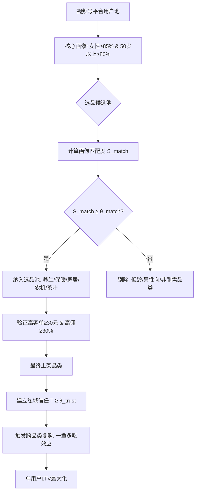
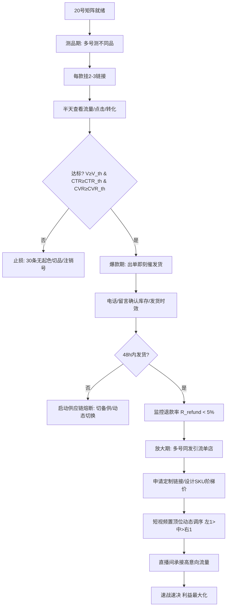
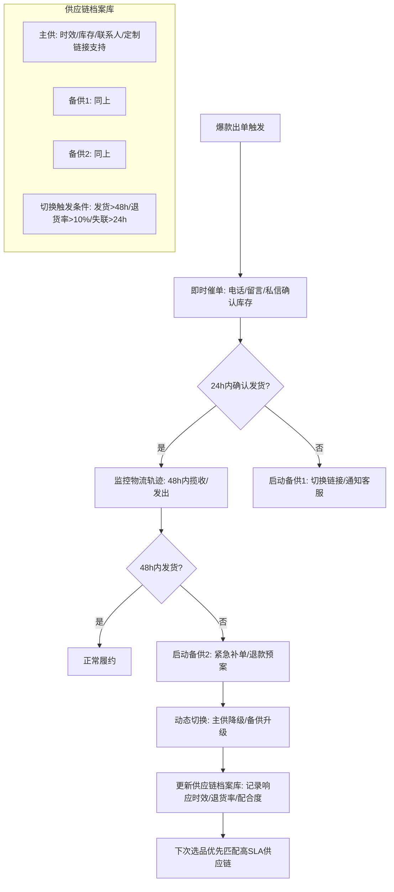
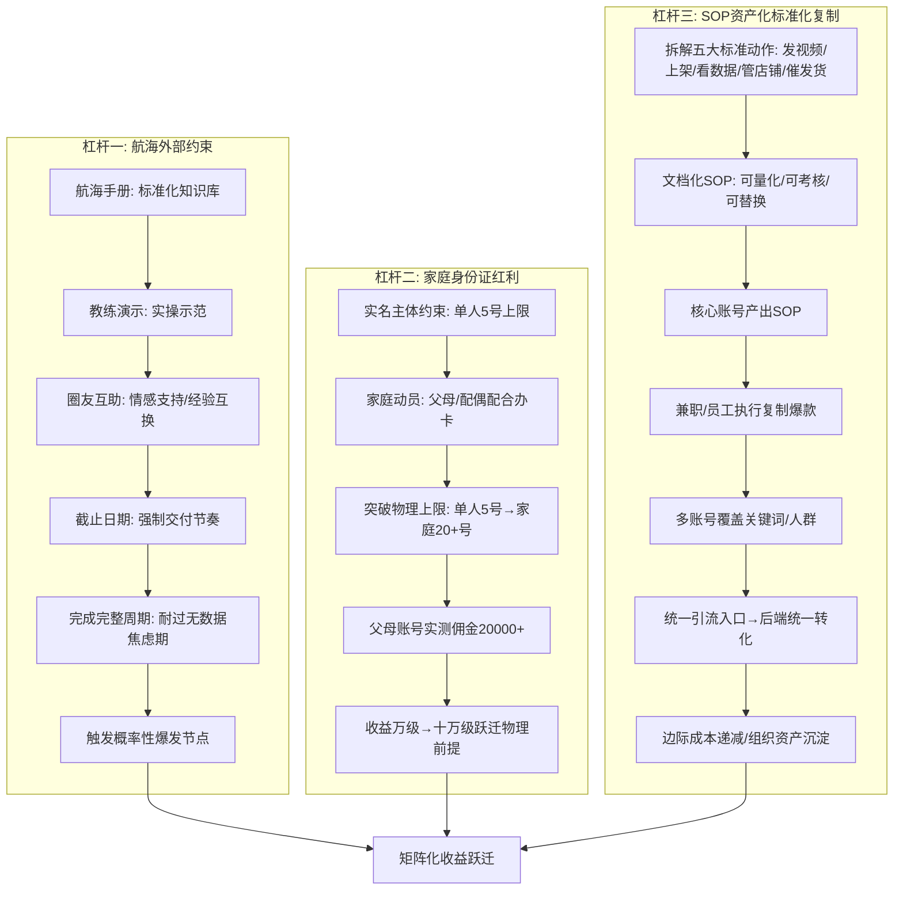

# 第 27 章 视频号短视频带货矩阵化实操 —— 身份证合规搭建、物理隔离硬件方案、测品爆款放大与供应链熔断机制
作者：龙哥

## 学习目标

- 掌握视频号银发女性用户画像与高客单选品逻辑
- 建立一证五号身份证合规矩阵模型与物理隔离硬件方案
- 执行测品-爆款-放大三阶段数据驱动决策标准化流程
- 实施爆款定制链接与SKU阶梯定价策略提升客单价
- 构建短视频引流+直播承接的分层转化模型
- 遵守店铺体验分风控红线与偏远地区不发货设置
- 建立供应链熔断机制：多店铺备选+即时催单+动态切换
- 将带货拆解为发视频/上架/看数据/管店铺/催发货五大标准动作实现SOP资产化

## 27.1 生活类比

想象视频号带货矩阵化是一场**“连锁便利店加盟”工程**：

- **选品** = 不用自己进货，去“批发市场”(选品广场/榜单)挑已验证的“畅销款”(高客单/高利润/高佣金)
- **账号矩阵** = 用全家身份证(一证五号)开“分店”，统一“总部SOP”(标准动作/硬件标配/账号编号)，物理隔离(一机一号)防关联
- **测品-爆款-放大** = “试营业→正式开业→连锁复制”：多店试菜单(测品)→出单即督导发货(爆款)→爆款统一装修/定制菜单/多店同推(放大)
- **供应链熔断** = 建“中央厨房备选库”：主供断货即切备供/48小时出餐红线/实时监控/动态切换，保“爆款不断供”
- **风控红线** = “卫生评分生存线”：店分<4分强制关店/偏远不送外卖/物流分不拖后腿

就像开连锁加盟：总部统一选品/装修/SOP(矩阵标准化)，加盟商用自家证照(身份证矩阵)，中央厨房多备选防断供(供应链熔断)，卫生分数达标才能活(店铺体验分)，赚钱动作标准化复制N遍(SOP资产化)。

## 27.2 概念地图

视频号短视频带货矩阵化体系
├── 用户画像与选品策略
│   ├── 银发女性高客单画像：女性≥85%、50岁以上≥80%  —— P024、P028、I8BLdIIfbobzkYxCLGBctYqbnae
│   └── 养生/保暖/家居等中老年高频刚需品类聚焦  —— P024、P028、I8BLdIIfbobzkYxCLGBctYqbnae
├── 账号矩阵合规与物理隔离
│   ├── 一证五号身份证矩阵模型：主号管子号/同绑一卡/物理隔离分组  —— P024、P028、RhRywNqifi3wjGkc4MacUiwXnxc
│   └── 安卓双开硬件方案：红米Note 11T/1机10号/编号台账/定期保号  —— P024、P028、RhRywNqifi3wjGkc4MacUiwXnxc
├── 三阶段数据驱动决策法
│   ├── 测品期：多号测不同品/挂2-3链接/半天看流量  —— P024、P028、AxQ8duaITowcrCx54hocWSy4nnb
│   ├── 爆款期：出单即刻催发货/2天发货红线/监控退款率  —— P024、P028、AxQ8duaITowcrCx54hocWSy4nnb
│   └── 放大期：多号同发引流单店/定制链接/SKU/短视频+直播转化  —— P024、P028、AxQ8duaITowcrCx54hocWSy4nnb
├── 爆款转化优化策略
│   ├── 定制链接与SKU阶梯定价：专属链接/1份29.9-2份49.9/多规格组合  —— P024、P028、I8BLdIIfbobzkYxCLGBctYqbnae
│   ├── 短视频引流+直播承接：短视频获流/直播提升转化/置顶位权重调序  —— P024、P028、I8BLdIIfbobzkYxCLGBctYqbnae
│   └── 橱窗动态排序与长尾搭配：顶部2-3爆款/高客单高佣高销量长尾  —— P024、P028、I8BLdIIfbobzkYxCLGBctYqbnae
├── 风控红线与供应链熔断
│   ├── 店铺体验分生存线：新店4.5分/4分隐形下架/合作门槛≥4.2分  —— P024、P028、P034
│   ├── 偏远地区不发货设置规避物流纠纷  —— P024、P028、P034
│   └── 供应链熔断机制：48小时发货红线/多店铺备选/即时催单/动态切换  —— P024、P028、P034、I8BLdIIfbobzkYxCLGBctYqbnae
├── 执行力与组织放大杠杆
│   ├── 航海机制外部约束：手册/教练/圈友/截止日期  —— P024、P028
│   ├── 家庭支持解锁身份证红利：单人5号→家庭20+号  —— P024、P028、I8BLdIIfbobzkYxCLGBctYqbnae
│   └── 流程化标准化SOP：五大标准动作文档化/账号编号/硬件标配  —— P024、P028、AxQ8duaITowcrCx54hocWSy4nnb
└── 实战爆发案例与惨痛教训
├── 单账号爆发系列：羽绒服/湿巾/茶壶/养生茶/舅舅账号/父母账号  —— P024、P028
├── 茶壶供应链失联：实发率1/3/切换5-6家仍损失数千佣金  —— P024、P028、I8BLdIIfbobzkYxCLGBctYqbnae
├── 店铺分<4分隐形惩罚：爆款下架/佣金归零  —— P024、P028、P034
└── 账号管理物理解决：贴纸标记/电子表格/流水编号A1-A5  —— P024、P028、RhRywNqifi3wjGkc4MacUiwXnxc

## 27.3 视频号用户画像与选品锚点 —— 银发女性高客单决定品类天花板

### 核心洞察

视频号带货的核心流量池具有极其鲜明的结构性特征：**女性占比 ≥ 85%，50 岁以上占比 ≥ 80%**。这是平台算法与用户生态决定的，不可逆转。你必须把这个画像刻在脑子里，因为它直接决定了你的选品边界——必须聚焦养生、保暖、家居等中老年高频刚需品类。偏离画像，就是在浪费流量。

> "视频号用户女性偏多，年龄偏大；如图 女性占 ≥85%，50 岁以上占比 ≥80%。"
> 
> ——《P024, P028, I8BLdIIfbobzkYxCLGBctYqbnae》

高客单价（≥30 元）、高佣金率（≥30%）是覆盖付费流量成本、实现 ROI 正向的硬性门槛。这不是建议，是生存线。

#### 数学建模：用户画像稳定性与选品匹配度

设视频号用户群体 $U$ 具有性别分布 $G$ 和年龄分布 $A$。实测数据表明：

$$
\begin{cases}
P(\text{女性} | U) \geq 0.85 \\
P(\text{年龄} \geq 50 | U) \geq 0.80
\end{cases}
$$

定义选品集合 $P = \{p_1, p_2, ..., p_n\}$，每个商品 $p_i$ 具有目标人群匹配度函数 $M(p_i, U)$。由于视频号依托微信社交图谱，**人群标签粘性 $\sigma_{people}$ 远高于兴趣标签粘性 $\sigma_{interest}$**，即：

$$
\sigma_{people} \gg \sigma_{interest}
$$

这意味着一旦建立信任关系 $T(u, seller) \geq \theta_{trust}$，同人群属性下的跨品类转化概率显著提升：

$$
P(\text{购买 } p_j | \text{已购 } p_i, T \geq \theta_{trust}) \gg P(\text{购买 } p_j | \text{未建立信任})
$$

这就是“一鱼多吃”效应的数学本质：橘子海实测农机卖得动，果树苗木、日用品也能卖动（$P024, I8BLdIIfbobzkYxCLGBctYqbnae$）。

#### 选品边界的量化判定

对于候选品类 $C$，定义画像匹配度得分：

$$
S_{match}(C) = \sum_{u \in U_{target}} w_u \cdot \mathbb{1}[u \text{ 需求 } C]
$$

其中 $U_{target} = \{u \in U : \text{性别=女性} \land \text{年龄} \geq 50\}$，$w_u$ 为购买力权重。仅当 $S_{match}(C) \geq \theta_{match}$ 时才进入选品池。实测验证：养生/保暖/家居/农机/茶叶等品类 $S_{match}$ 极高；男明星同款等低龄品类 $S_{match} \approx 0$。

---

### 关键性质

**画像稳定性强**：视频号依托微信社交图谱，人群标签粘性远高于兴趣标签。一旦你在私域建立了信任，就能实现“一鱼多吃”——卖得动 A 品类，同人群属性下的 B 品类必然能卖动。橘子海实测：农机卖得动，果树苗木、日用品也能卖。

**非标品/高客单优势**：中老年用户对“真实/产地/人情”信任度高，适合非标高毛利产品（如农机/茶叶/养生茶），无需专业直播话术。

#### 方法演进图：用户画像驱动选品决策流程



---

### 典型案例

东哥实测：羽绒服/湿巾/茶壶/养生茶/舅舅新品/父母账号，均为中老年高频刚需，验证画像选品有效性。橘子海案例：茶叶/农机等非标品，通过“真心实意”展示产地实况+私域服务，实现高客单/高复购。

### 边界条件

- 避开低龄粉丝品类（如男明星同款）：粉丝多为 18 岁以下无购买力，转化率极低。
- 红海标品竞争：账号规模大时（400+ 店）蓝海容量不足，需转战红海通过店群规模化建壁垒。

---

## 27.4 身份证矩阵合规与物理隔离硬件体系 —— 一证五号主号管子号，安卓双开单人管20号

### 核心定义

**一证五号合规模型**：基于微信实名规则，主号（A1）绑定运营者管理子号（A2-A5），5 号同绑一张银行卡；A/B/C 组不同人员账号物理隔离、不互绑，规避关联封禁。

> "一个身份证可以办 5 个号...其中 A2 - A5 的运营者绑定为 A1...5 个号绑定同个银行卡。A，B，C 几个人的账号各自分开不要互绑，安全第一。"
> 
> ——《P024, P028, RhRywNqifi3wjGkc4MacUiwXnxc》

**安卓双开硬件标准**：1 机 10 号，推荐红米 Note 11T 8+128G（~1700 元）保障流畅度；账号编号体系（A1-A5）+ 手写台账 + 定期拨号保号。

#### 数学建模：账号矩阵扩张上限与物理隔离成本函数

设单人身份证上限为 $N_{id} = 5$（一证五号），家庭成员数 $K$，则理论账号上限：

$$
N_{max} = K \times N_{id}
$$

东哥实测 $K=3$（父母+自己），$N_{max} = 15$，实际运营 20+ 号（含额外身份证资源），验证模型有效性。

硬件成本函数：安卓双开 1 机 10 号，手机单价 $C_{phone} \approx 1700$ 元（红米 Note 11T 8+128G），所需手机数：

$$
N_{phone} = \lceil N_{actual} / 10 \rceil
$$

$N_{actual}=20$ 时，$N_{phone}=3$，总硬件投入 $C_{total} = 3 \times 1700 = 5100$ 元，边际成本极低。

物理隔离的安全性收益函数：设群控/云手机/电脑端批量操作触发风控概率为 $P_{risk}^{batch} \approx 0.8$（经验值），一机一号物理隔离触发风控概率 $P_{risk}^{physical} \approx 0.02$。安全性收益：

$$
\Delta S = \frac{P_{risk}^{batch} - P_{risk}^{physical}}{P_{risk}^{batch}} \approx 97.5\%
$$

这证明物理隔离是“生存底线”而非“优化项”。

#### 方法演进图：账号矩阵合规搭建与物理隔离标准化流程

```mermaid
flowchart TD
    A[家庭身份证资源 K人] --> B[按组分配: A组/B组/C组]
    B --> C[每组主号A1/B1/C1绑定运营者身份]
    C --> D[子号A2-A5授权主号管理]
    D --> E[每组5号同绑1张银行卡]
    E --> F[物理隔离: A/B/C组设备/网络/操作完全分离]
    F --> G[硬件标配: 红米Note 11T 8+128G x ceil(N/10)]
    G --> H[账号编号体系: A1-A5/B1-B5/C1-C5]
    H --> I[管理台账: 贴纸标记+电子表格+流水编号]
    I --> J[养号SOP: 新号2-3天模拟真人行为]
    J --> K[保号机制: 半月一拨电话防停机]
    K --> L[矩阵就绪: 单人管20+号安全高效]
```

---

### 关键性质

**合规性即安全性**：严格利用平台官方规则与功能边界操作（一证五号/同绑一卡/物理隔离），实现“100%安全”的账号存活。小红书同行阿豪验证：“目前都是手机发、一机一号”，规避了群控/云手机/电脑端批量操作触发的风控。

**单人物理上限突破**：家庭支持（如母亲克服晕车办卡）可解锁“身份证红利”，将单人 5 号上限突破为家庭 20+ 号矩阵，是收益万级向十万级跃迁的物理前提。

**低成本管理工程化**：贴纸标记手机背面 + 电子表格台账 + 流水式编号 A1-A5，经验证可支撑 20+ 账号单人高效运营。

### 典型案例

东哥实操：3 部红米 Note 11T 支撑 20+ 账号，母亲克服晕车去县城办卡、父亲办卡，父母账号合计佣金 20000+。圈友反馈：6 个号忘记手机对应，作者给出“贴纸+台账+编号”组合拳低成本解决。

### 边界条件

- 避免使用曾卖过货的旧设备（历史污染导致流量受损），切记踩坑实证。
- 电脑端/云手机/群控工具批量操作易触发风控，亲测“一机一号”为最优解。

---

## 27.5 测品-爆款-放大三阶段数据驱动决策法 —— 概率博弈转确定性工程

### 核心逻辑

小红书阿豪揭示了底层规律：**“博概率”**。单条内容能否爆发具有高度不确定性，唯有矩阵化（N 账号 × M 内容）将概率转化为大数定律的确定性收益。东哥在视频号上将这套逻辑标准化为三阶段：

| 阶段 | 核心动作 | 量化阈值 | 来源 |
|------|----------|----------|------|
| **测品期** | 多账号测不同品，视频挂 2-3 链接 | 半天看流量；头部团队日测 70-100 品 | P024、P028、AxQ8duaITowcrCx54hocWSy4nnb |
| **爆款期** | 出单后即刻电话/留言催发货 | 2 天内发货红线，监控退款率 | P024、P028、AxQ8duaITowcrCx54hocWSy4nnb |
| **放大期** | 发现爆款后多号同发引流单店 | 定制链接/SKU/短视频+直播转化 | P024、P028、AxQ8duaITowcrCx54hocWSy4nnb |

> "开始各账号测不同产品，发布视频时就要选择产品上架 2-3 个链接。至少每半天查看一下各账号流量。重点在出了 1-2 单后要立刻跟 2-3 家店铺留言及电话确认货源充足及发货速度问题...延迟 3-5 天发货很容易退款退单。发现爆款后多个账号测同款产品，短视频引流到橱窗同个店铺抓紧时间抢钱，打仗速战速决利益最大化。"
> 
> ——《P024, P028, AxQ8duaITowcrCx54hocWSy4nnb》

#### 数学建模：博概率的大数定律转化与三阶段决策阈值

设单账号单内容爆发概率为 $p \ll 1$（典型值 $p \sim 0.01-0.05$），单账号发布 $M$ 条内容，爆发次数 $X \sim Binomial(M, p)$。单账号方差极大：

$$
Var(X) = M p (1-p) \approx M p
$$

矩阵化 $N$ 账号，总爆发次数 $Y = \sum_{i=1}^N X_i$，期望与方差：

$$
\mathbb{E}[Y] = N M p, \quad Var(Y) = N M p (1-p)
$$

变异系数 $CV = \frac{\sqrt{Var(Y)}}{\mathbb{E}[Y]} = \frac{1}{\sqrt{N M p}}$。随着 $N$ 增大，$CV \to 0$，**概率问题转化为确定性工程**。

**测品期阈值**：半天查看流量，设流量阈值 $V_{th}$、点击率阈值 $CTR_{th}$、转化率阈值 $CVR_{th}$。仅当 $V \geq V_{th} \land CTR \geq CTR_{th} \land CVR \geq CVR_{th}$ 时判定“通过测品”。

**爆款期发货 SLA**：设发货时效 $T_{ship}$，退款率 $R_{refund}$。实测规律：

$$
R_{refund}(T_{ship}) = 
\begin{cases}
< 0.05, & T_{ship} \leq 48h \\
> 0.30, & T_{ship} > 72h
\end{cases}
$$

因此设定硬性红线：$T_{ship}^{max} = 48h$。出单即刻催发货，最小化 $T_{ship}$。

**止损线数学逻辑**：单品 30 条笔记无起色止损。设单内容爆发概率 $p$，30 条均不爆概率 $(1-p)^{30}$。若 $p=0.05$，则 $(0.95)^{30} \approx 0.21$；若 $p=0.02$，则 $(0.98)^{30} \approx 0.55$。30 条是“在可接受试错成本内，若仍无信号则后验概率极低”的贝叶斯决策边界。

#### 方法演进图：测品-爆款-放大三阶段标准化决策流程



---

### 关键性质

**数据驱动替代主观**：半天看流量/出单即催发货/30 条止损线，均为量化阈值而非凭感觉。阿豪强调：“如果一个号单品你发了 30 个笔记以上，还没有什么进展，我建议就直接注销账号重新换品搞吧。”

**供应链响应速度决定变现上限**：48 小时发货是物流分红线，延迟 3-5 天必引发退款；店铺沟通不畅会导致“到手鸭子飞了”（茶壶案例损失数千佣金）。

**爆款定制链接解决决策瘫痪**：SKU 过多导致用户选择困难，定制专属链接可控主图/SKU/价格，阶梯价（1 份 29.9/2 份 49.9）提升客单价与转化率。

> "爆款产品让店铺定制链接，主图，SKU，详情页，价格等都可以修改，这样可以促进出单以及提升客单价。SKU 太多太乱影响下单；另外价格上 1 份 29.9 元，2 份 49.9 元；客户更容易买 2 单或更多。定制 SKU 有 5 个：2 罐，3 罐，4 罐，1 罐，茶花三件套*1 份；茶花三件套*2 份；价格 30-180 都有"
> 
> ——《P024, P028, I8BLdIIfbobzkYxCLGBctYqbnae》

### 典型案例

- **茶壶案例**：次日出 30 单，持续 1.5 月单账号 6800 元，但因供应链失联实发率 1/3、切换 5-6 家备选仍损失数千佣金。
- **养生茶案例**：70+ 单佣金 2300+，定制 5 SKU 阶梯价验证提客单。
- **舅舅账号**：首日 10 万+ 播放、持续 2 月佣金 12000+。

### 边界条件

- 单号 30 条笔记止损线：博概率核心定律下，单账号方差极大，矩阵化将概率转确定性，焦虑单号不爆是认知偏差。
- 自然流高风险：连续十几个账号被限流彻底退出，投流具备稳定/可复制/可放大/不废号四大优势。

---

## 27.6 爆款转化优化策略 —— 定制链接、SKU阶梯价、短视频引流直播承接、橱窗动态排序

### 27.6.1 爆款定制链接与 SKU 阶梯定价

针对爆款商品，向商家定制专属链接（主图/SKU/详情/价格可控），采用“1 份 29.9，2 份 49.9”阶梯价及多规格组合（单罐/多罐/套装）提升客单价与转化率，解决 SKU 过多导致的决策瘫痪。

> "爆款产品让店铺定制链接，主图，SKU，详情页，价格等都可以修改，这样可以促进出单以及提升客单价。SKU 太多太乱影响下单；另外价格上 1 份 29.9 元，2 份 49.9 元；客户更容易买 2 单或更多。定制 SKU 有 5 个：2 罐，3 罐，4 罐，1 罐，茶花三件套*1 份；茶花三件套*2 份；价格 30-180 都有"
> 
> ——《P024, P028, I8BLdIIfbobzkYxCLGBctYqbnae》

这段话展示了定制链接的核心价值：**把商品从“货架上的众多选项”变成“为这个爆款视频量身定做的落地页”**，主图对应视频封面，SKU 精简为高转化组合，价格设计阶梯引导多件购买。

#### 数学建模：SKU 阶梯定价对客单价与转化率的提升效应

设原始 SKU 集合 $S_{orig} = \{s_1, s_2, ..., s_m\}$，$m$ 较大（如 10+），用户决策熵 $H_{orig} = \log_2 m$。定制后 SKU 集合 $S_{cust} = \{s'_1, ..., s'_5\}$，决策熵 $H_{cust} = \log_2 5 \approx 2.32$，决策复杂度降低约 $60\%$。

阶梯价格函数 $P(q)$，其中 $q$ 为购买数量：

$$
P(q) = 
\begin{cases}
29.9, & q = 1 \\
49.9, & q = 2 \\
\text{套装价}, & q \geq 3
\end{cases}
$$

边际单价 $P_{marginal}(q) = P(q)/q$ 显著下降：$P_{marginal}(1)=29.9$，$P_{marginal}(2)=24.95$，激励多件购买。实测客单价提升公式：

$$
AOV_{new} = \sum_{q} P(q) \cdot \pi(q) > AOV_{orig}
$$

其中 $\pi(q)$ 为购买数量分布，阶梯价将分布向 $q \geq 2$ 位移。

---

### 27.6.2 短视频引流 + 直播承接转化模型

流量分层运营策略：短视频负责低成本获取公域流量爆发，直播间承接高意向流量提升转化率。

> "短视频搞流量，直播提升转化。当视频爆了，是可以有 3 个置顶位的，置顶的视频会有更多流量，流量大小：左 1＞中间＞右 1。可以在后台根据视频数据做调整排序。在视频号助手【活动管理】创建 活动标题：关注头像商品橱窗下单...引导客户去橱窗下单。"
> 
> ——《P024, P028, I8BLdIIfbobzkYxCLGBctYqbnae》

这个模型揭示了**置顶位的权重递减特性（左1 > 中 > 右1）**，你需要根据实时数据动态调序，把转化最好的视频放在左1。配合橱窗活动标题“关注头像商品橱窗下单”引导下单，形成“视频种草 → 直播拔草 → 橱窗复购”闭环。

#### 方法演进图：短视频引流直播承接分层转化模型

```mermaid
flowchart LR
    subgraph 公域流量获取
        A[短视频发布] --> B[算法推荐池]
        B --> C[爆款视频识别: 播放/完播/互动阈值]
    end
    
    subgraph 置顶位权重调序
        C --> D[三个置顶位: 左1 中 右1]
        D --> E[权重递减: W_left1 > W_mid > W_right1]
        E --> F[实时数据动态调序: 转化最佳→左1]
    end
    
    subgraph 转化承接层
        F --> G[短视频种草: 低成本获公域流量]
        G --> H[直播间承接: 高意向流量提升转化]
        H --> I[橱窗活动标题: 关注头像商品橱窗下单]
        I --> J[私域沉淀/复购]
    end
    
    subgraph 长尾变现
        J --> K[橱窗动态排序]
        K --> L[顶部2-3爆款承接主流量]
        L --> M[长尾高客单/高佣/高销量品承接溢出流量]
        M --> N[单用户价值最大化]
    end
```



---

### 27.6.3 橱窗动态排序与长尾搭配运营法

橱窗顶部保留 2-3 个爆款供选择；叠加高客单（≥30 元）、高佣（≥30%）、高销量（>100 单）的畅销品作为长尾，利用爆款流量溢出带动长尾成交，最大化单用户价值。

> "橱窗里面根据出单情况产品排序。顶部爆款产品有 2-3 个供客户选择。另外橱窗里面再添加一些客单价≥30 元，佣金比率 ≥30%，销量过百的畅销品，也会有出单。"
> 
> ——《P024, P028, I8BLdIIfbobzkYxCLGBctYqbnae》

这个策略的本质是**流量分级变现**：爆款承接主流量，长尾承接溢出流量，两者互补。

---

## 27.7 风控红线与供应链熔断机制 —— 4.2分生存线、48小时发货红线、多级备选动态切换

### 27.7.1 店铺体验分生存阈值

视频号店铺三大体验分（商品/服务/物流）的生存阈值：**新店初始 4.5 分，低于 4 分触发隐藏下架，合作门槛建议 ≥ 4.2 分**。物流分易因偏远地区发货纠纷拉低，必须预设不发货区域（港澳台/偏远省份）。

> "现在视频号新开店铺的评分一般是 4.5 分...低于 4 分的店铺，很容易被平台隐藏下架...尽量选择店铺分数高（≥4.2 分），以及物流分数高的店铺进行合作。建议有店铺的小伙伴，在店铺后设置偏远地区/港澳台地区等不发货"
> 
> ——《P024, P028, P034》

实测验证：2-3 款产品因合作店铺分数过低被平台下架/隐藏，爆款流量无法转化、佣金直接归零，证明“店铺分 ≥ 4.2”为硬性准入指标。

#### 数学建模：店铺体验分加权计算与物流分敏感性分析

设店铺综合体验分 $D_{total}$ 为三维加权：

$$
D_{total} = w_1 D_{product} + w_2 D_{service} + w_3 D_{logistics}
$$

典型权重 $w_1=0.3, w_2=0.2, w_3=0.5$（物流权重最高）。物流分 $D_{logistics}$ 受偏远地区退货率 $R_{remote}$ 显著影响：

$$
D_{logistics} = D_{base} - \alpha \cdot R_{remote}
$$

其中 $\alpha$ 为敏感度系数。预设不发货区域后 $R_{remote} \to 0$，$D_{logistics} \approx D_{base}$。实测：未设不发货区时物流分易跌破 4.6，触发连锁下架风险。

**合作门槛判定函数**：

$$
\text{IsEligible}(shop) = \mathbb{1}[D_{total} \geq 4.2 \land D_{logistics} \geq 4.6 \land \text{无违规记录}]
$$

---

### 27.7.2 供应链熔断三板斧

| 板斧 | 核心动作 | 实战验证 |
|------|----------|----------|
| **多店铺备选** | 建立“主供/备供1/备供2”三级档案（发货时效/库存同步/联系人/切换触发条件） | 茶壶案例切换 5-6 家仍损失数千佣金，证明单一依赖风险极高 |
| **即时催单** | 出单后立刻电话/留言跟进发货时效，每天多次催促 | 东哥“我每天去这个店铺的多账号下私信、留言，留下电话” |
| **动态切换** | 发货延迟/退货率超标即启动切换，建立供应链响应速度 SLA | 将“催发货”优先级设定高于“发视频” |

> "出单了，千万要立刻跟店铺确认并跟踪发货时效问题。避免爆单后迟迟无法发货，最终需要售后处理等情况发生。我每天去这个店铺的多账号下私信、留言，留下电话却杳无音讯。最后这 30 多单仅发货了 1/3 ，到手的鸭子飞了。累计切换了 5-6 家店铺。而因为店铺联系不上，延迟发货，疫情退货等原因，我还是损失了几千元的佣金。"
> 
> ——《P024, P028, P034, I8BLdIIfbobzkYxCLGBctYqbnae》

这段惨痛教训告诉我们：**催发货优先级 > 发视频**。爆发期内，发货时效是核心变量，必须建立“多店铺备选+即时催单+动态切换”的供应链熔断机制。

#### 方法演进图：供应链熔断三板斧标准化执行流程



---

### 27.7.3 边界条件

- 315 等节点主动下架商品链接避险：平台集中打击虚拟类目，保全大店存活，风波过后再上架。
- 个体户执照注册👸号推流受限：社群共识个体工商户营业执照注册👸号存在不给推流/效果差风险，建议新手优先用个人身份证注册。

---

## 27.8 执行力复利与组织化放大 —— 航海外部约束、家庭身份证杠杆、SOP资产化、标准化复制

### 27.8.1 执行力是跑通 0-1 必要条件

唯有完成完整航海周期、耐过“无数据”焦虑期、持续复盘迭代，才能触发概率性爆发节点（如 12 月 7 日单日 3800 元销售额）。

> "如果 12 月那次没有决定再尝试一次，没有坚持完整个航海，后面的结果和放大或许都不会发生，有时候真的就差坚持这一会…找准方向了，要在同一个航海项目多次参加。这样可以跟着圈友在一起互帮互助，拼着一股热情不断的持续突破"
> 
> ——《P024, P028》

航海提供“手册+教练演示+圈友互助+截止日期”外部结构，将模糊意愿转化为确定性行动。东哥参加 4 次视频号航海（6/8/12 月、2 月），仅 12 月完整跑完并爆发。

### 27.8.2 家庭支持是放大规模关键杠杆

账号矩阵扩张受限于实名主体（身份证/银行卡），家人配合（母亲克服晕车去县城办卡）解锁“身份证红利”，将单人 5 号上限突破为家庭 20+ 号。

> "测出爆款手中缺少账号怎么办？我赶紧跑回去，用我妈妈的证件办了 5 个号，后来又用我爸爸的证件办了几个号，全部都用上，目前父母账号合计佣金 20000+。我妈妈其实坐车晕车的，后来还是开车去了县城，办好了银行卡绑定手机号，真的是给了我很大的支持"
> 
> ——《P024, P028, I8BLdIIfbobzkYxCLGBctYqbnae》

父母账号合计佣金 20000+，验证家庭矩阵可行性与高收益贡献。

### 27.8.3 流程化标准化是收益复利唯一路径

将带货拆解为“发视频、上架、看数据、管店铺、催发货”五大标准动作，通过账号编号/硬件标配/SOP 文档化实现工程化复制。

> "跑通流程，优化细节，多账号，流程化，赚钱的事多做十遍。把自己所有的账号进行编号，可以进一步提高效率，也方便管理。"
> 
> ——《P024, P028, AxQ8duaITowcrCx54hocWSy4nnb》

**标准化 SOP 是矩阵横向复制的必要充分条件**：核心账号产出 SOP → 兼职/员工执行“复制爆款”标准化动作 → 多账号覆盖关键词/人群 → 统一引流入口 → 后端统一转化。

#### 数学建模：SOP 标准化对边际成本的降维打击

设单账号运营成本函数 $C(n)$，其中 $n$ 为账号数。无 SOP 时，边际成本 $MC_{noSOP} = \frac{dC}{dn} \approx C_{base}$（线性增长，每个号都需独立决策）。有 SOP 后，核心决策固化为标准动作，边际成本：

$$
MC_{SOP} = \frac{dC}{dn} = C_{exec} \ll C_{base}
$$

其中 $C_{exec}$ 仅为执行层人力成本。规模化收益函数：

$$
Profit(N) = N \cdot \mu_{revenue} - (C_{fixed} + N \cdot C_{exec})
$$

当 $N \to \infty$，平均成本 $AC \to C_{exec}$，利润率趋于 $\frac{\mu_{revenue} - C_{exec}}{\mu_{revenue}}$。这解释了“赚钱的事多做十遍”从口号变为可执行工程问题的数学本质。

#### 方法演进图：执行力复利与组织化放大三大杠杆



---

### 27.8.4 矩阵核心价值非账号数量

而是：
- 流量内部循环最大化
- 大带小
- 单广位多账号售卖提高广告单价
- 运营 SOP 标准化复制降低边际成本
- 分散封号风险保障资产安全

### 27.8.5 实战验证

单账号爆发系列：
- 羽绒服/湿巾：400 单/3000 佣金
- 茶壶：6800 佣金但供应链损失数千
- 养生茶：70+ 单/2300 佣金/5 SKU
- 舅舅账号：首日 10 万+ 播放/2 月 12000 佣金
- 父母账号：合计 20000+ 佣金

账号管理物理解决：贴纸标记手机背面 + 电子表格台账 + 流水编号 A1-A5，支撑 20+ 账号单人高效运营。

---

## 27.9 多源对照

### 共识

视频号、小红书、抖音三大平台带货的底层逻辑高度同构，均遵循**“博概率”**核心定律：单账号单内容爆发具有高度不确定性，方差极大，唯有通过矩阵化（N 账号 × M 内容）增加试错次数，将概率问题转化为大数定律的确定性收益。P024、P028、RhRywNqifi3wjGkc4MacUiwXnxc 均独立验证了这一规律，并一致认为焦虑单号不爆是认知偏差，30 条笔记止损线是理性决策边界。

**物理隔离是账号安全底线**：P024、P028、RhRywNqifi3wjGkc4MacUiwXnxc 均实测验证“一机一号/手机端发布”规避群控风控，拒绝电脑端/云手机批量操作。阿豪明确表示“目前都是手机发、一机一号”，东哥配置 3 部红米 Note 11T 支撑 20+ 号，职称赛道实操者同样主张“同一个设备不要频繁切换账号”，三方实证形成铁律。

**供应链响应速度决定爆款变现上限**：P024、I8BLdIIfbobzkYxCLGBctYqbnae、AxQ8duaITowcrCx54hocWSy4nnb 均强调 48 小时发货红线与多级备选机制。东哥茶壶案例因供应链失联实发率 1/3、切换 5-6 家仍损失数千佣金；纸壳投流体系建立“关停止损公式”与“黄金时间窗”量化供应链配合度；橘子海观测到日出 10 单为供应链主动上门临界点。三源共振证明：催发货优先级 > 发视频，变现优先于获流。

**SOP 标准化是规模化前提**：P024、P028、RhRywNqifi3wjGkc4MacUiwXnxc 均主张将全流程固化为可量化、可考核、可替换的标准动作。东哥“发视频/上架/看数据/管店铺/催发货”五大动作；阿豪“5+5 组合拳/30 条止损/ROI 分级投放”；职称赛道“养号/复制爆款/AI 改写/SEO 布局/双轨引流”全链路 SOP。标准化是个人经验转化为组织资产的必要充分条件。

### 分歧

| 维度 | P024（东哥/视频号） | P028（阿豪/小红书） | AxQ8duaITowcrCx54hocWSy4nnb（纸壳/视频号投流） |
|------|----------------------|----------------------|--------------------------------------------------|
| **核心玩法** | 自然流为主+短视频挂车，矩阵测品 | 自然流为主+5+5内容电商组合拳，SEO蓝海词 | 纯付费投流（短视频挂车投流），不依赖自然流 |
| **测品逻辑** | 多号测不同品，半天看流量 | 纯内容视频测款不挂车，测出爆款模板再挂车+直播 | 双阶段测品：1测验品（1000豆/6h）、2测探价（2000豆/阶梯出价） |
| **爆款放大** | 多号同发引流单店+定制链接+直播承接 | 每日5+5组合拳+直播上下划流量矫正标签+ROI分级投流 | 高客单走“大额+卡赔付”，低客单走“小额叠投+勤关停” |
| **选品策略** | 银发女性画像锚定养生/保暖/家居 | 跨品类“跟品”：多刷+三方工具查榜单，反对主观选品 | 三维选品：拼多多榜单+蝉妈妈数据+同行爆品跟投（爆率最高） |
| **风控红线** | 店铺体验分≥4.2、偏远不发货、48h发货 | 账号物理隔离、企业号抗风险、30条笔记止损 | 0粉挂车取消/投放门槛提高反而利好专业团队 |

---

## 27.10 设计中的取舍

**为什么不用自然流而选付费投流/矩阵自然流？**

自然流在视频号、抖音、小红书均表现为：连续限流、账号易废、不可复制、不可放大。付费投流（视频号挂车/小红书聚光/抖音千川）底层逻辑不变——买流量、算 ROI、优化素材品，具备穿越周期的确定性。纸壳实测：“连续限流十几个账号后，彻底退出自然流玩法”，投流“稳定、可复制、可放大、不废号”，付费玩法是终极赛道。

**为什么要物理隔离（一机一号）而不用云手机/群控？**

云手机/群控/电脑端批量操作会触发平台设备指纹/IP/行为模式的关联判定，导致矩阵连坐封禁。物理隔离成本低（红米 Note 11T ~1700 元），安全性最高，是“生存底线”而非“优化项”。阿豪亲测“目前都是手机发、一机一号”，东哥 3 部手机管 20+ 号零封号，职称赛道同样验证“同一设备频繁切换会被检测”。

**为什么要定制链接而不直接用商家通用链接？**

通用链接 SKU 过多导致用户决策瘫痪、主图不匹配视频内容、价格无阶梯引导。定制链接把“货架”变成“落地页”，主图对应视频封面、SKU 精简为高转组合、价格设计阶梯引导多件购买，直接提升客单价与转化率。东哥养生茶案例：定制 5 SKU 阶梯价，客单价与转化率双提升；纸壳投流体系“SKU 套装化必须要有低价 SKU 承接千展和消耗”，同构逻辑。

**为什么“催发货”优先级高于“发视频”？**

爆发期内，发货时效是核心变量：48 小时内发货是物流分红线，延迟 3-5 天必引发退款；店铺沟通不畅会导致“到手鸭子飞了”（茶壶案例损失数千佣金）。视频决定流量上限，发货决定流量能否变现，**变现优先于获流**。东哥每天多账号私信留言留电话催单，纸壳投流体系建立“异常诊断决策树”包含发货监控，均为实战验证的优先级排序。

---

## 27.11 动手练习

### 练习 1：视频号账号矩阵合规搭建实战推演

假设你拥有 3 位家庭成员身份证（父母+自己），准备搭建视频号带货矩阵：

1. 设计账号编号体系：按 A/B/C 三组分配主号/子号编号（A1-A5/B1-B5/C1-C5），规划银行卡绑定策略（每组同绑一卡）
2. 硬件采购清单：按安卓双开 1 机 10 号标准，计算所需红米 Note 11T 8+128G 手机数量/成本预算，设计手机背面贴纸标记与电子表格台账结构
3. 养号与防关联 SOP：制定新号注册后 2-3 天模拟真人行为细则、一机一号物理隔离操作规范、手机号半月一拨保号流程

**回答问题：**
- 为什么主号必须绑定运营者身份而非家人身份？子号授权逻辑是什么？
- 若某手机故障导致该组 10 个号需紧急迁移，如何在不触发风控前提下完成设备更换？
- 银行卡同绑一卡是否会触发支付风控？实测有无异常？

### 练习 2：测品-爆款-放大三阶段决策沙盘演练

场景：你已搭建 20 号矩阵，准备切入“中老年养生茶”品类，请完成：

1. 测品期方案：20 号如何分配测不同款（每款挂 2-3 链接）？半天查看流量数据的标准化动作清单是什么？流量/点击/转化阈值如何设定判定“通过测品”？
2. 爆款期应急预案：某款养生茶次日出 30 单，立即执行“催发货”标准动作（电话/留言/确认库存/发货时效）；若店铺失联/延迟发货，启动供应链熔断切换 5-6 家备选店铺的具体操作步骤与沟通话术
3. 放大期矩阵协同：爆款验证后，20 号如何同发同款引流单店？定制链接申请流程/SKU 阶梯价设计（1 份/2 份/套装）/短视频置顶位轮换策略/直播间排班承接

**回答问题：**
- 为什么“催发货”优先级高于“发视频”？茶壶案例中供应链失联导致实发率 1/3、损失数千佣金的根因是什么？
- 单品 30 条笔记无起色则切品的止损线，背后的概率博弈数学逻辑是什么？
- 置顶视频左1>中>右1权重递减特性，如何根据实时数据动态调序最大化流量利用率？

### 练习 3：店铺体验分风控与供应链熔断实战演练

1. 体验分监控日报表设计：包含商品分/服务分/物流分/DSR/违规记录/偏远地区退货率，预警阈值（商品分<4.5/物流分<4.6/综合<4.2）与应急预案（换链接/停推/设不发货区）
2. 供应链档案库建立：为每个合作店铺建立档案（发货时效/库存同步方式/联系人/历史退款率/是否支持定制链接），设定“48小时发货红线”触发即时催单与动态切换条件
3. 茶壶案例复盘：模拟爆款期（30+ 单）店铺失联导致实发率 1/3，紧急切换 5-6 家备选仍因延迟/疫情退货损失数千佣金，输出“单一供应链依赖风险评估报告”与“多级备选+实时催单”改进方案

**回答问题：**
- 为什么新店初始 4.5 分却建议合作门槛 ≥ 4.2 分？物流分为何最易因偏远地区拖后腿？
- 供应链熔断机制中，“即时催单”与“动态切换”的时间窗口分别是多少？如何量化“催发货”的 ROI？
- 当平台收紧规则（如 0 粉挂车取消/投放门槛提高）时，标准化 SOP 团队为何反而受益？

---

## 27.12 本章小结

这一章中我们学习了视频号短视频带货矩阵化实操的完整体系。首先明确了**视频号银发女性用户画像（女性≥85%、50岁以上≥80%）**决定选品聚焦养生/保暖/家居等中老年刚需；其次建立了**一证五号身份证合规矩阵模型**与**安卓双开物理隔离硬件方案**（红米Note 11T/1机10号/编号台账），解决账号安全与规模化上限；接着标准化了**测品-爆款-放大三阶段数据驱动决策流程**（半天看流量/出单即催发货/30条止损/定制链接SKU阶梯价/短视频引流直播承接）；然后刻画了**店铺体验分风控红线（4.2分生存线/偏远不发货）**与**供应链熔断机制（48h发货/多级备选/即时催单/动态切换）**；最后揭示了**执行力复利的三大杠杆**：航海外部约束、家庭身份证红利、SOP资产化标准化复制，验证了“赚钱的事多做十遍”从口号变为可执行工程问题的完整路径。

本章我们一起学习了以下概念：

| 概念 | 解释 |
|------|------|
| 视频号用户画像 | 女性≥85%、50岁以上≥80%，核心流量池为中老年女性，决定选品聚焦养生/保暖/家居等高频刚需 |
| 身份证矩阵合规模型 | 基于微信一证五号规则，主号管子号、同绑一卡、物理隔离不同人员账号组，规避关联封禁 |
| 物理隔离硬件方案 | 安卓双开1机10号，红米Note 11T 8+128G(~1700元)，账号编号A1-A5+手写台账+定期拨号保号 |
| 测品-爆款-放大三阶段 | 多号测品半天看流量→出单即刻催发货(2天红线)→爆款多号同发定制链接/SKU/短视频引流+直播转化 |
| 爆款定制链接与SKU阶梯价 | 向商家定制专属链接可控主图/SKU/价格，采用1份29.9/2份49.9阶梯价及多规格组合提升客单价 |
| 短视频引流+直播承接 | 短视频低成本获公域流量爆发，直播间承接高意向流量提升转化，置顶位权重递减动态调序 |
| 店铺体验分风控红线 | 新店4.5分，<4分隐形下架，合作门槛≥4.2分，物流分易因偏远地区拉低需预设不发货区域 |
| 供应链熔断机制 | 48小时发货红线/多店铺备选/即时催单/动态切换，茶壶案例验证单一供应链依赖风险极高 |
| 家庭支持身份证红利 | 母亲克服晕车办卡解锁身份证红利，将单人5号上限突破为家庭20+号矩阵，是收益跃迁物理前提 |
| 流程化标准化SOP | 将发视频/上架/看数据/管店铺/催发货五大动作标准化文档化，使‘赚钱的事多做十遍’成为可执行工程问题 |
| 航海机制外部约束 | 提供手册/教练演示/圈友互助/截止日期外部结构，将模糊意愿转化为确定性行动，12月坚持完周期迎来拐点 |

