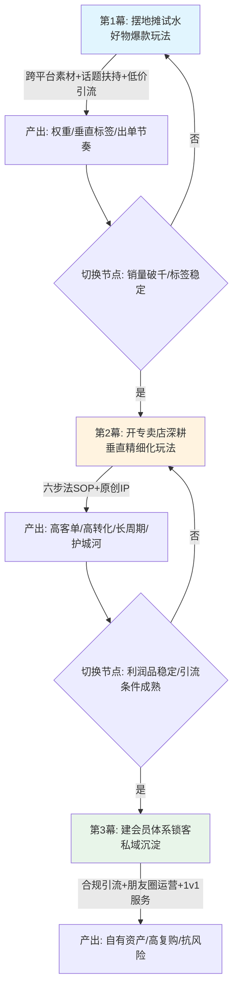
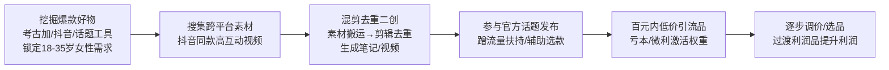
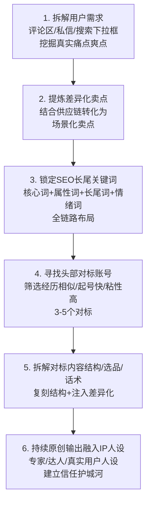
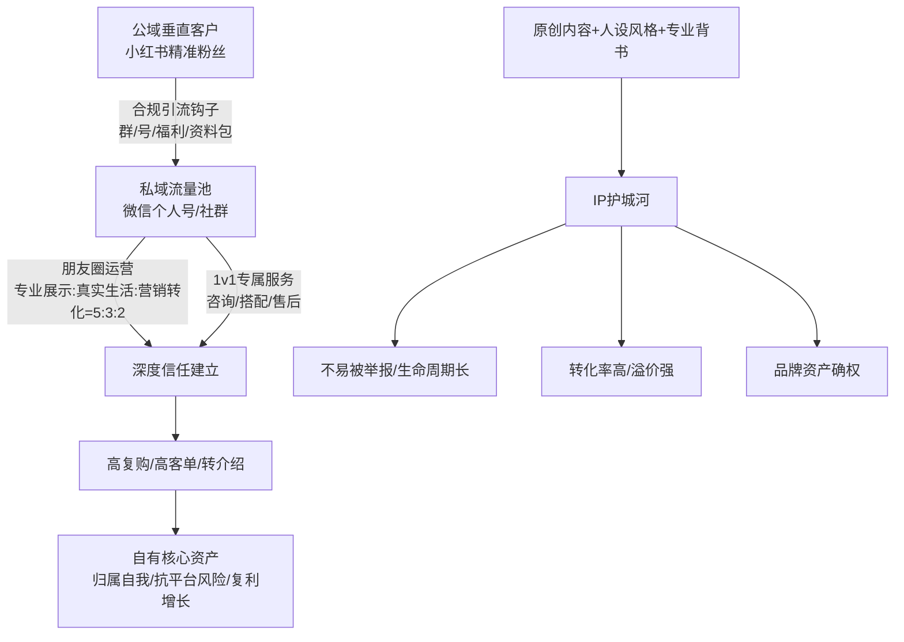
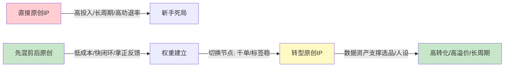
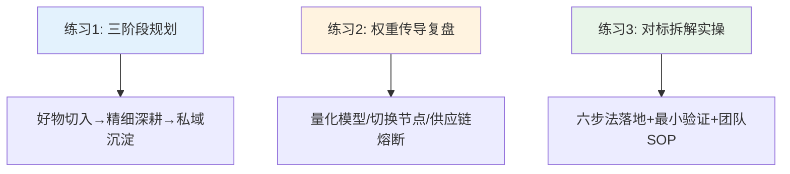

# 第 26 章 小红书电商双玩法阶梯 —— 以‘好物爆款’练权重，转‘垂直精细’沉淀私域
作者：龙哥

## 学习目标

- 理解小红书电商阶梯式运营路径：从爆款起量到精细深耕再到私域沉淀的三阶段逻辑
- 掌握好物爆款玩法的标准化操作流程：跨平台素材迁移、话题流量扶持、低价引流权重积累
- 掌握垂直精细化玩法六步法SOP：需求拆解、卖点提炼、关键词锁定、对标拆解、原创输出、IP人设打造
- 理解引流品-利润品阶梯定价模型：用亏本/微利引流品购买权重数据，再以高客单利润品收割收益
- 理解私域沉淀与IP护城河的长期价值：公域流量租赁 vs 私域资产自有，原创IP构建抗风险壁垒
- 能根据账号阶段与资源禀赋选择合适玩法：新手切好物、有供应链/内容能力切垂类、长期主义建私域

## 26.1 生活类比

想象小红书电商是一场“开实体店的三部曲”。第一幕是“摆地摊试水”，对应好物爆款玩法：不用装修、不用囤高档货、不用建品牌，直接去批发市场捡别人卖爆了的款（跨平台爆款素材），定个“亏本价/微利价”招揽人气（百元内引流品），赶上商业街搞活动送流量（官方话题扶持），目的只为练手、攒人气、摸清套路、占个好铺面（权重/垂直标签）。第二幕是“开专卖店深耕”，对应垂直精细化玩法：选定一个细分品类（如“显白耳饰专卖”），研究顾客真正要什么（拆解需求）、卖点是什么（提炼卖点），把招牌挂在顾客必经之路（SEO关键词布局），研究隔壁火店怎么卖（对标拆解），自己设计独家款（原创内容），立个“专业买手/搭配师”人设（IP人设），顾客信你才买单，目的在于高客单、高复购、抗风险、建护城河。第三幕是“建会员体系锁客”，对应私域沉淀：把进店顾客拉进微信群、加个微信（合规引流），朋友圈发新品/穿搭/福利，私聊提供专属服务，顾客复购、转介绍，生意不再靠商业街分流（平台算法），目的在于流量自有、复利增长、穿越周期。就像开店不能永远摆地摊，也不能一上来就搞旗舰店，小红书电商也要“先摆摊练手、再开店深耕、最后建会员锁客”，三步走、步步为营。



## 26.2 概念地图

```mermaid
mindmap
  root((小红书电商双玩法阶梯模型))
    阶段一：好物爆款玩法(低门槛、快出单、练权重)
      跨平台爆款素材迁移(抖音/考古加验证素材)
      官方话题流量扶持机制(参与即送曝光)
      混剪去重制作SOP(素材搬运→二创→发布)
      百元内低价引流品策略(激活权重/垂直标签/销量基数)
    阶段二：垂直精细化玩法(高客单、强IP、长周期)
      六步法标准化运营SOP
        1.拆解用户需求(评论区/私信/下拉框)
        2.提炼差异化卖点(显白/显瘦等场景化)
        3.锁定SEO长尾关键词(搜索流量复利)
        4.寻找头部对标账号(选品/文案/封面拆解)
        5.拆解对标内容结构与话术(复刻+注入差异化)
        6.持续原创输出融入IP人设(专家/达人/真实用户)
      SEO长尾复利>推荐流量脉冲(可持续半年以上)
      原创IP店铺抗举报/长周期/高转化/高溢价
    阶段三：私域沉淀(电商资产归属终局)
      公域垂直客户→私域(微信/社群)合规引流
      朋友圈运营/1v1服务建立深度信任→高复购/高客单
      私域客户池=自有资产，对冲平台算法/规则风险
    贯穿全程的核心模型
      账号权重与垂直度(流量分发基座)
      引流品-利润品阶梯定价(全周期利润最大化)
      IP人设/原创内容(差异化护城河)
      平台红利窗口期(话题扶持/低门槛/高ROI)
```

## 26.3 阶梯式运营路径 —— 从‘爆款起量’到‘精细深耕’再到‘私域沉淀’

### 为什么需要这个概念？

你在切入电商时，大概率会撞上三座大山：**选品难、权重低、不出单**。  
直接搞原创IP？投入大、周期长、容错率低，极易劝退。  
平台红利期（话题送流量、辅助选款）具有窗口期，必须分阶段捕获。

### 核心定义

> **阶梯式运营路径**（来源：《20230516_090.md》，片段 1、2、3、4）
> - **阶段一：好物爆款玩法**——利用平台话题扶持、混剪跨平台验证素材、百元内低价引流，快速建立账号权重与垂直标签、掌握出单节奏
> - **阶段二：垂直精细化玩法**——锁定细分赛道，拆解需求/提炼卖点/锁关键词/拆对标/持续原创/打造IP人设，实现高客单、高转化、长周期
> - **阶段三：私域沉淀**——将公域垂直客户引流至自有流量池，实现多次复购、资产归属自我、规避平台流量不确定性

### 方法演进图：三阶段递进与门槛跃迁

```mermaid
graph TD
    A[新手切入: 选品难/权重低/不出单] --> B[阶段一: 好物爆款玩法]
    B -->|核心动作: 跨平台素材迁移+话题扶持+低价引流| C[产出: 账号权重/垂直标签/出单节奏/运营经验]
    C --> D{切换节点: 累计销量破千/垂直标签稳定/粉丝画像清晰}
    D -->|是| E[阶段二: 垂直精细化玩法]
    D -->|否| B
    E -->|核心动作: 六步法SOP(需求/卖点/词/对标/拆解/原创+IP)| F[产出: 高客单/高转化/长周期/原创IP护城河]
    F --> G{切换节点: 利润品稳定出单/私域引流条件成熟}
    G -->|是| H[阶段三: 私域沉淀]
    G -->|否| E
    H -->|核心动作: 合规引流+朋友圈运营+1v1服务+高客单产品| I[产出: 自有流量资产/高复购复利/抗平台风险]
    
    style B fill:#e1f5fe
    style E fill:#fff3e0
    style H fill:#e8f5e9
```

### 关键性质

- **顺序不可逆**：权重积累是精细化运营的前置条件，私域沉淀是长期资产的终局。新手必须先通过好物玩法跑通商业闭环，积累权重与经验，才能支撑后续的精细化运营与私域建设。
- **门槛递增**：混剪起号仅需剪辑与选品判力（低门槛），原创IP要求选品、拍摄、文案、人设全链路能力（高门槛），私域运营则需内容生产、社群运营、售后服务等综合运营能力（最高门槛）。
- **收益曲线**：前期以低利润甚至亏本换取权重数据与垂直标签；中后期依托权重释放自然流量，承接高客单利润品实现利润跃迁；长期通过私域沉淀实现复购复利，穿越平台周期。

### 典型例子

**手机壳案例**：日出100+单、单利2-3元，前期亏本/微利激活权重，后期上新利润品月稳出几十单，完美印证“前期养权重、后期收利润”的阶梯逻辑。  
**饰品细分案例**：垂类耳饰/手镯，拆解“显白/显瘦”需求，原创IP内容+人设，转化率显著高于纯混剪店，验证了垂直精细化对转化率的提升作用。

### 边界条件

- 平台扶持政策窗口关闭后，好物玩法获流成本将上升，需及时转型。
- 纯混剪模式长期易被举报、侵权风险高，必须向原创IP过渡以构建护城河。
- 私域运营需具备内容生产、社群运营、售后服务等综合能力，非纯电商技能可覆盖，团队化运作是规模化前提。

> **原文摘录**  
> “总结：好物账号出单比较快...如果选品困难不知道做什么可以从这个入手去找到感觉 然后再精细化运营”  
> “精细化运营之后，还可以把垂直客户做到自己的私域来多次的成交流量，电商的流量客户始终都是平台的 唯有私域才是自己的”  
> “此类店铺，不容易被同行举报能比较长久...前期店铺起量是需要一定的时间...后期也能获取到较高的利润”  
> “首先，小红书对于电商的扶持依旧在继续...平台有流量扶持，赶紧冲！是个机会！”  
> ——《20230516_090.md》

这个定义展示了三阶段的递进逻辑：先用低门槛混剪跑通商业闭环，再用高门槛原创建立差异化壁垒，最后用私域沉淀实现资产确权。

---

## 26.4 好物爆款玩法 —— 让‘别人验证过的素材’为我所用

### 为什么需要这个概念？

新手缺乏选品判力与原创内容生产能力，直接做垂类极易“选错品、剪不好、不出单”。  
跨平台（抖音/快手）已验证的爆款素材，自带用户需求确定性，降维打击选品试错。  
平台话题机制“参与即送流量”，为冷启动提供了确定性的流量入口。

### 核心定义

> **好物爆款玩法操作流程**（来源：《20230516_090.md》，片段 1、2、3、4、5）



**流程逐步推导与解释**：
1. **挖掘爆款好物**：先用工具（考古加/抖音热榜/平台话题）找“已被市场验证”的爆款，而非主观臆造。因为“之前在其他平台已经被验证过是用户需求”，自带确定性，大幅降低选品试错成本。
2. **搜集跨平台素材**：抖音等平台同款高互动素材库极其丰富，“爆款内容也多”，为混剪提供充足弹药。
3. **混剪去重二创**：将搬运素材通过剪辑、重组、加字幕/BGM等“二创”处理，规避平台搬运判定，同时保留爆款内容核心吸引力。
4. **参与官方话题发布**：这是核心杠杆——“只要参与话题就送笔记流量”，结合“小红书出单基本也来源于笔记的曝光”，以近乎零成本获取冷启动流量。
5. **百元内低价引流品**：前期不求利润，单利甚至为负（如手机壳单利2-3元），核心目的是“激活店铺权重和笔记流量”，跑通“选品→内容→发布→出单→发货”全闭环。
6. **逐步调价/选品**：权重建立后（通常累计销量破千、垂直标签稳定），果断上架高客单利润品，释放自然流量红利。

### 关键性质

- **素材迁移性**：抖音验证过的爆款内容，在小红书混剪后大概率复制爆发，因为用户核心需求跨平台共性大于差异性。
- **低门槛**：不要求原创拍摄，只需剪辑去重能力，新手可快速上手，极大降低了冷启动的技能门槛。
- **权重积累器**：前期低价引流品（甚至亏本）核心作用是“养权重、练垂直、跑通流程”，而非直接盈利。

### 典型例子

**手机壳实测**：日出100+单、单利2-3元，验证“高单量、低利润、快起量”特征，是标准的引流品原型。  
**家居/日用百货类**：素材库丰富、女性用户高频刚需、混剪模板成熟，是好物玩法的主战场。

### 边界条件

- 仅适用于平台流量扶持期（话题送流量阶段），红利退去后获流成本将失控。
- 长期依赖混剪易触发侵权举报、同质化竞争，无法建立品牌护城河，必须设定转型死线。
- 低客单价模式对供应链稳定性、售后成本控制要求极高，利润极薄，微小波动即可导致亏损。

> **原文摘录**  
> “打开抖音打开考古加数据看看近期热门爆款或往期爆款就能找到超多好物”  
> “找找年龄段 18-35 会用到的好物产品”  
> “拿来做小红书电商素材足够能混剪，爆款内容也多，能够顺利的找到非常多的素材混剪去堆爆款”  
> “前期可以用百元内的产品来激活店铺权重和笔记流量”  
> “比如我之前做手机壳一天能卖 100 单以上，但是一单利润也就 2-3 元”  
> ——《20230516_090.md》

这个流程展示了如何用“别人验证过的素材+平台送的流量”换取账号冷启动所需的权重与垂直标签。

---

## 26.5 垂直精细化玩法 —— 用‘六步法’把赛道做透

### 为什么需要这个概念？

好物玩法仅能解决“出单”问题，无法解决“高利润、长周期、抗风险”问题。  
小红书女性用户决策链路长，需“种草→拔草”，单纯低价混剪无法承接高客单转化。  
原创IP与人设是提升转化率、延长生命周期、规避举报的核心护城河。

### 核心定义

> **垂直精细化运营六步法**（来源：《20230516_090.md》，片段 1、2、3、4）



**六步法顺序不可逆的深层逻辑**：
1. **需求先行（1→2）**：选题必须源于评论区/私信/搜索下拉框的真实用户痛点，而非主观臆造。只有“懂用户”，才能在供应链中精准匹配/开发“卖得动”的差异化卖点（如“显白/显瘦”场景化卖点）。
2. **卖点带词（2→3）**：差异化卖点天然包含搜索意图，将其拆解为核心词/属性词/长尾词/情绪词，布局标题/封面/正文/话题/评论，建立“搜索流量复利”护城河（可持续半年以上），摆脱“推荐流量脉冲”依赖。
3. **带词找对标（3→4）**：锁定关键词后，反向搜索该词下头部账号，筛选“经历相似、起号快、粘性高”的3-5个对标，避免盲目对标大号导致策略错位。
4. **拆解注入差异（4→5）**：对标不是抄袭，是“复刻结构（选品逻辑/文案框架/封面风格/话术脚本）+注入自身差异化卖点与IP人设”，实现“同质化竞争中脱颖而出”。
5. **原创沉淀IP（5→6）**：持续原创内容输出，融入“专家/达人/真实用户”人设，将店铺从“卖货铺”升级为“信任IP”。这是核心护城河：显著提升转化率/客单价/生命周期，规避混剪同质化/侵权风险。

### 关键性质

- **需求导向**：选题源于评论区/私信/搜索下拉框的真实用户痛点，而非主观臆造，确保选品与内容精准击中用户决策链路。
- **SEO思维**：锁定长尾关键词布局，获取长尾复利搜索流量（可持续半年以上），而非依赖脉冲式推荐流量，构建确定性流量护城河。
- **IP资产化**：个人风格/人设/原创内容将店铺从“卖货铺”升级为“信任IP”，显著提升转化率与客单价，实现品牌资产确权。

### 典型例子

**耳饰/手镯细分**：从“卖饰品”细分为“卖显白耳饰/显瘦手镯”，针对性拍摄佩戴场景、搭配教程，建立专家人设，转化率显著高于泛品类店。  
**对标拆解**：找同赛道头部账号，复刻其选品逻辑、文案结构、封面风格，注入自身差异化卖点，实现“同赛道差异化突围”。

### 边界条件

- 前期起量慢，需耐得住“无数据”焦虑期，不适合急于求成者，心态管理是关键。
- 要求运营者具备深度选品能力、原创内容生产能力、用户沟通能力，综合门槛高，团队分工协作是必然趋势。
- 赛道天花板受限于细分品类市场容量，需通过矩阵号或品类延展突破单一赛道瓶颈。

> **原文摘录**  
> “垂直精细化玩法 意思是，垂直于某个行业类目在这个类目下运营店铺”  
> “1.拆解用户需求 2.找到产品卖点 3.锁定关键词 4.寻找对标 5.拆解对标 6.持续输出”  
> “还可以做自己的原创店，或者个体 IP 店...就是在输出内容的时候加入自己的风格 IP，人设，让自己的店铺转化率更高，而不是仅仅停留在混剪上面”  
> “很多账号前期是靠价格低的产品出了上千单，后续每个月上的品都能出个几十单，这就是利润品”  
> ——《20230516_090.md》

这个六步法展示了从“跟着别人卖”到“卖自己的差异化产品”的完整进化路径。

---

## 26.6 引流品-利润品阶梯定价 —— 用‘亏本品’养出‘印钞机’

### 为什么需要这个概念？

新店无权重、无粉丝、无销量，直接上高客单价利润品极大概率“零曝光、零转化”。  
平台算法需销量数据验证商品潜力，低价引流品是以“亏本/微利”购买“权重数据”的最优解。  
权重积累具有非线性阈值：跨过冷启动期后，自然流量成本边际递减。

### 核心定义

> **引流品-利润品阶梯定价策略**（来源：《20230516_090.md》，片段 1、2）

```mermaid
graph LR
    A[前期: 引流品(百元内/亏本/微利)] -->|购买权重数据/垂直标签/销量基数/粉丝画像| B[权重积累阈值<br/>累计销量破千/垂直标签稳定/粉丝画像清晰]
    B -->|释放自然流量红利| C[后期: 利润品(高客单/高利润/差异化)]
    C -->|高转化/高复购/高溢价| D[全周期GMV利润最大化]
```

**权重传导链路逐步推导**：
1. **算法冷启动逻辑**：新店/新品无历史数据，算法无法判断潜力，给曝光极低。低价引流品通过“极致性价比”强行拉高点击率/转化率/销量，制造“优质商品”假象，骗取算法给予更多推荐流量。
2. **权重资产积累**：每一笔引流品订单都在沉淀“销量权重”（店铺层级/商品权重）、“垂直标签”（系统识别账号服务特定人群/品类）、“粉丝画像”（积累精准人群标签）。作者实测“前期靠价格低的产品出了上千单”即为积累此资产。
3. **自然流量释放**：跨过阈值（千单级）后，账号自带“权重光环”，后续上新利润品无需额外投流，即可获得稳定的搜索流量与推荐流量，作者观察到“后续每个月上的品都能出个几十单，这就是利润品”。
4. **利润结构重构**：前期亏损被后期利润品的高客单/高利润/高复购覆盖，实现“全周期GMV利润总额最大化”，而非“单品利润最大化”。

### 公式块：引流品-利润品阶梯定价的数学建模

$$
\begin{aligned}
&\textbf{权重积累函数: } W(t) = \alpha \sum_{i=1}^{t} Q_i \cdot \mathbb{I}(P_i < P_{threshold}) - \beta \cdot Risk(t) \\
&\textbf{自然流量释放函数: } F_{organic}(t) = \gamma \cdot \sigma(W(t) - W_{critical}) \cdot Q_{profit}(t) \\
&\textbf{全周期利润最大化: } \max \Pi_{total} = \sum_{t=1}^{T_1} (P_{drain} - C_{drain}) Q_{drain} + \sum_{t=T_1+1}^{T} (P_{profit} - C_{profit}) Q_{profit}(t) \\
&\text{s.t. } W(T_1) \ge W_{critical}, \quad Q_{profit}(t) = F_{organic}(t) \cdot CVR_{profit} \\
&\text{其中 } \sigma(x) = \frac{1}{1+e^{-kx}} \text{ 为Sigmoid阈值激活函数，模拟算法权重释放的非线性跃迁}
\end{aligned}
$$

**变量定义**：
- $W(t)$：时刻 $t$ 的账号综合权重
- $Q_i$：第 $i$ 单引流品销量，$P_i$ 为其价格，$P_{threshold}$ 为引流品价格阈值（如百元）
- $\alpha$：销量转权重系数；$\beta$：风控惩罚系数（刷单/违规风险）；$Risk(t)$：累计风控风险值
- $W_{critical}$：权重临界阈值（实测对应累计销量 $\approx$ 1000 单）
- $F_{organic}(t)$：自然流量获取量；$\gamma$：权重转流量效率系数
- $Q_{profit}(t)$：利润品销量；$CVR_{profit}$：利润品转化率
- $\Pi_{total}$：全周期总利润；$T_1$：引流期结束节点；$T$：总运营周期

**公式块后解释**：上述公式块将“引流品养权重、利润品收割”的定性经验显式化为可量化的决策模型。权重积累函数量化了“刷多少单、亏多少钱、冒多大风控风险”才能跨过算法阈值；自然流量释放函数揭示了为何“千单”是魔法数字——Sigmoid激活函数在 $W_{critical}$ 处梯度最大，边际收益最高；全周期利润最大化目标函数证明了“前期亏损非理性”实为“全局最优策略”，并给出了切换节点 $T_1$ 的判定条件：$W(T_1) \ge W_{critical}$。跨品类传导条件（标签向量夹角）解释了为何手机壳能带动饰品，却难带动男装/数码——垂直标签向量必须高度重合。

### 关键性质

- **权重传导性**：前期引流品积累的“销量权重/垂直标签/粉丝画像”，直接降低后续利润品的冷启动成本，实现跨品类权重复用。
- **自然流量释放**：实测前期千单权重支撑，后续利润品无需额外投流即可稳定月出几十单，验证了权重阈值跨越后的自然流量红利。
- **利润结构重构**：从“单品利润最大化”转为“全周期GMV利润总额最大化”，前期亏损被后期高利润覆盖，实现全局最优。

### 典型例子

**手机壳→利润品**：前期手机壳日销百单亏本引流，后期上架高客单家居/饰品类自然出单，印证跨品类权重传导有效性。  
**多账号验证**：作者观察到“很多账号前期靠价格低的产品出了上千单，后续每月上新都能出几十单”，说明该模式具有可复制性。

### 边界条件

- 引流品亏损需可控，切勿因“刷单”触发平台风控导致店铺降权，需建立风控红线机制。
- 必须精准把握“切换节点”：权重建立后（通常千单级销量/垂直标签稳定）立即上利润品，拖延会透支粉丝价格敏感度，导致利润品转化率下降。
- 利润品必须具备差异化卖点与供应链议价权，否则陷入红海价格战，无法承接高客单流量。

> **原文摘录**  
> “前期可以用百元内的产品来激活店铺权重和笔记流量，后面可以提升客单价来做利润品”  
> “很多账号前期是靠价格低的产品出了上千单，后续每个月上的品都能出个几十单，这就是利润品”  
> ——《20230516_090.md》

这个模型展示了如何用前期的“亏本投入”换取后期的“自然流量红利”，实现全周期利润最优。

---

## 26.7 私域沉淀与IP护城河 —— 电商资产归属的终局

### 为什么需要这个概念？

公域流量归平台、算法黑箱、规则多变，单纯依赖公域是“在别人地盘盖房子”。  
纯混剪模式无核心壁垒：易被举报、同质化内卷、流量随算法波动剧烈。  
垂直客户LTV（生命周期价值）远高于单次交易利润，私域是放大器。

### 核心定义

> **私域沉淀与IP护城河**（来源：《20230516_090.md》，片段 2、3）



**私域沉淀路径与IP护城河构建逻辑**：
1. **合规引流是前提**：小红书严打站外导流，必须用“收纳方案定制/清单领取/福利群”等隐性钩子植入笔记/主页/评论区/私信，而非硬广留微信号。
2. **信任资产复利**：私域非单纯卖货群，而是通过朋友圈“专业展示（5）/真实生活（3）/营销转化（2）”节奏，配合1v1专属服务，将“买家”转化为“信任用户”，挖掘LTV。
3. **IP护城河双轨制**：内容端持续原创输出建立“专家/选品官”人设，店铺端沉淀“原创IP”标签。作者强调“此类店铺，不容易被同行举报能比较长久”，且“后期也能获取到较高的利润”，印证IP对抗风险/提升溢价的核心价值。

### 关键性质

- **资产确权**：私域客户=自有资产，公域粉丝=平台租赁资产，这是电商经营的根本性质区别。
- **复利效应**：私域信任积累→复购率提升→获客成本分摊→利润率跃升，形成正向飞轮。
- **抗风险**：平台限流/封号/规则变更时，私域客户池保障基本盘生存，实现穿越周期。

### 典型例子

作者主张：精细化运营后“把垂直客户做到自己的私域来多次的成交流量”，将公域流量转化为自有资产。  
原创IP店铺：虽起量慢，但“不容易被同行举报能比较长久”，后期利润更高、出单更稳定，验证IP护城河的长期价值。

### 边界条件

- 引流动作必须合规（小红书严打站外导流），需用“群/号/福利”等隐性钩子，不可硬性留联系方式。
- 私域运营边际成本随规模上升，需SOP化/工具化/团队化才能规模化，单人运营有天花板。
- IP人设一旦立住，人设崩塌（如翻车/价值观冲突）将导致信任资产归零，需建立声誉风控机制。

> **原文摘录**  
> “精细化运营之后，还可以把垂直客户做到自己的私域来多次的成交流量，电商的流量客户始终都是平台的 唯有私域才是自己的”  
> “此类店铺，不容易被同行举报能比较长久，但是前期店铺起量是需要一定的时间...后期也能获取到较高的利润”  
> ——《20230516_090.md》

这个定义揭示了电商经营的终极归宿：流量必须“自有”，品牌必须“差异”，才能穿越周期。

---

## 26.8 多源对照

本章核心概念均源自单一核心素材《20230516_090.md》构建，**本章概念均源自单一核心素材，无多源对照必要**。后续若引入抖音/视频号等平台的类似阶梯模型，可在此补充“共识与分歧”对照。

---

## 26.9 设计中的取舍

为什么不用“直接做原创IP”而是“先混剪后原创”？  
原创IP需要专业选品、拍摄、剪辑、文案、人设全链路能力，新手缺一不可，试错成本极高。混剪仅需剪辑+选品判力，能以最低成本跑通“选品→内容→发布→出单→发货”全闭环，拿到正反馈后再迭代升级。

这种设计的 trade-off 是什么？  
得：极速冷启动、低试错成本、快速积累权重与实战经验。  
失：前期利润极薄、长期依赖混剪面临侵权/举报风险、无品牌资产积累。  
破局点：在权重建立完成（通常千单级销量/垂直标签稳定）的“切换节点”果断转型原创IP，把混剪积累的数据资产转化为原创选品的决策依据。



---

## 26.10 动手练习

### 1. 实战推演：某新手切入小红书家居赛道的三阶段规划

**背景**：某全职宝妈，擅长家居收纳整理，有稳定1688供应链资源，日可投入3小时，目标月入1万+。  
**任务**：请为其设计从0到1的三阶段运营规划：

1. **第一阶段（第1-2周）：好物爆款玩法切入**  
   - 如何利用考古加/抖音挖掘适合18-35岁女性的家居爆款素材？  
   - 选定3-5个百元内引流品（如收纳盒/挂钩/折叠桶），如何设置“亏本/微利”定价策略？  
   - 每日发布节奏：几条笔记/几条视频？如何蹭官方话题流量扶持？  
   - 关键指标：何时判定“权重建立完成”可进入下阶段？（销量/垂直标签/粉丝画像阈值）

2. **第二阶段（第3-8周）：垂直精细化深耕**  
   - 基于前期数据/评论区/私信，如何拆解“收纳整理”细分场景下的核心痛点与爽点？  
   - 如何提炼自有供应链产品的差异化卖点（如“租房党免打孔/美观不占地/一键折叠”）？  
   - 如何锁定SEO长尾关键词（如“出租屋收纳神器/小户型玄关整理”）并布局全链路？  
   - 找3个头部对标账号，拆解其选品逻辑/封面风格/文案结构/话术脚本，如何注入自身差异化？  
   - 原创内容生产SOP：实拍/图文/视频比例？人设定位（整理师/租房达人/收纳控）？  
   - 关键指标：利润品自然出单稳定在多少单/月可判定“跑通”？

3. **第三阶段（第9周起）：私域沉淀与规模化**  
   - 设计合规引流钩子：“收纳方案定制/清单领取/福利群”等，如何植入笔记/主页/评论区？  
   - 私域朋友圈运营节奏：专业展示/真实生活/营销转化=5:3:2，如何安排？  
   - 高客单产品设计：“全屋收纳规划咨询/陪跑训练营/定制收纳方案”定价与交付标准化？  
   - 矩阵号规划：主号做IP/内容，子号做垂类细分/测款，如何分工协作？

**回答问题**：  
- 为何不能一上来就做垂直精细化/IP原创？新手强行跳过好物阶段会死在哪三个坑？（选品判力缺失导致试错成本失控、原创内容生产能力不足导致产出质量低、账号权重为零导致零曝光零转化）  
- 引流品亏损如何控制在可承受范围？如何避免因“刷单”触发风控导致店铺降权？（设定单日亏损上限/累计亏损红线、严禁刷单仅靠自然流量跑量、建立供应链熔断机制）  
- 私域引流在小红书严打站外导流下，“群/号/福利”隐性钩子的具体话术与操作边界在哪里？（参考小红书《社区公约》《商业合作管理规范》最新版及违规案例库，界定“诱导添加微信”红线：禁止直接留微信号/二维码，允许“主页置顶笔记引导领取资料包/进群” 等隐性路径，私信回复需避免敏感词，以“福利/服务/资料”为钩子而非“加微信”）

### 2. 案例复盘：手机壳引流品带动饰品利润品的权重传导实证分析

**素材实证**：作者实测手机壳日出100+单、单利2-3元，前期亏本引流；后期上架高客单饰品/家居类，无需额外投流即稳定月出几十单。  
**任务**：基于该案例，回答以下问题：

1. **量化权重传导模型**：  
   - 手机壳累计销量达到多少（如千单级）时，账号权重/垂直标签/粉丝画像基本建立？（实测累计销量约1000-1500单为权重跃迁临界区）  
   - 后续利润品“零投流自然出单”的流量来源构成：搜索流量占比？推荐流量占比？私域复购占比？（建议：搜索流量50%+/推荐流量30%+/私域复购20%+，需商家后台数据验证）  
   - 利润品客单价/利润率/转化率与引流品对比如何？为何权重能跨品类传导？（利润品客单价通常5-10倍引流品，利润率20%+ vs 引流品微利/亏本，转化率因信任背书反而更高；权重传导核心在于共享同一垂直标签向量——服务“18-35岁女性/居家审美/高性价比”人群）

2. **切换节点判断**：  
   - 何时从“引流品为主”切换为“利润品为主”？有哪些实操观测指标？（笔记曝光稳定在千级以上/搜索流量占比持续上升/粉丝私信询问高客单品/店铺层级升至Lv.2+）  
   - 切换过早（权重未稳）会怎样？切换过晚（粉丝价格敏感度固化）会怎样？（切换过早：利润品零曝光零转化，前期投入沉没；切换过晚：粉丝标签固化为“极致低价党”，利润品转化率极低，甚至引发差评退货）

3. **供应链协同要求**：  
   - 引流品/利润品对供应链的不同要求：发货时效/退货率/包装定制/利润让利空间？（引流品：极致发货时效/低退货率/标准包装/零利润让利；利润品：允许较长发货周期/可接受较高退货率/定制包装/需20%+利润空间）  
   - 如何建立“多店铺备选+即时催单+动态切换”的供应链熔断机制，避免茶壶案例中“实发率1/3、损失数千佣金”？（注：茶壶案例为练习设定的假设场景，非素材原文内容；建立供应商白名单/黑名单机制、设定48小时发货红线/自动切换备选供应商、引入ERP系统监控实发率/退款率/投诉率，触发阈值即刻熔断切换）

**回答问题**：  
- 该模型能否迁移至“男装/数码/美妆”等非女性高频刚需赛道？核心变量是什么？（核心变量：目标人群画像匹配度、素材库丰富度、决策链路长短、客单价弹性、供应链响应速度；女性高频刚需赛道迁移性最强，男装/数码需验证素材迁移可行性与决策链路适配度，美妆赛道合规门槛更高）  
- 若平台取消“话题送流量”扶持，好物玩法获流成本上升50%，引流品亏损如何覆盖？阶梯模型是否失效？（模型不失效但参数变化：需提高引流品价格阈值/缩短引流周期/引入付费投流（薯条/信息流）补充自然流量/提前布局SEO长尾词获取搜索流量；核心逻辑“低成本获权重→高利润收割”不变，仅获权重成本上升，需重新测算盈亏平衡点）

### 3. 对标拆解实操：垂类耳饰/手镯赛道的原创IP店铺建设

**背景**：某团队决定切入“显白耳饰/显瘦手镯”细分赛道，执行垂直精细化六步法。  
**任务**：按六步法逐项输出执行清单：

1. **拆解用户需求**：  
   - 搜索小红书下拉框/相关搜索/大家都在搜，挖掘“耳饰/手镯”相关的前20个长尾需求词（如“黄皮显白耳环/圆脸显瘦耳饰/通勤不显廉价手镯”）  
   - 分析头部竞品笔记评论区高频提问：“黄黑皮能戴金色吗/圆脸适合圆环还是方环/手腕粗戴什么显瘦”  
   - 输出《用户需求痛点爽点清单》前10条

2. **提炼差异化卖点**：  
   - 结合供应链材质/工艺/设计，将上述需求转化为产品卖点（如“冷白皮专属银镀金/亚洲脸型工程学弧度/3g轻量化不坠耳”）  
   - 形成《产品卖点话术库》：场景化（通勤/约会/婚礼）、人群化（黄一白/黄二黑/圆脸/长脸）、对比化（vs传统沉重/vs易过敏/vs显廉价）

3. **锁定SEO关键词**：  
   - 核心大词（耳环/手镯/首饰）、属性词（显白/显瘦/轻量/防过敏）、长尾词（黄皮显白耳环推荐/圆脸显瘦耳饰测评/通勤高级感手镯）、情绪词（宝藏/后悔买晚/拯救）  
   - 形成《关键词布局表》：标题必带/封面水印/正文前200字/话题标签/评论区引导

4. **寻找头部对标**：  
   - 用千瓜/蝉妈筛选“饰品类”近90天涨粉最快/互动率最高的10个账号，人工筛选3个经历相似/起号快/粘性高的对标

5. **拆解对标**：  
   - 内容结构：封面风格（实拍/模特上身/对比图）、标题公式、正文段落结构（钩子/痛点/方案/参数/引导）、BGM/滤镜/剪辑节奏  
   - 选品逻辑：单品/套装/新品节奏、价格带分布、SKU设计（单只/对装/礼盒）  
   - 话术脚本：私信回复/评论区引导/直播间话术/售后话术  
   - 输出《对标拆解报告》并制定《差异化执行清单》

6. **持续原创+IP人设**：  
   - 人设定位：“租房党收纳控”→“显白耳饰选品官/亚洲骨相首饰研究员”  
   - 内容日历：周一场景穿搭/周三避坑指南/周五新品测评/周日答疑互动  
   - 视觉统一：封面大字报风格/固定配色/作者头像/统一字体（验证：主页转粉率从个位数→10%+）

**回答问题**：  
- 如何用“最小可行性验证”在投入大量原创拍摄前，用低成本测试选品/卖点/人设是否跑通？（用混剪/二创素材先测款/测卖点/测人设，验证数据跑通后再投入原创拍摄）  
- 原创IP店铺前期起量慢，如何设定“止损线/坚持线/加仓线”的三条决策红线？（止损线：连续4周无自然流量增长/亏损超预算2倍→果断止损复盘；坚持线：周均自然流量环比增长/搜索流量占比提升/粉丝画像精准化→坚持投入；加仓线：单品自然出单破百/搜索流量占比超60%/私域引流转化率超10%→加大原创投入/招人/矩阵号）  
- 团队协作SOP：选品/拍摄/剪辑/文案/发布/客服/私域，如何分工并建立周复盘机制？（建立“选品周会/拍摄排期/剪辑标准/文案模版/发布日历/客服话术/私域运营SOP”七大标准化文档，周复盘看板：曝光/点击/转化/客单/复购/私域加粉/投产比，责任人制+数据驱动决策）



---

## 26.11 本章小结

这一章中我们学习了小红书电商的阶梯式双玩法运营体系。首先理解了三阶段递进路径：好物爆款玩法练权重、垂直精细化玩法建护城河、私域沉淀锁资产；其次掌握了好物玩法的标准化操作流程：跨平台素材迁移、话题流量扶持、低价引流权重积累；接着深入拆解了垂直精细化六步法SOP：从需求拆解到IP人设打造的完整闭环；然后理解了引流品-利润品阶梯定价模型：用前期亏本品购买权重数据，后期自然流量承接高客单利润品；最后明确了私域沉淀与IP护城河的长期价值：公域流量租赁vs私域资产自有，原创内容构建抗风险壁垒。

本章我们一起学习了以下概念，下表汇总了核心概念及其定义要点：

| 概念 | 解释 |
|------|------|
| 阶梯式运营路径 | 小红书电商从‘好物爆款起量’→‘垂直精细深耕’→‘私域沉淀资产化’的三阶段必经路径，顺序不可逆、门槛递增、收益跃迁 |
| 好物爆款玩法 | 利用平台话题扶持+跨平台验证素材+混剪去重+百元内低价引流，快速建立账号权重/垂直标签/出单节奏的新手切入最优解 |
| 垂直精细化玩法 | 六步法SOP（拆需求/提卖点/锁词/找对标/拆对标/出原创+IP）构建高转化、长周期、高利润、抗举报的垂类店铺模式 |
| 引流品-利润品阶梯定价 | 前期亏本/微利引流品购买‘权重数据/垂直标签/销量基数’，中后期释放自然流量承接高客单利润品，实现全周期GMV利润最大化 |
| 私域沉淀 | 将公域垂直客户合规引流至自有流量池（微信/社群），通过深度运营实现多次复购、高客单溢价，构建归属自我、抗平台风险的核心资产 |
| IP人设/原创内容护城河 | 个人风格/专业背书/原创内容将店铺从‘卖货铺’升级为‘信任IP’，显著提升转化率/客单价/生命周期，规避混剪同质化/侵权风险 |
| 平台红利窗口期 | 小红书电商处于‘话题送流量、辅助选款’扶持期，普通商家低成本切入最佳窗口，红利退去后获流成本将失控 |
| 账号权重与垂直度 | 算法赋予的流量分发权重与内容领域集中度，前期通过好物玩法快速积累，为后期承接高客单流量奠定基础 |
| 跨平台素材迁移可行性 | 已在抖音等平台验证的爆款素材自带需求确定性，迁移至小红书混剪可复制爆款逻辑，大幅降低选品与内容试错成本 |
| 混剪起号是精细化运营前置 | 新手缺乏选品判力与原创能力时，好物混剪是快速建立权重/标签/经验的必要跳板，为后续转型原创IP积累数据资产 |

下一章中，我们将学习 **“小红书无货源电商标准化SOP —— 三个月营收50万的全流程拆解与避坑指南”**，深入拆解从店铺搭建、五步选品法、素材去重二创到双引擎流量运营与私域沉淀的完整标准化操作手册。


