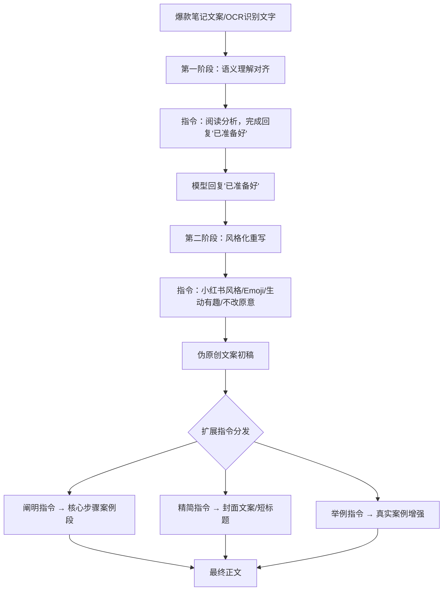
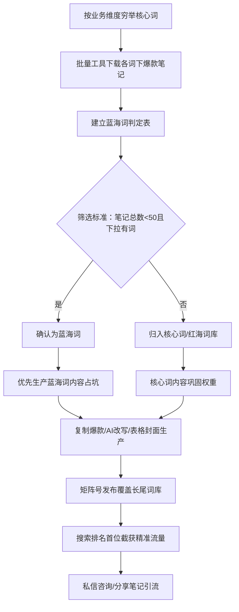

# 第 19 章 小红书爆款起号与矩阵化运营体系

## 学习目标

- 理解小红书冷启动的核心悖论：新号不靠原创靠模仿
- 掌握复制爆款起号法的四要素（选题、标题、封面、合规）跨账号迁移操作
- 掌握养号-标签化机制的主动打标SOP（搜索关键词、互动热门笔记、规避营销号判定）
- 掌握ChatGPT双阶段改写Prompt工程（语义对齐→风格化重写）与数据驱动标题套用法
- 掌握表格封面合集化制作标准（Excel/腾讯文档结构化表格截图）与零设计门槛量产
- 理解小红书SEO蓝海词策略：布局式占坑（无视公域数据、只抢关键词排名）截获精准搜索流量
- 掌握表情包话术+分享笔记与互关拉群自动化引流两套组合拳对抗平台风控
- 掌握小号隔离引流大号收割的账号分工模型与群聊单账号日承接200人量化基准
- 理解矩阵化横向复制模型：标准化SOP是组织扩张的必要充分条件
- 能根据赛道特性判断是否适合聚光投流放大及职称赛道地域护城河的非竞争性加盟逻辑

## 19.1 生活类比

想象小红书运营是一场**精准捕鱼比赛**。

**复制爆款起号** = 直接用冠军选手经过验证的**鱼饵配方、抛竿姿势、钓点坐标**，而不是自己瞎配鱼饵。

**养号-标签化** = 比赛前先在目标湖区**撒窝子、试水深、观察鱼群活动规律**，让鱼群（算法）记住你的味道（标签）。

**AI伪原创工作流** = 把冠军鱼饵拆解成**标准化工业配方（Prompt）**，批量生产略有差异的新饵料，通过质检（语义对齐）再包装（风格化）。

**表格封面合集化** = 制作**一目了然的鱼类图鉴封面**，鱼儿（用户）一眼看到就知道这有它想要的，点击收藏率极高。

**SEO蓝海词布局** = 在**鱼群必经的迁徙路径（搜索词）**提前埋下钩子，不追求比赛时的观众喝彩（点赞），只等精准上钩（私信咨询）。

**表情包+分享笔记引流** = 钩子上挂**隐形诱饵（表情包/分享卡片）**，绕过巡查员（风控）的金属探测器（关键词拦截）。

**互关拉群自动化** = 建**自动化传送带（群聊）**，鱼上钩直接传送到鱼仓（私域），单船日处理200条，禁航期（禁言）也能运作。

**矩阵化横向复制** = 将冠军全套装备、动作、决策**标准化成作战手册（SOP）**，招募渔船队（兼职团队）按图索骥，横向复制捕获量。

## 19.2 概念地图

小红书爆款起号与矩阵化运营体系
├── 核心起号法：复制爆款起号法
│   ├── 爆款基因四要素可迁移性（选题/标题/封面/合规）  —— docs/202305/RhRywNqifi3wjGkc4MacUiwXnxc.md [origin/improve/critique]
│   ├── 平台查重宽松性验证  —— docs/202305/RhRywNqifi3wjGkc4MacUiwXnxc.md [origin/improve/critique]
│   ├── 前5篇非营销内容保护期红线  —— docs/202305/RhRywNqifi3wjGkc4MacUiwXnxc.md [origin/improve/critique]
│   └── 老号冷启动修复可行性  —— docs/202305/RhRywNqifi3wjGkc4MacUiwXnxc.md [origin/improve/critique]
├── 账号冷启动基建：养号-标签化机制
│   ├── 主动打标SOP（搜关键词/互动热门/规避营销号）  —— docs/202305/RhRywNqifi3wjGkc4MacUiwXnxc.md [origin/improve/apply]
│   ├── 标签先于内容分发原则  —— docs/202305/RhRywNqifi3wjGkc4MacUiwXnxc.md [origin/improve/apply]
│   ├── 对标账号业务路径逆向拆解  —— docs/202305/RhRywNqifi3wjGkc4MacUiwXnxc.md [origin/improve/apply]
│   └── 养号副产出：爆款素材库积累  —— docs/202305/RhRywNqifi3wjGkc4MacUiwXnxc.md [origin/improve/apply]
├── 内容高效量产体系：AI工作流与SEO蓝海词
│   ├── ChatGPT双阶段改写Prompt工程（语义对齐→风格化重写）  —— docs/202305/RhRywNqifi3wjGkc4MacUiwXnxc.md [origin/improve/apply]
│   ├── 数据驱动标题套用法（拒绝AI生标题/套用高数据结构）  —— docs/202305/RhRywNqifi3wjGkc4MacUiwXnxc.md [origin/improve/apply]
│   ├── 表格封面合集化（零设计门槛/高信息密度/强收藏属性）  —— docs/202305/RhRywNqifi3wjGkc4MacUiwXnxc.md [origin/apply]
│   ├── 小红书SEO蓝海词策略（长尾词挖掘/布局式占坑/复利效应）  —— docs/202305/RhRywNqifi3wjGkc4MacUiwXnxc.md [origin/improve/apply]
│   ├── 关键词全景梳理与蓝海词挖掘实操  —— docs/202305/RhRywNqifi3wjGkc4MacUiwXnxc.md [origin/improve/apply]
│   └── 零互动笔记精准获客验证  —— docs/202305/RhRywNqifi3wjGkc4MacUiwXnxc.md [origin/improve/apply]
├── 安全引流与私域成交：双轨对抗风控
│   ├── 表情包话术+分享笔记（非文本形式/小号隔离/隐晦词汇）  —— docs/202305/RhRywNqifi3wjGkc4MacUiwXnxc.md [origin/improve/apply/critique]
│   ├── 互关拉群自动化引流（群聊机制/高并发200人/日/禁言期可操作）  —— docs/202305/RhRywNqifi3wjGkc4MacUiwXnxc.md [origin/improve/apply/critique]
│   ├── 小号隔离引流大号收割账号分工模型  —— docs/202305/RhRywNqifi3wjGkc4MacUiwXnxc.md [origin/improve/apply/critique]
│   ├── 私信发送前置检测机制（长按无引用/回复即限流）  —— docs/202305/RhRywNqifi3wjGkc4MacUiwXnxc.md [origin/improve/apply/critique]
│   └── 企业号抗风险能力实测验证  —— docs/202305/RhRywNqifi3wjGkc4MacUiwXnxc.md [origin/improve/apply/critique]
└── 组织化放大：矩阵化横向复制模型
    ├── 标准化SOP必要充分条件论（选题/AI改写/封面/发布/引流/风控六模块）  —— docs/202305/RhRywNqifi3wjGkc4MacUiwXnxc.md [origin/improve/extension]
    ├── 核心账号产出SOP→执行账号矩阵→统一引流入口→后端统一转化  —— docs/202305/RhRywNqifi3wjGkc4MacUiwXnxc.md [origin/improve/extension]
    ├── 职称赛道地域护城河与非竞争性加盟逻辑  —— docs/202305/RhRywNqifi3wjGkc4MacUiwXnxc.md [origin/improve/extension]
    └── 聚光投流适配性前瞻判断  —— docs/202305/RhRywNqifi3wjGkc4MacUiwXnxc.md [origin/improve/extension]

## 19.3 复制爆款起号法 —— 让新号借用老号的爆款基因

### 为什么需要这个概念？

新号冷启动面临三重困境：无权重、无标签、内容方向不确定。从零创作爆款成本高、周期长、成功率低，属于高风险赌博。但平台算法偏好已验证的优质内容结构，重发爆款可规避选题、标题、封面、合规四大核心风险点。

> "👉先说结论，秘诀就是「复制爆款」。因为一篇笔记如果成为了爆款，那么它基本是规避了「选题、标题或封面不佳」和「笔记违规」的问题。"
> 
> "真相是「小红书不怎么查重」，重发的笔记依然有流量，并且很大概率再次成为爆款。"
> 
> "目前不仅应用于起号，同时也应用于兼职团队，横向复制。"
> 
> —— 来源：docs/202305/RhRywNqifi3wjGkc4MacUiwXnxc.md [origin]

### 核心定义：复制爆款起号法

**复制爆款起号法**（来源：docs/202305/RhRywNqifi3wjGkc4MacUiwXnxc.md [origin]）

直接搬运同领域头部/腰部账号历史爆款笔记（选题、标题、封面、结构），经微调后在新号发布。利用"小红书不怎么查重"及爆款基因跨账号可迁移特性，快速获取账号初始权重与垂直标签。

**核心约束**：起号期前5篇必须为非营销干货笔记，过早植入营销内容导致标签偏离。

这个定义展示了三个核心优势：(1) 规避选题/标题/封面/合规四大风险点；(2) 利用平台查重宽松特性实现跨账号复用；(3) 标准化可横向复制支撑矩阵化运营。

### 关键性质与边界条件

爆款基因可迁移性体现为选题角度、标题钩子、封面设计、合规性四要素跨账号复用有效。平台查重宽松性表现为重发内容依然获得推荐，大概率复现爆款表现。标签保护期要求新号前2天5篇纯干货建立垂直标签，是起号存活红线。横向复制性说明该方法可标准化为SOP，支撑兼职团队/矩阵账号批量执行。

边界条件包括：仅适用于起号期（前5篇）及矩阵化量产阶段，长期运营仍需原创内容建立IP护城河；必须规避营销性质爆款（含引流钩子），前期仅复制纯干货类爆款；依赖领域内存在可搬运的历史爆款库，冷门新赛道可能无素材可复制；账号主体需为真实用户行为（养号打标），裸号直接发布易判营销号。

### 典型例子

**职称赛道实战**：搜索"中级职称评审"高赞笔记，提取标题结构"后悔没早知道的XX潜规则"，替换地域/专业关键词发布，新号单篇获赞破千。

**兼职团队横向复制**：核心账号产出SOP，兼职账号执行"复制爆款"标准动作，多账号覆盖关键词矩阵。

### 多源对照：爆款起号的不同解释

**共识**：新号直接搬运验证过的爆款内容是冷启动最高效路径。

**分歧**：
- 《docs/202305/RhRywNqifi3wjGkc4MacUiwXnxc.md [origin]》认为核心在于"爆款基因四要素可迁移"，即选题/标题/封面/合规已验证；
- 《docs/202305/RhRywNqifi3wjGkc4MacUiwXnxc.md [improve]》强调"平台查重宽松性"是物理基础，若平台升级查重算法则失效；
- 《docs/202305/RhRywNqifi3wjGkc4MacUiwXnxc.md [critique]》通过实测发现"前5篇非营销保护期"是硬性红线，违者必死。

## 19.4 养号-标签化机制 —— 让算法主动给贴上垂直标签

### 为什么需要这个概念？

新号无历史行为数据，算法无法判定垂直领域，首批推荐流量池为泛娱乐大池，精准度极低。被动等待算法打标周期长且不可控，主动模拟真人行为可在2-3天内强制绑定垂直标签。同时规避"营销号"判定：纯发布内容无互动的账号极易被判定为营销号导致限流。

> "我们在正常互动的过程中，最好先去搜索所做领域的关键词，并与热门笔记进行互动，因为平台是个性化推荐，会根据我们的阅读偏好打上标签，进行首页内容的推荐。"
> 
> "如果我们多与领域热门笔记互动，那么当我们打开小红书时，首页推荐就不仅仅是当天的平台热门，也会给你推荐关注领域的近期热门，而这些内容有很多的好处，比如有的可以直接拿来当素材..."
> 
> —— 来源：docs/202305/RhRywNqifi3wjGkc4MacUiwXnxc.md [origin]

### 核心定义：养号-标签化机制

**养号-标签化机制**（来源：docs/202305/RhRywNqifi3wjGkc4MacUiwXnxc.md [origin]）

账号注册完善资料后，不发内容，先搜索核心业务关键词，大量点赞/收藏/评论领域内近期热门笔记。通过高频垂直互动行为，诱导推荐算法给账号打上精准领域标签，使首页推荐流变为"领域素材库"。同步完成：规避营销号判定 + 获取垂直标签 + 积累选题素材库 三重收益。

这个机制展示了"标签先于内容"原则：账号初始标签决定首批推荐流量池精准度，直接影响后续内容冷启动表现。

### 标准作业程序（SOP）

**养号打标SOP**（来源：docs/202305/RhRywNqifi3wjGkc4MacUiwXnxc.md [origin]）

```
1. 账号注册完善资料（头像/昵称/简介/背景图统一垂直领域调性）
2. 连续2-3天，每日执行：
   a) 搜索核心业务关键词 3-5 个（如"中级职称"、"评审材料"、"职称论文"）
   b) 互动（点赞/收藏/有价值评论）领域内近7天高赞笔记各 50-100 篇
   c) 记录首页推荐流变化，验证垂直标签形成
3. 第4天开始发布首篇"复制爆款"笔记
```

每个步骤都有明确的执行标准：互动对象必须是近期高互动笔记，单日互动量50-100次，真机真网络真实名环境为前提。

### 对标账号业务路径逆向拆解

**对标拆解法**（来源：docs/202305/RhRywNqifi3wjGkc4MacUiwXnxc.md [origin]）

在养号期同步执行：完整走一遍竞品"评论引导-私信话术-引流落地页"全流程。
- 评论区有人问"求分享" → 看同行回复话术
- 同行回复"打个招呼" → 去打招呼 → 看私信话术
- 私信收到引流诱饵 → 点击查看落地页/加微信 → 拆解转化路径

这个方法将竞品的商业闭环显性化为可直接复用的模板。

### 典型例子

**职称赛道新号**：搜索"中级职称"、"评审材料"、"职称论文"等核心词，连续3天每天互动50+篇同领域爆款笔记，第4天发布首篇复制爆款笔记即获精准推荐。

**素材库副产出**：养号期发现同行持续发布各地通知文件，直接录入蓝海词素材库。

### 多源对照：养号机制的不同视角

**共识**：主动打标是新号冷启动的必要基建，标签先于内容分发。

**分歧**：
- 《docs/202305/RhRywNqifi3wjGkc4MacUiwXnxc.md [origin]》强调"个性化推荐机制"下的标签获取原理；
- 《docs/202305/RhRywNqifi3wjGkc4MacUiwXnxc.md [improve]》补充"规避营销号判定"的实操细节（真机/真网络/真实名）；
- 《docs/202305/RhRywNqifi3wjGkc4MacUiwXnxc.md [apply]》验证"养号副产出素材库"的实战价值（发现老刘通知类素材）。

## 19.5 AI伪原创工作流 —— 将创作转化为标准化Prompt工程

### 为什么需要这个概念？

纯搬运长期不可持续，平台加大原创保护力度，需实现"借壳生蛋"的伪原创量产。人工改写效率低、质量不稳、难批量，必须将改写流程标准化为可复用的AI指令集。小红书风格强（Emoji、口语化、情绪价值），通用大模型零样本生成质量差，需少样本微调。

### 核心定义：ChatGPT双阶段改写Prompt工程

**ChatGPT双阶段改写Prompt工程**（来源：docs/202305/RhRywNqifi3wjGkc4MacUiwXnxc.md [origin]）

**第一阶段：语义理解对齐**
```
指令：接下来我将向你提供一段文案，请先阅读并分析，完成后只需要回复"已准备好"，并等待我的下一步指令。
```
模型回复"已准备好"后进入第二阶段。

**第二阶段：风格化重写**
```
指令：请将这段文案，用小红书的风格，在不改变原意的前提下进行改写，要求有emoji表情，语言最好生动有趣（设置语言风格有助于提高伪原创质量）
```

**扩展指令集**：
- 阐明指令：针对核心步骤生成具体案例段
- 精简指令：生成封面文案/短标题
- 举例指令：补充真实案例增强说服力

这个工程展示了"语义对齐优先、风格化控制、结构化复用"三大特性：第一阶段强制模型理解原文深层逻辑；显式指定Emoji密度、口语化程度复刻原生调性；同一套Prompt可批量处理同领域不同选题。

### 方法演进图：双阶段Prompt工程流程



### 数据驱动标题套用法

**数据驱动标题套用法**（来源：docs/202305/RhRywNqifi3wjGkc4MacUiwXnxc.md [origin]）

**核心主张**：拒绝AI生成标题，从高数据笔记提取标题结构/关键词进行替换组合，或套用爆款标题公式。

**操作步骤**：
1. 收集同领域高赞笔记标题（如前20篇）
2. 提取高频结构词："潜规则"、"血泪总结"、"后悔没早知道"、"避坑指南"、"摸到门道"
3. 替换业务关键词生成新标题
4. A/B测试不同结构，沉淀高CTR标题库

> "我也试过用chatGPT取标题，但效果并不满意，最后还是选择相信数据（最靠谱），提取了两个合适的标题...稍微替换关键词用于文案标题。"
> 
> —— 来源：docs/202305/RhRywNqifi3wjGkc4MacUiwXnxc.md [origin]

这个方法展示了"数据>直觉、结构>创作、复用>原创"的实用主义原则。

### 典型例子

**职称赛道应用**：输入竞品"后悔没早看的评审避坑指南"爆款文案，输出保留核心避坑点、增加本地政策细节、植入"宝子们"、"血泪教训"等口语词的伪原创文案。

**扩展指令应用**：对核心步骤用"举例"指令生成具体案例段，用"精简"指令生成封面文案。

### 多源对照：AI工作流的不同实践

**共识**：双阶段Prompt+数据驱动标题是内容工业化的标准范式。

**分歧**：
- 《docs/202305/RhRywNqifi3wjGkc4MacUiwXnxc.md [origin]》给出标准双阶段Prompt模板；
- 《docs/202305/RhRywNqifi3wjGkc4MacUiwXnxc.md [improve]》补充扩展指令集（阐明/精简/举例）提升原创度；
- 《docs/202305/RhRywNqifi3wjGkc4MacUiwXnxc.md [apply]》实测AI生标题效果不如数据驱动套用法，确立"拒绝AI生标题"原则。

## 19.6 表格封面合集化 —— 零设计门槛的高点击封面范式

### 为什么需要这个概念？

图文笔记封面决定点击率（CTR），专业设计成本高、周期长、依赖人才。碎片化知识点缺乏结构化呈现方式，用户认知负荷高、收藏率低。需要一种零设计技能、可批量生产、信息密度高、自带收藏属性的封面标准。

### 核心定义：表格封面合集化

**表格封面合集化**（来源：docs/202305/RhRywNqifi3wjGkc4MacUiwXnxc.md [origin]）

利用Excel/腾讯文档/飞书文档将领域碎片知识点整理为结构化表格（列：核心词/解读/避坑/操作步骤等），截图表格作为笔记封面（首图）及正文主体图片，配合简短文案发布。封面即内容、内容即封面，实现"所见即所得"的高信息密度呈现。

> "用腾讯文档表格（其他同类软件也行）制作成合集类笔记的封面（最容易出爆款的封面之一），大多数图片类笔记都可以切换成这种风格去展示"
> 
> "图片篇的爆款笔记，其实不需要有详细的正文内容也可以，简单总结一下内容就行。"
> 
> —— 来源：docs/202305/RhRywNqifi3wjGkc4MacUiwXnxc.md [origin]

这个范式展示了四大核心优势：零设计门槛（会做表格即可）、高信息密度（单图承载10-20知识点）、强收藏属性（天然适合收藏转发）、算法友好（图文权重高、OCR识别易）。

### 表格封面制作参数建议

本表列出表格封面制作的关键参数建议值与理由，用于指导标准化生产。

| 参数 | 建议值 | 理由 |
|------|--------|------|
| 列数 | ≤7列 | 手机端显示清晰 |
| 行数 | ≤15行 | 避免字体过小 |
| 正文字数 | ≥300字 | 规避低质/非原创判定 |
| 适用领域 | 知识密集型 | 考证、职称、技能教程、对比测评 |

**边界条件**：
- 仅适用于知识密集型、标准化程度高的垂直领域
- 必须配合"数据驱动标题套用法"，标题植入核心长尾词
- 纯表格内容易被判定为"低质/非原创"，正文需补充原创解读

### 典型例子

**"广东各地中级职称评审材料清单"表格封面**：列=城市/材料/社保要求/论文要求/截止时间，单条笔记收藏破万。

**"考公岗位筛选表"封面**：列=部门/岗位/招录数/专业限制/竞争比，配合蓝海词"选调生岗位表"获精准搜索流量。

### 多源对照：表格封面的实战验证

**共识**：表格封面是图文类笔记最高性价比的封面形式。

**分歧**：
- 《docs/202305/RhRywNqifi3wjGkc4MacUiwXnxc.md [origin]》确立"最容易出爆款的封面之一"地位；
- 《docs/202305/RhRywNqifi3wjGkc4MacUiwXnxc.md [apply]》验证"无需详细正文、简单总结即可"的低成本生产模式。

## 19.7 小红书SEO蓝海词策略 —— 用布局式占坑截获精准搜索流量

### 为什么需要这个概念？

推荐流量脉冲式衰减、不可控，小众高客单赛道用户决策周期长、依赖主动搜索。核心大词竞争激烈、头部垄断，新号无权重无法竞争首屏曝光。长尾蓝海词"搜索需求大、优质内容少"，易排名靠前且用户意图极强（高转化）。

### 核心定义：小红书SEO蓝海词策略

**小红书SEO蓝海词策略**（来源：docs/202305/RhRywNqifi3wjGkc4MacUiwXnxc.md [origin]）

**蓝海词定义**：目标人群会去搜索，但同行发过相关优质笔记很少的关键词。

**布局式SEO**：放弃追求点赞/阅读等公域指标，核心目标"占坑"关键词排名，被搜索到并引发私信即成功。

**三步执行**：
1. 挖掘蓝海词
2. 生产高权重内容（复制爆款/AI改写/表格封面）
3. 矩阵号覆盖长尾词库

> "目标人群会去搜索，但没什么同行发过相关笔记的关键词，我称之为「有潜力的蓝海词」。"
> 
> "当这样的蓝海词被搜索时，即使某个同行发过的笔记数据不是很好，但因为相关笔记实在是太少了，而它的笔记因为精准度高，还是会排在前面，吃掉大部分的精准流量。"
> 
> —— 来源：docs/202305/RhRywNqifi3wjGkc4MacUiwXnxc.md [origin]

这个策略展示了"搜索意图强度＞推荐兴趣强度、复利效应、精准度溢价、矩阵放大性"四大关键性质。

### 方法演进图：SEO蓝海词全链路流程



### 关键词全景梳理与蓝海词挖掘实操

**关键词全景梳理法**（来源：docs/202305/RhRywNqifi3wjGkc4MacUiwXnxc.md [origin]）

```
1. 按业务维度穷举核心词：
   - 职称层级：初级/中级/高级
   - 地域：广东/北京/上海/各地市
   - 大方向：工程师/教师/经济师/会计师
   - 细分属性：材料/社保/论文/继续教育/评审流程

2. 批量工具下载各词下爆款笔记（前10-20篇）

3. 建立蓝海词判定表：
   列 = 关键词 | 笔记总数 | 最高赞 | 均赞 | 是否有优质内容 | 搜索下拉是否出现
   
4. 筛选标准：笔记总数 < 50 且 搜索下拉有词 = 蓝海词

5. 优先生产蓝海词内容占坑，核心词内容巩固权重
```

> "前段时间，我们把领域的关键词都捋了一遍：工程师职称的...教师职称的...职称大方向的... 然后，用工具（小红书笔记批量下载软件），提取了这些关键词在小红书的爆款笔记。"
> 
> —— 来源：docs/202305/RhRywNqifi3wjGkc4MacUiwXnxc.md [origin]

### 零互动笔记精准获客验证

**实测证据**（来源：docs/202305/RhRywNqifi3wjGkc4MacUiwXnxc.md [apply]）

> "有一个做工程师职称的账号，私信被咨询的跨度广了，比如有一篇笔记，虽然没有一个点赞和收藏，但被用户私信「分享笔记」了很多次..."
> 
> —— 来源：docs/202305/RhRywNqifi3wjGkc4MacUiwXnxc.md [apply]

这个案例证明：SEO搜索流量精准度极高，公域互动指标（点赞/收藏）不代表商业价值。零互动笔记只要排名靠前，即可截获高意向精准流量。

### 通知类布局式SEO商业验证

**老刘案例**（来源：docs/202305/RhRywNqifi3wjGkc4MacUiwXnxc.md [apply]）

> "有个同行叫「老刘」，经常发广东各地的职称申报通知文件...有了小红书SEO思路后，不管数据好不好，都学他这么布局各个城市，现在每天都有一定的私信数量，是求分享通知文件的。"
> 
> —— 来源：docs/202305/RhRywNqifi3wjGkc4MacUiwXnxc.md [apply]

验证了"布局式SEO"对长尾需求覆盖的商业有效性：单篇数据差但日均私信稳定，矩阵号可全词库覆盖。

### 多源对照：SEO策略的不同侧重

**共识**：蓝海词布局式SEO是小众高客单赛道精准获客的核心策略。

**分歧**：
- 《docs/202305/RhRywNqifi3wjGkc4MacUiwXnxc.md [origin]》提出蓝海词定义与布局式SEO核心原则；
- 《docs/202305/RhRywNqifi3wjGkc4MacUiwXnxc.md [improve]》细化关键词全景梳理与批量工具下载实操；
- 《docs/202305/RhRywNqifi3wjGkc4MacUiwXnxc.md [improve]》补充"无视公域数据、只抢排名"的执行心法；
- 《docs/202305/RhRywNqifi3wjGkc4MacUiwXnxc.md [apply]》提供零互动获客与老刘通知布局两大实证案例。

## 19.8 表情包话术+分享笔记 —— 非文本形式对抗风控的引流组合拳

### 为什么需要这个概念？

小红书严打私域引流：文本微信号/联系方式/引流关键词直接拦截，发图识别OCR同样违规。账号违规导致限流/封号，主号权重受损得不偿失，必须物理隔离引流风险。需要一种合规、低成本、可批量、抗风控迭代的引流技术方案。

### 核心定义：表情包话术规避违规

**表情包话术规避违规**（来源：docs/202305/RhRywNqifi3wjGkc4MacUiwXnxc.md [origin]）

将敏感引流文案（微信号/口令/钩子）制作为图片表情包，私信发送绕过文本检测；结合"分享笔记"功能：小号发布引流诱饵笔记（含联系方式图片/群二维码）→ 大号收藏 → 私信时"分享笔记"卡片传递。小号隔离大号收割：小号专职制作引流内容承担违规风险，大号正常运营仅做分发动作。

> "把你的话术，先做成图片，再添加到表情包...试过发图片也提醒违规，所以才做成表情，目前还没收到违规提醒"
> 
> "用小号做引流图，其他账号收藏笔记，私信时分享笔记...建议统一用小号做引流笔记"
> 
> —— 来源：docs/202305/RhRywNqifi3wjGkc4MacUiwXnxc.md [origin]

这个技术展示了"形式对抗原则"：平台风控核心针对文本语义/直接图片OCR，表情包/分享卡片/群聊系统消息属于非标准检测路径。

### 标准化执行流程

**表情包引流SOP**（来源：docs/202305/RhRywNqifi3wjGkc4MacUiwXnxc.md [improve]）

```
1. 小号矩阵准备：批量注册/购买小号（几元/个），完善基础资料
2. 引流诱饵笔记制作：小号发布含微信号图片/群二维码的诱饵笔记
3. 表情包话术制作：
   - 文案："资料整理好了，打个招呼发你" 
   - 隐晦词："薇：xxx_888" / "V:xxx_888" / "➕xxx_888"
   - 制作为表情包（手写体/涂鸦风格/加水印）
4. 大号矩阵收藏：大号/矩阵号收藏小号引流笔记
5. 私信发送执行：发送表情包 + 分享小号引流笔记卡片
6. 微信号优化：复杂难记微信号必改简单易记版本，提升通过率
```

### 私信发送前置检测机制

**风控自检指标**（来源：docs/202305/RhRywNqifi3wjGkc4MacUiwXnxc.md [critique]）

> "当天回复的前几条私信，切记长按信息是否有「引用」「回复」等字样，有则确保信息发送成功，如果没有就停止私信，通常等几个小时就恢复私信正常。"
> 
> —— 来源：docs/202305/RhRywNqifi3wjGkc4MacUiwXnxc.md [critique]

这个机制为团队排班提供了可执行的风控自检标准动作：每日首条私信长按检查"引用/回复"选项是否存在。

### 典型例子

**实测对比**：直接发引流图片→违规提醒；同内容做表情包+隐晦词→持续运行零违规。

**话术模板**："资料整理好了，打个招呼发你" → 发送表情包"薇：xxx_888" → 分享笔记"《2024职称资料合集》"。

**小号矩阵**：10个小号轮流发布引流笔记/私信表情包，大号矩阵收藏分发，单日引流200+精准粉。

### 多源对照：引流对抗风控的不同层面

**共识**：表情包+分享笔记+小号隔离是当前可行的最优引流组合拳。

**分歧**：
- 《docs/202305/RhRywNqifi3wjGkc4MacUiwXnxc.md [origin]》提出表情包绕过文本检测与分享笔记传递诱饵的核心组合；
- 《docs/202305/RhRywNqifi3wjGkc4MacUiwXnxc.md [improve]》细化隐晦词汇、手写体/涂鸦风格、微信号简化等工程化细节；
- 《docs/202305/RhRywNqifi3wjGkc4MacUiwXnxc.md [apply]》验证小号矩阵+大号分发的规模化实战模式；
- 《docs/202305/RhRywNqifi3wjGkc4MacUiwXnxc.md [critique]》发现私信前置检测机制，提供风控自检标准动作。

## 19.9 互关拉群自动化引流 —— 利用群聊机制实现高并发私域承接

### 为什么需要这个概念？

私信引流效率低、易限流、单账号日上限低（~50条），无法支撑矩阵化高并发承接。群聊具备"互关可拉人"、"历史消息可见"、"禁言期可操作"三大反风控特性。需要一种可标准化、可量化产能、抗风控的批量引流标准作业程序。

### 核心定义：互关拉群自动化引流

**互关拉群自动化引流**（来源：docs/202305/RhRywNqifi3wjGkc4MacUiwXnxc.md [origin]）

利用"互关可直接拉群"+"群聊设置：取消进群确认+开启新成员展示历史消息"机制。标准化流程：评论区引导互关 → 后台筛选互关用户 → 批量拉入预设群(单群40人/单号5群) → 新成员自动阅读历史引流消息(微信号/钩子) → 群满踢人循环利用。单账号理论日处理上限：5群×40人=200人，禁言状态账号亦可执行拉群/发言操作。

> "互关可以直接拉群...群聊设置，笔记挂群聊➡️取消进群确认➡️打开新成员展示历史消息👉新人进群自动被引导"
> 
> "目测最多可拉40人！但是，敲重点了！一个号可以建5个群，所以一个号一天能处理200人，完全够用！再循环利用，5个群拉满了，把1群的人踢出去，重新再拉40人！"
> 
> "即使账号禁言状态，也可以互关拉人，也可以在群聊讲话"
> 
> —— 来源：docs/202305/RhRywNqifi3wjGkc4MacUiwXnxc.md [origin]

这个模型展示了高并发承接（50→200人/日）、抗风控鲁棒性（禁言期可操作）、自动化程度高（配合RPA批量执行）、产能可量化（便于团队排班扩容）四大核心优势。

### 标准化执行流程

**群聊裂变承接SOP**（来源：docs/202305/RhRywNqifi3wjGkc4MacUiwXnxc.md [improve]）

```
1. 评论区引导：置顶/回复话术引导"打招呼/关注"
   话术："有需要的姐妹打个招呼"
   
2. 后台筛选：筛选互关用户列表

3. 群聊配置（预设）：
   - 笔记挂群聊
   - 取消进群确认
   - 打开新成员展示历史消息
   
4. 批量拉群：单群40人，单号5群，日处理200人

5. 群内自动引流：
   - 新成员进群自动阅读历史消息
   - @所有人："大家的私信和评论，已经看了，加一下薇，统一处理，👇是薇" + 表情包微信号
   
6. 循环利用：群满踢人重拉，账号长期复用
```

### 群聊引流量化基准表

本表量化单账号群聊引流的核心产能指标，用于团队排班与扩容规划。

| 指标 | 数值 | 备注 |
|------|------|------|
| 单群上限 | 40人 | 平台硬性限制 |
| 单号群数 | 5个 | 平台硬性限制 |
| 日处理上限 | 200人 | 5群×40人 |
| 禁言期可操作 | 是 | 核心反风控优势 |
| 循环周期 | 群满即踢 | 可无限复用 |

**边界条件**：
- 前置条件：必须互关才能拉群，需设计高转化评论区引导话术
- 账号权重要求：新注册小号需养号3-7天积累基础权重
- 用户体验风险：频繁拉群/踢人可能引发投诉，需控制频次与话术温和度
- 平台政策风险：可能收紧群聊功能，需持续验证可用性

### 多源对照：群聊引流的工程化与风控视角

**共识**：互关拉群是突破私信限流、实现高并发承接的核心技术。

**分歧**：
- 《docs/202305/RhRywNqifi3wjGkc4MacUiwXnxc.md [origin]》确立群聊机制、配置参数、日处理200人上限；
- 《docs/202305/RhRywNqifi3wjGkc4MacUiwXnxc.md [improve]》标准化评论区引导、后台筛选、群内欢迎语等SOP动作；
- 《docs/202305/RhRywNqifi3wjGkc4MacUiwXnxc.md [apply]》验证禁言期可操作、循环利用、RPA批量执行的工程化可行性；
- 《docs/202305/RhRywNqifi3wjGkc4MacUiwXnxc.md [critique]》提示用户投诉风险、平台收紧功能风险、账号权重门槛等边界条件。

## 19.10 矩阵化横向复制模型 —— 将个人经验资产化为组织SOP

### 为什么需要这个概念？

单账号流量上限受限于平台算法/人力精力，矩阵化是突破单账号天花板的必经路径。个人经验隐性化、非标准化，无法直接传递给兼职/员工执行，必须显性化为SOP。缺乏标准化SOP的矩阵扩张必然导致质量失控、风控失守、转化率崩塌。

### 核心定义：矩阵化横向复制模型

**矩阵化横向复制模型**（来源：docs/202305/RhRywNqifi3wjGkc4MacUiwXnxc.md [origin]）

**组织架构**：
```
核心账号（产出SOP/选题库/素材库/话术库） 
    → 执行账号矩阵（兼职/员工执行标准化动作） 
    → 统一引流入口（私域池） 
    → 后端统一转化（销售/服务团队）
```

**核心SOP模块（6大模块）**：
1. 选题挖掘SOP
2. AI改写Prompt库  
3. 封面制作模板
4. 发布排期表
5. 引流话术库
6. 风控应对手册

**执行标准**：像素级模仿（标题/封面/正文结构/发布时间/互动话术），不求原创求效率求稳定。

> "因为「搬运老号爆款」的方法有效，所以目前不仅应用于起号，同时也应用于兼职团队，横向复制。"
> 
> "成都圈友跟我学习了，跟我也不是竞争关系...职称公司，一般只能做省内人群的生意"
> 
> "这一章节主要是小红书笔记创作的高效流程...我探索出了两种高效的玩法...均是验证过至少20条以上的爆款、且整体的操作思路与流程保持基本一致。"
> 
> —— 来源：docs/202305/RhRywNqifi3wjGkc4MacUiwXnxc.md [origin]

这个模型确立了"标准化SOP是矩阵扩张的必要充分条件"：只有全流程固化为可量化/可考核/可替换的SOP，才能实现横向复制，将个人经验转化为组织资产。

### 非竞争性加盟逻辑：职称赛道地域护城河

**地域护城河**（来源：docs/202305/RhRywNqifi3wjGkc4MacUiwXnxc.md [extension]）

> "职称赛道有意思的地方是，除了个别资源丰富的，大部分公司只能做当地的职称申报服务，比如广东省的职称公司，一般只能做省内人群的生意，所以成都圈友跟我学习了，跟我也不是竞争关系"
> 
> —— 来源：docs/202305/RhRywNqifi3wjGkc4MacUiwXnxc.md [extension]

职称服务强地域属性天然形成区域护城河，不同城市运营者学习同套方法论不构成竞争，适合标准化教学与加盟模式。

### 聚光投流适配性前瞻判断

**投流适配性**（来源：docs/202305/RhRywNqifi3wjGkc4MacUiwXnxc.md [extension]）

> "这个赛道按道理很适合做投流（聚光投放），我也懂这个，有需要的可以找我聊天..."
> 
> —— 来源：docs/202305/RhRywNqifi3wjGkc4MacUiwXnxc.md [extension]

高客单价、转化路径标准赛道理论极适合聚光投放放大，留作规模化后续优化方向。

### 设计中的取舍

**为什么不用"原创内容起号"而用"复制爆款起号"？**

原创起号面临选题不确定、标题无经验、封面无模版、合规风险高四大痛点，成功率极低。复制爆款将这四大风险点全部外包给已验证的历史爆款承担，把"创新"降维为"模仿+微调"，成功率显著提升。代价是长期缺乏原创积累难建立IP护城河，需在起号后逐步过渡。

**这种设计的trade-off是什么？**

复制爆款起号在启动速度上极快（2-3天），成功率高（借用验证基因），规模化复制易（SOP标准化），风控风险低（已验证合规），但长期护城河弱（需后期转型）。原创内容起号启动慢（2-4周），成功率低（全链路试错），长期护城河强（自带IP属性），规模化复制难（依赖个人才华），风控风险高（未知合规边界）。这是速度与护城河、标准化与个性化、短期生存与长期品牌之间的经典权衡。

### 多源对照：矩阵化模型的不同维度

**共识**：标准化SOP是矩阵扩张的必要充分条件，职称赛道地域属性支持非竞争性复制。

**分歧**：
- 《docs/202305/RhRywNqifi3wjGkc4MacUiwXnxc.md [origin]》确立核心账号产出SOP→执行矩阵→统一引流→后端转化的组织架构；
- 《docs/202305/RhRywNqifi3wjGkc4MacUiwXnxc.md [improve]》细化6大SOP模块与像素级模仿执行标准；
- 《docs/202305/RhRywNqifi3wjGkc4MacUiwXnxc.md [extension]》提出地域护城河非竞争性加盟逻辑与聚光投流前瞻判断。

## 19.11 动手练习

### 练习 1：复制爆款起号实战演练

**任务**：在小红书搜索你的目标赛道核心词（如"中级职称评审"），按点赞排序筛选前20篇非营销性爆款笔记。

1. 提取这20篇笔记的共性标题结构（如"后悔没早知道的XX潜规则"、"血泪总结：XX避坑指南"）。
2. 分析封面设计共性（纯文字大字报/表格截图/对比图/聊天记录截图）。
3. 选取1篇爆款笔记，用ChatGPT双阶段Prompt进行伪原创改写：
   - 第一阶段：喂入原文，指令"阅读分析，完成回复已准备好"。
   - 第二阶段：指令"用小红书风格改写，保留Emoji，语言生动有趣，不改原意"。
4. 基于提取的标题结构，替换你的业务关键词生成3个新标题。
5. 用Excel制作一张表格封面（列：核心知识点/避坑指南/操作步骤/截止时间），截图作为封面。

**思考题**：
- 为什么前5篇不能发营销笔记？如果前期发了营销笔记导致标签偏离，如何补救？
- 当赛道内无历史爆款可复制时（全新蓝海赛道），起号策略应如何调整？

### 练习 2：养号打标与SEO蓝海词挖掘实操

**任务**：模拟新号养号全流程并挖掘蓝海词库。

1. 注册/准备一个新号，完善资料（头像/昵称/简介/背景图统一垂直领域调性）。
2. 连续3天，每天搜索核心业务词5个，互动（点赞/收藏/有价值评论）领域内近7天高赞笔记各20篇，记录首页推荐流变化。
3. 用批量下载工具（或手工）按"核心词+地域/年份/细分属性"组合长尾词（如"广东2024中级职称社保要求"），下载各词下前10笔记。
4. 建立蓝海词判定表：列=关键词/笔记总数/最高赞/均赞/是否有优质内容/搜索下拉是否出现。筛选"笔记总数<50且下拉有词"的蓝海词。
5. 针对筛出的3个蓝海词，分别用复制爆款法/AI改写法/表格封面法各产出1篇笔记发布。

**思考题**：
- 为什么说"搜索流量意图强度＞推荐流量"？如何用数据验证这一结论？
- 蓝海词内容发布后"零点赞零收藏"但有私信咨询，如何向老板/合伙人汇报该笔记的ROI？

### 练习 3：安全引流组合拳压力测试

**任务**：搭建一套"表情包+分享笔记"与"互关拉群"双轨引流体系并进行抗风控测试。

1. 准备：1个大号（正常运营）、3个小号（引流专用）、1个引流诱饵笔记（含微信号图片/群二维码）。
2. 制作表情包话术：将"资料整理好了，加薇：xxx_888 发你"制作为表情包（隐晦词/手写体/涂鸦风格），大号收藏小号引流笔记。
3. 执行私信引流：大号私信目标用户发送表情包+分享小号引流笔记卡片，记录发送成功率/违规提醒率/用户加微率。
4. 执行互关拉群：评论区置顶"有需要打招呼"，后台筛选互关用户，建群设置（取消进群确认/开启历史消息/挂群聊笔记），批量拉人，群内@全员发表情包微信号。
5. 压力测试：单日私信50条/拉群200人，监控账号状态（流量/违规/限流）。测试禁言期账号能否正常拉群发言。
6. 记录私信前置检测：每日首条私信长按检查"引用/回复"选项是否存在。

**思考题**：
- 表情包引流与直接发图片引流的本质区别是什么？平台升级OCR识别表情包文字后，如何进化话术形式？
- 群聊引流单账号上限200人/天，若业务量日增500精准粉，账号矩阵如何规模化配置？成本如何测算？

### 练习 4：矩阵化SOP标准化与非竞争性复制推演

**任务**：将上述起号、量产、引流全流程固化为可交付的组织级SOP手册框架。

1. 梳理6大核心SOP模块目录：选题挖掘SOP、AI改写Prompt库、封面制作模板库、发布排期表、引流话术库、风控应对手册。
2. 细化"AI改写Prompt库"：编写通用双阶段Prompt模板+职称/考公/技能3个垂类专用扩展指令（阐明/精简/举例）。
3. 细化"引流话术库"：表情包话术5套/评论区引导话术10条/私信首条话术3版/群内欢迎语2版/禁言期应急话术。
4. 设计兼职执行考核表：日产出量/爆款率/违规率/引流转化率/私信回复及时率，设定及格线。
5. 推演异地复制可行性：以成都职称赛道为例，分析地域护城河下，同套SOP在成都落地需微调哪些模块？（政策差异/关键词差异/竞品差异/素材来源差异）

**思考题**：
- 为什么说"标准化SOP是矩阵扩张的必要充分条件"？缺乏SOP直接招人矩阵化会发生什么？
- 聚光投流适配性判断依据是什么？若决定投流，SOP需新增哪些模块？（投手操作手册/ROI监控看板/素材迭代节奏/赔付止损规则）

## 19.12 本章小结

这一章中我们学习了小红书从0到1的爆款起号与矩阵化运营全体系。首先掌握了**复制爆款起号法**的核心悖论——新号不靠原创靠模仿，通过搬运验证过的选题/标题/封面/合规四要素快速获取权重；其次建立了**养号-标签化机制**，主动打标诱导算法给账号贴垂直标签，同时积累素材库；接着构建了**AI伪原创工作流**，将创作标准化为双阶段Prompt工程+数据驱动标题套用法，实现工业化量产；然后引入**表格封面合集化**零设计门槛高点击范式，配合**小红书SEO蓝海词策略**的布局式占坑，精准截获搜索流量；随后攻克**安全引流**难题，发明表情包话术+分享笔记与互关拉群自动化引流双轨组合拳，量化单账号日承接200人上限；最后确立**矩阵化横向复制模型**，将全流程固化为6大SOP模块，利用职称赛道地域护城河实现非竞争性跨城复制。

本章我们一起学习了以下概念：

| 概念 | 解释 |
|------|------|
| 复制爆款起号法 | 新号直接搬运同领域老号历史爆款（选题/标题/封面/合规），利用平台查重宽松特性快速获取权重，前5篇必须为非营销干货 |
| 养号-标签化机制 | 发布前主动搜关键词、互动热门笔记，诱导算法打垂直标签，同时规避营销号判定并积累素材库 |
| 对标账号业务路径拆解 | 完整走一遍竞品评论引导-私信话术-引流落地页流程，逆向工程商业闭环模板 |
| ChatGPT双阶段改写Prompt工程 | 第一阶段语义理解对齐（回复"已准备好"），第二阶段小红书风格重写（Emoji/口语化/生动/不改原意），可扩展阐明/精简/举例指令 |
| 数据驱动标题套用法 | 拒绝AI生标题，从高数据笔记提取标题结构/关键词替换组合，或套用爆款标题公式，实测优于AI创作 |
| 表格封面合集化 | 用Excel/腾讯文档将碎片知识整理为结构化表格截图作封面正文，零设计门槛、高信息密度、强收藏属性、算法友好 |
| 小红书SEO蓝海词策略 | 挖掘"搜索需求大、竞争内容少"长尾词，生产高权重内容抢占搜索首位截获高意向流量，核心目标占坑排名而非公域互动 |
| 布局式SEO执行 | 无视点赞阅读数据，只为覆盖长尾关键词排名，零互动笔记也能获精准私信，矩阵号可全词库覆盖 |
| 表情包话术规避违规 | 将敏感引流话术制作为图片表情包发送，结合分享笔记功能传递诱饵，利用非文本形式绕过关键词拦截与语义识别 |
| 互关拉群自动化引流 | 利用互关可拉群+群聊历史消息可见机制：评论区引导互关→批量拉群(40人/群×5群=200人/日)→新成员自动阅读历史引流消息 |
| 小号隔离大号收割模型 | 小号专职制作引流诱饵承担违规风险，大号正常运营收藏小号笔记，引流时大号分享笔记转发小号内容，实现风险隔离 |
| 私信前置检测机制 | 当日前几条私信长按无"引用/回复"选项即隐形限流，需停发等待恢复，为团队排班提供风控自检标准 |
| 群聊日承接上限量化 | 单账号5群×40人=日处理200人上限，群满可踢人循环，禁言期亦可操作，为团队产能规划提供量化基准 |
| 矩阵化横向复制模型 | 核心账号产出SOP→兼职/员工执行标准化动作→多账号覆盖关键词/人群→统一引流入口→后端统一转化，将个人经验资产化为组织资产 |
| 职称赛道地域护城河 | 职称服务强地域属性天然形成区域护城河，不同城市运营者学习同套方法论不构成竞争，适合标准化教学与加盟模式 |
| 聚光投流适配性判断 | 高客单价、转化路径标准赛道理论极适合聚光投放放大，留作规模化后续优化方向 |

下一章中，我们将学习 **公众号运营体系与变现阶梯** —— 从情感IP起号到引流造势IP强信任的四阶梯进阶路径，拆解公众号高度闭塞机制下的外部流量破局与私域沉淀全链路SOP。

