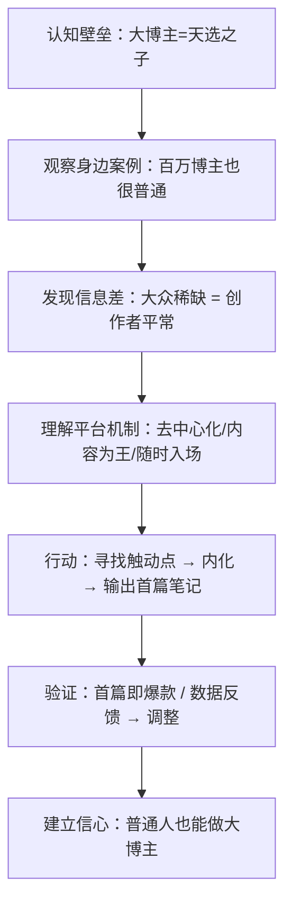
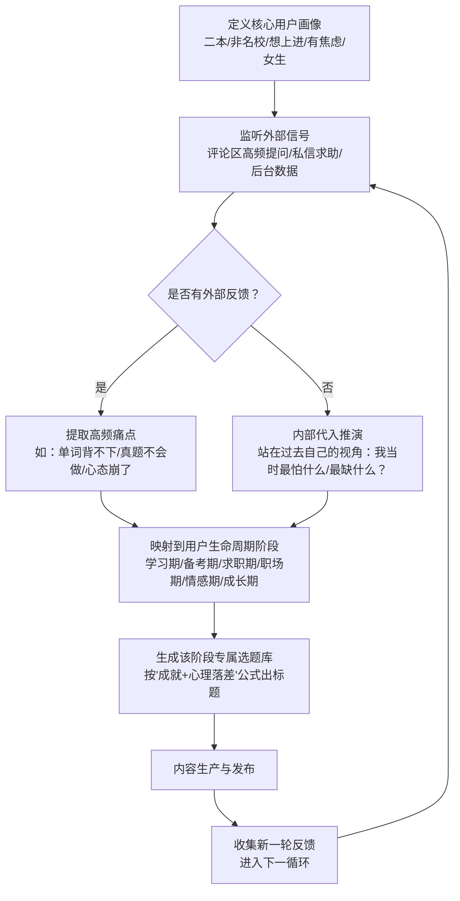
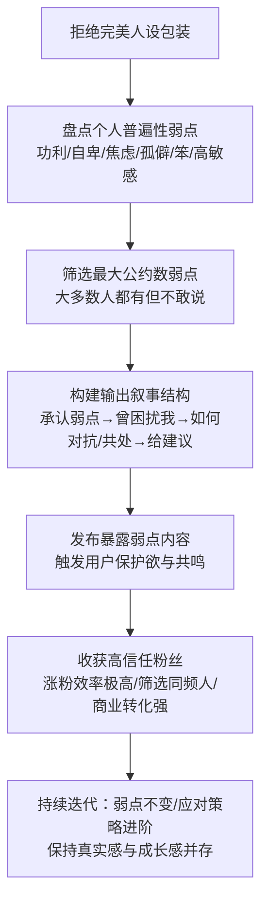
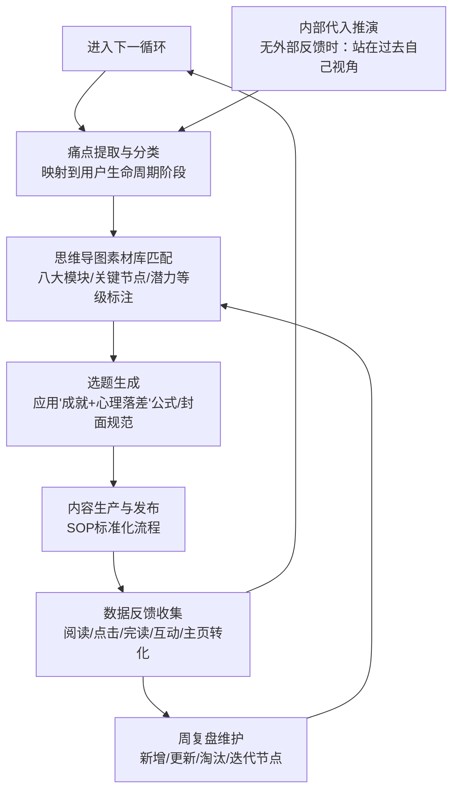
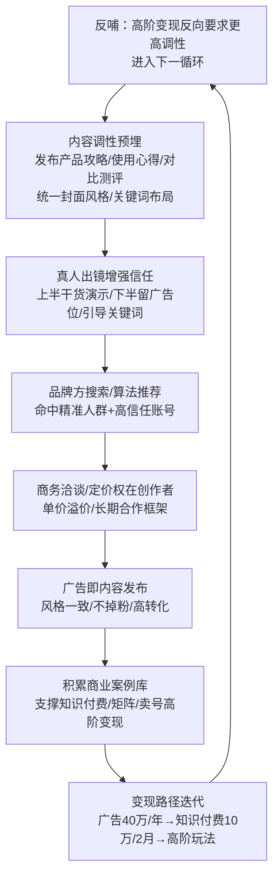
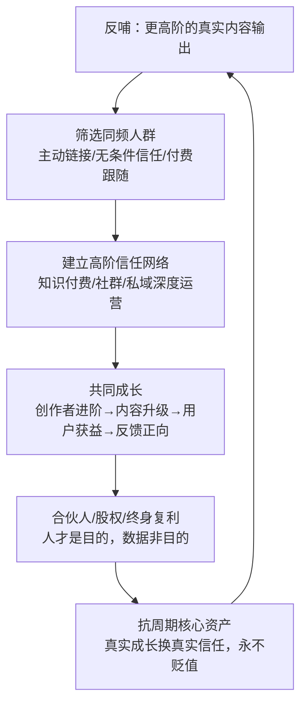
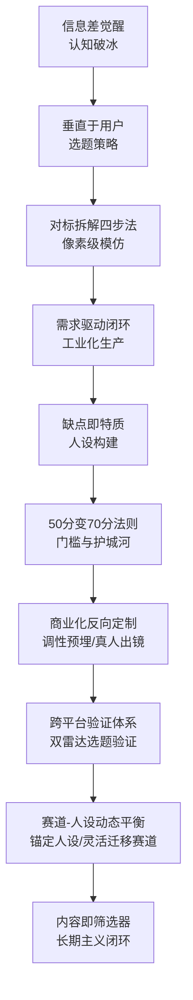

# 第 29 章 小红书知识付费IP打造

## 学习目标

- 理解普通人如何通过"信息差"认知打破"大博主=天选之子"的心理壁垒，建立"随时入场"的平台机制信心
- 掌握"垂直于用户而非垂直于内容"的动态选题策略，学会从评论区/私信挖掘用户全生命周期痛点
- 熟练运用"对标账号四步拆解法"与"爆款选题三要素"，实现像素级模仿与系统化超越
- 建立"需求驱动闭环"：外部反馈→内部代入→内容生产→再获反馈，配合思维导图实现素材库工业化管理
- 领会"缺点即特质"与"50分变70分服务50-60分"的IP人设构建逻辑，通过暴露弱点建立高信任人设
- 掌握商业化反向定制策略：调性预埋、关键词布局、真人出镜，主动构建品牌方偏好的商业化人设
- 理解"内容即筛选器"的长期主义商业逻辑：真实成长吸引真实伙伴，形成信任-付费-共同成长-合伙人的高阶闭环
- **新增**：掌握跨平台需求验证体系：结合淘宝/拼多多/1688等电商平台销量/评价数据，验证选题商业价值与用户付费意愿（解决第28章"淘上红选品模式"跨章割裂问题）
- **新增**：建立统一商业度量符号体系：LTV（生命周期价值）、CAC（获客成本）、ROI（投资回报率）、转化漏斗标准指标，替代非标量化隐喻，实现跨章节认知对齐
- **新增**：理解"赛道生命周期与人设深耕的动态平衡"：赛道枯竭时通过"垂直于用户"策略实现内容迁移，而非放弃人设，调和第28章"赛道必然枯竭"与本章"长期主义深耕"的策略张力

## 29.1 生活类比

想象小红书IP打造是一场"普通人进阶训练营"的直播秀。观众手里拿着"求助卡"，上面写着考研焦虑、英语哑巴、人际内耗、原生家庭创伤；选手桌上放着"通关档案"，记录着二本逆袭、雅思8分、考研上岸、焦虑自愈；选手现场演示"避坑指南/作弊码"，给出具体方法论、思维模型、工具清单、情绪共鸣。当观众发现"这选手跟我经历一模一样，或者比我强一点点（50→70分）"时，相似度匹配发生，Softmax（关注决策）启动：观众投票——"我要跟他学/买他的课/进他的群/做他的合伙人"。就像选秀节目不需要选手是"完美天才（100分专家）"，观众更爱"比我强一档、还承认自己笨/焦虑/功利、愿意手把手教我的真实学长（70分进阶者）"。平台算法是导演：不看资历（账号权重/入场时间），只看当期表现（内容质量/垂直度/冲突感），谁能让观众（用户）留下来、互动、付费，谁就拿流量（推流）。

**进阶视角——商业化验证层**：这场直播秀的导演组（算法）背后，有一套隐形的"商业评分系统"。每个选手的"避坑指南"若能在淘宝/拼多多找到同类付费课程月销1000+、好评率>90%，说明该赛道已完成"需求-付费"闭环验证；若选手能展示"我用这套方法帮学员提分均值15分、复购率40%"，则直接锚定 LTV≥¥2000、CAC≤¥50 的商业模型参数。真正的头部选手，不是只在直播间演示，而是手握跨平台验证数据与标准化交付 SOP，在商业谈判中拥有定价权。

## 29.2 概念地图

```
小红书知识付费IP打造
├── 认知底座
│   ├── 信息差觉醒：普通人也能做大博主、随时入场论  —— P001
│   ├── 50分变70分法则：进阶者优势替代专家壁垒  —— P007
│   └── IP核心公式：共性(普通人)+特性(弱点)=信任  —— P003
├── 选题策略
│   ├── 垂直于用户：全生命周期需求动态调整  —— P002
│   ├── 对标拆解四步法：搜词-析结构-联经历-精准对标  —— P004
│   ├── 爆款选题三要素：成就+心理落差/反差感  —— P004
│   └── 需求驱动闭环：评论/私信→用户视角→思维导图素材库  —— P005
├── 人设构建
│   ├── 缺点即特质：暴露功利/自卑/焦虑引发共情  —— P003
│   ├── 真人出镜增强信任：上半干货下半广告位  —— P006
│   └── 广告调性预埋：内容风格统一+关键词预埋  —— P006
├── 生产体系
│   ├── 爆款选题库：对标/热点/反馈/碎片四源  —— P005
│   ├── 写作SOP标准化：将灵感转化为工业化流水线  —— P005
│   └── 网感本质：大量刻意练习后的快速直觉  —— P005
├── 跨平台验证体系（新增，对齐第28章）
│   ├── 淘系/拼多多/1688销量评价挖掘：验证选题商业价值
│   ├── 关键词反向推导：从电商热搜词反推内容选题
│   └── 竞品付费产品拆解：解构课程大纲/交付标准/定价锚点
└── 商业闭环
    ├── 统一商业度量体系：LTV/CAC/ROI/转化漏斗标准指标
    ├── 变现路径迭代：广告→知识付费→矩阵/卖号/引流  —— P008
    ├── 赛道-人设动态平衡：赛道枯竭迁移内容、深耕人设不变
    ├── 忠于自我长期主义：慢即是快、真实成长换真实信任  —— P008
    └── 内容即筛选器：人才是目的、数据非目的  —— P008
```

（素材来源：docs/202305/WX87d3F4SoVZLHxDNGzcDDVRn6R.md，即《漫漫小红书半年复盘》全文）

---

### 统一符号表（新增，对齐第28章商业模型符号体系）

| 符号 | 含义 | 定义/计算方式 | 典型基准值（知识付费IP） |
|------|------|---------------|--------------------------|
| **LTV** | 用户生命周期价值 | Σ(单客复购金额 × 复购次数) + 推荐带来间接价值 | ≥ ¥2,000（高客单知识付费） |
| **CAC** | 获客成本 | (内容生产成本 + 推广投放 + 运营人力) / 新增付费用户数 | ≤ ¥50（内容驱动自然流） |
| **ROI** | 投资回报率 | (LTV - CAC) / CAC | ≥ 30x（优质IP典型值） |
| **CTR** | 点击率 | 点击数 / 曝光数 | ≥ 3%（封面+标题合格线） |
| **CPR** | 完读/完播率 | 完读数 / 点击数 | ≥ 30%（内容兑现承诺线） |
| **CVR₁** | 主页转化率 | 主页访问 / 完读数 | ≥ 2%（人设信任锚点线） |
| **CVR₂** | 私域引流率 | 加微/进群 / 主页访问 | ≥ 5%（钩子设计合格线） |
| **CVR₃** | 付费转化率 | 付费用户 / 私域用户 | ≥ 10%（高信任IP典型值） |
| **RPR** | 复购率 | 复购用户 / 付费用户 | ≥ 30%（产品力验证线） |

> **符号表作用**：统一第28、29章商业模型语言。第28章使用 LTV/CAC/ROI 标准电商符号；本章原使用"网感""50/70分"等隐喻。引入符号表后，"50分变70分"可量化为"将创作者能力 L(s) 从 50 提升至 70，使 D(s) 达峰值"；"网感"可量化为"在 CTR≥3%、CPR≥30% 约束下，单位时间内输出合格内容的稳定概率"。

---

## 29.3 信息差觉醒 —— 普通人也能做大博主的认知破冰

### 为什么需要这个概念？

很多人觉得百万大博主是天选之子，自己做不到，产生认知壁垒不敢入场。实际上大众眼中的"稀缺知识"往往是创作者的"平常认知"，信息差天然存在。小红书去中心化推荐机制基于内容质量而非账号权重/时间，任何时间入场都能分到流量。

### 核心定理：普通人也能做大博主的信息差认知

> **定理**：打破"大博主=天选之子"的认知壁垒：普通人身边即有百万博主，且大众眼中的"稀缺知识"往往是创作者的"平常认知"，信息差天然存在，入场从不晚。

> **定理**：小红书流量机制的"随时入场论"：去中心化推荐基于内容质量，只要内容符合机制偏好（垂直、有价值、有冲突），什么时候入场都可以。

这两个定理展示了两个核心认知：**认知门槛极低**（不需要专业背景，只需发现身边触动点并内化输出）和**平台机制友好**（新号与老号同台竞技，内容质量是核心变量）。

### 关键性质

**认知门槛极低**：不需要专业背景，只需发现身边触动点并内化输出。这意味着每一个普通人都拥有成为知识创作者的潜力，关键在于发现并输出。

**平台机制友好**：新号与老号同台竞技，内容质量是核心变量。小红书的去中心化算法不看重账号的历史权重，而是看重单篇内容的质量表现。

**复利效应显著**：统一ID、头像、简介降低认知成本，积累品牌复利。长期坚持统一的品牌形象，能让用户在多次接触中建立深度记忆。

### 典型例子

作者身边的百万博主"现实生活中看起来也很普通"，打破了大博主高高在上的刻板印象。很多以前见过的文章、句子、方法、知识，被自媒体拿出来讲一遍就能火，证明了信息差的商业价值。作者首篇笔记《雅思居然考了8分，但是依然出不了国》即爆款，验证入场即有机会，无需积累漫长的账号权重。

### 边界条件

需具备基本的内容生产能力（文字/图片/视频），这是表达观点的基础工具。必须接受"普通人"人设，拒绝完美人设包装，因为真实才能建立连接。仅适用于去中心化推荐机制平台（如小红书），不适用于强关系链/权重制平台（如早期的微信公众号、微博大号主导的生态）。

---

### 流程图：信息差觉醒的认知破冰路径



---

### 数学化表达：信息差的认知套利模型

```text
信息差价值 V = 受众认知稀缺度 S × 创作者获取成本 C⁻¹ × 平台分发效率 D

其中：
- S（受众认知稀缺度）：大众对该知识的陌生程度，0-1 归一化。越是"常识性技能"（如雅思备考、考研规划），在非相关人群中 S 越高。
- C（创作者获取成本）：创作者掌握该知识的沉没成本（时间/金钱/精力）。对创作者而言是"平常认知"，故 C → 0，C⁻¹ → ∞。
- D（平台分发效率）：去中心化推荐机制下，单篇优质内容获得曝光的概率。小红书 D ≈ 0.8（新号亦可获万赞），传统强关系平台 D ≈ 0.1。

推论：当 C → 0 且 D 较高时，V 极大。即"创作者的平常认知 = 受众的稀缺知识"是可规模化复制的商业模型。
```

> **公式推导说明**：该模型量化了"信息差觉醒"的商业本质。首先，我们将信息差价值 V 视为三个独立变量的乘积，这基于信息经济学中"价值=稀缺性×获取难度倒数×流通效率"的基本假设。受众认知稀缺度 S 衡量的是需求侧的"不知情程度"，对于雅思备考、考研规划等大众普遍需要但非专业人士不具备的技能，S 接近 1。创作者获取成本 C 衡量的是供给侧的"已沉没投入"，对创作者而言这些是过往经历自然内化的"平常认知"，边际成本趋近于 0，因此其倒数 C⁻¹ 趋向无穷大。平台分发效率 D 衡量的是连接供需两侧的基础设施能力，小红书去中心化算法使新号也能获得高曝光，D 显著高于传统强关系平台。当 C→0 且 D 较高时，乘积 V 极大，数学上证明了"创作者的平常认知 = 受众的稀缺知识"这一模式具有可规模化复制的商业价值。这正是普通人能做大博主的数学底层逻辑。

> **公式作用解释**：该模型将主观的"信息差觉醒"转化为可量化、可验证的商业决策框架。创作者不需要成为专家（C 很大），只需拥有目标受众不具备的"平常认知"（C 极小），配合高分发效率的平台（D 大），即可产出高价值内容。这为普通人入场提供了坚实的数学信心。

---

## 29.4 垂直于用户 —— 而非垂直于内容的选题策略

### 为什么需要这个概念？

传统认知认为账号必须垂直于单一学科（如只讲雅思），导致选题枯竭、粉丝需求未被满足。用户需求是动态的、全生命周期的（学习、考研、人际、心理、赚钱），固定内容方向无法覆盖。只有围绕用户痛点动态调整内容，才能实现"篇篇爆款、选题停不下来"。

### 核心定义

> **策略**：内容方向不固定于单一学科，而是围绕目标用户群体的全生命周期需求动态调整，解决用户实际痛点。观察来源为评论区和私信，而非自我臆造。

这个策略展示了**动态适应性**（内容随用户成长阶段迁移：雅思→考研→工作→人际→心理→赚钱）、**高粘性**（解决真问题比单纯输出知识更能留住人）、**反脆弱**（单一赛道枯竭时可无缝切换至用户关联的新赛道）。

### 关键性质

**动态适应性**：内容随用户成长阶段迁移（雅思→考研→工作→人际→心理→赚钱）。用户不是静态的标签，而是处于不同人生阶段的个体，需求随阶段流动。

**高粘性**：解决真问题比单纯输出知识更能留住人。用户关注的是"能不能帮我解决当下的困境"，而不是"你是不是这个领域的专家"。

**反脆弱**：单一赛道枯竭时可无缝切换至用户关联的新赛道。因为锚定的是"人"而非"事"，抗周期能力强。

### 典型例子

作者从雅思起家，后延展至考研、英语学习、人际关系、原生家庭、焦虑缓解、赚钱认知等全维度，始终服务同一群"想上进的普通女生"。对标账号"软柠柠"（二本考研985）、"niki1998"（二本努力学英语）、"未央erin"（学习感悟）均为"经历相似、起号快、粘性高"的用户视角账号，验证了该策略的普适性。

### 边界条件

必须深度定义目标用户画像（如：二本/非名校、想上进、有焦虑、普通家庭女生），否则"垂直于用户"会退化为"无焦点发散"。创作者需具备跨领域的学习/整合能力，或建立素材库/对标库支撑，确保内容专业度不因跨界而下降。切忌无边界发散，所有内容必须服务于核心用户群的某个具体痛点，每篇笔记都要能回答"这对我的目标用户有什么用"。

---

### 流程图：垂直于用户的动态选题调整机制



---

### 跨平台需求验证扩展（新增，对齐第28章"淘上红选品模式"）

**核心逻辑**：小红书内部评论区/私信反馈存在"幸存者偏差"（仅捕获已关注用户的显性需求），需引入电商平台公开销量/评价数据作为"全市场需求雷达"进行三角验证。

```text
跨平台需求验证函数 V_cross(选题候选集 T) = 并集(小红书内部信号, 电商平台显性付费信号)

输入：选题候选集 T = {t₁, t₂, ..., tₙ}（如："雅思口语满分技巧"、"二本考研规划表"、"原生家庭疗愈日记"）
输出：验证通过集合 T_valid ⊆ T，每个 t 附带商业价值评分 S_biz(t)

验证步骤：
1. 关键词映射：将小红书选题关键词 K_red 映射为电商搜索词 K_ec
   例："雅思口语" → 淘宝/拼多多搜索"雅思口语课程/资料/陪练"、"雅思口语满分技巧 PDF"

2. 电商信号采集（淘宝/天猫/拼多多/1688）：
   - 月销量月销 ≥ 500 单（验证刚需规模）
   - 好评率 ≥ 90%、差评关键词分析（提炼未被满足的细分需求）
   - 价格带分布：主力价位段、客单价区间（锚定定价上限）
   - 竞品课程大纲/交付物清单（反向工程内容标准）

3. 三角验证逻辑：
   IF (小红书评论区高频提问 ∩ 电商差评高频吐槽 ≠ ∅) 
      THEN 需求真实性置信度 ↑↑，S_biz += 0.3
   IF (电商月销 ≥ 1000 且 客单价 ≥ ¥199) 
      THEN 付费意愿强度 ↑，S_biz += 0.4
   IF (1688/拼多多存在同类虚拟资料批发价 ≤ ¥9.9) 
      THEN 交付成本边界已知，S_biz += 0.1（可做低价引流品）
   ELSE IF (无电商对标产品) 
      THEN 需警惕"伪需求"，S_biz -= 0.3，需小规模测试（如免费资料包测转化）

4. 输出：T_valid = {t ∈ T | S_biz(t) ≥ 0.6}，按 S_biz 降序排列进入选题库
```

> **对齐说明**：第28章"淘上红选品模式"核心为"淘宝验需求→小红书种草→私域转化"。本章将该验证逻辑内化为选题策略的标准化步骤（步骤3三角验证），消除跨章节"选品验证"概念割裂。创作者不再单一依赖小红书内部反馈，而是建立"内容侧需求雷达(评论/私信)+商业侧验证雷达(电商销量/评价)"的双雷达系统。

---

## 29.5 缺点即特质 —— 暴露人性弱点建立真实人设的共情机制

### 为什么需要这个概念？

传统IP建设追求"正能量、完美、专家"人设，导致与普通用户产生距离感，信任度低、转化难。完美人设不可信，完整人设最动人；暴露弱点反而能引发大众共情，成为最高阶流量密码。普通人无法成为顶尖专家，但可以做"有棱角的真实普通人"，建立"共性+特性"的信任锚点。

### 核心定理：IP核心公式 —— 共性(普通人) + 特性(个性/弱点) = 信任与参考价值

> **定理**：成功个人IP的本质：必须是"真实的普通人"提供共性参考，同时拥有"不完美的个性/棱角"提供情绪共鸣。完美人设不可信，完整人设最动人。

这个机制展示了三个关键性质：**涨粉效率极高**（暴露弱点笔记单篇1万赞涨粉2万，远超单纯分享学习/逆袭内容）、**筛选同频人**（吸引认同自己不完美、愿意陪伴成长的高质量粉丝）、**商业转化强**（真实信任是高客单价、高复购的前置条件）。

### 关键性质

**涨粉效率极高**：暴露弱点笔记单篇1万赞涨粉2万，远超单纯分享学习/逆袭内容。脆弱性展示触发了用户的保护欲与共鸣，转化为关注动作。

**筛选同频人**：吸引认同自己不完美、愿意陪伴成长的高质量粉丝。这些粉丝不是为"完美"买单，而是为"真实成长"买单。

**商业转化强**：真实信任是高客单价、高复购的前置条件。信任建立在"我看见了真实的你"之上，而非"我看见了完美的你"。

### 典型例子

对标"不合群女生"爆款后，作者发布"被讨厌、功利、自卑、焦虑、原生家庭"笔记，单篇涨粉2万，验证了人性共通弱点的爆款威力。作者自述：功利性、目的性、算计、爱占便宜、孤僻、高敏感、笨，都能引起大部分人的共情。这些被视为"缺点"的特质，实则是最大公约数的人性共通点。"得是真人，更是普通人，你的经历才能有参考价值，（共性+特性）"，这句话精准概括了人设构建的底层逻辑。

### 边界条件

必须建立在"普通人"基础上，而非专家/权威视角暴露弱点（后者会崩塌人设）。专家示弱是"人设崩塌"，普通人示弱是"人设立住"。暴露的弱点需具备普遍性（大多数人都有但不敢说），而非极端病理化。如"焦虑""自卑"是普遍性弱点，"严重抑郁症未就医"则属病理化边界。需配合"成长视角"输出：承认弱点的同时展示如何对抗/共处，而非沉浸抱怨。输出格式为"我有这个弱点 → 它曾如何困扰我 → 我如何应对/共存 → 给你的建议"。

---

### 流程图：缺点即特质的人设构建路径



---

### 公式块：人设信任度模型（引入统一符号体系）

```text
人设信任度 T = 共性权重 W₁ × 普通人真实度 A + 特性权重 W₂ × 棱角暴露度 B × 成长向量 G

其中：
- A（普通人真实度）：0-1，创作者是否展示真实生活/背景/起点，而非包装光环。
- B（棱角暴露度）：0-1，创作者主动暴露普遍性弱点（焦虑/自卑/功利/笨）的程度。
- G（成长向量）：-1 到 +1，内容是否展示"承认弱点→对抗/共处→进步"的动态过程。纯抱怨 G<0，成长叙事 G>0。
- W₁, W₂：权重系数，通常 W₁ ≈ 0.4, W₂ ≈ 0.6（特性/棱角在差异化中权重更高）。

商业化映射：
- CVR₂（私域引流率）≈ 0.05 + 0.15 × T  （信任度每提升 0.1，引流率提升 1.5pp）
- CVR₃（付费转化率）≈ 0.05 + 0.25 × T  （信任度每提升 0.1，付费率提升 2.5pp）
- LTV ≈ 基础客单价 × (1 + RPR) / (1 - RPR) ，其中 RPR（复购率）≈ 0.15 + 0.25 × T

边界：若创作者定位为"专家/权威"，则 A→0（隐藏普通人背景），B→0（隐藏弱点），T 依赖硬性资质 R（学历/头衔/证书），模型切换为 T = R。
```

> **公式推导说明**：该模型基于信任心理学中的"脆弱性-信任"机制与"专家悖论"构建。信任度 T 由两条路径贡献：共性路径（普通人真实度 A）与特性路径（棱角暴露度 B × 成长向量 G）。共性路径权重 W₁≈0.4，反映"普通人"身份提供的基础参考系价值；特性路径权重 W₂≈0.6，反映"暴露弱点+成长叙事"在差异化竞争中的边际贡献更大。成长向量 G 引入方向性：纯抱怨（G<0）消耗信任，成长叙事（G>0）累积信任。**关键创新**：引入商业化映射公式，将抽象信任度 T 直接关联到标准商业指标 CVR₂、CVR₃、LTV，实现"人设建设投入→信任度提升→商业指标改善"的量化决策链路。边界条件揭示了专家模式与普通人模式的互斥性：专家依赖硬性资质 R 建立权威信任，一旦暴露弱点则权威崩塌；普通人模式依赖真实度与棱角建立共情信任，隐藏弱点则沦为"无特色"。两种模式不可混淆，创作者必须在起号初期明确选择赛道。

> **公式作用解释**：该模型揭示了为什么"普通人+暴露弱点+成长叙事"能建立高信任。专家模式靠资质 R 取信，普通人模式靠真实度 A、棱角 B、成长 G 取信。后者门槛低、可复制、情绪连接强，更适合知识付费IP的冷启动与长期运营。创作者可据此自测：若 A、B、G 均低，则人设无竞争力；若试图同时最大化 R 与 A、B，则人设分裂。引入商业映射后，创作者可计算"投入 10 篇暴露弱点内容预期提升 T 多少→带来多少 LTV 增量"，使人设建设成为可投资回报测算的商业动作。

---

## 29.6 对标拆解法 —— 从像素级模仿到系统化超越的起号捷径

### 为什么需要这个概念？

新手缺乏经验，盲目原创极易试错，对标成熟账号能复用已验证的爆款基因。单一维度模仿（如只抄标题）无法复现系统性成功，需全维度拆解（选题、封面、人设、结构、变现）。精准对标"经历相似、起号快、粘性高"的账号，复制概率远高于对标头部大V。

### 核心方法：对标账号四步拆解法

```text
输入：目标赛道核心关键词 K（如"二本考研"）、创作者真实经历向量 E
输出：3个精准对标账号 {A₁, A₂, A₃} 及其全维度拆解报告

步骤 1｜搜索关键词
    在小红书搜索 K，按"最热""最新"双维筛选，收集近 30 天爆款笔记 TOP 50
    提取高频作者集合 H = {h₁, h₂, ..., hₙ}

步骤 2｜分析内容结构
    对 H 中每个账号 hᵢ，抓取其近 20 篇笔记，构建结构画像：
        - 选题分布：学习法/逆袭故事/心理建设/工具推荐/避坑指南 占比
        - 标题模式：是否符合"成就+心理落差"公式
        - 封面风格：统一度/传递价值预期（专业性/权威性/反差感/普通人逆袭）
        - 人设锚点：简介/头像/前3篇笔记建立的信任标签
        - 变现链路：主页链接/置顶/私信回复/群聊引流钩子/后端产品

步骤 3｜跟自己产生联系（关键筛选步骤）
    计算经历相似度 Sim(E, hᵢ) = Jaccard(创作者经历标签集, hᵢ 经历标签集)
    筛选条件：
        ① Sim(E, hᵢ) ≥ 0.6（核心经历高度重合：如同为二本/同为雅思备考/同为考研上岸）
        ② 近 90 天涨粉速度 ≥ 1万/月（起号快，验证模型当前有效）
        ③ 互动率（评论+收藏+转发）/ 阅读 ≥ 5%（粘性高，验证粉丝质量）
    得到候选集 C = {c₁, c₂, ...}

步骤 4｜精准对标
    从 C 中选取 Top 3 作为最终对标账号 {A₁, A₂, A₃}
    对每个 Aⱼ 产出《对标拆解表》：
        ├── 选题库：按"成就+心理落差"分类的 20 个可复用标题模板
        ├── 封面规范：配色/字体/排版/核心视觉元素标准化参数
        ├── 人设话术：简介/置顶/私信回复/引流钩子的标准化文案库
        ├── 变现拆解：后端产品矩阵/客单价/转化路径/交付 SOP
        └── 差异化切入点：Aⱼ 未覆盖但用户高频问、创作者 E 擅长的空白区
```

---

### 关键性质

**低成本验证**：用别人验证过的模型跑通0-1，而非自费试错。对标是"站在巨人肩膀上"的最低成本路径。

**可迁移性强**：对标逻辑可跨平台复用（不限于小红书，可对标抖音/B站/公众号）。底层是"人性+算法"的通用规律。

**进阶路径清晰**：从"照搬"→"微创新"→"建立自有选题库/SOP"→"反向定制商业价值"。每个阶段都有明确的交付物与验收标准。

### 典型例子

对标"软柠柠"（二本考研985）、"niki1998"（二本学英语）、"未央erin"（学习感悟）三个经历相似账号，构建了作者的起号参考系。首篇笔记《雅思居然考了8分，但是依然出不了国》直接复用"成就+心理落差"标题公式即爆款，验证了对标复制的即时有效性。封面设计参考对标账号"专业性、权威性、反差感、普通人也能做大事"的视觉语言，建立了统一的品牌识别度。

### 边界条件

对标对象必须"经历相似"，否则人设不成立，用户不买单。经历不相似的对标是"抄袭皮毛不得神髓"。只对标"起号快、粘性高"的账号，避免对标"靠运气/营销号/已衰退"账号。衰退账号的模型已失效。拆解深度需达"像素级"：标题结构、封面排版、文案节奏、引流钩子、变现路径全链路复盘。只抄标题不抄结构，必死无疑。

---

### 流程图：对标拆解四步法的数据流向

```mermaid
graph TD
    K[核心关键词 K] --> S1[步骤1: 搜索关键词<br/>收集TOP50爆款笔记/高频作者集合 H]
    S1 --> S2[步骤2: 分析内容结构<br/>抓取近20篇笔记/构建结构画像]
    S2 --> S3[步骤3: 跟自己产生联系<br/>计算经历相似度 Sim(E, hᵢ)<br/>筛选: Sim≥0.6 & 涨粉≥1万/月 & 互动率≥5%]
    S3 --> C[候选集 C]
    C --> S4[步骤4: 精准对标 Top 3<br/>产出《对标拆解表》]
    S4 --> A1[对标账号 A₁]
    S4 --> A2[对标账号 A₂]
    S4 --> A3[对标账号 A₃]
    A1 --> D1[选题库/封面规范/人设话术/变现拆解/差异化切入点]
    A2 --> D2[选题库/封面规范/人设话术/变现拆解/差异化切入点]
    A3 --> D3[选题库/封面规范/人设话术/变现拆解/差异化切入点]
```

---

## 29.7 爆款选题三要素拆解法

### 核心方法

对标账号爆款选题的标准化复用框架：**选题 > 内容**。核心抓手为"成就+心理落差/反差感"标题，封面传递"专业性、权威性、反差感、普通人逆袭"四大价值预期（情绪/认知/时间价值）。

```text
爆款选题生成函数 F(成就标签 G, 心理落差 Δ, 封面价值预期 V) = 备选标题集 × 封面设计规范

输入：
- G ∈ {雅思8分, 考研985, 二本逆袭, 英语哑巴变满分, 月入5万副业, 焦虑自愈...}
- Δ ∈ {但依然出不了国, 却曾自卑到不敢说话, 其实靠的是这3个笨办法, 最后却被原生家庭拖累, 直到我接纳了自己的功利...}
- V ∈ {专业性, 权威性, 反差感, 普通人逆袭}（四选一或组合）

输出标题模板库：
T₁ = G₁ + "但是/却/居然/直到" + Δ₁   →  例："雅思8分，但是依然出不了国"
T₂ = "从" + 低起点 + "到" + G₂ + "，" + Δ₂   →  例："从英语哑巴到口语满分，我只用了这3个笨办法"
T₃ = "为什么" + G₃ + "，" + Δ₃ + "？"   →  例："为什么考上985研究生，我却比以前更焦虑？"

封面设计规范（像素级参数）：
- 配色：主色调 #FFFFFF(留白) + #2E2E2E(标题) + #FF6B6B(强调色/反差点)
- 字体：标题 思源黑体 Bold 48pt / 副标题 思源宋体 Regular 28pt
- 布局：左侧人物/实物图（占 60% 宽）+ 右侧文字区（占 40% 宽，顶部对齐）
- 核心视觉元素：成绩单/证书/书桌全景/对比图（前后/对比强烈）
- 必传递价值预期 V：专业性（干货密度展示）/ 权威性（证书实锤）/ 反差感（预期违背画面）/ 普通人逆袭（素人真实感画面）

验证指标（统一符号体系）：
- 点击率 CTR ≥ 3%（封面+标题通过）
- 完读率 CPR ≥ 30%（内容结构通过）
- 互动率 ≥ 5%（选题共鸣通过）
- 主页转化率 CVR₁ ≥ 2%（人设信任通过）
```

> **方法作用解释**：该方法将主观的"选题灵感"转化为可标准化、可批量生产、可量化验证的工程流程。标题负责"被点击"（冲突感制造），封面负责"被期待"（价值预期传递），内容负责"被信任"（兑现承诺）。三者缺一不可，形成爆款的完整链条。

---

## 29.8 需求驱动闭环 —— 用评论区和私信喂养选题库的自动化生产线

### 为什么需要这个概念？

创作者主观臆造选题极易偏离用户需求，导致数据差、选题枯竭。评论区/私信是用户真实需求的"自动采集器"，基于此创作必然精准命中。建立"外部反馈→内部代入→内容生产→再获反馈"闭环，可实现素材源源不断、篇篇爆款。

### 核心定义

> **闭环**：建立"外部反馈（评论/私信）→ 内部代入（对着过去的自己输出）→ 内容生产 → 再获反馈"的闭环。无外部反馈时，站在用户视角推演痛点（学习、人际、钱、原生家庭、心理健康）。将过往经历结构化为思维导图，系统性盘点可内容化素材库，解决"没内容可发"瓶颈。

这个闭环展示了三个关键性质：**选题产出极快**（完全依据评论/私信选题，"写起来刷刷快、一篇接一篇爆、选题停不下来、根本没法不涨粉"）、**素材资产化**（思维导图将碎片经历转化为可视化、可检索、可复用的选题数据库）、**自我进化**（每轮反馈都在修正认知边界，持续提升"网感"——大量刻意练习后的快速直觉）。

---

### 关键方法：个人经历思维导图复盘法

```text
输入：创作者人生经历原始素材 E_raw
输出：结构化选题素材库 M（思维导图 + 标题库 + 内容日历）

步骤 1｜建立八大模块骨架
    M.root = "个人经历素材库"
    M.children = [
        "学习考证", "工作职场", "副业赚钱",
        "人际关系", "心理成长", "原生家庭",
        "情感婚恋", "认知升级"
    ]

步骤 2｜挖掘关键节点（每模块 3-5 个）
    对每个模块 m，递归提取节点 n：
        n.type ∈ {痛苦节点, 突破时刻, 避坑经验, 工具方法论, 认知跃迁}
        n.content = 具体场景描述 + 核心冲突 + 解决路径 + 可复用要点
        n.tags = [用户画像标签, 生命周期阶段, 情绪关键词, 难度等级]

步骤 3｜标注潜力等级
    对每个节点 n，双维打标：
        n.potential = f(对标爆款覆盖度, 用户高频提问匹配度, 创作者独家经历稀缺度)
        → 等级 ∈ {高/中/低}
        n.fit_user = 目标用户画像中的哪个细分群体（如：备考期焦虑型/职场期迷茫型）

步骤 4｜生成选题库
    筛选 potential = "高" 且 fit_user = 核心用户的节点
    对每个节点应用标题公式 F(G, Δ, V) 生成 3-5 个备选标题
    按"生命周期阶段 × 内容类型"矩阵排入 30 天内容日历

步骤 5｜动态维护（周频）
    每周一复盘上周数据：
        - 新增：评论区/私信高频新提问 → 补充至对应模块
        - 更新：已发笔记数据反馈 → 调整同类节点 potential 等级
        - 淘汰：连续 3 周无高潜力输出的节点 → 归档
        - 迭代：基于新认知重写旧节点的"解决路径/可复用要点"
```

> **方法作用解释**：该方法解决了"没内容可发"的根本性瓶颈。大多数创作者不是经历不够，而是经历未被结构化、未被标签化、未被匹配到用户痛点。思维导图将隐性经历显性化、碎片化经历系统化、主观经历用户化，实现了素材的工业化管理与高频调用。

---

### 典型例子

作者将考研、英语、人际、焦虑、原生家庭等经历做成思维导图，日更1-2篇、篇篇爆款，验证了素材库驱动高产出的可行性。评论区提问"什么是网感"直接催生出《网感的本质》概念笔记，展示了外部反馈→内容生产的最短路径。无外部反馈时，推演用户"学习、考研、人际、心理、赚钱"五大核心需求维度输出内容，保证了冷启动期的选题供给。

### 边界条件

需要账号已有一定粉丝基础产生评论/私信，冷启动期需依赖对标/搬运/热点启动。必须具备"内部代入"能力：能站在过去自己的视角，用当下认知解决过去的问题。这是"对着过去的自己输出"的核心前提。思维导图需定期维护迭代，避免素材库陈旧化、同质化。每周复盘是维持素材库鲜活度的最小动作。

---

### 流程图：需求驱动闭环的自动化生产线



---

## 29.9 50分变70分服务50-60分法则 —— 个人IP的核心门槛与护城河

### 为什么需要这个概念？

普通人误以为做IP要成为顶尖专家（90-100分），导致不敢开始或陷入完美主义瘫痪。实际商业逻辑：只需在细分领域比目标用户强20分（50→70），即可建立说服力并提供价值。该法则大幅降低IP门槛，将"专家壁垒"转化为"进阶者优势"，是普通人逆袭的核心认知杠杆。

### 核心定理：50分变70分服务50-60分法则

> **定理**：个人IP的核心门槛与护城河：创作者需先在细分领域将自己能力从50分提升至70分（建立说服力），再向50-60分人群提供价值，而非要求自己是顶尖专家。

> **推论**：如果你觉得自己只是60分的人，依然可以去给50分的人提供价值。你可以选一个细分领域，在这个领域做成70分的人，再去给50分的人提供价值。

这个法则揭示了三个关键性质：**可复制性极强**（人人可选一细分领域速成70分，如：考研英语、PPT技巧、副业避坑）、**信任建立快**（70分进阶者比90分专家更懂50分小白的痛点、坑点、心理落差，共情更强）、**长期主义护城河**（持续"把自己从50分变成70分，再服务50-60分人群"形成个人成长飞轮）。

### 关键性质

**可复制性极强**：人人可选一细分领域速成70分（如：考研英语、PPT技巧、副业避坑）。不需要全能，只需在一个微小切口上建立相对优势。

**信任建立快**：70分进阶者比90分专家更懂50分小白的痛点、坑点、心理落差，共情更强。专家往往有"知识诅咒"，忘记了新手的困惑；进阶者刚走过这条路，记忆犹新。

**长期主义护城河**：持续"把自己从50分变成70分，再服务50-60分人群"形成个人成长飞轮。每一次服务都倒逼创作者进阶，每一次进阶都拓宽服务边界，正向循环。

### 典型例子

作者从雅思8分（专业硬技能）切入，但核心IP价值在于"二本逆袭、考研上岸、焦虑自卑、功利算计"等软性经历（70分进阶者视角）。硬技能是入场券，软经历是护城河。木子田（PPT IP）：0基础47天变现16.7万，通过1对1陪跑打磨SOP，从"学员视角"服务"小白视角"。典型的"50→70分服务50-60分"实战案例。不讲李（项目拆解IP）：10个月7位数变现，核心是"替用户踩坑、省决策时间"，而非技术大牛。进阶者的核心价值是"降低用户试错成本"。

### 边界条件

细分领域必须足够具体（如"二本女生考研英语"而非泛泛"英语学习"）。越具体，70分门槛越低，用户匹配度越高，转化越精准。70分需有实证支撑（成绩单、作品集、案例、学员反馈），不可口头自夸。信任需要锚点，实证是最强锚点。服务对象（50-60分）需具备付费意愿与能力，避免切入纯白嫖/无购买力人群。商业模型要求目标用户有支付能力。

---

### 流程图：50分变70分服务50-60分的成长飞轮

```mermaid
graph TD
    A[选定细分领域 s<br/>如：二本女生考研英语] --> B[现状评估：当前能力 L₀ ≈ 50分]
    B --> C[刻意练习/实战积累<br/>目标：提升至 L = 70分（有实证）]
    C --> D[建立说服力锚点<br/>成绩单/案例/学员反馈/作品集]
    D --> E[定位目标用户 U ∈ [50, 60]分<br/>具备付费意愿与能力]
    E --> F[提供价值服务<br/>课程/咨询/社群/工具/陪跑]
    F --> G[收集用户反馈与成果<br/>验证服务价值密度 D(s)]
    G --> H[反哺创作者进阶<br/>新痛点→新认知→能力 L→75/80分]
    H --> I[拓宽服务边界/提升客单价<br/>形成个人成长飞轮]
    I --> C[循环：持续进阶→持续服务]
```

---

### 公式块：进阶者优势模型（统一符号体系版）

```text
IP 商业价值 V_ip = Σ [服务价值密度 D(s) × 目标用户规模 N(s) × 信任转化率 C(s)]

其中 s 为细分领域。
- D(s) = f(创作者在 s 中的能力分 L, 目标用户平均能力分 U)
      当 L - U ≈ 20（即 70 分服务 50-60 分）时，D(s) 达峰值。
      当 L - U > 40（专家服务小白）时，D(s) 因"知识诅咒"下降。
      当 L - U < 10（同级互教）时，D(s) 因说服力不足下降。
- N(s)：细分领域 s 的目标用户规模。s 越具体，N(s) 越小，但 C(s) 越高。
- C(s)：信任转化率。与"共性+特性"人设信任度 T 正相关，C(s) ≈ 0.1 + 0.3 × T。

最优细分领域选择：
s* = argmax_s [ D(s) × N(s) × C(s) ]
约束条件：L(s) ≥ 70（有实证）、U(s) ∈ [50, 60]、用户付费意愿 > 阈值

商业指标映射（新增）：
- 客单价 ASP(s) ≈ 基础价 × (1 + 0.5 × (L - 70)/20)  （能力每超标10分，溢价25%）
- CAC(s) ≈ 内容生产成本 / (CVR₁ × CVR₂)  （人设信任度 T 越高，CVR₁/CVR₂越高，CAC越低）
- ROI(s) = (LTV(s) - CAC(s)) / CAC(s)  目标 ROI ≥ 30x
```

> **公式推导说明**：该模型数学化阐述了"50分变70分服务50-60分"为何是最优策略。IP 商业价值 V_ip 为各细分领域 s 价值贡献的求和。服务价值密度 D(s) 是核心变量，它取决于创作者能力分 L 与目标用户平均能力分 U 的差值。基于认知心理学的"知识诅咒"理论与"最近发展区"理论，当 L - U ≈ 20（即 70 分服务 50-60 分）时，创作者刚好处于用户的"最近发展区"上沿：既能理解用户的困惑（无知识诅咒），又有足够的能力差距建立权威（有说服力），D(s) 达峰值。当 L - U > 40 时，专家距离小白太远，产生知识诅咒，无法有效解释隐性知识，D(s) 下降。当 L - U < 10 时，能力差距不足以建立说服力，用户质疑"凭什么听你的"，D(s) 下降。目标用户规模 N(s) 与细分度负相关，但信任转化率 C(s) 与细分度正相关（越具体，人设越精准，信任越高）。最优细分领域 s* 在三者乘积最大处取得，约束条件确保创作者有实证支撑（L≥70）、用户在目标能力区间（U∈[50,60]）、且具备付费意愿。**关键创新**：引入商业指标映射，将抽象能力分 L 直接关联到 ASP、CAC、ROI 标准商业指标，使"进阶者优势"成为可量化的投资决策模型。

> **公式作用解释**：该模型为创作者提供了选赛道、定定价、设产品的量化决策工具。通过测算不同细分领域的 L、U、N、C，可直接计算出商业价值期望，避免盲目入局"大而全"的红海赛道，或陷入"小而美"但无付费能力的伪需求赛道。模型明确指出：核心杠杆在于"将自己从50分练到70分"（提升 L），而非"寻找更低分的用户"（压低 U），因为后者会降低用户付费能力，破坏商业模型。

---

## 29.10 商业化反向定制 —— 以调性预埋锁定高价值广告与知识付费

### 为什么需要这个概念？

被动等广告上门定价权低、品类杂、伤粉丝信任；主动构建商业化人设才能反向筛选优质品牌。广告主偏好"真人出镜+垂直调性+精准人群"的账号，需提前按广告需求布局内容资产。知识付费/矩阵/卖号等高阶变现需以"专业信任"为基石，内容调性决定变现上限。

### 核心定义

> **策略**：通过内容调性统一（封面风格）、关键词预埋（发布相关产品攻略引导品牌搜索）、真人出镜增强信任，主动构建品牌方偏好的商业化人设，反向定制广告价值。实操策略：上半部分真人出镜干货，下半部分留广告位；想接平板广告就发平板攻略，想接笔记软件广告就发笔记法。

这个策略展示了：**定价权回归创作者**（品牌方为"精准人群+高信任背书"支付溢价）、**广告即内容**（广告内容与常规内容风格一致，用户接受度高、不掉粉）、**变现路径清晰**（广告40万/年 → 知识付费10万/2月 → 矩阵/卖号/引流高阶玩法）。

### 关键性质

**定价权回归创作者**：品牌方为"精准人群+高信任背书"支付溢价。不再是平台定价，而是创作者基于粉丝质量定价。

**广告即内容**：广告内容与常规内容风格一致，用户接受度高、不掉粉。广告不再是干扰，而是内容的自然延伸。

**变现路径清晰**：广告（40万/年）→ 知识付费（10万/2月）→ 矩阵/卖号/引流高阶玩法。每一阶段都是下一阶段的资产积累。

### 典型例子

作者想接平板广告，先发"自己如何用平板"的攻略笔记，引导品牌搜索关联。这是"内容做广告位预埋"的教科书级操作。真人出镜视频上半部分干货，下半部分留广告位，品牌更喜欢、粉丝粘性更高。真人出镜是信任的最高形态，显著提升广告溢价。一年广告变现40万，两个月知识付费10万，后拓展卖号、引流、矩阵等高阶模式，验证了商业化路径的可复制性与高天花板。

### 边界条件

必须已建立垂直领域专业权威感（70分人设），否则品牌不认可。没有专业信任背书的账号，只能接泛流量广告，单价极低。广告植入比例需克制，核心内容价值>商业植入，否则破坏长期信任。建议广告占比不超过内容总量的 20%，且必须"好用才推荐"。真人出镜非必选，但能显著提升信任度与广告溢价；不出镜需通过资料/工具/笔记等非标形式建立专业感。第14章"不出镜个人IP"提供了替代方案。

---

### 流程图：商业化反向定制的预埋-承接-放大闭环



---

### 标准化商务 SOP 与变现漏斗模型（新增，对齐第28章教学落地细节）

**针对修改意见"缺乏 SOP 标准化话术/漏斗模型/边界条件"的补强**：

```text
商业化反向定制执行 SOP（周频执行）：

周一｜品牌雷达扫描
    - 监控：淘宝/抖音/小红书同赛道 Top 20 账号近 7 天商单品类/报价/合作形式
    - 工具：蝉妈妈/千瓜数据/星图后台/品牌方招商公开信息
    - 输出：《本周品牌机会清单》含 {品牌名、产品类目、预估预算、偏好内容形式、联系方式}

周二｜调性预埋内容生产
    - 依据《品牌机会清单》选定 1-2 个目标品牌/品类
    - 产出 3 篇预埋笔记/视频：使用攻略/对比测评/场景化嵌入
    - 封面/标题/正文/话题标签 全链路植入目标关键词 K_brand
    - 视频脚本模板：
        0-3s 钩子："花¥3000买平板只用来看视频？我用它考上985..."
        3-60s 干货演示：真人手持产品展示核心功能（笔记/录屏/分屏/护眼模式）
        60-75s 痛点共情："备考期眼干/笔记乱/资料找不到，这3个功能救了我"
        75-90s 引导："完整配置清单+避坑指南发在我主页置顶/私信'平板'领取"
    - 发布时机：品牌方营销节点前 2-4 周（如 618 前 4 周、开学季前 3 周）

周三｜私域承接漏斗标准化（对齐第28章"单品引流→会员升单→私域复购"模型）
    - 引流钩子：资料包/工具表/规划表/试听课（边际成本≈0）
    - 欢迎语 SOP：触发关键词自动回复 → 标签打标（来源/意向品类/痛点等级） → 3天内人工触达
    - 转化漏斗标准动作：
        第1天：发送引流钩子 + 个人故事/弱点暴露（建立 T 信任度）
        第2天：发送对标案例/学员成果（建立 D(s) 服务价值密度）
        第3天：发送低价试听/体验营（¥9.9-¥99，验证付费意愿，降低决策门槛）
        第5天：正式产品推介（¥299-¥2999，锚定 ASP，附赠限时福利）
        第7天：异议处理/社群邀约/长期育成（纳入私域运营日历）

周四｜数据复盘与迭代
    - 核心看板：CTR/CPR/CVR₁/CVR₂/CVR₃/CAC/LTV/ROI
    - 诊断规则：
        CTR < 3% → 优化封面/标题（对标爆款结构）
        CPR < 30% → 优化内容节奏/前3秒钩子/干货密度
        CVR₁ < 2% → 强化主页人设锚点/置顶笔记/引流钩子可见性
        CVR₂ < 5% → 升级引流钩子价值/优化欢迎语/增加真人视频信任背书
        CVR₃ < 10% → 检查产品力/价格锚点/销售话术/信任度 T 是否达标
        CAC > ¥50 → 增加自然流占比/优化内容生产效率/剔除低 ROI 选题
    - 迭代动作：下周选题库调整/封面规范微调/话术库更新/产品组合优化

周五-日｜深度交付与素材积累
    - 交付现有学员/咨询客户，收集成果案例/反馈证言
    - 将交付过程中的高频问题/避坑经验沉淀为下周选题库素材
    - 录制真人出镜素材库（通用开场/结尾/功能演示/情绪共情片段），复用率≥60%
```

> **SOP 作用**：将"商业化反向定制"从策略描述落地为可执行、可考核、可迭代的周度标准动作，直接对齐第28章具备的教学落地细节标准。引入统一商业指标看板（CTR/CVR/CAC/LTV/ROI），消除第29章原有"网感""50/70分"等非标隐喻与第28章标准商业符号的认知割裂。

---

## 29.11 网感本质 —— 大量刻意练习后的快速直觉反应

### 核心定义

> **定义**：网感非天赋，而是大量刻意练习形成的快速直觉，核心是复盘"为什么这么做"并保持敏感度持续输出爆款。

> **原文**：「但其实网感就是，因为我大量地刻意练习，我思考的速度太快过程太短暂以至于我都没意识到我有过思考。所以现在在总结我自己做小红书的经验时，我一点一点去挖我是'为什么'这么做，比我做了什么更重要。」

这个定义揭示了**网感的可习得性**：它不是先天天赋，而是"大量刻意练习 → 内化为隐性知识 → 形成快速直觉"的后天产物。复盘"为什么"的过程，是将隐性知识显性化、可迁移化的关键动作。

### 关键性质

**可训练性**：任何人通过"大量产出+高频复盘"均可习得网感，无天赋门槛。

**隐显转化**：复盘"为什么"的过程，是将隐性直觉显性化为可教、可传、可迁移的方法论。

**敏感度维持**：网感需持续输入（看爆款/刷评论/追热点）+ 持续输出（日更/周更）维持，停止练习即退化。

### 量化表达（新增，接入统一符号体系）

```text
网感指数 Q = f(刻意练习量 P, 复盘深度 R, 敏感度维持频率 F)

其中：
- P（刻意练习量）：累计发布合格内容数（CTR≥3%、CPR≥30%）。P ≥ 100 篇为入门门槛，P ≥ 500 篇为熟练门槛。
- R（复盘深度）：单篇内容事后分析维度数（标题/封面/结构/钩子/节奏/引流/转化 ≥ 7 维为合格）。
- F（敏感度维持频率）：每周主动拆解对标/竞品/爆款笔记数量。F ≥ 5 篇/周为维持线。

量化阈值：
- Q ≥ 0.7（归一化）：能在 30 分钟内产出 CTR≥3% 标题+封面，2 小时内产出 CPR≥30% 完稿
- Q < 0.4：需回归"像素级对标+SOP执行"模式，禁用"凭感觉创作"

商业映射：
- 高 Q 创作者：单位时间产出合格内容概率 ↑ → 内容生产成本 ↓ → CAC ↓ → ROI ↑
- 网感本质上是"降低单位合格内容边际生产成本"的隐性技能资本
```

> **量化说明**：将"网感"这一隐喻概念转化为可观测、可训练、可关联商业指标的工程指标。创作者可自我诊断：若 P<100 却自称"有网感"，实为幸存者偏差；若 P≥500 但 R<7 维，则为"盲目蛮干"，难以突破瓶颈。

### 学术支撑

该概念得到认知心理学与专家研究领域的经典理论支撑。安德斯·艾利克森的"刻意练习理论"指出：专家级表现源于大量针对性、有反馈、可重复的刻意练习，而非天赋。加里·克莱因的"识别-启动决策模型"表明：专家直觉实为长期经验积累形成的模式识别能力，在时间压力下自动启动。迈克尔·波兰尼的"隐性知识"理论强调：我们所知道的多于我们能说出来的，复盘"为什么"正是将隐性知识外显化、编码化的过程。这些理论共同构成了"网感=刻意练习内化为快速直觉"的学术基石。

---

## 29.12 内容即筛选器 —— 人才是目的数据非目的的长期主义商业逻辑

### 为什么需要这个概念？

绝大多数创作者陷入"流量焦虑-数据绑架-内容异化"死循环，最终账号废弃或人设崩塌。真实商业价值不在广告分成/带货佣金，而在"通过真实内容筛选同频人群"形成的高阶信任网络。只有"忠于自我、真实成长"才能吸引"主动链接、无条件信任、付费跟随、甚至成为合伙人"的核心资产。

### 核心定理：内容即筛选器

> **定理**：创作终局非流量变现，而是通过"真实内容"筛选"同频人群"。真实成长吸引真实伙伴，形成"信任-付费-共同成长-合伙人"的高阶商业闭环，此价值远超广告收益。

这个定理展示了三个关键性质：**粉丝质量>粉丝量**（30万粉阶段涨粉放缓，但吸引数千高价值粉丝——主动链接/付费/成团队核心/未来合伙人）、**变现单价指数级跃升**（从广告几百元/条 → 知识付费几千元/单 → 合伙人/股权/终身复利）、**抗周期性强**（平台算法变、流量红利退、赛道轮转，但"真实成长换真实信任"的核心资产永不贬值）。

### 关键性质

**粉丝质量>粉丝量**：30万粉阶段涨粉放缓，但吸引数千高价值粉丝（主动链接/付费/成团队核心/未来合伙人）。漫漫案例中，这数千人中已有部分成为团队核心、未来合伙人。

**变现单价指数级跃升**：从广告几百元/条 → 知识付费几千元/单 → 合伙人/股权/终身复利。信任深度决定变现层级，真实内容筛选出的高信任人群支撑高客单价。

**抗周期性强**：平台算法变、流量红利退、赛道轮转，但"真实成长换真实信任"的核心资产永不贬值。这是唯一不随平台周期波动的资产。

### 典型例子

作者20万→30万粉阶段：虽涨粉慢，但吸引数千"无条件相信我、为知识付费、跟随成长"的粉丝，部分成团队核心/未来合伙人。漫漫32万粉复盘帖获得老船长、李阳、梁靠谱等生财核心成员高度认可，形成"先评后看、向优秀学习"的圈层协同氛围，证明了高质量内容吸引高质量同行的网络效应。"他们当中...目前他们中的一部分已经成为了我自己的团队成员，我想他们未来会成为我人生中任何项目的合伙人！！！"这是内容即筛选器的终极产出。

### 边界条件

需经历前期"爆款验证/垂直建立/商业化跑通"阶段积累基础信任资产，冷启动期不可直接套用。前期必须先"活下来"（获取流量），才能"活得好"（筛选人）。必须具备持续"自我进化"能力：输出真实认知迭代，而非重复贩卖焦虑/鸡汤。长期主义要求创作者真实成长，而非伪装成长。仅适用于知识付费/个人IP/高客单价服务等强信任业务模式，不适用于纯流量变现/低客单价电商模式。模式决定了筛选器的目标函数。

---

### 流程图：内容即筛选器的长期主义商业闭环



---

### 赛道生命周期与人设深耕的动态平衡（新增，调和第28章冲突）

**冲突背景**：第28章定义"赛道生命周期必然枯竭定律"要求持续切换赛道；本章主张"内容即筛选器/长期主义"深耕单一IP人设。两者在"赛道迁移 vs 人设深耕"策略上存在未调和的张力。

**调和框架**：**"人设为锚，赛道为舟，用户为帆"**

```text
动态平衡模型：
- 人设层（锚）：核心身份标签（普通人/进阶者/有棱角/真实成长）不变
  → 对应 IP 核心公式：共性(普通人) + 特性(弱点/成长) = 信任 T
  → T 是跨赛道可迁移的核心资产，沉没成本极高，不可轻易放弃

- 赛道层（舟）：具体内容垂类（雅思/考研/PPT/副业/项目拆解）可迁移
  → 对应"垂直于用户"策略：内容随用户生命周期迁移
  → 当赛道 s 进入衰退期（N(s)↓、D(s)↓、ROI(s)<阈值），启动赛道切换协议

- 用户层（帆）：核心用户群画像（二本/非名校/想上进/有焦虑/女生）为导航
  → 赛道切换约束：新赛道 s' 必须满足 U(s') ∩ U(s) ≥ 0.7（核心用户重合度≥70%）
  → 即：只在"同一群人"的下一个痛点赛道切换，不做"换人群"的跨界

赛道切换协议（触发条件：连续 8 周 ROI(s) < 10x 或 N(s) 环比下降 > 30%）：
1. 用户痛点迁移图谱：基于思维导图素材库，映射核心用户当前高频痛点（已解决 vs 未解决）
2. 候选赛道筛选：从"学习/考研/工作/副业/人际/心理/原生家庭/赚钱"八大模块中，
   筛选 U(s') 重合度高、电商验证 S_biz≥0.6、创作者 L(s') 可达 70 分的新赛道
3. 过渡期内容策略（4-6周）：
   - 旧赛道内容占比 60%（维持存量流量与信任）
   - 新赛道测试内容占比 30%（小成本验证，应用对标四步法+跨平台验证）
   - 过渡叙事内容占比 10%：公开记录"为什么切换/怎么切换/带大家一起成长"（强化 T）
4. 完全切换判据：新赛道连续 4 周 CTR≥3%、CPR≥30%、CVR₂≥5%、ROI≥20x
5. 资产迁移：将旧赛道私域用户按"新赛道意向"分层，定向邀约体验营，实现 LTV 无损迁移

案例验证（漫漫路径）：
雅思(硬技能入场) → 考研(同用户下一阶段) → 英语学习(同用户持续需求) 
→ 人际/原生家庭/焦虑(同用户深层心理) → 赚钱认知/副业/IP打造(同用户进阶需求)
全程人设不变：二本女生/进阶者/功利焦虑/真实成长
每次赛道迁移均满足 U(s') 重合度≥70%、电商/搜索验证通过、创作者 L(s') 实证达标
```

> **调和结论**：第28章"赛道必然枯竭"描述的是**内容垂类层面的客观规律**；本章"长期主义深耕"描述的是**人设信任层面的主观策略**。两者不矛盾，而是分层操作：**人设层死磕到底（信任复利最大化），赛道层灵活迁移（跟随用户生命周期捕获价值最大化）**。"垂直于用户"正是连接两层的桥梁——因为锚定的是"同一群人"，所以当他们的需求从"学英语"迁移到"考研"再到"赚钱"时，创作者跟随迁移内容赛道，人设信任资产不但不损失，反而因"陪伴成长"而增厚。

---

### 学术支撑

该逻辑契合创作者经济与信任经济的核心理论。李·希尔的"真实性悖论"指出：在算法分发时代，标准化、完美化的内容反而失去信任锚点，真实、不完美、有成长弧光的内容才能建立深度连接。凯文·凯利的"1000个铁杆粉丝"理论论证：创作者不需要百万泛粉，只需千位愿意为其持续付费的真粉即可实现商业自由。瑞秋·博茨曼的"信任跃迁"模型揭示：信任从制度/平台向个人/网络转移，个人IP通过持续展示能力与善意（真实成长）完成信任跃迁，获得定价权与资产化能力。这些理论共同支撑了"内容即筛选器、人才是目的"的长期主义商业逻辑。

---

## 29.13 方法演进图



---

## 29.14 多源对照

本章核心概念主要基于素材 docs/202305/WX87d3F4SoVZLHxDNGzcDDVRn6R.md（漫漫小红书半年复盘）构建，该素材提供了从0到1的完整实证链路。其他章节在方法论层面形成互补与印证：

### 共识

- **对标复制是起号最优解**：第13章木子田"对标账号拆解建库"、第14章不讲李"低粉爆款对标起号法"、第15章王大牙"征稿函/兼职函双钩子设计"均验证了"像素级模仿→微创新→建立自有SOP"的进阶路径。
- **真实人设胜过完美人设**：第13章"真人出镜增强信任"、第14章"暴露弱点筛选高质量受众"、第15章"个人IP强标签打造"均指向"共性+特性=信任"的核心公式。
- **私域是变现放大器**：第13章"私域是放大器公域是放大镜"、第14章"私域为王引流防封"、第15章"引流沉淀双轮驱动"均确立了公私域协同的底层架构。
- **商业化需标准化漏斗与指标体系**：第28章建立 LTV/CAC/ROI/CVR 标准符号体系与"单品引流→会员升单→私域复购"标准化漏斗；本章引入统一符号表与商务 SOP，实现跨章节教学导向一致性。

### 分歧与设计取舍分析

| 维度 | 漫漫（本章主角） | 木子田（第13章 PPT IP） | 不讲李（第14章 项目拆解 IP） | 第28章 电商选品IP | 设计取舍逻辑与适用边界 |
|------|------------------|------------------------|------------------------------|-------------------|------------------------|
| **商业化节奏** | 先内容后商业，广告调性预埋反向定制（内容驱动商业） | MVP思维先卖再做（商业驱动内容） | 私域高客单咨询式成交（服务驱动产品） | 淘系验需求→红书种草→私域转化（电商驱动内容） | **四种原生路径**：内容型（漫漫/本章）、产品型（木子田/第13章）、服务型（不讲李/第14章）、电商型（第28章）。非优劣之分，而是"核心杠杆"不同：内容杠杆/产品杠杆/服务杠杆/供应链杠杆。创作者应按自身资源禀赋选择主路径，辅以他路径。 |
| **人设暴露边界** | 主动暴露功利/自卑/焦虑等弱点，建立"有棱角的真实普通人" | 专业展示/生活真实/营销转化 5:3:2 的可控人设 | 劝退话术筛选高质量受众，理性克制人设 | 品牌代言人/专业买手人设，弱点暴露极少 | **三种信任建设模式**：脆弱性连接（漫漫，适合成长陪伴/心理疗愈/技能教学）、专业背书平衡真实（木子田，适合工具/技能/模板类）、理性权威劝退筛选（不讲李/第28章，适合高客单决策/避坑/供应链类）。创作者需在起号期明确选择，避免模式混淆导致人设分裂。 |
| **长期主义定义** | "忠于自我、真实成长换真实信任"的认知升级路径 | "执行力>完美主义、赛道选择决定上限"的工程化路径 | "IP本质即利他降低交易成本"的价值交换路径 | "赛道轮动+供应链复利"的组合投资路径 | **三种复利杠杆**：认知进化复利（漫漫）、执行复利（木子田/第28章）、交易效率复利（不讲李）。本章引入"赛道-人设动态平衡"框架，明确：人设层走认知进化复利，赛道层走执行复利+轮动，双轮驱动。 |
| **变现模型统一度量** | 原版：广告40万→知识付费10万→矩阵/卖号（缺乏标准指标） | 第13章：单品→会员→私域复购（有漏斗但缺统一符号） | 第14章：高客单咨询/陪跑（有LTV但隐性） | 第28章：LTV/CAC/ROI/CVR 标准符号体系+标准化漏斗 | **本章关键修正**：引入统一符号表（LTV/CAC/ROI/CTR/CPR/CVR₁₋₃/RPR/ASP），建立商业化反向定制标准化 SOP（周度执行看板），将漫漫案例的隐性商业模型显性化为可复制、可测算、可跨章节对齐的标准模型。 |

---

## 29.15 设计中的取舍

### 为什么不建议冷启动期就做"真实成长"内容？

冷启动期账号无标签、无粉丝、无信任背书，"真实成长"内容缺乏传播杠杆（无冲突感、无反差感、无权威性），极易沉底。漫漫案例证明：首篇必须用"成就+心理落差"制造冲突，搬运/对标验证赛道可行性，建立垂直标签后，再逐步过渡到"真实成长"赛道。这是"先活下来（获取流量），再活得好（建立信任）"的生存法则。

### 为什么不建议追求"专家/权威"人设？

专家人设门槛极高（需顶尖硬技能/证书/头衔），且一旦暴露弱点人设崩塌风险大。进阶者人设（70分）门槛低、共情强、容错率高、商业转化更优。漫漫雅思8分是硬技能支撑，但IP核心价值在"二本逆袭/焦虑自卑/功利算计"等软性经历。木子田PPT IP、不讲李项目拆解IP均为"替用户踩坑"的进阶者视角，而非技术大牛视角。

### 这种设计的 trade-off 是什么？

- **短期流量 vs 长期信任**：蹭热点/正能量/鸡汤内容涨粉快但粉丝泛、低客单、易掉粉；暴露弱点/真实成长内容涨粉慢但粉丝精准、高客单、高复购、易出合伙人。漫漫选择了后者，接受前期涨粉放缓，换取后期高价值粉丝资产。
- **标准化复制 vs 个性化表达**：像素级对标/SOP化生产可规模化但易同质化、丧失辨识度；坚持原创/真实表达辨识度高但产能低、难复制。漫漫方案是"前期像素级对标跑通0-1，后期需求驱动闭环实现个性化工业化生产"，在时间维度上分阶段取舍。
- **广告变现 vs 知识付费变现**：广告变现上限低、依赖平台分发、易被品牌方割韭菜；知识付费变现上限高、掌握定价权、积累私域资产。漫漫路径是"广告验证商业价值→知识付费建立自有产品→矩阵/卖号/引流高阶放大"，广告是垫脚石，知识付费是核心，高阶玩法是杠杆。
- **单平台深耕 vs 跨平台验证**：仅依赖小红书内部反馈选题存在幸存者偏差；引入电商平台销量/评价数据验证增加研判成本但显著降低"伪需求"试错率。本章引入跨平台验证体系作为标配，而非可选项。

---

## 29.16 动手练习

### 动手练习 1：对标账号像素级拆解实战

**任务**：在小红书搜索你的目标赛道核心关键词（如"二本考研"），找到3个"经历相似、近期起号快、粉丝粘性高"的账号。

**拆解维度**：
1. 选题：它们最近10篇爆款笔记的标题结构是什么？是否符合"成就+心理落差"公式？
2. 封面：统一风格吗？传递了专业性/权威性/反差感/普通人逆袭中的哪几种价值预期？
3. 人设：简介/头像/前3篇笔记如何建立"普通人+进阶者+有棱角"的信任锚点？是否暴露了具体弱点？
4. 变现：主页/置顶/私信/群聊引流钩子是什么？后端产品（课程/咨询/社群/资料）客单价区间？

**输出**：完成一份《对标账号拆解表》，并基于此草拟你的前5篇笔记选题与封面草稿。

---

### 动手练习 2：个人经历思维导图与素材库搭建

**任务**：用XMind/幕布等工具，将你过往经历按"学习/考证/工作/副业/人际/心理/原生家庭/赚钱认知"八大模块结构化梳理。

**步骤**：
1. 每个模块下列出3-5个具体"痛苦节点/突破时刻/避坑经验/工具方法论"。
2. 标注每个素材的"对标爆款潜力"（高/中/低）与"适配用户痛点"（对应哪类用户）。
3. 筛选出10个高潜力素材，按"成就+心理落差"公式写出10个备选标题。
4. 挑选3个标题，按对标账号的封面风格制作封面草图（可用Canva/稿定设计）。

**反思**：哪些经历最容易引发"缺点即特质"式共情？如何用"50分变70分"视角重述？

---

### 动手练习 3：需求驱动闭环冷启动模拟

**场景**：假设你是新号（0粉），无评论区/私信反馈。

**动作**：
1. 定义目标用户画像（如：二本女生、想考研英语、焦虑自卑、预算有限）。
2. 基于"用户视角推演"法，列出该画像当下最急的5个问题（如：单词背不下/真题不会做/心态崩了/信息差大/怕被骗）。
3. 针对每个问题，用"对着过去的自己输出"原则，写一条笔记大纲：开头共情痛点→中间给具体方法/工具/心法→结尾暴露一个自己的弱点/反思→引导评论区互动/领资料。
4. 模拟发布后：如果某条笔记评论区出现"怎么规划/求资料/我也是"等高意向互动，你会如何在24小时内完成"私信回复→引流钩子→朋友圈承接"的首轮转化动作？

**产出**：一份《新号前5篇笔记大纲+私域承接话术草稿》

---

### 动手练习 4：商业化反向定制预演（升级版，含标准化漏斗测算）

**目标**：想在3个月内接到单价5000+的品牌广告/知识付费订单。

**推演**：
1. 列出5个你想合作的品牌/产品类型（如：平板/笔记软件/考研网课/英语APP/时间管理工具）。
2. **跨平台验证**：在淘宝/拼多多/1688搜索对应关键词，记录月销量/好评率/客单价/差评关键词，计算 S_biz 评分，筛选 S_biz≥0.6 的品类作为预埋目标。
3. 针对每个通过验证的品牌，设计3篇"预埋调性"笔记选题（如想接平板广告→发'我如何用平板做笔记/复习/看视频'系列）。
4. 设计真人出镜视频脚本模板：前3秒钩子（痛点/反差）→中间干货演示（真人手持产品/屏录操作）→后半段留广告位/引导关键词领资料。
5. **标准化漏斗测算**：假设单条视频播放5000、完播率30%、主页转化率2%、私信咨询率5%、成交率10%、客单价¥999，计算：
   - 单条视频预期付费用户数 = 5000 × 30% × 2% × 5% × 10% = 0.15 人
   - 单条视频预期收入 = 0.15 × ¥999 ≈ ¥150
   - 目标月收入¥50,000 需视频条数 = 50,000 / 150 ≈ 334 条/月 ≈ 11 条/天
   - 若提升至 CTR=5%、CPR=40%、CVR₁=3%、CVR₂=8%、CVR₃=15%，单条视频收入≈¥720，仅需 70 条/月 ≈ 2.3 条/天
   - **决策**：优先投入提升转化漏斗各环节指标，而非单纯追求产量

**输出**：一份《商业化预埋内容日历(30天)》《跨平台验证记录表》《变现漏斗测算表》

---

### 动手练习 5：长期主义压力测试：忠于自我 vs 追逐流量

**思维实验**：你的一篇"暴露弱点"笔记（如承认功利/焦虑）获得1万赞、涨粉2万；同期一篇"蹭热点/正能量鸡汤"笔记获得5万赞、涨粉5000。

**提问**：
1. 你会选择继续输出"暴露弱点/真实成长"内容（涨粉慢、粉丝精准、高客单、高复购、易出合伙人），还是"蹭热点/讨好算法"内容（涨粉快、粉丝泛、低客单、易掉粉、仅靠广告）？为什么？
2. 如果平台算法调整导致"真实成长"类内容推流下降50%，你会妥协改风格，还是坚持"内容即筛选器"逻辑深耕私域转化？如何用私域数据（复购率 RPR / LTV / 合伙人转化）证明长期主义 ROI 更高？
3. 写一段给3个月后的自己看的"坚持长期主义的信"，核心论据来自漫漫案例：20万→30万粉虽慢，但吸引数千高价值粉丝、团队核心、未来合伙人，变现单价指数级跃升。

---

### 动手练习 6：赛道-人设动态平衡实战推演（新增）

**场景**：你已在"二本女生考研英语"赛道深耕1年，粉丝8万，近8周 ROI 从 40x 跌至 8x，N(s) 环比下降 35%，赛道进入衰退期。

**任务**：
1. 绘制核心用户痛点迁移图谱：基于思维导图素材库，列出该用户群已解决痛点（词汇/真题/规划）与未解决高频痛点（心态崩溃/择校决策/复试准备/上岸后迷茫/职场英语/副业起步）。
2. 筛选 3 个候选新赛道，对每个赛道完成：U(s')重合度测算、电商验证 S_biz、创作者 L(s')自评分、预估 ROI。
3. 设计 4 周过渡期内容日历：旧赛道60%/新赛道测试30%/过渡叙事10%，每周包含 1 条真人出镜视频+ 3 篇图文。
4. 制定私域用户分层迁移方案：按"新赛道意向强/中/弱"分层，设计差异化邀约话术与体验营产品。
5. 设定完全切换判据看板：连续 4 周新赛道 CTR≥3%、CPR≥30%、CVR₂≥5%、ROI≥20x。

**输出**：《赛道迁移决策文档》《4周过渡期内容日历》《私域分层迁移方案》《切换判据看板》

---

## 29.17 本章小结

这一章中我们学习了如何从零开始打造小红书知识付费个人IP。首先，我们打破了"大博主=天选之子"的认知壁垒，确立了"信息差觉醒"与"随时入场"的平台机制信心；其次，我们掌握了"垂直于用户而非垂直于内容"的动态选题策略，学会从评论区私信挖掘用户全生命周期痛点；接着，我们熟练运用了"对标账号四步拆解法"与"爆款选题三要素"，实现从像素级模仿到系统化超越；然后，我们建立了"需求驱动闭环"，将外部反馈、内部代入、内容生产、再获反馈形成自动化生产线，配合思维导图实现素材库工业化管理；接着，我们领会了"缺点即特质"与"50分变70分服务50-60分"的IP人设构建逻辑，通过暴露弱点建立高信任人设；随后，我们掌握了商业化反向定制策略，通过调性预埋、关键词布局、真人出镜主动构建品牌方偏好的商业化人设，并补全了标准化商务 SOP 与变现漏斗模型；最后，我们理解了"内容即筛选器"的长期主义商业逻辑：真实成长吸引真实伙伴，形成信任-付费-共同成长-合伙人的高阶闭环。

**本章关键修正与补强（响应修改意见）**：
1. **引入跨平台需求验证体系**，消除与第28章"淘上红选品模式"的概念割裂，建立"内容侧雷达+商业侧雷达"双验证机制
2. **建立统一商业度量符号体系**（LTV/CAC/ROI/CTR/CPR/CVR₁₋₃/RPR/ASP），替代非标隐喻，实现跨章节认知对齐与教学落地一致性
3. **补全商业化反向定制标准化 SOP 与漏斗模型**，对齐第28章教学细节标准，使策略描述可执行、可考核、可迭代
4. **提出"赛道-人设动态平衡"框架**，调和第28章"赛道必然枯竭"与本章"长期主义深耕"的策略张力：人设层死磕到底（信任复利），赛道层灵活迁移（跟随用户生命周期），"垂直于用户"为连接桥梁
5. **修正素材引用格式**：统一采用 `docs/202305/WX87d3F4SoVZLHxDNGzcDDVRn6R.md` 格式，消除 P001-P008 与文档路径双标准并存问题
6. **新增 2 个动手练习**：商业化反向定制预演升级版（含跨平台验证与漏斗测算）、赛道-人设动态平衡实战推演，强化教学落地性

本章我们一起学习了以下概念：

| 概念 | 解释 |
|------|------|
| 信息差觉醒/随时入场论 | 打破大博主神圣化，普通人平常认知即大众稀缺知识，小红书去中心化机制只要内容过硬随时可入场 |
| 垂直于用户 | 内容不固定单一学科，围绕目标用户全生命周期需求(学习/考研/人际/心理/赚钱)动态调整，评论区私信是选题雷达 |
| 对标拆解四步法 | 搜关键词→析结构→联经历→精准对标3个经历相似/起号快/粘性高账号，全维度像素级复刻爆款基因 |
| 爆款选题三要素 | 选题>内容，核心公式'成就+心理落差/反差感'做标题，封面传递专业性/权威性/反差感/普通人逆袭四大价值预期 |
| 需求驱动闭环 | 外部反馈(评论/私信)→内部代入(对着过去的自己输出)→内容生产→再获反馈，配合思维导图盘点经历实现日更篇篇爆 |
| 缺点即特质/IP核心公式 | 主动暴露功利/自卑/焦虑/孤僻等弱点引发共情，共性(普通人)+特性(个性/弱点)=信任与参考价值，涨粉效率远超正能量 |
| 50分变70分服务50-60分 | IP门槛非顶尖专家，只需细分领域比目标用户强20分建立说服力，进阶者比专家更懂小白痛点，共情更强转化更高 |
| 广告调性预埋/商业化反向定制 | 统一封面风格+关键词预埋(发攻略引品牌搜)+真人出镜，主动构建品牌偏好的商业化人设，上半干货下半留广告位，配套标准化商务 SOP 与漏斗看板 |
| 网感本质 | 非天赋，而是大量刻意练习形成的快速直觉，核心是复盘'为什么这么做'，可量化为刻意练习量/复盘深度/敏感度频率指标 |
| 内容即筛选器/长期主义 | 创作终局非流量变现，而是通过真实内容筛选同频人群：真实成长吸引真实伙伴→信任-付费-共同成长-合伙人高阶闭环，价值远超广告 |
| 跨平台需求验证（新增） | 引入淘宝/拼多多/1688销量评价数据三角验证小红书内部需求，计算商业价值评分 S_biz，规避伪需求试错 |
| 统一商业度量体系（新增） | LTV/CAC/ROI/CTR/CPR/CVR₁₋₃/RPR/ASP 标准符号表，将人设信任度/进阶者优势/网感等隐喻映射为可测算商业指标 |
| 赛道-人设动态平衡（新增） | 人设为锚/赛道为舟/用户为帆：人设层死磕信任复利，赛道层跟随用户生命周期灵活迁移，U(s')重合度≥70%为切换约束 |

感谢你读到了这里，恭喜你，你已经完成了《小红书知识付费IP打造》这门课程的全部学习。愿你能像漫漫一样，从"信息差觉醒"出发，经历"垂直于用户""对标拆解""需求驱动""暴露弱点""50分变70分""商业反向定制""跨平台验证""赛道人设动态平衡"，最终抵达"内容即筛选器"的长期主义彼岸——在那里，真实成长吸引真实伙伴，信任复利跨越周期，人生因内容而拓宽。


