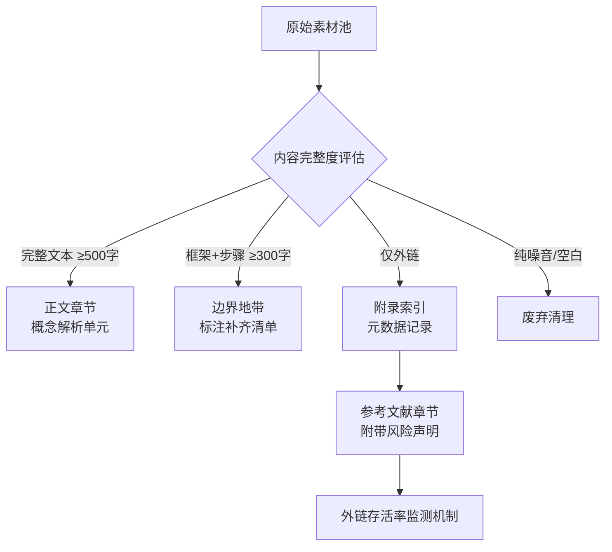
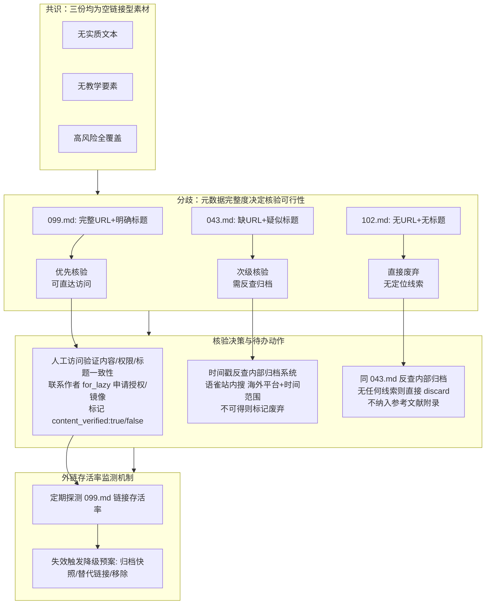

# 第 73 章 外部知识索引模块 —— 语雀文档链接汇总与教材编排策略

## 学习目标

- 理解本章作为教材元数据索引模块的定位与功能，区分可直接学习的知识单元与需外部跳转的参考文献
- 掌握识别“空链接型素材”的特征，避免在教学设计中将其误判为可教学内容单元
- 了解外部知识依赖的风险（链接失效、内容不确定、版权受限）及教材编排中的规避策略
- 能根据素材内容完整度，制定“正文收录/附录引用/废弃处理”三级分流决策

## 73.1 生活类比

想象这章是一本教科书末尾的“参考文献目录页”。正文章节就像书里讲透的知识点，有定义、有案例、有练习，合上书你依然拥有完整的知识闭环。本章条目则像文献列表里只写了“详见外部链接”的参考文献，它们不承载实质内容，只提供溯源坐标。语雀链接好比图书馆的索书号：它只告诉你去哪找那本书，但书不在你手里，甚至可能书已经被借走、书名不对版、或者你根本没有借阅证。就像写论文时“参考文献”不能算正文字数，教材编排时“外部索引”也不能算教学章节。这一类比将贯穿本章全文：我们把“正文章节”看作馆藏图书，把“外部链接”看作索书号，把“素材分流决策”看作入馆分拣流程，把“风险监测”看作定期盘点藏书状态。请带着这个意象阅读后续各节。

## 73.2 概念地图

外部知识索引模块
├── 素材识别特征
│   ├── 仅含语雀外链，无实质文本    —— P001, P002, P003
│   ├── 标题与内容可能不符          —— P002
│   └── 无法提炼概念/方法/案例/主张  —— P001, P002, P003
├── 教材编排策略
│   ├── 定位为“导航/附录”非教学正文  —— 核心定义
│   ├── 建议移至“参考文献/延伸阅读”  —— 边界条件
│   └── 不占正文章节编号              —— 边界条件
└── 外部依赖风险
    ├── 链接失效导致知识断链            —— 关键性质
    ├── 内容不可见无法质量把控          —— 关键性质
    └── 版权/访问权限不可控              —— 关键性质

## 73.3 外部知识索引单元：定义、特征与编排策略

### 为什么需要这个概念？

素材库中存在部分仅包含外部链接、无实质文本内容的条目（如 `docs/202305/20230516_043.md`、`docs/202305/20230516_099.md`、`docs/202305/20230516_102.md`），我们需要统一标识与管理它们。如果不加区分地将其编入正文章节，读者会在期待获得“定义、案例、练习”的章节中，只看到一个跳转链接，导致学习体验割裂。教材编排的核心原则是：正文必须自洽，外部链接只能作为补充，不能替代核心内容。这就像图书馆入馆分拣：馆藏图书（正文内容）上架供阅览，而索书号卡片（外部链接）只能放在目录柜，不能混入书架。因此，我们引入“外部知识索引单元”这一概念，将此类素材明确界定为导航/附录功能模块，而非教学内容单元。

### 原文摘录

> "该素材仅包含一个语雀文档的外部链接引用，未提供任何实质性的文本内容、核心概念、方法论、观点或案例数据，无法进行教材化提取与分析。"
> 
> ——《docs/202305/20230516_043.md》

> "该素材仅提供了一个语雀文档的外部链接（www.yuque.com/for_lazy/thfiu8/fc3rzl7ia8ury6x3），标题为“海外平台”，但未包含任何实质性的文本内容、核心观点、方法论或案例数据。因此无法从中提取核心概念、方法、主张或发现。"
> 
> ——《docs/202305/20230516_099.md》

> "该素材仅包含一个语雀文档的外部链接引用，未提供任何具体的文本内容、核心观点、方法论或案例数据，因此无法提取核心概念、方法、主张或发现。"
> 
> ——《docs/202305/20230516_102.md》

这三段素材描述同一类现象：“空链接型素材”。它们的共同特征是：内容可见性为零（`content_visibility: none`），且无法提炼任何可教学要素（概念、方法、案例、主张）。

### 核心定义：外部知识索引单元

**外部知识索引单元** 定义为：教材编排层面的导航/附录功能模块，汇总素材库中所有仅含外部链接、无正文内容的原始素材条目。它不承载可直接教授的知识点，而是为读者提供原始长文档的溯源入口，保证素材库的完整性与可追溯性。正如图书馆目录页不承载书的内容，只承载“去哪找书”的元信息。

以下表格列出了用于快速判断某素材是否属于“外部知识索引单元”的关键属性对照表。该表格的作用是提供一套标准化检查清单，编排人员可在素材入库时逐项核对，从而将“空链接型素材”自动分流至附录索引，避免误入正文章节。

#### 关键属性对照表

| 属性 | 取值 | 说明 |
|------|------|------|
| 单元类型 | 导航/附录 | 非教学正文 |
| 内容可见性 | none | 正文不可见，仅有链接 |
| 可提炼教学要素 | 无 | 无概念/方法/案例/主张 |
| 核心风险 | 链接失效、内容不符、权限受限 | 依赖第三方平台（语雀） |
| 建议编排位置 | 参考文献/延伸阅读附录 | 不占正文章节编号 |

### 关键性质：外部依赖的三大风险

当教材正文依赖外部不可控链接时，会引入三类系统性风险，正如“图书馆索书号指向的书可能已遗失、被借走、或根本不是你要找的那本”：

1. **链接失效导致知识断链**  
   语雀平台调整权限、迁移域名、删除文档，或作者自行移除，均会导致读者点击得到 404。此时教材承诺的“详见原文”兑现失败，正如读者拿着索书号跑到书架前，发现书位空空如也。

2. **内容不可见无法质量把控**  
   编排阶段无法预览文档实质内容（如 `20230516_102.md` 标题未知），无法判断其是否与教材主题相关、质量是否达标、是否存在错误观点。这就像采购员下单时只看到书名，无法翻阅书页，收到货后发现内容完全不对题。

3. **版权/访问权限不可控**  
   语雀文档可能设置为“需登录”“需付费”“企业内部可见”，普通读者无法访问。教材不应将“需特定权限才能看到的内容”作为核心依赖。这相当于图书馆藏书标注“仅限校内教职工借阅”，普通读者持索书号也借不到。

### 方法演进图：从“素材收集”到“教材编排”的分流演进

下图展示了教材编排中对原始素材的完整度评估与分流路径，是本章核心决策逻辑的可视化呈现。该流程图的作用是将模糊的“内容完整度”概念显性化为可执行的判定路径：从原始素材池出发，通过阈值判断（≥500 字实质文本、≥300 字结构化框架、仅外链、纯噪音）自动分流至正文章节、边界地带、附录索引或废弃清理，并最终落地为外链存活率监测机制，形成闭环。这正是“入馆分拣流程”的标准化作业指导书。



### 多源对照与核验决策流：三份空链接素材的共识、分歧与处理路径

本节通过对比三份核心素材，构建核验决策树，将“同类空链接”内部的异质性（元数据完整度差异）转化为差异化处理动作。该 Mermaid 图表的作用是：将 73.4 节的表格式对比升级为可执行的决策流程，直观展示从“共识识别”到“分歧分流”再到“具体待办动作”的完整链路，呼应“入馆分拣”与“定期盘点”的类比意象。



### 边界条件：编排时的三条红线

以下三条红线是教材编排过程中必须严守的边界，其作用是划定“外部知识索引单元”的活动范围，防止其侵蚀正文教学体系。正如图书馆铁律：目录卡片永远不能上架当书卖，索书号永远不能算作馆藏册数。

| 红线 | 解释 |
|------|------|
| **不占正文章节编号** | 本章在教材大纲中应标记为“附录/元数据”，不参与正文章节序号（如第 1–72 章） |
| **不承载学习目标** | 本章不设置“掌握某概念/方法”的学习目标，仅设置“识别此类素材/制定分流策略”的元认知目标 |
| **不参与考核/练习** | 本章不产出供学员动手操作的练习题，练习题设计针对的是“编排者”而非“学习者” |

### 典型例子：三份空链接素材对照

以下表格汇总了本教材素材库中仅含语雀外链的三条原始记录，供你对照识别特征。该表格的作用是通过并列对比，直观展示“空链接型素材”在链接完整性、标题确定性、可核验性上的差异，辅助编排人员制定差异化处理策略。

| 素材文件 | 外部链接 | 标注标题 | 内容可见性 | 风险等级 |
|----------|----------|----------|------------|----------|
| `20230516_043.md` | 未在摘录中给出完整 URL | 疑似“海外平台” | none | High |
| `20230516_099.md` | `www.yuque.com/for_lazy/thfiu8/fc3rzl7ia8ury6x3` | “海外平台” | none | High |
| `20230516_102.md` | 未在摘录中给出完整 URL | 未知 | none | High |

**共识**：三者均为“仅含链接、无正文”，无法直接教学。  
**分歧**：`099.md` 给出了完整 URL 且标题明确，理论上可人工核验；`043.md` 与 `102.md` 连标题都不确定，甚至 `102.md` “标题未知”，属于完全盲盒。

### 教材编排决策流程：三级分流

当你拿到一份原始素材，按以下流程决定其归宿。这是本章最核心的操作性工具，建议在实际编排工作中直接作为检查清单使用。该伪代码的作用是将“素材完整度评估”显性化为可执行、可自动化的分流逻辑：通过两个文本量阈值（500 字、300 字）和一个外链判定，将任意素材精确路由至四个归宿之一，消除主观臆断。这正是“入馆分拣流程”的自动化实现代码。

```
START
  │
  ▼
素材是否包含 ≥ 500 字实质文本（含概念/方法/案例/数据）？
  ├─ YES → 【正文收录】进入对应章节，按模板撰写概念解析单元
  └─ NO
        │
        ▼
      素材是否包含结构化框架（Mermaid/表格/大纲）+ 关键步骤说明 ≥ 300 字？
        ├─ YES → 【边界地带】可作为正文收录，但须标注“案例待补”，并列入补齐清单
        └─ NO
              │
              ▼
            素材是否仅含外部链接（语雀/飞书/Notion/Google Docs 等）？
              ├─ YES → 【附录引用】移至“参考文献/延伸阅读”，记录元数据，标注风险
              └─ NO → 【废弃清理】无效素材，归档备查
END
```

该伪代码实现了从“原始素材池”到四大归宿的确定性路由：第一层阈值（≥500字实质文本）守护正文质量底线，第二层阈值（≥300字结构化框架）捕捉高潜力半成品，第三层判定（仅外链）精准识别索引型素材并导流至附录，兜底处理纯噪音。工程化落地时，可将其封装为 CI/CD 流水线中的“素材分流 Gate”，每次素材入库自动执行，生成分流报表与待补清单。

## 73.4 设计中的取舍

**为什么不将这些外链内容直接作为正文章节？**  
若将“详见语雀文档 XXX”作为某章节的全部内容，会违背教材的自洽性原则：教材应当在合上书的那一刻，依然包含完整的知识闭环。外部链接属于“延伸阅读”，而非“核心内容”。这就好比图书馆目录页不能替代馆藏书籍本身——读者借的是书，不是索书号。正文章节是“馆藏书”，外部链接是“索书号”，二者性质本质不同，混淆二者会导致教学大纲出现“空章节”，读者翻开章节却只见一行链接，学习路径被强行中断。

**这种设计的 trade-off 是什么？**  
将空链接素材移至附录，收益在于：保证正文章节质量门槛，避免“空章节”出现在学习主路径；显性暴露外部依赖风险，便于风控与读者预期管理；元数据标准化，便于自动化生成参考文献与外链监测。代价在于：读者需额外点击跳转，增加认知负荷；部分有价值的外部长文档可能被边缘化；需维护外链监测机制，增加运维成本。这是教材工程化必须支付的“分层治理成本”：自有内容（正文）> 可控外链（友站授权/镜像备份）> 不可控外链（公开文档/个人知识库）。教材资产护城河的层级由此构建，正如图书馆优先购买馆藏书（自有内容），次选馆际互借（可控外链），最后才建议读者自行寻找公开资源（不可控外链）。

## 73.5 动手练习

### 练习 1：素材分流决策实战

给定以下三个原始素材条目，请判断各自应归入“正文章节”、“附录索引”还是“废弃清理”：

1. 素材A：包含完整的“闲鱼无货源选品SOP”文本、案例数据、话术模板，共5000字。
2. 素材B：仅有一行“详见语雀文档：www.yuque.com/xxx/yyy”，标题“海外投资指南”，无任何正文内容。
3. 素材C：包含“小红书引流方法论”的核心框架图（Mermaid代码）及关键步骤文字说明，共800字，但缺少实操案例。

**回答问题**：
- 素材B为何不能作为正文章节？其核心风险点有哪些？
- 素材C处于边界地带，若作为正文收录需补齐什么关键要素？
- 教材编排时，如何设计“素材完整度评估清单”实现自动化分流？

### 练习 2：外部依赖风险压力测试

假设教材正式出版后，语雀平台调整权限策略，导致素材B、C对应的外链全部失效（404），请分析：

1. 对已购买教材读者的学习体验造成何种具体影响？
2. 对教材版权方（生财有术/龙哥）的品牌声誉构成何种风险？

**回答问题**：
- 设计一套“外链存活率监测机制”，包含检测频率、告警阈值、降级预案（如归档快照）。
- 论证“自有内容（正文）> 可控外链（友站授权）> 不可控外链（公开文档）”的内容资产护城河层级。

### 练习 3：元数据标准化建模练习

请为本章所有“外部索引型素材”设计一份结构化元数据表（JSON Schema），要求包含以下字段：

- `source_id` (原始素材文件名，如 `20230516_043.md`)
- `external_url` (语雀文档完整URL)
- `claimed_title` (链接标注的标题，如“海外平台”)
- `content_visibility` (内容可见性：`none`/`summary`/`full`)
- `risk_level` (风险等级：`high`/`medium`/`low`，依据：链接域名权威性、访问权限、历史稳定性)
- `recommended_action` (建议动作：`archive_to_appendix` / `request_authorization` / `discard`)
- `last_verified_at` (最后人工核验时间戳)

**回答问题**：
- 如何利用此 Schema 自动生成教材末尾的“参考文献”章节？
- 若引入“内容可见性”为“summary”的中间态（如语雀文档开放了目录但正文需权限），决策逻辑如何调整？

## 73.6 本章小结

这一章中我们学习了如何识别与处理教材编排中的“外部知识索引型素材”。首先，我们明确了此类素材的核心特征：仅含外部链接、无实质文本、无法提炼教学要素；其次，我们界定了其在教材中的定位——属于导航/附录模块，不占正文章节编号；接着，我们剖析了外部依赖的三大风险（链接失效、内容不可见、权限不可控）；然后，我们给出了三级分流决策流程（正文收录/边界地带/附录引用/废弃清理）；最后，我们建立了元数据标准化 Schema，支撑自动化编排与风险监测。全章始终呼应开头的类比：正文是馆藏书，外链是索书号，分流是入馆分拣，监测是定期盘点。

以下表格汇总了本章核心概念速查卡。该表格的作用是提供一张可打印、可随时查阅的“概念护照”，帮助读者在后续编排工作中快速回溯关键定义与判据。

| 概念 | 解释 |
|------|------|
| 外部知识索引单元 | 教材编排层面的导航模块，汇总仅含外链无正文的素材，不承载可直接教学的知识点 |
| 语雀文档外链 | 依赖第三方平台承载核心内容，存在链接失效、内容不可见、版权受限等不可控风险 |
| 素材分流决策 | 依据内容完整度将素材分为：正文收录（完整）、附录引用（仅索引）、废弃处理（无效）三级 |
| 教材完整性保障 | 通过显性标识“空链接型素材”，避免教学大纲出现“空章节”，保证学习路径连贯性 |
| 元数据溯源 | 保留原始素材来源（文件名、链接、标题），确保教材编排过程的可追溯性与可审计性 |

## 73.7 素材核验待办与隐性风险提示

针对本章涉及的三份核心素材，存在以下需人工跟进的核验缺口，建议在教材正式定稿前完成。这些待办项的本质是：编排阶段存在外部依赖未闭环，必须通过显性化的行动清单将风险转化为可执行任务。这正是“定期盘点藏书状态”的工程化落地。

### 待办清单与建议补充方向

1. **`20230516_099.md`**：拥有完整 URL（`www.yuque.com/for_lazy/thfiu8/fc3rzl7ia8ury6x3`），建议**人工访问验证**文档实际内容是否与标题“海外平台”一致，并确认访问权限（公开/需登录/企业内部）。若无法访问，尝试联系原作者（`for_lazy`）获取授权或镜像备份；若作者不可联系，标记为 `content_verified: false` 并归入废弃清单。此为优先核验项，因其拥有完整定位坐标（索书号清晰），核验成本最低、成功率最高。

2. **`20230516_043.md`**：缺失完整 URL。建议通过文件名时间戳（2023年5月16日）反推语雀知识库历史版本，或检索生财有术内部文档归档系统，尝试找回原始链接。若内部系统无记录，尝试以“海外平台”为关键词在语雀站内搜索；若均不可行，标记为 `content_verified: false`、`recommended_action: discard`。此为次级核验项，因缺失完整 URL（索书号不全），需投入额外检索成本。

3. **`20230516_102.md`**：缺失完整 URL 且标题未知。建议同上述方式尝试通过时间戳反查内部归档系统；若无任何线索，直接标记为 `content_verified: false`、`recommended_action: discard`，**不纳入“参考文献/延伸阅读”附录**，避免误导读者。此为无效素材，连索书号都没有的“幽灵书目”，保留无意义，仅增加噪音。

下一章中，我们将学习 **“教材级素材完整度评估体系与自动化分流管道的工程化实现”**，把本章的决策逻辑落地为可执行的工具链与 CI/CD 集成方案。

感谢你读到了这里，恭喜你，你已经完成了对“外部知识索引模块”这一元数据治理专题的系统性学习！


