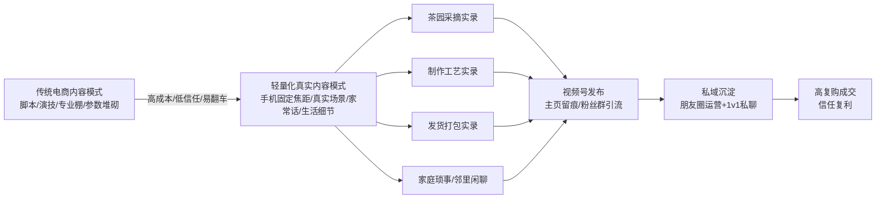
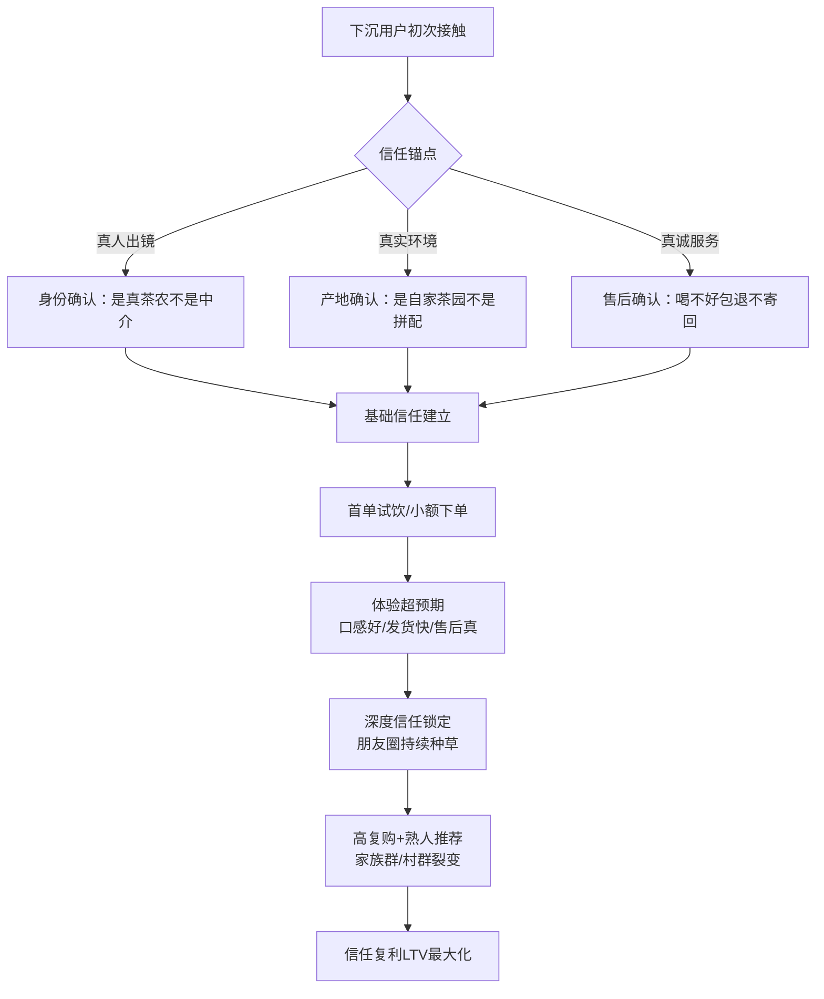
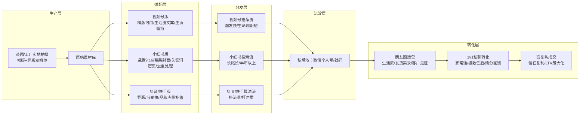

# 第 48 章 视频号轻量化私域模式
作者：龙哥

## 学习目标

- 理解轻量化私域模式的核心逻辑：为何个人/小团队应做“减法”放弃直播与小店
- 掌握下沉市场农产品的信任构建法则：真心实意、真实产地、真诚售后的三要素
- 熟悉多平台素材复用分发的操作SOP：视频号+小红书双平台协同引流私域的标准化动作
- 能识别轻量化模式的边界条件：产地真实性、物流兜底、私域规模化瓶颈及防封技巧
- 学会用“私域沉淀+信任转化”替代“公域爆款+即时成交”的商业思维范式

## 48.1 生活类比

想象轻量化私域模式像**“村口老张卖自家茶”**：公域内容（视频号/小红书）就是老张每天在村口晒茶、聊天、让人闻香、看采摘过程，这是真实展示而非吆喝叫卖；多平台分发就是老张不仅在村口晒，还托隔壁村表哥、县城女婿帮忙转发朋友圈，覆盖视频号推荐流与小红书搜索流；私域沉淀（微信/群）则是买过茶的邻里被拉进“老张茶友群”，平时唠嗑、发红包、晒泡茶照片，构建朋友圈运营与1v1私聊的深度连接；信任转化体现在邻里介绍亲戚来买——“老张茶实在，喝不好包退，还是产地直发”，形成高复购与社交裂变；做减法则是老张不租柜台、不请推销员、不搞直播带货，省下房租人工钱买更好茶叶、包邮赠样。就像老张靠“真人、真茶、真心”在方圆十里立住口碑，轻量化模式也靠“真实内容、私域信任、多平台分发”在下沉市场跑通闭环。

---

## 48.2 概念地图

视频号轻量化私域模式（第48章细纲核心）
├── 核心定律
│   ├── 个人创业‘减法’优于‘加法’定律  —— P001
│   └── 下沉市场信任红利论  —— P001
├── 关键概念
│   ├── 视频号轻量化变现模式：公域引流+私域成交  —— P001
│   ├── 下沉市场农产品IP：真心实意建立信任  —— P001
│   └── 多平台素材复用分发：一鱼多吃跨平台获客  —— P001
├── 执行方法论
│   ├── 私域沉淀与信任转化法：朋友圈运营+1v1私聊  —— P001
│   ├── 小红书辅助获客战术：种草属性补足搜索短板  —— P001
│   └── 真实内容生产SOP：拒绝脚本/演技/滤镜，记录产地生活  —— P001
├── 边界与风控
│   ├── 产地真实性前置条件：纯贩子无法长期维持人设  —— P001
│   ├── 物流体验硬短板：偏远地区需自建补发/赔付/专线兜底  —— P001
│   ├── 私域规模化瓶颈：单人5000好友上限，突破需招募合伙人  —— P001
│   └── 引流防封技巧：主页留痕/群聊中转/小号发号/关键词规避  —— P001
└── 实证验证
    ├── 三个月变现20万声明  —— P001
    ├── 轻量化模式收益不降反稳对比  —— P001
    ├── 小红书跨平台成交验证  —— P001
    └── 普通人低起点逆袭路径  —— P001

---

## 48.3 轻量化私域模式 —— 做减法，用私域信任替代公域爆款

### 为什么需要这个概念？

你可能也有过这种体验：明明听说直播带货很火，自己也买了设备、搭了场景、背了话术，可一开播就是几十人在线，还要时刻盯着数据、怕违规、怕限流，累得像条狗，一个月下来账号废了、钱也没赚到。这就是典型的“加法”陷阱——**不断叠加动作（选品、场景、主播、投流、小店、客服），看似完善，实则每一环都在烧钱、烧精力、烧容错率**。

作者“橘子海”在素材中直白地复盘了这条路：“前期操作和大家一样，通过软件选品发视频，视频爆了开直播……今年1月份开始转换了一下思路和方法，**不在追求爆款，也不开视频号小店和直播，主要是懒和能力有限，直播对个人来说成本太大了，但我发现收益也并没有减少**。”[^P001_1]

这句话揭示了个体创业的核心悖论：**高门槛动作（直播、小店、专业团队）的边际收益往往为负**，因为它们消耗了你最稀缺的资源——**时间与精力**，却无法保证流量的确定性。视频号的算法推荐机制决定了公域流量极其不稳定，今天爆款、明天限流，账号权重随时归零。

**轻量化私域模式**的核心定义就是：**不开视频号小店、不做直播、不追求爆款视频，仅通过视频号内容引流至私域（微信个人号/社群），再通过私域信任转化成交的低成本运营模式。**[^P001_1]

它的核心公式极其简练：
> **公域内容（真实记录）→ 多平台分发 → 私域沉淀（朋友圈+1v1）→ 高复购成交**

这个公式展示了三个关键位移：
1. **流量位移**：从“争夺公域算法推荐”转移到“经营私域存量信任”；
2. **转化位移**：从“直播间即时冲单”转移到“长周期信任积累后下单”；
3. **成本位移**：从“高固定成本（人场货）”转移到“低边际成本（手机+真人+真货）”。

### 核心定义与推导

> **轻量化私域模式定义**（来源：《P001 视频号轻量化私域模式》）

$$
\text{模式核心} = \text{真实内容生产} \times \text{多平台分发} \times \text{私域信任运营} \div \text{公域算法依赖}
$$

这个公式采用乘除结构，其逻辑推导如下：
- **分子端（乘法叠加）**：真实内容生产、多平台分发、私域信任运营是三个**可控、可积累、相互增强**的动作。真实内容生产提供信任原材料，多平台分发放大单次内容的触达面，私域信任运营将流量转化为可复利的资产。三者缺一不可，相互乘积，共同决定了模式的“确定性分子”。
- **分母端（除法消减）**：公域算法依赖是**不可控、波动大、易归零**的变量。直播带货、追爆款、开小店都高度依赖平台推荐算法，一旦限流或封号，前端投入尽数打水漂。将分母趋近于零（即刻意抛弃对算法的强依赖），整个模式的确定性就趋近于无穷大。这正是“做减法”的数学本质：减去不可控变量，留下可控确定性。

### 关键方法：真实内容生产SOP

> **真实内容生产SOP**（来源：《P001》）

```
1. 拒绝脚本/演技/滤镜/专业灯光，用手机固定焦距记录真实场景
2. 内容素材：茶园采摘/制作工艺/发货打包/家庭琐事/邻里闲聊
3. 文案风格：家常邻里话，不讲参数指标，讲口感体验/生活细节
4. 发布节奏：日更1-2条，视频号优先，小红书延迟48小时/去重后分发
5. 引流钩子：视频号挂主页微信号/粉丝群/置顶评论；小红书用评论区钩子/主页简介
```

这段SOP展示了**“内容即人设，生活即素材”**的生产逻辑。你不需要学剪辑特效，只需要把手机架在茶园、厂房、打包台上，按下录制键。素材中作者明确提到：“内容形式：真实记录茶园采摘、制作、发货、家庭琐事，无脚本、无演技、无滤镜。”[^P001_2] 这种“笨功夫”反而建立了最高级的信任护城河——**因为造假成本太高，真实成本最低**。

### 方法演进图：真实内容生产SOP的迭代路径



### 典型例子与边界条件

**典型例子**：作者“橘子海”，初中学历、前流水线工人、曾负债几十万，转型轻量化模式后**3个月变现20万**，月收益不降反稳。[^P001_3] 这印证了“普通人低起点逆袭路径”的可行性——**无学历无背景无资源，全力以赴做减法，反而能跑通闭环**。

**边界条件**（必须清醒认知）：
- **品类限定**：仅适用于高信任属性、高复购潜力、非标/弱标品类（农产品、茶叶、土特产、手工制品）；标品、强品牌溢价品类不适用。
- **人设依赖**：强依赖创始人真实人设输出，难以标准化复制团队化运营，扩张受限于个人精力。
- **冷启动期**：前3个月日引流可能<50人，现金流承压，需有心理预期与资金储备。
- **违规风控**：微信私域引流需规避关键词、频控，需掌握“主页留痕/群聊中转/小号发号/关键词规避”等防封技巧（详见48.5节）。

---

## 48.4 下沉市场信任红利 —— 真心实意即最高级的转化话术

### 为什么需要这个概念？

你在城市卖课、卖软件、卖化妆品，话术都要讲“痛点、恐惧、稀缺、权威、从众”，可一旦面对县城阿姨、村里大爷，这套话术**完全失效**。素材中作者深刻指出：“确实应该真心实意的对待农村下沉市场，普通人没什么梦想，无外乎挣点小钱，让自己和家人过得好一点。”[^P001_4]

下沉市场用户的决策逻辑与城市白领**根本不同**：
- 城市白领信“专家背书、参数对比、品牌溢价、退货无忧”；
- 下沉市场信“熟人推荐、产地直发、实地所见、人情面子、售后兜底”。

专业直播间的高光灯、专业话术、脚本化互动，反而会引发他们的**防备心理**——“这是不是骗子？城里人套路深”。而真实生活流——**真人出镜、真实环境、真诚服务**——才能建立安全感。

### 核心定义与推导

> **下沉市场信任红利论**（来源：《P001》）

$$
\text{信任构建} = \text{真人} + \text{真境} + \text{真心} \quad \text{而非} \quad \text{专业话术} + \text{搭建棚} + \text{标准SOP}
$$

这个公式采用加法结构，其逻辑推导如下：
- **左侧（加法叠加）**：真人出镜、真实环境、真诚服务是三个**独立且可叠加**的信任基石。真人出镜解决“谁在卖”的身份确认，真实环境解决“货从哪来”的产地确认，真诚服务解决“出事咋办”的售后确认。三者各自提供独立信任增量，相加构成完整的信任拼图。
- **右侧（对比排除）**：专业话术、搭建棚、标准SOP是城市电商的标配，但在下沉市场不仅边际成本极高，更因“过度包装”触发用户防备心理，产生负向信任增量。因此用“而非”明确排除，标定了信任构建的正向边界。

### 关键性质与传播路径

1. **信任门槛低、维护成本低、崩塌代价高**  
   一单假货、一次售后推诿 = 信用破产。在微信强关系链（家族群、村群、同乡会）中，负面口碑的**逆向传播速度是正向的10倍以上**。

2. **传播路径依赖微信强关系链**  
   单次转化带动群体跟单。素材中作者提到“目前全网有茶业IP粉丝15W+”[^P001_5]，这背后是无数个“老张茶友群”在自发裂变。

3. **定价策略需留“回馈空间”**  
   客单价不敏感，但“面子”“情分”敏感。定价必须包含：赠茶样、包邮、熟人价、节日红包。若直接报最低价，反而让买家觉得“便宜没好货”、没面子、没情分。

### 方法演进图：下沉市场信任构建路径



### 典型例子与边界条件

**典型例子**：一位县城阿姨问“你们家茶叶为啥比超市贵？超市才80块一斤”。  
**错误回复（专业科普风）**：讲产地海拔、采摘标准、加工工艺、质检报告 → 阿姨听不懂、觉得你装、转头买超市。  
**正确回复（家常邻里风）**： “阿姨，超市茶是机器采、拼配茶，喝完涩口不耐泡。我们是自家茶园、手工炒、一芽一叶，喝完嘴里回甘、晚上睡眠好。您先尝尝我们的试饮装（赠样），喝不好喝、发霉、碎叶，找我全额退款不用寄回。要是觉得好，平时自喝、送亲戚、发朋友圈晒一晒，我给您留个老主顾价，包邮再送茶样。”  

这个回复体现了**“真心实意”四重保障**：真实产地背书 + 低门槛试错（赠样） + 极致售后兜底（全额退款免运费） + 情分回馈空间（老主顾价+赠样）。

**边界条件（红线）：**
- **产地真实性前置**：必须真实有产地/工厂/源头。纯贩子、二道贩子无法长期维持“人设”，极易翻车（视频通话看茶园、发货单显示产地、邻里实地考察都会露馅）。
- **物流体验硬短板**：偏远地区快递慢、破损率高，必须自建“补发/赔付/专线”兜底机制，否则信任瞬间归零。
- **私域规模化瓶颈**：单人微信5000好友上限，突破需招募“合伙人/代理”下沉至村级，管理成本指数级上升。

---

## 48.5 多平台素材复用分发 —— 一鱼多吃，用小红书种草补足视频号搜索短板

### 为什么需要这个概念？

视频号是**推荐算法为主、搜索流量弱、内容生命周期短（24-48小时衰减）**，单平台流量上限低、波动大。小红书则是**搜索流量强、内容长尾效应长（半年以上）、女性用户多、种草属性强**，与农产品“女性决策者/送礼自饮”高度匹配。

素材中作者感叹：“小红书也能出单确实惊到我了”[^P001_6]，这揭示了一个核心洞察：**内容生产成本已沉没，边际分发成本趋近零，不分发即浪费沉没成本**。

### 核心定义与推导

> **多平台素材复用分发**（来源：《P001》）

$$
\text{跨平台ROI} = \frac{\sum_{i=1}^{n} (\text{平台}_i \text{引流量} \times \text{转化率})}{\text{单次内容生产成本} + \sum_{i=1}^{n} \text{适配成本}_i}
$$

这个公式采用分数结构，其逻辑推导如下：
- **分子（收益端）**：$\sum_{i=1}^{n} (\text{平台}_i \text{引流量} \times \text{转化率})$ 表示多平台流量的叠加收益。视频号贡献“推荐爆发快”，小红书贡献“搜索长尾长”，抖音/快手贡献“算法补流量”。各平台流量来源互不相关，收益可线性叠加。
- **分母（成本端）**：$\text{单次内容生产成本}$ 是**沉没成本**，无论分发几个平台都只发生一次；$\sum_{i=1}^{n} \text{适配成本}_i$ 是**边际适配成本**（剪辑比例、改标题、加封面、去重处理）。
- **决策判据**：只要 $\text{适配成本}_i < \text{平台}_i \text{增量收益}$，分发该平台即为正收益。由于视频生产成本已沉没，边际分发成本极低，多平台分发几乎必然为正ROI。

### 关键方法：双平台协同分发SOP

> **视频号+小红书双平台分发SOP**（来源：《P001》）

```
1. 素材拍摄：横版/竖版双机位同步录制，或横版素材后期裁剪双版本
2. 视频号版（优先发布）：
   - 文案：生活流/真实感，话题标签#产地直发 #茶农日常
   - 引流：主页留微信号/粉丝群/置顶评论钩子
3. 小红书版（延迟48小时/去重后发布）：
   - 必须竖版9:16，前3秒加精美封面+大字标题（如“云雾茶园避坑指南”）
   - 文案植入搜索关键词：怎么选茶/茶叶保存/送礼推荐/避坑指南
   - 评论区钩子：“集赞领试饮/主页简介领资料”
   - 去重处理：镜像/调色/变速/加边框/加贴纸/字幕边框
4. 私域汇聚：所有平台引流至同一微信个人号/社群，统一朋友圈运营+1v1私聊转化
```

这段SOP展示了**“一鱼多吃”的工程化实操**：同一素材，视频号吃“推荐流量红利”，小红书吃“搜索长尾红利”，抖音/快手吃“算法补量红利”，私域吃“信任复利”。

### 方法演进图：多平台素材分发数据流



### 平台差异与防封技巧对照

下表对比了三大平台在流量机制、内容偏好、引流方式、去重要求四个维度的差异，供制定分发策略时参考：

| 维度 | 视频号 | 小红书 | 抖音/快手 |
|------|--------|--------|-----------|
| 核心流量 | 推荐算法（爆发快） | 搜索SEO（长尾长） | 推荐算法（补流量） |
| 内容偏好 | 生活流/真实感/横版友好 | 精美封面/干货笔记/竖版强制/关键词密集 | 娱乐化/节奏快/竖版 |
| 引流方式 | 主页留痕/粉丝群/置顶评论（相对宽松） | **极严**：群名片/纸条/计算器/私信自动回复/小号中转 | 打击最重，仅作品牌声量补给 |
| 去重要求 | 低（原创保护机制弱） | **高**（必须镜像/调色/变速/加边框） | 高 |

**小红书引流防封技巧（物理规避手段）**：
- **群名片法**：建群→群设置“群名片”写微信号→引导用户点击群名片复制
- **纸条法**：视频/图片中手持纸条写微信号（非文字识别）
- **计算器法**：评论区回复“需要加V：计算器输入123456789查看”
- **小号中转**：大号发内容、小号评论区/私信发钩子→小号发微信号
- **关键词规避**：微信→V信/WX/加薇；群→交流会/茶友会；加好友→交个朋友

> **注意**：素材中作者并未详细展开防封细节，但评论区用户追问“批量下载软件”“怎样才算养好号”[^P001_7]，侧面印证了**小红书引流管控极严、操作繁琐、风险高**，需结合相关章节（小红书安全引流）综合应用。

---

## 48.6 多源对照：轻量化模式的不同实践路径

本章核心模式在素材库中有多个变体实践，对照如下：

### 共识

下表梳理了三个典型案例在核心策略上的共识点，均来源于同一素材库不同角色的实践：

| 核心共识 | P001(橘子海/茶叶) | P002(I8BL/农机) | P003(东哥/视频号带货矩阵) |
|----------|-------------------|-----------------|---------------------------|
| **放弃直播/小店** | ✅ 核心策略 | ✅ 核心策略 | ❌ 保留直播承接转化 |
| **私域为王** | ✅ 微信个人号/群 | ✅ 企微客服/私域 | ✅ 短视频引流+直播承接 |
| **真实内容/人设** | ✅ 真实生活流 | ✅ 真人出镜/CO人设 | ✅ 素材反推选品/IP搬运 |
| **下沉市场/银发人群** | ✅ 农村/茶叶 | ✅ 农村/农机 | ✅ 视频号50岁+女性≥80% |
| **多平台分发** | ✅ 视频号+小红书 | ✅ 视频号+小红书+快手 | ❌ 专注视频号单平台 |

### 分歧

下表展示了三条路径在执行层面的关键分歧，揭示了不同资源禀赋下的策略选择：

| 分歧点 | P001(橘子海) | P002(I8BL) | P003(东哥) |
|--------|--------------|------------|------------|
| **直播作用** | 完全放弃，成本太大 | 完全放弃，轻量化 | **保留**：短视频引流+直播承接，转化率更高 |
| **账号矩阵** | 单号深耕，个人IP | 单号深耕，IP搬运过渡原创 | **矩阵化**：一证五号+安卓双开+物理隔离，20+账号 |
| **选品逻辑** | 固定茶叶单品类 | 素材反推选品（先找IP素材再匹配供应链） | 测品-爆款-放大三阶段数据驱动 |
| **供应链模式** | 自有产地/源头 | 定制链接/SKU/外部供应链熔断 | 多店铺备选+即时催单+动态切换 |
| **规模化路径** | 受限个人精力，招募合伙人下沉村级 | 品牌连锁谈判全国联动 | 家庭身份证红利解锁矩阵上限+流程化SOP |

**洞察**：P001与P002高度趋同于**“个人/微团队轻量化私域”**范式；P003则演进为**“团队化矩阵投流”**范式。前者核心杠杆是**信任复利**，后者核心杠杆是**流量杠杆×供应链杠杆**。普通人起步建议先跑通P001/P002路径，积累私域资产与供应链认知后，再评估是否具备P003的团队化条件。

---

## 48.7 设计中的取舍

**问：为什么不用“直播带货+小店”标准模式？**  
答：因为个人/小团队的**时间杠杆**极其有限。直播要求：固定场地、固定时长、专业主播、选品团队、投流预算、售后客服——每一项都是固定成本，且强依赖平台算法（自然流量不稳定、投流ROI波动大）。素材中作者亲测：“运气好的情况下一个月也能赚几万块钱，难点在于选品和素材……直播对个人来说成本太大了。”[^P001_1] 轻量化模式将**固定成本压至接近零**，用**信任杠杆（私域复利）**替代**流量杠杆（公域算法）**，虽然单次爆发上限低，但**生存确定性高、现金流稳健、抗风险强**。

**问：为什么不用“抖音/快手”做主力阵地？**  
答：抖音/快手对“硬广/引流”打击最重，且用户画像偏年轻、娱乐化，与高客单农产品的“中老年/实用/信任”决策链条错位。视频号依托微信生态，**公私域无缝跳转、信任传递零损耗**；小红书女性用户多、种草属性强、搜索长尾长，完美补足视频号搜索短板。两者组合是当前**下沉市场农产品获客性价比最高**的组合。

**问：这种设计的trade-off是什么？**  

| 收益 | 代价 |
|------|------|
| 固定成本→0，生存确定性↑ | 单账号爆发上限↓（无直播/投流放大） |
| 私域资产自有，抗平台风险↑ | 规模化受限于个人精力/微信好友上限（~5000） |
| 信任复利/LTV极高 | 冷启动慢（前3个月日引流<50），现金流承压 |
| 内容生产门槛极低 | 强依赖创始人真实人设，难标准化团队化复制 |
| 多平台分发边际成本≈0 | 小红书引流防封操作繁琐、风险高 |

---

## 48.8 动手练习

### 练习 1：轻量化模式可行性自测清单

针对你手头的一个产品/项目（或设想的项目），判断是否适合“轻量化私域模式”：
1. 产品是否为高信任属性、高复购潜力、非标/弱标品类？（如农产品、茶叶、土特产、手工制品）
2. 你是否拥有真实产地/工厂/源头准入资格？（而非纯贩子/二道贩子）
3. 你能否接受前3个月日引流<50人、现金流承压的冷启动期？
4. 你是否具备基础剪辑能力、真实出镜意愿、长期朋友圈运营耐心？
5. 物流履约端：偏远地区是否有补发/赔付/专线兜底方案？
6. 私域风控：是否掌握“主页留痕/群聊中转/小号发号/关键词规避”等防封技巧？

**回答问题**：
- 若第2条不满足，该模式为何极大概率会翻车？  
  **解析**：纯贩子/二道贩子无法长期维持“真人+真境”人设。视频通话看茶园、发货单显示产地、邻里实地考察等验证手段会瞬间露馅，导致信任崩塌、私域资产归零，且面临平台封号与法律风险。
- 若第5条缺失，信任崩塌的传导路径是什么？  
  **解析**：偏远地区快递慢/破损 → 客户收货体验差 → 私聊投诉/朋友圈吐槽 → 家族群/村群/同乡会逆向传播 → 负面口碑扩散速度是正向10倍以上 → 新客信任门槛极高/老客流失 → 私域资产连锁崩塌。
- 对比“直播带货模式”与“轻量化私域模式”，在“时间杠杆”与“信任杠杆”维度的核心差异是什么？  
  **解析**：直播模式依赖**时间杠杆**——单位时间内通过高频开播、投流放大触达陌生人，追求即时转化ROI，但时间不可复用、停播即停收；轻量化模式依赖**信任杠杆**——单位内容通过多平台分发、私域沉淀、长期运营，将一次触达转化为可复利的信任资产，时间越久价值越高。

### 练习 2：多平台素材适配改造实操

假设你拍摄了一条60秒的“茶园采摘日记”横版视频（含旁白讲解），需分发至视频号与小红书：
1. **视频号版**：保持横版/竖版均可，文案侧重“生活流/真实感”，引流钩子置于主页/粉丝群/置顶评论，标签用#产地直发 #茶农日常
2. **小红书版**：必须剪成竖版9:16，前3秒加精美封面+大字标题（如“云雾茶园避坑指南”），文案植入“怎么选茶/茶叶保存/送礼推荐”等搜索关键词，评论区钩子用“集赞领试饮/主页简介领资料”，需做镜像/调色/变速/加边框去重

**回答问题**：
- 为何小红书版需“首发平台+48小时延迟分发”或深度去重处理？  
  **解析**：小红书原创保护机制强，同质化检测严。同一素材多平台同发极易被判定“搬运/低质”，导致限流/封号。48小时延迟让首发平台完成流量跑完，去重处理（镜像/调色/变速/加边框）破坏指纹特征，规避跨平台查重算法，保证各平台账号权重独立。
- 小红书引流钩子为何不能像视频号那样直接放微信号/群二维码？需用哪些“物理规避手段”替代？  
  **解析**：小红书对“站外导流”打击极严，文本/图片中的微信号、二维码、群聊卡片会被OCR识别并限流封号。必须用**物理规避手段**：群名片法（群设置名片写微信号）、纸条法（手持纸条拍照）、计算器法（评论区引导输入数字查看）、小号中转（大号发内容、小号评论/私信发钩子）、关键词规避（微信→V信/WX/加薇）。
- 同一素材在视频号靠“推荐算法”、小红书靠“搜索SEO”获客，两者流量衰减周期与长尾价值有何本质不同？  
  **解析**：视频号推荐流呈**指数衰减**，前24-48小时占总流量80%以上，长尾极短，适合“爆发式收割”；小红书搜索流呈**长尾分布**，发布半年后仍有稳定搜索流入，适合“持续式收割”。前者像“捕鱼”，后者像“养鱼塘”，两者互补构建稳定获客漏斗。

### 练习 3：下沉市场信任话术重写练习

场景：你在私域微信回复一位来自县城的阿姨，她询问“你们家茶叶为啥比超市贵？超市才80块一斤”。

任务：基于“下沉市场信任红利论”（真实/产地/人情/面子/情分），重写三版回复话术：
- **版本A：专业科普风**（展示反面教材，分析为何在下沉市场失效）
- **版本B：家常邻里风**（核心话术，体现“真心实意”、留“回馈空间”、售后兜底）
- **版本C：社交裂变风**（引导转介绍，利用“熟人推荐/家族群/同乡会”强关系链）

**回答问题**：
- 版本B中“喝不好喝、发霉、碎叶，找我全额退款不用寄回”这类极致售后承诺，为何能在下沉市场建立压倒性信任优势？  
  **解析**：下沉用户风险厌恶极高、维权能力弱。该承诺将“试错成本”从买家转移给卖家，且“免寄回”消除了物流麻烦（偏远地区寄件难）。这相当于卖家用“亏佣金/成本”买“信用资产”，在强关系链中形成“实在人、敢担当”口碑，触发熟人推荐裂变。
- 定价策略中为何要留“回馈空间”（如赠茶样、包邮、熟人价）？若直接报最低价会发生什么？  
  **解析**：下沉市场决策受“面子/情分”驱动。直接报最低价＝“便宜没好货”+“没面子/情分可讲”+“无法在亲戚面前显摆渠道/价格”。留回馈空间让买家获得“捡到漏/拿到内部价/送礼有面子”的心理满足，且便于其二次分享推荐（“我有熟人渠道，比超市实在还便宜”）。
- 对比城市白领人群，下沉市场用户的“信任锚点”与“决策路径”有何根本性区别？  
  **解析**：城市白领信任锚点为**制度/标准/品牌**（质检报告、大平台担保、退货无忧），决策路径为“搜参数→比价格→看评价→下单→售后找平台”；下沉用户信任锚点为**人/地/情**（真人真境、产地直发、熟人背书、人情往来），决策路径为“信人→试饮→喝好→复购→拉亲戚进群→群体跟单”。前者依赖公域制度降低信任成本，后者依赖私域关系实现信任跃迁。

---

## 48.9 本章小结

这一章中我们学习了**视频号轻量化私域模式**的完整逻辑与实操体系。首先，我们拆解了**“个人创业做减法”**的核心定律——放弃高成本、高门槛、高风险的直播带货与小店运营，转而采用“公域内容引流+私域信任转化”的低成本模式，反而能降低运营风险、稳定收益确定性。其次，我们深度剖析了**“下沉市场信任红利”**的心理机制——农村用户信任“真人、真境、真心”，拒绝专业话术与包装人设，极致售后（全额退款免运费）与情分回馈（赠样/包邮/熟人价）是建立压倒性信任的关键。接着，我们掌握了**“多平台素材复用分发”**的工程化SOP——视频号吃推荐爆发、小红书吃搜索长尾、抖音/快手补流量，同一素材经适配分发最大化ROI，私域汇聚统一运营。然后，我们识别了模式的**四大边界红线**：产地真实性前置、物流兜底机制、私域规模化瓶颈、引流防封技巧，缺一不可。最后，我们通过多源对照（茶叶/农机/矩阵带货三大变体）厘清了不同资源禀赋下的路径选择，明确了“信任杠杆”与“流量杠杆”的适用边界。

本章我们一起学习了以下概念：

| 概念 | 解释 |
|------|------|
| 视频号轻量化变现模式 | 不开店、不直播、不追爆款，仅用内容引流至私域靠信任成交的低成本模式 |
| 个人创业‘减法’优于‘加法’定律 | 放弃高门槛直播带货，转做轻量化私域反而降低风险、稳定收益 |
| 下沉市场信任红利论 | 农村用户信任‘真实/产地/人情’，真心实意展示实况+售后保障即可获高复购 |
| 多平台素材复用分发 | 同一视频素材分发视频号(推荐爆发)+小红书(搜索长尾)最大化ROI |
| 私域沉淀与信任转化法 | 放弃公域即时转化，沉淀微信靠朋友圈/私聊长期运营实现高LTV |
| 真实内容生产SOP | 拒绝脚本/演技/滤镜，记录茶园采摘/制作/发货/家庭琐事的真实生活流 |
| 产地真实性前置条件 | 必须真实有产地/源头，纯贩子/二道贩子无法长期维持人设易翻车 |
| 物流体验硬短板 | 偏远地区快递慢/破损率高，必须自建补发/赔付/专线兜底机制 |
| 私域规模化瓶颈 | 单人微信5000好友上限，突破需招募合伙人下沉村级，管理成本指数级上升 |
| 引流防封技巧 | 小红书管控严需物理规避：群名片/纸条/计算器/小号中转/关键词规避 |

---

[^P001_1]: 来源素材 `docs/202305/20230516_079.md`，作者“橘子海”实战复盘：“今年 1 月份开始转换了一下思路和方法，不在追求爆款，也不开视频号小店和直播，主要是懒和能力有限，直播对个人来说成本太大了，但我发现收益也并没有减少。”
[^P001_2]: 来源素材 `docs/202305/20230516_079.md`，作者“橘子海”实战复盘：“内容形式：真实记录茶园采摘、制作、发货、家庭琐事，无脚本、无演技、无滤镜。”
[^P001_3]: 来源素材 `docs/202305/20230516_079.md`，作者“橘子海”实战复盘：《视频号还能做吗，三个月通过视频号赚 20W》。
[^P001_4]: 来源素材 `docs/202305/20230516_079.md`，作者“橘子海”实战复盘：“确实应该真心实意的对待农村下沉市场，普通人没什么梦想，无外乎挣点小钱，让自己和家人过得好一点”。
[^P001_5]: 来源素材 `docs/202305/20230516_079.md`，作者“橘子海”实战复盘：“目前全网有茶业 IP 粉丝 15W+”。
[^P001_6]: 来源素材 `docs/202305/20230516_079.md`，作者“橘子海”实战复盘：“小红书也能出单确实惊到我了”。
[^P001_7]: 来源素材 `docs/202305/20230516_079.md`，评论区用户追问“批量下载软件”“怎样才算养好号”。

