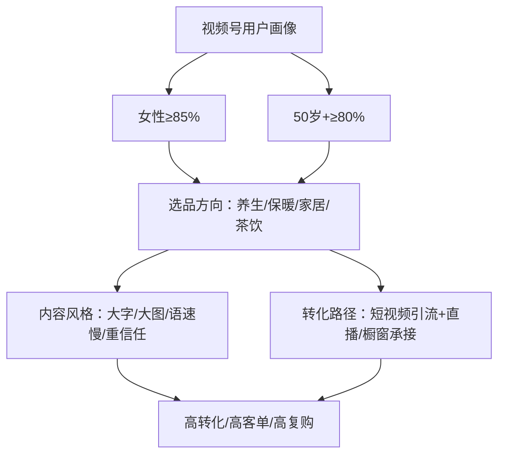
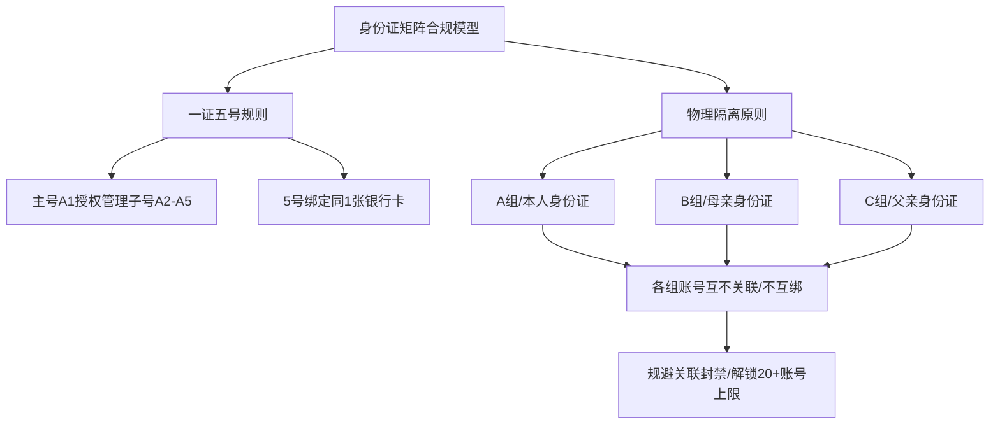
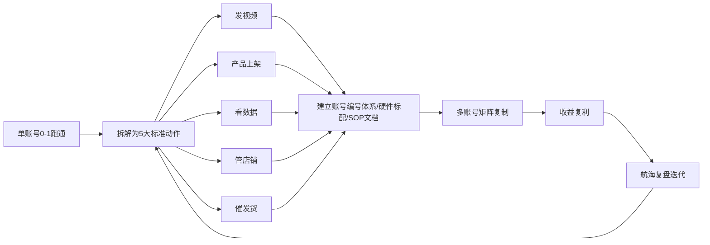
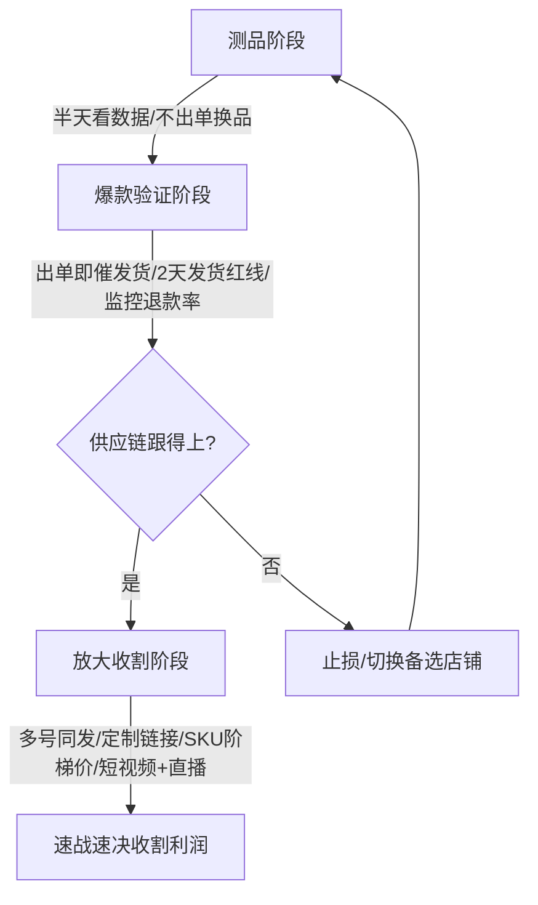
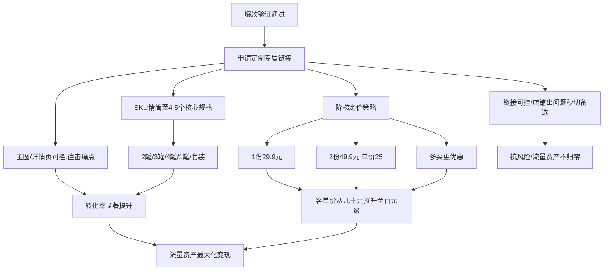
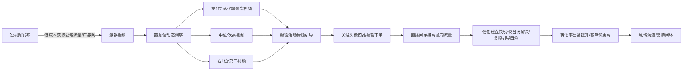
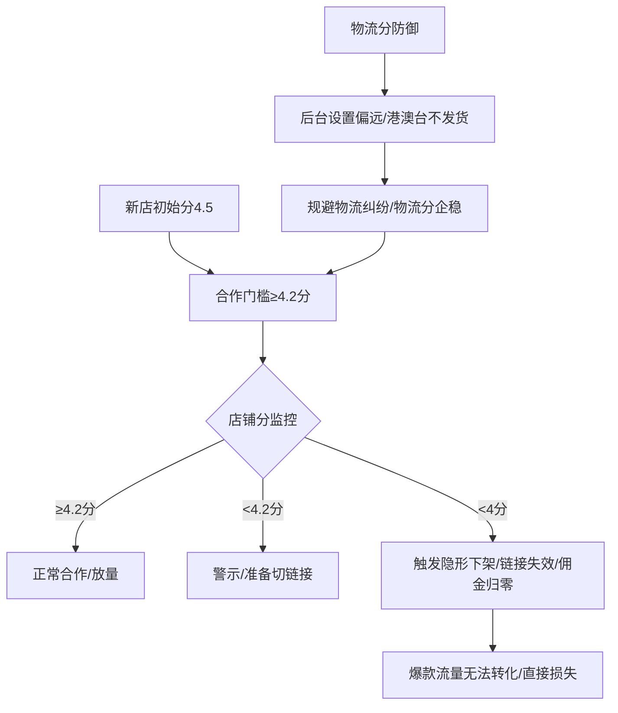
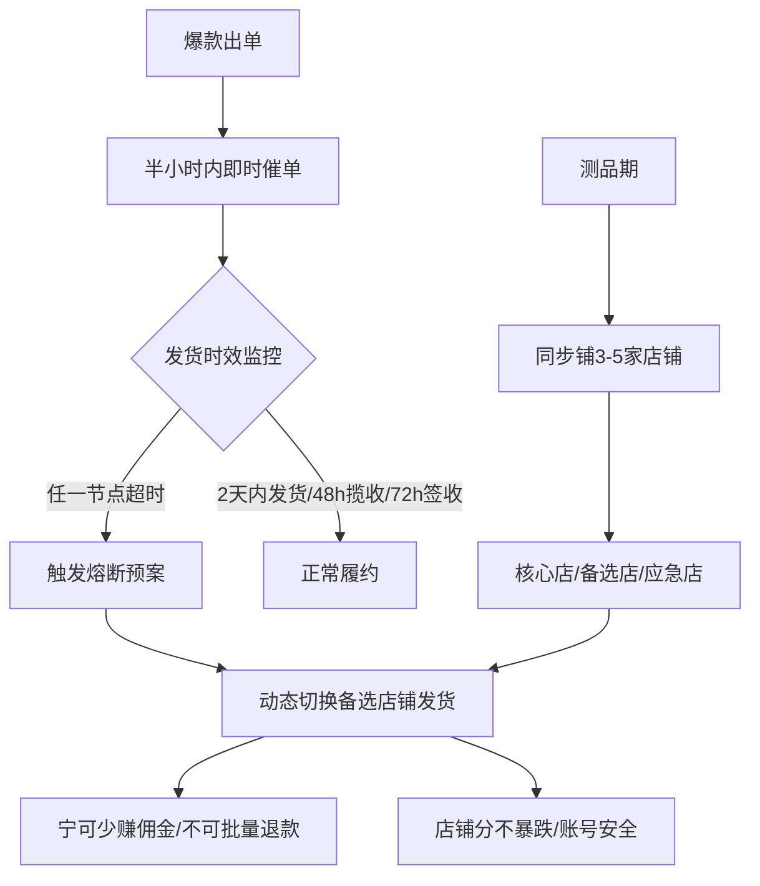
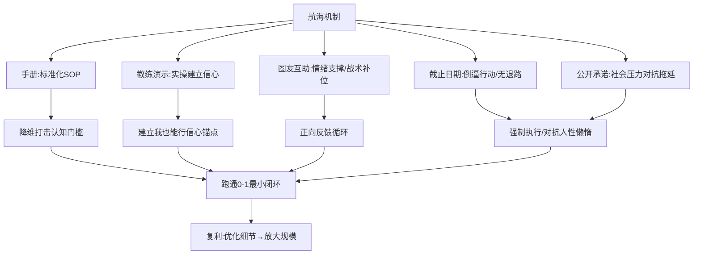
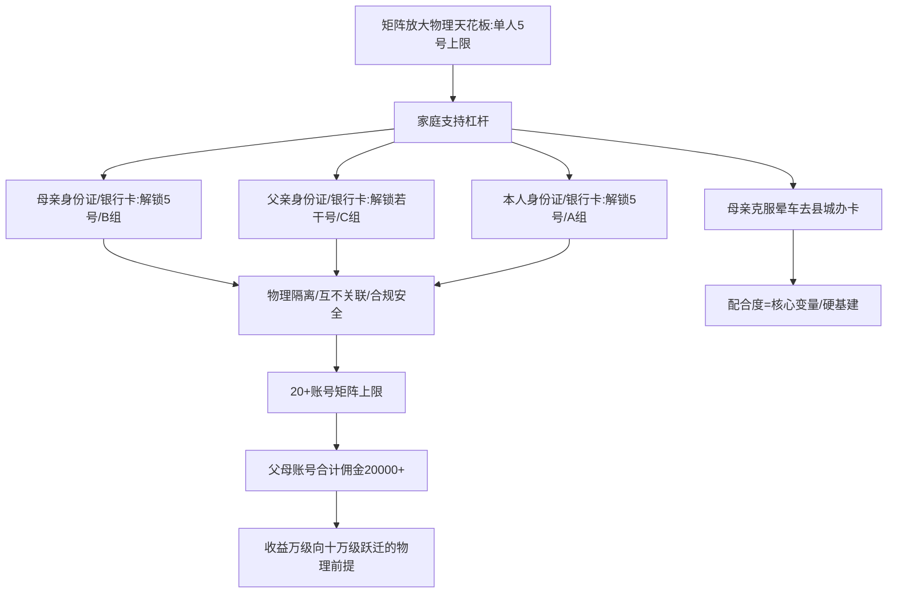

# 第 44 章 视频号短视频带货矩阵化实操 —— 从合规搭建到流程化放大的工程化路径

## 学习目标

- 理解视频号银发用户画像对选品、内容、转化的决定性影响
- 掌握一证五号身份证矩阵合规模型与多账号物理隔离管理方案
- 掌握测品-爆款-放大三阶段数据驱动决策法及关键红线
- 能设计爆款定制链接与SKU阶梯定价策略以最大化客单价
- 建立短视频引流+直播承接的分层转化模型与橱窗动态运营SOP
- 识别店铺体验分风控红线（4.2分准入/4分生死线）与偏远地区不发货防御策略
- 建立供应链熔断机制：多店铺备选+即时催单+动态切换
- 理解流程化标准化（发视频/上架/看数据/管店铺/催发货五步法）是放大复利的唯一路径
- 认知航海机制作为外部约束容器对个体执行力的强制激励作用
- 认知家庭支持（身份证/银行卡/配合度）作为矩阵放大物理杠杆的关键作用

## 44.1 生活类比

想象视频号带货是一场**精心策划的“社区团购接龙”**。视频号的核心用户画像，就是社区里最爱囤货、最信熟人推荐、钱包松但眼光准的“楼长大妈/大爷”群体（女性占比≥85%、50岁以上占比≥80%）；身份证矩阵，就是为了多组几个团、不被物业封号，动用自家、岳父岳母、亲戚的身份证分别建群、收款（一证五号、物理隔离、互不关联）；测品-爆款-放大，就是先在小群发几款样品（测品），哪款抢得凶（出单）立马电话催厂家备货（催发货），再拉满所有人群同步推（多号同发），定制专属价格梯度（阶梯价）；定制链接/SKU，就是不用厂家统一价目表，自己设专属海报、专属套餐（1盒29.9/2盒49.9）、专属发货单，转化率蹭蹭涨；短视频引流+直播承接，就是朋友圈发广告引流（短视频），晚上开语音会详细讲解、现场下单（直播），置顶最火的广告（置顶位动态调序）；店铺分风控，就是物业/平台对群卫生/投诉/发货速度打分，低于及格线（4分）直接封群隐藏，必须设置“偏远不送”保分；供应链熔断，就是主力供货商突然失联/断货，立马启动备选供货商、甚至自己垫资发货，宁可少赚不可砸招牌（退款率/店铺分红线）；流程化SOP，就是把“发广告、收单、催发货、对账、处理售后”写成傻瓜式操作手册，新来的亲戚照着做也能出单，实现“赚钱的事多做十遍”；航海机制，就是找个组织（航海），交钱、定目标、有教练带着练、有截止日期、不完成罚款，强迫自己从“想卖货”变成“每天按时发广告、催发货”；家庭支持，就是老婆/老公/父母不仅不拦着，还帮忙办卡、接验证码、顶班发货，把单兵作战变成家族产业，解锁“身份证红利”。

## 44.2 概念地图

视频号短视频带货矩阵化实操
├── 核心认知
│   ├── 视频号用户画像：银发女性高客单决策逻辑
│   ├── 执行力>认知：赚钱的事多做十遍
│   └── 供应链响应速度决定爆款变现上限
├── 基建体系
│   ├── 身份证矩阵合规模型：一证五号+物理隔离+授权分离
│   ├── 多账号硬件方案：安卓双开/红米Note11T/账号编号A1-A5/台账管理
│   └── 家庭支持杠杆：父母身份证解锁20+账号上限
├── 标准化作业流程（SOP）
│   ├── 五大标准动作：发视频、上架、看数据、管店铺、催发货
│   ├── 测品-爆款-放大三阶段法：半天测品/催发货红线/多号同发定制链接
│   ├── 爆款定制链接与SKU阶梯定价：主图/SKU/价格可控/1份29.9-2份49.9
│   ├── 短视频引流+直播承接模型：置顶位动态调序/橱窗长尾搭配/活动标题引导
│   ├── 店铺体验分风控：≥4.2分准入/<4分下架/偏远地区不发货设置
│   └── 供应链熔断机制：多店铺备选+即时催单+动态切换/验货红线
├── 外部赋能系统
│   └── 航海机制：手册+教练演示+圈友互助+截止日期+公开承诺
└── 实证验证层
    ├── 单账号爆发案例：羽绒服/茶壶/养生茶/舅舅账号/父母账号
    ├── 供应链失联导致实发率崩塌
    ├── 店铺分<4分触发隐形下架
    ├── 航海4次仅12月完整跑通迎来拐点
    └── 账号管理混乱的物理解决方案（贴纸+表格+编号）

## 44.3 视频号用户画像 —— 银发女性的高客单决策逻辑

### 为什么需要这个概念？

带货选品若不匹配平台核心用户画像，流量再大也难转化。视频号用户结构极其特殊：女性占比≥85%、50岁以上占比≥80%，是典型的“银发经济”阵地。只有看透人群画像，才能在选品时避开红海，精准击中养生、保暖、家居等高频刚需。

> "视频号用户女性偏多，年龄偏大；如图 女性占 ≥85%，50 岁以上占比 ≥80%。"
> 
> ——《docs/202305/20230516_024.md》

### 核心定义

**视频号带货核心流量池**：以中老年女性为绝对主力的高信任、高客单、高复购人群。

画像标签：女性占比≥85%，50岁以上占比≥80%，决策快、信任强、复购高。这一画像直接决定了选品方向：必须聚焦中老年高频刚需（养生、保暖、家居、茶饮）；决定内容风格：大字、大图、语速慢、重情感信任、轻花哨技巧；决定转化路径：短视频引流+直播/橱窗承接，私域信任转化率极高。

### 关键性质

这一画像具有强烈的选品导向性，直接决定“卖什么”：羽绒服、湿巾、茶壶、养生茶等冬季保暖滋补品，单账号轻松跑出千单万佣。父母账号合计佣金20000+，验证了该人群的付费能力与信任粘性。同时，依赖“颜值/潮流/极致性价比”打法的选品，在此人群中大概率扑街。我们要做的是**顺应人性**，而非**教育用户**。

### 典型例子

12月羽绒服/湿巾爆款，单账号400单、佣金3000+；1月茶壶次出30单，后持续1.5月单账号佣金6800元；3月养生茶出70+单、佣金2300+；2月舅舅账号首日10万+播放，持续2月佣金12000+；父母账号合计佣金20000+。这些案例均验证了该画像对选品与转化的决定性影响。

### 边界条件

非标品、高客单、长决策链路产品（如大件家电、高端数码）不适配该人群。依赖“颜值/潮流/极致性价比”打法的选品，在此人群中大概率扑街。



## 44.4 身份证矩阵合规模型 —— 一证五号的物理隔离术

### 为什么需要这个概念？

矩阵化放大受限于实名制：一个人只能实名5个号，单人上限死死卡住。账号关联风险极高：同设备、同网络、互绑主体极易触发连坐封禁。必须用“物理隔离+授权分离”破解身份上限与安全红线。

> "一个身份证可以办 5 个号，比如 A1，A2，A3，A4，A5。其中 A2 - A5 的运营者绑定为 A1，电脑网页端视频号助手用 A1 账号可以切换登录各账号发布视频。5 个号绑定同个银行卡。A，B，C 几个人的账号各自分开不要互绑，安全第一。"
> 
> ——《docs/202305/20230516_024.md》

### 核心定义

**身份证矩阵合规模型**：基于微信“一证五号”规则，构建“主号授权+子号运营+同卡结算+物理隔离”的矩阵账号体系。

结构上，主号(A1)绑定运营者管理子号(A2-A5)，5号绑1张银行卡；不同家庭成员(A/B/C组)账号物理隔离，绝不互绑。这一模型具有合规性——利用平台规则红利（一证五号），而非钻漏洞，长期可用；安全性——物理隔离（不同手机、不同人、不同网络）规避关联封禁；可控性——主号网页端统一发视频，子号仅运营，权责清晰。

### 关键性质

该模型的合规性体现在利用平台规则红利而非钻漏洞，长期可用。安全性体现在物理隔离（不同手机、不同人、不同网络）规避关联封禁。可控性体现在主号网页端统一发视频，子号仅运营，权责清晰。

### 典型例子

作者用自己身份证办5号(A组)、妈妈身份证办5号(B组)、爸爸身份证办几号(C组)，组建20+账号矩阵。父母账号合计佣金20000+，验证“身份证红利”可直接变现。

### 边界条件

家庭成员配合度是硬约束：母亲克服晕车去县城办卡，是放大规模的物理前提。手机硬件成本：推荐红米Note 11T 8+128G(~1700元)，1机双开10号，20号需2-3部手机。银行卡绑定：5个号必须绑定同一张卡，资金归集统一管理。



## 44.5 流程化放大闭环 —— 让“赚钱的事多做十遍”成为SOP

### 为什么需要这个概念？

单账号跑通≠可放大：非标准化动作无法复制，人一多就乱，质量不可控。普通人缺天赋、缺资源、缺运气，唯有“流程化标准化”能把概率游戏变成工程问题。只有将带货拆解为标准动作，才能实现“跑通流程→优化细节→多账号复制→收益复利”。

> "跑通流程，优化细节，多账号，流程化，赚钱的事多做十遍。"
> 
> "发视频，产品上架，看数据，管店铺，催发货。这几个步骤...当我们可以多做十遍的时候，就已经是在进一步放大了。"
> 
> ——《docs/202305/20230516_024.md》

### 核心定义

**五大标准动作**：将视频号带货全链路拆解为可执行、可考核、可替换的标准化动作单元。

1. **发视频**：内容生产与分发
2. **产品上架**：选品、挂车、SKU配置
3. **看数据**：流量、转化、ROI监控
4. **管店铺**：体验分维护、售后处理、合规巡检
5. **催发货**：供应链跟进、发货时效把控、异常熔断

同时建立账号编号体系、硬件标配清单、SOP文档化操作手册，实现单人高效管理20+账号。

### 关键性质

该闭环具有可复制性：新人拿到SOP按步骤执行即可产出合格动作，不依赖个人灵感。具有可放大性：账号从1→5→20，动作不变，仅重复次数增加，边际成本递减。具有可迭代性：每轮航海复盘沉淀新SOP，如“橱窗排序法”“SKU定价法”持续优化细节。

### 典型例子

账号编号A1-A5 + 手机背面贴纸标记 + 笔记本台账 + 电子表格，解决“6个号忘记哪个手机是哪个号”的管理混乱。“发视频、上架、看数据、管店铺、催发货”五步法，让作者从兼职小白变全职操盘手。

### 边界条件

前提是单账号0-1已跑通验证可行，未跑通前搞矩阵是找死。执行力是核心变量：SOP再好不执行等于零，作者“赚钱的事多做十遍”靠的是死磕。供应链、物流、平台规则变动等外部环境突变，需SOP具备快速修补能力。



## 44.6 测品-爆款-放大三阶段法 —— 数据驱动的生死决策线

### 为什么需要这个概念？

带货本质是概率游戏：99%的品是炮灰，只有1%能成爆款。主观臆测选品死得快，必须用“小成本测、数据验证、放量收割”三阶段动作控制风险。每阶段有明确止损/放量标准，避免“死磕烂品”或“放量不力”两类致命错误。

> "开始各账号测不同产品，发布视频时就要选择产品上架 2-3 个链接。"
> 
> "至少每半天查看一下各账号流量。重点在出了 1-2 单后要立刻跟 2-3 家店铺留言及电话确认货源充足及发货速度问题...延迟 3-5 天发货很容易退款退单。"
> 
> "发现爆款后多个账号测同款产品，短视频引流到橱窗同个店铺抓紧时间抢钱，打仗速战速决利益最大化。"
> 
> ——《docs/202305/20230516_024.md》

### 核心定义

**三阶段数据驱动决策法**：

| 阶段 | 核心动作 | 关键指标 | 止损/放量标准 |
|------|----------|----------|---------------|
| **阶段1 测品** | 多账号测不同品，单视频挂2-3链接，半天看流量/出单 | 曝光量、点击率、出单数 | 不出单果断换品，不恋战 |
| **阶段2 爆款验证** | 出单后立刻电话/留言催发货(2天内发货红线)，监控退款率/实发率 | 发货时效、退款率、实发率、店铺分 | 供应链跟不上即止损，宁可少赚不可翻车 |
| **阶段3 放大收割** | 多号同发同款引流单店，定制链接/SKU，短视频引流+直播转化 | 单账号日单量、客单价、ROI、店铺分 | 速战速决，爆款周期短(几天到几周) |

该三阶段决策表将模糊的运营经验固化为可执行的检查清单，使“凭感觉做决策”转变为“看指标定动作”，在爆款周期短、容错率低的视频号带货中，是控制风险、锁定利润的核心工具。

### 关键性质

该方法具有“快、狠、稳”三大特性：快——测品周期短(半天看数据)，止损快(不出单即换)，放量决策快(出单即定制)；狠——催发货优先级>发视频，供应链不熔断宁可少赚不可翻车；稳——爆款定制链接锁定利润，橱窗动态排序+长尾搭配最大化单用户价值。

### 典型例子

12月羽绒服/湿巾：测品出单→催发货→多号同发→单账号400单/佣金3000+。1月茶壶：次日出30单验证爆款→定制5 SKU阶梯价→持续1.5月单账号6800元(后因供应链崩塌损失数千)。

### 边界条件

供应链响应速度是硬天花板：48小时发货红线，延迟3-5天必引发退款雪崩。店铺体验分<4.2分不合作，<4分直接下架，物流分极易被偏远地区拖垮。单一供应链依赖风险极高：必须建立“多店铺备选+即时催单+动态切换”熔断机制。



## 44.7 爆款定制链接与SKU阶梯定价 —— 把流量变成利润的精细化手术刀

### 为什么需要这个概念？

通用链接无法承接爆款流量：主图不吸引、SKU乱、价格死、详情弱，转化率极低。爆款周期短(几天到几周)，必须在黄金窗口期用“定制链接+阶梯价”榨干流量价值。SKU过多导致决策瘫痪，阶梯价(1份29.9/2份49.9)利用锚定效应强迫客单提升。

> "爆款产品让店铺定制链接，主图，SKU，详情页，价格等都可以修改，这样可以促进出单以及提升客单价。"
> 
> "SKU 太多太乱影响下单；另外价格上 1 份 29.9 元，2 份 49.9 元；客户更容易买 2 单或更多。"
> 
> "定制 SKU 有 5 个：2 罐，3 罐，4 罐，1 罐，茶花三件套*1 份；茶花三件套*2 份；价格 30-180 都有"
> 
> ——《docs/202305/20230516_024.md》

### 核心定义

**爆款定制链接**：向商家申请定制专属链接，主图、SKU、详情页、价格全可控，剥离平台通用链接的平庸基因。

**SKU阶梯定价策略**：

```text
SKU结构（精简至4-5个核心规格）：
- 2罐装
- 3罐装  
- 4罐装
- 1罐装
- 套装（如茶花三件套）

价格阶梯：
- 1份：29.9元
- 2份：49.9元（单价25元）
- 3份/套装：单价更低，覆盖30-180元价格带
```

此策略通过精简SKU消除决策瘫痪，利用阶梯价锚定效应引导多买，将单客价值从几十元拉升至百元级。

### 关键性质

该策略具有转化率杠杆作用：定制主图/详情直击痛点，配合橱窗置顶位，流量转化率显著提升。具有客单价杠杆作用：阶梯价+套装组合，将单客价值从几十元拉升至百元级。具有抗风险性：链接可控，店铺出问题可秒切同款其他店铺链接，流量资产不归零。

### 典型例子

养生茶爆款：定制5 SKU(2/3/4/1罐+三件套)，价格30-180元，单账号70+单/佣金2300+。茶壶爆款：定制链接+高佣45%→单账号6800元，验证定制链接对利润的放大作用。

### 边界条件

需商家配合度高：小商家/代发商家常拒绝定制或响应慢，需在测品期筛选“配合度高”店铺。定制链接审核/生效有延迟，爆款初期需通用链接顶上，无缝切换考验运营反应速度。类目限制：标品(如3C数码)难定制，非标/白牌/源头工厂品类定制空间最大。



## 44.8 短视频引流+直播承接模型 —— 公私域流量的分层变现

### 为什么需要这个概念？

单一短视频转化有天花板：冲动下单率低、客单价上不去、售后压力大。直播间承接高意向流量：信任建立快、异议当场解决、复购引导自然、转化率显著更高。置顶视频权重递减规律(左1>中>右1)未被利用，等于白白浪费爆款流量溢出价值。

> "短视频搞流量，直播提升转化。"
> 
> "当视频爆了，是可以有 3 个置顶位的，置顶的视频会有更多流量，流量大小：左 1＞中间＞右 1。可以在后台根据视频数据做调整排序。"
> 
> "在视频号助手【活动管理】创建 活动标题：关注头像商品橱窗下单...引导客户去橱窗下单。"
> 
> ——《docs/202305/20230516_024.md》

### 核心定义

**分层运营策略**：
- 短视频负责低成本获取公域流量爆发(广撒网)
- 直播间承接高意向流量提升转化率(深转化)

**置顶策略**：爆款视频占据3个置顶位(左1>中>右1)，根据实时数据动态调序，配合橱窗活动标题引导下单。

**活动标题话术**：如“关注头像商品橱窗下单”，将公域流量显性导入私域成交场域。

### 关键性质

该模型实现流量分级：短视频=流量入口(成本低、爆发快)，直播=转化池(信任强、客单高)。置顶位是稀缺资源，左1流量最大，必须给转化率最高的爆款视频。闭环设计：视频→橱窗/直播→私域(微信/群)→复购，构建完整商业闭环。

### 典型例子

舅舅账号：首日10万+播放，销售额8800，持续2月、佣金12000+，短视频引流+直播承接跑通全链路。爆款视频动态调序：数据好的换左1，下滑的挪右1，实时榨干置顶流量红利。

### 边界条件

直播需要人/场/货配置：无人直播/真人出镜均可，但需标准化话术SOP与排品逻辑。置顶位仅3个，长尾视频无法享受置顶红利，需靠橱窗长尾商品承接溢出流量。平台规则收紧风险：视频号对直播带货规则变动快，需持续跟进合规红线。



## 44.9 店铺体验分风控红线 —— 4.2分准入线与4分生死线

### 为什么需要这个概念？

爆款跑起来最怕店铺“隐形下架”：流量来了链接打不开，佣金直接归零。视频号店铺分(商品/服务/物流)是硬性生存指标，非软性参考，违规即死。物流分最隐蔽、最易忽视：偏远地区发货纠纷、延迟揽收、虚假发货，单靠运营无法挽回。

> "现在视频号新开店铺的评分一般是 4.5 分...低于 4 分的店铺，很容易被平台隐藏下架...尽量选择店铺分数高（≥4.2 分），以及物流分数高的店铺进行合作。"
> 
> "建议有店铺的小伙伴，在店铺后设置偏远地区/港澳台地区等不发货"
> 
> ——《docs/202305/20230516_024.md》

### 核心定义

**三大体验分生存阈值**：
- 新店初始4.5分 → 合作门槛≥4.2分(安全垫) → 红线<4分(触发隐藏下架)
- 物流分防御：后台预设“偏远地区/港澳台不发货”，规避物流纠纷拖垮店铺分
- 选品准入：宁可少赚，不合作<4.2分店铺；合作中店铺分跌破4.2立即切链接

### 关键性质

该风控体系具有非线性惩罚特性：4.2到4.0仅0.2分差距，却是“正常曝光”与“彻底隐藏”的生死界限。物流分不可控性强：依赖上游发货速度、快递时效、偏远网点服务，唯一可控动作是“不发偏远”。需要动态监控：必须建立店铺分日报表，日监控、周预警、月复盘，纳入SOP必查项。

### 典型例子

作者亲历2-3款产品因店铺分低被下架/隐藏，爆款流量无法转化、佣金直接归零。设置偏远地区不发货后，物流分企稳回升，店铺分重回安全区。

### 边界条件

高佣金/高销量店铺往往物流分较低(单量大、偏远单多)，需在“利润”与“安全”中权衡。新店无历史分(初始4.5)，前30天是观察期，小单验证物流后再放量。平台规则动态调整：体验分权重、计算公式、惩罚阈值可能随政策收紧而提高。



## 44.10 供应链熔断机制 —— 到手鸭子飞了的止损术

### 为什么需要这个概念？

爆款期“到手鸭子飞了”最痛：茶壶30+单实发仅1/3，损失数千佣金，利润全赔进去。单一供应链是定时炸弹：店铺失联、延迟发货、疫情退货，任何环节断裂即全盘皆错。“催发货”优先级必须>“发视频”：没货卖再多单也是零，甚至因退款率高触发风控。

> "出单了，千万要立刻跟店铺确认并跟踪发货时效问题。避免爆单后迟迟无法发货，最终需要售后处理等情况发生。"
> 
> "我每天去这个店铺的多账号下私信、留言，留下电话却杳无音讯。最后这 30 多单仅发货了 1/3 ，到手的鸭子飞了。"
> 
> "累计切换了 5-6 家店铺。而因为店铺联系不上，延迟发货，疫情退货等原因，我还是损失了几千元的佣金。"
> 
> ——《docs/202305/20230516_024.md》

### 核心定义

**三重熔断机制**：
1. **多店铺备选**：测品期同步铺3-5家店铺(核心店/备选店/应急店)
2. **即时催单**：出单半小时内电话/留言/私信轰炸，打破信息不对称
3. **动态切换**：发货超24h未揽收/48h未签收即启动备选店铺发货

**验货红线**：2天内发货、48小时揽收、72小时签收，任一节点超时即触发熔断预案。

供应链分级：核心店(主力爆款)、备选店(同款/同质替代)、应急店(库存兜底、哪怕利润低)。

### 关键性质

该机制是利润保护伞：宁可少赚佣金切备选店，不可因死磕单一供应链导致批量退款、店铺分暴跌。是信息不对称对抗：商家知库存/发货实况，运营只知后台单量，唯有高频催单/实地探访打破信息差。是组织能力考验：熔断需“运营盯单+客服催单+供应链对接”三位一体，单人运营极易顾此失彼。

### 典型例子

茶壶爆款期：核心店铺失联→实发率1/3→紧急切换5-6家备选店→因延迟/疫情退货仍损失数千佣金。羽绒服/湿巾：供应链稳定、发货及时，单账号400单持续月底，验证供应链稳定性对爆款持续度的决定性作用。

### 边界条件

非标品/定制品/源头工厂直发：供应链可控性强，熔断成本低，适合重仓放大。纯代发/一手货源不明/多级分销商品：供应链黑盒极深，熔断失效率高，建议轻仓测品。法定节假日/疫情/极端天气：物流停运不可抗力，需提前预判在橱窗/直播预售期标注发货延迟。



## 44.11 航海机制 —— 将模糊意愿转化为确定性行动的外部容器

### 为什么需要这个概念？

知道≠做到：认知鸿沟靠自律跨不过去，人性本懒、恐惧不确定、缺乏反馈正向循环。新手0-1最缺“外部结构”：截止日期、标准动作、同伴监督、导师演示、公开承诺。航海不是教知识，是提供“强制执行的容器”，把“想赚钱”变成“每天发3条视频、测5个品、催3家店”。

> "共参加过 4 次视频号航海（6 月，8 月，12 月，2 月）...直到 12 月 7 日那天销售额近 3800 元...我感觉不一样了。"
> 
> "6 月中旬...郭晓文教练直播演示实操后，我按照教练的方法继续做，很幸运的开始出单了，这次赚了 800 元。"
> 
> "航海手册及精华帖多看看，每 2 月 1 次的航海尽量多参加，跑通流程优化细节"
> 
> ——《docs/202305/20230516_024.md》

### 核心定义

**航海机制的五大外部结构要素**：
1. **手册**：标准化SOP，把“高手经验”拆解为“新手可执行动作”，降维打击认知门槛
2. **教练演示**：实操演示，建立“我也能行”信心锚点
3. **圈友互助**：打卡/复盘/互助，提供情绪支撑与战术补位
4. **截止日期**：倒逼行动，不做就淘汰，无退路
5. **公开承诺**：施压机制，利用社会压力对抗拖延

### 关键性质

航海机制具有强制性：截止日期倒逼行动，不做就淘汰。具有标准化：手册降维打击认知门槛。具有复利性：一次航海跑通流程，后续同项目再参航海即“优化细节→放大规模”，边际收益递增。

### 典型例子

作者参与4次视频号航海(6/8/12月、2月)，仅12月完整跑完并迎来拐点(12月7日单日3800销售额)。6月跟随郭晓文教练直播演示实操出首单800元，建立信心锚点。12月航海坚持完周期，跑通“测品-爆款-放大”全流程，后续独立放大至月佣金4万+。

### 边界条件

航海只提供容器和地图，不走路：报名不执行、执行不复盘、复盘不迭代，依然赚不到钱。项目方向必须对：选错赛道、跟错标杆，越努力越错。导师/教练质量参差不齐：需甄别“实战派”vs“理论派”，只抄实战派的SOP和动作。



## 44.12 家庭支持杠杆 —— 解锁“身份证红利”的隐形资产

### 为什么需要这个概念？

矩阵放大的物理天花板是“身份证/银行卡”数量，单人上限5号，家庭可解锁20+号。家人不理解/不配合=放大路径物理断裂：母亲晕车仍去县城办卡，是突破万级向十万级跃迁的关键一跃。家庭支持不是情感加分项，是商业放大的“硬基建”与“风险共担体”。

> "测出爆款手中缺少账号怎么办？我赶紧跑回去，用我妈妈的证件办了 5 个号，后来又用我爸爸的证件办了几个号，全部都用上，目前父母账号合计佣金 20000+。"
> 
> "我妈妈其实坐车晕车的，后来还是开车去了县城，办好了银行卡绑定手机号，真的是给了我很大的支持"
> 
> ——《docs/202305/20230516_024.md》

### 核心定义

**家庭支持杠杆模型**：利用家庭成员身份证/银行卡/实名资质，合规构建跨主体账号矩阵(A/B/C组物理隔离)。

家庭成员分工：运营者负责策略/操作/管理，家人负责实名/办卡/配合人脸/提供账号使用权。利益绑定：账号收益归运营者，但家人享受“参与感/成就感/实打实分红”，形成利益共同体。

### 关键性质

该模型具有合规性：直系亲属实名、实人认证、自用账号，100%合规，无封号风险。具有低成本：零额外身份成本，仅需家人时间成本(办卡/人脸/接验证码)。具有高信任：家庭内部沟通成本最低、背叛风险最低、配合度最高，是最佳合伙人。

### 典型例子

作者母亲克服晕车开车去县城办银行卡绑定手机号，解锁5个账号名额，后合计佣金20000+。父亲配合办卡实名，再解锁数个账号，构建父母账号组(B/C组)，单人矩阵→家庭矩阵跃迁。

### 边界条件

家庭关系紧张/不理解互联网/强烈反对“搞网络”的，强行推进极易引发家庭矛盾得不偿失。老年人办卡/人脸/接码物理困难大：需运营者全程陪同/远程指导/耐心安抚，不能甩手掌柜。资金归集风险：多张银行卡资金回笼需统一管理，建议绑定运营者常用收款码/银行卡统一回款。



## 44.13 多源对照

本章核心方法论均源自单一实战素材 `docs/202305/20230516_024.md`（东哥视频号带货复盘）。为验证结论的跨平台普适性与时效性，需补充以下方向素材：

1. **跨平台矩阵带货对比**：抖音/快手/小红书矩阵带货实操案例素材，对比各平台风控规则（实名上限、店铺分计算、置顶权重）、用户画像差异（年龄/性别/客单分布）与 SOP 复用边界，验证“银发女性高客单”“一证五号物理隔离”等结论的平台特异性。
2. **平台官方规则变更追踪**：视频号平台官方公告（体验分计算公式更新、实名制政策调整、直播带货合规新规），验证本章“4.2分准入线”“一证五号”“偏远不发货”等红线的当前时效性，建立规则监测与SOP同步更新机制。
3. **供应链管理理论支撑**：库存博弈论、供应链韧性模型、供应商风险评估框架等通用理论文献，为“多店铺备选/验货红线/动态切换”提供学理支撑，将实战经验上升为可迁移的供应链熔断方法论。

## 44.14 设计中的取舍

### 为什么不用“群控软件/云手机/电脑端批量发布”而坚持“安卓手机双开/一机一号”？

**核心权衡**：安全性 > 效率。

> "亲测运维规范：针对‘电脑统一发布是否影响账号’提问，明确‘目前都是手机发’、‘一机一号’，规避了群控工具/云手机/电脑端批量操作触发的风控风险，验证了物理隔离的安全性。"
> 
> ——《docs/202305/20230516_024.md》

**风控实证**：作者亲测“目前都是手机发”、“一机一号”，规避了群控工具/云手机/电脑端批量操作触发的关联封禁风险。
**物理隔离成本可控**：红米Note 11T 8+128G(~1700元)单机双开10号，20号仅需2-3部手机，硬件成本<5000元，远低于账号被封的沉没成本。
**管理可控性**：贴纸标记+台账+编号，单人可管20+号，边际管理成本极低。

### 为什么“测品期必须同步铺3-5家店铺”而不是“深耕单一优质供应链”？

**核心权衡**：抗风险 > 利润最大化。

**量化对比**：
- 测品期多铺3-5家店铺的沟通成本：约每家每天10分钟，5家合计50分钟/天，测品期3天共2.5小时人工成本。
- 单一供应链崩塌的期望损失：茶壶案例实测损失数千元佣金（30+单实发率仅1/3，切换5-6家备选店仍因延迟/疫情退货损失数千元）。

**单一供应链黑盒风险**：商家库存/发货/售后实况不透明，一旦失联/延迟/疫情，全盘崩塌。
**熔断机制前置成本低**：测品期多铺几家店，仅增加沟通成本，但能建立“核心-备选-应急”三级供应链池，爆款期可秒级切换。
**议价能力**：多家竞价天然倒逼佣金率上浮、发货优先级提升。

## 44.15 动手练习

### 练习 1：设计一套视频号带货账号矩阵搭建方案

假设你有本人、配偶、父母共4人身份证可用，每人一张银行卡，预算购买3部红米Note 11T手机：

1. 设计账号编号体系（如A1-A5/B1-B5...）与授权绑定关系图
2. 规划3部手机的双开登录分配方案（每机10号）与物理标记方法
3. 制定账号安全维护SOP：保号通话频率、人脸识别配合流程、资金归集路径

**回答问题**：
- 若父母其中一人坚决不配合人脸识别，矩阵上限降至多少？如何补位？
- 为何强调A/B/C组账号“各自分开不要互绑”？违规关联的具体风控触发机制是什么？

### 练习 2：推演一次完整的“测品-爆款-放大”决策演练

场景：你用5个账号(A1-A5)同时测5个不同单品(羽绒服/湿巾/茶壶/养生茶/保暖鞋)，每条视频挂3个不同店铺链接：

1. 第1天中午：A1出单2单(羽绒服)、A3出单1单(茶壶)、其余0单。请写出接下来4小时内的标准动作清单（催发货话术、监控指标、止损判断）。
2. 第2天上午：羽绒服累计50单、退款率5%、店铺物流分4.6；茶壶累计30单、店铺失联、实发率30%、已切换3家备选店。请判断：哪个品进入“放大阶段”？哪个品触发“熔断机制”？放大阶段的具体动作有哪些（定制链接要素、SKU设计、置顶调序、橱窗长尾搭配）？

**回答问题**：
- 为什么说‘催发货优先级>发视频’？用茶壶案例的数千元损失数据量化说明。
- 店铺体验分从4.5跌至3.9的非线性后果是什么？如何通过‘偏远不发货’设置防御物流分？

### 练习 3：复盘一次航海周期的执行力转化路径

参考东哥4次航海(6/8/12月、2月)仅12月完整跑通并爆发的案例：

1. 列出航海提供的5大外部结构要素（手册/教练/圈友/截止日期/公开承诺），分析每个要素如何对抗人性弱点（懒/怕/疑/拖/忘）。
2. 对比6月航海(跟随教练出首单800元)与8月航海(未坚持)的关键差异：执行动作的标准化程度、复盘频次、同伴互助深度。
3. 设计你的个人‘微型航海’21天计划表：目标设定、每日必做3件事、周复盘模板、止损退出条件。

**回答问题**：
- ‘方向确定后，要在同一个航海项目多次参加’的底层逻辑是什么？复利在哪里？
- 如果没有航海这种外部容器，普通人靠自律跑通0-1的概率为何趋近于零？

### 练习 4：供应链熔断机制压力测试

某爆款养生茶日出200单，核心供应商(店铺分4.7)因疫情封控导致：
- 第1天：揽收延迟24h，客服不回消息
- 第2天：发货量仅50单，剩余150单积压
- 第3天：买家投诉激增，店铺物流分跌至4.1

请制定分天应对预案：
1. 第1天傍晚前：启动几家备选店铺？如何分单？如何安抚买家？
2. 第2天中午：核心店铺恢复发货但单量有限，备选店铺价格高佣金低，如何动态分配订单以平衡利润与店铺分？
3. 第3天：店铺分已破4.2准入线，是否立即全量切链接？如何处理已发货订单的售后？

**回答问题**：
- 为何建议测品期同步铺3-5家店铺？单一供应链的‘黑盒风险’具体指什么？
- ‘验货红线：2天发货/48h揽收/72h签收’的依据是什么？违反后果量化多大？

---

## 44.16 本章小结

这一章中我们学习了如何将视频号短视频带货从单账号跑通推向矩阵化放大的工程化路径。首先，我们识别了视频号独特的**银发女性用户画像**（女性≥85%、50岁+≥80%），这是选品与内容的战略锚点；其次，我们构建了**身份证矩阵合规模型**（一证五号+物理隔离+授权分离），破解了实名上限与关联封禁的双重物理约束；接着，我们拆解了**流程化放大闭环**的五大标准动作（发视频/上架/看数据/管店铺/催发货），将非标准化经验沉淀为可复制SOP；然后，我们掌握了**测品-爆款-放大三阶段法**的数据驱动决策红线，确立了“催发货优先于发视频”的执行优先级；之后，我们设计了**爆款定制链接与SKU阶梯定价策略**，用主图/SKU/价格全可控的专属链接榨干流量价值；随后，我们建立了**短视频引流+直播承接**的分层转化模型，利用置顶位动态调序与活动标题引导最大化流量收割；紧接着，我们刻画了**店铺体验分风控红线**（4.2分准入/4分生死线）与偏远地区不发货的防御体系；随后，我们建立了**供应链熔断机制**（多店铺备选+即时催单+动态切换），以“到手鸭子飞了”的惨痛教训为戒；最后，我们认知了**航海机制**与**家庭支持杠杆**作为外部约束容器与物理放大前提的双重关键作用。

本章我们一起学习了以下概念：

| 概念 | 解释 |
|------|------|
| 视频号用户画像（银发女性） | 女性≥85%、50岁+≥80%，决定选品聚焦养生/保暖/家居等高频刚需 |
| 身份证矩阵合规模型 | 一证五号+主号授权子号+物理隔离(A/B/C组)+同卡结算，破解实名上限与关联封禁 |
| 流程化放大闭环 | 将带货拆解为发视频/上架/看数据/管店铺/催发货五大标准动作，实现可复制/可放大/可迭代 |
| 测品-爆款-放大三阶段法 | 小成本快速测→出单即催发货验证→多号同发定制链接/SKU速战速决 |
| 爆款定制链接与SKU阶梯定价 | 主图/SKU/价格全可控，精简SKU设阶梯价(1份29.9/2份49.9)提客单破决策瘫痪 |
| 短视频引流+直播承接模型 | 短视频广撒网获流量，直播深转化建信任；置顶位左1>中>右1动态调序榨干流量 |
| 店铺体验分风控红线 | 新店4.5分→≥4.2分准入→<4分隐形下架；物流分设偏远不发货防御 |
| 供应链熔断机制 | 多店铺备选+出单半小时内催单+48h未揽收切换备选，宁可少赚不可批量退款 |
| 航海机制 | 手册+教练演示+圈友互助+截止日期的外部约束容器，将模糊意愿转化为确定性行动 |
| 家庭支持杠杆 | 利用直系亲属身份证/银行卡合规解锁20+账号名额，是收益万级向十万级跃迁的物理前提 |

下一章中，我们将学习**抖音养生/知识付费/IP矩阵**的跨赛道通用打法，看如何用“像素级模仿→人群匹配优化→矩阵置换测品→私域高客单转化”的范式，在不同平台、不同赛道中复用底层方法论。

感谢你读到了这里，恭喜你已经掌握了视频号短视频带货从0到1、从1到N的完整工程化方法论。把这些SOP打印出来，贴在工位上，下一个爆款，就是你“多做十遍”的结果。


