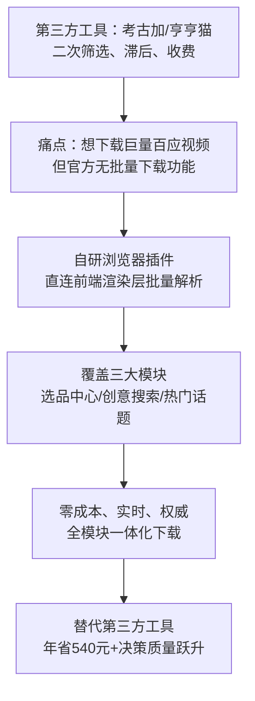
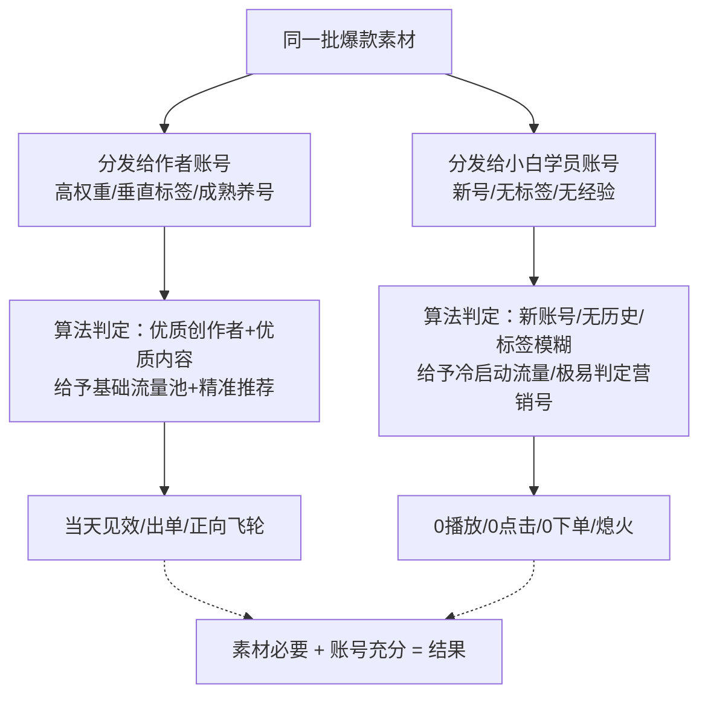

# 第 61 章 工具开发与模式复制 —— 从“巨量百应插件”到“选品-素材-变现”一体化的商业化闭环
作者：龙哥

## 学习目标

- 理解官方后台数据源对比第三方工具的核心优势与替代逻辑
- 掌握从社群痛点挖掘到工具开发再到模式复制的完整商业化闭环路径
- 掌握 MVP 手工验证跑通最小商业闭环的标准化动作与决策锚点
- 识别账号权重/运营能力作为同素材变现结果核心充分条件的工程化要求
- 能运用“需求-工具-验证”闭环方法论指导自身或他人工具型产品的冷启动

## 61.1 生活类比

想象做短视频带货像**开一家“卖现成菜”的外卖店**：**巨量百应** = **中央大厨房的“每日爆款菜谱墙”**（官方权威、实时更新、免费公开）；**第三方工具（考古加/亨亨猫）** = **倒手卖菜谱的“二道贩子”**（信息滞后、收会员费、还得你自己跑腿买食材）；**自研插件** = **你直接在大厨房装了条“自动传菜带”，想要哪道菜按一下就送到后厨**（零成本、直连源头、批量拿）；**MVP手工验证** = **先不买设备，亲手按菜谱炒几份卖卖看，真有回头客再买锅**（3.43元首单=第一笔真金白银的订单）；**模式复制** = **菜谱和食材你都搞定了，招几个学徒按SOP炒，你只管选品分发，把店开成连锁**（但学徒手艺参差不齐=账号权重差异，有的店开张即爆，有的关门大吉）。核心道理：**菜谱（素材）只是入场券，厨子手艺（账号运营）才是出菜率的天花板；想赚大钱，别光顾着买好菜谱，得把“招厨子、派食材、定标准”的连锁模式跑通。**

## 61.2 概念地图

工具开发与模式复制
├── 核心认知
│   ├── 官方后台数据源优于第三方采集源  —— P001
│   ├── 工具即入场券，模式复制才是放大器  —— P002
│   └── 账号权重决定变现上限  —— P004
├── 标准化流程
│   ├── MVP手工验证跑通闭环  —— P003
│   ├── 需求-工具-验证闭环  —— P005
│   └── 素材分发防压缩SOP  —— P002
├── 技术实现
│   ├── 巨量百应全模块视频批量下载  —— P001
│   └── 自研浏览器插件直连前端渲染层  —— P001
└── 实战验证
    ├── 手工搬运首单3.43元验证可行性  —— P003
    ├── 工具上线自用账号爆发与波动  —— P004
    ├── 私域招募小白复制受限于执行力  —— P004
    └── 成本替代量化：年省540元+会员费  —— P005

## 61.3 官方后台数据源替代第三方工具 —— 零成本直连爆款素材源头

### 为什么需要这个概念？

短视频从业者做选品、搬运素材，最核心的痛点是：**哪里有最新、最准、免费的爆款视频？**  
市面上主流的第三方工具（考古加、亨亨猫等）数据源均为二次筛选，存在三大硬伤：数据滞后（非实时）、准确性打折（第三方算法筛选偏差）、需付费会员（如亨亨猫45元/月）。而**巨量百应作为抖音官方商业服务平台**，其创意中心、选品中心、热门话题三大模块汇聚了全网最权威、实时的爆款视频数据，但官方后台**原生不支持批量下载、去水印**，导致从业者被迫依赖第三方中转平台，增加了时间成本、资金成本与数据失真风险。

### 核心定义

> **官方后台数据源替代策略**（来源：《U2lPdc1ayoNSPUxgsNfcEXrXn1d.md》）
>
> 利用巨量百应官方后台（创意中心/选品中心/热门话题）提供的实时爆款视频数据，直接作为选品决策依据与内容素材来源；开发自研浏览器插件直连官方前端渲染层，实现全模块视频批量无水印下载，绕过第三方中转平台，实现“零边际成本、高时效性、高权威性”的素材获取闭环。

### 关键技术实现：自研浏览器插件直连前端渲染层

作者没有去破解后台 API（风险高、维护难），而是选择**浏览器插件 + 前端 DOM 解析**的工程化路径：插件注入巨量百应前端页面，直接解析渲染层的视频播放地址、标题、数据指标，一键批量下载无水印源文件。

**覆盖三大核心入口**（来源：《U2lPdc1ayoNSPUxgsNfcEXrXn1d.md》）：

```
1. 选品中心：最近1小时 - 1个月爆款视频批量下载（多维度榜单）
2. 创意搜索：关键词搜索视频批量下载（精准定位垂类素材）
3. 热门话题：话题榜单视频批量下载（蹭热点、跟趋势）
```

> "这个工具实现了巨量百应-创意中心模块的短视频模块中的所有视频下载"
> 
> ——《U2lPdc1ayoNSPUxgsNfcEXrXn1d.md》

**这个实现展示了**：不依赖官方开放平台授权，通过前端渲染层“降维打击”获取核心数据资产，是中小开发者低成本接入头部平台数据的通用范式。

### 成本替代量化（来源：《U2lPdc1ayoNSPUxgsNfcEXrXn1d.md》）

| 成本项 | 第三方工具（如亨亨猫） | 自研插件 | 年化节省 |
|--------|------------------------|----------|----------|
| 会员费 | 45元/月 | 0元 | 540元 |
| 数据时效 | 小时/天级滞后 | 分钟级实时 | 机会成本不可估量 |
| 数据准确度 | 二次筛选失真 | 官方源头直出 | 决策质量提升 |
| 功能覆盖 | 单模块/碎片化 | 全模块一体化 | 工作流打通 |

> "这个工具至少给短视频从业者解决了每个月亨亨猫45元的费用以及其它相似的工具费用"
> 
> ——《U2lPdc1ayoNSPUxgsNfcEXrXn1d.md》

**这个公式/表格展示了**：工具的核心价值锚点不仅是“省钱”，更是“用零成本拿到比付费工具更好、更快、更全的数据”，重构了从业者的选品决策基建。

### 方法演进图



---

## 61.4 工具即入场券，模式复制才是放大器 —— 从省钱工具到规模化商业模式

### 为什么需要这个概念？

工具开发完成后，作者自用账号确实进入爆发期，但后续数据展示**“最坏结果 23.76 元，结果可能是 0”**（来源：《U2lPdc1ayoNSPUxgsNfcEXrXn1d.md》），揭示了一个残酷事实：**工具仅解决“获取素材”的效率与成本问题（入场券），单账号运营上限有限、收益波动极大**。单人时间精力有限，无法通过单账号实现收益指数级增长。必须将“工具+选品+素材+发布”标准化为可复制的 SOP，通过私域招募、矩阵账号实现“模式复制”（放大器）。

### 核心定义

> **工具即入场券，模式复制才是放大器**（来源：《U2lPdc1ayoNSPUxgsNfcEXrXn1d.md》）
>
> - **工具层**：自研插件降低获取爆款视频的路径成本，替代第三方付费工具，解决“效率/成本”问题；
> - **模式层**：私域招募小白学员，统一供给选品与素材（通过 🐧 防压缩分发），标准化“下载-发布-带货”动作，实现收益放大，解决“规模化/标准化”问题；
> - **核心洞察**：纵观任何有结果的人，基本都在模式复制；想赚更多钱，就去复制模式。

> "纵观任何有结果的人，基本都在模式复制。PS：想赚更多的钱，就去复制模式"
> 
> ——《U2lPdc1ayoNSPUxgsNfcEXrXn1d.md》

### 关键性质

- **边际成本递增**：模式复制需作者亲自每天分发素材、把控选品，标准化程度低，边际管理成本高；
- **执行力依赖强**：小白学员“最差结果 0”、“自己选品难”，账号权重/运营能力是同素材变现结果的核心变量；
- **资产沉淀差异**：工具为数字化资产（边际成本近零），模式复制构建组织资产（可规模化）。

### 私域招募实验实录（来源：《U2lPdc1ayoNSPUxgsNfcEXrXn1d.md》）

**4.18 启动内部招募**，统一供料（选品+素材），观察 7 天：

| 指标 | 表现 | 启示 |
|------|------|------|
| 最好记录 | 当天发视频，当天见效 | 高权重账号+合规素材+正确时机 = 大概率出单 |
| 普遍现象 | 最差结果 0 | 素材必要，账号充分；新号/无标签/无经验 = 大概率 0 |
| 瓶颈 | 小白自己选品难、执行力差 | 作者被迫每天亲自供料，成为精力瓶颈 |
| 合规 SOP | 素材通过 🐧 发送 | 规避微信压缩画质导致违规/限流 |

> "目前由我自己每天给这些人提供素材，相当于选品。为了避免压缩，建议素材通过QQ发送。"
> 
> ——《U2lPdc1ayoNSPUxgsNfcEXrXn1d.md》

**这个伪代码/流程展示了**：模式复制的核心不是“发工具给学员”，而是**“统一选品、统一素材、统一话术、统一发布节奏”**的标准化供给体系。作者精力卡在“每天选品分发”上，说明 SOP 尚未沉淀到“学员自主执行”层级。

### 边界条件

- 模式复制受限于学员执行力、账号质量、账号养成周期，非完全自动化；
- 作者精力成为瓶颈：需亲自每天选品、分发素材，难以规模化至百人级；
- 平台风控风险：批量搬运同质化素材易触发平台查重、限流，需去重技术配合。

---

## 61.5 MVP 手工验证 —— 用最小成本跑通商业闭环再造工具

### 为什么需要这个概念？

避免“造出没人用的工具”或“跑不通闭环就投入开发资源”的资源浪费。验证“巨量百应素材+视频号带货”商业模式的真实可行性与需求强度，以**真实交易数据（首单佣金 3.43 元）**作为工具开发决策的唯一标准。

### 核心定义

> **MVP 手工验证**（来源：《U2lPdc1ayoNSPUxgsNfcEXrXn1d.md》）
>
> 在工具开发前，人工手动执行完整业务流程：巨量百应选品 → 手动下载视频 → 发布视频号挂车 → 出单验证。仅用约 10 条视频、零工具成本，跑通“流量-转化-交付”最小闭环。验证结果为正（有出单）才启动工具开发，为负则止损切换赛道。

### 关键性质

- **低成本试错**：仅投入人力时间，无资金/技术沉没成本；
- **真实反馈**：市场给出的真实交易数据比任何调研都可靠；
- **决策锚点**：首单佣金 3.43 元成为“这是一个火苗”的决策信号，直接触发后续工具开发投入。

> "发了大概10个视频，只出了一单。这个是一个火苗。"
> "第一笔钱佣金 3.43元到账，可以自行推测这个项目我做了多久以及可行性。"
> 
> ——《U2lPdc1ayoNSPUxgsNfcEXrXn1d.md》

### 标准化动作：MVP 手工验证 5 步法

```
1. 选品：登录巨量百应网页版，按“近1小时/近24小时”爆款榜单，人工筛选 5-10 条垂类高互动视频
2. 下载：使用浏览器开发者工具/录屏软件/在线解析站，手动获取无水印视频文件
3. 去重：剪映/爱剪辑简单剪辑（调速、镜像、加滤镜、画中画）过平台查重
4. 发布：视频号挂载同款/同类商品链接，设置定时发布（早9/中12/晚19-21）
5. 观测：连续 3-7 天记录播放量、点击率、下单量，出单即判定“火苗”存活
```

**这个流程展示了**：不写一行代码、不花一分钱，就能用“笨功夫”跑通商业闭环的最小可行性验证。这 3.43 元佣金，是整个工具开发、模式复制、商业化放大的**地基基石**。

### 边界条件

- 手工验证样本量极小（10 条视频、1 单），不代表规模化稳定性；
- 仅验证“素材+平台”组合可行性，未验证账号体系、供应链、去重技术等规模化要素；
- 依赖操作者基础操作能力，非标准化可复制动作。

---

## 61.6 账号权重决定变现上限 —— 同素材异结果的核心变量

### 为什么需要这个概念？

同一批爆款素材分发给不同账号，结果呈现**极大方差**（作者账号当天见效 vs 小白学员最差 0 收益）。这是第 61 章最反直觉、也最关键的工程化洞察：**素材只是必要条件，账号养成、标签精准度、发布时机等运营能力是充分条件**。忽视账号体系建设，盲目追求“爆款素材”会导致模式复制彻底失败。

### 核心定义

> **账号权重/运营能力**（来源：《U2lPdc1ayoNSPUxgsNfcEXrXn1d.md》）
>
> 包含实名认证、芝麻信用、发帖频次、垂直标签精准度、历史违规记录、设备环境隔离等综合指标。同素材变现方差：同等素材下，高权重账号当天出单，低权重/新号/小白账号可能 0 收益。

> "PS：这里也反映了一个问题，同样的素材同样的品，和账号还是有很大因素的。"
> "当然，最差的结果也是0。这些人没啥经验，完全小白，由他们自己选，估计有点难。"
> 
> ——《U2lPdc1ayoNSPUxgsNfcEXrXn1d.md》

### 关键性质：素材与账号的“与”关系

| 维度 | 素材（必要条件） | 账号/运营（充分条件） |
|------|------------------|------------------------|
| 无爆款素材 | 必不出单 | — |
| 有爆款素材 | 不必出单 | 高权重+合规+对时机 = 大概率出单 |
| 工程化要求 | 工具/渠道获取 | 一机一卡一号、设备隔离、养号周期、垂直喂养 |

**这个对照展示了**：素材与账号为**“与”关系而非“或”关系**。极差素材即使高权重账号也难转化；顶级素材配废号也照样 0 收益。规模化的前置工程是**账号矩阵建设**，不是“买更好的采集工具”。

### 典型例子

- **私域招募实验**：作者账号（高权重、垂直标签成熟）当天见效；小白学员账号（新号/无标签/无经验）最差结果 0；
- **闲鱼实战同理**：同素材分发，店铺权重（转化率/售后率/DSR）决定曝光与成交，见第 3 章“店铺权重双核心指标：转化率进攻 - 售后风险防御”。

### 数据流图：同素材异结果的归因链路



---

## 61.7 需求-工具-验证闭环 —— 从社群痛点到商业化产品的标准化路径

### 为什么需要这个概念？

避免“为开发而开发”，确保工具解决真实强刚需。建立可复用的产品化方法论：发现需求 → 调研竞品 → 定义问题 → 开发解决 → 实战验证 → 放大分发。将社群隐性知识显性化为标准化产品资产。

### 核心定义

> **需求-工具-验证闭环**（来源：《U2lPdc1ayoNSPUxgsNfcEXrXn1d.md》）
>
> - **需求层**：星球文章高频提及“巨量百应选品”、用户评论“想下载视频”显性化痛点；
> - **调研层**：购买竞品“考古加”实测，定位三大硬伤（无法直接下载、数据非一手、依赖第三方下载器）；
> - **开发层**：自研插件直连官方后台，实现全模块批量下载、去水印、免第三方工具；
> - **验证层**：MVP 手工跑通 → 工具上线自用爆发 → 私域模式复制放大；
> - **分发层**：兑换码/资源互换形式开放工具，沉淀用户口碑与社群影响力。

> "目录总纲：需求挖掘 -> 案例调研 -> 挖掘问题 -> 解决问题 -> 实战验证 -> 放大收益 -> 乐于分享"
> 
> ——《U2lPdc1ayoNSPUxgsNfcEXrXn1d.md>

### 关键性质

- **闭环完整性**：覆盖需求挖掘到商业放大全生命周期，非单点技术实现；
- **价值锚点量化**：工具替代第三方会员费（年省 540 元+），构建清晰价值主张；
- **社群杠杆**：依托生财有术社群完成需求验证、种子用户获取、信任背书、分发推广。

### 全流程复盘表（来源：《U2lPdc1ayoNSPUxgsNfcEXrXn1d.md》）

| 阶段 | 关键动作 | 核心产出 | 验证信号 |
|------|----------|----------|----------|
| 需求挖掘 | 星球高频提及“巨量百应选品”、评论区“想下载视频” | 痛点显性化 | 用户自发喊需求 |
| 案例调研 | 购买“考古加”会员实测 1 周 | 竞品三大硬伤清单 | 无法直接下载/数据非一手/依赖第三方 |
| 挖掘问题 | 定位核心矛盾：官方有数无下载、三方有下载数不准 | 产品定位单页 | “直连官方、批量下载、免费” |
| 解决问题 | 自研浏览器插件，前端 DOM 解析+批量下载 | v1.0 插件可用版 | 覆盖三大模块、无水印、一键批量 |
| 实战验证 | 手工搬运 10 条视频 → 视频号挂车 → 出单 3.43 元 | **火苗信号** | 决定投入开发资源 |
| 放大收益 | 私域招募、统一供料、🐧 分发素材、SOP 化 | 模式复制雏形 | 当天发当天见效（最好）vs 0（最差） |
| 乐于分享 | 兑换码分发、资源互换、社群口碑沉淀 | 品牌资产 | 评论区强烈索要工具码 |

> "这个工具降低了获取爆款视频的路径，不管是获取路径，还是下载路径"
> 
> ——《U2lPdc1ayoNSPUxgsNfcEXrXn1d.md》

### 边界条件

- 技术门槛：需具备浏览器插件开发/逆向接口/前端渲染层解析等工程能力；
- 平台合规风险：批量下载官方后台数据需关注反爬虫策略、用户协议合规边界。

---

## 61.8 多源对照

本章核心观点“建工具不如跑模式、跑模式不如造账号体系”在第 61 章单一素材内已形成闭环论证，暂无其他素材直接对标该完整闭环。但在以下相关章节可見同构印证：

### 共识

| 章节 | 共识点 | 佐证 |
|------|--------|------|
| 第 3 章（闲鱼） | 同素材/同供应链，店铺权重（转化率/售后）决定曝光与成交 | “店铺权重双核心指标：转化率进攻 - 售后风险防御” |
| 第 4 章（小红书） | 素材去重技术是规模化前提，账号矩阵建设是放大器 | “素材去重二创生产流程”、“个人店/个体店批量矩阵” |
| 第 6 章（视频号投流） | 素材为王（70%），投放技巧为辅（30%），账号体系是基建 | “品素决定论(70/30法则)”、“矩阵化测品组织架构” |
| 第 14 章（不出镜 IP） | 像素级模仿 SOP 是规模化前提，账号权重决定流量上限 | “标准化SOP是个人IP规模化前提”、“内容/赛道决定流量上限” |

### 分歧

暂无直接分歧素材。第 61 章的独特贡献在于：**将“工具开发”显性化为“需求验证→MVP手工跑通→工具交付→模式复制”的完整商业化产品生命周期**，并量化了“工具即入场券、模式复制才是放大器”的边际成本结构。

---

## 61.9 设计中的取舍

**为什么不用“购买现成第三方工具/会员”方案？**  
因为第三方工具数据非一手、有滞后、且持续付费（年 540 元+），且功能碎片化（需配合多个工具）。自研插件一次性投入开发成本，长期零边际成本，且数据源头直连、全模块覆盖、可按业务需求定制迭代（如增加去重标记、自动分发等）。

**为什么不用“全自动化 RPA/云手机批量发布”方案？**  
素材显示作者尝试私域招募时，**素材分发仍用人工 🐧 发送、选品仍由作者亲自把控**，说明“全自动化发布”在当前平台风控环境下风险极高（同质化素材批量发布极易触发查重、限流、封号）。**人工把控选品节奏、素材分发渠道、发布时机**，是当前阶段“保账号权重、保出单率”的必要人工成本。

**这种设计的 trade-off 是什么？**  
- **得**：账号存活率高、出单率可控、合规安全、数据反馈真实；  
- **失**：作者精力成为硬性瓶颈（日更选品分发）、模式复制边际成本高、难以突破“作者亲自带”的小规模团队上限。  
- **破局方向**：将“选品逻辑”沉淀为**标准化选品 SOP/工具化选品看板**，将“素材分发”沉淀为**网盘/私有 CDN+权限控制**，把作者从“操作工”解放为“架构师”。

---

## 61.10 动手练习

### 练习1：设计一个最小成本的选品验证闭环

**场景**：你想在视频号卖某类小家电，但不知道哪款爆款素材好用。

**任务**：
1. 不开发任何工具、不花钱买第三方会员，仅用免费官方渠道（如巨量百应网页版/抖音热榜/视频号选品广场），人工筛选 5 个近期高互动的竞品视频。
2. 手动下载（或录屏）这 5 个视频，去水印后发布到你的测试视频号（新号/小号均可），挂载同款/同类商品链接。
3. 连续观察 3 天，记录每条视频的播放量、商品点击率、下单量。

**回答问题**：
- 如果 5 条视频全军覆没（0 播放/0 点击/0 下单），你会判定是素材不行、账号权重不够、还是选品方向错？如何用最低成本进一步分离变量验证？
- 如果其中 1 条视频出单了（哪怕只有 1 单，佣金几块钱），这个“火苗”信号意味着什么？你的下一步动作会是造工具、养账号、还是找供应链？

### 练习2：拆解“工具即入场券，模式复制才是放大器”在你业务中的映射

**任务**：
1. 列举你当前或计划做的项目中，所有“工具/软件/脚本/模板”类资产（如：采集软件、去重工具、排版模板、自动回复话术库、选品表格等）。
2. 对每个工具判定：它解决的是“效率/成本”问题（入场券），还是“规模化/标准化”问题（放大器）？
3. 针对某一个核心工具，设计一个“模式复制”的最小实验：招募 1-2 个小白学员，你提供工具+统一选品/素材/话术（SOP），观察 7 天他们能否跑出结果。

**回答问题**：
- 实验期间，你发现自己每天必须亲自干预哪些环节（如：帮他们选品、改文案、改发布时间、处理违规申诉）？这些干预环节揭示了你的 SOP 哪里还不够标准化？
- 如果学员账号权重差导致结果方差巨大，你会建立什么样的“账号分级/养号/淘汰”机制来把账号变成可控的标准化生产要素？

### 练习3：复盘一个你熟悉的“工具型产品”的商业化路径

**任务**：选择一个你了解的工具型产品（可以是浏览器插件、小程序、SaaS 软件、付费文档/表格、甚至是一个自动化脚本），按“需求-工具-验证”闭环五阶段复盘：
1. 需求层：最初的痛点是如何在社群/评论区/客户沟通中显性化的？（有无“用户自己喊着要”的原始证据？）
2. 调研层：竞品/替代方案有哪三大硬伤？（如：贵、慢、数据不准、操作繁琐、不合规）
3. 开发层：核心技术方案如何实现“降维打击”？（如：直连官方源、自研算法、零成本部署）
4. 验证层：MVP 阶段是否有“手工服务/人工跑通”的真实交易数据锚点？（首单金额/转化率/周期）
5. 分发层：是如何放大的？（自用 → 私域分发 → 公开售卖 → 合伙人/代理裂变？）

**回答问题**：
- 如果这个工具只停留在“自用/小圈子分发”阶段，卡在哪个环节？（技术维护成本、作者精力瓶颈、平台合规风险、缺乏标准化 SOP、目标用户付费意愿弱？）
- 基于第 61 章方法论，你会给这个工具的作者提哪三条具体的“放大器”建设建议？

---

## 61.11 本章小结

这一章中我们学习/了解/讨论了工具开发与模式复制的完整商业化闭环。首先，我们拆解了**官方后台数据源替代第三方工具**的核心逻辑：巨量百应作为抖音官方商业平台，其创意中心数据权威性、实时性、准确性最高，通过自研浏览器插件直连前端渲染层，实现全模块视频批量无水印下载，单用户年省 540 元+会员费。其次，我们深度剖析了**MVP 手工验证**的标准化动作：工具开发前，人工手动搬运约 10 条视频跑通“流量-转化-交付”最小闭环，首单佣金 3.43 元成为“火苗”决策锚点，触发后续开发投入。接着，我们揭示了**工具即入场券，模式复制才是放大器**的残酷真相：工具仅解决获取素材效率，单账号上限有限；需通过私域招募、统一供料、标准化 SOP 实现模式复制放大收益，但边际成本高、依赖作者精力。然后，我们识别了**账号权重决定变现上限**的工程化铁律：同素材异结果，素材是必要条件，账号养成/标签精准度/发布时机等运营能力是充分条件，规模化前置工程是账号矩阵建设。最后，我们沉淀了**需求-工具-验证闭环**方法论：从社群痛点挖掘到竞品调研、问题定义、自研解决、手工验证、模式放大、乐于分享的全生命周期标准化路径。

本章我们一起学习了以下概念：

| 概念 | 解释 |
|------|------|
| 官方后台数据源 | 巨量百应作为抖音官方商业平台，其创意中心数据权威性、实时性、准确性最高，是选品与素材的源头活水 |
| 自研插件/巨量百应工具 | 直连官方前端渲染层，实现创意中心/选品中心/热门话题全模块视频批量无水印下载，替代第三方付费工具，单用户年省 540 元+ |
| MVP手工验证 | 工具开发前，人工手动搬运约 10 条视频至视频号跑通闭环，首单佣金 3.43 元作为“火苗”信号触发后续开发投入 |
| 工具即入场券，模式复制才是放大器 | 工具仅解决获取素材效率（入场券），单账号上限有限；需通过私域招募、统一选品分发、标准化 SOP 复制模式（放大器）实现指数级放大 |
| 账号权重/运营能力 | 同素材分发不同账号结果巨大方差（当天见效 vs 0 收益），素材是必要条件，账号养成、标签精准度、发布时机等运营能力是充分条件 |
| 需求-工具-验证闭环 | 星球高频提及需求 -> 购买竞品定位痛点 -> 自研解决 -> 手工验证 -> 工具上线 -> 私域放大 -> 兑换码分发，形成可复用的产品化标准路径 |
| 素材分发防压缩 SOP | 为规避微信传输压缩画质导致违规/限流，规定高清素材通过 🐧 等非压缩渠道分发给团队/学员 |

下一章中，我们将学习 **第 62 章：虚拟资料变现通用方法论 —— 从选品验证到私域高客单成交的标准化闭环**，融合黄岛主、饭饭、三恒、静水流深等案例，提炼虚拟产品“零边际成本、可无限复售、跨平台套利”的底层逻辑，构建从赛道挖掘、选品验证、内容生产、私域引流、分层变现到风控规避的通用 SOP。

