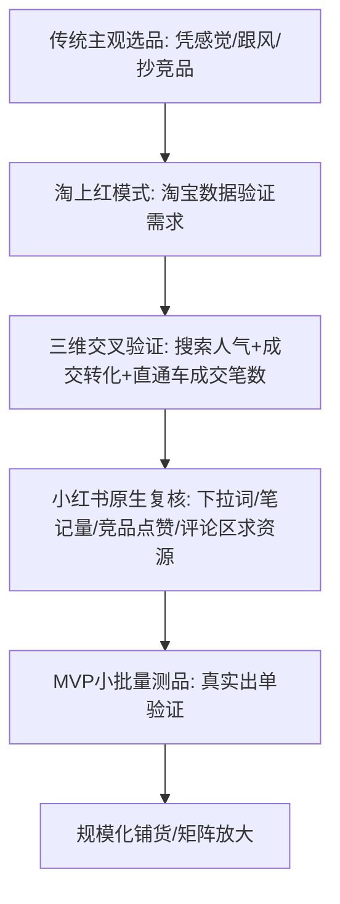

# 第 28 章 小红书虚拟资料变现 —— 从选品验证到私域高客单成交的标准化闭环
作者：龙哥

## 学习目标

- 理解虚拟产品纯利润属性与零边际成本杠杆原理
- 掌握淘上红选品模式：用电商数据验证需求，再用内容平台收割流量
- 掌握词根三级挖掘体系：从通用大词层层剥洋葱找到蓝海细分词
- 掌握三维选品验证指标：搜索人气、成交转化、直通车成交笔数的铁三角交叉验证法
- 掌握五步私域成交话术 SOP：从加好友到升单会员的标准化销售流水线
- 理解单品引流-会员升单漏斗：低价诱饵破冰，高价会员盈利的双层变现结构
- 认清赛道生命周期必然枯竭定律：持续挖掘新赛道才是核心护城河
- 理解虚拟产品跨平台需求同构性与版权风险隔离：淘宝验需求、小红书引流、微信私域成交

## 28.1 生活类比

想象虚拟资料变现是一场**跨城接力赛**：
- **淘宝(电商平台) = 专业的'试吃超市'**：顾客用真金白银投票(直通车成交笔数)，告诉你哪个口味(赛道)真好卖、利润高；
- **词根挖掘 = '剥洋葱选品牌'**：从'零食'(通用词根)→'薯片'(行业词根)→'黑松沙士味薯片'(细分领域词根)，越剥越精准、竞争越小；
- **三维验证 = '三道安检门'**：搜索人气查'有多少人排队'、成交转化查'真买没买'、直通车成交查'老板愿不愿砸钱推'，三道门全过才是真蓝海；
- **小红书 = '种草达人聚集地'**：拿着超市验过的货，拍成笔记(内容)发在这里，精准吸引同款人群(宝妈)来围观；
- **私域微信 = '自家会员制仓库'**：15元单包薯片(引流品)让人低成本尝鲜，展示仓库里1000箱各种口味(会员群500G资料)，补34.9元(差价)就能搬走整个仓库(终身会员)；
- **白嫖用户 = '只闻不买的路人'**：别赶走，塞包免费试吃装(少量资料)进嘴里，留下微信(进私域池)，以后天天推新口味总有买的时候。

就像开连锁餐饮：总部(淘宝)研发爆款菜单→分店(小红书)试吃引流→中央厨房(私域)标准化出餐复购，菜单(赛道)过季必换，唯有研发体系(方法论)长存。

## 28.2 概念地图

小红书虚拟资料变现体系
├── 核心认知
│   ├── 虚拟产品纯利润属性  —— 零边际成本、无限复售、版权风险隔离（素材：docs/202305/20230516_033.md）
│   ├── 跨平台需求同构性  —— 淘宝验需求、小红书引流、微信成交（素材：docs/202305/20230516_033.md）
│   └── 赛道生命周期必然枯竭定律  —— 持续挖掘新赛道为核心护城河（素材：docs/202305/20230516_033.md）
├── 选品方法论
│   ├── 淘上红选品模式  —— 电商数据反向验证，内容平台分发收割（素材：docs/202305/20230516_033.md）
│   ├── 词根三级挖掘体系  —— 通用词根→行业词根→细分领域词根（素材：docs/202305/20230516_033.md）
│   └── 三维选品验证指标  —— 搜索人气(需求量)+成交转化(支付意愿)+直通车成交笔数(实锤销量)（素材：docs/202305/20230516_033.md）
├── 转化体系
│   ├── 五步私域成交话术 SOP  —— 开场提问→鉴定白嫖→发报价→收钱发货→补差价升单（素材：docs/202305/20230516_033.md）
│   ├── 单品引流-会员升单漏斗  —— 低价单品破冰+会员群锚定+差价升单（素材：docs/202305/20230516_033.md）
│   └── 白嫖用户分层运营  —— 免费给资料建信任、纳入长期池、等待转化（素材：docs/202305/20230516_033.md）
└── 实证案例库
    ├── 反霸凌启蒙绘本(淘宝324单/高搜索)  —— 典型蓝海验证（素材：docs/202305/20230516_033.md）
    ├── 英语启蒙/蓝色考拉(小红书7400+笔记/竞品点赞>100)  —— 成熟需求验证（素材：docs/202305/20230516_033.md）
    ├── 大白菜U盘装系统教程(5118挖词/跨平台验证)  —— 非典型赛道验证（素材：docs/202305/20230516_033.md）
    └── 学科资料/幼师赛道红海化演进  —— 赛道周期论佐证（素材：docs/202305/20230516_033.md）

## 28.3 虚拟产品纯利润属性 —— 零边际成本的无限复售杠杆

> "因为虚拟项目变现的是纯利润哈！虚拟项目没什么成本在里面，而且需求也非常大，基本上各行各业都可以实现虚拟项目变现。"
> 
> ——《小红书虚拟项目实操全流程拆解》（素材：docs/202305/20230516_033.md）

这段话直接点出了虚拟产品的核心诱惑：**变现收入几乎等于纯利润**。不同于实体商品需要扣除采购、仓储、物流、包装、售后等层层成本，虚拟资料（PDF、视频教程、模板、软件工具）生产一次，即可无限次复制销售，边际成本趋近于零。这正是纳瓦尔杠杆理论中“复制边际成本为零的产品”在普通人创业层面的最佳实践。

**虚拟产品纯利润属性定义**（素材：docs/202305/20230516_033.md）

- **零边际成本**：数字化文件复制成本可忽略不计
- **无库存压力**：不占物理空间，无仓储费、无损耗、无积压风险
- **无物流成本**：网盘链接/群文件/小程序即时交付，零运费、零时效焦虑
- **可无限复售**：同一份资料可卖给无数用户，收入随销量线性增长，成本曲线水平

$$
\text{Profit}_{\text{virtual}} = \sum (\text{Price}_i \times \text{Qty}_i) - \text{FixedCost}_{\text{production}} - \text{CAC}
$$

这个公式展示了虚拟产品利润结构的本质：总收入减去一次性生产固定成本与获客成本（CAC）即为净利。没有变动成本项，这意味着规模效应极其显著——卖得越多，单品分摊固定成本越低，利润率越逼近 100%。

> "如果你很在意版权你可以不考虑这个，因为这个版权很多时候只出现在电商平台，如果微信私域变现的话，基本上不用考虑版权。"
> 
> ——《小红书虚拟项目实操全流程拆解》（素材：docs/202305/20230516_033.md）

作者进一步揭示了**版权风险隔离**的实战智慧：公域电商平台（淘宝、拼多多、小红书店铺）有自动化版权巡查、品牌方投诉、平台扣分下架机制，风险极高；而微信私域（网盘分享、群文件、知识付费小程序）无自动巡查，仅响应举报，且交付环境相对封闭，大幅降低了版权风险敞口。这不是鼓励侵权，而是指出**交付阵地选择本身就是风控策略**——将高风险的“货架”放在公域，把真正的“成交与交付”挪到私域。

**典型案例对照表**

| 产品形态 | 单价 | 交付形式 | 核心优势 | 适用阶段 |
|----------|------|----------|----------|----------|
| 反霸凌启蒙绘本 | 49.9元/会员 | PDF/网盘/群文件 | 刚需强、版权相对安全（整理类）、复购率高 | 蓝海早期 |
| 英语启蒙动画/蓝色考拉 | 15元单品→49.9元会员 | 视频/音频/PDF打包 | 资料量大(500G+/3000+份)、感知价值极高 | 成长期 |
| 大白菜U盘装系统教程 | 9.9-29.9元 | 视频教程/工具包 | 泛技能刚需、受众广、制作门槛低 | 成熟期 |

**边界条件提醒**：
- 公域平台销售虚拟资料面临版权审核、下架、罚款风险，**必须迁移至微信私域完成交付变现**
- 核心竞争力不在“资料本身”（资料可复制），而在于**“选品验证能力”**与**“私域转化体系”**
- 单一赛道必然从蓝海变红海至枯竭，**需建立持续挖掘新赛道的系统能力**

## 28.4 淘上红选品模式 —— 用电商数据验证需求，再用内容平台收割流量

> "我们做小红书说白了，就是淘上红模式，淘宝火的虚拟产品，如果放到了小红书上也可以测试操作。"
> 
> "我们用名不虚传这个软件...软件主要围绕淘宝去分析，因为电商平台上的数据可以直观的展现给我们"
> 
> ——《小红书虚拟项目实操全流程拆解》（素材：docs/202305/20230516_033.md）

这两段原文揭示了跨平台套利的核心逻辑：**小红书选品靠直觉，试错慢、死得快；淘宝/拼多多拥有真实的搜索、成交、转化数据，是“需求真相场”**。淘上红模式的本质是：**数据验证在电商（低成本、高确定性），流量收割在内容（高精准、低获客成本）**。

**淘上红选品模式定义**（素材：docs/202305/20230516_033.md）

- **核心动作**：利用淘宝成熟销量/搜索/转化数据（直通车成交笔数）筛选验证过的虚拟热品，迁移至小红书分发引流
- **核心工具**：“名不虚传”等淘宝数据分析软件，以“直通车成交笔数”为核心指标
- **跨平台同构性**：淘宝验证成功的虚拟产品，核心需求在小红书必然存在；差异仅在于获客方式——搜索电商（主动搜）vs 内容种草（被动推/主动搜）

**关键性质拆解**：

1. **需求跨平台同构性**：用户痛点（如“孩子英语启蒙怎么办”）跨平台不变，仅获客路径不同
2. **选品逻辑反转**：传统逻辑是“想卖什么→去找货源→发内容试”；淘上红逻辑是“看淘宝什么卖得好→确定需求真实→整理资料→发小红书笔记引流”
3. **试错成本压缩**：淘宝直通车成交笔数 = 商家用真金白银跑出来的真需求，替你完成了最昂贵的“市场验证”环节

**典型案例验证链路**

| 赛道 | 淘宝验证数据 | 小红书复核数据 | 结论 |
|------|--------------|----------------|------|
| 反霸凌启蒙绘本 | 直通车成交324单、搜索人气高 | 笔记量少、竞品弱、评论区求资源 | 极速切入，蓝海确认 |
| 英语启蒙/蓝色考拉 | 淘宝有销量、搜索热度高 | 7400+笔记、下拉框有词、竞品点赞>100、评论区持续求资源 | 验证成熟需求，可入 |
| 大白菜U盘装系统 | 5118挖掘“课程”词根→淘宝有销量 | 搜索有笔记、点赞>100、评论区持续求购 | 非典型赛道验证通过 |

**边界条件与避坑指南**：
- 电商数据仅作“需求验证”，**不可直接搬运竞品素材**（侵权/同质化）
- 小红书仍需二次验证：搜索下拉词、笔记总量、竞品对标（点赞>100）、评论区真实求资源
- 部分冷门品类淘宝数据稀少，需结合小红书原生数据综合判断
- 平台风格差异：电商主图/详情页 vs 小红书封面/正文/钩子，**内容生产需适配平台调性**

**方法演进图：从主观选品到数据驱动选品**



## 28.5 词根三级挖掘体系 —— 从通用大词层层剥洋葱找到蓝海细分词

> "备注：词根分为 通用词根 ，通用词根挖出来的，又分为 行业词根、细分化领域的词根"
> 
> "启蒙这个词，可以分很多的，譬如：英语启蒙、法律启蒙、地理启蒙、语言启蒙、音乐启蒙、反霸凌启蒙、早教启蒙等等很多的"
> 
> "1、领域思路的放大...我们就可以从这方面去联想一些关键词根，你可以多思考下 0-6 岁的儿童方面都会学习什么？"
> 
> ——《小红书虚拟项目实操全流程拆解》（素材：docs/202305/20230516_033.md）

直接搜“大词”（如“资料”“教程”）竞争极其惨烈，新号无法破圈；热门细分词（如“考公资料”“英语启蒙”）早已红海，新手难插针。词根三级挖掘体系提供了一套**系统性拆解方法**：从用户画像出发，层层剥洋葱，找到“有需求、少竞品”的长尾蓝海词。

**词根三级挖掘体系定义**（素材：docs/202305/20230516_033.md）

| 层级 | 名称 | 示例 | 特征 |
|------|------|------|------|
| **一级** | 通用词根 | 启蒙、课程、教程、资料、模板、副业、提效、技能 | 泛流量大、极泛、竞争最激烈 |
| **二级** | 行业词根 | 英语启蒙、法律启蒙、幼儿启蒙、早教启蒙、写作副业、设计副业、带货副业 | 垂直度提升、需求明确、竞争中等 |
| **三级** | 细分领域词根 | 蓝色考拉英语启蒙、反霸凌启蒙绘本、大白菜U盘装系统、公考行测资料、CPA会计教程 | 精准长尾、竞争指数级下降、转化率指数级上升 |

**关键性质**：

- **基于用户画像发散**：小红书核心用户为宝妈 → 联想 0-6 岁儿童学习场景 → 全维度展开（启蒙、早教、育儿、逻辑思维、英语...）
- **词根间包含与派生关系**：可用工具（5118/名不虚传/千瓜/蝉妈妈）批量挖掘长尾词库
- **竞争-转化跷跷板**：细分词根竞争强度呈指数级下降，转化率呈指数级上升

**实操演示：以“启蒙”为通用词根的三级展开**

```
启蒙 (L1 通用)
├── 英语启蒙 (L2 行业)
│   ├── 蓝色考拉英语启蒙 (L3 细分)
│   ├── 剑桥少儿英语启蒙 (L3 细分)
│   └── 自然拼读启蒙 (L3 细分)
├── 反霸凌启蒙 (L2 行业)
│   ├── 反霸凌启蒙绘本 (L3 细分)  ← 淘宝324单验证蓝海
│   └── 反霸凌绘本推荐书单 (L3 细分)
├── 早教启蒙 (L2 行业)
│   ├── 蒙特梭利早教资料 (L3 细分)
│   └── 全脑开发训练营 (L3 细分)
└── 音乐/美术/逻辑启蒙... (L2 行业) → 各自展开 L3 细分
```

**边界条件**：
- 过度细分会导致搜索量过小（月搜 < 100），商业价值不足，需平衡“竞争度”与“搜索量”
- 依赖工具批量挖掘，纯人工效率极低
- **词根挖掘只是“找方向”，必须配合“三维验证指标”才能“定品”**

## 28.6 三维选品验证指标 —— 搜索人气、成交转化、直通车成交笔数的铁三角

> "想要找到符合我们的，我们可以看这三个指标：搜索人气、成交转化、直通车成交笔数"
> 
> "其中，我们看到了，反霸凌启蒙绘本，这个成交笔数是 324...搜索人气也是很高平的，说明这个品非常不错的"
> 
> "蓝色考拉 这个有 7400+笔记，说明做的人是有的但是不多...再看看下拉框，有相关的，说明有人去搜...点赞至少要 100 以上，不然我们会觉得这个赛道的资料没什么需求量"
> 
> ——《小红书虚拟项目实操全流程拆解》（素材：docs/202305/20230516_033.md）

光有词根不够，必须用数据验证“真需求”vs“伪需求”，“大需求”vs“小需求”。单一指标易误判：搜索高可能只是好奇，转化高可能样本太少，成交笔数才是硬通货。三维交叉验证，建立“定量决策”而非“拍脑袋决策”的选品标准。

**三维选品验证指标定义**（素材：docs/202305/20230516_033.md）

| 指标 | 数据来源 | 代表含义 | 验证作用 | 核心判断标准 |
|------|----------|----------|----------|--------------|
| **搜索人气** | 淘宝/拼多多/5118/名不虚传 | 需求量 | 验证“有人要” | 搜索指数 > 行业均值，趋势上升 |
| **成交转化** | 淘宝/拼多多后台/第三方工具 | 支付意愿 | 验证“肯付费” | 转化率 > 同类目均值，ROI > 1 |
| **直通车成交笔数** | 名不虚传/生意参谋/直通车后台 | 实锤销量 | 验证“能规模化卖” | 成交笔数 > 100（蓝海阈值），商家持续投放 |

**铁三角交叉验证逻辑**：

$$
\text{真蓝海判定} = (\text{搜索人气} > \text{阈值}) \land (\text{成交转化} > \text{阈值}) \land (\text{直通车成交笔数} > 100)
$$

三指标**缺一不可**：有人搜、肯买、能规模化卖，才是真蓝海。其中**直通车成交笔数是核心锚点**——商家愿砸钱推 = 利润空间足 = 市场容量大。

**小红书原生数据交叉验证**（双重保险）：

| 小红书指标 | 获取方式 | 判断标准 | 含义 |
|------------|----------|----------|------|
| 搜索下拉框词 | 手动搜核心词观察下拉 | 有相关长尾词 | 需求存量大、用户主动搜 |
| 笔记总量 | 搜索关键词看笔记数 | 1000-10000 篇 | 供给适中、未饱和 |
| 竞品点赞量 | 点开竞品笔记看互动 | 单篇点赞 > 100 | 内容有穿透力、需求真实 |
| 评论区求资源 | 翻阅竞品笔记评论 | 近期持续有“求链接/怎么买” | 购买意愿强、转化路径通 |

**典型案例：反霸凌启蒙绘本三维验证实录**

```
淘宝端（名不虚传）：
├── 直通车成交笔数：324 单  ✅ 核心锚点达标
├── 搜索人气：高平          ✅ 需求量大
└── 成交转化：正常          ✅ 付费意愿强

小红书端（原生复核）：
├── 核心词搜索笔记量：< 500 篇  ✅ 供给稀缺
├── 搜索下拉框：有“反霸凌绘本推荐/电子版”  ✅ 需求细分
├── 竞品笔记点赞：头部 50-200  ✅ 非头部垄断，新号有机会
└── 评论区：持续有“求电子版/怎么买”  ✅ 转化路径通
```

**边界条件**：
- 淘宝数据工具可能存在数据延迟、采样偏差，仅作参考
- 小红书搜索/笔记量受算法影响，需观察近期趋势而非单点快照
- 竞品对标需筛选“个人号/中小号”，头部大号数据不具参考性（自带流量光环）
- 新品类无历史数据时，可小批量测品（MVP）用实战跑数验证

## 28.7 五步私域成交话术 SOP —— 从加好友到升单会员的标准化销售流水线

> "关于变现话术，我们根据以往做项目的经验，提炼出了 5 个咨询核心：开场提问、鉴定白嫖、发报价表、收钱发货、补差价追销"
> 
> "单份英语启蒙动画是 15 元...建议 49.9 元进动画课件群...小姐姐今天可以补差价进会员群呢，只需要补 34.9 就行，资料有 500 多 G"
> 
> "注意：如果对方确实不打算付钱，想白嫖，那么就免费发他几个动画视频，让他过把瘾，后期在慢慢转化。"
> 
> "客户加进来之后，要主动给客户发信息，其实这个时候，能自动回复就自动回复，有软件辅助，包括自动同意添加好友，添加后再去自动回复。"
> 
> ——《小红书虚拟项目实操全流程拆解》（素材：docs/202305/20230516_033.md）

私域聊天极度依赖人才，销售水平参差不齐，难复制、难规模、难管理。客户异议固定（贵/免费/怕骗/试用），需要标准化应答话术提升转化率。单品利润低（15元），必须通过“补差价升单”提升 LTV 实现商业可持续。五步 SOP 将非标销售动作标准化为流水线，配合自动化工具实现“低技能门槛、高复制率、可规模化”。

**五步私域成交话术 SOP 定义**（素材：docs/202305/20230516_033.md）

```
SOP 流程图：
用户加微信
    ↓
[自动通过 + 自动发欢迎语/报价单/群公告]  ← 工具层标准化
    ↓
Step 1: 开场提问建立需求          ← "宝宝几岁？英语基础如何？目标是啥？"
    ↓
Step 2: 鉴定白嫖筛选意向          ← "是想系统学习，还是先看看资料？"
    ↓
Step 3: 发报价单/群对比锚定价值    ← 单品15元 vs 会员49.9元(500G/3000+份) + 录屏展示
    ↓
Step 4: 收钱发货完成首单            ← 发网盘链接/群邀请，确认收货
    ↓
Step 5: 补差价追销升单会员          ← "仅需补34.9元得全套" + "今日前10名送面试礼包" + "持续更新至上岸"
```

**各步骤关键性质拆解**：

| 步骤 | 核心动作 | 话术示例 | 心理学原理 | 自动化配合 |
|------|----------|----------|------------|------------|
| **1. 开场提问** | 不推销，先问需求 | “宝宝几岁？英语基础如何？平时怎么启蒙的？” | 专业咨询感、建立信任、收集画像标签 | 自动发欢迎语+标签分组 |
| **2. 鉴定白嫖** | 识别只想白嫖用户 | “是想系统跟着学，还是先免费看几节试试？” | 意向分级、沉没成本预埋 | 关键词触发分流（白嫖/意向/成交） |
| **3. 价格锚定** | 单品 vs 会员对比表 | “单买15元/套；会员49.9元=3000+份/1000G/持续更新，录屏发你瞅瞅” | 锚定效应、超值感知、损失厌恶 | 自动发报价单/群录屏/目录文档 |
| **4. 首单成交** | 发货确认、建立交易闭环 | “收到，发你网盘链接/拉进群，资料永久可看，有问题随时问我” | 互惠原则、交易确认偏好 | 自动发货/拉群/打标“已成交” |
| **5. 补差价升单** | 心理账户+限时紧迫 | “小姐姐今天补34.9元进会员群，前10名送面试礼包，资料持续更新至上岸” | 沉没成本+稀缺性+损失厌恶 | 标签触发升单话术/自动拉会员群 |

**白嫖用户分层运营策略**（关键补充）：

> "注意：如果对方确实不打算付钱，想白嫖，那么就免费发他几个动画视频，让他过把瘾，后期在慢慢转化。"

- **拒付费者** → 免费送少量资料（1-3个视频/PDF）→ 纳入“白嫖池”标签组
- **长期培育** → 朋友圈/群持续种草新赛道/新资料 → 边际成本为零 → 等待转化时机（节日/焦虑期/新品上线）
- **转化触发** → “之前送你的反霸凌绘本孩子喜欢吗？新出英语启蒙全套只要49.9元...”

**典型话术脚本（英语启蒙赛道）**：

```
【自动欢迎语】欢迎宝妈！我是专注英语启蒙的XX，资料库有3000+份动画/绘本/教材。回复“年龄/基础/目标”我给你匹配方案。

【Step1 开场提问】宝宝今年几岁呀？英语基础咋样？是想磨耳朵、还是认词、还是自然拼读？

【Step2 鉴定白嫖】明白，那您是想买套系统的跟着学，还是先领点免费的试试水？

【Step3 价格锚定】单套动画15元；我们有终身会员群49.9元，含3000+份动画/绘本/教材/音频，1000G网盘持续更新。我发个群录屏您瞅瞅（发视频/目录图）。

【Step4 首单成交】收到15元，发网盘链接：xxx。资料永久有效，不会用/不会教随时找我。

【Step5 补差价升单】小姐姐，今天补34.9元就能进会员群得全套，前10名再送《面试英语礼包》，资料持续更新至上岸，超划算！
```

**边界条件**：
- 话术必须真实、合规，禁止虚假宣传、诱导消费、承诺结果
- 虚拟资料版权风险：公域平台严查，私域交付相对安全，但仍需规避明显侵权品类（盗版课程、破解软件）
- 客服人员需培训“共情-专业-逼单”节奏，机械执行反而降低转化
- **单品价格 15-29 元为黄金引流价格带**：过高（>50元）劝退首单，过低（<9.9元）吸引低质用户

## 28.8 单品引流-会员升单漏斗 —— 低价诱饵破冰，高价会员盈利的双层变现结构

> "单份英语启蒙动画是 15 元...建议 49.9 元进动画课件群...小姐姐今天可以补差价进会员群呢，只需要补 34.9 就行，资料有 500 多 G"
> 
> "可以录制会员网盘群的录屏视频，发给客户看，增加信任感"
> 
> ——《小红书虚拟项目实操全流程拆解》（素材：docs/202305/20230516_033.md）

直接卖高客单价（>100元）信任门槛高、决策周期长、转化率低；纯卖低价单品（<20元）利润薄、LTV低、无法支撑高流量获客成本。需要“低价破冰建立信任 + 高价升单收割利润”的分级漏斗模型。

**单品引流-会员升单漏斗定义**（素材：docs/202305/20230516_033.md）

| 层级 | 产品形态 | 价格带 | 核心目的 | 关键指标 |
|------|----------|--------|----------|----------|
| **前端引流品** | 低价单品（单套动画/单科资料） | 15-29元 | 筛选付费用户、建立交易信任、获取联系方式 | 首单转化率 > 30%、引流成本回本 |
| **后端利润品** | 会员制/年费制（全套/终身/全学科） | 49.9-299元 | 最大化LTV、建立长期关系、交叉销售 | 升单率 > 20%、会员复购率 > 30% |
| **升单机制** | 补差价（会员价-单品价） | 34.9元 | 利用心理账户“已花15元，再加34.9得全套”极其划算 | 升单话术标准化、限时紧迫感 |

**关键性质**：

- **引流品边际成本为零**，可无限发放，甚至可作为“免费钩子”给白嫖用户
- **会员群内容必须“量大、全、更新快、有目录/录屏证明”**，支撑高感知价值
- **升单话术标准化**：展示对比表/录屏 → 强调“仅限今天/前XX名” → 引导补差价 → 发会员群邀请
- **复购逻辑**：会员群内持续更新资料 → 维持活跃度 → 二次开发新赛道会员/高客单服务

**数学模型：漏斗经济账**

假设：单品 15 元，会员 49.9 元，升单差价 34.9 元
- 引流 100 人加微信 → 首单转化 30% → 30 人买单品 → 收入 450 元
- 升单率 25% → 7.5 人升级会员 → 补差价收入 262 元
- **总收入 712 元，客单价 23.7 元（vs 单卖单品 15 元，提升 58%）**
- 会员群后续推新赛道（数学启蒙/识字/编程），每人再转化 1 次会员 → LTV 翻倍

**典型案例：英语启蒙双层漏斗实录**

```
前端：15元/单套动画（决策成本低、即时交付、建立信任）
    ↓
交付时附赠：会员群目录图 + 网盘录屏视频（展示1000G/3000+份）
    ↓
锚定对比：单买15元=1套 vs 会员49.9元=全套+持续更新
    ↓
升单话术："仅需补34.9元" + "今日前10名送礼包" + "更新至上岸"
    ↓
后端：49.9元终身会员群 → 持续推新赛道会员/高客单咨询/实体教材代购
```

**边界条件**：
- 会员群内容必须持续产出/更新，否则“一次性割韭菜”导致信用破产、投诉维权
- 虚拟资料版权合规：建议自制/整理/二创/授权，避免直接倒卖盗版大课（法律/平台双重风险）
- 升单率受限于“引流品质量”与“会员品感知价值差”，引流品太烂→不信任；会员品太水→不升单
- 需建立“白嫖用户池”与“付费用户池”分层运营体系，话术/频次/内容差异化

## 28.9 赛道生命周期必然枯竭定律 —— 持续挖掘新赛道才是核心护城河

> "这个赛道我们是从蓝海做到红海的，也算是圆满结束这个赛道。"
> 
> "如果你不去挖掘新的赛道，你最终会被饿死，因为你做的赛道早晚一天会枯竭的，而且整体项目也做不长久。"
> 
> "学科资料做的人就很多...流量基本上不是问题，就是转化上没原来的高了...黄岛主(虚拟项目) : 幼师现在不好做了，尤其是是公开课，现在很多做培训的也还在这个赛道上操作，但见效可能会差一些。"
> 
> ——《小红书虚拟项目实操全流程拆解》（素材：docs/202305/20230516_033.md）

很多新手找到一个爆款赛道就以为躺赢了，拒绝学新东西、不愿换赛道。平台算法变、用户审美变、竞品涌入、版权收紧，**任何单一赛道都有寿命周期**。必须建立“赛道也是消耗品”的认知，将核心能力锚定在“挖掘赛道”而非“守住赛道”。

**赛道生命周期必然枯竭定律定义**（素材：docs/202305/20230516_033.md）

$$
\text{赛道生命周期} = \text{萌芽期(蓝海)} \xrightarrow{\text{竞品入场}} \text{成长期} \xrightarrow{\text{同质化}} \text{成熟期(红海)} \xrightarrow{\text{边际收益<边际成本}} \text{衰退期(枯竭)}
$$

| 阶段 | 特征 | 操作重点 | 典型信号 |
|------|------|----------|----------|
| **萌芽期(蓝海)** | 搜索需求大、优质内容少、竞品弱(点赞<100)、平台扶持、转化率高 | 极速铺货、建立标杆账号、跑通SOP | 单日引流>100、转化率>10%、ROI>3.0 |
| **成长期** | 竞品增多、转化下降、需投流/薯条助推 | 优化内容/素材、开始矩阵化、测试付费投放 | 单日引流50-100、转化率5-10%、ROI>1.5 |
| **成熟期(红海)** | 笔记量激增、竞品头部化、同质化严重、转化显著下降、客诉/退款率上升 | 差异化内容、私域深度运营、开发高客单后端 | 单日引流<50、转化率<5%、ROI≈1.0 |
| **衰退期(枯竭)** | 边际收益<边际成本、账号易违规、素材库报废 | **止损退出**、迁移核心资产、切换新赛道 | 连续30天引流<10、转化<1%、ROI<1.0、主号违规 |

**核心能力迁移：从“单一项目操盘” → “跨赛道挖掘验证方法论”**

| 可迁移核心资产 | 具体表现 | 迁移方式 |
|----------------|----------|----------|
| **方法论** | 词根挖掘、三维验证、MVP测品、五步话术、升单漏斗 | 文档化SOP、新人培训、工具化（表单/脚本/自动回复） |
| **私域用户池** | 付费用户标签（赛道/客单/复购/活跃度） | 打标分层、旧赛道用户交叉推新赛道、社群裂变 |
| **转化体系** | 话术库/漏斗结构/自动化工具/价格锚定模板 | 复制粘贴、仅改赛道相关话术、复用工具配置 |
| **供应链** | 资料来源渠道/整理模板/更新机制/质检标准 | 标准化采集→清洗→整理→上架流水线 |

**典型案例：学科资料赛道从蓝海到红海的完整演进**

```
时间轴：
2021年初（萌芽） → 入局学科资料，单日引流200+，转化率15%，单号月入5万+
2021年中（成长） → 同行涌入，开始薯条投流，转化降至8%，矩阵化3账号
2021年底（成熟） → 笔记量爆炸，同质化严重，转化5%，需精细化运营维持
2022年中（衰退） → 转化<1%，ROI<1，主号违规限流，决定“圆满结束”
2022下半年 → 迁移方法论切入“启蒙细分赛道”（反霸凌/蓝色考拉/大白菜）
```

**边界条件与避坑指南**：
- **赛道切换成本高**：账号垂直度重置、粉丝画像偏移、素材库报废、私域标签冲突
- **矩阵化运营可平滑过渡**：老账号维护现金流（降本增效）+ 新账号测试新赛道（低成本MVP）+ 私域统一转化（不炸群/不掉粉）
- **核心资产是“方法论+私域用户池+转化体系”**，而非“某个具体账号/赛道/素材库”
- **判断“何时退出”比“如何进入”更难**，需设定止损线（连亏3个月/ROI<1.0/主号违规/精力严重内耗）

## 28.10 虚拟产品跨平台需求同构性与版权风险隔离 —— 淘宝验需求，小红书引流，微信私域成交

> "我们做小红书说白了，就是淘上红模式，淘宝火的虚拟产品，如果放到了小红书上也可以测试操作。"
> 
> "如果你很在意版权你可以不考虑这个，因为这个版权很多时候只出现在电商平台，如果微信私域变现的话，基本上不用考虑版权。"
> 
> "淘宝上的数据虽然不是很多，但需求的人是有的，所以这个品类绝对可以做"
> 
> ——《小红书虚拟项目实操全流程拆解》（素材：docs/202305/20230516_033.md）

很多创业者纠结“去哪个平台”，实则**三平台分工不同**：淘宝验需求、小红书引流、微信成交。版权风险是虚拟项目最大雷区，公域平台严查、私域相对安全，需物理隔离风险。跨平台迁移不是搬运内容，而是“需求验证迁移+内容本地化生产+私域标准化转化”。

**三平台分工协作模型定义**（素材：docs/202305/20230516_033.md）

```
┌─────────────────────────────────────────────────────────────────┐
│                    需求同构性：用户痛点跨平台不变                │
│  例："孩子英语启蒙怎么办" → 淘宝搜课程 / 小红书看笔记 / 微信买资料 │
└─────────────────────────────────────────────────────────────────┘
                              │
              ┌───────────────┼───────────────┐
              ▼               ▼               ▼
┌──────────────────┐ ┌──────────────────┐ ┌──────────────────┐
│  淘宝/拼多多      │ │  小红书/抖音/     │ │  微信私域         │
│  (搜索电商)       │ │  视频号           │ │  (强关系)         │
│  职能：验需求     │ │  职能：引流       │ │  职能：成交       │
│  - 看直通车成交   │ │  - 笔记种草      │ │  - 五步话术SOP   │
│  - 看搜索人气     │ │  - 评论区钩子    │ │  - 价格锚定升单  │
│  - 看成交转化     │ │  - 主页留联      │ │  - 会员群运营    │
│  - 找供给/素材    │ │  - 私信自动回复  │ │  - 朋友圈种草    │
│  数据最真实/全    │ │  获客成本低/精准  │ │  客单价高/复购高 │
└──────────────────┘ └──────────────────┘ └──────────────────┘
              │               │               │
              └───────────────┼───────────────┘
                              ▼
              ┌─────────────────────────────────────┐
              │     版权风险隔离：物理分离交付阵地   │
              │  公域：有巡查/投诉/下架/罚款 → 高风险 │
              │  私域：无自动巡查/仅响应举报 → 低风险 │
              └─────────────────────────────────────┘
```

**关键性质**：

1. **选品在淘宝**：看直通车成交笔数、搜索人气、成交转化，数据最真实、最全
2. **引流在小红书**：笔记种草、评论区钩子、主页留联、私信自动回复，获客成本低、精准度高
3. **成交在微信**：五步话术 SOP、价格锚定升单、会员群运营、朋友圈种草、裂变分销，客单价高、复购率高
4. **素材生产**：不搬运竞品素材，而是“整理/二创/自制/授权”生产平台原生风格内容

**典型跨平台闭环案例**

| 赛道 | 淘宝验需求 | 小红书引流动作 | 微信私域成交 |
|------|------------|----------------|--------------|
| 反霸凌启蒙绘本 | 验324单成交、高搜索 | 发“反霸凌绘本推荐/内页展示/避坑指南”笔记 → 评论区钩子“需要电子版扣1” → 引流微信 | 15元单品/49.9元会员，五步话术成交 |
| 大白菜U盘教程 | 5118挖词→淘宝验有销量 | 发“小白也能学会的装系统教程” → 主页置顶笔记留网盘钩子 → 私信自动回复网盘链接 | 9.9元单品/29.9元全套工具包 |

**边界条件与风控红线**：
- **小红书近期严打“硬广/引流/虚拟资料”**，笔记/私信/主页/评论区均有违规风险，需“软广/钩子/诱饵/分层”技巧
- **微信私域高频加好友/收款/发文件易触发风控**，需“双号分流/多渠道收款/网盘分享/分批发送”基建
- **跨平台内容适配**：淘宝主图/详情页 → 小红书封面/正文/标题/标签 → 微信朋友圈/群公告/网盘目录，格式/话术/视觉全不同
- **部分重版权品类（影视/音乐/付费大课/破解软件）即使私域也有法律风险**，建议避开，聚焦“整理类/工具类/教程类/模板类”低风险品类

## 28.11 多源对照

本章核心方法论主要基于《docs/202305/20230516_033.md》（黄岛主小红书虚拟项目实操）单一素材构建。结合第 27 章“小红书带货矩阵化概率论”的共识框架，现有方法论可映射为：

| 第 27 章共识 | 本章对应实践 | 备注 |
|-------------|--------------|------|
| 博概率核心定律 | 矩阵化账号测品、MVP小批量验证、增加试错次数捕捉低概率爆款 | 本章“MVP小批量测品”即博概率实操化 |
| 物理隔离底线 | 公域（小红书/淘宝）验需求与引流，私域（微信）隔离版权风险与成交 | 本章“版权风险隔离论”即物理隔离在虚拟赛道的落地 |
| 供应链响应速度决定变现上限 | 资料整理标准化流水线（采集→清洗→整理→上架）、会员群持续更新机制 | 本章“供应链”资产迁移表体现该共识 |
| SOP 标准化是规模化前提 | 五步私域成交话术 SOP、单品引流-会员升单漏斗标准化、自动化工具配合 | 本章将非标销售动作标准化为流水线 |

**共识**：虚拟产品零边际成本、私域变现规避版权、跨平台需求同构、标准化话术提升转化、赛道有生命周期需持续挖掘。

**分歧**：暂无（单一素材来源）。[需要补充文献]

## 28.12 设计中的取舍

**为什么不用“原创大课/付费课程搬运”而是“整理类/工具类/教程类/模板类”资料？**

- 原创大课制作周期长、需专业背景、门槛高，不适合普通人快速切入
- 付费课程搬运版权风险极高（法律/平台双重打击），甚至私域交付也可能面临侵权诉讼
- 整理类/工具类/教程类/模板类：制作门槛低（整理公开信息/二创/自制），版权相对安全（整理公开资料/工具教程），需求极大（考公/考证/启蒙/技能/办公），复购率高

**为什么单品定价 15-29 元，会员定价 49.9-99 元？**

- 单品 < 9.9 元：吸引低质用户（羊毛党/白嫖党），首单转化虽高但后续升单极难，且支付手续费比例高
- 单品 > 50 元：决策成本高，首单转化率骤降，引流成本回不本
- 会员价 < 39.9 元：感知价值不足，难以支撑“超值”锚定，升单动力弱
- 会员价 > 199 元：需极强信任背书，新号/新赛道难跑通，适合成熟IP后期

**这种设计的 trade-off 是什么？**

| 维度 | 选择 | 获得 | 失去/风险 |
|------|------|------|-----------|
| **产品形态** | 整理/教程/模板 | 低门槛、低版权风险、易标准化 | 单品护城河弱、易被复制、需持续更新维护 |
| **选品策略** | 淘上红+词根挖掘 | 试错成本低、成功率高 | 依赖工具/数据、可能错过纯内容平台原生爆款 |
| **变现路径** | 单品引流+会员升单 | LTV高、可持续、可规模化 | 需建立私域运营体系、客服培训成本、风控基建成本 |
| **赛道策略** | 快进快出、持续换赛道 | 规避红海、捕捉红利 | 素材库/账号/粉丝画像频繁重置、团队学习成本高 |

## 28.13 动手练习

### 练习 1：手动演练一次完整的词根挖掘与三维验证流程

假设你发现小红书用户画像偏向“30-40岁女性职场人群”：
1. 列出3个通用词根（如：副业、提效、技能）
2. 每个通用词根下延展3个行业词根（如：副业→写作副业/设计副业/带货副业）
3. 选定1个行业词根，用5118/名不虚传/千瓜工具挖掘5个细分领域词根
4. 针对这5个细分词根，分别在淘宝/拼多多（看直通车成交笔数/搜索人气）和小红书（看下拉词/笔记量/竞品点赞/评论区求资源）完成三维交叉验证

**回答问题**：
- 为什么细分领域词根的竞争强度呈指数级下降而转化率呈指数级上升？
- 若淘宝数据显示某词根直通车成交笔数高但小红书笔记量极少，是机会还是陷阱？如何判断？
- 为什么不能只看“搜索人气”这一个指标就决定选品？

### 练习 2：模拟实战：五步私域成交话术在“考公资料”赛道的落地推演

场景：用户在小红书看完你的“考公上岸避坑指南”笔记，私信“怎么买资料”加了微信：
1. 写出“开场提问”的3个话术版本（要求：建立专业咨询感、不推销、筛选精准需求）
2. 设计“鉴定白嫖”的判断标准与2套差异化回复（付费意向 vs 纯白嫖）
3. 构建“发报价单”的锚定对比表：单科9.9元 vs 全科目会员49.9元(含历年真题/模考/笔记/课程/面试)，并准备会员群网盘录屏展示清单
4. 话术设计“补差价升单”：利用“仅需补40元”、“今日前10名赠面试礼包”、“资料持续更新至上岸”三重心理杠杆

**回答问题**：
- 为什么单品价格设在9.9-19.9元区间最利于破冰？过高或过低分别会有什么后果？
- 会员群内容必须具备哪3个“硬指标”才能支撑“超值感知”并规避投诉？
- 如何用自动化工具（自动通过/自动回复/标签分组）将上述流程标准化为“无脑可执行”的SOP？

### 练习 3：战略复盘：赛道枯竭时的“平滑切换”与“资产迁移”实战推演

假设你深耕“幼师资源证”赛道1年，近30天单日引流从100+跌至<10、转化率<1%、主力账号收到违规警告：
1. 列出判定该赛道进入“衰退期”的5个量化红线指标
2. 设计“矩阵化平滑过渡”方案：老账号维护现金流（如何降本）+ 新账号测试新赛道（选什么赛道/怎么测）+ 私域统一转化（怎么不炸群/不掉粉）
3. 梳理可迁移的核心资产清单：方法论（哪些步骤通用）+ 私域用户池（如何打标/分层）+ 转化体系（话术/漏斗/工具）+ 供应链（资料来源/更新机制）

**回答问题**：
- 为什么说“判断何时退出比如何进入更难”？设定止损线的3个核心维度是什么？
- 切换赛道时，旧私域用户画像与新赛道不匹配怎么办？是“硬推”还是“养号”？
- 如何建立“持续挖掘新赛道的系统能力”，使其成为团队的标准化生产流水线而非依赖个人灵感？

## 28.14 本章小结

这一章中我们系统拆解了小红书虚拟资料变现的全链路标准化闭环。首先，我们确立了虚拟产品纯利润属性与零边际成本杠杆原理，揭示了版权风险可通过私域交付隔离的实战智慧。其次，我们掌握了淘上红选品模式——用电商平台真实数据（直通车成交笔数）验证需求，再迁移至内容平台收割流量的跨平台套利逻辑。接着，我们学习了词根三级挖掘体系（通用→行业→细分）与三维选品验证指标（搜索人气+成交转化+直通车成交笔数）的铁三角交叉验证法，建立了定量决策选品标准。然后，我们详细拆解了五步私域成交话术 SOP（开场提问→鉴定白嫖→发报价→收钱发货→补差价升单）与单品引流-会员升单漏斗的双层变现结构，将非标销售动作标准化为可复制的流水线。之后，我们认清了赛道生命周期必然枯竭定律，确立了核心竞争力从“守赛道”迁移至“挖赛道方法论”的战略认知。最后，我们理清了虚拟产品跨平台需求同构性与版权风险隔离的三平台分工协作模型：淘宝验需求、小红书引流、微信私域成交。

本章我们一起学习了以下概念：

| 概念 | 解释 |
|------|------|
| 虚拟产品纯利润属性 | 零边际成本、无库存物流、可无限复售，变现收入即纯利润，版权风险可通过私域交付隔离 |
| 淘上红选品模式 | 利用淘宝直通车成交笔数等真实电商数据验证需求，再迁移至小红书内容种草引流，降低选品试错成本 |
| 词根三级挖掘体系 | 通用词根(启蒙)→行业词根(英语启蒙)→细分领域词根(蓝色考拉/反霸凌绘本)，层层递进挖掘长尾蓝海 |
| 三维选品验证指标 | 搜索人气(需求量)+成交转化(支付意愿)+直通车成交笔数(实锤销量)三指标交叉验证，剔除伪需求 |
| 五步私域成交话术 SOP | 开场提问建立需求→鉴定白嫖筛选意向→发报价锚定价值→收钱发货首单→补差价追销升单会员，标准化可复制 |
| 单品引流-会员升单漏斗 | 15元单品破冰建信任→49.9元会员群(500G+/3000+份)锚定超值→补差价34.9元利用心理账户逼单→最大化LTV |
| 白嫖用户分层运营 | 拒付费者免费送少量资料→纳入私域长期池→朋友圈/群长期培育→边际成本为零等待转化时机 |
| 赛道生命周期必然枯竭定律 | 单一赛道必经萌芽→成长→成熟→衰退，核心竞争力须从"守赛道"迁移至"挖赛道系统能力" |
| 跨平台分工与风险隔离 | 淘宝/拼多多验需求看数据→小红书/抖音内容种草引流→微信私域强关系成交复购，版权风险随交付阵地转移而隔离 |

下一章中，我们将学习 **“小红书带货矩阵化概率论 —— 博概率核心逻辑、单品打爆SOP、ROI分级投放与跟品策略”**，揭示小红书电商“博概率”本质：单条笔记爆发具有高度不确定性，成功依赖矩阵账号增加试错次数捕捉低概率事件，为中小商家提供低门槛、可复制的矩阵化操作范式。


