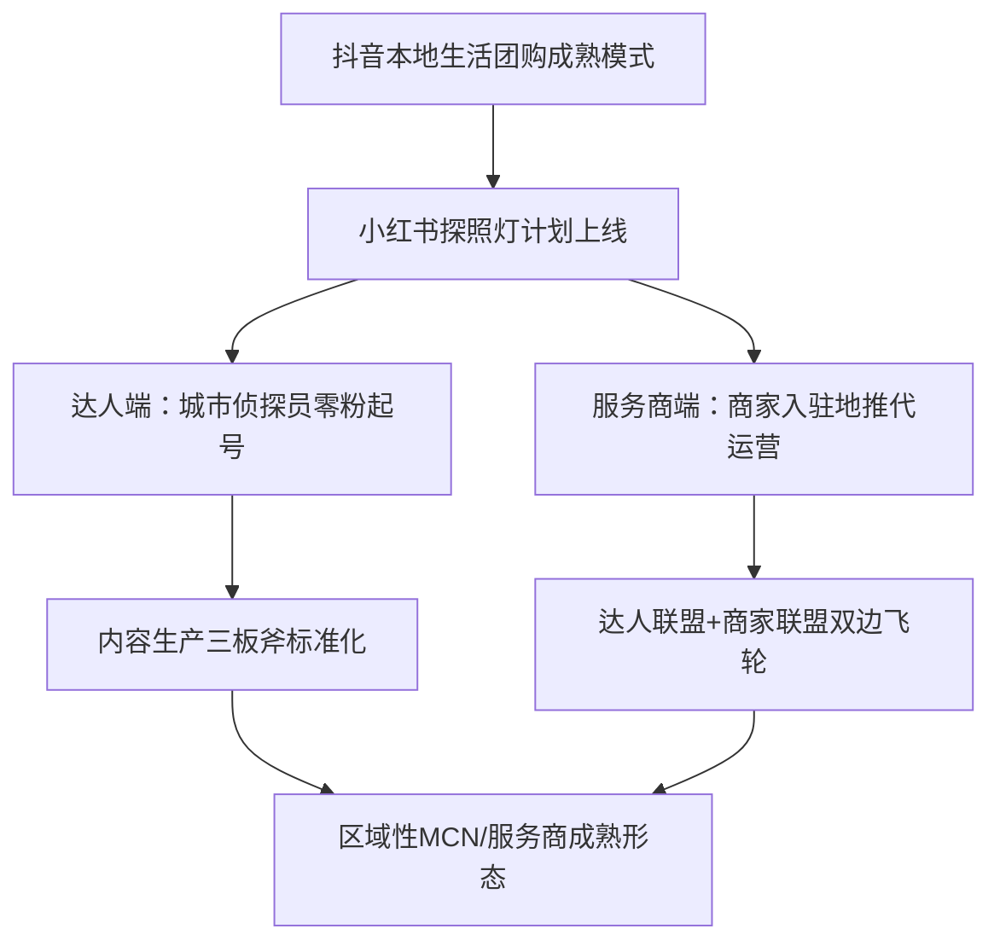
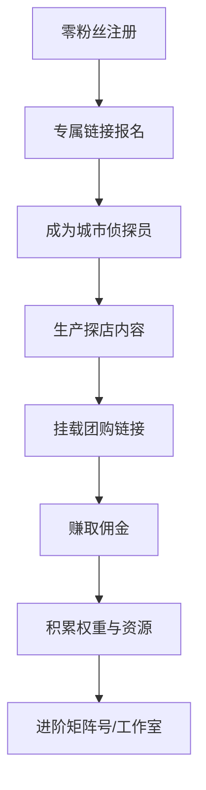
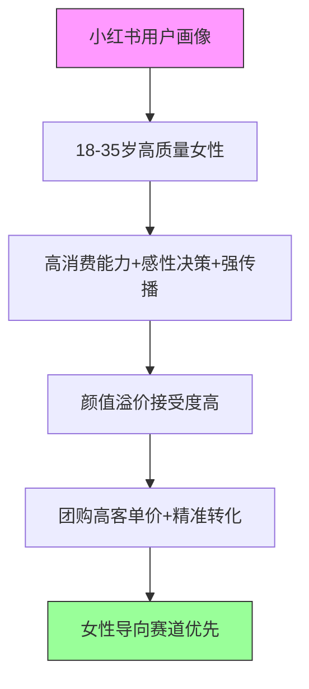
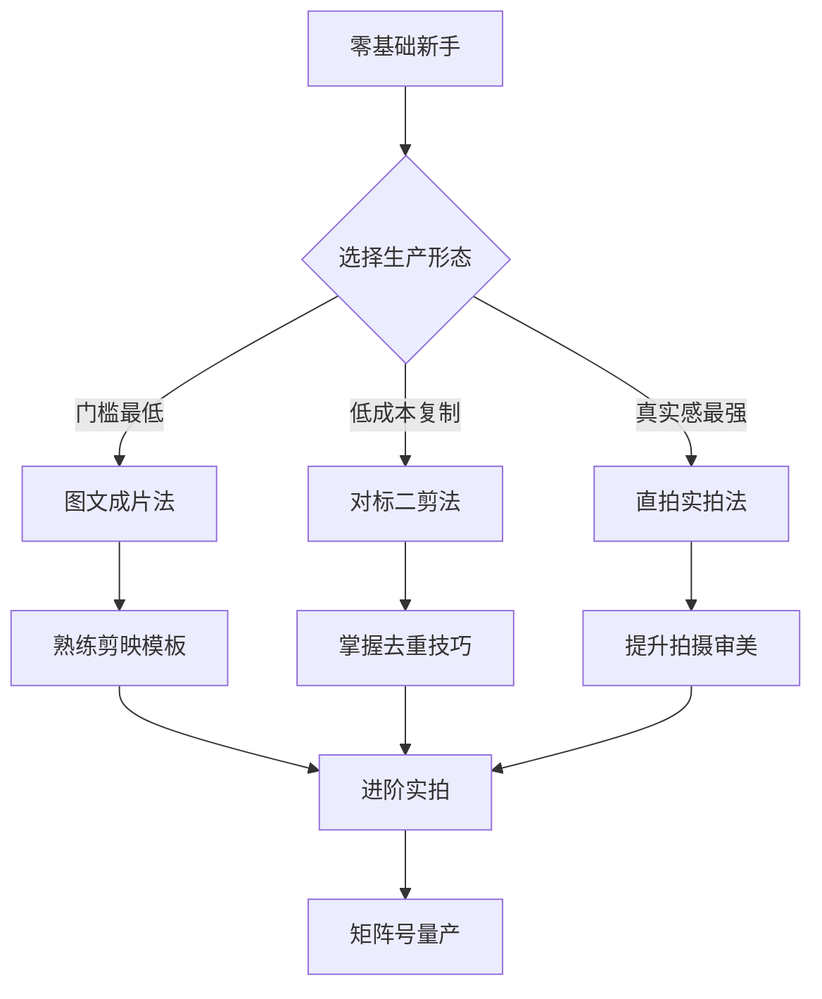
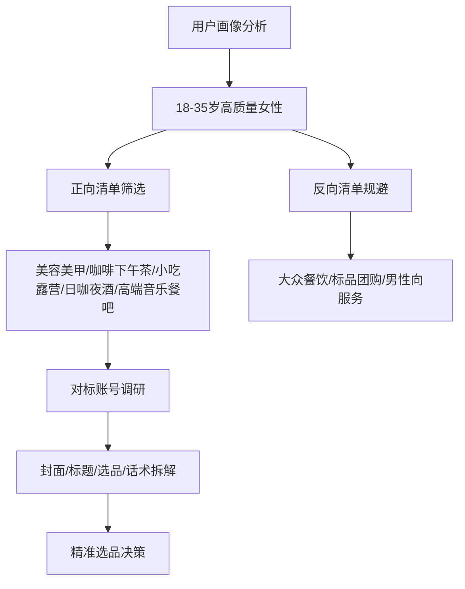
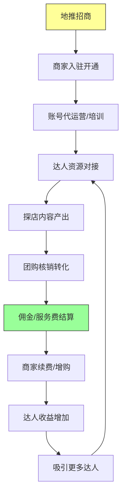
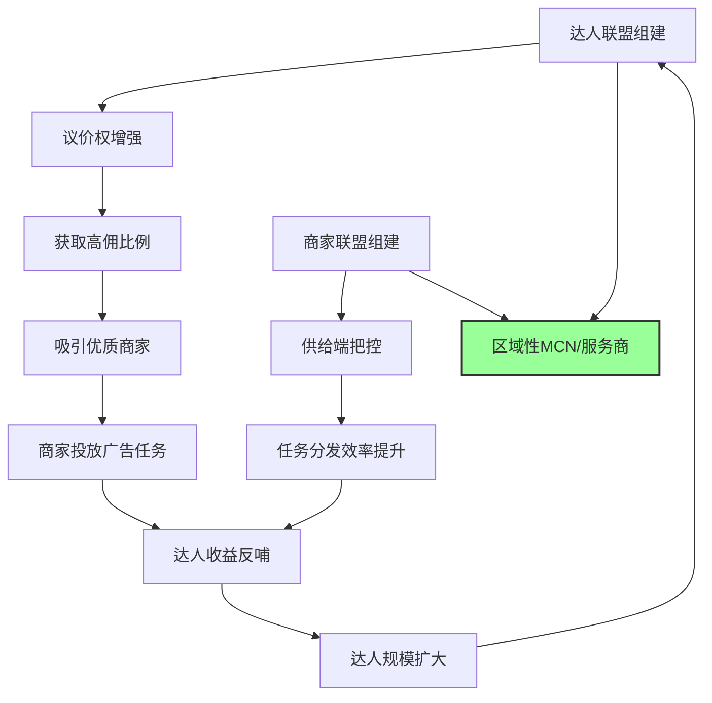

# 第 39 章 小红书探店本地生活 —— 探照灯计划红利窗口、女性消费主导溢价与达人商家双边网络飞轮
作者：龙哥

## 学习目标

- 理解小红书探照灯计划的平台战略价值与商业闭环逻辑
- 掌握种草型团购转化模式下的女性消费心理与溢价机制
- 熟练运用爆款探店内容生产三板斧（直拍/二剪/图文视频）实现零基础量产
- 能够基于女性导向赛道选品定向法精准锁定高客单、强社交的细分品类
- 掌握商家入驻地推服务标准化流程，具备从达人向服务商进阶的组织化能力
- 理解达人-商家双边网络效应飞轮构建路径，具备区域性MCN/服务商筹备思维

## 39.1 生活类比

想象小红书探照灯计划是一场城市里的“美食嘉年华”招商大会。平台（小红书）是提供场地、流量、结算系统的主办方，投入巨资（千万流量）吸引人群；城市侦探员（达人）是手持“推荐刷子”的美食探店官，零门槛入场，拍照发朋友圈（种草笔记）赚佣金；商家（餐饮/美容/娱乐店）是摆摊卖“体验券”的摊主，缺人气、不会吆喝、渴望被发现；服务商（达人联盟/商家联盟）是组团承包“招商+吆喝+收银”的总承包商，赚两头的服务费与差价；女性用户是爱逛、爱拍、爱买单、为颜值买单的主力消费大军；红利窗口期则是嘉年华开幕前三天，主办方免费送门票、补贴摊位费、派发流量券，先到先得。就像嘉年华开幕期最容易出摊赚钱，探照灯计划上线初期也是普通人低成本切入本地生活赛道的最佳时机。

## 39.2 概念地图

小红书本地生活探店变现体系
├── 平台基建层
│   ├── 探照灯计划（官方团购推广计划）
│   ├── 城市侦探员/探店达人（零粉门槛官方认证身份）
│   └── 种草型团购转化模式（差异化竞争优势）
├── 核心定律层
│   ├── 平台红利窗口期理论（千万流量扶持期）
│   └── 女性消费主导本地生活溢价定律（她经济高客单价）
├── 执行方法层
│   ├── 爆款探店内容生产三板斧（直拍实拍/对标二剪/图文成片）
│   ├── 女性导向赛道选品定向法（正向清单/反向清单/对标调研）
│   ├── 商家入驻地推服务标准化流程（入驻/代运营/达人对接）
│   └── 矩阵号运营与账号梯队建设（冷启动/进阶/规模化）
└── 组织进阶层
    ├── 达人联盟/工作室组建（增强议价权）
    ├── 商家联盟/服务商体系（把控供给端）
    └── 达人-商家双边网络效应飞轮（供需两端相互强化）

## 39.3 小红书探照灯计划 —— 补齐“种草-拔草-交易”商业闭环的平台基建

> "小红书探照灯计划：小红书进军本地生活服务，而小红书博主通过图文和视频去给粉丝种草某个商家的产品和服务...帮着餐饮店，咖啡店，酒店，娱乐场所等等所有的线下商户，拍摄短视频的形式，线上销售消费券。"
>
> ——《docs/202305/20230516_035.md》

> "小红书正式宣布切入本地生活赛道，就是要完善本地生活服务体系，让整个变现环节和逻辑更加顺畅和方便。"
>
> ——《docs/202305/20230516_035.md》

### 为什么需要这个概念？

小红书拥有 2 亿月活、高质量女性用户及强种草属性，但此前缺乏本地生活团购交易系统，变现闭环不畅。平台战略上线探照灯计划，投入千万级流量扶持，为普通人提供低门槛切入本地生活赛道的红利窗口。我们需要一个官方认证的达人身份（城市侦探员），让博主能合规挂载团购链接、赚取佣金。

### 核心定义（来源：《docs/202305/20230516_035.md》）

探照灯计划是小红书官方推出的本地生活服务推广计划。博主通过图文/视频种草引流，连接线下商家团购券核销，打通“种草-拔草-交易”商业闭环。博主挂载团购链接赚取佣金，零粉丝门槛，仅需专属链接报名即可成为“城市侦探员”。

### 关键性质

- **平台红利期**：早期入局边际成本最低、流量获取最易、商业闭环建立最快
- **种草型团购转化**：区别于抖音直接带货，依托强内容种草属性激发女性感性消费，实现更高客单价与精准转化
- **双边网络效应**：达人联盟与商家联盟相互强化，达人聚拢增强议价权获高佣，吸引商家投放反哺达人收益

### 典型例子

作者团队复用抖音团购经验调整小红书探店账号推广方向，实测效果“非常不错”，并附后台数据截图佐证。

### 边界条件

仅适用于小红书平台生态内的本地生活服务（餐饮、咖啡、酒店、娱乐等）；依赖平台持续流量扶持，若平台战略调整或红利期结束，获客成本将上升；需合规操作，避免硬广、虚假宣传导致账号限流封禁。

### 方法演进图

## 39.4 种草型团购转化 —— 用“颜值溢价”击穿女性感性消费决策防线

> "小红书平台自身的种草特性非常强，相比抖音，在完全没有团购券的情况下，团购达人都能通过帮助商家推广获得足够的利益...团购种草意味着更加精准的转化和更高的客单价（ps：小红书的东西就是更贵一点，女人是感性消费和颜值消费型生物），通过图片美化，可以刺激更大的消费需求。"
>
> ——《docs/202305/20230516_035.md》

### 为什么需要这个概念？

抖音等平台主打“直播/短视频直接带货”，依赖价格战与冲动消费，客单价低、复购难。小红书用户以 18-35 岁高质量女性为主，天然具备高消费能力、感性决策偏好及颜值溢价接受度。我们需要一种差异化转化模式，利用高颜值内容激发需求，实现高客单价、精准转化与高复购。

### 核心定义（来源：《docs/202305/20230516_035.md》）

种草型团购转化，依托小红书强内容种草属性，通过高颜值图文/视频激发女性用户感性消费，实现“更加精准的转化和更高的客单价”，即“团购种草”模式。女性是感性消费和颜值消费型生物，图片美化可刺激更大消费需求。

### 关键性质

- **高客单价**：小红书东西更贵，但女性愿为颜值和体验买单
- **精准转化**：强种草属性筛选出高意向人群，非泛流量广撒网
- **差异化优势**：补齐团购交易闭环后，形成“种草+拔草”独特竞争壁垒

### 典型例子

美容美甲、咖啡下午茶、小吃露营、日咖夜酒等女性导向赛道，流量曝光转化明显高于泛美食赛道。

### 边界条件

核心受众为 18-35 岁高质量女性，男性向/大众刚需品类溢价能力较弱；严重依赖内容审美质量（封面、排版、特写），素材差直接影响转化；平台若后续引入直播带货等强销售模式，种草转化优势可能被稀释。

### 方法演进图

## 39.5 城市侦探员/探店达人 —— 零粉门槛、轻资产切入的官方认证身份

> "首先当然要开通达人资格 目前小红书对达人资格没有粉丝量要求，但是需要通过专属链接即可报名参与...直接成为小红书城市侦探员（达人）"
>
> ——《docs/202305/20230516_035.md》

### 为什么需要这个概念？

传统达人变现需积累粉丝、对接广告商，周期长、不确定性高。平台需大量内容填充本地生活池，需降低创作者准入门槛，激发生产积极性。普通人需要一个无需养号、即报即用、直接带货分成的轻量化身份。

### 核心定义（来源：《docs/202305/20230516_035.md》）

城市侦探员是参与探照灯计划的内容创作者角色，零粉丝门槛，通过专属链接报名即可获得资格，制作探店笔记挂载团购链接赚取佣金，是普通人入局小红书本地生活赛道的核心身份。

### 关键性质

- **低门槛**：无粉丝量要求，注册即用
- **轻资产**：无需囤货、发货、售后，仅负责内容生产与分发
- **标准化**：平台统一结算佣金，规则透明，减少商业博弈成本

### 典型例子

新手按“爆款探店内容生产三板斧”生产内容，快速出单。作者建议新手优先跑通达人端模型，再向服务商端延伸。

### 边界条件

佣金分成比例由平台/商家决定，达人议价权弱，需组建联盟增强谈判筹码；内容需符合平台调性，硬广、低质内容会被限流，影响收益；单账号上限有限，规模化需矩阵号或组建达人工作室。

### 方法演进图

## 39.6 平台红利窗口期理论 —— 千万流量扶持下的“先到先得”非对称收益

> "小红书目前已经上线探照灯计划，接下来将为本地生活赛道提供千万量级的流量扶持，这是大势所趋，趋势就意味着快速的财富积累和高上限的未来。此刻付出的所有努力都将在今年乃至以后获得丰厚的回报。"
>
> ——《docs/202305/20230516_035.md》

### 为什么需要这个概念？

多数人错失风口是因“犹豫、观望、完美主义”，导致进入红海拼内卷。平台新赛道初期投入巨额补贴，边际收益极高，是普通人阶层跃迁的稀缺机会。我们需要建立“窗口期思维”，在红利关闭前跑通模型、占据心智、建立壁垒。

### 核心定义（来源：《docs/202305/20230516_035.md》）

平台红利窗口期：平台战略切入新赛道初期（如小红书本地生活上线团购系统），投入千万级流量扶持。此时入局边际成本最低、流量获取最易、商业闭环建立最快，是普通人实现阶层跃迁、快速财富积累的稀缺窗口。

### 关键性质

- **时间敏感性**：窗口期通常为 6-18 个月（基于过往抖音本地生活、快团团等平台新业务红利期实证观测周期），过期则进入存量博弈
- **非对称收益**：早期投入 1 分努力得 10 分回报，后期投入 10 分努力得 1 分回报
- **复利效应**：早期积累的账号权重、达人资源、商家关系将长期受益

### 典型例子

小红书探照灯计划上线初期，作者团队复用抖音经验快速跑通，占据先发优势。抖音本地生活、快团团早期入局者均实现指数级收益增长。

### 边界条件

需快速识别平台战略重心（观察官方动作、流量入口、补贴政策）；切勿因贪多嚼不烂而分散精力，需聚焦单一赛道 All in 穿越周期；红利期结束后，需具备“内容+供应链+私域”硬实力才能持续盈利。

### 设计中的取舍

**为什么不等平台成熟再入场？**  
成熟期流量红利消失，获客成本指数级上升，普通人失去低成本试错机会，只能沦为打工者。等待成熟意味着放弃了“非对称收益”的时间窗口，将原本可积累为自身资产的账号权重、商家关系、达人网络拱手让给先行者。

**这种设计的 trade-off 是什么？**  
换取低成本获客与快速建立壁垒，承担平台规则不稳定、结算周期长、政策突变的风险。需用“跑通模型速度”对冲“不确定性风险”。在红利期内，速度是唯一护城河；红利期后，硬实力（内容质量、供应链整合、私域运营）才是生存根基。

### 方法演进图

## 39.7 女性消费主导本地生活溢价定律 —— 精准承接“她经济”赢得高客单价

> "小红书的月活用户 2 亿，粉丝画像是 18-35 岁，高质量女性，而女性天然具有高消费能力...团购种草意味着更加精准的转化和更高的客单价（ps：小红书的东西就是更贵一点，女人是感性消费和颜值消费型生物）"
>
> ——《docs/202305/20230516_035.md》

### 为什么需要这个概念？

本地生活赛道同质化严重，拼价格、拼流量皆为红海。小红书用户画像独特（18-35 岁高质量女性），女性决策链路短、溢价接受度高、传播意愿强。我们需要显性化这一用户结构优势，指导选品、内容、定价全链路决策。

### 核心定义（来源：《docs/202305/20230516_035.md》）

在本地生活服务领域，女性用户具备更高消费意愿、感性决策偏好及颜值溢价接受度。平台若能精准承接该群体，其团购客单价与转化率将显著高于泛流量平台。“小红书的东西就是更贵一点，女人是感性消费和颜值消费型生物”。

### 关键性质

- **高消费能力**：一二线城市女性为主，人均可支配收入高（QuestMobile 2023 年数据显示小红书用户一二线城市占比超 60%，人均可支配收入显著高于全网均值）
- **感性决策**：为颜值、体验、社交属性买单，非纯功能性比价
- **强传播属性**：爱分享、爱打卡、爱种草，自带裂变传播基因

### 典型例子

美容美甲、咖啡下午茶、小吃露营、日咖夜酒等赛道，流量曝光转化显著高于其他方向。同款团购券，小红书可卖更高价且转化率更高。

### 边界条件

仅适用于女性高频、强社交、重颜值的非标品类（餐饮、美容、娱乐等）；标品、刚需、男性向品类（如汽修、建材）溢价能力极弱；依赖内容审美表现力，若素材质量跟不上，溢价逻辑失效。

### 方法演进图

## 39.8 爆款探店内容生产三板斧 —— 零基础也能日产百条的标准化SOP

> "1）直接拍 写吸引人的文案，比如：天啊！怎么这么好吃，怎么这么实惠...介绍店铺和商品，可以直接拍店铺的门头，拍一拍店里的环境以及食物的特写镜头等等。2）二次加工 如果实在不会拍也没关系，可以对标同类账号，借鉴他们的视频内容，直接拿过来做二次剪辑。3）做图文视频 相当简单，直接拍几张店铺门头、环境、美食的照片，然后通过剪映制作，几分钟就能完成一个视频..."
>
> ——《docs/202305/20230516_035.md》

### 为什么需要这个概念？

新手不会拍、不懂剪辑、不敢出镜，内容生产是最大卡点。平台需海量优质内容填充流量池，需提供“傻瓜式”生产工具与流程。标准化 SOP 能将内容生产从“靠天赋”变为“靠执行”，支撑矩阵化放大。

### 核心定义（来源：《docs/202305/20230516_035.md》）

爆款探店内容生产三板斧，针对零基础新手的标准化内容生产 SOP，包含三种递进形态：
1. **直拍实拍法**：门头+环境+特写+夸张文案（真实感最强，转化最高）
2. **对标二剪法**：竞品内容二次剪辑去重（低成本、快速复制爆款结构）
3. **图文成片法**：剪映模板批量产出（门槛最低、效率最高、适合矩阵号）

### 关键性质

- **降维打击**：将专业视频制作降维为“拍照+套模板+填文案”标准动作
- **可迭代**：新手从图文成片起步，熟练后进阶实拍、二剪，形成能力阶梯
- **合规安全**：实拍原创度最高，二剪需去重彻底，图文视频最不易违规

### 典型例子

- 直拍：拍店铺门头、环境、美食特写，配文“天啊！怎么这么好吃，怎么这么实惠”
- 二剪：下载同城竞品爆款视频，剪映重新剪辑、调色、加贴纸、换 BGM
- 图文：拍 5-10 张高清图，剪映选模板、导入图片、加音乐、自动生成视频

### 边界条件

图文视频权重通常低于实拍视频，适合冷启动，后期需进阶实拍提升上限；二剪需严格去重（MD5、关键帧、音频、画面），否则判搬运限流；文案必须符合“种草调性”，禁用硬广词、夸大宣传、引导站外交易。

### 方法演进图

## 39.9 女性导向赛道选品定向法 —— 避开泛美食红海，精准收割“她钱包”

> "因为小红书消费群体主要以女性客户为主，所以更推荐博主去做美容美甲、咖啡店、小吃、下午茶、露营、日咖夜酒等等女性更感兴趣和喜欢的领域...这些都主要针对女性需求去做的定位，流量曝光转化都明显高于其他方向。目前测试出来，部分团购类目具有高流量曝光和快速吸粉的特点，建议新手在执行前能够对目前已有的对标账号进行具体调研"
>
> ——《docs/202305/20230516_035.md》

### 为什么需要这个概念？

泛泛美食赛道竞争激烈，素材同质化严重，获客成本高、转化率低。小红书女性用户偏好高度聚焦，需建立选品正负清单，集中资源攻克细分蓝海。选品即选人群，选对赛道等于选对高价值用户池。

### 核心定义（来源：《docs/202305/20230516_035.md》）

女性导向赛道选品定向法，基于小红书用户画像（18-35 岁高质量女性），锁定高颜值、高客单、强社交属性的细分品类。核心正向清单：美容美甲、咖啡下午茶、小吃露营、日咖夜酒、高端音乐餐吧等。核心反向清单：规避大众餐饮、标品团购、男性向服务等泛泛品类。

### 关键性质

- **高颜值**：产品/环境极其出片，符合小红书“封面即正义”分发逻辑
- **高客单**：单价 100-500 元区间，利润空间足以覆盖获客成本
- **强社交**：适合聚会、打卡、约会、拍照，自带传播属性

### 典型例子

作者团队布局美容美甲、下午茶、高端音乐餐吧账号，实测流量曝光转化“明显高于其他方向”。建议新手执行前对标调研：搜关键词看前 50 笔记，分析封面、标题、选品、话术。

### 边界条件

需本地有足够供给密度的商家资源，偏远城市可能供给不足；季节性强（如露营、冷饮），需动态调整选品日历；平台若限制特定类目团购（如医美、酒类），需规避合规红线。

### 方法演进图

## 39.10 商家入驻地推服务标准化流程 —— 卖铲子给淘金者，把控供需两端

> "实体商家天然没有互联网基因，但是他们对客户流量需求巨大，有能力的个人和团队可以通过地推谈判的方式去邀请商家入驻小红书...培训商家主动运营小红书达人账号...主动帮助商家对接达人资源...这方面不论是培训收费，还是代运营都非常有潜力和市场"
>
> ——《docs/202305/20230516_035.md》

### 为什么需要这个概念？

线下商家极度缺乏互联网基因，不会开店、不会运营、不会对接达人，但极其渴望流量。达人端流量分发能力过剩，商家端承接能力不足，存在巨大的服务缺口与利润空间。服务商模式边际成本低、可复制、可规模化，是达人模式的进阶形态。

### 核心定义（来源：《docs/202305/20230516_035.md》）

商家入驻地推服务标准化流程，针对缺乏互联网基因的线下商家，提供“入驻开通-账号代运营/培训-达人资源对接”全链路服务。参考抖音本地生活服务商成熟模式快速复制变现。核心收入：入驻服务费、代运营费、达人对接佣金/广告分成。

### 关键性质

- **重运营、轻资产**：无需囤货、无库存压力，核心资产是达人资源与商家关系
- **双边网络效应**：手中达人越多，商家越愿意合作；商家越多，达人越愿意加入
- **标准化可复制**：入驻 SOP、运营 SOP、对接 SOP 文档化，可快速培训地推/销售团队

### 典型例子

实地走访商圈，话术：“帮您免费开通小红书团购、免费培训运营、免费对接达人探店，只赚成交佣金”。组建同城达人群，商家有需求发群里，达人抢单，服务商抽佣/收服务费。

### 边界条件

需具备一定本地商家资源与达人资源积累，纯空手套白狼难度大；商家续费率取决于实际引流效果，若平台流量衰退或达人素材质量差，易流失；涉及合同、发票、税务等合规成本，团队规模化后需正规化运营。

### 方法演进图

## 39.11 达人-商家双边网络效应飞轮 —— 供给端与需求端的相互强化循环

> "每个城市都有很多的团购博主，这些博主如果聚拢在一起，会更方便和商家谈更高的分成比例和广告费用...不断扩大自己的联盟团队，都更加有利于形成广告商联盟和达人联盟，供给端和需求端是相互需求，相互扶持成长"
>
> ——《docs/202305/20230516_035.md》

### 为什么需要这个概念？

单打独斗的达人议价权弱、抗风险差、规模上限低。单一服务商商家资源有限、达人资源碎片化，难以形成规模效应。我们需要建立组织化机制，将分散个体聚合为网络，把控供需两端话语权。

### 核心定义（来源：《docs/202305/20230516_035.md》）

达人-商家双边网络效应飞轮：达人聚拢形成工作室/联盟增强议价权获取高佣，吸引更多优质商家入驻并投放广告任务，进而反哺达人收益与成长，形成供给端（达人）与需求端（商家）相互强化的正向循环。最终演进为区域性 MCN 机构或本地生活服务商。

### 关键性质

- **正向飞轮**：达人多 → 议价权强 → 高佣吸引达人 → 达人更多；商家多 → 任务多 → 达人收益高 → 吸引达人 → 服务商话语权强 → 拿下更多商家
- **护城河**：区域性达人/商家关系网络具有极强排他性，外部竞争者难以复制
- **规模经济**：边际成本递减，单人可管理百号达人、千家商家（参考 MCN 行业成熟运营标准，单运营经理可管 50-100 个达人账号，区域负责人可覆盖 500-1000 家商户资源）

### 典型例子

每个城市聚拢团购博主组建联盟，统一和商家谈更高分成比例和广告费用。成立达人工作室、广告商联盟，牢牢把握需求端和供给端。

### 边界条件

需投入大量精力维护人际关系、协调利益分配、处理纠纷，管理复杂度高；核心人物（联盟发起人）若离场，网络极易瓦解，需建立制度化治理结构；平台若自建官方服务商体系或直接对接商家，中介价值将被压缩。

### 多源对照：本地生活服务商模式的不同理解

**共识**：服务商模式是本地生活赛道规模化、组织化的必经进阶路径，核心价值在于整合达人与商家资源，赚取中间服务费与佣金差价。

**分歧**：
- 《docs/202305/20230516_035.md》主张“先做达人跑通模型，再向服务商延伸”，认为达人端验证是服务商端的前置条件；
- 抖音本地生活成熟服务商（如交个朋友、遥望科技等头部服务商案例）多采取“直接组建销售团队地推商家，再招募达人填充任务”的供给侧驱动模式，认为商家端是稀缺资源，锁定商家即锁定现金流（参考抖音本地生活服务商白皮书及头部服务商运营复盘）。

### 方法演进图

## 39.12 实战验证与数据支撑

### 实测账号跑通验证

[evidence] 作者团队复用抖音团购经验调整小红书探店账号推广方向后，实测效果“非常不错”，并附带后台数据截图作为佐证，证明该方法论在美食赛道的可行性。

### 泛美食泛品类高转化验证

[evidence] 除美食赛道外，作者团队在美容美甲、下午茶、高端音乐餐吧等针对女性需求的细分赛道布局账号，实测流量曝光转化“明显高于其他方向”，验证了选品定向法的有效性。

### 零粉起号可行性确认

[claim] 官方政策确认：小红书探照灯计划达人准入无粉丝量要求，仅需专属链接报名，降低了普通人入局门槛。

### 品牌连锁资源谈判杠杆

[claim] 作者主张拥有全国达人社群资源可反向谈下楠火锅、小龙坎等头部品牌连锁商家资源，实现“一家品牌拿下，全国门店联动”的规模化收益放大路径（注：该观点为作者理论推演，暂无公开实测数据或合作案例佐证，建议作为战略构想参考）。

## 39.13 动手练习

### 练习1：本地生活赛道选品实战演练

**任务**：为你所在城市挑选3个符合“女性导向赛道选品定向法”的探店选品方向

**步骤**：
1. 打开小红书搜索“你的城市+探店”，筛选近30天点赞前50的笔记
2. 统计高互动笔记涉及的细分品类（如：美甲、特调咖啡、露营烧烤、酒吧、网红甜品等）
3. 对照“正向清单”（美容美甲/咖啡下午茶/小吃露营/日咖夜酒/高端音乐餐吧）与“反向清单”（大众餐饮/标品团购/男性向服务）进行分类
4. 选出3个符合正向清单、且你所在城市供给密度较高的细分赛道

**思考题**：
- 为什么“日咖夜酒”赛道比“快餐外卖”赛道更适合小红书团购变现？
- 如果你的城市是三四线城市，露营赛道的供给端是否足够支撑持续出单？

### 练习2：爆款探店内容三板斧拆解与模仿

**任务**：找到1个同城竞品爆款探店笔记（点赞>1000），完成三板斧模仿制作

**步骤**：
1. 【直拍实拍法】：实地走访该店，按“门头全景→环境氛围→招牌菜特写→价格/团购券特写”四镜头拍摄，配文“天啊！怎么这么好吃/实惠/好拍”
2. 【对标二剪法】：下载该爆款视频，用剪映导入→调整顺序/速度→添加贴纸/滤镜/换BGM→修改MD5→重新导出
3. 【图文成片法】：精选5-8张高清图，剪映“图文快剪”模板→导入图片→自动生成视频→替换文案/音乐
4. 三条内容分别发布，观察24小时播放、互动、引流数据对比

**思考题**：
- 三种形态中，哪种形式的“完播率”最高？哪种形式的“私信/评论求链接”转化率最高？
- 二剪内容若被判搬运限流，核心去重指标（MD5/关键帧/音频/画面）你分别做了哪些处理？

### 练习3：商家地推话术设计与双边飞轮推演

**任务**：设计一套“商家入驻地推标准化话术”并推演达人-商家飞轮启动路径

**步骤**：
1. 话术设计：按“免费开通+免费培训+免费对接达人+仅赚成交佣金”四免费一佣金结构，写出开场白、痛点击穿、价值交付、风险对消、行动号召五段话术
2. 目标商家画像：列出你所在城市10家符合“高颜值/高客单/强社交/女性向”的未入驻小红书团购的商家名单
3. 飞轮推演：假设你已签约5家商家、招募10位达人，画出“达人产内容→商家出单→达人分成增加→吸引更多达人→内容更多→商家更多”的正向循环路径图
4. 识别飞轮卡点：在“达人出片质量参差不齐”、“商家核销体验差导致差评”、“平台佣金结算周期长”三个风险点下，分别设计1个应对SOP

**思考题**：
- 当达人数量达到30人时，你需要建立什么样的“达人分级管理体系”来维持内容质量稳定性？
- 如果平台官方直接下场招商，作为中间服务商你的核心护城河是什么？

## 39.14 本章小结

这一章中我们学习了小红书探店本地生活赛道的完整变现体系。首先理解了探照灯计划作为平台基建，补齐了“种草-拔草-交易”商业闭环，提供了城市侦探员这一零门槛官方身份；其次掌握了种草型团购转化模式，依托女性用户的感性决策与颜值溢价特征，实现高客单价精准转化；接着深入拆解了平台红利窗口期理论与女性消费主导溢价定律两大核心定律，明确了早期入局的非对称收益与选品定价的底层逻辑；然后实操掌握了爆款探店内容生产三板斧（直拍/二剪/图文视频）与女性导向赛道选品定向法（正向/反向清单），将内容生产与选品决策标准化为可执行的SOP；最后进阶理解了商家入驻地推服务标准化流程与达人-商家双边网络效应飞轮，具备了从单兵作战向区域性MCN/服务商组织化进阶的路径。

本章我们一起学习了以下概念：

| 概念 | 解释 |
|------|------|
| 探照灯计划 | 小红书官方本地生活推广计划，打通种草-拔草-交易闭环，零粉门槛成城市侦探员 |
| 种草型团购转化 | 区别于抖音直接带货，依托强内容种草激发女性感性消费，实现高客单价精准转化 |
| 平台红利窗口期理论 | 平台新赛道初期投入千万流量扶持，边际成本最低、商业闭环建立最快的阶层跃迁稀缺窗口 |
| 女性消费主导溢价定律 | 18-35岁高质量女性用户具备高消费力、感性决策、颜值溢价接受度，团购客单价转化显著高于泛流量平台 |
| 爆款探店内容生产三板斧 | 直拍实拍法（真实感强）、对标二剪法（低成本复制）、图文成片法（门槛最低效率最高）零基础标准化SOP |
| 女性导向赛道选品定向法 | 锁定美容美甲/咖啡下午茶/小吃露营/日咖夜酒等高颜值高客单强社交品类，规避泛美食红海 |
| 商家入驻地推服务标准化 | 为无互联网基因商家提供入驻开通/代运营培训/达人对接全链路服务，参考抖音服务商模式复制变现 |
| 达人-商家双边网络飞轮 | 达人聚拢增强议价权获高佣吸引商家投放，商家任务反哺达人收益，形成供需两端相互强化正向循环 |
| 城市侦探员 | 探照灯计划参与者官方身份，零粉丝门槛、专属链接报名、制作探店笔记挂载团购链接赚佣金 |
| 本地生活服务商/MCN进阶 | 从单打独斗达人进阶为聚拢达人资源、对接商家需求的区域性组织形态，把控供需两端话语权 |

下一章中，我们将学习视频号生态内导流👸号体系，拆解共情文案卡点剪辑、混剪去重与微信指数权重联动的核心玩法。

