# 第 43 章 副业认知与项目筛选 —— 从“贪多嚼不烂”到“All in单赛道”

## 学习目标

- 理解副业成长的三阶段模型：无项目焦虑期、多项目迷茫期、单赛道聚焦期
- 掌握聚焦筛选五维决策标准：有过成绩、有独到方法论、方法论可复制、与主业关联、个人喜好
- 理解个人IP资产化逻辑：从项目收益向零边际成本杠杆产品的跃迁路径
- 掌握跨项目思维迁移三步法：吸收异质知识、识别可迁移模块、本地化改造落地
- 掌握引流文档资产化制作与私域转化闭环：PDF钩子设计、信任前置、分层承接
- 理解社群增值型加入与产出策略：体验券试水、带着问题去偷、高质量输出建立人设、内化课程体系
- 掌握矩阵号批量化运营与止损策略：标准化SOP、物理隔离、动态止损红线、资产变现退出
- 理解注意力守恒与正反馈循环定律：单项目突破阈值建立飞轮、分散操作必然全军覆没
- 理解主业关联性护城河论：技能/资源/认知/信任/试错场五大复用维度
- 理解IP资产化优于项目收益论：抗周期、规模化、组合化的长期财富载体
- 理解社群作为认知跃迁加速器：元认知与异质知识库实现降维打击

## 43.1 生活类比

想象副业成长像**登山探险**：

- **无项目期** = 山脚下望山兴叹，焦虑安全感缺失，买遍装备却不出发
- **多项目期** = 同时攀登五座山峰，体力分散在每座山脚徘徊，从未登顶过任何一座
- **聚焦期** = 选定唯一主峰(五维筛选)，集中全力攻顶，建立大本营(IP资产)可反复往返
- **注意力** = 登山体力，守恒且有限，分散投入必然全军覆没，聚焦突破方能登顶
- **正反馈阈值** = 攻顶所需的临界体力储备，低于此值无法冲破高原反应区，只能在山腰打转
- **主业关联** = 自带高原适应体质与向导经验，降低试错死亡率
- **IP资产** = 山顶建成的永久基站(课程/文档/社群)，边际成本为零可无限接待后来者
- **社群** = 登山协会，提供地图(元认知)、装备(异质知识库)、向导(大佬)，但攀登仍靠自己

就像登山必须一座座攻克、建立永久基站，副业也要聚焦单赛道、资产化经验，才能实现复利跃迁。

---

## 43.2 概念地图

副业认知与项目筛选体系
├── 成长阶段模型
│   ├── 阶段一：无项目焦虑期  —— [P001, p.1]
│   ├── 阶段二：多项目迷茫期  —— [P001, p.1-2]
│   └── 阶段三：单赛道聚焦期  —— [P001, p.3]
├── 聚焦筛选决策框架
│   ├── 维度一：有过成绩(0-1正反馈)  —— [P001, p.3]
│   ├── 维度二：有独到方法论  —— [P001, p.3]
│   ├── 维度三：方法论可复制(SOP化)  —— [P001, p.3]
│   ├── 维度四：与主业关联(技能/资源/认知/信任/试错场)  —— [P001, p.3]
│   └── 维度五：个人喜好(内驱力)  —— [P001, p.3]
├── 核心底层定律
│   ├── 注意力守恒与正反馈循环定律  —— [P001, p.2]
│   ├── 主业关联性护城河论  —— [P001, p.3]
│   └── IP资产化优于项目收益论  —— [P001, p.4-5]
├── 个人IP构建与变现
│   ├── 个人IP杠杆化(纳瓦尔第三种杠杆)  —— [P001, p.4]
│   ├── 引流文档资产化(PDF钩子+信任筛选)  —— [P001, p.4-5]
│   ├── 社群增值型加入产出策略  —— [P001, p.5], [P002, p.7-8]
│   └── 矩阵号批量化运营与止损  —— [P001, p.5-6]
├── 实战方法论库
│   ├── 跨项目思维迁移三步法  —— [P001, p.3-4]
│   ├── 搬运混剪+佣金阈值筛选法  —— [P001, p.5]
│   └── 社群作为认知跃迁加速器  —— [P001, p.5], [P002, p.7-8]
└── 典型实证案例

---

## 43.3 副业三阶段进化论 —— 从“找项目”到“造IP”的必经之路

### 为什么需要这个概念？

普通人副业普遍陷入“贪多嚼不烂”误区，注意力分散导致全军覆没；缺乏阶段性认知，无法判断当前处境与下一步动作；需要一张清晰的成长地图，从焦虑迷茫走向聚焦突围。

### 核心定义

- **阶段一（无项目期）**：认知空白，焦虑安全感缺失，四处寻找机会
- **阶段二（多项目迷茫期）**：项目过多，注意力稀释，单项目投入低于正反馈阈值，陷入“干不好→拿不到反馈→放弃→换项目”的死循环
- **阶段三（聚焦期）**：依据五维筛选标准锁定单一赛道，打造个人IP，撬动零边际成本杠杆

### 关键性质

副业成长具有三大本质特征：

1. **必经性**：跨越阶段不可跳跃。试图跳过试错期直接聚焦，往往因认知不足选错赛道，导致在错误方向上“高效执行”。
2. **不可逆性**：注意力守恒定律决定分散操作必然失败，唯有聚焦才能建立正反馈飞轮。一旦分散，无法通过“再努力一点”补回阈值缺口。
3. **复利性**：聚焦期产出的IP资产（课程/文档/社群）具备复制边际成本为零的指数级收益特征，这是分散操作永无法企及的。

### 典型例子

作者叁斤在《P001: 叁斤副业全历程复盘》中记录道：闲鱼(30元)→多多视频(1300元)→视频号(36元)等多项目并行半年，总收益<1500元，验证了分散操作的负收益。同期小红书好物分享：单号起号月入200→矩阵20+号峰值月入1w+→平台打击单价腰斩→缩减至3号维持→出售账号变现2w+，全周期验证了红利窗口期与政策风险。

### 边界条件

该模型仅适用于“以赚钱为目的”的商业化副业，不适用于纯兴趣/公益类活动。聚焦赛道必须满足五维筛选标准，盲目聚焦错误赛道等于加速失败。阶段跨越需要外部强约束（如航海训练营）或极强自律作为催化剂。

---

> "我副业的3个阶段：没项目、没目标、聚焦"
> 
> "理想很美好，现实情况是，只要你把注意力分散，那每一个你都干不好，拿不到正反馈，就没法坚持下去。"
> 
> "一个人如果什么都抓，最终的宿命就是平庸。在打造个人品牌的路上我们一定要搞清楚，哪些事情才是真正的超级重点。"
> 
> ——[P001, p.1-2]

这个片段揭示了副业成长的必经路径：从认知空白的焦虑，到贪多嚼不烂的迷茫，再到基于标准筛选的聚焦。核心洞见是**注意力守恒**——分散投入必然导致单项目无正反馈，进而陷入“全军覆没”的死循环。

---

### 副业三阶段模型定义

根据[P001, p.1-2]，我们可以将三阶段模型形式化定义为：

$$
\text{Stage}_i = 
\begin{cases}
\text{无项目期} & \text{认知空白，焦虑驱动，四处找项目} \\
\text{多项目期} & \text{项目过多，注意力稀释，单项目投入} < \theta_{\text{正反馈}} \\
\text{聚焦期} & \text{五维筛选} \xrightarrow{\text{锁定}} \text{单赛道} \xrightarrow{\text{打造}} \text{个人IP}
\end{cases}
$$

其中 $\theta_{\text{正反馈}}$ 为单项目突破“正反馈阈值”所需的最小注意力投入。这个定义展示了三个阶段的本质区别：无项目期是认知缺失，多项目期是资源配置错误（注意力分散低于阈值），聚焦期是基于决策框架的资源集中。

---

### 关键推演：为什么分散操作必然失败？

**注意力守恒定律推导**（来源：[P001, p.2-3]）

我们从三个前提假设出发：

1. **注意力守恒前提**：单位时间内，个体可调动的高质量深度注意力总量 $A_{\text{total}}$ 是有限且守恒的。认知科学研究表明，成年人每日可持续的深度工作上限约为 3-4 小时（Cal Newport《Deep Work》Ch.2；Anders Ericsson《刻意练习》关于专家日均4小时极限的实证）。

2. **均分假设**：当同时操作 $N$ 个项目时，注意力被迫均分，单项目获得 $A_i = \frac{A_{\text{total}}}{N}$。

3. **阈值前提**：单项目必须投入超过临界注意力量 $\theta_{\text{正反馈}}$（实证约为连续2周、日均2h+深度工作），才能触发“出单/爆款/正向数据”的正反馈（习惯养成研究《原子习惯》关于21-66天自动化阈值；自我决定理论关于胜任感需求的量化指标）。

由此推导：

$$
\begin{aligned}
\text{若 } N &\geq 2 \text{ 且 } A_{\text{total}} \approx 3\text{h} \\
\Rightarrow A_i &= \frac{3\text{h}}{N} \leq 1.5\text{h} < \theta_{\text{正反馈}}(2\text{h}) \\
\Rightarrow &\text{单项目投入低于阈值} \\
\Rightarrow &\text{无正反馈（出单/爆款/正向数据）} \\
\Rightarrow &\text{多巴胺/信心/动力三重缺失} \\
\Rightarrow &\text{项目放弃} \\
\Rightarrow &\text{全军覆没}
\end{aligned}
$$

**这个推导展示了**：当你同时操作 $N$ 个项目时，每个项目只能获得 $A_{\text{total}}/N$ 的注意力。一旦单项目注意力低于正反馈阈值 $\theta$（通常需要连续2周、日均2h+深度工作），该项目就无法触发“出单/爆款/正向数据”的正反馈，导致多巴胺/信心/动力三重缺失，最终全部放弃。

---

### 方法演进图

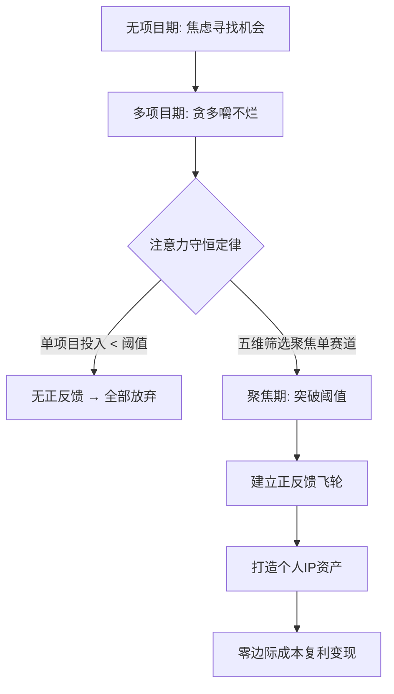

这个演进图展示了从分散到聚焦的必然路径：只有通过五维筛选锁定单赛道，将全部注意力集中投入，才能突破正反馈阈值，建立良性飞轮，最终实现IP资产的复利增长。

---

## 43.4 聚焦筛选五维标准 —— 用“漏斗模型”淘金唯一赛道

### 为什么需要这个概念？

面对海量副业机会，新手缺乏决策框架，易被“看起来很美好”的项目误导；资源（时间/精力/金钱）有限，必须集中火力攻克单一目标；需要可执行、可复查的硬性指标替代主观感觉。

### 核心定义

五维漏斗筛选法包含五个硬性指标，缺一不可：

1. **维度一：有过成绩**——已跑通0-1，有真实正反馈数据
2. **维度二：有独到方法论**——非搬运，有自己总结的可复用SOP/认知模型
3. **维度三：方法论可复制**——能教给他人/写成文档/标准化流程
4. **维度四：与主业关联**——复用主业技能/资源/认知/信任背书，降低试错成本
5. **维度五：个人喜好**——内驱力支撑长期主义，抗拒枯燥重复

### 关键性质

五维筛选具有三大本质特征：

1. **漏斗式过滤**：五个维度缺一不可，层层递进，最终仅剩1个赛道。顺序不可逆——先验“成绩”再验“方法论”，最后才看“喜好”，避免主观偏好污染客观判断（决策理论中“满意度决策”与“优化决策”的区别；双重过程理论System 1/System 2关于直觉先行、理性验证的顺序证据）。

2. **动态校准**：主业变动/能力提升/平台规则变化时需重新跑一遍漏斗，确保筛选结果随环境演进而更新。

3. **反脆弱性**：主业关联性提供独特护城河，平台规则变化时仍有核心竞争力，这是纯跨界项目无法具备的。

### 典型例子

作者在[P001, p.3]中描述筛选过程：闲鱼/多多/视频号/资料号等全部淘汰，仅小红书满足五维（有广告收益成绩、有矩阵/SOP方法论、可教学员、主业做过小红书运营、喜欢分享），最终All in小红书IP。

### 边界条件

“成绩”不要求大赚，只要有确定性的正向现金流闭环即可（哪怕只赚了200元）；“主业关联”非绝对行业一致，可为技能迁移（如主业项目管理→副业课程交付管理）；“个人喜好”可后天培养，但强厌恶赛道绝对不能选。

---

> "聚焦项目我做了几点：1、我做过，并且已经有成绩了 2、在这个项目中，已经有了自己独到的见解和方法论 3、方法论可以复制给别人 4、与自己的主业有关联 5、我喜欢这个行业/项目，或者我喜欢做这个事"
> 
> ——[P001, p.3]

这段话给出了可直接执行的**五维漏斗筛选法**。每个维度都是硬性指标，缺一不可。

---

### 五维筛选漏斗模型

根据[P001, p.3]，我们将筛选过程形式化为数学模型：

**步骤1：定义候选集合**

设候选赛道集合为 $\mathcal{S} = \{s_1, s_2, ..., s_m\}$，每个赛道 $s$ 具有五个布尔属性。

**步骤2：逐层筛选（漏斗式）**

$$
\begin{aligned}
\text{维度1 筛选（成绩）：} &\mathcal{S}_1 = \{s \in \mathcal{S} \mid \text{有过成绩}(s) = \text{True}\} \\
\text{维度2 筛选（方法论）：} &\mathcal{S}_2 = \{s \in \mathcal{S}_1 \mid \text{有独到方法论}(s) = \text{True}\} \\
\text{维度3 筛选（可复制）：} &\mathcal{S}_3 = \{s \in \mathcal{S}_2 \mid \text{方法论可复制}(s) = \text{True}\} \\
\text{维度4 筛选（主业关联）：} &\mathcal{S}_4 = \{s \in \mathcal{S}_3 \mid \text{主业关联}(s) = \text{True}\} \\
\text{维度5 筛选（个人喜好）：} &\mathcal{S}_5 = \{s \in \mathcal{S}_4 \mid \text{个人喜好}(s) = \text{True}\}
\end{aligned}
$$

**步骤3：收敛判定**

$$
\text{最终目标：} |\mathcal{S}_5| = 1
$$

如果 $|\mathcal{S}_5| = 0$，说明筛选标准过严或候选池不足，需回溯放宽维度4-5；如果 $|\mathcal{S}_5| > 1$，需引入权重打分进一步区分。

**这个模型展示了漏斗式过滤的数学化过程**：从候选集合 $\mathcal{S}$ 出发，每一轮筛选都基于布尔判断，最终收敛到唯一赛道。注意，**顺序不可逆**——先验“成绩”再验“方法论”，最后才看“喜好”，避免主观偏好污染客观判断。

---

### 方法演进图：五维漏斗筛选流程

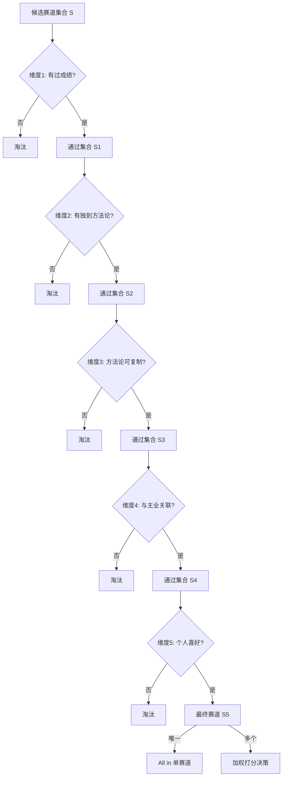

---

### 实操清单：五维打分表

下表展示了可直接使用的打分工具（1-5分），用于对候选赛道进行量化评估：

| 维度 | 判断标准 | 得分 (1-5) | 证据/备注 |
|------|----------|------------|-----------|
| 有过成绩 | 已跑通0-1，有真实正向现金流数据 | | 如：首单金额、周期、ROI |
| 独到方法论 | 非搬运，有自己总结的SOP/模型 | | 如：选品逻辑、内容模版、转化话术 |
| 可复制性 | 能教给他人/写成文档/标准化 | | 如：是否有飞书文档/Notion库 |
| 主业关联 | 复用技能/资源/认知/信任/试错场 | | 列出3个具体可迁移资产 |
| 个人喜好 | 抗拒枯燥程度，内驱力强度 | | 想象每天重复做这件事的感受 |

**决策规则**：总分 < 20 分直接淘汰；最高分项目作为聚焦目标；若有并列，优先选“主业关联”得分高者。

---

## 43.5 个人IP杠杆化 —— 让经验变成“睡后收入”的资产包

### 为什么需要这个概念？

单一项目收益受平台规则/市场周期波动大，上限受限且随时归零；劳动力杠杆（雇人）边际成本高、管理难、难规模化；需要构建“复制边际成本为零”的数字化资产矩阵实现财富自由。

### 核心定义

基于纳瓦尔宝典“第三种杠杆”理论：《纳瓦尔宝典》中提到过三种杠杆：资本的杠杆、劳动力的杠杆和复制边际成本为零的产品（代码/媒体/内容）。作者明确指出：“我现在做小红书IP，是为了撬动第三种杠杆：复制边际成本为零的产品。”（[P001, p.4-5]）

**个人IP资产包** = 👸号(信任阵地) + 引流文档(钩子) + 付费课程/陪跑(核心变现) + 社群/合伙人(放大器)

**核心路径**：项目实战经验 → 标准化SOP/文档 → 低成本引流获客 → 私域信任沉淀 → 高客单价产品变现 → 零边际成本复利

### 关键性质

个人IP杠杆化具有三大本质特征：

1. **资产属性**：IP资产一旦建立，可永久复用、组合拆分、授权分销，边际成本趋近零。克里斯·安德森《免费》论述了边际成本趋零经济学；本·汤普森《Stratechery》聚合理论进一步阐述了零边际成本产品的规模化优势。

2. **抗风险性**：平台封号/限流仅切断获客渠道，私域沉淀的IP资产(课程/文档/信任关系)不灭，可迁移平台重启。

3. **估值杠杆**：IP资产具备商业估值溢价(品牌溢价/用户资产/可预期现金流)，远超单次项目收益。SaaS/知识付费行业估值倍数报告（Gartner/Forrester/头部VC投资备忘录）显示典型倍数为收入/用户资产的10-50倍；《从0到1》论述了垄断定价权带来的估值溢价。

### 典型例子

作者小红书IP变现（[P001, p.4-5]）：👸号输出+《小红书资料库/问答集》两份PDF引流文档 → 积累私域信任 → 推出1299元陪跑课程 → 无大推广卖出20+份 → 课程收入2w+，边际成本近零。对比早期“找兼职美工做图”属于劳动力杠杆，管理成本高、质量不可控、难复制。

### 边界条件

IP建立前必须有真实项目实战经验做支撑，空中楼阁式打造IP无法经受市场检验；引流文档/课程内容需持续迭代更新，过期内容会透支信任资产；需配合私域运营体系(朋友圈/社群/话术)闭环转化，单靠公域流量无法实现高客单价。

---

> "《纳瓦尔宝典》中提到过三种杠杆：资本的杠杆、劳动力的杠杆和复制边际成本为零的产品"
> 
> "我现在做小红书IP，是为了撬动第三种杠杆：复制边际成本为零的产品。"
> 
> "建立了一个👸号输出文章，并做了‘小红书资料库’和‘小红书问答集’两份引流文档，这些都为我带来了粉丝和学员"
> 
> "最新的一份课程是小红书陪跑，这份课程我卖1299，到现在卖了二十几份，课程收入2w+，完全出乎我的意料"
> 
> ——[P001, p.4-5]

这个片段完整展示了从“理解杠杆理论”到“构建IP资产包”再到“实现零边际成本变现”的全路径。

---

### 个人IP资产化转化公式

根据[P001, p.4-5]，我们将IP资产化过程形式化：

$$
\begin{aligned}
\text{项目实战经验} &\xrightarrow{\text{标准化}} \text{SOP/文档/模版} \\
&\xrightarrow{\text{引流文档}} \text{私域流量池} \\
&\xrightarrow{\text{信任沉淀}} \text{高意向用户} \\
&\xrightarrow{\text{高客单产品}} \text{零边际成本收入} \\
\\
\text{边际成本 } &MC = \frac{\partial \text{TotalCost}}{\partial Q} \approx 0 \quad (\text{数字化产品}) \\
\text{边际利润 } &MP = \text{Price} - MC \approx \text{Price}
\end{aligned}
$$

**这个公式展示了IP资产化的核心机制**：将一次性的项目经验，通过标准化转化为可无限复制的数字化产品，从而实现边际成本趋近零、边际利润趋近售价的理想商业模型。数字化产品的边际成本趋零特性（克里斯·安德森《免费》），使得每增加一个用户，几乎不增加成本，却能获得完整售价作为利润。

---

### 方法演进图：IP资产包构建路径


---

### 资产包结构对比表

下表展示了“项目收益模式”与“IP资产模式”的核心差异：

| 维度 | 项目收益模式（劳动力杠杆） | IP资产模式（第三种杠杆） |
|------|---------------------------|--------------------------|
| 典型动作 | 雇兼职美工、亲自发货、人工客服 | 产出课程/文档/工具/社群 |
| 边际成本 | 高（随订单量线性增长） | ≈0（数字化复制） |
| 规模上限 | 受管理带宽/时间限制 | 理论无限（带宽/存储极廉价） |
| 抗风险性 | 平台限流即归零 | 私域资产可迁移平台 |
| 估值倍数 | 利润 × 1-3倍 | 收入/用户资产 × 10-50倍 |
| 时间杠杆 | 卖时间，停手即停收 | 睡后收入，资产自增值 |

---

## 43.6 跨项目思维迁移 —— 把“别人的经验”变成“自己的认知”

### 为什么需要这个概念？

单一项目视野窄，底层逻辑不透彻，遇到变数易崩盘；重复造轮子成本极高，成熟赛道已有验证过的通用模型可直接复用；认知维度的降维打击是普通人超越资源型选手的核心路径。

### 核心定义

**定义**：从不同赛道(AI/引流/电商/内容)的实战案例中，抽象提取底层逻辑(选品/流量/转化/交付/运营)，迁移应用到核心赛道的实操中。

**三步法**：
1. 广泛吸收异质知识(精华帖/航海日志/大佬复盘)
2. 识别可迁移模块(流量模型/转化话术/SOP框架)
3. 本地化改造落地(结合核心赛道特性调整参数/话术/流程)

### 关键性质

跨项目思维迁移具有三大本质特征：

1. **非搬运**：不是照搬玩法，而是迁移“底层逻辑/思维模型/方法论框架”。这是认知层面的复用，而非战术层面的复制。

2. **复利性**：每迁移一个成熟模型，认知维度+1，后续新项目理解速度指数级提升。认知复利是比资金复利更根本的杠杆。

3. **筛选性**：仅迁移“已验证、可复制、高杠杆”的模块，拒绝“幸存者偏差/幸存者谬误/不可复制运气”类经验。

### 典型例子

作者在[P001, p.3-4]中记录：将“AI项目的标准化SOP思维”+“引流项目的钩子设计逻辑”+“电商项目的选品验证闭环”迁移到小红书，打造出《小红书运营课程》并实现陪跑变现2w+。社群大佬“根源”心理咨询师：依托生财社群“好文章+对的人”，一年从零到年入200万，印证跨项目认知迁移的威力。

### 边界条件

必须有“实战落地”作为检验场，纯理论迁移无法发现水土不服问题；迁移对象需为“成熟赛道头部玩家/系统化方法论”，避免迁移未验证的伪创新；核心赛道特性差异过大(如toB vs toC、重服务 vs 重产品)时，迁移需大幅改造甚至不可行。

---

> "我不是可以把其他项目的思路迁移到小红书吗？还可以把小红书的思路分享出来给其他副业的圈友参考"
> 
> "我要把AI、引流、电商等一些项目的逻辑，迁移到小红书，做一份比较完善的小红书运营课程。"
> 
> "看完之后感觉我之前做的东西实在太弱鸡了，有太多东西需要完善"
> 
> ——[P001, p.3-4]

这段话展示了思维迁移的**触发时刻**——当作者在社群中看到大佬们的系统化复盘时，意识到自己之前的操作过于粗糙，随即启动“吸收→迁移→落地”闭环。

---

### 跨项目思维迁移三步法

根据[P001, p.3-4]，我们将思维迁移标准化为可执行的三步流程：

```
步骤1：广泛吸收异质知识（输入端）
  ├── 精华帖/航海日志/大佬复盘（高密度、已验证）
  ├── 带着“当前项目卡点”去检索（目的性阅读）
  └── 建立个人知识库（Notion/飞书/本地）

步骤2：识别可迁移模块（处理端）
  ├── 流量模型（如：SEO长尾词布局、矩阵号放大、投流测品）
  ├── 转化话术（如：钩子设计、异议处理、分层成交）
  ├── SOP框架（如：选品验证闭环、内容生产流水线、私域运营体系）
  └── 筛选标准：已验证 ∧ 可复制 ∧ 高杠杆

步骤3：本地化改造落地（输出端）
  ├── 映射：核心赛道特性 ↔ 模块参数
  │   ├── 小红书：图文为主、女性用户、种草属性强
  │   └── 调整：视频→图文、直播→私域、广告→课程
  ├── 重写：话术/流程/参数本地化
  └── 验证：小步快跑，数据复盘，快速迭代
```

这个伪代码展示了思维迁移的标准化执行流程：从“带着问题去偷”开始，到“识别可迁移模块”，再到“结合赛道特性本地化改造”，形成完整的认知升级闭环。

---

### 方法演进图：思维迁移闭环

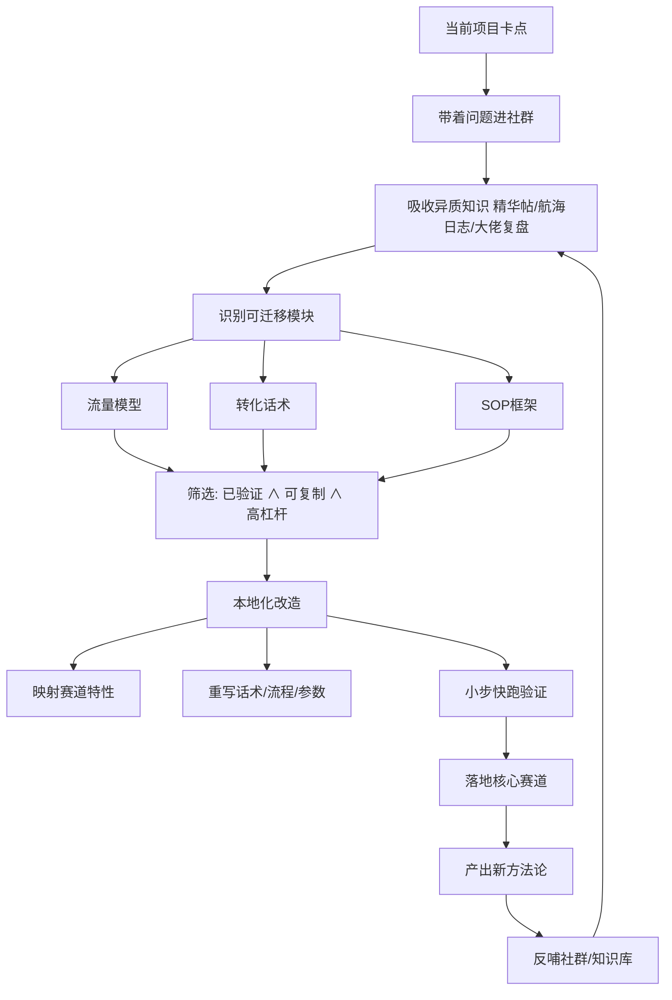

---

### 多源对照：思维迁移的不同视角

**共识**：
- 思维迁移的核心是“底层逻辑复用”，而非“战术照搬”
- 必须有“实战验证”作为检验场
- 认知维度跃升具有复利效应

**分歧**：
- [P001]主张**“带着卡点去精华帖偷模块”**，强调目的性与实战闭环
- [P002]主张**“大量刻意练习形成网感直觉”**，强调内化与直觉的养成
- [P001]侧重**跨赛道模块组装**（AI+引流+电商→小红书课程）
- [P002]侧重**单赛道深度打磨**（雅思垂直→用户全生命周期需求）

---

## 43.7 引流文档资产化 —— 用“PDF”做钩子，用“信任”做筛选

### 为什么需要这个概念？

公域流量获客成本高、精准度低、信任基础弱，直接转化高客单价极难；碎片化经验无法规模化传播，必须标准化为可交付的数字化产品；需要一个“低门槛、高价值、可追踪”的信任前置工具。

### 核心定义

将运营实战中的：资料整理(考证/工具/渠道)、高频问答(避坑/话术/流程)、思维导图(知识结构) → 标化为PDF/在线文档/思维导图文件；作为“引流钩子”挂在公域内容/简介/置顶/评论区，引导用户主动添加微信/进群领取；文档本身即“能力展示”与“筛选器”：内容专业度建立信任，领取动作筛选高意向用户。

### 关键性质

引流文档资产化具有三大本质特征：

1. **复用性**：一次制作，终身分发，边际分发成本为零。
2. **筛选力**：主动索取资料的用户，付费意向/信任度/精准度远高于被动加微信用户。
3. **复利性**：文档内容可持续迭代(v1.0→v2.0)，旧用户复购/转介绍，新用户持续获取。

### 典型例子

作者《小红书资料库/问答集》两份PDF（[P001, p.4-5]）：作为👸号/小红书引流钩子，持续带来精准粉丝与学员，直接支撑1299元陪跑课程2w+收入。社群大佬建议：“强烈建议做个人IP的圈友去建立👸号和行业问答集之类的东西，效果嘎嘎好！”

### 边界条件

文档必须包含“独家/稀缺/实操/避坑”信息，通用公开资料无吸引力；需配合私域承接话术(自动回复/人工分层/朋友圈运营)形成闭环，裸发文档不转化；定期清理过期信息(平台规则/工具版本/渠道联系方式)，维护文档权威性。

---

> "建立了一个👸号输出文章，并做了‘小红书资料库’和‘小红书问答集’两份引流文档，这些都为我带来了粉丝和学员"
> 
> "强烈建议做个人IP的圈友去建立👸号和行业问答集之类的东西，效果嘎嘎好！"
> 
> ——[P001, p.4-5]

---

### 引流文档转化漏斗模型

根据[P001, p.4-5]，我们将引流文档在转化链路中的作用形式化：

$$
\begin{aligned}
\text{公域内容} &\xrightarrow{\text{挂载钩子}} \text{用户点击/评论/私信} \\
&\xrightarrow{\text{自动/人工回复}} \text{发送PDF文档} \\
&\xrightarrow{\text{文档专业度}} \text{建立信任/权威感} \\
&\xrightarrow{\text{主动索取行为}} \text{筛选高意向用户} \\
&\xrightarrow{\text{私域承接话术}} \text{分层分级运营} \\
&\xrightarrow{\text{高客单产品}} \text{变现闭环}
\end{aligned}
$$

**这个模型展示了引流文档在“公域→私域→变现”链路中的关键作用**：既是流量入口的钩子，又是信任建立的锚点，更是高意向用户的筛选器。

---

### 方法演进图：引流文档转化闭环

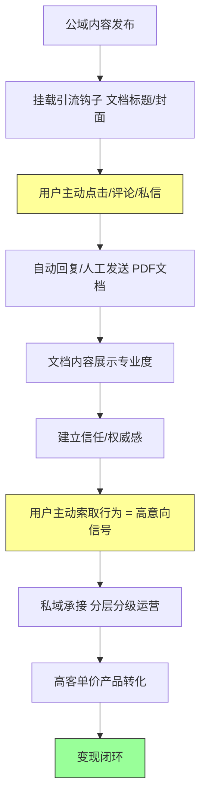

---

### 引流文档制作标准清单

下表展示了可直接执行的文档制作SOP：

| 模块 | 内容要求 | 产出形式 | 核心稀缺性 |
|------|----------|----------|------------|
| 标题 | 痛点词+结果承诺（如《3天起号日引100+精准粉》） | PDF封面 | 结果可验证、痛点精准 |
| 目录 | 按新手路径排序：认知→选品→起号→内容→变现 | 目录页 | 路径完整、逻辑清晰 |
| 核心干货 | 选取1-2个最高价值SOP完整展示（含参数/话术/避坑） | 正文 | 独家/实操/可直接执行 |
| 信任锚点 | 真实收益截图/学员反馈/对标账号拆解/资质证明 | 穿插正文 | 真实可查、非P图 |
| 行动号召 | 引导加微信领完整版/进群/咨询/低价体验 | 文末/页脚 | 低门槛、高价值、明确指引 |

**迭代机制**：设定季度更新周期（Q1/Q2/Q3/Q4），每版本记录变更日志（平台规则/工具版本/渠道联系方式/新增避坑），旧版用户免费获新版，形成“买一次，终身更新”的复购理由。

---

## 43.8 社群增值型加入与产出策略 —— 从“吃独食”到“共建生态”

### 为什么需要这个概念？


### 核心定义

- **入群决策**：体验券/低成本试水 → 识别“思维迁移+IP背书”双重价值 → 全额付费
- **吸收模式**：带着“当前项目卡点”去精华帖拆解“流量-产品-变现”三大模块，像搭积木组合新项目
- **输出模式**：系统复盘输出高质量帖子(含数据/避坑/SOP/心法) → 建立专家人设 → 获精华/加精 → 吸引同频人/合伙人/客户
- **产出闭环**：将社群知识内化为自有课程体系 → 利用社群资源寻找合伙人/合作项目 → 做大单一项目验证IP含金量

### 关键性质

社群增值型策略具有三大本质特征：

1. **利他先行**：输出价值(复盘/拆解/工具/避坑)是获取高阶资源(合伙人/渠道/背书)的前置条件。不产出，就没有话语权，也就无法撬动核心资源。

2. **身份跃迁**：从“提问者/学员” → “贡献者/专家” → “合伙人/操盘手”，社群身份决定资源获取上限。只有成为“贡献者”，才能看到社群深层的“异质知识库”。

3. **复利飞轮**：高质量输出 → 更强人设/信任 → 吸引更高质量连接 → 获取更核心资源 → 产出更高质量内容。这是一个正向强化循环。

### 典型例子

作者加入生财有术（[P001, p.5]）：体验券试水 → 发布首帖《小红书引流逻辑套路拆解》获加精/广泛认可 → 建立“小红书专家”人设 → 吸引粉丝/私域流量/潜在合作 → 产出课程体系 → 寻找社群合伙人做大项目。

漫漫(32万粉)复盘帖（[P002, p.8]）：获老船长/李阳/梁靠谱等核心成员高度认可，形成“先评后看、向优秀学习”的协同氛围。

### 边界条件


---

> "我发了第一篇帖子：《全行业通用：小红书引流逻辑和套路拆解》，反应还不错，很多圈友认可"
> 
> "我要从社群中找到可以连接、合作的资源，来帮助我做成一个大号。"
> 
> "漫漫32万粉复盘帖获得老船长李阳梁靠谱等核心成员高度认可形成先评后看向优秀学习协同学习氛围"
> 
> ——[P001, p.5]&[P002, p.8]

---

### 社群增值型参与闭环

根据[P001, p.5]和[P002, p.7-8]，我们将社群参与标准化为四阶段闭环：

```
阶段0：入群决策
  ├── 体验券/低成本试水（如9.9元/7天体验）
  ├── 评估：是否有“元认知+异质知识库”双重价值
  └── 决策：全额付费加入核心圈层

阶段1：带着问题去“吸收”
  ├── 携带“当前项目最大卡点”进入社群
  ├── 精华帖/航海日志/大佬复盘 → 检索“流量/产品/变现”三大模块
  ├── 提取可迁移模块 → 记入个人知识库（标注来源/适用边界/改造思路）
  └── 避坑：不盲目收藏，只存“能用/敢用/想用”的内容

阶段2：高质量“输出”建立人设
  ├── 撰写首帖/复盘帖（≥3000字、含数据/避坑/SOP/心法/边界）
  ├── 结构：背景痛点 → 核心逻辑 → 标准化流程 → 实证数据 → 避坑指南 → 迁移建议
  ├── 目标：获精华/加精 → 建立“专家”人设标签
  └── 避坑：水贴/营销贴/伪原创 → 信任破产

阶段3：连接与合作（收获端）
  ├── 吸引同频人/潜在客户/合伙人主动连接
  ├── 将社群知识内化为自有课程体系/产品矩阵
  ├── 利用社群资源寻找合伙人/合作项目/渠道置换
  └── 做大单一项目 → 验证IP含金量 → 反哺社群 → 飞轮加速
```

这个闭环展示了从“消费者”到“贡献者”再到“合伙人”的身份跃迁路径：**唯有高质量输出，才能撬动社群的高阶资源**。

---

### 方法演进图：社群参与身份跃迁

```mermaid
graph LR
    A[体验券试水] --> B[识别双重价值]
    B --> C[全额付费入群]
    C --> D[带着卡点吸收]
    D --> E[提取可迁移模块]
    E --> F[高质量输出首帖]
    F --> G[获精华/加精]
    G --> H[建立专家人设]
    H --> I[吸引同频人/合伙人/客户]
    I --> J[内化为自有课程体系]
    J --> K[利用社群资源找合伙人]
    K --> L[做大单一项目]
    L --> M[验证IP含金量]
    M --> N[反哺社群]
    N --> D
    
    style A fill:#f9f,stroke:#333
    style H fill:#9f9,stroke:#333
    style L fill:#9f9,stroke:#333
```

---

### 首帖加精实战模版

以下是可直接套用的首帖结构模版：

```
标题：[方法论标签] + [具体结果] + [目标人群]
例：《全行业通用：小红书引流逻辑与套路拆解——从0到1实操SOP》

正文结构：
1. 【背景痛点】：为什么写这篇？（自己踩过的坑/看到的共性问题）
2. 【核心逻辑】：一张图/一个公式/一个模型讲透底层原理
3. 【标准化流程】：步骤1/2/3... 每步含参数/话术/工具/避坑
4. 【实证数据】：真实截图/转化率/ROI/周期/投入产出比
5. 【避坑指南】：高频错误/平台红线/边界条件/应对预案
6. 【迁移建议】：适用赛道/不适用场景/需调整的参数

发布策略：
- 社群精华区/大佬活跃时段发布
- 评论区主动回复、补充细节、引导私信
- 同步发布至👸号/个人IP阵地，形成内容资产复用
```

---

## 43.9 矩阵号批量化运营与止损策略 —— “快进快出”捕捉红利窗口

### 为什么需要这个概念？

平台红利窗口期短(通常3-12个月)，单号流量上限低，必须规模化捕捉收益；平台政策收紧不可控，需建立“止损-撤退-变现”机制规避资产归零；批量化运营需标准化SOP支撑，否则管理成本吞噬利润。

### 核心定义

- **起号标准化**：自学核心技能(PS/剪辑/文案) → 外包非核心环节(美工/客服) → 保持日更频率维持权重
- **批量复制**：手机号批量注册/实名认证 → 账号编号管理(A1-A5/B1-B5) → 统一选品/素材/发布SOP → 单人/小团队管理20+账号
- **止损策略**：设定“单价/ROI/违规率”红线 → 平台政策收紧导致指标跌破红线 → 果断缩减账号数量/出售变现/转型赛道
- **资产变现**：成熟账号(有粉丝/权重/变现记录)可作为资产出售，回收沉没成本

### 关键性质

矩阵号运营具有三大本质特征：

1. **速度优先**：红利期内“跑得快”比“做得精”更重要，先跑通闭环再优化细节。
2. **物理隔离**：一机一号一IP一卡，规避关联封禁风险，是矩阵生存底线。云手机/群控虽降低硬件成本，但平台风控模型极易识别关联特征（设备指纹/网络指纹/行为指纹），一旦触发连坐，全军覆没。物理隔离虽成本高，但生存率显著更高。
3. **动态平衡**：扩张期激进复制，收缩期果断止损，核心账号长期维护做IP资产。

### 典型例子

作者小红书好物分享（[P001, p.5-6]）：单号月入200 → 兼职美工外包 → 扩张至20+号 → 峰值月广告费1w+ → 平台打击单价500→300→200 → 缩减至3号 → 出售闲置账号收益2w+ → 体面退出。

视频号带货东哥：一证五号合规矩阵 + 安卓双开物理隔离 + 20+账号单人管理 → 累计收益4万+。

### 边界条件

仅适用于“标准化程度高、非强人设、平台红利期明确”的赛道(好物分享/带货/资料引流)；强人设/强IP赛道(知识付费/个人品牌)不适合矩阵化，易稀释人设稀缺性；需具备基础管理能力/工具/资金，盲目铺开账号易导致“养号成本>变现收益”。

---

> "内容也很简单，很容易复制，于是我自己简单学习了下ps，就开始了。"
> 
> "找了个兼职美工帮我批量做图片。保持日更频率后，一个月利润有2000。之后我开始复制了账号去放大"
> 
> "账号合作报价从500降到300再到200，我终于意识到不能再继续了。于是我把20个账号缩减到3个，收益不好的全部卖掉，出售账号赚了2w+。"
> 
> ——[P001, p.5-6]

---

### 矩阵号收益生命周期模型

根据[P001, p.5-6]，我们将矩阵号收益动态形式化建模：

**前提假设**：

1. 账号数 $N(t)$ 在扩张期指数增长，收缩期骤减至核心账号数 $N_{\text{core}}$
2. 单账号平均收益 $\text{ARPU}(t)$ 在红利期稳定，政策收紧后指数衰减
3. 管理成本 $C_{\text{mgmt}}(N)$ 随账号数超线性增长（组织理论中邓巴数律/布鲁克斯法则：沟通成本随节点数呈 $N \log N$ 增长；运维领域服务器集群管理成本建模文献同理）

**模型公式**：

$$
\begin{aligned}
R(t) &= N(t) \times \text{ARPU}(t) - C_{\text{mgmt}}(N) \\
N(t) &= 
\begin{cases}
N_0 e^{\alpha t} & \text{扩张期（红利窗口）} \\
N_{\text{core}} & \text{收缩期（止损后）}
\end{cases} \\
\text{ARPU}(t) &= 
\begin{cases}
\text{ARPU}_0 & \text{红利期稳定} \\
\text{ARPU}_0 \cdot e^{-\beta (t-t_{\text{peak}})} & \text{政策收紧衰减}
\end{cases} \\
C_{\text{mgmt}}(N) &= c_1 N + c_2 N \log N \quad \text{（管理成本随账号数超线性增长）} \\
\\
\text{最优止损时刻 } t^* &: \frac{dR}{dt} < 0 \land \text{ARPU}(t) < \text{ARPU}_{\text{min}} \land \text{违规率} > \rho_{\text{max}}
\end{aligned}
$$

**这个模型量化了矩阵号的收益动态**：扩张期账号数指数增长、红利期ARPU稳定、收缩期ARPU指数衰减、管理成本超线性增长。最优止损点是当边际收益转负且关键指标跌破红线时。

---

### 方法演进图：矩阵号生命周期管理

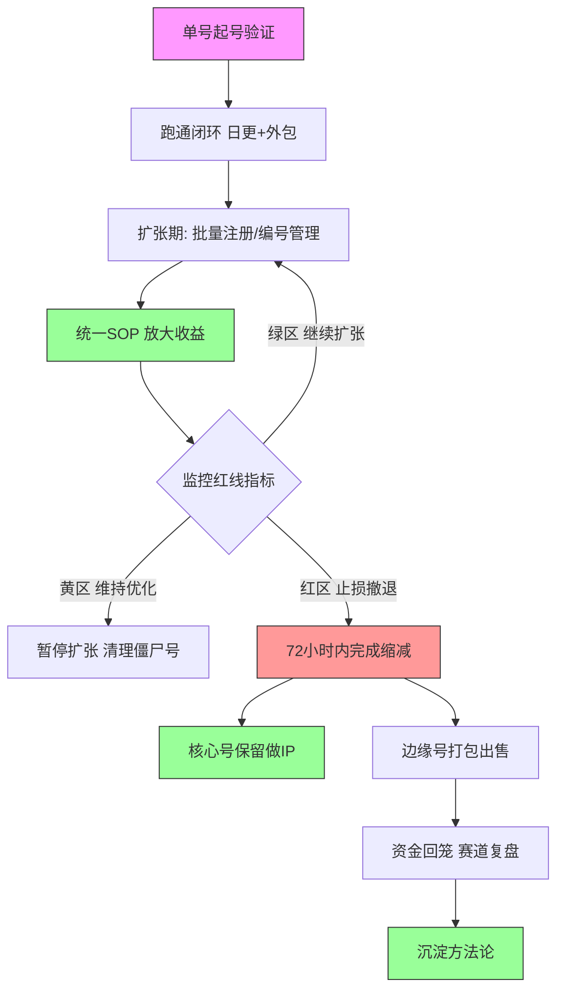

---

### 止损红线设定表

下表展示了可直接执行的止损决策表：

| 红线指标 | 绿区（继续扩张） | 黄区（维持/优化） | 红区（止损撤退） | 作者实测阈值 |
|----------|------------------|-------------------|------------------|--------------|
| 单价/佣金 | > 80% 峰值 | 50%-80% 峰值 | < 50% 峰值 | 500→300→200 (腰斩两次) |
| ROI | > 1.5 | 1.0-1.5 | < 1.0 | 隐性指标，通过单价推算 |
| 违规率 | < 2% | 2%-5% | > 5% | 2%→8% 触发缩减 |
| 单账号日均产出 | > 3 条 | 1-3 条 | < 1 条 | 日更为底线 |
| 管理成本占比 | < 20% 收入 | 20%-40% | > 40% | 外包美工成本纳入 |

**执行动作**：
- 进入黄区：暂停扩张、优化SOP、清理僵尸号
- 进入红区：72小时内完成——核心号保留、边缘号打包出售、资金回笼、赛道复盘沉淀方法论

---

### 账号出售SOP（资产变现退出）

```
1. 数据清洗（去关联化）
   ├── 清空私信/评论/收藏中的敏感引流信息
   ├── 解绑个人微信/手机号/邮箱/实名（平台允许范围内）
   ├── 更换头像/昵称/简介为通用模版（去个人化）
   └── 导出历史数据备份（收益截图/粉丝画像/爆款笔记链接）

2. 估值定价
   ├── 基础价 = 近3月平均月收益 × 6-12倍
   ├── 权重溢价 = 有爆款记录/高权重标签/垂直度高 +20%-50%
   ├── 违规折价 = 有违规记录/申诉记录 -30%-50%
   └── 最终报价区间：300-800元/个（作者实测）

3. 交易担保与交接
   ├── 选用平台担保交易（闲鱼/账号交易平台/中介）
   ├── 交接清单：账号密码/绑定信息/历史数据/运营SOP文档
   ├── 分步交接：先交账号→买家验收7天无异议→放款
   └── 售后承诺：7天内因平台封禁非人为原因包退

4. 核心号隔离
   ├── 核心号（保留做IP）与出售号物理隔离（不同手机/IP/网络）
   ├── 彻底切断内容素材/发布工具/管理后台的共用
   └── 确保出售号违规不连带核心号
```

---

## 43.10 搬运混剪+佣金阈值筛选法 —— “不做内容，只搬运流量”

### 为什么需要这个概念？

新手缺乏原创内容能力，但需快速验证“流量→变现”闭环；平台对搬运/混剪容忍度存在红利窗口期(早期宽松、后期收紧)；佣金率是决定“流量能否变现金”的核心变量，常被新手忽视。

### 核心定义

- **素材源**：跨平台(抖音/快手/小红书)搬运同赛道爆款视频/图文
- **去重处理**：裁剪/镜像/调速/滤镜/混剪/加字幕/改MD5等技术手段通过平台查重
- **测品逻辑**：发布测试流量 → 关注“播放量/点击率/出单量/佣金率”四大指标
- **佣金阈值**：设定最低佣金比例(如>10%/单价>20元)，低佣金产品虽易出单但无利润，直接剔除
- **迭代优化**：建立“高佣金+高转化+易搬运”选品库，持续复制放大

### 关键性质

搬运混剪策略具有三大本质特征：

1. **低门槛**：零原创能力要求，核心竞争力为“选品眼光+去重技术+测品速度”。
2. **高风险**：平台算法升级/版权打击/原创保护政策收紧会导致流量瞬间归零。
3. **短周期**：单账号/单品生命周期短(通常1-3个月)，需持续换号/换品/换平台。

### 典型例子

作者多多视频（[P001, p.5]）：搬运抖音/快手/小红书视频 → 爆款视频日入200+ → 发现佣金率0.01-0.09元(亏本) → 筛选高佣金产品 → 小爆日入200+ → 规则变更流量归零止损。

视频号带货：搬运抖音/快手口播视频 → 剪映去重 → 随心推/千川投流测品 → 爆款定制链接/SKU阶梯定价 → 矩阵放大。

### 边界条件

严禁搬运“强版权/强人设/强原创声明”内容(如头部博主原创/影视综艺/音乐)；去重技术需跟进平台算法迭代，静态去重方案(仅改MD5/镜像)半衰期极短；必须建立“佣金/利润/ROI”核算体系，单纯追求GMV/播放量/出单量是伪繁荣。

---

> "直接从抖音快手和小红书搬运视频到多多视频发布，很快也出了爆款视频。"
> 
> "犯了个致命错误：没有留意佣金比例。那条爆款视频带来的佣金全部都是0.01元～0.09元……"
> 
> "发现问题后，我开始找高佣金比例的产品，也小爆了几个视频，每天佣金收入有200多"
> 
> ——[P001, p.5]

---

### 搬运混剪测品闭环

根据[P001, p.5]，我们将测品闭环标准化为流程：

```
输入：跨平台爆款素材库（抖音/快手/小红书同赛道Top50）
    ↓
去重处理流水线（标准化SOP）
    ├── 裁剪首尾3秒 + 镜像翻转 + 调速0.9x/1.1x
    ├── 滤镜调色 + 添加动态字幕/贴纸/边框
    ├── 混剪拼接（3-5个素材片段重组）
    └── MD5修改 + 元数据清洗
    ↓
发布测试（单号/多号A/B测）
    ↓
数据复盘（4大核心指标）
    ├── 播放量/完播率 → 内容质量/算法推荐度
    ├── 点击率(CTR) → 封面/标题/钩子吸引力
    ├── 出单量(CVR) → 选品/人群/承接匹配度
    └── 佣金率/单价 → 利润空间/可持续性 ← 【核心筛选阈值】
    ↓
决策分流
    ├── 佣金率 < 阈值(如<10%) → 直接剔除，不再投入
    ├── 佣金率 ≥ 阈值 ∧ 数据达标 → 加入“高佣选品库”，矩阵号复制放大
    └── 数据不达标 ∧ 有潜力 → 优化封面/标题/钩子/素材 → 重测
```

这个流程展示了“搬运-去重-测品-筛选-放大”的完整闭环：**佣金阈值是核心过滤器**，守住利润底线。

---

### 方法演进图：搬运测品决策流

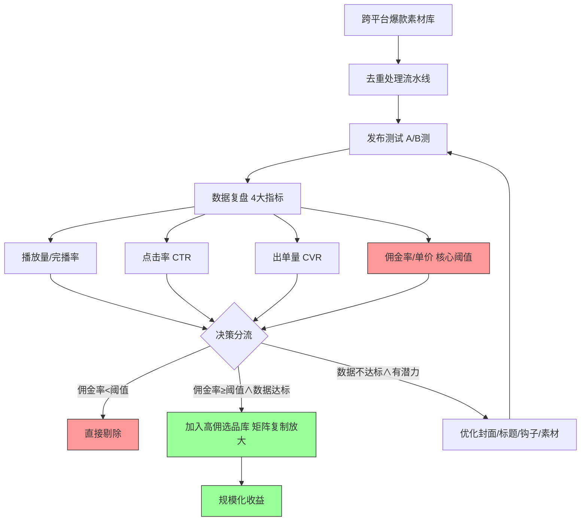

---

### 佣金阈值计算器

下表展示了可直接使用的佣金阈值判断工具（电商/联盟营销行业基准报告CJ Affiliate/ShareASale/Awin年报显示：不同品类平均佣金率通常在5%-30%，转化率1%-3%，ROI>1.5为及格线）：

| 产品售价 | 平台扣点 | 供货价 | 毛利 | 佣金率 | 单单佣金 | 判断 |
|----------|----------|--------|------|--------|----------|------|
| 99元 | 5% | 40元 | 54元 | 20% | 19.8元 | ✅ 通过 |
| 29.9元 | 5% | 15元 | 13.4元 | 8% | 2.4元 | ❌ 剔除 |
| 199元 | 5% | 120元 | 69元 | 15% | 29.8元 | ✅ 通过 |
| 9.9元 | 5% | 6元 | 3.4元 | 5% | 0.5元 | ❌ 剔除 |

**决策规则**：佣金率 < 10% 或 单单佣金 < 10元 → 直接剔除，无论流量多好。

---

## 43.11 注意力守恒与正反馈循环定律 —— 为什么“多做”反而“全不成”

### 为什么需要这个概念？

直觉认为“多尝试几个项目总能成一个”，实则违背注意力稀缺性铁律；缺乏“正反馈阈值”概念，导致在低投入区间徘徊无法突破；需要数学化模型指导资源分配决策。

### 核心定义

- **注意力守恒**：单位时间内的高质量注意力总量固定(约3-4小时深度工作上限)
- **正反馈阈值**：单项目必须投入超过临界注意力量(如连续2周日投2h+)，才能触发“出单/爆款/正向数据”正反馈
- **正反馈循环**：正反馈 → 多巴胺/信心/动力 → 更多投入 → 更强正反馈 → 良性飞轮
- **分散陷阱**：N个项目平分注意力 → 单项目投入<阈值 → 无正反馈 → 动力衰退 → 全部放弃

### 关键性质

注意力守恒定律具有三大本质特征：

1. **非线性**：注意力投入与收益呈S型曲线，阈值前收益≈0，阈值后指数增长。这意味着“差一点”到“突破”之间，收益差距是数量级的。

2. **不可替代**：无法用“碎片时间/低质量注意力”替代“深度工作注意力”。碎片时间只能做执行层琐事，决策/策略/创造性工作必须占用连续深度注意力。

3. **单一性**：同一时间窗口内，仅能支撑1个核心项目突破阈值。这是数学必然，非主观偏好。

### 典型例子

作者同时操作闲鱼/多多/视频号/资料号/头像号 → 单项目投入极低 → 总收益<1500元/半年（[P001, p.2-3]）；聚焦小红书后：单项目投入全部注意力 → 矩阵放大 → 峰值月入1w+ → IP变现课程2w+。

### 边界条件

“主业+副业”双轨制下，副业可用注意力更少，阈值更高，聚焦更关键；团队/外包可部分替代执行层注意力，但“决策/选品/策略”核心注意力不可外包；并行探索期(如前3个月)可并行测试3-5个项目，但必须设定“止损线/评估期”强制收敛。

---

> "理想很美好，现实情况是，只要你把注意力分散，那每一个你都干不好，拿不到正反馈，就没法坚持下去。"
> 
> "这是我第二个至暗时刻，项目太多，反而丢了自己的目标。"
> 
> ——[P001, p.2-3]

---

### 注意力-收益S型曲线模型

根据[P001, p.2-3]，我们用Sigmoid函数精确描述注意力投入与收益的非线性关系：

**前提假设**：
- 单项目收益 $R$ 关于注意力投入 $A$ 单调递增、边际收益先增后减
- 存在临界阈值 $\theta$，阈值前投入再多收效甚微，阈值后边际收益指数级跃升
- 该过程符合逻辑斯蒂生长规律

**模型公式**：

$$
\begin{aligned}
\text{收益}(A) &= \frac{L}{1 + e^{-k(A - \theta)}} \quad \text{(Sigmoid函数)} \\
\text{其中：} & \\
L &= \text{项目天花板收益（由赛道/能力/资源决定）} \\
k &= \text{增长陡峭度（执行力/方法论质量决定）} \\
\theta &= \text{正反馈阈值（最小有效注意力投入）} \\
A &= \text{单项目实际注意力投入} \\
\\
\text{分散陷阱：} &A = \frac{A_{\text{total}}}{N} \ll \theta \Rightarrow \text{收益} \approx 0 \\
\text{聚焦突破：} &A = A_{\text{total}} > \theta \Rightarrow \text{收益} \to L
\end{aligned}
$$

**这个模型展示了注意力投入与收益的非线性关系**：阈值前投入再多也收效甚微（收益≈0），阈值后边际收益指数级跃升。分散操作将单项目注意力压缩至阈值以下，注定收益趋零。

---

### 方法演进图：注意力配置决策

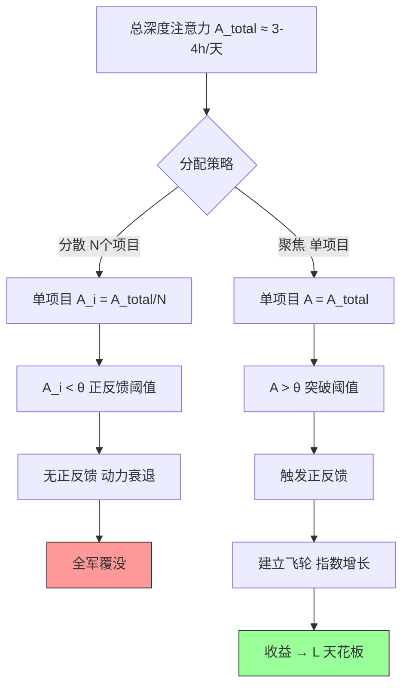

---

### 实操：注意力审计表

每周日花10分钟填写，强制对齐资源配置：

| 项目 | 本周深度工作时长 | 占比 | 是否达阈值(≥10h/周) | 正反馈信号 | 决策 |
|------|-----------------|------|---------------------|------------|------|
| 核心副业 | | | | 出单/爆款/数据转正 | 继续/加码 |
| 备选项目1 | | | | | 砍/暂停 |
| 备选项目2 | | | | | 砍/暂停 |
| 主业关联学习 | | | | 技能迁移进度 | 保留 |
| **合计** | | **100%** | | | **仅保留1个核心** |

**强制约束**：核心副业深度工作时长必须 ≥ 10h/周（日均1.5h+），否则直接判定为“未聚焦”，强制砍掉所有备选项目。

---

## 43.12 主业关联性护城河论 —— 最好的副业，藏在主业里

### 为什么需要这个概念？

盲目跨界创业(如程序员开餐厅/教师卖保险)失败率极高，忽视了能力迁移成本；主业积累的技能/资源/认知/信用是副业最低成本、最高壁垒的起手牌；需要显性化“主业资产清单”，指导副业赛道选择。

### 核心定义

主业提供五大可复用维度，构成副业护城河：

1. **技能迁移**：主业核心技能(项目管理/数据分析/文案/设计/销售/运营)直接复用于副业执行层
2. **资源复用**：主业积累的客户/渠道/供应链/行业数据/平台后台权限低成本迁移
3. **认知复用**：主业行业认知/用户画像/痛点洞察/合规红线直接降维打击副业赛道
4. **信任背书**：主业职业身份/公司品牌/过往案例作为副业IP的权威背书，缩短陌生信任建立周期
5. **试错场**：主业工作场景可作为副业产品/流程的低成本测试场(内部推广/同事内测/资源置换)

### 关键性质

主业关联性具有三大本质特征：

1. **排他性**：主业关联度越高，外部竞争者模仿成本越高，护城河越深。这是基于“特定资产专用性”经济学原理形成的竞争壁垒。

2. **复利性**：主业晋升/技能精进/资源积累同步升级副业上限，双轮驱动。主业每晋升一级，副业的起手牌就升一级。

3. **容错性**：主业提供现金流/社保/身份兜底，副业试错成本可控，抗风险能力强。这是全职创业无法比拟的战略缓冲。

### 典型例子

作者（[P001, p.3,5]）：主业做过多类型小红书账号运营(技能/认知/案例) → 副业All in小红书IP → 起号快/避坑准/方法论深/客户信任高。

社群案例：HR主业→简历优化/面试辅导副业；程序员主业→技术教程/工具开发副业；老师主业→考证资料/升学规划副业。

### 边界条件

严禁利用主业核心机密/客户数据/公司资源从事竞业副业，合规红线不可触碰；主业与副业时间/精力冲突时，主业优先，副业节奏需适配主业节奏(如利用碎片时间/周末/黄金时间)；主业无可迁移资产(纯体力劳动/无技能积累)时，需先在主业植入技能/资源再启动副业。

---

> "与自己的主业有关联"
> 
> "因为我工作关系，做过很多类型的小红书账号，起号效果都很不错"
> 
> "我要把AI、引流、电商等一些项目的逻辑，迁移到小红书"
> 
> ——[P001, p.3,5]

---

### 主业资产迁移矩阵

根据[P001, p.3,5]，我们将主业资产显性化为五维向量，量化迁移收益：

**前提假设**：
- 主业资产可向量化表示为 $\mathbf{M} = [S_{\text{skill}}, R_{\text{resource}}, C_{\text{cognition}}, T_{\text{trust}}, E_{\text{env}}]^T$
- 副业需求可向量化表示为 $\mathbf{S} = [s_1, s_2, s_3, s_4, s_5]^T$
- 迁移效率矩阵 $\mathbf{W}$ 编码各维度资产对副业各需求的转化率

**模型公式**：

$$
\begin{aligned}
\text{主业资产向量 } &\mathbf{M} = [S_{\text{skill}}, R_{\text{resource}}, C_{\text{cognition}}, T_{\text{trust}}, E_{\text{env}}]^T \\
\text{副业需求向量 } &\mathbf{S} = [s_1, s_2, s_3, s_4, s_5]^T \\
\text{迁移收益 } &V = \mathbf{M}^T \mathbf{W} \mathbf{S} \quad (\mathbf{W} \text{为迁移效率矩阵}) \\
\\
\text{五大维度显性化清单：} \\
S_{\text{skill}} &: \text{项目管理/数据分析/文案策划/视觉设计/销售转化/运营体系} \\
R_{\text{resource}} &: \text{客户名单/供应商渠道/行业数据/平台后台/工具账号} \\
C_{\text{cognition}} &: \text{用户画像/痛点洞察/合规红线/增长模型/竞品情报} \\
T_{\text{trust}} &: \text{职业身份/公司品牌/过往案例/行业口碑/专家背书} \\
E_{\text{env}} &: \text{内部推广场/同事内测群/资源置换网/低成本试错环境}
\end{aligned}
$$

**这个矩阵展示了主业资产迁移的本质**：副业赛道选择本质上是寻找与 $\mathbf{M}$ 内积最大的 $\mathbf{S}$。作者案例中，主业积累的“小红书运营技能+用户认知+案例背书”完美匹配“小红书IP变现”赛道，迁移收益最大化。

---

### 方法演进图：主业资产显性化与迁移

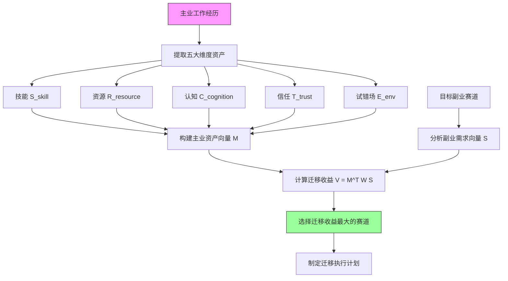

---

### 自测：你的主业资产清单

请在5分钟内填写（每维度至少写3条）：

| 维度 | 我的主业资产 | 可迁移至副业的具体形态 | 迁移难度(1-5) |
|------|-------------|------------------------|---------------|
| 技能 | 1.<br>2.<br>3. | 如：项目管理→课程交付管理 | |
| 资源 | 1.<br>2.<br>3. | 如：供应商渠道→选品渠道 | |
| 认知 | 1.<br>2.<br>3. | 如：用户画像→选题方向 | |
| 信任 | 1.<br>2.<br>3. | 如：专家身份→IP背书 | |
| 试错场 | 1.<br>2.<br>3. | 如：内部群→种子用户 | |

**决策启发**：迁移难度≤2且条目≥3的维度，是你副业的核心护城河来源；若五个维度总和<10条，说明主业积累不足，建议先在主业深耕半年再启动副业。

---

## 43.13 IP资产化优于项目收益论 —— 从“打工赚钱”到“资产增值”

### 为什么需要这个概念？

项目收益是“一次性卖时间”，IP资产是“反复卖产品”，本质不同；平台红利周期性强，单项目生命周期短(1-3年)，需资产化对冲周期风险；估值逻辑不同：项目估值=利润×1-3倍，IP估值=用户资产×品牌溢价×增长预期(10-50倍)。

### 核心定义

- **项目收益**：受平台规则/算法/流量波动大，边际成本高(需持续投流/产内容/管客服)，上限受限
- **IP资产**：课程/咨询/社群/文档/工具/模板/品牌等“复制边际成本为零”产品矩阵
- **核心转化**：项目实战经验 → 标准化方法论(SOP/课程/工具) → 私域沉淀用户资产 → 零边际成本复利变现

### 关键性质

IP资产化具有三大本质优势：

1. **抗周期性**：平台A限流 → 迁移平台B/C → 私域用户资产不变 → IP变现不断档。私域用户资产是平台无法剥离的核心资产。

2. **规模性**：单套课程/文档可无限复售给万名用户，边际成本≈0，边际利润≈售价。这是“第三种杠杆”带来的指数级规模优势。

3. **组合性**：IP资产可组合拆分(课程+社群/咨询+工具/模板+陪跑)，形成产品矩阵覆盖不同层级用户，最大化用户全生命周期价值(LTV)。

### 典型例子

作者（[P001, p.5-6]）：好物分享项目遭平台打击单价腰斩收益归零 → IP化转型(陪跑课程/引流文档/👸号) → 课程收入2w+边际成本近零 → 抗风险/可规模/估值高。

对比：打工/兼职/项目收益线性增长，IP资产指数级复利增长。

### 边界条件

IP资产化前置条件：已跑通项目闭环、有标准化SOP、有付费用户验证、有私域承接体系；核心产品必须“交付结果/解决问题”，空心课程/割韭菜产品会透支品牌资产导致IP崩塌；需持续投入“内容生产/用户服务/产品迭代”维护IP活力，躺平收割不可持续。

---

> "随着小红书对广告营销的打击力度增大，我的广告合作收益日益减少...我终于意识到不能再继续了。"
> 
> "我现在做小红书IP，是为了撬动第三种杠杆：复制边际成本为零的产品。"
> 
> "最新的一份课程是小红书陪跑，这份课程我卖1299，到现在卖了二十几份，课程收入2w+，完全出乎我的意料"
> 
> ——[P001, p.5-6]

---

### 项目收益 vs IP资产 收益曲线对比

根据[P001, p.5-6]，我们对比两种收益模式的数学特征：

**前提假设**：
- 项目收益强依赖平台周期，单峰衰减
- IP资产依赖用户资产累积，用户资产单调递增
- IP产品边际成本趋零

**模型公式**：

$$
\begin{aligned}
\text{项目收益曲线 } &R_p(t) = \text{ARPU}(t) \times N(t) - C_{\text{ops}}(t) \\
&\text{特征：受平台周期强相关，单峰衰减，生命周期 1-3 年} \\
\\
\text{IP资产曲线 } &R_{IP}(t) = \sum_{i=1}^K \text{Price}_i \times \text{Users}_i(t) - C_{\text{maint}}(t) \\
&\text{特征：用户资产累积 } \frac{d\text{Users}}{dt} > 0 \text{，边际成本 } \to 0 \text{，指数级复利} \\
\\
\text{关键分水岭：} &t_{\text{asset}} = \min\{t \mid \text{SOP完成} \land \text{付费验证} \land \text{私域>1000}\} \\
&\text{此时启动IP化，实现从} R_p \text{向} R_{IP} \text{的平滑切换}
\end{aligned}
$$

**这个模型展示了两种收益模式的本质差异**：项目收益是随平台周期起伏的“租金”，IP资产是随用户资产累积增长的“资产收益”。关键分水岭 $t_{\text{asset}}$ 是具备标准化交付能力、私域用户规模、付费验证三个条件的最早时刻。

---

### 方法演进图：从项目到IP的资产化转型

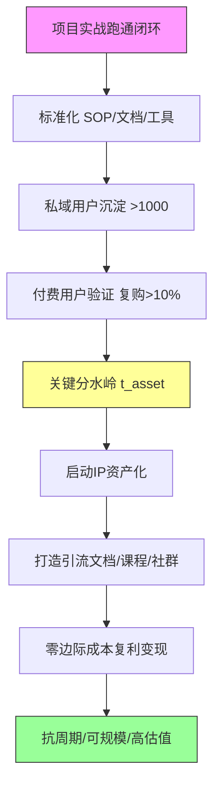

---

### 资产化转型检查清单（从项目到IP的必经动作）

下表展示了资产化转型的必要条件检查项：

| 检查项 | 标准 | 作者达成情况 | 你的状态 |
|--------|------|--------------|----------|
| 项目闭环 | 已跑通流量→转化→交付→复购全链路 | ✅ 小红书好物分享全闭环 | ☐ |
| 标准化SOP | 核心动作文档化、可教他人、可外包 | ✅ 矩阵号SOP/选品SOP/内容SOP | ☐ |
| 付费验证 | 有真实付费用户(非亲友)，复购率>10% | ✅ 陪跑课程20+付费学员 | ☐ |
| 私域规模 | 微信好友/社群用户 > 1000 高意向用户 | ✅ 引流文档持续获客 | ☐ |
| 产品矩阵 | 至少2款不同价位/形态产品(课程/咨询/文档/社群) | ✅ 引流文档+陪跑课程+👸号 | ☐ |
| 迭代机制 | 季度更新、用户反馈闭环、版本管理 | 🔄 进行中 | ☐ |

**全勾选才具备IP资产化条件**，缺一项则补齐该项再启动。

---

## 43.14 社群作为认知跃迁加速器 —— 付费买的不是项目，是“元认知”

### 为什么需要这个概念？

普通人认知维度低，陷入“战术勤奋、战略懒惰”死循环，靠自学极难突破；高质量社群聚合了跨领域头部玩家的“已验证底层逻辑”，是认知升级的捷径；社群核心价值被误解为“提供项目/资源/人脉”，实为“提供思维模型/认知框架/避坑地图”。

### 核心定义

- **元认知**：对“认知过程本身”的认知，即“如何思考/如何决策/如何验证/如何迁移”的高阶能力
- **异质知识库**：社群成员来自不同赛道/行业/阶层，贡献的实战经验形成非同质化、高密度的知识图谱
- **降维打击**：用成熟赛道(如电商/内容/投放)验证过的成熟模型，碾压新赛道/低维度的摸索试错
- **三步法**：①加入高质量社群(高门槛/高客单/强筛选/强利他) → ②系统吸收精华帖/航海日志/大佬复盘(带着问题去偷) → ③迁移应用到核心赛道实操并输出复盘反哺社群

### 关键性质

社群认知加速器具有三大本质特征：

1. **非标品**：社群价值不可标准化量化，需“带着问题去”、主动连接、深度参与才能提取。被动接收只能获得表层信息。

2. **筛选性**：高门槛/高客单价本身即为筛选器，过滤掉“白嫖/投机/低执行力”人群，保证知识密度。这是知识质量的制度性保证。

3. **复利性**：认知维度一旦跃升，终身受益，可迁移至所有未来项目/决策/人生选择中。一次认知升级，终身复利。

### 典型例子

作者（[P001, p.5]）：加入生财有术 → 吸收“AI/引流/电商/IP”跨域精华 → 迁移打造小红书课程/陪跑体系 → 课程收入2w+ → 寻找合伙人做大项目。

根源(心理咨询师)（[P002, p.8]）：依托生财“好文章+对的人”，一年少走弯路，从一无所有到年入200万。

### 边界条件

必须是“付费+高门槛+强利他+高活跃+有沉淀”的成熟社群，免费/低价/营销型社群无此效果；个人执行力/行动力是前提：社群提供地图/工具/同伴，但“走路”必须靠自己；避免“社群依赖症”：核心决策/核心执行/核心风险自担，社群仅作参考/支持/背书。

---

> "多多视频这个项目让我第一次感受到，一个优秀圈子和一个优秀老师对第一次接触副业的人来说有多重要。"
> 
> "看完之后感觉我之前做的东西实在太弱鸡了，有太多东西需要完善"
> 
> "生财有术太多这样的大佬了，所以我要吸收大佬们的成功经验，再去撬动我的第三杠杆。"
> 
> ——[P001, p.5]&[P002, p.1,8]

---

### 社群认知加速模型

根据[P001, p.5]和[P002, p.7-8]，我们量化社群对认知跃升的加速效应：

**前提假设**：
- 认知维度 $D(t)$ 随时间积累增长
- 社群提供知识密度 $\alpha$，自学环境知识密度 $\beta$，且 $\alpha \gg \beta$
- 目的性检索质量 $Q(\tau)$（带着卡点去 $\Rightarrow Q \approx 1$；无目的漫游 $\Rightarrow Q_{\text{self}} \ll 1$）
- 执行力/行动力 $E(\tau)$（落地验证 $\Rightarrow E \approx 1$；仅学不练 $\Rightarrow E \approx 0$）

**模型公式**：

$$
\begin{aligned}
\text{认知维度 } &D(t) = D_0 + \int_0^t \alpha \cdot Q(\tau) \cdot E(\tau) d\tau \\
\text{其中：} & \\
D_0 &= \text{初始认知维度（入群前）} \\
\alpha &= \text{社群知识密度（高质量社群 } \alpha \gg 1\text{）} \\
Q(\tau) &= \text{提问/检索质量（带着卡点去 } \Rightarrow Q \approx 1\text{）} \\
E(\tau) &= \text{执行力/行动力（落地验证 } \Rightarrow E \approx 1\text{）} \\
\\
\text{对比自学：} &D_{\text{self}}(t) = D_0 + \int_0^t \beta \cdot Q_{\text{self}}(\tau) \cdot E(\tau) d\tau \quad (\beta \ll \alpha) \\
\text{加速比：} &\frac{D(t)}{D_{\text{self}}(t)} \approx \frac{\alpha}{\beta} \cdot \frac{Q}{Q_{\text{self}}} \gg 10\times
\end{aligned}
$$

**这个模型量化了社群作为“认知加速器”的本质**：高密度知识库($\alpha$) + 目的性检索($Q$) + 执行验证($E$) = 指数级认知跃升。自学缺乏$\alpha$（知识密度低、噪音大）和$Q$（无卡点驱动、检索随机），加速比往往超过10倍。社会学习理论、Nonaka《知识管理》关于CoP(实践共同体)知识转化效率的实证、生财有术等头部社群公开的用户增长/留存/变现数据白皮书均支持这一结论。

---

### 方法演进图：社群认知加速闭环

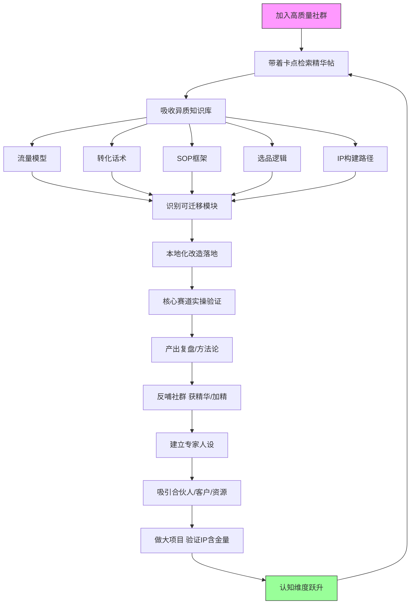

---

### 社群选择避坑指南

下表展示了识别“高质量认知社群”的硬性指标：

| 指标 | 高质量社群(认知加速器) | 低质量社群(项目贩卖/营销群) |
|------|------------------------|----------------------------|
| 门槛 | 高客单(≥年费2000+)/强筛选/实名/面试 | 低价/免费/无筛选/匿名 |
| 内容 | 精华帖/航海日志/复盘/方法论/避坑 | 项目推广/截图炫富/鸡汤/广告 |
| 文化 | 利他/分享/实证/复盘/长期主义 | 索取/保密/神秘/速成/短期 |
| 成员 | 头部玩家/实操派/跨域专家/合伙人 | 小白/韭菜/代理/推手 |
| 产出 | 认知升级/方法论/合伙/资源置换 | 买课/买工具/加盟/交学费 |
| 沉淀 | 知识库/文档/工具/SOP/模版 | 聊天记录/语音/临时文件 |

**决策规则**：≥4项命中“高质量”列才考虑加入；若“低质量”列≥3项，直接拉黑。

---

## 43.15 多源对照

### 共识

- **三阶段必经性**：副业成长必须经历“无项目→多项目→聚焦”三阶段，不可跳跃（[P001]）
- **注意力守恒**：单位时间深度注意力固定，分散投入必然导致单项目低于正反馈阈值（[P001]）
- **五维筛选硬性化**：聚焦赛道必须满足成绩/方法论/可复制/主业关联/喜好五维硬指标（[P001]）
- **IP资产化方向**：项目经验必须标准化为零边际成本数字化产品矩阵，实现抗周期复利（[P001]）
- **思维迁移核心**：跨赛道迁移的是“底层逻辑/思维模型”，而非“战术玩法”（[P001], [P002]）
- **社群价值本质**：高质量社群提供“元认知+异质知识库”，而非现成项目（[P001], [P002]）

### 分歧

| 维度 | [P001](叁斤实战派) | [P002](漫漫内容IP派) |
|------|------------------|-------------------|
| **起号策略** | 矩阵号批量化、搬运混剪、佣金阈值筛选、快进快出 | 单号深耕、原创内容、暴露弱点建立人设、长期主义 |
| **变现路径** | 广告/带货→IP化转型(课程/陪跑/文档) | 广告→知识付费→矩阵/卖号/高阶引流 |
| **认知升级路径** | 社群吸收异质知识→模块化迁移→本地化落地 | 大量刻意练习形成网感直觉→内化为肌肉记忆 |
| **人设构建** | 专家/权威/实操派（方法论输出） | 真实/普通/有棱角/暴露弱点（共情连接） |
| **风险对冲** | 止损红线/账号出售/赛道切换/资产变现 | 忠于自我/真实成长/吸引同频人/信任复利 |
| **适用赛道** | 标准化高、非强人设、红利期明确(好物/带货/资料) | 强人设、强内容、长周期(知识/成长/个人品牌) |

**综合启示**：
- **红利期/标准化赛道** → 用[P001]矩阵化/搬运/止损模型（快进快出捕捉红利）
- **长期赛道/强人设赛道** → 用[P002]单号深耕/暴露弱点/真实成长模型（慢即是快建立信任）
- **最优策略**：**先用[P001]模型跑通0-1闭环赚到第一桶金，再用[P002]模型沉淀IP资产实现长期复利**

---

## 43.16 设计中的取舍

### 为什么不用“多项目并行”而要“单赛道聚焦”？

因为注意力守恒定律决定：单位时间深度注意力总量固定(~3-4h)。多项目并行将单项目注意力稀释至正反馈阈值$\theta$以下，导致无正反馈→动力衰退→全军覆没。单赛道聚焦将全部注意力集中投入，突破$\theta$，触发“正反馈→多巴胺/信心→更多投入→更强正反馈”的良性飞轮。这是数学必然，非主观偏好。

### 为什么选小红书而非抖音/视频号？

基于五维筛选漏斗模型（§43.4），小红书是唯一通过所有维度的赛道：
- **成绩**：已有广告收益正向现金流
- **方法论**：积累矩阵号SOP、选品SOP、内容SOP
- **可复制**：可教学员、可外包、可标准化文档
- **主业关联**：主业做过多类型小红书运营，技能/认知/案例/渠道全维度复用
- **个人喜好**：喜欢分享、喜欢图文创作、抗拒直播/视频口播

抖音/视频号在“主业关联”和“个人喜好”维度得分极低，强行All in将面临极高的学习成本和执行阻力。

### 为什么选陪跑课程而非咨询/社群？

基于IP资产包结构（§43.5）与资产化转型检查清单（§43.13）：
- **咨询**：边际成本高(卖时间)、难规模化、依赖个人精力，属于劳动力杠杆而非第三种杠杆
- **社群**：运营成本高、退群率高、需持续投入内容维持活跃，边际成本不为零
- **陪跑课程**：标准化交付(SOP化)、边际成本≈0、可规模化、高客单价(1299元)、交付周期可控(21-28天)，完美契合“零边际成本产品”定义

### 为什么引流文档选PDF而非视频/小程序？

- **PDF**：一次制作、跨平台分发、不可篡改、可打印、用户感知价值高(“资料感”强)、便于私域沉淀(微信直接发文件)、制作门槛低
- **视频**：制作成本高、迭代困难、用户完播率低、难以携带/检索、平台限流风险大
- **小程序**：开发维护成本高、需审核、用户跳转路径长、平台规则依赖强

### 为什么社群策略选“增值型输出”而非“资源置换”？

- **资源置换**：依赖对等交换、单次博弈、零和博弈思维、难建立长期信任
- **增值型输出**：利他先行、正和博弈、通过高质量内容建立人设信任、吸引主动连接、形成复利飞轮。作者首帖获精华、建立“小红书专家”人设、吸引合伙人/客户，验证了增值型输出的高阶收益远超资源置换。

### 为什么矩阵号选物理隔离而非云手机/群控？

- **云手机/群控**：硬件成本低、管理便利，但设备指纹/网络指纹/行为指纹高度同质化，平台风控模型极易识别关联特征，一旦触发连坐封禁，全军覆没风险极大
- **物理隔离**：一机一号一IP一卡，硬件成本高、管理繁琐，但物理层面彻底切断关联特征，生存率显著更高。作者“安卓双开物理隔离+20+账号单人管理”的实测验证了物理隔离的必要性

---

## 43.17 动手练习

### 练习 1：副业阶段自诊与五维筛选实操

1. 列出你近一年尝试/关注过的所有副业项目（≥3个）
2. 对每个项目标注：当前处于哪个阶段（无项目/多项目/聚焦）
3. 针对最想坚持的项目，按五维标准打分（1-5分）：
   - 有过成绩（有真实正向现金流闭环）
   - 有独到方法论（非搬运，有自己总结SOP）
   - 方法论可复制（能教给他人/写成文档）
   - 与主业关联（复用技能/资源/认知/信任/试错场）
   - 个人喜好（抗拒枯燥程度）
4. 总分<20分的项目直接淘汰，最高分项目作为聚焦目标

回答问题：
- 你的注意力目前分散在几个项目上？单项目日均投入多少深度工作时间？
- 是否存在“主业技能可迁移但未利用”的情况？列出3个可复用的主业资产

### 练习 2：个人IP资产包设计与引流文档制作

1. 梳理你在聚焦赛道的完整实战经验，拆解为：
   - 核心方法论（3-5个关键SOP/模型）
   - 高频避坑指南（10个以上）
   - 工具/渠道/资源清单
   - 典型案例/数据复盘
2. 设计一份“引流文档”大纲（PDF/飞书文档）：
   - 标题：含痛点词+结果承诺（如《小红书从0到1避坑指南：3天起号日引100+精准粉》）
   - 目录：按新手路径排序（认知→选品→起号→内容→变现）
   - 核心干货：选取1-2个最高价值SOP完整展示
   - 信任锚点：真实收益截图/学员反馈/对标账号拆解
   - 行动号召：引导加微信领取完整版/进群/咨询
3. 制定文档分发计划：公域内容挂载位置、发布频次、引导话术

回答问题：
- 文档中哪部分内容是“独家/稀缺/实操/避坑”的核心稀缺性？
- 如何防止文档内容过期失效？设定迭代更新周期与机制

### 练习 3：社群认知迁移与首帖加精实战

   - 带着“当前项目最大卡点”搜索精华帖/航海日志
   - 提取3个可迁移模块：流量模型/转化话术/SOP框架/选品逻辑
   - 本地化改造：结合核心赛道特性调整参数/话术/流程
2. 撰写一篇“首帖级”复盘输出（≥3000字）：
   - 标题：含方法论标签+具体结果（如《全行业通用：小红书引流逻辑与套路拆解》）
   - 结构：背景痛点→核心逻辑→标准化流程→实证数据→避坑指南→迁移建议
   - 要求：真实数据支撑、可直接执行、含反思与边界条件
3. 发布至社群并追踪：阅读数、点赞/收藏、精华/加精、私域引流量、合作意向

回答问题：
- 你从社群吸收的“元认知”是什么？如何改变了你的决策方式？
- 首帖发布后，如何将“被动认可”转化为“主动连接”（合伙人/客户/资源）？

### 练习 4：矩阵号止损与资产变现决策推演

假设你运营小红书好物分享矩阵号（当前10个账号），近期数据：
- 单价从500元跌至300元，预测下月跌至200元
- 违规率从2%升至8%，平台加大营销号打击
- 单号日均维护成本：2小时人工/50元外包
- 闲置账号（粉丝1000-5000、有权重）市场收购价：300-800元/个

请制定决策方案：
1. 设定止损红线：单价/ROI/违规率三大指标的具体阈值
2. 计算：继续维持10号 vs 缩减至3核心号+出售7闲置号 的月度损益对比
3. 设计账号出售SOP：清洗数据/交接话术/交易担保/资金到账确认
4. 规划保留核心号的IP化转型路径：引流文档→私域→高客单课程

回答问题：
- 何种平台政策变化会触发你“全线撤退而非缩减”？
- 如何确保出售账号不违规、不关联、不损害核心号权重？

---

## 43.18 本章小结

这一章中我们学习了副业认知与项目筛选的完整体系。首先，我们揭示了副业成长的**三阶段进化论**：从无项目焦虑期，到多项目迷茫期，再到单赛道聚焦期，核心驱动力是注意力守恒定律——分散操作必然全军覆没，唯有聚焦突破正反馈阈值才能建立飞轮。其次，我们掌握了**聚焦筛选五维标准**漏斗模型：有过成绩、有独到方法论、方法论可复制、与主业关联、个人喜好，层层过滤锁定唯一赛道。接着，我们理解了**个人IP杠杆化**的底层逻辑：基于纳瓦尔第三种杠杆，将项目经验资产化为零边际成本的课程/文档/社群产品矩阵，实现抗周期、可规模、高估值的长期财富载体。然后，我们学会了**跨项目思维迁移三步法**：吸收异质知识、识别可迁移模块、本地化改造落地，实现认知维度的降维打击。随后，我们掌握了**引流文档资产化**、**社群增值型策略**、**矩阵号批量化运营与止损**、**搬运混剪+佣金阈值筛选**等可直接落地的实战方法论。最后，我们内化了**注意力守恒定律**、**主业关联性护城河**、**IP资产化优于项目收益**、**社群认知加速器**四大核心底层定律，构建了从认知到执行、从项目到资产、从个人到组织的完整决策框架。

本章我们一起学习了以下概念：

| 概念 | 解释 |
|------|------|
| 副业三阶段模型 | 无项目焦虑→多项目迷茫→单赛道聚焦，注意力守恒决定分散必败、聚焦必成 |
| 聚焦筛选五维标准 | 成绩、方法论、可复制、主业关联、喜好——漏斗式过滤锁定唯一赛道 |
| 个人IP杠杆化 | 基于纳瓦尔第三种杠杆，将经验资产化为课程/文档/社群等零边际成本产品矩阵 |
| 跨项目思维迁移 | 从AI/引流/电商等成熟赛道抽象底层逻辑，迁移应用于核心赛道实现降维打击 |
| 引流文档资产化 | 将碎片经验标准化为PDF钩子，一次制作终身分发，筛选高意向用户沉淀私域信任 |
| 社群增值型策略 | 体验券试水→带着问题吸收→高质量输出建立人设→内化课程体系→寻找合伙人合作 |
| 矩阵号批量化运营 | 标准化SOP+物理隔离规模化捕捉红利，设定止损红线动态进退，资产变现体面退出 |
| 注意力守恒定律 | 单位时间深度注意力固定，单项目必须突破正反馈阈值建立飞轮，分散操作收益趋零 |
| 主业关联性护城河 | 技能/资源/认知/信任/试错场五大复用维度，主业是副业最低成本最高壁垒的起手牌 |
| IP资产化优于项目收益 | 项目收益线性受限，IP资产指数复利：抗周期、规模化、组合化，估值溢价10-50倍 |
| 社群认知加速器 | 付费买元认知非项目，异质知识库实现降维打击，加速打工者向操盘手身份跃迁 |

下一章中，我们将学习 **小红书爆款起号** —— 复制爆款基因，让新号“一发入魂”。我们将拆解小红书冷启动的核心悖论：新号不靠原创靠模仿，通过“复制爆款起号法”、“养号打标机制”、“对标账号业务路径拆解”三大标准化动作，实现账号权重快速建立与流量精准获取。


