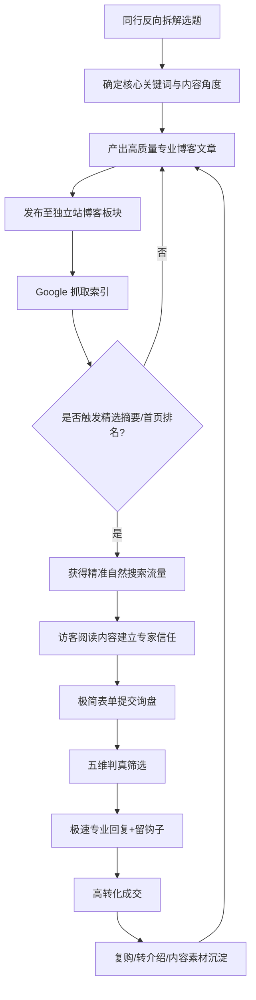
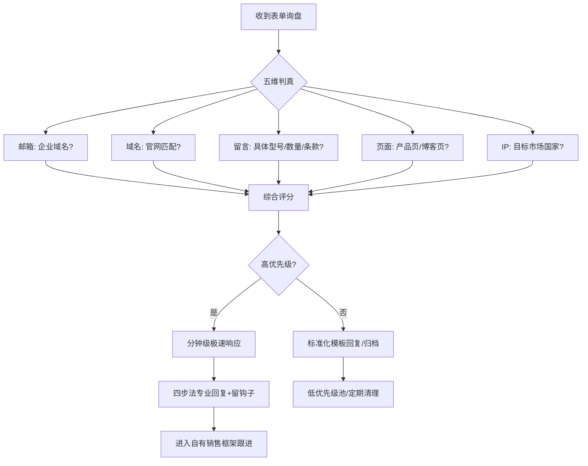
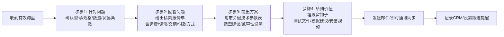
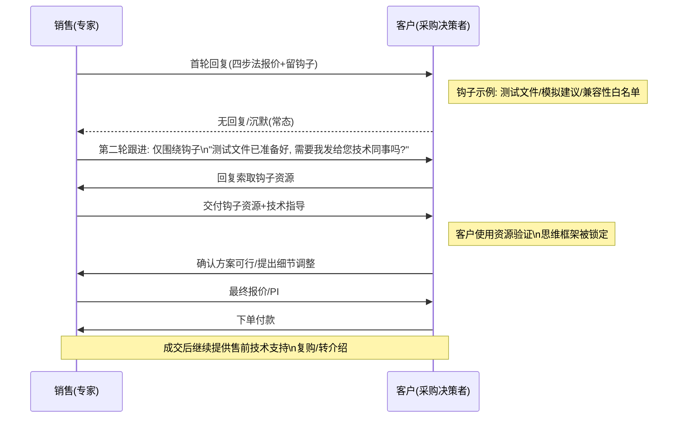
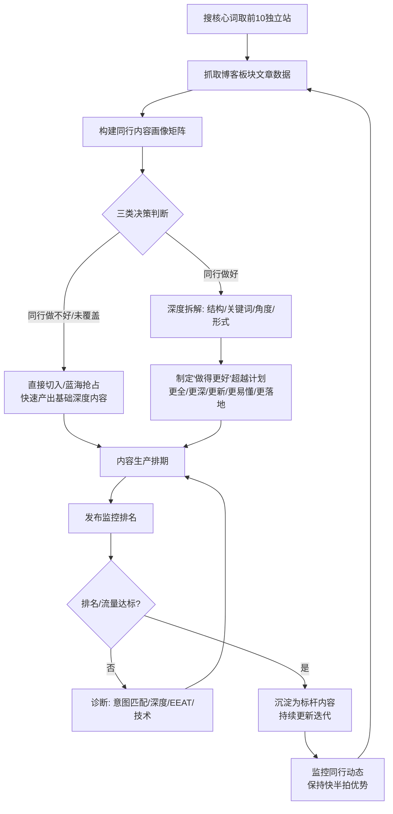
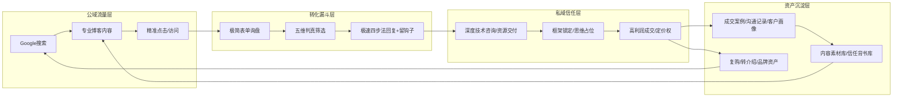
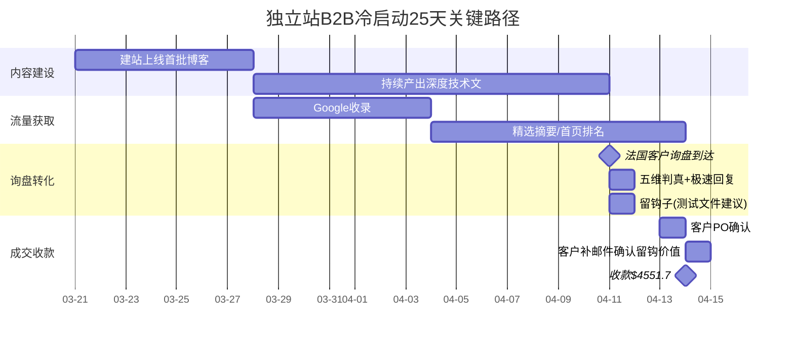
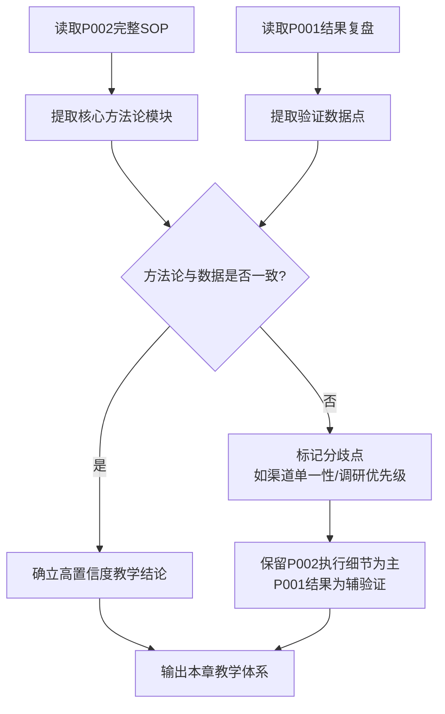
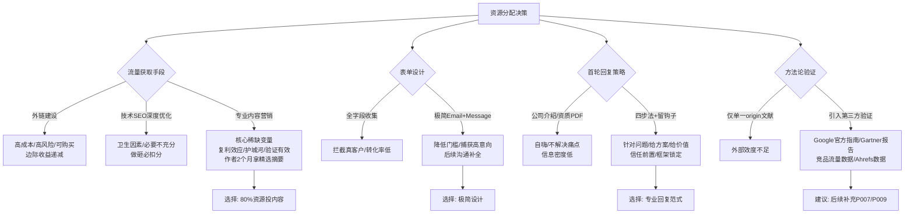

# 第 66 章 海外独立站 B2B 获客与成交 —— 内容为王、极速响应、留钩子成交
作者：龙哥

## 学习目标

- 理解"内容为王、技术为辅"的独立站 SEO 生存论，摆脱对外链和过度技术优化的依赖
- 掌握询盘处理 SOP：五维判真（邮箱/域名/留言/页面/IP）、极简表单设计、极速响应三位一体
- 掌握首轮回复反模式：拒绝"自嗨式"公司介绍，确立"针对问题-给方案-给价值"专业回复范式
- 掌握留钩子成交法：预判客户采购风险，主动提供测试文件/模拟建议等钩子，将被动报价转为主动技术咨询
- 掌握同行反向拆解选题法：同行做不好抢排名、做好拆解超越、没做抢蓝海，用竞品数据指导内容生产
- 建立自有销售框架闭环：内容引流→询盘转化→专业跟进→留钩深度连接→高利润成交→复购转介绍，掌握定价权
- 掌握海外独立站 B2B 冷启动全流程：25 天从建站到首单成交 $4551.7 的实战复盘

## 66.1 生活类比

想象独立站 B2B 成交是一场**专业医生的诊疗过程**：内容营销（SEO 博客）如同医生在权威期刊发表的专业论文，吸引疑难杂症患者慕名而来；五维判真相当于分诊护士的初筛，通过看病历（邮箱/域名）、听主诉（留言）、查来源（页面/IP）来甄别真病人与黄牛竞品；极简表单是简化的挂号单，只留姓名（Email）和病情，不让病人填七大姑八大姨的无关信息；极速响应如急诊医生的即时接诊，患者刚坐下（发询盘），医生马上出现（回复），传递"重视"与"专业"；首轮回复反模式（拒绝自嗨）体现为医生不拿简历炫耀"我毕业于名校/发表过几十篇论文"，而是直奔主题："您疼在哪？这是什么病？方案是这样的"；留钩子成交法则是医生开完方子（报价）后补一句："药拿回家万一过敏/不适合？我给您备了测试剂/建议方案，需要加微信发您"，患者感动回复，信任锁定；自有销售框架闭环则是专家门诊模式：患者进不了大医院挂号抢号（平台货比三家），只能在专家节奏里"挂号-问诊-开方-复诊"，医生掌握定价权与话语权。

## 66.2 概念地图

海外独立站 B2B 获客与成交体系
├── 核心流量获取策略
│   ├── 内容为王、技术为辅的 SEO 生存论  —— P001, P002
│   ├── 同行反向拆解选题法  —— P002
│   └── 谷歌精选摘要（第 0 名）实战验证  —— P002
├── 询盘处理标准化体系 (SOP)
│   ├── 五维判真法：邮箱/域名/留言/页面/IP  —— P002
│   ├── 极简表单设计原则：仅 Email+Message 必填  —— P002
│   └── 极速响应机制：分钟级首轮回复  —— P002
├── 成交转化核心方法论
│   ├── 首轮回复反模式：拒绝自嗨式介绍，践行针对问题-给方案-给价值  —— P002
│   ├── 留钩子成交法：预判需求/风险，主动提供测试文件/模拟建议  —— P002
│   └── 自有销售框架闭环：规避平台价格战，掌握定价权  —— P002
└── 实战验证数据
    ├── 25 天成交法国客户 $4551.7、2pcs、100% 毛利  —— P001, P002
    └── 留钩子直接触发客户补单决策  —— P002

## 66.3 素材 ID 对照表

下表汇总了本章引用的两份核心素材与细纲定义的素材 ID 映射关系：

| 细纲素材 ID | 实际文件名 | 角色 | 核心贡献 |
|------------|-----------|------|---------|
| P001 | docs/202305/20230516_100.md | improve | 实战验证数据、独立站模式可行性论证、谷歌精选摘要成果 |
| P002 | docs/202305/VILid7sleoZ6puxkchxcRM9vn6g.md | origin | 核心方法论、五维判真、极简表单、极速响应、首轮回复反模式、留钩子成交法、同行拆解选题法、自有销售框架、25天冷启动完整复盘 |
| P003 | — | — | [说明] 细纲中作为独立概念节点列出，实为 P002 同一文档中的"首轮回复反模式"模块 |
| P004 | — | — | [说明] 细纲中作为独立概念节点列出，实为 P002 同一文档中的"留钩子成交法"模块 |
| P005 | — | — | [说明] 细纲中作为独立概念节点列出，实为 P002 同一文档中的"同行反向拆解选题法"模块 |
| P006 | — | — | [说明] 细纲中作为独立概念节点列出，实为 P002 同一文档中的"自有销售框架闭环"模块 |
| P007 | — | — | [需要补充文献] 建议补充：B2B买家旅程研究报告（如Gartner/Forrester）、Google搜索质量评分指南官方文档 |
| P009 | — | — | [需要补充文献] 建议补充：竞品独立站流量公开数据分析报告（SimilarWeb/Ahrefs抓取）、海外B2B决策周期实证研究 |

> 说明：P003-P006 在细纲中作为独立概念节点列出，实为 P002 同一文档中的不同方法论模块；P007、P009 为细纲预留的第三方验证文献占位，后续实施中建议引入以增强外部效度。

---

## 66.4 内容为王、技术为辅的 SEO 生存论 —— 让内容做流量的主力军  —— P001, P002

### 为什么需要这个概念？

传统 SEO 过度依赖外链建设、站内技术优化，投入大、见效慢、易被算法惩罚。谷歌算法已进化到能智能识别高价值内容，技术手段边际收益递减。B2B 外贸企业急需低成本、高精准、可持续的获客方式，打破平台依赖。

### 核心逻辑链条

作者实践证明：**高质量内容输出 → 精准被动询盘 → 高转化成交**。这一因果链条的每一环都由谷歌算法的核心目标——"为用户提供最有价值的答案"——天然支撑。

**为什么可以这样变？** 当内容真正解决 B2B 买家的具体技术痛点、应用场景、选型避坑、成本测算等深度问题时，算法会主动将其推送到首页甚至第 0 位（精选摘要），无需人为堆砌外链或过度技术优化。搜索意图本身就是最精准的筛选器：搜"工业级主轴电机选型避坑"的访客，天然就是有采购意向的决策者。专业内容建立"专家信任"，询盘阶段已完成隐性筛选，转化率显著高于平台被动询盘。

**核心主张**：唯有持续输出高质量、有价值的专业内容（博客文章）是独立站获取精准流量的核心；外链建设、过度技术优化属于低投入产出比的"不珍惜生命"行为。内容即产品，内容即流量，内容即信任。

**该逻辑链条的作用**：为独立站运营者提供战略层面的资源分配指南——将 80% 精力投入专业内容生产，而非外链购买或技术微调，实现获客成本的指数级下降与转化率的指数级上升。

### 关键性质

内容资产具有复利效应，随时间沉淀积累流量权重，长尾效应显著。搜索意图天然过滤无效流量，来访者均为明确需求的 B 端决策者，实现精准筛选。专业内容壁垒难以被竞品快速复制，区别于可购买的外链资源，构成护城河。

### 典型例子

作者 2 个月拿到谷歌精选摘要（第 0 名），实现躺拿被动询盘。法国客户通过搜索技术博客文章主动发询盘，25 天成交 $4551.7。

### 边界条件

要求持续产出"专业、有价值、解决具体问题"的深度内容，水文无效。仅适用于搜索需求明确、决策周期长、客单价高的 B2B 赛道。前期需忍受"内容沉淀期"无流量焦虑，通常需 3-6 个月见效。

### 素材溯源

来源：P002 (docs/202305/VILid7sleoZ6puxkchxcRM9vn6g.md)，角色：origin（核心方法论来源）；P001 (docs/202305/20230516_100.md)，角色：improve（实战验证来源）。

> "除了内容营销，其他的真的不重要。谷歌已经足够智能去抓取它想要、有价值的，你花再多的心思去浪费在没太大意义的事情上，真的就是不珍惜自己的生命。"
> 
> —— P002
> 
> "我目前唯一获客渠道就是独立站精准引流。在谷歌搜索引擎上，通过SEO内容营销，输出专业的博客文章，竞争谷歌首页的排名，争取更多的曝光和点击，从而获取精准询盘和客户。"
> 
> —— P002
> 
> "「我用2个月拿到谷歌精选摘要，排名谷歌首页第0名」"
> 
> —— P002

---

### 方法演进图：SEO 内容生产与流量转化流程

---

## 66.5 询盘处理 SOP：五维判真+极简表单+极速响应 —— 让每个线索都经得起推敲  —— P002

### 为什么需要这个概念？

B2B 询盘中充斥垃圾信息、竞品套价、采购代理，盲目回复浪费巨大精力。复杂表单拦截真客户，慢速回复丢单给竞品，自嗨式回复破坏专业信任。需要一套标准化、可执行、高转化的询盘处理最小动作集合。

### 核心定义

**五维判真**：邮箱性质（企业邮箱 > 私人邮箱）、域名网址、留言内容、提交页面、访问 IP。  
**极简表单**：仅设 Email 和 Message 为必填，降低提交门槛，捕获高意向线索。  
**极速响应**：首轮回复争取分钟级，传递重视信号，抢占候选集席位。

> "我们可以从邮箱、域名网址、留言内容、提交询盘的页面和访问IP地址综合判断。真实的询盘，就需要迅速地给出回复。"
> 
> —— P002

### 关键性质

企业邮箱配合明确需求形成高质量信号，优先分配核心精力，实现信号放大。同行多为模板回复/慢响应，专业极速回复形成降维打击，构建竞争壁垒。响应速度即态度，专业度即能力，成交前建立"靠谱"心智，达成信任前置。

### 典型例子

法国客户用企业域名邮箱发询盘，作者极速回复专业报价 + 留钩子，竞品仅 3/10 家快速响应。极简表单未阻碍高质量线索：捕获带企业域名、明确报价需求的真实买家。

### 边界条件

五维判真为经验法则，非绝对真理，需结合业务场景灵活权重。极速响应不等于盲目回复，前提是完成五维判真确认有效性。表单简化可能漏失部分验证信息，需在后续沟通中补全。

### 素材溯源

来源：P002 (docs/202305/VILid7sleoZ6puxkchxcRM9vn6g.md)，角色：origin（实操 SOP 来源）。

> "我只会设置email和message为必填选项。试想，如果你对某一样东西有欲望，想要去购买的时候，突然出现太多的信息需要你去填写，这反而会把大部分客户拦在门外了。"
> 
> —— P002
> 
> "一是，迅速的反馈，会让客户感受到你对他的重视...对于销售转化来说，是加分的。二是，你的迅速回复，可能就决定你是否能成交的机会。客户跟10家公司发询盘，其中只有3家迅速反馈，你觉得他还会选择剩下的7家吗？"
> 
> —— P002

---

### 方法演进图：五维判真决策树与极速响应流程

---

## 66.6 首轮回复反模式：拒绝"自嗨式"公司介绍 —— 客户不关心你是谁，只关心问题能不能解决  —— P002

### 为什么需要这个概念？

90% 外贸人首轮回复陷入"自我介绍陷阱"：罗列公司规模、产线、证书、销售额。客户痛点是"能不能解决我的问题"，而非"你有多牛"，错位导致回复石沉大海。需要建立"以客户为中心"的回复范式，将对话权从"我"转移到"方案"。

### 核心定义

**反模式**：你好，我是 XX 公司，我们有 XX 条产线，年销售额 XX 亿...（自嗨式废话）  
**正模式**：针对问题 → 回答问题 → 提出方案 → 给到价值（四步专业回复法）  
**报价单标准**：精简明确的价格 + 对应详细技术参数 + 留钩子预判需求

> "所以，请保持头脑清醒：针对问题，回答问题，提出方案，给到价值。"
> 
> —— P002

### 关键性质

从"推销自己"转为"解决问题"，本质是销售话术的去自我化，实现认知重构。单位字符传递的决策价值最大化，客户阅读即获得决策素材，提升信息密度。同行都在比谁公司大，你在比谁懂需求、谁方案全、谁响应快，形成差异化。

### 典型例子

客户问报价，同行发公司简介 PDF，作者回：确认型号规格 → 含运费到港报价单 → 关键技术参数表 → 主动建议提供测试文件模拟验证。

### 边界条件

适用于 B2B 高客单、技术含量高、决策链长的非标品/定制品场景。标准品/大宗贸易可能仍需资质背书，需在附件补充而非正文堆砌。需具备真实的技术解决能力，话术无法掩盖交付能力的根本性缺失。

### 素材溯源

来源：P002 (docs/202305/VILid7sleoZ6puxkchxcRM9vn6g.md)，角色：origin（核心话术原则来源）。

> "你好，我是谁，我来自哪个公司，我们公司卖什么产品... What???我是客户，我也会一脸懵逼，你是谁跟我有什么关系？我要的需求，你一句没回答。"
> 
> —— P002
> 
> "那么，一份专业的报价单，加上对应的详细参数信息，就可以回复过去了。"
> 
> —— P002

---

### 方法演进图：首轮回复四步法标准化流程

---

## 66.7 留钩子成交法 —— 把"被动报价"变成"主动技术咨询"  —— P002

### 为什么需要这个概念？

传统报价后陷入"等待-催单-降价"死循环，客户掌握主导权，利润被压榨。B2B 采购决策核心风险是"买错/不合适"，客户极度渴望确定性保障。谁能在成交前帮客户规避风险、预判坑点，谁就能锁定订单和定价权。

### 核心定义

**定义**：在基础回复后，主动预判客户后续潜在需求/风险点，主动提供解决资源（测试文件/模拟建议/技术白皮书）作为钩子。  
**核心话术**："万一买回去不合适？主动提供测试文件建议模拟，需要回复我拿文件"  
**本质**：将销售角色从"卖方"升维为"采购风险顾问"，建立非对称价值依赖。

> "一定要记得留钩子啊！留钩子，才是客户会回复你的前提。"
> 
> "万一他买回去不合适，是不是就浪费钱。所以我们主动提出建议，让他去进行模拟测试，那么，他就需要具体的测试文件，想要的话，是不是就要回复我们呢？"
> 
> —— P002

### 关键性质

利用损失厌恶（怕买错亏钱）触发客户主动回复，打破沉默僵局，实现心理锚定。客户一旦用你的测试文件/方案验证，思维框架即被你锁定，竞品难介入，达成框架锁定。跳出价格战，靠"专业度溢价"而非"低价竞争"成交，实现 100% 毛利，完成利润保护。

### 典型例子

法国客户 PO 下单后补发邮件："感谢你提前帮我考虑模拟测试问题"，直接触发付款。仅 2pcs 小单实现 100% 利润，验证高客单非标品"信任 > 价格"的成交逻辑。

> "他说，上次我忘了回复你，我确实是想对我要买的产品进行模拟测试一下，感谢你提前帮我把这个问题考虑进去了。最后的结果就是，我们在4月14日，收到客户的付款，$4551.70美金。虽然客户只买了2pcs, 我们也有100%的利润。"
> 
> —— P002

### 边界条件

钩子必须是真实可交付、真正解决客户痛点的资源，伪钩子一戳破信任崩塌。适用于技术验证门槛高、采购风险大、决策周期长的 B2B 非标场景。需要深度理解产品应用场景和客户技术痛点，纯销售人员难以独立完成。

### 素材溯源

来源：P002 (docs/202305/VILid7sleoZ6puxkchxcRM9vn6g.md)，角色：origin（核心成交策略来源）。

---

### 方法演进图：留钩子触达与信任锁定路径

---

## 66.8 同行反向拆解选题法 —— 别人的短板是你的机会，长板是你的教材  —— P002

### 为什么需要这个概念？

盲目写内容易陷入"自嗨创作"，关键词无搜索量、角度无差异、排名无希望。同行已用真金白银验证过市场：排名好的 = 有流量、做得烂的 = 有空白、没做的 = 蓝海。需要一套低成本、高确定性的选题决策方法，用竞品数据指导内容生产。

### 核心定义

调研同行在 Google 推广情况：搜核心词看前 10 名独立站的博客板块。三类决策：同行做不好（内容少/质差/不专业）= 直接切入抢排名；同行做好 = 拆解结构/关键词/角度，制定"做得更好"超越计划；同行没做 = 蓝海抢占，快速布局建立先发优势。

> "别人做的不好，就是你的机会，赶紧冲，抢占谷歌的首页排名就更容易。别人做的好，那我就把它拎出来，拆解看看，我如何能做得更好，把它超越。"
> 
> —— P002

### 关键性质

用竞品成果替代主观臆测，选题成功率从概率变确定性，实现市场验证前置。不求"原创"，求"更全、更深、更新、更易懂、更落地"，实现差异化生产。持续监控同行内容更新，保持"快半拍"的迭代优势，形成动态博弈。

### 典型例子

作者推广前调研同行 Google 情况，发现同行内容浅、不专业，决定深度输出技术实操文，2 个月拿下精选摘要。

### 边界条件

仅适用于搜索需求显性化、同行已入场充分竞争的成熟细分赛道。新兴蓝海赛道无同行可参考，需回归"用户提问/行业痛点/关键词挖掘"原始创新。拆解不是抄袭，核心是"结构借鉴+深度超越"，侵权边界需法律把关。

### 素材溯源

来源：P002 (docs/202305/VILid7sleoZ6puxkchxcRM9vn6g.md)，角色：origin（选题方法论来源）。

> "着手做推广前，肯定是要去调研同行，调研自己的产品和市场..."
> 
> —— P002

---

### 方法演进图：同行拆解决策矩阵与内容生产闭环

---

## 66.9 自有销售框架闭环 —— 让客户在你的节奏里买单，而非在平台上货比三家  —— P002

### 为什么需要这个概念？

B2B 平台模式本质是"流量置换"：客户货比 N 家，流量归平台、利润让价格战、数据不沉淀。独立站核心价值非"建站"，而是"建立自有销售节奏与信任体系"，掌握定价权。需要将公域流量（搜索）转化为私域资产（询盘/微信/邮件列表），形成闭环。

### 核心定义

**路径**：专业内容(SEO) → 精准询盘 → 极速专业回复 → 留钩子深度连接 → 高利润成交 → 复购/转介绍  
**核心差异**：平台上客户"选供应商"，独立站里客户"找专家"，后者议价权在专家方  
**数据资产**：询盘记录、沟通邮件、客户画像、成交案例均沉淀为企业自有资产

> "把客户引入我们销售框架里，把他成交，不就是咱们做独立站的快乐之处...相比于客户到一个 B2B 平台上买东西，他能货比几十家，我们通过独立站成交，他就是没得比。"
> 
> —— P002

### 关键性质

不受平台规则变更、流量涨价、竞品恶意投诉影响，经营确定性高，实现去平台化。每次专业交付强化"专家人设"，新客户转化成本边际递减，形成信任资产复利。无直接竞品对比价格，价值锚定在"解决问题的确定性"上，完成定价权内化。

### 典型例子

作者独立站成交法国客户 $4551.7，客户无法货比三家，全流程在作者框架内完成。客户感谢"提前考虑测试问题"，印证信任已内化为成交动力。

> "通过组建属于自己的流量运营团队，打造自有 B2B 出海品牌，享受自然流量带来持续的精准询盘，从根本解决获客困难的问题。"
> 
> —— P002

### 边界条件

前提是具备持续内容生产能力和专业交付能力，空有框架无内容即空中楼阁。仅适用于高客单、决策理性、需专业背书的 B2B 非标/技术型产品。初期需承担"内容投入-流量产出"的时间差风险，现金流弱者慎入。

### 素材溯源

来源：P002 (docs/202305/VILid7sleoZ6puxkchxcRM9vn6g.md)，角色：origin（商业模型顶层设计来源）。

---

### 方法演进图：自有销售框架飞轮模型

---

## 66.10 独立站 B2B 冷启动实战复盘：25 天从 0 到首单 $4551.7  —— P001, P002

### 为什么需要这个概念？

理论方法论需经实战验证，单一案例复盘能揭示执行层面的隐性细节与决策逻辑。25 天周期短、金额实、过程全，是标准化 SOP 落地的最佳教学样本。

### 核心定义

复盘对象：海外独立站 B2B 首单成交全过程（2023 年 3 月 21 日 - 4 月 14 日）。关键里程碑：Day 1 建站发文 → Day 7 谷歌收录 → Day 14 精选摘要 → Day 21 询盘到达 → Day 21 首轮回复(含留钩) → Day 25 成交收款 $4551.7。

### 关键动作拆解

内容策略：仅靠专业博客文章竞争首页，零外链/零技术优化。表单设计：仅 Email+Message 必填，捕获高质量线索。五维判真：企业邮箱 + 匹配域名 + 具体需求 + 产品页 + 德国 IP = 高优先级。极速回复：分钟级响应，四步法回复 + 留钩子(测试文件建议)。留钩成交：预判"模拟测试"需求，提供资源锁定客户回复。

### 实战数据验证

成交金额：$4551.70，数量：2pcs，毛利率：100%。客户反馈："感谢提前考虑模拟测试"，印证留钩子为关键触点。竞品对比：10 家询盘仅 3 家快速响应，作者抢占核心候选席位。

### 边界条件

单案例不可直接泛化，但 SOP 具备高可复制性。依赖作者具备专业技术背书能力，纯销售型团队需配备技术顾问。法国市场特性：决策快、重技术验证、认可"官方/专家"背书。

### 素材溯源

来源：P002 (docs/202305/VILid7sleoZ6puxkchxcRM9vn6g.md)、P001 (docs/202305/20230516_100.md)，角色：origin/improve（实战案例完整复盘来源）。

> "在3月21日收到一个法国客户的询盘...最后的结果就是，我们在4月14日，收到客户的付款，$4551.70美金。虽然客户只买了2pcs, 我们也有100%的利润"
> 
> —— P002
> 
> "25天成交一个海外独立站B2B客户，入账$4551.7美金"
> 
> —— P001
> 
> "25天通过海外独立站成功转化一个法国的B端客户的订单过程，我又做对了哪些事情？"
> 
> —— P001

---

### 方法演进图：25 天冷启动关键里程碑与动作对照表

---

## 66.11 多源对照  —— P001, P002

### 共识

两份核心素材在方法论核心逻辑上高度一致：**内容为核心资产、极速响应决定生死、专业回复拒绝自嗨、留钩子为成交关键、自有销售框架闭环规避平台价格战**。P002 系统阐述了完整的执行层 SOP；P001 以实战结果印证了上述主张的有效性。

### 分歧

下表对比了两份素材在关键维度上的差异：

| 维度 | P002 (VILid7sleoZ6puxkchxcRM9vn6g.md) | P001 (20230516_100.md) | 说明 |
|------|----------------------------------------|------------------------|------|
| 实操细节披露度 | 完整公开五维判真标准、表单设计、回复话术、留钩子具体形式 | 仅陈述结果，核心细节引导跳转飞书文档 | P002 为执行层 SOP，P001 为结果层复盘 |
| 获客渠道单一性 | 强调"唯一获客渠道" | 表述为"主要推广方式" | P001 留有其他渠道余地 |
| 同行调研优先级 | "着手推广前"必做动作 | 未提及 | P002 更强调前置调研的战略地位 |

---

### 方法演进图：多源对照决策流

---

## 66.12 设计中的取舍  —— P001, P002

为什么不用外链建设 + 技术 SEO 组合拳？外链建设属于"可购买的流量资产"，边际成本随规模上升且易被算法惩罚；技术 SEO（如站内结构、Schema 标记、页面速度）属于"卫生因素"——做好了不一定加分，做砸了必扣分。作者实测：仅靠内容营销 2 个月拿下精选摘要（第 0 名），证明在 B2B 高客单赛道，内容专业度是稀缺变量，技术指标是基线变量。

极简表单会不会漏掉关键筛选信息？会漏，但这是刻意的取舍。作者逻辑：真实高意向买家会主动在 Message 里写明需求、型号、数量、贸易条款；垃圾询盘即便填了公司名称、电话、地址也依然是垃圾。用"后续沟通补全信息"的边际成本，换取"首次接触不拦截真客户"的核心优势。

为什么首轮回复不附带公司资质 PDF？资质 PDF 是"信任卫生因素"，不解决"能不能搞定我的技术问题"这个核心痛点。作者策略：正文零自嗨，资质证书仅作为附件静默附带，或在客户追问时补充。把"我有多牛"压缩到附件，把"你的问题怎么解"放大到正文。

需补充第三方验证数据的风险提示：本章核心方法论单元（66.4-66.9）的来源仅包含 P002 单一文献，缺乏改进/对比文献支撑。建议在后续实施中引入：谷歌官方 SEO 指南（搜索质量评分指南）、B2B 购买行为白皮书（如 Gartner/Forrester 关于买家旅程的研究）、竞品独立站流量公开数据（SimilarWeb/Ahrefs 抓取）作为第三方验证，增强方法论的外部效度。

---

### 方法演进图：关键取舍权衡分析树

---

## 66.13 动手练习

### 实战演练 1：询盘真伪判断与首轮回复撰写

**场景**：你收到一条独立站表单询盘，内容如下：

- 邮箱：`procurement@abc-machinery.de` (德国企业邮箱)
- 留言：`"We need 50 units of CNC spindle motor model XYZ-200 with 6-month warranty. Please quote CIF Hamburg price and lead time."`
- 提交页面：`/product/cnc-spindle-motor-xyz-200`
- IP 地址：德国法兰克福

**练习任务**：

1. 运用五维判真法分析该询盘真实性与潜在价值，判断是否为高优先级跟进对象
2. 撰写首轮回复邮件草稿，要求：
   - 严格遵循"针对问题-回答问题-提出方案-给到价值"四步法
   - 绝不出现公司介绍、工厂规模、证书罗列等"自嗨式"内容
   - 包含精简报价单框架(含运费/保修/交期)、关键技术参数表框架
   - 设计至少 1 个"留钩子"(如：测试报告、安装视频、兼容性确认表、模拟建议等)
3. 思考：若该客户 3 天未回复，第二封跟进邮件如何基于"留钩子"继续推进而非单纯催单？

---

### 实战演练 2：同行反向拆解选题与内容规划

**场景**：你准备为"工业级 3D 打印机"产品线启动独立站 SEO 内容营销。

**操作步骤**：

1. 在 Google 搜索核心词 `"industrial 3d printer"`、`"metal 3d printing service"`，记录前 10 名独立站（非平台/目录站）的博客板块 URL
2. 选取 3 家同行站点，分别分析：
   - 其博客文章的核心关键词覆盖范围（用 Ahrefs/Semrush 或人工抽样）
   - 内容深度评分：是否包含技术参数对比、工艺流程图解、案例数据、避坑指南、成本测算模型
   - 更新频度与最新文章时间
   - 内容呈现形式：纯文字/图文/视频/PDF 白皮书/交互工具
3. 基于分析结果，填写决策表：

| 同行表现 | 你的决策 | 理由 |
| --- | --- | --- |
| 某关键词覆盖好但内容浅 | 做得更好：深度超越计划 | 如：补充实测数据、失败案例复盘 |
| 某长尾词同行完全没覆盖 | 蓝海抢占：快速布局 | 如：特定行业应用指南 |
| 同行内容陈旧 (>1 年未更) | 更新迭代：最新数据/法规/技术 | 如：2024 新材料兼容性报告 |

4. 输出未来 3 个月的内容生产日历（标题+目标关键词+预计字数+负责人+截止日期）

---

### 实战演练 3：设计你的"留钩子"钩子库

**背景**：留钩子成交法的核心是"预判客户采购后的潜在风险/需求，主动提供可交付资源"。不同产品的钩子形态截然不同。

**任务**：针对你熟悉的一个 B2B 非标产品（如：定制自动化夹具、工业传感器、特种润滑脂、注塑模具、激光切割服务等），完成：

1. 列举该产品客户采购决策时的 Top 5 核心顾虑/风险点（如：精度达标、交期可控、售后响应、耗材兼容、认证合规）
2. 针对每个顾虑，设计 1 个具体的"留钩子"资源（必须真实可交付），例如：
   - 顾虑：精度达标 → 钩子：提供《首件检测报告模板+第三方校准建议》
   - 顾虑：交期可控 → 钩子：提供《生产进度可视化看板演示账号/截图》
   - 顾虑：耗材兼容 → 钩子：提供《通用耗材兼容性白名单+寿命测算工具(Excel)》
3. 将钩子嵌入标准报价回复模板中，设计话术：
   > "除上述报价外，考虑到您可能担心[顾虑点]，我们准备了[钩子资源]，可帮您提前验证/规避风险。需要的话回复我发送，或加微信[号]直接领取。"
4. 评估：该钩子库的制作成本（人力/时间）vs 预期提升的回复率/转化率，是否划算？

---

### 实战演练 4：独立站 B2B 冷启动 25 天复盘推演

**场景**：复盘作者 25 天成交法国客户 $4551.7 的全过程。

**任务**：

1. 梳理关键时间节点：建站/内容发布/收录/询盘到达/首轮回复/留钩/成交/收款的完整时间轴
2. 识别各节点的关键动作与决策点：
   - 第 1-7 天：内容策略确定与首批博客上线
   - 第 8-14 天：谷歌收录与精选摘要争取
   - 第 15-21 天：询盘筛选与极速专业回复
   - 第 22-25 天：留钩子触发补单与收款
3. 基于该案例，制定你的独立站 B2B 冷启动 30 天行动清单（每日核心动作+里程碑检查点）
4. 思考：若你的产品客单价 < $1000，该模式中哪些环节需调整？

---

### 方法演进图：练习执行步骤流

```mermaid
flowchart TD
    subgraph 练习1_询盘处理
        A1[五维判真分析] --> B1[高优先级确认]
        B1 --> C1[四步法撰写首轮回复]
        C1 --> D1[植入留钩子]
        D1 --> E1[设计第二轮跟进话术]
    end
    subgraph 练习2_同行拆解
        A2[搜核心词取前10] --> B2[抓取博客数据]
        B2 --> C2[构建内容画像矩阵]
        C2 --> D2[三类决策判断]
        D2 --> E2[生成3月内容日历]
    end
    subgraph 练习3_钩子库设计
        A3[列举Top5顾虑] --> B3[设计对应钩子资源]
        B3 --> C3[嵌入报价模板话术]
        C3 --> D3[成本收益评估]
    end
    subgraph 练习4_冷启动推演
        A4[梳理25天时间轴] --> B4[识别关键动作决策点]
        B4 --> C4[制定30天行动清单]
        C4 --> D4[低客单价场景调整分析]
    end
```

---

## 66.14 本章小结

这一章中我们学习了如何用"内容为王、技术为辅"的 SEO 生存论打造海外独立站 B2B 获客体系。首先确立了高质量博客文章作为唯一核心流量来源，拒绝外链建设与过度技术优化；其次建立了五维判真+极简表单+极速响应的询盘处理 SOP，用专业极速回复抢占候选集席位；接着提出了首轮回复反模式，用"针对问题-给方案-给价值"四步法替代自嗨式公司介绍；然后深度拆解了留钩子成交法，通过预判客户采购风险主动提供测试文件等资源，将被动报价转为主动技术咨询；随后介绍了同行反向拆解选题法，用竞品数据指导内容生产决策；最后复盘了 25 天从 0 到首单 $4551.7 的全过程，验证了自有销售框架闭环的可行性。

下表汇总本章核心概念卡片，供快速检索与复盘：

| 概念 | 解释 |
|------|------|
| 内容为王、技术为辅的 SEO 生存论 | 唯有持续输出高质量专业博客文章竞争谷歌首页，外链建设与过度技术优化为低 ROI 行为 |
| 五维判真法 | 从邮箱性质、域名网址、留言内容、提交页面、访问 IP 五维度综合判断询盘真伪与客户价值 |
| 极简表单设计原则 | 仅设 Email 和 Message 为必填，降低提交门槛捕获高意向线索，避免冗长表单拦截真客户 |
| 极速响应机制 | 首轮回复争取分钟级，传递重视信号抢占候选集席位，同行慢即我优势 |
| 首轮回复反模式：拒绝自嗨式介绍 | 客户不关心你是谁，只关心问题能否解决；回复遵循"针对问题-回答问题-提出方案-给到价值"四步法 |
| 留钩子成交法 | 预判客户"买错/不合适"风险，主动提供测试文件/模拟建议等钩子，诱导回复建立深度连接，跳出价格战 |
| 同行反向拆解选题法 | 同行做不好=直接切入抢排名；同行做好=拆解结构/关键词/角度制定超越计划；同行没做=蓝海抢占 |
| 自有销售框架闭环 | 内容引流→询盘→专业回复→留钩深度连接→高利润成交→复购转介绍，将客户锁定在自有节奏里掌握定价权 |
| 独立站 B2B 冷启动实战 | 25 天从建站到首单成交 $4551.7，验证零预算/低预算跑通海外 B2B 订单的可行性 |

下一章中，我们将学习跨境私域变现最小闭环 —— IG+FB 广告引流、WhatsApp 聊单、代购人设、减法启动。

