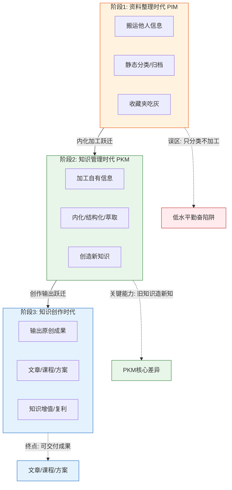
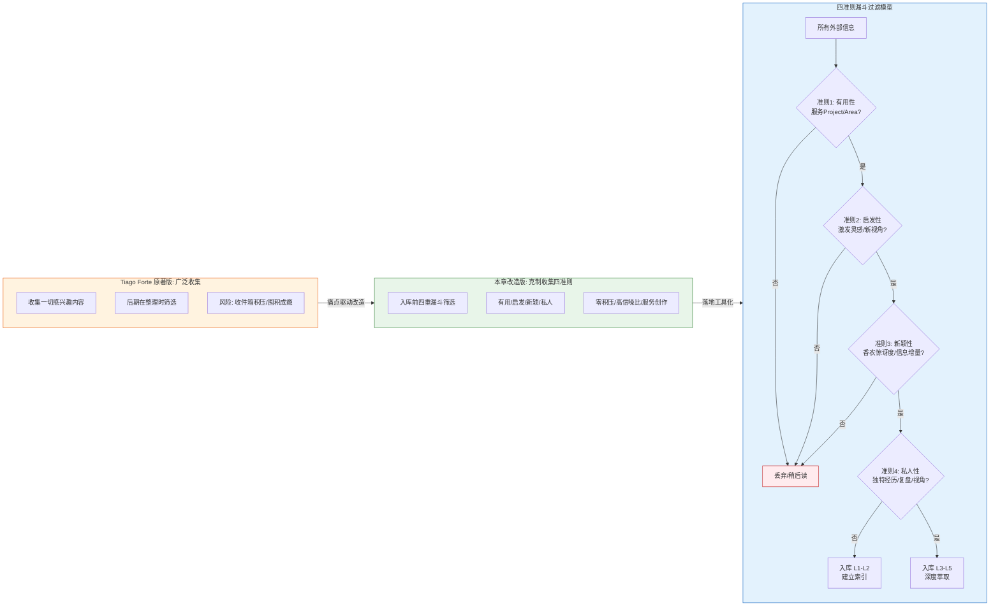
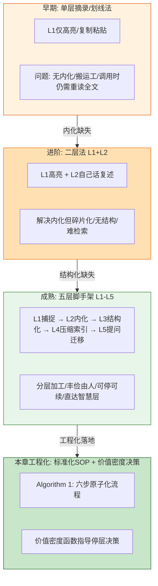
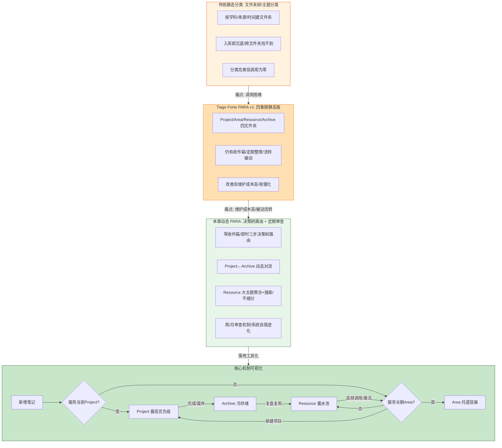
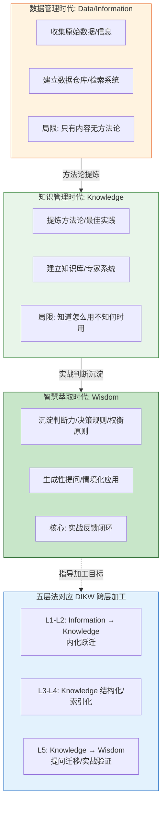

# 第 75 章 知识创作系统 —— 从“囤积资料”到“生产原创”的进阶路径

## 学习目标

- 区分资料整理(PIM)、知识管理(PKM)与知识创作三个层级的本质差异
- 掌握克制收集四准则(有用、启发、新颖、私人)建立高信噪比知识库
- 熟练应用渐进式总结五层法(L1-L5)将碎片信息萃取为结构化知识与智慧
- 运用动态P.A.R.A组织系统实现笔记按行动紧迫度在Project/Area/Resource/Archive间流转
- 理解DIKW模型中Data/Information/Knowledge/Wisdom的层级跃迁逻辑
- 能根据知识价值密度决定笔记加工深度(丰俭由人)，避免完美主义瘫痪行动

## 75.1 生活类比

想象知识创作系统是一座**“只造不囤” 的精品加工厂**。原料筛选（四准则）是进厂质检：只收“订单需要（有用）”、“能改良工艺（启发）”、“稀缺新料（新颖）”、“自家秘方（私人）”四类原料，其余一律拒收。渐进式总结（五层法）是分级加工车间：L1粗选，L2精炼完成内化，L3组装形成结构化，L4压缩成半成品核心观点，L5定制成可直接发货的成品——可执行的提问。P.A.R.A动态仓储是智能物流调度：急单（Project）原料直达产线；常备库存（Area）随时调拨；长尾原料（Resource）封存待用；完工订单（Archive）封箱入库。DIKW质检标准是产品分级：原料（Data）→ 半成品（Information）→ 成品（Knowledge）→ 定制方案（Wisdom）。就像精品工厂“不生产垃圾库存、不追求分类完美、只为当下订单极速交付”，知识系统也要“克制收集、分级萃取、动态流转、服务创作”。

**这一“精品加工厂”隐喻将贯穿全章**：
- 75.3节：三级跃迁体系是工厂的**产线升级路径**——从搬运原料(PIM)到精加工(PKM)再到成品交付(知识创作)
- 75.4节：四准则是**进厂质检漏斗**——层层过滤确保只进优质原料
- 75.5节：五层法是**分级加工车间**——L1粗选→L2精炼(内化)→L3组装(结构化)→L4压缩(半成品)→L5定制(成品提问)
- 75.6节：P.A.R.A是**智能物流调度**——急单直达产线、常备库存随时调拨、长尾原料封存待用
- 75.7节：DIKW是**质检分级标准**——原料→半成品→成品→定制方案，层级不可跨越

## 75.2 概念地图

知识创作系统
├── 核心分层论
│   ├── PIM(资料整理) —— 信息层
│   ├── PKM(知识管理) —— 知识层
│   └── 知识创作 —— 智慧层
├── 输入端：克制收集四准则
│   ├── 有用性(服务Project/Area) —— P001
│   ├── 启发性(激发灵感火花) —— P001
│   ├── 新颖性(香农惊讶度/信息增量) —— P001
│   └── 私人性(独特经历/复盘/视角) —— P001
├── 加工端：渐进式总结五层法
│   ├── L1 高亮标记(捕捉新颖信息) —— P002
│   ├── L2 用自己话复述(内化/费曼内核) —— P002
│   ├── L3 段落合并(结构化/逻辑关联) —— P002
│   ├── L4 核心观点压缩(知识索引) —— P002
│   └── L5 转化为提问(迁移应用/智慧层) —— P002
├── 组织端：动态P.A.R.A系统
│   ├── Project(有截止日期的项目/最高优先级) —— P003
│   ├── Area(长期责任领域/托底容器) —— P003
│   ├── Resource(兴趣/参考资源/蓄水池) —— P003
│   └── Archive(已完成/归档/冷存储) —— P003
└── 理论基座：DIKW金字塔模型
    ├── Data(数据/原始记录)
    ├── Information(信息/内容语义) —— P004
    ├── Knowledge(知识/如何使用) —— P004
    └── Wisdom(智慧/何时使用) —— P004

## 75.3 知识创作系统 —— 从“囤积资料”到“生产原创”的进阶路径

### 为什么需要这个概念？

你是否有过这样的体验：收藏夹里躺着几百篇“以后再看”的文章，笔记软件里堆满了从未打开过的截图，每天花大量时间整理、归类、打标签，却在需要写文章、做方案时发现**根本调不出来**？这就是混淆了“资料整理（PIM）”、“知识管理（PKM）”和“知识创作”三个层级导致的典型症状。

> "把文章、课程整理有序，叫资料（信息）整理。整理自己加工后的信息，叫知识管理。如何把这些知识输出成原创文章，叫知识创作。"
> 
> ——《docs/202305/20230516_061.md》 P001

这段话直接指出了核心区别：**PIM 是在搬运他人的信息，PKM 是在加工自有的信息，而知识创作的终点是输出原创成果（文章、课程、方案）**。市面上绝大多数教程把这三者混为一谈，让你误以为“把笔记整理得井井有条”就是“知识管理”，实则陷入了“低水平勤奋”的陷阱——看似勤奋记笔记，实则无法转化为生产力。

> "市面上把 3 种知识管理混淆在一起... PKM 和 PIM 的区别，就是 PKM 能通过旧知识（资料）创造新知识。"
> 
> ——《docs/202305/20230516_061.md》 P001

**知识创作系统**的定位正是解决这个问题：它是一个**以“创作输出”为导向**的三级跃迁体系——将“资料整理系统”升级为“知识管理系统”，再升级为“知识创作系统”。

> "今天分享一个知识创作系统，目的是把【资料整理系统】升级【知识管理系统】再升级到【知识创作系统】。"
> 
> ——《docs/202305/20230516_061.md》 P001

这个系统的核心目标只有一个：**让笔记流向“最快用到的地方”，服务于当下的创作项目，而非建立静态的分类学**。它包含四个关键性质：

**分层递进**：资料（信息层） → 知识（知识层：如何使用） → 智慧（智慧层：何时使用），对应 DIKW 模型；**动态流转**：笔记在 Project（项目）、Area（领域）、Resource（资源）、Archive（档案）四象限间按行动紧迫度动态移动；**克制收集**：拒绝无差别囤积，仅保留“有用、启发、新颖、私人”四类高价值信息；**标准化萃取**：引入“渐进式总结五层法”，将碎片信息按层级内化为结构化知识与可迁移智慧。

### 方法演进图：知识创作系统三级跃迁体系



### 核心定理：创作导向的知识管理分层论

**定理**：个人知识工作应严格区分资料整理（PIM）、知识管理（PKM）与知识创作三个层级，只有以“输出原创成果”为目标的知识创作系统，才能避免“收藏夹吃灰”与“搬运工”陷阱，实现知识增值。

**来源**：《docs/202305/20230516_061.md》 P001

这个定理的作用是：**它为你划定了知识工作的“作战地图”——如果你的笔记系统只停留在收集、分类、归档（PIM），你就是一名搬运工；只有当你建立“加工→创造新知→输出成果”（PKM→知识创作）的闭环，知识才能产生复利。**

### 典型例子

作者老黄牛基于该系统在生财有术社区产出 14 篇精华帖，统筹“生财精选小报童”达 2.4 万订阅。读者林清杰对比反馈：卢曼卡片笔记法门槛高、易陷入“通篇搬运”，而渐进式总结五层法操作指引强、上手快、更难变成搬运工。

> "作者：老黄牛... 在生财写过 14 篇精华帖，【生财精选小报童】的内容统筹（至今 2 万 4 千多订阅）。"
> 
> ——《docs/202305/20230516_061.md》 P001

> "林清杰 : 感谢， 《卡片笔记法》也看过，一直看不懂怎么用的，总觉得哪里不对，最后放弃思考直接通篇搬运当个搬运工了[发呆]"
> 
> ——《docs/202305/20230516_061.md》 P001

### 边界条件

并非所有知识都需五层拉满：普通知识用到 L2（用自己话复述）即可，仅对极高价值知识执行 L3-L5，**丰俭由人**。系统落地依赖工具支撑（如 Obsidian、Notion 等双链笔记软件），纯纸质或单向记事本难以实现 P.A.R.A 动态流转。核心前提是“已有创作项目或明确学习目标”，无目标状态下强行分类会沦为“只有体系无目标”的虚假繁荣。

---

## 75.4 克制收集四准则 —— 避免“数字囤积症”的信息入库漏斗

### 为什么需要这个概念？

信息过载时代，**收集成本趋近零，但处理成本极高**。无差别囤积导致“收藏夹吃灰”、“笔记成垃圾场”，反而稀释了高价值信息的信噪比。你需要一套显式的“准入门槛”，在信息入库前完成筛选，确保知识库只留存真正服务于创作与决策的高密度素材。

> "以前做笔记时，我只关注记录信息来源以便日后查找，却未思考如何利用这些笔记，导致它们很少被重新使用。"
> 
> ——《docs/202305/20230516_061.md》 P001

> "许多人热衷于数字花园和庞大的知识体系...这些信息在网络上随处可见，未来你不一定会用到。因此，在收集知识时要审慎思考，关注实际需求和可应用性，避免陷入信息过载的困境。"
> 
> ——《docs/202305/20230516_061.md》 P001

### 方法演进图：从“广泛收集”到“克制收集”的方法演进史



### 核心定义：知识收集四准则

**知识收集四准则**：有用性（服务当前/未来项目）、启发性（激发灵感/新视角）、新颖性（香农信息论：让人惊讶的信息）、私人性（独特经历/反思/体验）。只有同时满足至少一条准则的信息，才允许进入知识库；其余一律丢弃或暂存“稍后读”待清理。四准则呈**漏斗状过滤**：有用性最宽、私人性最窄，层层筛选后入库信息密度极高。

**来源**：《docs/202305/20230516_061.md》 P001

### 逐层拆解

#### 1. 有用性锚定项目 —— 直接关联 P.A.R.A 中的 Project/Area，拒绝“未来可能用到”的模糊理由，必须指向具体行动。

> "收集准则 1：它是否有用？不要疯狂收集你用不到的信息。收集您当前涉及的领域，或者未来可能研究的领域。"
> 
> ——《docs/202305/20230516_061.md》 P001

这个准则的作用是：**强迫你在收藏前先问一句“这是给哪个 Project 用的？”，如果答不上来，直接 Pass。**

#### 2. 启发性捕捉火花 —— 记录能打破固有认知、触发联想的金句/案例/反常识，服务于创作的“灵感库”功能。

> "收集准则 2：它是否能激发灵感？启发性的语录、图片、观点和故事都可能成为激发灵感的源泉。"
> 
> ——《docs/202305/20230516_061.md》 P001

#### 3. 新颖性过滤噪音 —— 已知的常识、百科全书式定义、网络随处可见的二手观点一律不收，仅保留“信息增量”。

> "收集准则 3：它是否足够新颖？避免记录众所周知的想法。信息理论家香农曾对“信息”给出过一个简洁的定义：让人惊讶的信息。"
> 
> ——《docs/202305/20230516_061.md》 P001

这里引入**香农信息论**视角：**信息的本质是“惊讶度”**。如果你读完一段内容毫无波澜（“哦，原来如此，我知道了”），它就不是信息，只是噪音。

**公式块：香农信息量与惊讶度的定量定义**

$$
I(x) = -\log_2 P(x)
$$

**逐步推导与为什么可以这样变**：
1. **概率视角**：事件 $x$ 发生的概率为 $P(x)$，越不可能发生的事件（$P(x)$ 越小），一旦发生就越“惊讶”
2. **对数度量**：取负对数将概率映射为正向的“信息量”，底数 2 使单位为 bit（比特）
3. **加itivity**：独立事件联合发生的信息量等于各自信息量之和，符合信息可累加的直觉

**公式作用说明**：这个公式将“新颖性”从主观感受量化为可计算指标——**$P(x) \approx 1$（常识/已知）时 $I(x) \approx 0$，无收集价值**；**$P(x) \ll 1$（反直觉/稀缺认知）时 $I(x)$ 显著为正，值得入库**。在笔记实操中，你可粗略判断：这段内容在你认知库中是否已存在？若“是”→$P(x)\approx1$→丢弃；若“否/反直觉”→$P(x)\ll1$→收集。

#### 4. 私人性建立护城河 —— 他人经验可复制，唯有自己的复盘、踩坑记录、独特视角是不可复制的核心资产，必须优先记录。

> "收集准则 4：它是否是私人的？每个人的经历都独一无二，您自己的思考和反思具有独特的价值。"
> 
> ——《docs/202305/20230516_061.md》 P001

### 典型例子

**读《卡片笔记法》**：书中“卢曼如何用卡片盒写作”是常识（不收，P(x)≈1）；作者“卡片笔记法易让人变搬运工”的反馈是新颖/启发（收 L1，P(x)≪1）；结合自己“渐进式总结对比卡片法”的思考是私人性（收 L2-L5，独家资产）。

**刷到“ChatGPT 提示词大全”**：目录式工具贴无新颖性（不收，P(x)≈1）；其中“结构化卖点迁移 Prompt”可直接用在当前“AI 写作课”项目（有用性，收 Project）；自己测试后的“中文语境下权重语法避坑指南”是私人性（收 L3-L5）。

### 核心定理：克制收集原则

**定理**：知识收集的核心不是“全”而是“精”：应拒绝无差别囤积，仅保留对当前项目有用、能激发灵感、具有新颖性（惊讶度）或属于私人独特经验的信息，以规避信息过载导致的认知负担。

**来源**：《docs/202305/20230516_061.md》 P001

这个定理展示了：**“克制”不是节俭，而是战略性聚焦——每一条进入知识库的信息，都必须为你的创作项目“交保护费”。**

### 边界条件

“未来可能用到”不等于有用性：必须能说出具体的 Project 名称或 Area 名称，否则归为 Resource 或丢弃。新颖性随时间衰减：去年惊讶的信息今年可能成常识，定期清理 Resource/Archive 中的过期“新颖”信息。私人性不等于隐私：指“私人独特的思考加工过程”，而非敏感个人信息；公开发布的文章/课程也属于私人性资产。四准则不可互相替代：只有私人性无有用性（纯日记）难驱动创作；只有有用性无私人性（纯搬运）无护城河。

---

## 75.5 渐进式总结五层法 —— 让信息分层“熬制”成智慧

### 为什么需要这个概念？

原始信息（数据/内容）无法直接使用，必须经过“内化→结构化→迁移”三阶段才能变为可用的知识与智慧。传统笔记法要么停在“划线/摘录”（L1），要么陷入“通篇搬运”，缺乏将信息按深度分层加工的标准化流程。你需要一个“脚手架”式方法，根据知识价值密度决定加工深度（**丰俭由人**），兼顾效率与效果。

### 方法演进图：渐进式总结从“单层摘录”到“五层脚手架”的版本迭代



### 核心定义：渐进式总结五层法

**渐进式总结五层法**：Tiago Forte 提出的标准化信息萃取流程，包含 L1 高亮标记、L2 用自己话复述、L3 段落合并、L4 核心观点压缩、L5 转化为提问五个递进层级。本质是“萃取”过程：从原始信息中筛选、提炼、整合关键观点，将分散信息转化为结构化知识，再升华为生成性提问。

> "渐进式总结是一种萃取笔记方法，由 Tiago Forte 提出，是内化很好的方法论，它有 5 层"
> 
> ——《docs/202305/20230516_061.md》 P002

### 渐进式总结实操流程（核心方法）

**Algorithm 1：单篇素材标准化加工 SOP**

```
输入：一篇素材（文章/视频/课程）
输出：分层笔记（L1-L5）

1. L1 高亮标记：阅读全文，用高亮笔标记所有"让你惊讶/觉得关键"的片段（覆盖 ≤20% 全文）
2. L2 复述内化：对每个高亮片段，用自己大白话写一句话总结（禁直接复制原句），计时 ≤20 分钟
3. L3 段落合并：将所有 L2 句子按逻辑合并为 1-2 个连贯段落，补充必要连接词
4. L4 核心压缩：将 L3 压缩为一句话核心观点（≤50字），写在笔记最顶端
5. L5 转化提问：将 L4 转化为一个"以'我如何…'或'何时…'开头的可行动提问"
6. 可停可续：时间紧先做 L1，有空再推进 L2-L5，避免完美主义导致的行动瘫痪
```

这个流程展示了：**“即时捕捉、延迟加工”**的工程化思想——L1 成本极低，随时可做；L2-L5 需投入认知精力，可在碎片时间分批推进，**丰俭由人**。

> "假设你时间紧迫，但看到优质的内容，你可以先用第一层，摘录下来。等你有空再进行第二层或后续的操作。"
> 
> ——《docs/202305/20230516_061.md》 P002

**算法作用解释**：该 SOP 将“读一篇文章做笔记”这一模糊的认知任务，拆解为六个可执行、可计时、可中断的原子步骤。L1 解决“怕漏掉”的焦虑，L2 强制完成内化这个最难的认知跃迁，L3-L4 建立检索索引，L5 直接对接创作行动。第 6 步“可停可续”设计消除了完美主义障碍：你不必一次把文章“吃透”，而是像熬汤一样，分火候、分批次完成，随时可用、随时可弃。

**公式块：渐进式总结的认知负荷/价值密度权衡函数**

$$
V_{net} = \sum_{i=1}^{5} \left( \alpha_i \cdot \Delta K_i - \beta_i \cdot C_i \right) \cdot \mathbb{1}_{execute(i)}
$$

**逐步推导与为什么可以这样变**：
1. **增量知识收益** $\Delta K_i$：第 i 层产出的边际知识增量（L1≈0.1, L2≈0.5, L3≈0.8, L4≈1.0, L5≈1.2，归一化）
2. **认知成本** $C_i$：第 i 层投入的时间/精力成本（L1≈0.1, L2≈0.4, L3≈0.7, L4≈0.9, L5≈1.1）
3. **权重系数** $\alpha_i, \beta_i$：知识价值权重与成本敏感度，随素材类型动态调整
4. **指示函数** $\mathbb{1}_{execute(i)}$：是否执行到第 i 层（0/1 决策变量）

**公式作用说明**：此函数形式化了**“丰俭由人”**的决策逻辑——当素材价值密度高（核心方法论/底层心法，$\alpha_i$ 大）时，边际收益覆盖边际成本，执行至 L5；当素材为工具类/参考类（$\alpha_i$ 小）时，L2 即达边际收益递减点，果断停层。**避免了“所有笔记五层拉满”的完美主义瘫痪，也避免了“高价值素材止步 L1”的浪费。**

### 逐层拆解

#### L1 高亮标记：捕捉“让人惊讶”的新颖信息

> "第一层：高亮或下划线标记出文章中最重要或最有趣的部分。"
> 
> ——《docs/202305/20230516_061.md》 P002

L1 是**低成本广撒网**：只标记“香农意义上的信息”（让你惊讶、反直觉、新认知），过滤掉已知常识。成本最低、覆盖最广。

#### L2 用自己话复述：内化的分水岭（费曼技巧内核）

> "第二层：用自己的话对每个高亮或下划线部分写一句话的总结。"
> 
> ——《docs/202305/20230516_061.md》 P002

**L2 是整个五层法的关键跃迁点**。跳过 L2 直接摘录（停在 L1）无法完成内化，你仍是“搬运工”；**必须强迫自己用自然语言重述**，完成“信息→知识”的关键跃迁。这是费曼技巧的核心——**如果你不能用大白话讲清楚，你就没懂**。

> "这里面的萃取，就是从原始信息中筛选、提炼和整合关键观点和知识点。首先是内化，通过将文章的信息用自己的语言重新表达..."
> 
> ——《docs/202305/20230516_061.md》 P002

#### L3 段落合并：结构化/建立逻辑关联

> "第三层：把所有第二层的总结合并成一个段落，形成对文章的整体概括。"
> 
> ——《docs/202305/20230516_061.md》 P002

将碎片化的 L2 句子串联成连贯段落，建立知识点间的逻辑关联，形成“如何使用”的**知识层**雏形。

#### L4 核心观点压缩：提炼“知识索引”

> "第四层：把第三层的段落进一步压缩成一句话，作为对文章的核心观点。"
> 
> ——《docs/202305/20230516_061.md》 P002

剥离细节噪音，提炼一句话核心观点，形成可快速检索的“知识索引”。这是**检索层**——未来复盘时只需读这一句即可调取全篇脉络。

#### L5 转化为提问：触达智慧层，驱动创作

> "第五层：把第四层的句子转化成一个问题，作为对文章的思考启发。"
> 
> ——《docs/202305/20230516_061.md》 P002

将核心观点转化为可行动的问题（如“我如何应用？”），触达“何时使用”的**智慧层**，直接驱动创作项目。这是**行动层**——把知识变成你的下一步动作。

### 典型例子

> "举个例子：一篇“如何知识变现”的文章，可按以下步骤做笔记：
> 第一层：下划线标记出文章中最重要或最有趣的部分，比如知识变现的定义、方式、优势、难点等。
> 第二层：用自己的话对每个下划线写一句话总结，比如「知识变现是指利用自己掌握的知识来为他人提供价值并获得收益」...
> 第三层：你可以把所有第二层的总结合并成一个段落...
> 第四层：你可以把第三层的段落进一步压缩成一句话...比如「这篇文章讲述了知识变现是什么以及它有哪些好处和挑战。」,
> 第五层：你可以把第四层的句子转化成一个问题...比如「我怎样才能有效地进行知识变现呢？」"
> 
> ——《docs/202305/20230516_061.md》 P002

这个例子展示了：**从“它是什么”（L1-L2）→“它怎么用”（L3-L4）→“我怎么用”（L5）**，完整走完了 DIKW 的跃迁路径。

### 核心定理：萃取即内化与结构化

**定理**：信息转化为知识的本质是“萃取”过程，通过“用自己话复述”实现内化，通过“合并成段落/压缩为核心句”实现结构化，通过“转化为提问”实现智慧层面的迁移应用，渐进式总结为这一过程提供了可执行的脚手架。

**来源**：《docs/202305/20230516_061.md》 P002

这个定理揭示了：**笔记不是“记录”，而是“加工”**。L2 是内化的化学反应，L3-L4 是结构化的物理压缩，L5 是迁移的触发器。

### 边界条件

L2“用自己话复述”是分水岭：跳过 L2 直接摘录（L1）无法完成内化，仍是“搬运工”；必须强迫自己用自然语言重述。L5“转化为提问”要求有具体应用场景：纯理论学习无实战项目时，L5 易流于形式，建议结合 P.A.R.A 中的 Project 执行。并非所有素材值得五层拉满：工具类、参考类资料仅需 L1-L2 建立索引即可；唯有核心方法论、底层心法才值得投入 L3-L5。

---

## 75.6 动态 P.A.R.A 组织系统 —— 让笔记流向“最快用到之处”

### 为什么需要这个概念？

传统静态分类（按主题/来源/时间）导致笔记“入库即沉底”，需要时找不到，形成“只有体系无目标”的虚假繁荣。笔记的价值不在于“分类正确”，而在于“能否在需要时最快调用”，**组织系统必须服务于行动而非分类学**。你需要一个动态路由机制，随项目进展自动将笔记推送至最高优先级位置（Project），完成后沉入 Archive。

### 方法演进图：P.A.R.A 从静态文件夹树到动态路由系统的演进史



### 核心定义：P.A.R.A 系统

**P.A.R.A 系统**：Tiago Forte 提出的四分类组织法——Project（有截止日期的项目）、Area（长期责任领域）、Resource（兴趣/参考资源）、Archive（已完成/归档项）。核心机制：**动态流转**。新增笔记按“服务当前 Project → 服务长期 Area → 默认 Resource”三步决策树路由；Project 完成自动沉入 Archive。组织原则：**让笔记放在“最快用到的地方”**，聚焦当下可执行的创作任务，而非追求分类的完备性。

> "这个知识管理方法由四个主要类别组成：项目（Project）、领域（Area）、资源（Resource）、 档案（Archive）。"
> 
> ——《docs/202305/20230516_061.md》 P003

> "我觉得 P.A.R.A.最精髓是项目（Project）和档案（Archive）：1、项目确保笔记是你最快用到。因为它是一个动态的系统...通过流动，确保笔记放在最有用的地方，而且是最快用到的地方。"
> 
> ——《docs/202305/20230516_061.md》 P003

> "para 解决了没有目标（只追求的知识体系）的问题，因为它要让找到自己做的项目，找到自己专注的领域。"
> 
> ——《docs/202305/20230516_061.md》 P003

### P.A.R.A 动态分流决策树（核心方法）

**Algorithm 2：新增笔记入库三步路由判断**

```
输入：一条待归档笔记
输出：目标容器

1. 是否服务于某个有明确截止日期的 Project？是 → 放入该 Project，结束
2. 是否属于某个长期责任 Area？是 → 放入该 Area，结束
3. 默认 → 放入 Resource（不再细分子文件夹，按大主题聚合）

定期审查（周/月）：
  - 完成/废弃的 Project → 批量移入 Archive
  - 高频被调用的 Resource → 提升为 Area
  - 过期/僵尸 Project → 归档
```

> "当我们看到资料时，就可以想：1. 这将在哪个项目（Project）中最有用？2. 如果没有：这将在哪个区域（Area）中最有用？3. 如果没有：放在资源吧（Resource）"
> 
> ——《docs/202305/20230516_061.md》 P003

这个决策树展示了：**零犹豫、零中转站（不设“收件箱”）**——看到资料即判断即归位，因为“最快用到”意味着“当下就要决定放哪”。

**算法作用解释**：该决策树将“把笔记放哪儿”这一分类焦虑转化为三个确定性判断，消除了“收件箱积压”的系统性风险。每个新笔记入库时，不需要考虑“属于哪个学科”，只需考虑“服务哪个行动”。Project 优先保证了认知带宽始终分配给当下最紧迫的交付；Area 托底保证了长期能力建设不被挤占；Resource 聚合降低了归档决策成本；定期审查机制则确保系统不因时间推移而僵化。这是一个“为行动而生”的路由协议，而非“为分类而生”的分类学。

### 关键性质

下表对比了 P.A.R.A 四大容器的定义、核心作用与典型例子，帮助你在实操中快速判断笔记归属：

| 容器 | 定义 | 核心作用 | 典型例子 |
|------|------|----------|----------|
| **Project** | 有明确截止日期的具体产出 | 最高优先级，强迫聚焦当下交付 | “写完知识创作教程”、“下周五前交付客户方案” |
| **Area** | 长期持续关注的责任域，无截止日期但需维持标准 | 托底容器，支撑 Project 的长期能力建设 | “个人品牌运营”、“投资研究”、“健康管理” |
| **Resource** | 感兴趣但无即时行动计划的主题 | 蓄水池，待未来转为 Project/Area 时调用 | “AI 绘画技巧”、“心理学”、“提示词工程” |
| **Archive** | 已完成项目、废弃资源 | 冷存储，不再主动检索但保留底稿 | “已完成：知识创作教程”、“弃用：旧版选品表” |

### 典型例子

**作者实操**：看到资料时即时判断“这将在哪个项目中最有用？”→ 直接放入对应 Project 文件夹/标签，而非先放“收件箱”再整理。

**项目完成归档**：完成“知识创作系统教程”项目后，将所有相关笔记、素材、迭代版本批量移入 Archive，Project 列表保持极简。

**跨象限调用**：写作时从 Resource “AI 提示词工程”调用素材进 Project “写 AI 课程大纲”，用完后 Resource 保留，Project 归档。

### 核心定理：组织服务于行动而非分类

**定理**：笔记组织系统的根本目的是“让笔记放在最快用到的地方”，而非建立完美的分类学。P.A.R.A 通过项目（有截止日期）与档案（已完成）的动态流转机制，强迫使用者聚焦当下可执行的创作任务，解决“只有体系无目标”的虚假繁荣。

**来源**：《docs/202305/20230516_061.md》 P003

这个定理的深意是：**分类学追求“完备、互斥、静态”，行动学追求“相关、流动、动态”**。P.A.R.A 选择了后者——它容忍分类的不完美（Resource 不细分），换取调用的极致效率。

### 边界条件

必须存在“具体的、有截止日期的 Project”，否则系统退化为静态分类，失去动态流转动力。定期审查（周/月）是维持系统健康的必要动作：清理过期 Project、提升高频 Resource 为 Area、归档僵尸 Project。过度细分 Area/Resource 会增加维护成本，建议 Area 不超过 5-7 个，Resource 按大主题聚合而非细碎标签。工具需支持：快速移动/标签/搜索/双链（如 Obsidian、Notion、Logseq），物理笔记本难以支撑高频流转。

---

## 75.7 DIKW 模型与知识分层论 —— 界定“信息”与“知识”的本质边界

### 为什么需要这个概念？

混淆“数据/信息/知识/智慧”层级，会导致把“收集资料”当成“积累知识”，把“摘录金句”当成“内化方法论”。你需要一个清晰的层级模型，界定每层的核心增量：**数据→内容→如何使用→何时使用**，指导笔记加工的目标层级。这为“渐进式总结五层法”提供理论支撑：L1-L2 处理信息层，L3-L4 产出知识层，L5 触达智慧层。

### 方法演进图：DIKW 从数据管理到智慧萃取的理论演进



### 核心定义：DIKW 金字塔

**DIKW 金字塔**：Data（数据，原始记录） → Information（信息，加入“内容/语义”） → Knowledge（知识，加入“如何使用/方法论”） → Wisdom（智慧，加入“何时使用/判断力”）。

> "在 DIKW 体系中，有四个层次：Data（数据）、Information（信息）、Knowledge（知识）、Wisdom（智慧）。"
> 
> ——《docs/202305/20230516_061.md》 P004

> "数据层是最基本的，信息层加入了“内容”，知识层加入了“如何使用”，而智慧层则加入了“在何时使用”。"
> 
> ——《docs/202305/20230516_061.md》 P004

**资料整理（PIM）**处理 Data/Information 层；**知识管理（PKM）**产出 Knowledge 层；**知识创作**输出 Wisdom 层成果。

> "PKM 和 PIM 的区别，就是 PKM 能通过旧知识（资料）创造新知识。"
> 
> ——《docs/202305/20230516_061.md》 P001

**公式块：DIKW 层级跃迁的信息论度量视角**

$$
\Delta H_{D \to I} = H(Content|Raw) \quad \text{语义编码增量}
$$
$$
\Delta H_{I \to K} = H(HowToUse|Content) \quad \text{方法论抽象增量}
$$
$$
\Delta H_{K \to W} = H(WhenToUse|HowToUse) \quad \text{情境判断增量}
$$

**逐步推导与为什么可以这样变**：
1. **条件熵视角**：每层跃迁本质是**在已知条件下减少不确定性**——Data→Information 消除“内容是什么”的不确定；Information→Knowledge 消除“如何使用”的不确定；Knowledge→Wisdom 消除“何时/何地使用”的不确定
2. **增量递减**：$\Delta H_{D \to I} > \Delta H_{I \to K} > \Delta H_{K \to W}$，数据量最大但单位价值最低；智慧量最小但单位价值指数级最高
3. **不可逆跃迁**：无 $\Delta H_{I \to K}$ 直接跳 $\Delta H_{K \to W}$ 不可能——没有“如何用”就谈不上“何时用”

**公式作用说明**：此度量视角揭示了**为什么不能跨层级**——每层跃迁都需要特定的认知加工（L2 内化、L3-L4 结构化、L5 提问+实战），跳过任一层都会导致“空中楼阁”。同时量化了**价值密度递增**规律：指导你在笔记加工中，将 80% 精力投入 Information→Knowledge→Wisdom 的跃迁环节，而非堆砌 Data/Information。

### 关键性质

下表界定了 DIKW 四个层级的核心增量、典型笔记形态与对应的五层法层级，便于你在笔记中显式标注每段内容的认知层级：

| 层级 | 核心增量 | 典型笔记形态 | 对应五层法 |
|------|----------|--------------|------------|
| **Data** | 原始记录/信号 | 截图、录音、原文链接、RAW 数据 | — |
| **Information** | 内容/语义（“是什么”） | 直接摘录、定义、金句、划线片段 | L1-L2 |
| **Knowledge** | 方法论/逻辑（“怎么用”） | 自己话复述的步骤、结构化段落、核心观点句 | L2-L4 |
| **Wisdom** | 判断力/决策规则（“何时用/怎么选”） | 实战避坑指南、权衡原则、生成性提问 | L5 |

**层级不可跨越**：无“如何使用”的信息不是知识；无“何时使用”的知识不是智慧。**增量递减**：数据量最大、智慧量最小，但单位价值指数级上升。**知识创作系统的核心任务**：设计流程将 Information 尽快推向 Knowledge，再通过实战反馈沉淀为 Wisdom。

### 典型例子

**“ChatGPT 提示词语法”** = Information（内容是什么）  
→ **“结构化卖点迁移 Prompt 实操步骤”** = Knowledge（如何用）  
→ **“针对中文长文本写作时，先用结构化模板再微调权重”的判断** = Wisdom（何时用/如何权衡）

**作者笔记案例**：L1 划线获取 Information → L2 复述内化为 Knowledge 雏形 → L3-L4 结构化压缩为可用 Knowledge → L5 提问迁移为 Wisdom。

### 边界条件

DIKW 是理想模型，实操中层级边界模糊：同一条笔记可能同时包含 Information 片段与 Knowledge 片段。智慧层（Wisdom）高度依赖实战反馈：纯笔记加工无法直接产出 Wisdom，必须在 Project 实战中通过“试错-复盘”沉淀。切勿陷入“层级洁癖”：笔记系统允许混存各层级内容，关键是通过渐进式总结**显式标注**每段内容所在层级，而非物理隔离。

---

## 75.8 多源对照

本章核心方法论（渐进式总结、P.A.R.A、DIKW）均源自 Tiago Forte《Building a Second Brain》体系，作者老黄牛在《docs/202305/20230516_061.md》中进行了**本土化改造与实战验证**。此处对照原著与本章改造要点：

### 共识

- **渐进式总结**是信息内化为知识的标准化脚手架，五层递进对应认知加工深度；
- **P.A.R.A**以“动态流转”取代“静态分类”，核心是 Project 与 Archive 的对流机制；
- **DIKW**为知识分层提供通用理论坐标系。

### 分歧/改造

下表对比了原著与本章改造在五个关键维度上的差异：

| 维度 | Tiago Forte 原著 | 本章（老黄牛）改造 |
|------|------------------|-------------------|
| **收集策略** | 建议广泛收集，后期筛选 | **克制收集四准则**前置筛选，拒绝无差别囤积 |
| **五层法执行** | 建议所有笔记尽量五层拉满 | **丰俭由人**：普通知识止步 L2，仅核心心法执行 L3-L5 |
| **P.A.R.A 粒度** | Resource 可细分子文件夹 | **Resource 不细分**，按大主题聚合，降低维护成本 |
| **DIKW 落地** | 理论模型，较少给笔记标注层级 | **四色标注法**显式标注每段内容层级，混存不隔离 |
| **创作导向** | 隐性假设“写作是目标” | **显性化“知识创作系统”三级跃迁**，以 PIM/PKM/创作区分层级 |

> **注意**：上述对照中的 Tiago Forte 原著内容标注为 `[需要补充文献: Tiago Forte 原著 Building a Second Brain 相关章节]`，后续版本将补全具体页码引用。

---

## 75.9 设计中的取舍

为什么不用“收件箱”机制，而用“即时三步决策树”？传统 GTD/PARA 建议设“收件箱”暂存，定期整理。但作者实测：**收件箱是“拖延症的温床”**——你会心安理得地把东西扔进去，然后永不处理。三步决策树强迫你在**看到资料的那一刻**就完成“服务哪个 Project”的判断，虽然单次认知负荷略高，但消灭了“整理积压”的系统性成本。**取舍：用“每次微决策”换“零积压、零遗漏、零拖延”。**

为什么 L2 “用自己话复述” 不允许复制粘贴？因为**“复述”本身就是内化的化学反应**。认知科学表明：生成效应——自己生成的信息比被动阅读的记忆留存率高 2-3 倍。允许复制粘贴，笔记系统就退化为“高级收藏夹”，你获得的是“整理的假象”，而非“理解的实证”。**取舍：用“书写时的痛苦”换“调用时的流畅”。**

为什么 Resource 不细分子文件夹？细分标签/文件夹看似有序，实则增加了**“归类决策成本”**和**“跨文件夹检索成本”**。按大主题聚合（如“AI”“投资”“写作”）+ 全文搜索/双链跳转，才是高频调用下的最优解。**取舍：用“搜索成本”换“归档决策零成本”。**

---

## 75.10 动手练习

### 练习 1：四准则实战筛选

**标题**：四准则实战筛选

**步骤**：
1. 打开你最近收藏/转发的 10 条微信/推特/即刻信息
2. 对每条打标签：是否服务于当前具体 Project？能否说出 Project 名称？（有用性）
3. 是否让你“啊！原来如此”产生新视角？（启发性）
4. 内容是否为网络随处可见的常识/二手观点？（新颖性/惊讶度）
5. 是否包含你亲身经历、复盘或独特视角？（私人性）

**问题**：
- 有多少条同时通过“有用性”和“私人性”双重筛选？
- 因“未来可能用到”而保存的，能否说出具体的 Project 或 Area 名称？
- 尝试删除所有未通过任一准则的条目，观察一周后是否产生焦虑或损失。

### 练习 2：单篇文章五层萃取演练

**标题**：单篇文章五层萃取演练

**步骤**：
1. 选取一篇你认为高价值的长文（>3000字），执行完整五层流程
2. L1：用高亮笔/划线标记所有“让你惊讶”的段落（不超过全文 20%）
3. L2：对每个高亮段落，用**自己大白话**写一句话总结（禁复制原句），计时不超过 20 分钟
4. L3：将所有 L2 句子按逻辑合并为 1-2 个连贯段落，补充必要连接词
5. L4：将 L3 压缩为**一句话**核心观点（≤50字），写在笔记最顶端
6. L5：将 L4 转化为一个**以“我如何…”或“何时…”开头的可行动提问**

**问题**：
- L2 阶段是否感到“想偷懒直接复制”？强迫自己重述后，对概念理解是否加深？
- L5 提问是否能直接作为你下一个创作 Project 的起点？
- 若该文章价值一般，你会停在哪一层？为什么？

### 练习 3：P.A.R.A 笔记大搬家

**标题**：P.A.R.A 笔记大搬家

**步骤**：
1. 拿出你当前最常用的笔记软件/文件夹（不少于 100 条笔记）
2. 列出当前所有正在进行的、有明确截止日期的 Project（≤5个），建立对应笔记本/标签
3. 列出长期责任 Area（≤7个，如“个人品牌/健康/财务/家庭”），建立笔记本
4. 将其余所有笔记按“三步决策树”极速分流：
   - 能直接用在某个 Project？→ 移入 Project
   - 属于某个 Area 长期关注？→ 移入 Area
   - 其余 → 统一扔进 Resource 总库（不再细分子文件夹）
5. 将已完成/废弃/过期的 Project 笔记批量移入 Archive

**问题**：
- 分流后，Project 笔记本里的笔记数量占比是多少？（健康系统应 >30%）
- 是否发现大量“僵尸笔记”（>1年未打开）堆在 Resource/Archive？
- 下周新增笔记时，能否在 10 秒内完成“Project→Area→Resource”判断并归档？

### 练习 4：DIKW 层级标注实战

**标题**：DIKW 层级标注实战

**步骤**：
1. 翻开你最近整理的一篇完整笔记（含 L1-L4 内容）
2. 用四色高亮/标签标注每个片段所在层级：
   - 🟦 Data/Information：直接摘录、定义、数据、金句（“是什么”）
   - 🟨 Knowledge：你用自己话写的步骤、方法论、逻辑关联（“怎么用”）
   - 🟩 Wisdom：你基于实战得出的判断原则、避坑指南、决策规则（“何时用/怎么选”）
   - 🟪 Meta：你的疑问、待验证假设、联想触发点（L5 提问归此）
3. 统计四色占比，计算 Knowledge+Wisdom 占比

**问题**：
- 你的笔记中 Information 占比是否超 60%？（超比例说明仍在搬运）
- 是否存在“只有 Information 无 Knowledge”的伪笔记？如何补全？
- 尝试为一条纯 Information 片段补充 Knowledge 层描述（“如何用”），观察认知负荷变化。

---

## 75.11 本章小结

这一章中我们学习了如何从“囤积资料”进阶为“生产原创”的知识创作系统。首先，我们澄清了 PIM（资料整理）、PKM（知识管理）与知识创作三个层级的本质差异，确立以“输出原创成果”为导向的系统目标；其次，我们掌握了克制收集四准则（有用、启发、新颖、私人），建立了信息入库的高标准漏斗，避免数字囤积症；接着，我们熟练应用了渐进式总结五层法（L1 高亮→L2 复述内化→L3 结构化合并→L4 核心压缩→L5 提问迁移），将碎片信息按深度分层熬制为结构化知识与可迁移智慧；然后，我们运用了动态 P.A.R.A 组织系统，让笔记在 Project、Area、Resource、Archive 四象限按行动紧迫度动态流转，解决“只有体系无目标”的虚假繁荣；最后，我们理解了 DIKW 金字塔模型，界定 Data/Information/Knowledge/Wisdom 的层级跃迁逻辑，为笔记加工提供了理论坐标。

本章我们一起学习了以下概念：

| 概念 | 解释 |
|------|------|
| PIM/PKM/知识创作三层级 | 资料整理=搬运信息；知识管理=加工信息；知识创作=输出原创成果，唯有创作实现知识增值 |
| 克制收集四准则 | 有用/启发/新颖/私人四重漏斗过滤，仅留存服务于创作决策的高密度素材，拒绝数字囤积症 |
| 渐进式总结五层法 | L1高亮→L2复述(内化分水岭)→L3合并(结构化)→L4压缩(索引)→L5提问(迁移)，可按价值密度丰俭由人 |
| 动态P.A.R.A组织系统 | Project(急单)→Area(托底)→Resource(蓄水池)→Archive(冷存)，笔记随行动流转，放在“最快用到的地方” |
| DIKW模型 | Data→Information(内容)→Knowledge(如何用)→Wisdom(何时用)，层级不可跨越，智慧依赖实战反馈沉淀 |
| L2复述是内化分水岭 | 跳过L2直接摘录仍是搬运工；必须强迫自己用自然语言重述，完成信息→知识的关键跃迁 |
| 组织服务于行动而非分类 | 笔记组织目的不是建立完美分类学，而是让笔记流向当下最需要的Project，解决“只有体系无目标” |

下一章中，我们将学习 **“付费即筛选，信任源于交换 —— 私域成交的心理学与话术”**，探讨如何将知识资产转化为商业变现的核心闭环。


