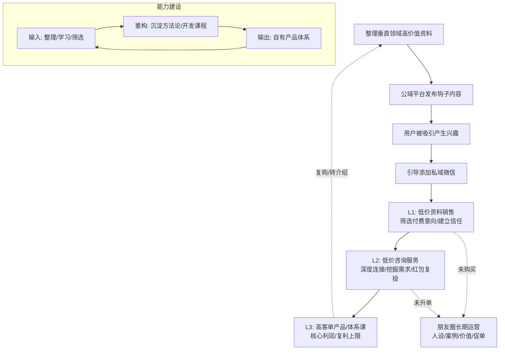
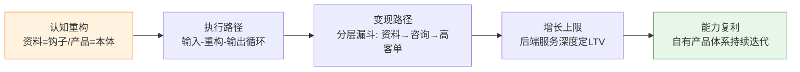
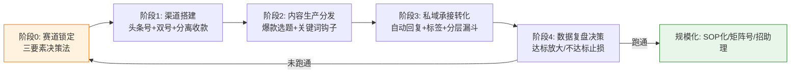
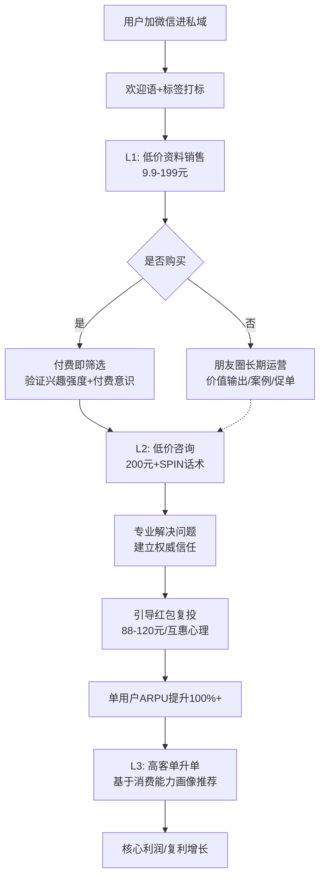
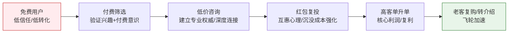
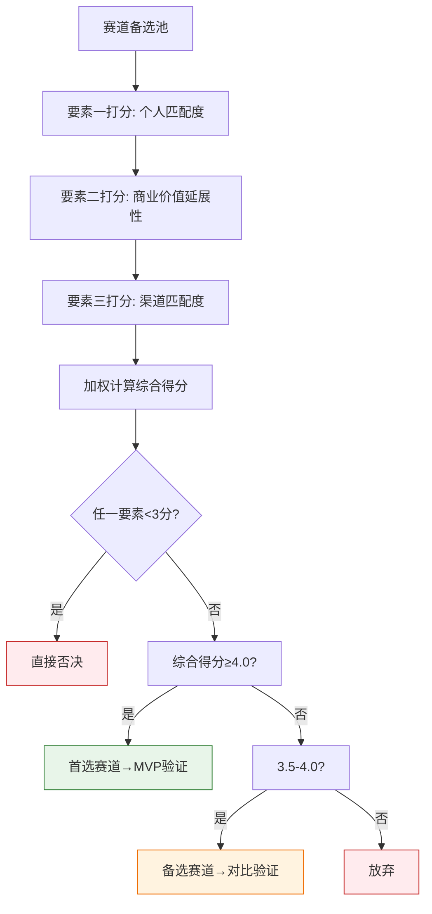
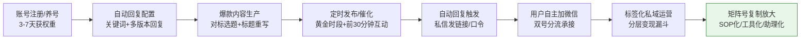

# 第 77 章 资料整理商业模型 —— 从“卖资料赚小钱”到“筛选用户造大钱”

## 学习目标

- 理解资料整理的杠杆属性与商业定位：资料是零边际成本的获客钩子，核心利润来自自有高附加值产品/服务体系
- 掌握"引流载体与变现主体分离原则"：引流资料可标准化/他人化/低成本；变现产品必须自有化/高价值/解决深层问题
- 熟练运用'最小可行性商业闭环(MVP)'方法论：以最快速度跑通'选品-引流-私域-分层变现'全链路，用数据决定是否加大投入
- 建立'选品三要素决策法'判断力：个人兴趣/擅长/长期规划一致性、用户群体商业价值可延展性、渠道流量分发机制匹配度缺一不可
- 掌握'头条号自动回复引流法'与'私域双号风控体系'：实现无人值守、低风控、规模化的私域获客基建
- 内化'付费即筛选，信任源于交换'的私域成交心法：用低价咨询建立专业信任，通过红包复投模型强化互惠，推动高客单转化
- 构建'变现分层漏斗'体系：低价资料筛选付费意向→低价咨询深度连接挖掘需求→高客单产品/体系课承接核心利润与复利
- 建立'输入-重构-输出'能力建设循环：资料整理非单纯搬运，而是整理输入(学习/筛选)→重构输出(沉淀方法论/开发课程/服务)的正向飞轮

## 77.1 生活类比

想象资料整理商业模型是一场精心设计的“品鉴会”：整理垂直资料如同免费提供的精致试吃小样，低成本、标准化、可批量复制，目的是筛选真正对这类口味感兴趣、愿意为正餐买单的食客；私域微信/社群是专属品鉴室，只有试吃满意、愿意付费入场的食客才能进入，完成“付费即筛选”；低价咨询/资料是前菜/开胃菜，低决策门槛、快速建立信任，让食客体验大厨手艺，触发“互惠心理”（红包复投）；高客单训练营/咨询/资源对接是主厨推荐的招牌主菜/定制套餐，高客单、高复利、需深度信任，才是餐厅真正的利润中心；输入-重构-输出是大厨不断钻研新食谱、优化供应链、推出新菜单的过程，资料整理只是展示厨艺的载体，核心竞争力在于“自有秘制菜谱（产品/服务体系）”的持续迭代。就像餐厅不能靠“免费试吃”盈利，而要靠“招牌菜”留住食客；创业者也不能靠“卖资料”致富，而要靠“自有产品体系”造大钱。

## 77.2 概念地图

资料整理商业模型
├── 核心范式
│   ├── 资料整理杠杆模型          —— P002,P001
│   ├── 踏脚石理论                  —— P001
│   ├── 引流载体与变现主体分离原则  —— P001, P002
│   └── 输入-重构-输出能力建设循环  —— P001, P002
├── 落地方法论
│   ├── 最小可行性商业闭环(MVP)    —— P001, P002
│   ├── 选品三要素决策法            —— P002, P004
│   ├── 头条号自动回复引流法        —— P002, P005
│   ├── 私域双号风控体系            —— P002, P005
│   └── 垂直赛道产品匹配法          —— P001
├── 私域成交体系
│   ├── 付费即筛选，信任源于交换  —— P002, P003
│   ├── 变现分层漏斗                —— P002, P003
│   ├── 咨询式成交标准化话术        —— P002, P003
│   └── 红包复投模型                —— P002, P003
└── 实证数据与边界
    ├── 4天实测：日均引流180+、资料转化60%、咨询转化30%、ARPU>200  —— P002
    ├── 免费引流用户质量低于付费用户  —— P002
    ├── 头条号引流效率验证            —— P002, P005
    └── 咨询服务作为高客单前置信任建立器  —— P002

## 77.3 资料整理商业模型 —— 从“卖资料赚小钱”到“筛选用户造大钱”

### 77.3.1 为什么需要这个概念？

你可能已经发现了一个残酷的现实：单纯倒卖资料、做“资料搬运工”，虽然边际成本为零，但天花板极低，极易陷入价格战的红海。普通人缺乏自有产品，靠搬运资料无法建立核心竞争力和复利护城河。我们需要一种低成本获客、高客单变现、可长期复利的商业闭环范式。

### 77.3.2 核心定义与推导

> "实操，资料整理日均引私域 180+用户"
> 
> "资料是别人的，产品必须是自己的"
> 
> ——《P001 三恒实操复盘》（素材 ID：P001）

这两句话揭示了本章的核心范式：**资料整理杠杆模型**。

**资料整理杠杆模型**定义：利用复制边际成本近零的资料作为“钩子”，筛选精准付费用户沉淀私域，核心利润来自自有的高附加值产品/服务体系（咨询、训练营、资源对接）。

这个模型包含三个核心子原则：

#### 1. 踏脚石理论

> "卖资料只不过是你获取客源的踏脚石（除非是你自己的产品和资料）"
> "赚卖资料的小钱已经是顺便的事儿了"
> 
> ——《P001 三恒实操复盘》（素材 ID：P001）

这个理论将资料定位为**流量入口工具**，而非最终变现对象。资料的作用是降低用户决策成本，为后端高价值自有产品导流。你把别人的资料整理成高质量的“试吃小样”，目的是筛选出愿意为“正餐”买单的食客。

#### 2. 引流载体与变现主体分离原则

> "既然你再获取客户，那就一定要打磨自己的产品，资料是别人的，产品必须是自己的，如果没有，那就去打磨，但是不能不做！"
> "因为只有做到这一步，我觉得资料整理的价值才算真正的发挥出来，赚卖资料的小钱已经是顺便的事儿了。"
> 
> ——《P002 三恒深度复盘》（素材 ID：P002）

这是最底层的逻辑：**引流端可标准化/他人化/低成本；变现端必须自有化/高价值/解决深层问题**。混淆二者会导致陷入“无脑卖资料”的低利润红海竞争。

我们可以用一个公式来形式化这个原则：

$$
\text{商业价值} = \underbrace{\text{引流资料（他人/低成本/标准化）}}_{\text{获客钩子，边际成本} \to 0} \times \underbrace{\text{自有产品体系（自有/高价值/深度服务）}}_{\text{利润本体，决定LTV上限}}
$$

**公式解释**：这个公式展示了资料放大流量池、自有产品放大单客价值、两者相乘实现指数级增长的核心作用。资料作为引流载体，生产一次可无限复制分发，边际成本趋近于零，这是“代码与媒体”杠杆的体现（《纳瓦尔宝典》）；但资料本身没有稀缺性，易被复制、贬值，单靠卖资料只能赚“辛苦钱”，天花板极低。只有自有产品体系（咨询、训练营、资源对接）具备稀缺性、不可复制性、高溢价能力，才能决定单用户LTV上限。两者相乘：资料负责把“流量池”放大，自有产品负责把“单客价值”放大，商业价值才能指数级增长。

#### 3. 输入-重构-输出能力建设循环

> "要整理输入，也要重构输出，甚至通过资料整理培养自己某一方面的能力，打造自己的商业盈利系统！"
> 
> ——《P001 三恒实操复盘》（素材 ID：P001）

资料整理不是单纯的搬运，而是一个**能力建设过程**：

$$
\begin{aligned}
\text{输入（整理/学习/筛选他人资料)} &\xrightarrow{\text{深度加工}} \text{重构（沉淀方法论/开发课程/服务）} \\
&\xrightarrow{\text{交付/迭代}} \text{输出（自有产品体系/商业盈利系统）}
\end{aligned}
$$

**公式解释**：这个循环展示了：每一次整理资料，都是在强迫自己“吃透”某个垂直领域的知识结构，进而沉淀为自己的方法论、课程、咨询框架。输入阶段：筛选、阅读、分类他人资料，本质是快速学习该领域知识图谱；重构阶段：将碎片化资料内化为结构化方法论、标准化交付流程、可复制的服务框架（如SOP、模板、课程大纲）；输出阶段：以自有产品形式交付用户，收集反馈再次迭代输入。资料是过程，能力和产品才是结果。这个正向飞轮让“整理资料”从低价值劳动力转化为高价值能力积累，构建个人护城河。

#### 4. 变现分层漏斗

> "单纯的卖资料...这是最无脑的一种做法！"
> "资料+咨询...基本上对一个咨询客户也会有两个收入...后期你会有更大的这种产品去承接！"
> 
> ——《P002 三恒深度复盘》（素材 ID：P002）

基于上述原则，标准化的变现路径设计为三层递进漏斗：

| 漏斗层级 | 产品形态 | 核心作用 | 典型客单价 | 转化目标 |
|----------|----------|----------|------------|----------|
| **L1 筛选层** | 低价资料（9.9-199元） | 筛选付费意向、建立初步信任、获取种子用户 | 低 | 付费转化率 > 30% |
| **L2 信任层** | 低价咨询（199-499元） | 深度连接、挖掘真实需求、建立专业权威、触发互惠红包 | 中 | 咨询转化率 > 20%，红包复投率 > 90% |
| **L3 利润层** | 高客单产品/体系课/资源对接（2999-99999元+） | 核心利润来源、复利增长、高LTV | 高 | 老客复购/升单率 > 15% |

这个漏斗展示了：前端资料只负责“筛选”，中端咨询负责“信任与挖掘”，后端高客单产品负责“利润与复利”。

### 77.3.3 关键性质总结

基于以上推导，我们提炼出资料整理商业模型的五大关键性质：

1. **资料是“踏脚石/诱饵”，产品才是“本体/利润源”** —— 不要爱上钩子，要爱上鱼（自有产品）。
2. **付费即筛选**：用户哪怕支付 9.9 元，即验证兴趣强度与付费意识双重指标，是最高质量的种子用户。
3. **商业信任仅通过价值交换（交易）建立** —— 信任不是聊天聊出来的，而是通过“交付价值-收取对价”的交易循环建立。
4. **输入-重构-输出循环**：整理资料不是搬运，而是“整理输入（学习/筛选）→ 重构输出（沉淀方法论/开发课程/服务）”的能力建设过程。
5. **变现天花板由后端服务深度决定** —— 前端引流速度定下限，后端咨询/训练营/资源对接等深度服务能力定 LTV 与复利上限。

这五大性质共同构成了从认知重构到商业执行的完整闭环：前两条重塑“赚钱认知”，中间两条指导“执行路径”，最后一条锚定“增长上限”。

### 77.3.4 典型例子

以下表格展示了四大经典赛道的“钩子-本体”组合模式及其核心逻辑差异：

| 资料赛道（钩子） | 目标用户群体 | 后端自有产品（本体） | 核心逻辑 |
|------------------|--------------|----------------------|----------|
| **高中资料** | 焦虑父母 / 高三生 | 高考志愿填报咨询（单价千元级） | 资料解决“信息获取”，咨询解决“重大决策” |
| **英语资料** | 成人考证 / 亲子启蒙群体 | 英语训练营 / 陪伴营（标准化交付、强复利） | 资料解决“素材”，训练营解决“坚持与体系” |
| **阅读资料** | 成长型知识付费用户 | 读书营 / 社群（高粘性、可规模化） | 资料解决“书单”，社群解决“执行与讨论” |
| **商业资料/天涯神贴** | 创业者 / 管理者 | 商业咨询 / 高客单课程 / 资源对接（高溢价、强信任） | 资料解决“认知”，咨询解决“落地与决策” |

**作者三恒实测数据（4天 MVP 验证）：**
- 日均投入：2 小时
- 日均引流：180+ 精准用户进私域
- 资料付费转化率：~60%（200 加微信 / 100 付费）
- 咨询二次转化率：~30%
- 单用户 ARPU：> 200 元

这个数据验证了：只要跑通 MVP，资料整理就是一个极其高效的获客杠杆。

### 77.3.5 数据流图



### 77.3.6 边界条件（避坑指南）

在实操中，必须警惕以下四个边界陷阱：

1. **免费送网盘链接（网盘拉新模式）** 会导致用户低估资料价值、无法判断付费意向，用户粘性极低，不适合构建高客单业务。
   > "如果你直接免费的把网盘链接分享给他的时候，这个时候他对这份资料的商业价值是低估的...而这种粉丝你也没办法判断他到底是不是你的潜在用户" ——《P002 三恒深度复盘》（素材 ID：P002）

2. **无自有后端产品/服务能力支撑时**，单纯卖资料仅能赚“辛苦钱”，难以跨越变现天花板。

3. **私域运营规模化需配套风控基建**：至少双微信号分流加好友、支付宝/多渠道分离收款，规避频控与资金冻结。
   > "你一定要提前准备好，至少两个微信号...避免被加好友频繁导致用户加不进来...避免收款频繁导致钱到不了账" ——《P002 三恒深度复盘》（素材 ID：P002）

4. **选品必须满足“三要素”**（详见 77.6 节）：个人兴趣/擅长/长期规划一致性；用户群体商业价值可延展性；渠道流量分发机制匹配度。

### 77.3.7 方法演进图



---

## 77.4 最小可行性商业闭环（MVP） —— 以最快速度跑通“选品-引流-私域-分层变现”全链路

### 77.4.1 为什么需要这个概念？

创业初期资源有限，盲目追求完美系统导致迟迟无法上线验证需求真伪。我们需要一个标准化的“最小动作集合”，用最低成本在最短时间内验证商业模型可行性，避免在未跑通闭环前过度投入供应链、团队、技术开发等重资产。

### 77.4.2 核心定义

**最小可行性商业闭环（MVP）**：从选品定位、渠道操作、私域承接到变现分层的完整最小链路。目标：以最快速度跑通并验证投入产出比（ROI），为后续规模化放大奠定数据基础。

核心指标：引流量、转化率、客单价、用户生命周期价值（LTV）。

### 77.4.3 关键性质

- **低成本试错**：作者案例中仅投入域名/服务器/工具约 8 元，或日均 2 小时人力成本。
- **快速反馈**：4-7 天内即可获得真实市场数据（如日均引流 180+、付费转化 60%）。
- **决策依据**：数据跑通则加大投入（如加大力度投高利润产品），跑不通则止损换赛道。
- **流程标准化**：跑通后即沉淀为 SOP（账号搭建、素材来源、话术脚本、引流私域、交付流程、避坑指南），便于复制放大。

### 77.4.4 典型例子

**案例一：视频定制项目（曹超峰，P003）**
- 成本：8 元（域名/工具）
- 周期：1 个月
- 结果：营收 2 万+
- 验证：陌生赛道可行性、生财思维迁移性、执行力杠杆

**案例二：资料整理项目（三恒，P001/P002）**
- 投入：日均 2 小时 × 4 天
- 渠道：头条号自动回复引流
- 结果：私域引流 700+（日均 180+）、资料付费转化 60%、咨询转化 30%、单用户 ARPU 200+
- 验证：MVP 全链路跑通、头条号引流效率、变现分层漏斗有效性

**案例三：ChatGPT 账号注册/Plus 代充航海（生财社群）**
- 参与者：新手小白
- 周期：1-3 个月
- 结果：月入 3k-2w+
- 验证：低门槛航海有效性、社群杠杆加速论

### 77.4.5 MVP 执行标准动作清单（可直接复用）

该清单将 MVP 验证拆解为四个标准化阶段，每阶段动作可直接复用，使新手能在 7 天内完成从 0 到 1 的闭环验证：

```
阶段 0：赛道锁定（1天）
├── 用“选品三要素决策法”锁定 1 个垂直资料赛道
├── 确定 L1 资料钩子（3-5个具体资料包）
├── 设计 L2 咨询服务内容与价格
└── 勾勒 L3 高客单产品雏形

阶段 1：渠道搭建（1天）
├── 注册/养号：头条号（主渠道）+ 小红书/👸号（备选矩阵）
├── 配置头条号关键词自动回复（关键词：“资料/打包/领取/666”）
├── 准备网盘分享链接（设置提取码/有效期）
└── 准备微信号/企微（至少 2 个分流）+ 支付宝/微信分离收款码

阶段 2：内容生产与分发（持续，日均 1-2 小时）
├── 挖掘对标爆款选题（同赛道头部账号近期高互动笔记/文章）
├── 伪原创/重组生产：标题重写 + 正文结构化 + 植入关键词钩子
├── 发布节奏：每日 1-3 篇，黄金时间段（早 9/中 12/晚 19-21）
└── 爆款催化：前 30 分钟人工互动（点赞/评论/转发）

阶段 3：私域承接与转化（实时）
├── 自动回复触发 → 用户加微信 → 欢迎语 + 标签打标（来源/意向/资料包）
├── L1 资料销售：发送网盘链接 + 引导好评/转介绍
├── L2 咨询转化：SPIN 简化版四步法（诊断→痛点→预算→方案→收单）
├── 红包复投引导：问题解决后“麻烦包个红包支持下，金额随意 88-120”
└── L3 升单推荐：基于消费能力画像，推荐高客单产品/训练营

阶段 4：数据复盘与决策（第 7 天/第 30 天）
├── 核心指标看板：引流量 / 资料付费转化率 / 咨询转化率 / ARPU / LTV
├── 达标标准（参考）：日均引流 ≥ 50 / 资料转化 ≥ 30% / 咨询转化 ≥ 20% / ARPU ≥ 150
├── 决策：达标 → 加大投入/矩阵化/招助理；不达标 → 换赛道/换钩子/换渠道/止损
```

### 77.4.6 边界条件

- **MVP 不等于简陋**：核心体验（交付质量、回复速度、支付顺畅）必须达标，否则得到的是“假阴性”数据。
- **验证周期不宜过长**：建议设定“至少跑一个月”止损线，克服频繁切项目死循环。
- **区分验证阶段（求真）与规模化阶段（求稳）**：前者容忍人工/半自动，后者必须全流程 SOP 化/工具化。
- **单一渠道验证通过不代表全渠道可行**：规模化前需测试多渠道匹配度（如头条号引流快但天花板低，需配合小红书/👸号矩阵）。

### 77.4.7 方法演进图



---

## 77.5 私域成交心法与标准化话术体系 —— 付费即筛选，信任源于交换

### 77.5.1 为什么需要这个概念？

绝大多数私域运营停留在“加好友/发朋友圈”层面，缺乏标准化的“从陌生到成交”销售动作。免费用户质量低、无法判断付费意向，导致后端高客单产品无人承接。我们需要一套可复制、可培训、可量化的私域转化 SOP，将销售从“靠天赋”变为“靠流程”。

### 77.5.2 核心定义

#### 1. 付费筛选双重验证

> "当用户在你这儿产生消费，产生知识付费之后，你们之间已经建立了一种潜意识的信任！"
> "第二，他有付费意识，包括但不限于 9.9、1999、3999...第三，一个渴望通过付费投资自己...就是你最大的用户资源！"
> 
> ——《P002 三恒深度复盘》（素材 ID：P002）

用户付费（哪怕 9.9 元）即完成两重筛选：
- **兴趣强度验证**：对该垂直领域有强烈需求
- **付费意识验证**：具备知识付费习惯，认可“为价值买单”

免费用户无法判断付费潜力，且易低估资料商业价值。

#### 2. 商业信任仅通过价值交换建立

> "如果你直接免费的把网盘链接分享给他的时候，这个时候他对这份资料的商业价值是低估的...而这种粉丝你也没办法判断他到底是不是你的潜在用户、到底是不是你的付费用户"
> 
> ——《P002 三恒深度复盘》（素材 ID：P002）

信任不是聊天聊出来的，而是通过“交付价值-收取对价”的交易循环建立。低价咨询（如 200 元）是低风险的信任启动器，而非单纯赚取咨询费。

#### 3. 咨询式成交标准化话术（SOP）

> "基本上呢对一个咨询客户也会有两个收入，一个是你的前期咨询费用，一个就是在你解决完他的问题之后，99%的人都会再给你发一个小红包表示感谢！"
> "基本上商业咨询费用我都是简单的收个 200，结束后目前最低的都会给我包个 88——120 的红包"
> "主要的是拿点小钱，了解大部分用户的真实需求、建立信任和提供服务，深度连接之后，后期你会有更大的这种产品去承接！"
> 
> ——《P002 三恒深度复盘》（素材 ID：P002）

标准化流程：

```
步骤 1：收取低价咨询费（如 200 元）→ 建立专业门槛与信任锚点
步骤 2：专业解决问题（SPIN 简化版四步法：诊断现状→揭示痛点→提供方案→展示案例→限时锚定）
步骤 3：引导用户自发发红包（88-120 元，互惠心理/沉没成本）→ 单用户即时 ARPU 提升 100%+
步骤 4：基于消费能力画像推荐高客单产品 → 咨询转化率 30% 进入高客单
```

#### 4. 红包复投模型

利用**互惠心理**与**沉没成本效应**，将单次咨询转化为双重收入（咨询费 + 红包），并为高客单转化铺路。实测 99% 用户问题解决后自发发红包，单用户即时 ARPU 提升超 100%。

### 77.5.3 关键性质

- **低价咨询是“信任启动器”而非单纯赚咨询费**：核心目的是建立专业权威与深度连接。
- **拒绝“免费送资料/免费咨询”模式**：免费用户低估价值、无付费筛选、粘性极低。
- **私域双号风控**：主号/副号分流加好友 + 支付宝/微信分离收款，解决频控与风控双重瓶颈。

### 77.5.4 典型例子

**三恒咨询式成交实录：**
- 咨询费：200 元
- 红包复投率：99%（金额 88-120 元）
- 高客单转化率：30%
- 单客 LTV：远超单纯卖资料

**SPIN 简化版四步聊单话术（可直接套用）：**
```
1. 开场建立专业感："您好，我是专注[垂直领域]的[人设标签]，帮过[X]位同类用户解决[核心问题]。"
2. 询问场景挖掘痛点："方便说说您目前的具体情况吗？比如[关键指标/痛点场景]..."
3. 询问预算锚定价格："您预想投入多少预算来解决这个问题？"
4. 现场比价/方案→收单："对比市面上[同类服务/课程]，我的方案是[差异化优势]，费用[价格]，现在下单送[赠品/权益]，要不要安排？"
5. 引导红包/升单："问题解决啦，麻烦包个红包支持下（88-120），后面有更系统的[高客单产品]适合您，要不先了解一下？"
```

### 77.5.5 数据流图

下图展示了从用户进私域到分层转化的完整数据流向，包含主流程与长期运营兜底路径：



### 77.5.6 边界条件

- **咨询服务必须具备真实解决问题的专业能力**，否则无法触发互惠红包与信任建立，反而引发投诉。
- **仅适合高客单价（>500 元）或高复购业务**：低客单（如 30 元定制视频）人工咨询成本过高，不划算。
- **规模化需助理接待标准化 SOP**：统一回复话术、统一引导流程、统一异常处理，否则创始人成瓶颈。
- **红包金额（88-120 元）为实测心理舒适区**：过高引起抗拒，过低失去仪式感，需根据客单价动态调整。

### 77.5.7 方法演进图



---

## 77.6 选品三要素决策法 —— 兴趣、商业价值、渠道匹配的铁三角

### 77.6.1 为什么需要这个概念？

赛道选择是创业成败的“战略定生死”决策，选错赛道战术再勤奋也是徒劳。新手易陷入“只看热度不看匹配”“只看兴趣不看变现”“只看变现不看渠道”的单一维度误区。我们需要一个可操作、可判断、可复用的决策框架，规避主观臆断。

### 77.6.2 核心定义

> "考虑三个要素：第 1 个，是不是你喜欢、擅长且未来要做的事儿当中的一部分...第 2 个，这个资料所带来的价值，以及是否可以演变出更多的商业价值...第 3 个，通过你选择的“资料整理”，哪些新媒体渠道可以发挥的作用最大"
> 
> ——《P002 三恒深度复盘》（素材 ID：P002）

选品决策的**铁三角模型**：

| 要素 | 核心判断标准 | 权重 | 评分维度（1-5 分） |
|------|--------------|------|-------------------|
| **要素一：个人喜好/擅长/长期规划一致性** | 只有热爱和擅长能支撑长期主义执行；资料整理本身就是输入-重构-输出的能力建设过程 | 35% | 1=完全无关/厌恶，3=可接受/一般，5=深度热爱/专业优势/长期规划核心 |
| **要素二：用户群体商业价值可延展性** | 能否开发出高客单、高复购、强复利的后端产品/服务，决定变现天花板 | 40% | 1=纯消费/无付费习惯，3=中等客单/单次购买，5=高客单/高复购/强资源延展 |
| **要素三：渠道流量分发机制匹配度** | 同样的资料在头条号靠自动回复引流快，在小红书靠 SEO 长尾复利，渠道特性决定打法 | 25% | 1=渠道完全不匹配，3=勉强可用，5=渠道机制完美契合（如头条号自动回复+资料类） |

**决策公式：**
$$
\text{赛道得分} = 0.35 \times \text{个人匹配度} + 0.40 \times \text{商业价值延展性} + 0.25 \times \text{渠道匹配度}
$$

**公式解释**：该公式将主观判断量化为加权评分，规避单一维度误区，任一要素<3 分即否决的硬性约束保证了决策的鲁棒性。个人匹配度（35%）：决定执行力的可持续性。资料整理需要长期输入，无兴趣/擅长支撑极易放弃。这是“劳动力杠杆”的质量基础。商业价值延展性（40%）：决定变现上限。用户群体若无高客单/高复购潜力，前端引流再多也无法转化为利润。这是“产品杠杆”的质量基础。渠道匹配度（25%）：决定获客速度与成本。同一资料在不同渠道分发效率天差地别，选对渠道事半功倍。这是“媒体杠杆”的效率基础。三者缺一不可：无兴趣→坚持不下去；无商业价值→赚不到钱；无渠道匹配→引流太慢/太贵。

**决策规则：** 三要素缺一不可，任一要素 < 3 分直接否决；综合得分 ≥ 4.0 为首选赛道，3.5-4.0 为备选，< 3.5 直接放弃。

### 77.6.3 典型例子：三大经典赛道对标分析

| 赛道 | 个人匹配度（35%） | 商业价值延展性（40%） | 渠道匹配度（25%） | 综合得分 | 结论 |
|------|-------------------|------------------------|-------------------|----------|------|
| **高中资料** | 5（教育背景/长期深耕规划） | 5（焦虑父母/志愿填报千元级单价） | 4（头条号/小红书教育分发高效） | **4.75** | ⭐ 首选 |
| **英语资料** | 4（有学习经验/持续输入） | 5（成人考证/亲子启蒙强付费） | 4（训练营模式成熟/渠道多元） | **4.35** | ⭐ 备选 |
| **天涯神贴/商业资料** | 5（本身商业实操者） | 5（创业者/管理者高客单高复购） | 3（👸号/知识星球长文分发精准但慢） | **4.35** | ⭐ 备选 |

### 77.6.4 边界条件

- **切勿因“热度高”强行切入不擅长赛道**（如医美/整形资料），专业壁垒导致交付翻车、信用破产。
- **切勿因“自己喜欢”切入商业价值低赛道**（如冷门诗词鉴赏），无法支撑后端高客单产品，陷入流量变现死循环。
- **切勿忽视渠道规则变化**（如头条号收紧自动回复、小红书打击引流），需建立多渠道备选机制。
- **个人禀赋随时间变化**，需每季度复盘三要素匹配度，必要时果断转型（如作者从资料整理转型商业咨询/训练营）。

### 77.6.5 方法演进图



---

## 77.7 头条号自动回复引流法 —— 无人值守、低风控、规模化的私域获客引擎

### 77.7.1 为什么需要这个概念？

公域平台普遍严控外链/联系方式，人工引流效率低、封号风险高、难以规模化。新手缺乏内容生产能力，难以通过“内容钩子”持续获取精准流量。我们需要一种低技术门槛、可自动化、合规安全的引流基建工具。

### 77.7.2 核心定义

> "头条号...提前在后台把这个关键词自动回复设置好...私信会自动把微信号发给他，他加你的微信之后，安排一个助理去回复...总的来说头条号就是引流比较快，可以尽快的试出这个效果！"
> 
> ——《P002 三恒深度复盘》（素材 ID：P002）

**头条号自动回复引流法**定义：利用头条号后台“关键词自动回复”功能：
1. 发布垂直领域爆款贴
2. 预设关键词触发
3. 私信自动发送微信号/网盘链接/口令
4. 用户自主添加
5. 助理/自动化工具承接

核心优势：**无人值守（发帖后自动跑）、引流快（爆文效应即时转化）、封号风险低（平台原生功能、非硬广）、人力成本低（仅需助理接待）**。

### 77.7.3 关键性质

- **内容为饵，自动回复为钩**：内容质量决定爆文概率（曝光上限），自动回复配置决定转化率（承接效率）。
- **爆文复用性**：一篇爆款贴可持续带来长尾引流，配合定时发布/矩阵号分发，实现“一次生产、多次收割”。
- **合规边界**：严禁直接发微信号（易封），需用谐音/图片/口令/网盘链接等变体；敏感词需提前测试白名单。

### 77.7.4 实操配置 SOP（可直接复制）

该 SOP 将头条号自动回复引流从账号准备到私域承接全链路标准化，关键词与回复内容的多版本轮换机制有效规避平台风控，双号分流与支付分离设计解决了规模化瓶颈：

```
步骤 1：账号准备（第 1-3 天）
├── 注册头条号（实名认证/绑定手机/完善资料/垂直领域标签）
├── 养号：每日发布 1-2 篇垂直内容，正常互动，3-7 天后获推荐流量
└── 准备备用账号（矩阵化铺垫）

步骤 2：自动回复配置（核心）
├── 进入头条号后台 → 互动管理 → 私信自动回复 → 关键词回复
├── 设置触发关键词（建议 3-5 组，覆盖用户高频意向表达）：
│   ├── "资料" / "打包" / "合集" / "整理" / "发我"
│   ├── "领取" / "要" / "给我" / "发一下" / "分享"
│   ├── "666" / "888" / "想要" / "需要" / "怎么领"
│   └── 资料包专属词："行测" / "申论" / "面试" / "词汇" / "语法" 等
├── 设置回复内容（多版本轮换，规避重复判定）：
│   ├── 版本 A："资料已整理好，网盘链接：[链接] 提取码：[码] ，加微信 [谐音/口令] 进群领最新版"
│   ├── 版本 B："亲，资料包发您邮箱/网盘了，备用联系方式：[图片二维码/谐音微信号]，回复'666'拉您进资料群"
│   └── 版本 C："整理不易，点个赞支持下，资料在这里：[网盘链接]，加我微信 [口令] 送你配套[思维导图/模板/工具]"
└── 测试：小号私信触发关键词，验证回复正常、链接可打开、微信可加

步骤 3：内容生产与爆款制造（持续）
├── 选题：对标同赛道头部账号近 30 天点赞/阅读/转发 Top 20 爆款
├── 标题重写：套用爆款标题结构（如"后悔没早知道""避坑指南""保姆级教程""内部资料"）
├── 正文结构：痛点开头 → 核心干货（分点/图表/案例） → 植入关键词钩子 → 引导互动
├── 发布时间：早 9:00 / 中 12:00 / 晚 19:30（头条号用户活跃高峰）
└── 爆款催化：发布后 30 分钟内，小号/助理点赞/评论/转发，制造初始热度

步骤 4：私域承接（实时/助理）
├── 双号分流：微信 A / 微信 B 轮流承接，单号日加好友 ≤ 40 人
├── 欢迎语预设："欢迎领取[资料包名称]，我是[人设]，资料在网盘[链接]，进群[群二维码]可获每日更新"
├── 标签体系：来源(头条号/文章标题) + 意向(资料/咨询/课程) + 阶段(新客/付费/咨询/成交)
└── 支付分离：资料款→微信 A，咨询费/课程款→微信 B/支付宝，规避风控
```

### 77.7.5 典型例子

以下是三恒 4 天 MVP 实测的核心数据看板，验证了该引流法的高效性与变现漏斗的可行性：

- 发文周期：4 月 28 日 11:00 - 5 月 2 日 22:00（4 天多）
- 日均投入：2 小时
- 发文数：多篇
- 引流总量：700+ 精准用户
- 日均引流：180+
- 资料付费转化：~60%
- 咨询转化：~30%
- 单用户 ARPU：> 200 元

**对比验证：** 同期小红书/👸号引流需人工回复/群聊中转，效率远低于头条号自动回复。

### 77.7.6 数据流图

```mermaid
graph TD
    A[头条号发布垂直爆款贴] --> B[用户阅读产生兴趣]
    B --> C[用户私信触发关键词<br/>"资料/打包/666/领取"]
    C --> D[后台自动回复<br/>网盘链接+微信口令]
    D --> E[用户加微信/进群]
    E --> F[双号分流承接<br/>欢迎语+标签打标]
    F --> G[L1 资料销售<br/>9.9-199元]
    G --> H[L2 咨询转化<br/>200元+红包复投]
    H --> I[L3 高客单升单<br/>训练营/咨询/资源对接]
    G -.->|未购买| J[朋友圈长期运营<br/>人设/案例/价值/促单]
    H -.->|未升单| J
```

### 77.7.7 边界条件

- **平台规则收紧风险**：头条号随时可能限制自动回复功能/关键词/链接跳转，不可作为唯一长期依赖渠道。
- **仅适合“资料/资源/工具”类强刚需、低决策成本产品**：高客单/高决策周期产品仍需人工深度沟通。
- **账号权重影响分发**：新号需养号（发布垂直内容、正常互动）3-7 天才有推荐流量，不可注册即营销。
- **助理接待上限**：单人日均接待上限约 50-80 人，超量需部署自动化欢迎语/标签分组/常见问题库，否则体验下降转化跌。

### 77.7.8 方法演进图



---

## 77.8 多源对照：资料整理商业模型的不同视角

本章核心概念有三篇核心素材支撑，形成互补验证：

### 共识

| 核心主张 | P001 三恒实操 | P002 三恒深度复盘 | P003 曹超峰逆向工程 |
|----------|---------------|-------------------|---------------------|
| **资料是钩子，产品是本体** | ✅ "资料是别人的，产品必须是自己的" | ✅ "单纯卖资料是最无脑的做法" | ✅ 隐含于 MVP 验证逻辑 |
| **MVP 最小闭环验证** | ✅ 4 天跑通全链路 | ✅ "以最快速度跑通最小 MVP" | ✅ 8 元成本验证陌生赛道 |
| **私域分层变现** | ✅ 资料→咨询→高客单 | ✅ 变现分层漏斗三层设计 | ✅ 隐含于月入 2 万+结果 |
| **执行力优先** | ✅ 日均 2 小时实操 | ✅ "解决真正的问题，赚钱的事多做十遍" | ✅ "执行力是知识变现关键杠杆" |

### 分歧

| 维度 | P001 侧重 (origin) | P002 侧重 (improve) | P003 侧重 (apply) |
|------|-------------------|-------------------|---------------------|
| **核心视角** | 实操数据复盘、具体数字验证 | 理论模型提炼、方法论体系化 | 陌生赛道发现、逆向工程流程 |
| **引流渠道** | 头条号自动回复（主） | 头条号自动回复 + 多渠道矩阵建议 | 未明确（侧重项目发现而非引流） |
| **选品方法** | 经验直觉 + 垂直匹配 | 选品三要素决策法（铁三角模型） | 场观数据异常值发现法 |
| **风控视角** | 双号分流 + 支付分离 | 双号分流 + 支付分离 + 助理 SOP | 未展开 |
| **适用阶段** | 0-1 冷启动 MVP | 1-N 规模化标准化 | 0-1 陌生赛道探索 |

**综合结论：** 三篇素材形成了“理论-实操-探索”的完整拼图：P002 提供了系统性的理论框架（杠杆模型、分离原则、三要素决策、分层漏斗、成交心法），P001 提供了该框架在具体赛道（资料整理）上的硬核实测数据验证，P003 证明了该思维模型可迁移至陌生赛道的通用性。**核心共识是：资料整理不是生意，而是获客手段；生意在后端自有产品体系。**

---

## 77.9 设计中的取舍

### 为什么不用“免费送资料拉新”模式？

**背景**：网盘拉新模式盛行，看似获客快。
**冲突**：免费模式看似获客快实则转化差，免费用户对资料商业价值严重低估，且无法判断其付费潜力。
**决策理由**：付费筛选完成双重验证（兴趣强度+付费意识），筛选出最高质量的种子用户。
**实证支撑**：作者三恒实测：免费用户质量远低于付费用户，且资料付费转化率达 60%（P002）。

### 为什么不用“单纯卖资料”模式？

**背景**：资料搬运工入局门槛极低，市场迅速红海化。
**冲突**：前端卖资料赚快钱与后端建立复利体系的长期目标矛盾。
**决策理由**：引流载体与变现主体必须分离，资料作为踏脚石服务于自有产品体系。
**实证支撑**：作者观察到单纯卖资料者长期停留在月入几千元天花板，而接入自有咨询/课程者单客 LTV 提升数十倍（P001, P002）。

### 为什么选择头条号而非小红书/👸号作为冷启动主渠道？

**背景**：新手缺乏内容生产能力且公域平台普遍严控引流。
**冲突**：引流效率与封号风险的博弈。
**决策理由**：头条号原生自动回复功能合规且高效，实现无人值守、低风控、引流快。
**实证支撑**：作者 4 天实测日均引流 180+，同期小红书/👸号效率远低于此（P002）。

### 为什么咨询费定在 200 元而非 99 元或 499 元？

**背景**：咨询定价直接影响信任建立效率与升单转化。
**冲突**：定价过低显廉价、定价过高阻碍首单。
**决策理由**：200 元处于“决策门槛低但足以建立专业权威”的心理舒适区：99 元易被视为廉价/低质，499 元决策周期长、转化率低。
**实证支撑**：实测 99% 用户自发发 88-120 元红包，咨询转化率 30%，单用户 ARPU 提升 100%+（P002）。

### 为什么必须双号分流 + 支付分离？

**背景**：私域流量规模化带来微信频控与收款风控双重瓶颈。
**冲突**：引流速度与账号安全的矛盾。
**决策理由**：物理隔离风险最彻底，双号分流解决频控，支付宝/微信分离收款解决风控，是规模化私域运营的生存底线。
**实证支撑**：作者强调“至少两个微信号”并实测解决加不进来、钱到不了账的双重问题（P002）。

---

## 77.10 动手练习

### 练习 1：设计你的“资料整理”MVP最小闭环

假设你擅长“公考备考”，拟通过整理资料引流至私域变现：

1. **选品**：列出 3 个可作为“免费钩子”的垂直资料包（如：行测高频易错题合集、申论范文模板库、面试热点预测），并说明选择依据
2. **渠道**：对比头条号自动回复、小红书评论区引流、👸号菜单栏引流三种方式的优劣，选定主渠道并配置自动回复关键词/话术
3. **私域承接**：设计双号分流加好友规则、欢迎语、标签分组体系、支付分离方案
4. **变现分层**：设计资料付费价格(如 9.9/19.9)、咨询服务内容与价格(如 1 对 1 规划 200 元)、高客单产品雏形(如全程班 2999 元/陪伴营 999 元)
5. **验证指标**：设定 7 天 MVP 验证的核心指标阈值（引流量≥多少、资料付费转化率≥多少%、咨询转化率≥多少%、单用户 ARPU≥多少），未达标如何止损/调整？

### 练习 2：拆解一个“付费即筛选”的私域成交实战复盘

回顾你最近一次在私域付费购买虚拟服务/课程的经历（或观察身边案例）：

1. 你是先免费领资料，还是直接付费？付费金额多少？决策耗时多久？
2. 卖家是否提供了低价咨询/体验课作为“信任启动器”？你是否因此产生了“互惠心理”（如好评/转发/追单）？
3. 卖家如何利用“红包复投/沉没成本”引导你升单高客单产品？话术关键节点是什么？
4. 如果卖家一开始就免费送完整资料/课程，你对价值的感知会如何变化？是否还会购买高客单后端？
5. 基于此，为你的项目设计一套“咨询式成交 SOP”：开场建立专业感→挖掘痛点→锚定预算→现场比价/方案→收单→引导红包/升单，每步的话术关键词是什么？

### 练习 3：选品三要素决策法实战演练：赛道筛选会议纪要

你有 3 个备选资料赛道：A. 幼儿英语启蒙资料  B. 程序员面试算法题解析  C. 养生食谱/中医养生资料

假设你的个人禀赋：5 年互联网大厂产品经理经验，擅长结构化思维与文档写作，长期想做“知识型 IP/咨询服务”，现有渠道资源：👸号 1000 粉、小红书新号、头条号新号

请产出一份“赛道筛选决策纪要”：

1. 逐项打分（1-5 分）：个人兴趣/擅长/规划一致性 | 用户群体商业价值可延展性(能否开发高客单后端) | 渠道分发匹配度(现有渠道能否高效触达) | 综合得分
2. 针对得分最高赛道，设计“资料钩子→咨询服务→高客单产品”的变现分层漏斗原型
3. 识别该赛道最大的“边界风险”（如：平台规则收紧、专业壁垒导致交付翻车、用户付费意愿不足等）及应对预案
4. 如果 MVP 跑通(日均引流 50+、资料转化 30%、咨询转化 20%)，规模化阶段需要补充哪些 SOP/工具/人力基建？

---

## 77.11 本章小结

这一章中我们学习了资料整理商业模型的完整体系：从核心范式到落地方法论，再到私域成交心法与风控基建。首先，我们确立了**资料整理杠杆模型**——资料是零边际成本的获客钩子，核心利润必须来自自有高附加值产品/服务体系；其次，我们掌握了**引流载体与变现主体分离原则**——引流端可标准化/他人化/低成本，变现端必须自有化/高价值/解决深层问题；接着，我们熟练运用了**最小可行性商业闭环(MVP)**方法论——以最低成本最快速度跑通全链路，用数据说话；然后，我们建立了**选品三要素决策法**——个人兴趣/擅长/规划一致性、用户商业价值可延展性、渠道分发匹配度的铁三角模型；之后，我们掌握了**头条号自动回复引流法**与**私域双号风控体系**——实现无人值守、低风控、规模化的私域获客基建；紧接着，我们内化了**付费即筛选，信任源于交换**的私域成交心法——用低价咨询建立专业信任，通过红包复投模型强化互惠，推动高客单转化；接着，我们构建了**变现分层漏斗**体系——低价资料筛选付费意向→低价咨询深度连接挖掘需求→高客单产品/体系课承接核心利润与复利；最后，我们建立了**输入-重构-输出**能力建设循环——资料整理非单纯搬运，而是整理输入(学习/筛选)→重构输出(沉淀方法论/开发课程/服务)的正向飞轮。

本章我们一起学习了以下概念：

| 概念 | 解释 |
|------|------|
| 资料整理杠杆模型 | 利用复制边际成本近零的资料作为获客钩子，核心利润来自自有高附加值产品/服务体系 |
| 踏脚石理论 | 资料是别人的（钩子/踏脚石），产品必须是自己的（本体/利润源），混淆二者陷入低利润红海 |
| 引流载体与变现主体分离原则 | 引流端可标准化/他人化/低成本；变现端必须自有化/高价值/解决深层问题 |
| 最小可行性商业闭环(MVP) | 以最低成本(如8元/日均2小时)最快速度跑通选品-引流-私域-分层变现全链路，用数据说话 |
| 选品三要素决策法 | 兴趣/擅长/规划一致性 × 用户商业价值可延展性 × 渠道分发匹配度 = 铁三角决策模型 |
| 头条号自动回复引流法 | 利用平台原生关键词自动回复功能，实现爆文自动发微信/网盘链接，无人值守、低风控、规模化 |
| 私域双号风控体系 | 至少两个微信号分流加好友 + 支付宝/微信分离收款，规避频控与资金冻结双重瓶颈 |
| 付费即筛选，信任源于交换 | 用户付费(哪怕9.9)完成兴趣强度+付费意识双重验证；商业信任仅通过价值交换(交易)建立 |
| 变现分层漏斗 | 低价资料(筛选意向) → 低价咨询(建立信任/挖掘需求/红包复投) → 高客单产品/体系课(核心利润/复利上限) |
| 咨询式成交话术/红包复投模型 | 200元咨询费建立专业权威 → 99%用户自发发88-120元红包(互惠心理) → 30%转化高客单，单用户ARPU提升100%+ |
| 输入-重构-输出能力建设循环 | 资料整理=整理输入(学习/筛选)→重构输出(沉淀方法论/开发课程/服务)，训练核心能力构建护城河 |
| 变现天花板由后端服务深度决定 | 前端引流速度定下限，后端咨询/训练营/资源对接等深度服务能力定LTV与复利上限 |

下一章中，我们将学习**知识创作系统**——从“囤资料”到“生产知识资产”，基于 DIKW 模型与 P.A.R.A 组织法，构建“收集筛选→萃取内化→动态组织→创作输出”的个人知识生产线，解决“收藏夹吃灰”与“搬运工”困境，实现知识复利。


