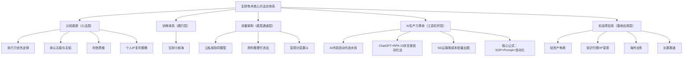
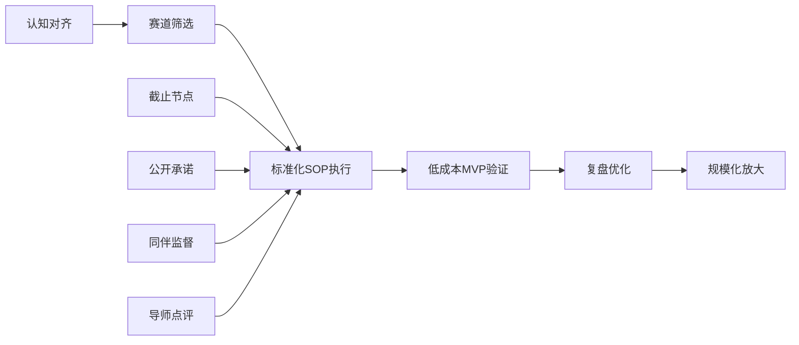
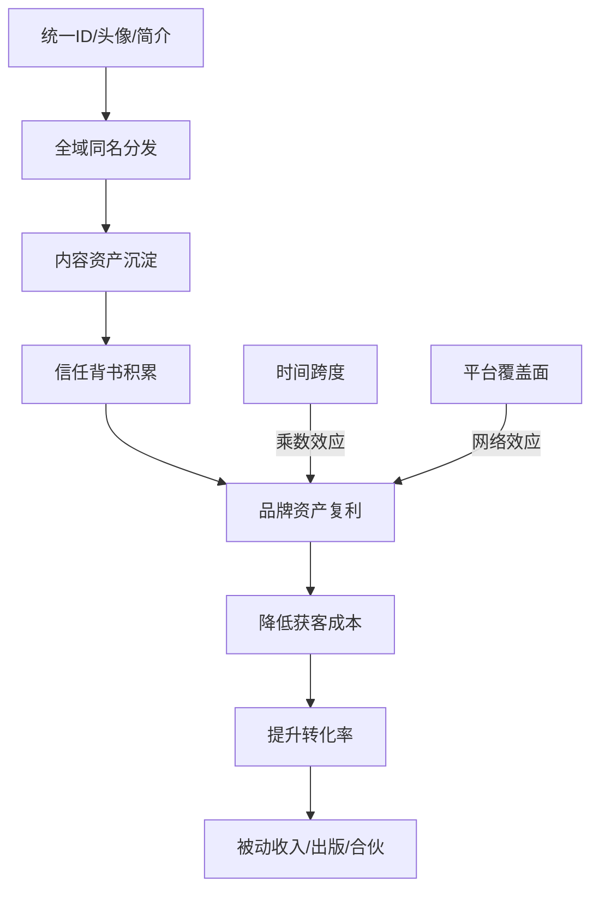
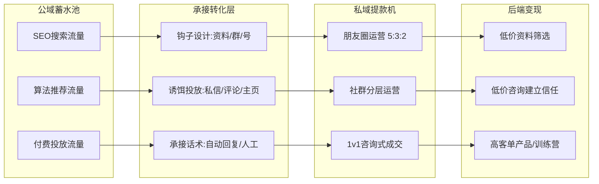
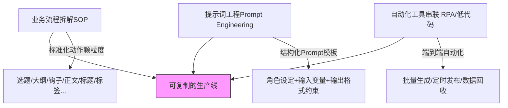
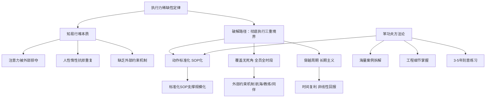
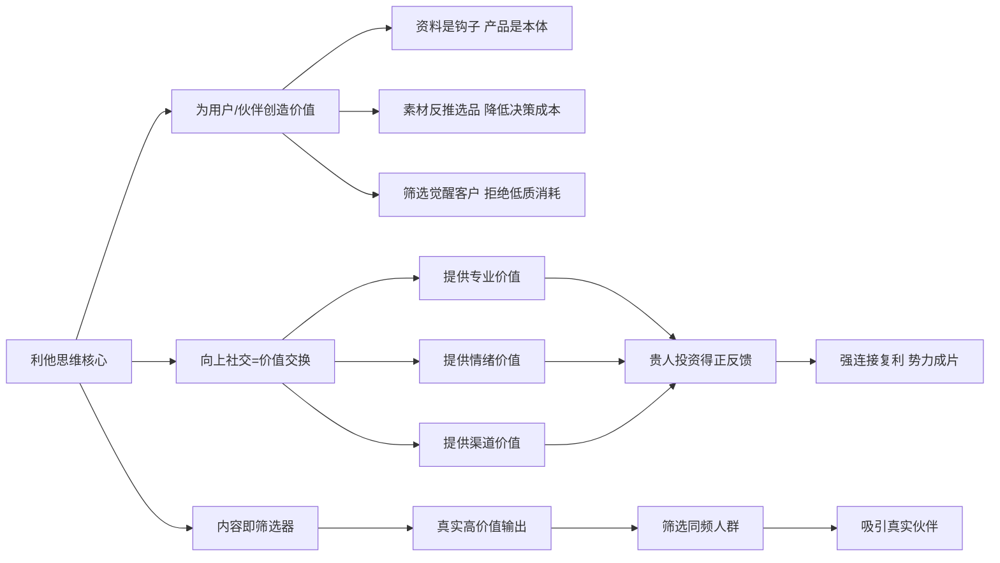
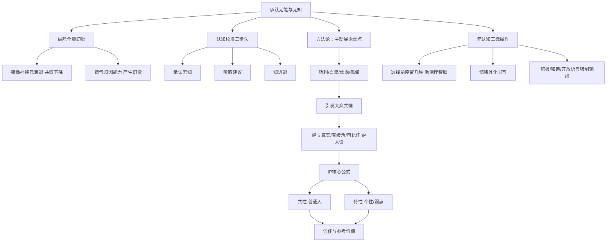

# 第 80 章 生财有术核心方法论体系 —— 从认知重构到商业闭环的完整路径图谱
作者：龙哥

## 学习目标

- 理解生财有术社群‘小航海’项目制训练营的底层逻辑与执行闭环
- 掌握个人IP‘百年不改名、全域用同名’的品牌资产复利构建法
- 建立‘公域蓄水池、私域提款机’的全平台流量变现底层架构认知
- 拆解AI内容自动化流水线的三要素：业务SOP拆解、提示词工程、自动化工具串联
- 内化‘执行力>创意’、‘承认无能’、‘利他思维’三大认知底座，完成从打工思维到商业思维的跃迁
- 熟练应用‘资料整理引流法’与‘变现分层漏斗’构建零边际成本商业模型
- 能根据个人禀赋，从实战项目库（无货源电商、知识付费、海外B2B、短剧CPS、长尾赛道）中筛选匹配赛道并跑通MVP
- 掌握‘付费即筛选’与‘商业信任=价值交换’的私域成交心法
- 理解‘输入-重构-输出’能力循环在资料整理中的核心作用

## 80.1 生活类比

想象生财有术的完整体系是一座‘普通人逆袭的加油站’：你驾驶着人生这辆车驶入站内。认知底座是加油前的车检 —— 不检查引擎（执行力）、不排空后备箱垃圾（承认无能）、不校准导航（利他思维），车再好也跑不远；小航海训练营是陪练教练，给地图（SOP）、定里程碑（截止节点）、坐副驾纠偏（导师点评），强制你跑完全程0-1闭环；个人IP是车牌品牌资产，百年不改名，时间越久牌面越值钱，换个平台（全域同名）照样认得是你；公私域流量是公路与私家车库，公域是公共高速（流量大但不归你、随时限行），私域是自家车库（车停进去就是自己的资产，随时能开）；AI自动化流水线是自动驾驶系统，不懂开车（业务SOP）光买辅助驾驶（AI工具）必翻车，先把路线规划好（拆解流程），再挂自动挡（RPA串联）才能睡后收入；实战项目库是加油站提供的不同标号燃料：无货源电商（92号、易得）、知识付费（95号、高客单）、海外B2B（98号、汇率杠杆），按你的车况（个人禀赋）自选加注。就像长途自驾：必须先修好车（认知）、跟教练跑几圈（航海）、挂好牌（IP）、规划公私路线（流量）、装上自动驾驶（AI）、选对油（项目），才能稳稳抵达财务自由终点。

## 80.2 概念地图



生财有术核心方法论体系
├── 认知底座（心法层）
│   ├── 执行力优先定律：赚钱的事多做十遍、解决真正的问题  —— P001, P005
│   ├── 承认无能与无知：成长起点、认知校准三步法  —— P007
│   ├── 利他思维：商业协作底层逻辑、贵人链接价值交换  —— P006
│   └── 个人IP复利策略：百年不改名、全域同名、不出镜也能做IP  —— P002
├── 训练体系（践行层）
│   └── 生财小航海：项目制训练营、六大筛选标准、MVP验证闭环  —— P001
├── 流量架构（底层通道层）
│   ├── 公私域协同模型：公域获客→私域转化→高客单变现  —— P003
│   ├── 资料整理引流法：低成本标准化钩子、日均引流180+  —— P008
│   └── 变现分层漏斗：资料筛选→咨询信任→高客单复利  —— P008
├── AI生产力革命（工具杠杆层）
│   ├── AI内容自动化流水线：文本/图像/视频三位一体  —— P004
│   ├── ChatGPT+RPA 13步文案自动化法  —— P004
│   ├── SD云端零成本批量出图（Colab/ComfyUI）  —— P004
│   └── 核心公式：SOP拆解 + Prompt工程 + 自动化串联  —— P004
└── 实战项目库（落地应用层）
    ├── 轻资产电商：小红书无货源/虚拟资料、视频号投流带货、闲鱼矩阵  —— P005
    ├── 知识付费/IP变现：写作训练营、咨询社群、个人IP信任背书  —— P006
    ├── 海外业务：独立站B2B冷启动、Mediabuy品牌词套利、跨境私域  —— P006
    └── 长尾赛道：二奢、手机壳、短剧CPS、快团团、Web3 Mint  —— P006

## 80.3 生财小航海 —— 普通人0到1的标准化训练营

### 为什么需要这个概念？

普通人知道很多道理却过不好这一生，核心缺口在于执行力而非认知。独自摸索易陷入“知易行难”死循环，需要外部强制约束机制打破惯性。商业闭环跑通需要结构化指导，而非碎片化建议。

### 核心定义

> "经营一家企业，除了大方向走对了，剩下来的，就是做执行，执行的好，公司就会好，执行不彻底，生意就做不起来。那些做得彻底的公司是值得尊敬的。经营企业的道理其实一点都不复杂，跟减肥一样，难的是，你能不能彻底执行。" 
> 
> ——《小马宋：执行力进化论》（docs/202305/20230516_003.md）

**生财小航海**是社群发起的项目制训练营模式，设定明确目标、时间节点与导师陪跑，强制成员在规定周期内跑通0-1商业闭环，解决“知道却做不到”的执行鸿沟。其核心机制包含四大外部约束：**截止节点、公开承诺、同伴监督、导师点评**。[来源：`docs/202305/SUMMARY.md` (origin), `docs/202305/20230516_014.md` (improve)]

### 关键性质

筛选标准六维：正向现金流快、无需复杂供应链/囤货、可标准化/SOP化、可借力AI工具提效、有明确的公域获客路径、后端有高复购/高客单产品。验证路径为认知对齐、赛道筛选、标准化SOP执行、低成本MVP验证、复盘优化、规模化放大。典型周期为1-3个月实现月入3k-2w+突破。这些筛选标准来自《生财有术SUMMARY.md》（origin），验证路径与周期则基于`docs/202305/20230516_014.md` (improve) 与案例实测归纳。



### 典型例子

圈友 **CBJhdD0dTokH8tx8HKYc1nJSnnc**（应届生）两周变现7000元完整复盘（加群、买号、调教、分销、写教程、办训练营、建星球、账号分销全时间线）[来源：`docs/202305/CBJhdD0dTokH8tx8HKYc1nJSnnc.md` (apply)]。

圈友 **Gn5NdifvBorUbdxvGl6ceQgXnpg** 从2020年入群“小透明”到2021年启动行动，一年内通过航海跑通闲鱼SEO霸屏实现年入200万 [来源：`docs/202305/Gn5NdifvBorUbdxvGl6ceQgXnpg.md` (improve)]。

圈友 **DGw1dYHSsohHu7x1AXhc4cQVnEN** 8块钱成本一个月小赚2万+，跑通视频定制冷门项目 [来源：`docs/202305/DGw1dYHSsohHu7x1AXhc4cQVnEN.md` (apply)]。

### 边界条件

仅适用于愿接受外部强制约束、能执行标准化SOP的新手。项目必须符合六大筛选标准，否则极易中途夭折。导师陪跑质量直接决定跑通率，伪导师会误人子弟。**不解决1-N规模化运营问题，需另行建立增长模型与组织架构。** [来源：`docs/202305/20230516_014.md` (improve), `docs/202305/Gn5NdifvBorUbdxvGl6ceQgXnpg.md` (improve)]

---

## 80.4 个人IP复利策略 —— 百年不改名，全域用同名

### 为什么需要这个概念？

普通人缺乏信任背书，获客成本高、转化率低，单次交易无复利。频繁改名、换号、分散运营导致品牌资产归零，无法积累长期资产。认知“出名是赚钱的代价”而非目的，主动选择建立可复利的品牌资产。

### 核心定义

> "简单说核心就一点：全网全域全形式的任何时候都做到只用唯一的名字+从不改名。各平台账号名字，作者名字，制作者名字，微信群内名字，各种分享的署名，出书的作者名，等等，全部都一样。" 
> 
> ——《粥左罗：价值千万的个人IP策略》（docs/202305/20230516_057.md）

**个人IP复利策略**要求在所有公域平台（抖音、小红书、微信、B站等）使用统一ID、头像、简介，降低用户认知成本，积累品牌复利，形成“名字=信任背书”的资产护城河。**不出镜也能打造IP**：资料号、工具号、笔记号、虚拟形象均可承载品牌。[来源：`docs/202305/SUMMARY.md` (origin), `docs/202305/20230516_057.md` (origin)]

### 关键性质

网络效应：时间×唯一名字=指数级影响力网络（粥左罗12年3000+篇内容验证）[来源：`docs/202305/20230516_057.md`]。信任迁移：统一IP降低陌生人决策成本，实现“认准名字直接下单”。资产化：将经验沉淀为课程、咨询、社群、文档等边际成本为零的数字产品矩阵。



### 典型例子

**粥左罗**：12年全网同名，3000+篇内容织就影响力网络，出版邀约主动上门 [来源：`docs/202305/20230516_057.md`]。

**漫漫**：半年涨粉20万年变现40万，主动暴露弱点建立真实人设，忠于自我吸引高价值合伙人 [来源：`docs/202305/WX87d3F4SoVZLHxDNGzcDDVRn6R.md` (improve)]。

**不讲李**：不出镜PPT拆解IP，10个月7位数变现，统一封面风格将主页转粉率从个位数提升至10%+ [来源：`docs/202305/GUHld91qQobms8x35tbcOUlSnZb.md` (apply)]。

### 边界条件

必须经得起时间考验，短期投机者无法享受复利红利。内容质量与人设一致性是前提，人设崩塌品牌资产瞬间归零。“出名是代价”认知门槛高，财务自由前主动追名逐利易反噬 [来源：`docs/202305/20230516_005.md` (critique)]。

---

## 80.5 公私域协同模型 —— 公域蓄水池，私域提款机

### 为什么需要这个概念？

公域流量归平台、不确定、易被算法收割，单纯靠公域变现天花板极低。私域流量归自己、可反复触达、高信任，是高客单价、高复购的核心阵地。无私域公域流量归零，无公域私域无水源，二者必须形成闭环。

### 核心定义

> "资料整理日均引私域 180+ 用户，最重要的是提供附加产品-解决问题的方案" 
> 
> ——《三恒：资料整理商业模型》（docs/202305/20230516_046.md）

**公私域协同模型**标准化流程：公域内容获客(SEO/算法推荐) → 私域信任转化(朋友圈/社群/1v1) → 后端高客单产品变现。核心动作四件套：**钩子设计(资料/群/号)、诱饵投放、承接话术、后端分层产品**。资料整理作为低成本标准化钩子：日均引私域180+用户，零边际成本。[来源：`docs/202305/SUMMARY.md` (origin), `docs/202305/20230516_015.md` (origin), `docs/202305/E0aFdosjUobxU7xEQeCc7y8snyb.md` (improve)]

### 关键性质

引流即销售：将引流环节标准化为销售流程（建立信任→挖掘痛点→展示方案→处理顾虑→行动号召→交付服务），7天实测咨询300+ → 加微81人(27%) → 成交41人(50.6%) [来源：`docs/202305/E0aFdosjUobxU7xEQeCc7y8snyb.md`]。朋友圈运营黄金比例：专业展示/生活真实/营销转化 = 5:3:2，打造专业真实有温度人设 [来源：`docs/202305/20230516_085.md`]。话术标准化SOP：咨询式成交五步法（诊断现状-揭示痛点-提供方案-展示案例-限时锚定），解决信任/价值/紧迫三大异议 [来源：`docs/202305/20230516_085.md`]。



### 典型例子

**资料整理引流**：日均180+精准用户进私域，后端匹配高考咨询/英语训练营/读书营等高客单服务，单用户ARPU超200元 [来源：`docs/202305/BzIfdvAQloqLImxjEhKcERAXn5f.md` (apply)]。

**小红书探店/无货源/虚拟资料**：前端笔记种草/SEO截流，中端私域话术转化，后端复购/高客单产品变现 [来源：`docs/202305/RhRywNqifi3wjGkc4MacUiwXnxc.md` (apply)]。

**视频号带货**：公域短视频/直播引流，私域企微/社群承接，规格图+官方背书话术促单农村中老年群体 [来源：`docs/202305/I8BLdIIfbobzkYxCLGBctYqbnae.md` (apply)]。

### 边界条件

平台风控红线不可触碰：小红书私信/评论区引流需用表情包/分享笔记/互关拉群组合拳规避 [来源：`docs/202305/RhRywNqifi3wjGkc4MacUiwXnxc.md`]。私域运营需投入真心与精力，纯工具化/自动化易导致僵尸粉、低转化。后端产品必须解决真问题，否则私域信任透支后无法挽回。

---

## 80.6 AI内容自动化流水线 —— 从会用工具到建流水线

### 为什么需要这个概念？

单纯会用ChatGPT/MJ/SD不赚钱，AI只是放大器而非救世主。业务未标准化前引入AI只会放大混乱，核心竞争力在于流程拆解与自动化串联。AI降低了“从0到1”技能门槛，但提高了“从1到N”标准化要求。

### 核心定义

> "从 0 开始借助 ChatGPT 变现 7k 入生财经历分享... AI是放大器而非救世主，核心竞争力在于‘提示词工程+业务流程拆解+自动化串联’" 
> 
> ——《生财有术SUMMARY.md》（docs/202305/SUMMARY.md）

**AI内容自动化流水线**结合ChatGPT（文本生成）、Midjourney/SD（图像生成）、RPA/自动化工具（剪映、Coze、Make/Zapier），构建从选题、生产、发布到数据反馈的全自动化内容生产系统。核心公式：**业务流程拆解SOP + 提示词工程Prompt Engineering + 自动化工具串联 = 可复制的生产线**。[来源：`docs/202305/SUMMARY.md` (origin), `docs/202305/20230516_070.md` (origin), `docs/202305/20230516_075.md` (improve)]

### 核心公式推导



**公式推导过程**：
1. **业务流程拆解SOP**：将内容生产拆解为最小可执行动作单元（如文案的13个结构化节点），消除“凭感觉创作”的随意性，建立可度量、可复制的标准作业程序。
2. **提示词工程Prompt Engineering**：为每个标准化节点设计结构化Prompt模板（角色设定+输入变量+输出格式约束），将“写Prompt”从玄学变为工程，实现输出质量的稳定可控。
3. **自动化工具串联**：用RPA/低代码平台（Coze、Make、按键精灵等）将上述标准化节点串联成端到端流水线，实现“抓取→生成→发布→回数”的无人值守闭环。
4. **合成公式**：三者缺一不可。无SOP则AI无章法可循；无Prompt工程则输出不可控；无自动化串联则仍停留在人工搬运阶段，无法实现规模化。三者结合 = **可复制的生产线**。

**公式作用**：该公式揭示了AI变现的第一性原理 —— **AI是放大器而非救世主**。它将“会不会用AI工具”这一伪命题，重构为“能不能把业务拆解成SOP、能不能写出扛打的Prompt、能不能把流程自动化串联”三个真实的工程能力维度。唯有跨过这三道关卡，才能从“会用工具”进阶到“建流水线”，构建真正的护城河。

### 关键性质

**ChatGPT+RPA文案自动化13步法**：选题、大纲、钩子、正文、标题、标签等13个结构化节点，配合RPA实现批量生成、定时发布、数据回收无人值守 [来源：`docs/202305/20230516_070.md`]。

**SD云端零成本批量出图**：Google Colab免费GPU部署SD WebUI，配合模型下载脚本、API调用、定时任务，无需本地显卡、无限时长、可编程 [来源：`docs/202305/HYrZdLBMRorB0qxKqFFcQ075nWf.md` (apply)]。

**内容形态覆盖**：短剧解说、表情包、数字人、SEO文章、电商图、IP形象生成等。

### 典型例子

**短剧CPS**：ChatGPT改写剧本+剪映自动剪辑+批量发布，单人日产50-100条，新手首月变现1.4万+ [来源：`docs/202305/20230516_084.md` (apply)]。

**AI表情包**：MJ/SD批量生产+抠图配字+微信表情平台分发+教程钩子引流私域+售课/定制/分销变现 [来源：`docs/202305/20230516_020.md`]。

**👸号法律赛道**：人工筛选爆款标题库+GPT-4.0模板化生成四段式法律文，双账号并行单人日产8篇，日均300元流量主收益 [来源：`docs/202305/20230516_081.md` (apply)]。

### 边界条件

素材质量决定上限：投流只能放大优质素材无法拯救烂素材（视频号带货验证）[来源：`docs/202305/20230516_024.md`]。平台风控升级需持续对抗：去重技术（MD5/关键帧/像素/音频）需迭代，账号环境隔离（一机一号一IP）是生存底线。提示词工程需持续迭代：挑最难案例垫图找缺陷加负面词修饰词回归测试，沉淀“扛打的关键词组” [来源：`docs/202305/20230516_075.md`]。

---

## 80.7 执行力优先定律 —— 赚钱的事多做十遍

### 为什么需要这个概念？

好主意很多，做下去的很少，认知鸿沟只能在行动中通过反馈修正。执行力而非认知是核心稀缺资源：减肥1/200成功率、餐厅SOP落地率<1%跨域数据证明 [来源：`docs/202305/20230516_003.md`]。“知易行难”的人性根源：注意力被他人掠夺（凑热闹、随大流、操他人心三大黑洞）[来源：`docs/202305/20230516_009.md`]。

### 核心定义

> "经营企业其实真的不难，关键是，有些基本动作你能不能做到，做彻底，这就像是减肥。" 
> 
> ——《小马宋：执行力进化论》（docs/202305/20230516_003.md）

**彻底执行三重境界**：动作颗粒度标准化(SOP)、执行覆盖面无死角(全员全时段)、时间维度长期主义(穿越周期)。

**“笨功夫”方法论**：海量案例拆解、工程细节掌握、3-5年长周期刻意练习，拒绝捷径思维。

**执行复利非线性**：个人每日分享获出版邀约、古茗横幅规模化崩塌反面教材 [来源：`docs/202305/20230516_003.md`]。

### 关键性质

注意力守恒与正反馈循环：注意力为稀缺资源，分散操作导致单项目投入低于正反馈阈值，唯有聚焦突破阈值建立增长飞轮 [来源：`docs/202305/20230516_009.md`]。航海机制外部约束：截止节点+公开承诺+同伴监督+导师点评，将模糊意愿转化为确定性行动 [来源：`docs/202305/20230516_014.md`]。标准化SOP是规模化前提：将“发视频、上架、看数据、管店铺、催发货”固化为标准动作，使赚钱的事可重复执行十遍 [来源：`docs/202305/20230516_024.md`]。



### 典型例子

**东哥视频号带货**：从兼职到全职、单号到20+矩阵，累计收益4万+，流程化标准化是收益复利唯一路径 [来源：`docs/202305/20230516_024.md` (apply)]。

**木子田PPT IP**：0基础47天变现16.7万，对标拆解建库+爆款四要素制作+私域钩子设计+朋友圈三段式+咨询式成交，执行力>完美主义 [来源：`docs/202305/20230516_085.md` (apply)]。

**古茗案例**：早期拉横幅/每日分享/早会彻底执行有效，规模化后SOP失效、执行变形导致崩塌 [来源：`docs/202305/20230516_003.md` (origin)]。

### 边界条件

方向错误时执行力越强亏损越大，需先跑通0-1验证方向再All in。执行力需建立在标准化SOP之上，而非盲目蛮干。个人精力有限，必须通过矩阵化/团队化/工具化突破单人物理上限。

---

## 80.8 利他思维 —— 商业协作的底层逻辑

### 为什么需要这个概念？

单向索取式社交/营销必然失败，商业本质是价值交换而非零和博弈。高客单价、高复购业务的基石：优先为用户/合作伙伴创造价值、解决问题。生财圈文化核心基因：真诚是社交最大杀手锏，吃水不忘挖井人形成势力复利。

### 核心定义

> "来生财一年后我终于明白什么是“利他”... 资料整理日均引私域 180+ 用户，最重要的是提供附加产品-解决问题的方案" 
> 
> ——《梁靠谱：来生财一年后我终于明白什么是利他》（docs/202305/20230516_016.md）

**利他思维**是在商业协作中，优先考虑为对方/用户创造价值、解决问题，而非单向索取。**向上社交非单向索取**，而是提供专业/情绪/渠道价值，使贵人投资获得正反馈。**内容即筛选器**：通过真实高价值输出筛选同频人群，真实成长吸引真实伙伴。[来源：`docs/202305/SUMMARY.md` (origin), `docs/202305/20230516_016.md` (origin), `docs/202305/M5lpdRp7OoHZAYxuDiicgGtSnpg.md` (improve)]

### 关键性质

贵人链接价值交换模型：梁靠谱与醒醒、苏姐深度绑定案例验证强连接复利 [来源：`docs/202305/20230516_016.md`]。破圈价值互换：进入高质量圈层本质是价值交换，遵循“了解目标-真诚领情-持续努力-及时反馈-完成目标”受助者协议 [来源：`docs/202305/CBJhdD0dTokH8tx8HKYc1nJSnnc.md` (apply)]。有效提问协议：提问前穷尽自我搜索，单条消息包含完整背景/条件/预期目标，尊重他人注意力资源 [来源：`docs/202305/CBJhdD0dTokH8tx8HKYc1nJSnnc.md` (apply)]。



### 典型例子

**资料整理引流**：资料是别人的踏脚石(钩子)，产品必须是自己的(本体)，通过解决用户深层问题实现高溢价变现 [来源：`docs/202305/BzIfdvAQloqLImxjEhKcERAXn5f.md`]。

**短剧CPS**：素材反推选品法，先找优质传播素材再匹配供应链，素材决定人群人群决定转化，利他降低用户决策成本 [来源：`docs/202305/I8BLdIIfbobzkYxCLGBctYqbnae.md`]。

**知识付费**：选客户比服务客户重要，筛选“正在觉醒/已觉醒”客户稍加助力即成，拒绝“需监督执行”低质客户 [来源：`docs/202305/20230516_041.md` (apply)]。

### 边界条件

利他不等于无原则付出，必须建立在商业模式可持续、边界清晰的前提下。伪利他(表面给予实为索取)极易被识破，反噬信任资产。需具备基础价值生产能力，无价值可给时强行利他不可持续。

---

## 80.9 承认无能与无知 —— 成长的起点

### 为什么需要这个概念？

普通人逆袭最大拦路虎是“面子”和“全能幻觉”：身居高位镜像神经元衰退，运气归因于能力 [来源：`docs/202305/20230516_055.md`]。只有接纳“无能、无知、无资源”现实，才能放下体面从最微小确定动作做起。认知校准三步法：承认无知 → 听取建议 → 知进退，是进阶前提。

### 核心定义

> "承认自己在某些方面无能和无知，才能在经营中听得进去别人的意见和建议，也才能知道有些事你是做不了的，才知道你需要放弃一些你不擅长做的项目和内容。" 
> 
> ——《小马宋：承认自己的无能和无知》（docs/202305/20230516_055.md）

**承认无能与无知**不仅是态度，更是方法：**主动暴露弱点**(功利/自卑/焦虑/孤僻)引发大众共情，建立“真实/有棱角/可信任”IP人设。**IP核心公式 = 共性(普通人) + 特性(个性/弱点) = 信任与参考价值** [来源：`docs/202305/WX87d3F4SoVZLHxDNGzcDDVRn6R.md`]。

**元认知训练三套微操作**：选择前停留几秒激活理智脑、情绪外化书写、积极/和善/开放语言强制输出 [来源：`docs/202305/M5lpdRp7OoHZAYxuDiicgGtSnpg.md`]。

### 关键性质

认知觉醒三层级：主流追名逐利 → 被迫以隐私换钱 → 觉醒者识破代价主动选择清福 [来源：`docs/202305/20230516_005.md`]。退休即再创业：65岁Lily姐多元身份叠加(团长/DJ/民宿/闲鱼/eBay/大航海)，验证银发群体高跨境电商潜力 [来源：`docs/202305/20230516_011.md` (apply)]。内向者创造优势：专注创造吸引连接、利他之心是成功唯一路径，重新定义内向非劣势 [来源：`docs/202305/M5lpdRp7OoHZAYxuDiicgGtSnpg.md`]。



### 典型例子

**漫漫**：对标“不合群女生”爆款后暴露弱点笔记单篇1万赞涨粉2万，涨粉转化率远超正能量内容 [来源：`docs/202305/WX87d3F4SoVZLHxDNGzcDDVRn6R.md`]。

**作者毛韩**：从年负债19万到年入百万，核心跃迁始于承认无能、放下体面跟航海抄作业 [来源：`docs/202305/20230516_014.md` (improve)]。

**老吴/二丫/梦宸**：三条不同起点财富跃迁实录：记账基座、被动收入锚点、三阶段风险测算、保险四件套 [来源：`docs/202305/NsZwdMgSxovqfxxgJqFc5XtXntb.md` (apply)]。

### 边界条件

承认无能不等于自暴自弃，而是基于现实的精准定位与资源配置。需配合“行动力>创意”原则，光承认不行动仍是零。高阶认知“能觉得钱够用”属稀缺品，多数人终生难跨越此认知鸿沟 [来源：`docs/202305/20230516_005.md`]。

---

## 80.10 资料整理商业模型 —— 资料是钩子，产品是本体

### 为什么需要这个概念？

无脑卖资料陷入低利润红海：零边际成本导致价格战，单纯贩卖资料天花板极低。资料本质是零边际成本的杠杆钩子，核心利润来自后端自有高附加值产品/服务体系。混淆引流载体与变现主体是新手核心认知偏差。

### 核心定义

> "资料是别人的踏脚石，产品必须是自己的" 
> 
> ——《三恒：资料整理商业模型》（docs/202305/20230516_046.md）

**引流载体与变现主体分离原则**：资料是别人的(钩子)，产品必须是自己的(本体)。

**变现分层漏斗三层递进**：
1. 低价资料（筛选付费意向/建立信任） —— 价格带：9.9-99元
2. 低价咨询（深度连接/挖掘需求/互惠红包） —— 价格带：199-299元
3. 高客单产品/训练营/资源对接（核心利润/复利上限） —— 价格带：299-2999元

**MVP最小闭环**：选品定位 → 渠道操作 → 私域承接 → 变现分层，数据复盘决定是否加大投入。[来源：`docs/202305/20230516_046.md` (origin), `docs/202305/BzIfdvAQloqLImxjEhKcERAXn5f.md` (origin), `docs/202305/20230516_033.md` (improve)]

### 关键性质

付费即筛选：哪怕9.9元也完成双重验证(强兴趣+付费意识)，免费用户无法判断付费潜力 [来源：`docs/202305/BzIfdvAQloqLImxjEhKcERAXn5f.md`]。商业信任仅通过价值交换建立：低价咨询(200元)是低风险信任启动器，引导用户自发发红包(88-120元)强化互惠 [来源：`docs/202305/BzIfdvAQloqLImxjEhKcERAXn5f.md`]。输入-重构-输出能力循环：整理输入(学习/筛选) → 重构输出(沉淀方法论/开发课程/服务) → 打磨核心竞争力护城河 [来源：`docs/202305/20230516_046.md`]。

```mermaid
flowchart LR
    subgraph 引流载体(钩子)
        A1[他人资料/公开资源]
        A2[整理加工 标准化]
        A3[公域分发 SEO/算法]
    end
    
    subgraph 筛选转化层
        B1[低价资料 9.9-99元]
        B2[付费即筛选 双重验证]
        B3[低价咨询 199-299元]
        B4[红包复投 互惠心理]
    end
    
    subgraph 变现主体(本体)
        C1[高客单产品 299-2999元]
        C2[训练营/陪跑服务]
        C3[资源对接/咨询社群]
        C4[核心利润 复利上限]
    end
    
    subgraph 能力建设
        D1[输入 整理学习筛选]
        D2[重构 沉淀方法论]
        D3[输出 开发课程服务]
        D4[打磨核心竞争力护城河]
    end
    
    A1 --> A2 --> A3
    A3 --> B1 --> B2 --> B3 --> B4
    B4 --> C1 --> C2 --> C3 --> C4
    A2 --> D1 --> D2 --> D3 --> D4
    D4 -.->|反哺| A2
```

### 典型例子

**高中资料 → 高考志愿填报咨询；英语资料 → 英语训练营；阅读资料 → 读书营/社群；商业资料 → 商业咨询/高客单课程/资源对接** [来源：`docs/202305/20230516_046.md`]。

**三恒**：资料整理日均引流180+，配合头条号自动回复/私域双号风控/咨询式成交话术，单用户ARPU超200元 [来源：`docs/202305/BzIfdvAQloqLImxjEhKcERAXn5f.md`]。

**黄岛主/饭饭/静水流深**：虚拟资料选品验证(淘上红/词根三级/三维指标) → 五步私域成交话术 → 分层变现(单品15元→会员49.9元补差价升单) [来源：`docs/202305/20230516_033.md`]。

### 边界条件

版权风险集中于公域电商平台，迁移至微信私域(网盘/群)交付可大幅规避。赛道生命周期必然枯竭：单一虚拟赛道必从蓝海变红海至枯竭，长久生存靠持续挖掘新赛道系统能力。幼师/公开课等大热门赛道同质化严重，新入局者见效显著变差，不建议新手切入 [来源：`docs/202305/20230516_033.md`]。

---

## 80.11 多源对照

### 共识

所有素材一致认为：**执行力是核心稀缺资源**，认知突破必须在行动中通过反馈修正；**个人IP复利**依赖“百年不改名、全域同名”的品牌一致性；**公私域协同**是变现的底层通道，**资料整理**作为零边际成本钩子，**后端高客单产品**决定变现上限；**AI工具**只是放大器，核心竞争力在于**SOP拆解+Prompt工程+自动化串联**；**利他思维**与**承认无能**是成长的认知前提。

### 分歧

**《P001 小马宋》** 认为执行力的核心在于“基础动作标准化”与“彻底执行”，强调简单动作的重复坚持；
**《P009 小马宋》** 则将执行力上升到“注意力守恒”层面，主张通过“笨功夫”（海量拆解+长周期刻意练习）构建专家壁垒；
**《P004 粥左罗》** 强调IP名字资产化的长期复利，主张“能用一辈子就是好名字”；
**《P005 蔡钰/猫叔》** 则认为财务自由后“出名是赚钱的代价”，主动选择隐退，名气转为纯成本项 [来源：`docs/202305/20230516_005.md`]。

---

## 80.12 设计中的取舍

**为什么不用“全能型人设”而是“暴露弱点的真实人设”？**

完美人设不可信，完整人设最动人。暴露功利/自卑/焦虑等弱点引发共情，建立“共性+特性=信任”的IP护城河。漫漫单篇暴露弱点笔记涨粉2万，转化率远超正能量内容。这种设计的trade-off是：短期可能损失部分“专业权威”光环，但长期获得极高粉丝粘性、信任溢价与合伙人级别的深度连接。这是用“脆弱感”换“抗脆弱性”的交易。

**为什么“资料整理”不作为最终产品卖，而作为“钩子”引流？**

资料边际成本为零，单纯卖资料陷入价格战红海；作为钩子筛选付费用户，后端自有高客单产品（咨询/训练营）决定LTV上限。三恒4天实测：资料付费转化60%，咨询二次转化30%，单用户ARPU超200元。

---

## 80.13 动手练习

### 练习1：设计你的‘小航海’首个MVP验证方案

1. 根据‘小航海项目筛选六标准’，从实战项目库中挑选1个最匹配你当下禀赋（资金/时间/技能/认知）的项目
2. 拆解该项目的‘公域获客→私域转化→后端变现’最小闭环关键动作（不超过5步）
3. 设定7天内的MVP验证指标：投入成本≤100元、产出≥1个真实付费订单/≥10个精准私域加微
4. 列出可能导致验证失败的Top 3风险点及对应的止损/调整预案

**回答问题**：
- 为什么要求‘正向现金流快’是新手项目的首要筛选标准？
- 如果MVP验证失败，是换项目还是优化SOP？判断依据是什么？

### 练习2：搭建个人IP‘百年不改名’的跨平台品牌资产包

1. 确定你的统一品牌ID（建议：真名/网名+领域关键词，如‘张三聊副业’），检查抖音/小红书/视频号/👸号/B站/微信是否均可注册/占用
2. 设计统一视觉锤：头像（真人/虚拟形象/Logo）、封面配色方案（主色+辅助色）、简介话术模板（我是谁+帮谁+解决什么问题+信任背书+行动号召）
3. 产出前3篇‘钩子内容’：针对目标用户最痛的问题，输出1篇长文/视频/笔记，同步分发至所有已占平台
4. 建立『内容-引流-转化』周度复盘表：记录各平台发布量/阅读/引流加微/私域成交/客单价

**回答问题**：
- 为什么‘不出镜’（资料号/工具号/笔记号）同样能积累品牌信任资产？
- 当人设与变现产品冲突时（如人设‘佛系’但卖‘高强度训练营’），如何调整？

### 练习3：跑通一条『AI+RPA』内容自动化微流水线

场景：每日从『即刻/小红书/抖音』热榜抓取Top 10话题 → ChatGPT按固定Prompt改写为『小红书爆款笔记/👸号标题/视频口播脚本』 → RPA定时发布至目标账号

1. 选定1个细分赛道（如‘AI工具测评/副业避坑/考公资料’）设计通用的3段式Prompt模板（角色设定+输入变量+输出格式约束）
2. 用Coze/扣子/按键精灵/Auto.js/腾讯RPA任选一工具，搭建『抓取→生成→发布』最简自动化流程（无需完美，跑通即可）
3. 连续运行7天，记录：单日内容产出量、平均阅读/播放、引流私域量、人工干预次数
4. 基于数据迭代Prompt与发布时间，形成v1.0标准化SOP文档

**回答问题**：
- 为什么说『业务未标准化前引入AI只会放大混乱』？请结合你的实操体会说明
- 提示词工程的核心护城河是『模板结构』还是『微调参数』？为什么？

### 练习4：实操『资料整理引流→分层变现』最小闭环

1. 选定1个垂直细分领域（如『Notion模板/公考资料/英语启蒙/小红书运营SOP』），整理1份高质量『引流资料包』（PDF/网盘/工具箱），成本≤2小时
2. 在小红书/抖音/👸号/闲鱼任选1平台，按『封面/标题/正文/评论区/主页』五要素优化发布3-5条引流笔记/视频，钩子指向『私信/评论领取资料』
3. 私域侧准备：『欢迎语自动回复+朋友圈专业/生活/营销5:3:2布局+低价咨询话术(9.9-99元)+高客单产品大纲(299-2999元)』
4. 连续运营14天，每日记录：引流加微数、资料领取率、咨询成交数/额、高客单成交数/额、单用户ARPU

**回答问题**：
- 为什么『资料是别人的（钩子），产品必须是自己的（本体）』？若无自有高客单产品，该模型还能跑通吗？
- 『付费即筛选』在低价咨询环节如何体现？红包复投模型（用户自发发红包88-120元）的心理机制是什么？

### 练习5：复盘一位生财圈友的实战案例，提炼可迁移方法论

从素材中自选1个完整案例（如：CBJhdD0dTokH8tx8HKYc1nJSnnc应届生两周变现7k、DGw1dYHSsohHu7x1AXhc4cQVnEN 8元成本月赚2w、I8BLdIIfbobzkYxCLGBctYqbnae视频号农机三个月20万、VILid7sleoZ6puxkchxcRM9vn6g海外独立站25天成交$4551）

1. 用『认知对齐→赛道筛选→SOP执行→MVP验证→复盘优化→规模化』六阶段模型，还原其完整动作轨迹
2. 标注关键节点的『异常值信号’（如：某条内容爆了、某渠道突然跑通、供应链崩了、账号被封）及其『应对决策』
3. 抽取3个可跨项目复用的『底层动作/认知/工具』，写成『通用SOP卡片』

**回答问题**：
- 该案例中『执行力>创意』体现在哪个具体环节？如果换成完美主义者会发生什么？
- 『利他思维』如何在该案例的『选品/内容/服务/转化』各环节落地？

---

## 80.14 本章小结

这一章中我们系统梳理了生财有术社群沉淀的核心方法论体系，从认知底座、训练体系、流量架构、AI工具杠杆到实战项目库五大层面构建了普通人逆袭的完整路径图谱。首先我们拆解了**生财小航海**作为普通人0-1跨越的标准化训练营，其四大外部约束机制（截止节点、公开承诺、同伴监督、导师点评）与六大项目筛选标准是新手跑通商业闭环的关键；其次深度解析了**个人IP复利策略**“百年不改名、全域同名”的品牌资产构建法，验证了时间×唯一名字的指数级网络效应；接着建立了**公私域协同模型**“公域蓄水池、私域提款机”的底层通道认知，资料整理作为零边际成本钩子日均引流180+，后端分层漏斗（资料筛选→咨询信任→高客单复利）决定变现上限；然后拆解了**AI内容自动化流水线**的核心公式（SOP拆解+Prompt工程+自动化串联），通过ChatGPT+RPA 13步法、SD云端零成本批量出图等实操验证了“AI是放大器而非救世主”的第一性原理；最后内化了**执行力优先定律**、**承认无能与无知**、**利他思维**三大认知底座，完成从打工思维到商业思维的跃迁。

以下是本章核心概念速查表：

| 概念 | 解释 |
|------|------|
| 生财小航海 | 普通人0-1跨越的标准化训练营：截止节点+公开承诺+同伴监督+导师点评，强制跑通商业闭环 |
| 小航海项目筛选六标准 | 正向现金流快、无复杂供应链、可标准化、可借力AI、有公域获客路径、后端高复购/高客单 |
| 个人IP复利策略 | 百年不改名、全域用同名，统一ID/头像/简介积累品牌资产，出名是赚钱的代价也是信任护城河 |
| 公私域协同模型 | 公域蓄水池（获客）→私域提款机（转化），核心动作：钩子设计、诱饵投放、承接话术、后端分层产品 |
| 资料整理引流法 | 零边际成本垂直资料作钩子，公域引流日均180+，核心利润在后端自有高附加值产品/服务 |
| 变现分层漏斗 | 三层递进：低价资料筛选付费意向 → 低价咨询建立信任/互惠 → 高客单产品/训练营核心利润 |
| AI内容自动化流水线 | SOP拆解 + Prompt工程 + RPA/低代码串联 = 可复制生产线，AI是放大器而非救世主 |
| ChatGPT+RPA 13步法 | 将文案拆解为13个结构化提示词节点，配合RPA实现批量生成、定时发布、数据回收无人值守 |
| SD云端零成本批量出图 | Google Colab免费GPU部署SD WebUI，配合脚本/API/定时任务，无需本地显卡实现无限批量出图 |
| 执行力优先定律 | 认知突破在行动中通过反馈修正，彻底执行三重境界：动作标准化、覆盖无死角、穿越周期 |
| 承认无能与无知 | 成长起点：接纳无能/无知/无资源现实，放下体面从微小确定动作做起（抄作业、跟航海、卖资料） |
| 利他思维 | 商业本质是价值交换：优先为用户/伙伴创造价值，真诚是社交最大杀手锏，信任仅通过交易循环建立 |
| 付费即筛选 | 哪怕9.9元也完成双重验证（强兴趣+付费意识），免费用户无法判断付费潜力且易低估商业价值 |
| 商业信任=价值交换 | 信任非聊天聊出，而是通过‘交付价值-收取对价’循环建立；低价咨询是低风险信任启动器 |
| 输入-重构-输出循环 | 整理输入(学习/筛选)→重构输出(沉淀方法论/开发课程/服务)→打磨核心竞争力护城河，资料整理即学习 |
| 实战项目库分层 | 轻资产电商(小红书/视频号/闲鱼)→知识付费/IP变现→海外业务(独立站B2B/Mediabuy)→长尾赛道(二奢/手机壳/短剧CPS) |

下一章中，我们将学习如何将这些核心方法论落地到具体的项目实操中，通过详细的SOP拆解、工具配置、数据复盘模板，帮助你在选定的赛道上跑通第一个MVP商业闭环。


