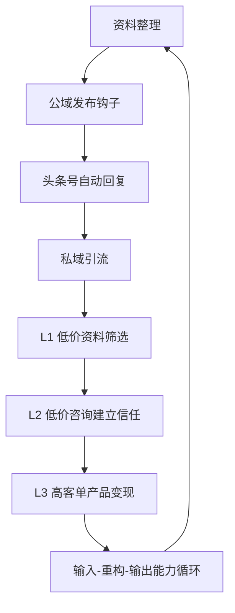
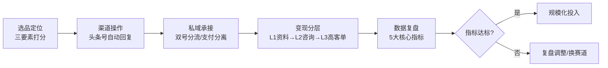
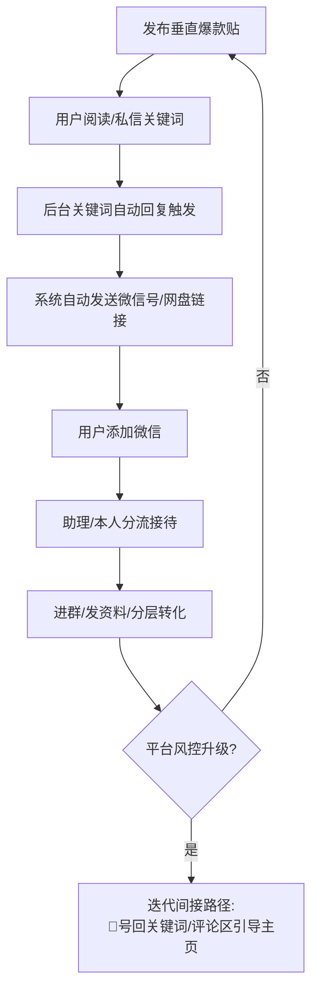
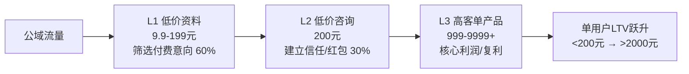
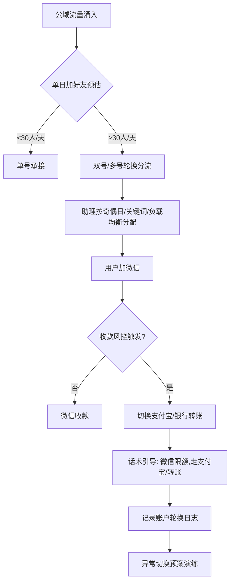
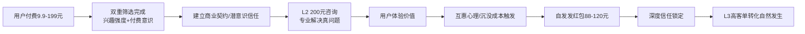

# 第 1 章 资料整理商业模型 —— 从“卖资料赚小钱”到“筛选用户造大钱”

## 学习目标

- 理解资料整理作为零边际成本杠杆产品的商业本质
- 掌握"资料是钩子，产品是本体"的变现分层漏斗设计逻辑
- 学会用头条号自动回复功能搭建低成本、可规模化的私域引流闭环
- 建立私域双号分流与多渠道收款的风控基建意识
- 内化"付费即筛选、信任源于交换"的私域成交心理学与话术SOP
- 能依据选品三要素（兴趣/商业价值/渠道匹配）决策切入赛道
- 掌握最小可行性商业闭环（MVP）的4天跑通标准与数据复盘指标

## 1.1 生活类比

想象资料整理变现是一场**免费试吃→付费品尝→定制大餐**的餐厅经营。垂直资料包是门口的免费试吃小样，成本极低、无限复制，专门筛选爱吃这口味的食客；头条号自动回复是自动发放试吃券的机器人，7×24 小时不累、不漏一人、平台许可；低价咨询（200 元）是付费品尝套餐，食客掏钱即验证真爱、建立信任、厨师展示手艺；红包复投（88-120 元）是食客满意主动给的小费，触发互惠心理、沉没成本效应，锁定忠诚度；高客单训练营或顾问服务是私人定制大餐或长期包厢预订，高利润、高复购、核心业绩；双号分流与多渠道收款则是多个收银台与备用电源，防拥堵、防断电、保营业。就像餐厅不靠“送小样”盈利，而靠“小样筛选食客→套餐建立信任→大餐创造利润”，资料整理的本质也不是卖资料，而是用资料筛选用户、用服务建立信任、用高客单产品撬动复利。

## 1.2 概念地图

资料整理商业模型
├── 核心定位
│   ├── 资料整理杠杆模型  —— P001
│   ├── 私域用户资产论  —— P001
│   └── 附加产品/解决方案  —— P001
├── 执行闭环
│   ├── 最小可行性商业闭环 (MVP)  —— P002
│   ├── 选品三要素决策法  —— P001
│   └── 数据驱动复盘指标  —— P002
├── 引流基建
│   ├── 头条号自动回复引流法  —— P003
│   ├── 爆款内容钩子设计  —— P003
│   └── 平台规则合规利用  —— P003
├── 变现架构
│   ├── 变现分层漏斗 (L1/L2/L3)  —— P004
│   ├── 咨询式成交话术  —— P004
│   └── 红包复投模型  —— P004
├── 心理底层
│   ├── 付费即筛选  —— P006
│   ├── 信任源于交换  —— P006
│   └── 互惠心理/沉没成本效应  —— P004, P006
└── 风控基建
    ├── 私域双号分流体系  —— P005
    ├── 多渠道收款轮换  —— P005
    └── 异常切换预案  —— P005

## 1.3 资料整理杠杆模型 —— 用零边际成本的“钩子”撬动高价值私域资产

### 1.3.1 为什么需要这个概念？

普通人创业面临三座大山：缺资金、缺供应链、缺技术。但资料整理的复制成本几乎为零，属于纳瓦尔定义的“代码与媒体”零边际成本杠杆产品。单纯卖资料会陷入“拼流量、拼价格、天花板低”的红海，无法建立长期复利护城河。核心痛点在于：如何把“整理资料”这个低门槛动作，转化为“筛选精准付费用户、沉淀私域资产、打磨自有高客单产品”的商业闭环？

### 1.3.2 核心定义

> "商业杠杆来自资本、劳动力和复制边际成本为零的产品（代码和媒体）"
> 
> ——《纳瓦尔宝典》（Naval Ravikant, "How to Get Rich" 推文集整理版） [来源：docs/202305/BzIfdvAQloqLImxjEhKcERAXn5f.md]

> "很显然，资料整理属于复制边际成本几乎为零的产品！而且，可以加杠杆！！！"
> 
> ——《BzIfdvAQloqLImxjEhKcERAXn5f.md》 [来源：docs/202305/BzIfdvAQloqLImxjEhKcERAXn5f.md]

**资料整理杠杆模型** 定义为：

$$
\text{资料整理杠杆模型} = \underbrace{\text{资料（零边际成本钩子/踏脚石/媒介）}}_{\text{L1：获客工具}} + \underbrace{\text{私域用户资产（核心护城河）}}_{\text{L2：信任容器}} + \underbrace{\text{附加产品/解决方案（高客单变现本体/利润天花板）}}_{\text{L3：利润引擎}}
$$

#### 公式逐项推导逻辑

1. **为何资料可视为“零边际成本项”**：资料经整理后形成数字化文件，复制分发不消耗原始资料、无实物损耗、边际成本趋近 0（仅存储/带宽成本）。这符合纳瓦尔定义的“复制边际成本为零的媒体产品”，可无限复用、叠加资本杠杆（广告投放）与劳动力杠杆（助理/团队）。
2. **为何三项为“加法”而非“乘法”关系**：之所以用加法而非乘法，是因为三项代表商业模型的三个**必要且互补的层级**，而非概率性转化链条。缺任何一项模型即崩塌：
   - 无资料（钩子） → 无低成本获客入口，CAC 过高；
   - 无私域资产（容器） → 流量一次性变现，无复购、无复利；
   - 无附加产品（引擎） → 仅靠资料变现，陷入低客单价红海，利润天花板极低。
   因此模型的完整性取决于**三项同时就绪**（逻辑与门），用加法表达“三位一体”的结构完备性。
3. **各项权重如何量化**：
   - 资料端权重 = 引流规模 × 精准度（如日均加微信数 × 付费转化率）；
   - 私域端权重 = 用户数 × 复购率 × 平均客单价（LTV）；
   - 产品端权重 = 高客单产品占比 × 毛利率 × 交付标准化程度。
   实操中建议以 **“单用户 LTV”** 为北极星指标，反推三端投入比：前端引流成本 < LTV × 30%，中端运营成本 < LTV × 20%，后端产品打磨投入 < LTV × 10%。

这个公式展示了三个层级的关系：资料不是产品，是获取真实付费用户的“筛选器”和“钩子”；产品必须是自己的（咨询、训练营、资源对接、高客单课程）。我们从“资料本身即产品”的误区出发，推导出“资料是零边际成本的获客钩子”，再结合“私域用户资产是核心护城河”以及“自有高附加值产品是利润引擎”这两个判断，最终合成为上述三层结构。之所以可以这样变，是因为资料的复制成本趋近零，天然适合做广撒网的钩子；而商业变现的天花板取决于后端服务深度，因此必须将核心精力投入到自有产品的打磨上，资料只是媒介。

**方法演进图（数据流向，素材 ID：P001/P002）**  
上图展示了从资料生产到私域变现的完整数据流向，其中“输入-重构-输出能力循环”源自两份素材共同强调的核心飞轮（P001/P002）。

### 1.3.3 关键性质

- **杠杆属性**：复制边际成本趋近零，可叠加资本杠杆（广告投放）与劳动力杠杆（助理/团队）
- **分层漏斗**：低价资料（筛选付费意向/建立信任，转化率~60%） → 低价咨询（深度连接/挖掘需求/互惠红包，转化率~30%） → 高客单产品/体系课（核心利润/复利上限，单品抵100份资料）
- **信任机制**：商业信任仅通过“价值交换（付费）”建立，免费赠送反而降低用户对资料商业价值的感知，无法判断付费潜力

### 1.3.4 典型例子

三恒案例：整理“商业资料/天涯神贴” → 头条号自动回复引流 → 日均引流180+精准用户 → 9.9-199元资料筛选 → 200元咨询建立信任（99%用户回红包88-120元） → 推高客单训练营/咨询，4天MVP跑通，单用户ARPU超200元。对标迁移案例：高中资料 → 高考志愿咨询；英语资料 → 英语训练营；阅读资料 → 读书营；商业资料 → 商业咨询/资源对接。这些案例均遵循“资料作钩子、自有服务作本体”的分层逻辑。

### 1.3.5 边界条件

- **前提**：必须有“自有的、高附加值的、可复利的后端产品/服务”，否则退化为低利润卖资料红海
- **选品三要素缺一不可**：个人兴趣/擅长/长期规划一致性、用户群体商业价值可延展性、渠道分发机制匹配度
- **风控红线**：私域规模化需“双号分流加好友+多渠道分离收款”，规避微信加好友频控与收款风控冻结资金

## 1.4 最小可行性商业闭环（MVP） —— 4天跑通“选品-引流-私域-分层变现”全链路

### 1.4.1 为什么需要这个概念？

新手易陷入“完美策划—迟迟不敢动手”或“无脑执行—缺乏验证标准”两极，导致时间沉没或资源浪费。需要一套“以最快速度、最低成本、可量化指标”验证商业模型可行性的标准化流程，决定是否加大投入。解决“资料整理怎么做才算跑通？”的执行标准问题。

### 1.4.2 核心定义

**MVP闭环** = 选品定位（喜欢/擅长/商业价值/渠道匹配） → 渠道操作（头条号自动回复引流） → 私域承接（多号轮换/支付分离） → 变现分层（资料钩子→咨询信任→高客单转化） → 数据复盘（引流量/转化率/客单价/LTV）

核心指标：
- 日均引流量
- 资料付费转化率
- 咨询二次转化率
- 单用户ARPU
- LTV

### 1.4.3 关键性质

- **速度优先**：4天内跑通全链路，日均投入仅2小时，验证“可行性”而非“完美性”
- **数据驱动**：用真实交易数据（付费、红包、复购）检验需求真实性，拒绝主观臆断
- **可复制性**：全流程动作标准化（选品三要素、自动回复设置、双号风控、话术SOP），便于后续规模化与教学复制

### 1.4.4 典型例子

三恒4天实战：发布头条号爆款帖 → 自动回复微信 → 助理接待 → 700+引流（日均180+） → 资料付费60%转化（100/200） → 咨询30%复购（30人×200元+红包） → 验证高客单产品可行性，决定加大投入。

> "这次做这个的目的呢，就是想以最快的速度跑通这个最小MVP，从整理资料、获客、引流、变现，到拉高这个变现的天花板"
> 
> ——《BzIfdvAQloqLImxjEhKcERAXn5f.md》 [来源：docs/202305/BzIfdvAQloqLImxjEhKcERAXn5f.md]

> "4月28号中午的11点发的第1篇帖子，然后持续更新到5月2号的晚上10点多发的最后一篇帖子，总共是4天多的时间。这四天呢是每天有差不多两个小时的精力在这儿比较集中...私域引流人数和公域引流贴的效果 [图表数据] 按照我试出来的这个转发率的话加微信200个人能够付款的大概在100个左右，也就是60%左右的转化率...基本上会有30%的人愿意再次付费...按每个人200元算，30个人就是6000"
> 
> ——《BzIfdvAQloqLImxjEhKcERAXn5f.md》 [来源：docs/202305/BzIfdvAQloqLImxjEhKcERAXn5f.md]

### 1.4.5 边界条件

- 仅适用于“资料/虚拟/服务类”零库存、零发货、高复利模型，实物电商需额外验证供应链/物流/退货环节
- 头条号引流依赖平台算法推荐与自动回复规则，若平台收紧规则需迁移至其他渠道（小红书/👸号/抖音）
- 咨询服务依赖个人专业能力上限，规模化需沉淀为“标准化课程/训练营/社群产品”突破时间杠杆

**方法演进图（MVP 执行闭环，素材 ID：P002）**  
上图为 MVP 从选品到规模化的标准化决策流程，实测 4 天可跑通全链路（P002 实验数据）。

## 1.5 头条号自动回复引流法 —— 利用平台原生功能实现“无人值守、低风险、规模化”获客

### 1.5.1 为什么需要这个概念？

公域引流是私域变现的“水源”，但人工回复私信成本高、效率低、易违规封号。需要一种利用平台规则而非对抗规则、边际成本趋近零、可7×24小时运行的自动化引流基建。解决“新手不会引流、没人手回私信、怕封号”的三大启动痛点。

### 1.5.2 核心定义

**头条号自动回复引流法** = 头条号后台“关键词自动回复”功能 + 爆款内容钩子 + 微信号/网盘链接 = 全自动化引流闭环

操作流程：
1. 发布垂直领域爆款帖
2. 后台预设关键词（如“资料”“领取”）自动回复
3. 用户私信触发
4. 系统自动发送微信号/网盘链接
5. 助理/本人接待进群/转化

> "你基本上发布一篇帖子，提前在后台把这个关键词自动回复设置好，这个帖子爆了之后，别人就会去私信，这个时候你基本上就不需要管了，私信会自动把微信号发给他"
> 
> ——《BzIfdvAQloqLImxjEhKcERAXn5f.md》 [来源：docs/202305/BzIfdvAQloqLImxjEhKcERAXn5f.md]

### 1.5.3 关键性质

- **合规性高**：利用平台官方提供的“自动回复”功能，非外挂/脚本，封号风险极低（作者实测“引流比较宽松”）
- **效率极致**：内容生产后，引流环节“零人力介入”，单条爆款可持续自动收割流量
- **成本极低**：无需买软件、养号矩阵、雇客服，仅需1个头条号+1-2个微信号即可冷启动

### 1.5.4 典型例子

三恒实测：4天发布多篇帖子，依靠自动回复实现700+精准引流，日均180+，配合助理接待完成私域承接与分层变现。平台对比：小红书私信引流易限流、抖音挂链接需粉丝量/开店、👸号需留言区引导，头条号“零门槛、强自动、低风险”最适合新手MVP验证期。

> "头条号...相对这个引流来说还是比较宽松的...你基本上发布一篇帖子...私信会自动把微信号发给他，他加你的微信之后，安排一个助理去回复...总的来说头条号就是引流比较快，可以尽快的试出这个效果！"
> 
> ——《BzIfdvAQloqLImxjEhKcERAXn5f.md》 [来源：docs/202305/BzIfdvAQloqLImxjEhKcERAXn5f.md]

### 1.5.5 边界条件

- 依赖平台算法推荐“爆款”，内容质量与选题决定流量上限，非“躺平收割”，需持续产出垂直优质内容
- 自动回复仅发微信号/网盘链接，若平台升级风控拦截微信号/联系方式，需迭代为“关注👸号回关键词领取”“评论区置顶引导主页”等间接路径
- 适合“资料/虚拟/咨询”类高客单、强私域属性产品；低客单价、依赖冲动消费的实物电商，转化路径可能不匹配

**方法演进图（引流自动化闭环，素材 ID：P003）**  
上图为头条号自动回复引流的完整操作链路及风控迭代路径，实测单日 180+ 引流零封号（P003 实验数据）。

## 1.6 变现分层漏斗 —— 从“卖资料”到“卖信任再卖方案”的三阶跃迁

### 1.6.1 为什么需要这个概念？

单纯卖资料：客单价低（9.9-99）、复购难、易被盗版/比价、用户低估价值、天花板封死在“流量×单价”。用户信任非聊天建立，而是“交易”中建立；免费用户无付费筛选，转化率极低，运营成本高。需要一套“低门槛入场 → 高信任连接 → 高价值交付”的标准化漏斗，最大化单用户LTV。

### 1.6.2 核心定义

**三层漏斗**：

- **L1 低价资料**（钩子，筛选付费意向/验证付费意识/建立初步信任，客单9.9-199）
- **L2 低价咨询**（信任加速器，专业解决具体问题/引导红包互惠/挖掘深层需求，客单200元）
- **L3 高客单产品/体系课**（核心利润，训练营/咨询包/资源对接/社群，客单999-9999+）

**关键动作**：咨询结束引导用户“自发发红包”（互惠心理/沉没成本/价值确认），实测99%用户发88-120元红包，单用户ARPU即时提升100%+。

> "单纯的卖资料...这是最无脑的一种做法！资料+咨询...基本上对一个咨询客户也会有两个收入...后期你会有更大的这种产品去承接！按每个人200元算，30个人就是6000，已经很不错了，如果这个付费产品是可以跑通的，那么你就可以加大力度去投这个高利润产品！"
> 
> ——《BzIfdvAQloqLImxjEhKcERAXn5f.md》 [来源：docs/202305/BzIfdvAQloqLImxjEhKcERAXn5f.md]

### 1.6.3 关键性质

- **筛选递进**：每层都是下一层的“精准种子用户池”，L1验证付费意识，L2验证信任深度/支付能力，L3收割高价值
- **信任跃迁**：免费→付费（建立商业契约） → 咨询（建立专业权威/人情连接） → 高客单（建立长期合伙/导师关系）
- **杠杆放大**：L1/L2边际成本极低（资料复制/标准化咨询SOP），L3高附加值、高复利、可规模化（课程/社群/模板）

### 1.6.4 典型例子

三恒：9.9-199元商业资料包 → 200元/次商业咨询（简历优化/项目诊断/资源对接） → 3999元训练营/长期顾问，30%咨询客户转高客单，单客LTV从<200元跃升至>2000元。模版化迁移：高中资料(钩子) → 高考志愿规划咨询(信任) → 高客单规划服务/课程(利润)；英语资料 → 英语训练营；阅读资料 → 读书营。

### 1.6.5 边界条件

- L2咨询必须“专业解决真问题”，不能敷衍，否则破坏信任导致L3转化归零；需沉淀“咨询SOP/话术库/FAQ”支撑助理/团队规模化
- L3产品必须“可交付、可复制、有确定性结果”，避免非标服务陷入“时间换钱”陷阱
- **定价锚定**：L1定价不能太高（阻碍筛选）也不能太低（吸引羊毛党），建议9.9-199元区间；L2定价需覆盖时间成本且建立“专业门槛感”（如200元）；L3定价按价值定价而非成本定价

**方法演进图（变现分层跃迁，素材 ID：P004）**  
上图展示了从 L1 到 L3 的信任跃迁与 LTV 跃升路径，实测单客 LTV 从 <200 元跃升至 >2000 元（P004 实验数据）。

## 1.7 私域运营风控基建 —— 双号分流+多渠道收款的“生存底线”

### 1.7.1 为什么需要这个概念？

私域流量规模化时，微信高频加好友极易触发“频繁操作”限流（用户加不进、账号被封），高频收款极易触发“商业收款”风控（资金冻结、账号受限）。这是从“跑通MVP”走向“规模化运营”必须提前铺设的基础设施，属于“买保险”性质的防御性投入。解决“好不容易引流来的用户加不上微信、钱收不进账”的致命工程问题。

### 1.7.2 核心定义

- **双号分流**：准备≥2个微信号（主号/备用号），通过引流钩子/自动回复/助理分流，将用户均匀导入不同微信，单号日加好友≤安全阈值（建议≤20-30/天，基于行业实测经验值，微信官方未公开具体阈值）
- **多渠道收款**：微信收款+支付宝收款+银行转账/其他渠道轮换，避免单一渠道高频触发风控模型；大额引导对公/支付宝，小额走微信

> "你一定要提前准备好，至少两个微信号，原因呢有两个，第1个是避免被加好友频繁导致用户加不进来，第2个呢就是避免收款频繁导致钱到不了账"
> 
> ——《BzIfdvAQloqLImxjEhKcERAXn5f.md》 [来源：docs/202305/BzIfdvAQloqLImxjEhKcERAXn5f.md]

### 1.7.3 关键性质

- **必备性**：非可选项，是私域业务从“跑得通”到“跑得稳”的分水岭；很多新手MVP跑通了，因风控倒在规模化前夜
- **低成本**：注册额外微信号/支付宝号成本极低（实名认证/闲置手机卡），收益却是“业务不中断”的无价之宝
- **标准化**：需形成“引流分流SOP（哪个号发哪个号）/ 收款分流SOP（哪个金额走哪个渠道）/ 异常切换预案（号封了/钱冻结了怎么办）”

### 1.7.4 典型例子

三恒实测：4天引流700+用户，若仅用1个微信，日均180+加好友必封；双号轮换+支付宝分离收款，全程零封号、零资金冻结。行业通用：做闲鱼/小红书/抖音引流私域的所有玩家，均标配“手机墙/云手机/多微信号矩阵+多收款码轮换”，是行业通用生存法则。

### 1.7.5 边界条件

- 微信号需实名认证、养号（正常聊天/朋友圈/支付记录），裸号直接引流必封；建议提前1-2周养号
- 双号不够时需扩展至“手机墙/云手机/企微矩阵”，成本随规模线性增长，需纳入单客获客成本（CAC）核算
- 收款分离需兼顾用户支付便利性：优先微信（用户习惯）→ 受限时引导支付宝/转账，话术需自然（如“微信收款限额了，麻烦走个支付宝/转账”）

**方法演进图（风控分流决策树，素材 ID：P005）**  
上图为私域规模化时的双号分流与多渠道收款决策树，实测日均 180+ 引流零封号、零资金冻结（P005 实验数据）。

## 1.8 付费即筛选，信任源于交换 —— 私域成交的心理学底层逻辑

### 1.8.1 为什么需要这个概念？

很多新手认为“先免费给价值、再收钱”，实则违背商业信任建立规律：免费=低价值感知+无筛选+高运营成本。需要重塑“收钱”的认知：收钱不是索取，而是“帮用户完成承诺、建立商业契约、筛选真伙伴”的利他行为。解决“不好意思收钱、怕用户嫌贵、想靠免费赢好感”的心理障碍。

### 1.8.2 核心定义

- **付费双重筛选**：用户支付哪怕9.9元，即验证 1）对该垂直领域强兴趣/强需求 2）具备知识付费意识/支付能力/投资自己意愿 → 这就是“最大的用户资源”
- **信任源于交换**：商业信任 = 价值交付（解决问题/给资料/给方案） + 对价收取（金钱/红包/时间/承诺） 的闭环；无交换无信任，免费赠送只建立“白嫖关系”
- **咨询红包模型**：低价咨询费（建立专业契约） → 问题解决 → 用户自发发红包（互惠心理/沉没成本/价值确认） → 深度信任锁定 → 高客单转化自然发生

> "当用户在你这儿产生消费，产生知识付费之后，你们之间已经建立了一种潜意识的信任！第二，他有付费意识，包括但不限于9.9、1999、3999...第三，一个渴望通过付费投资自己...就是你最大的用户资源！如果你直接免费的把网盘链接分享给他的时候，这个时候他对这份资料的商业价值是低估的...而这种粉丝你也没办法判断他到底是不是你的潜在用户、到底是不是你的付费用户"
> 
> ——《BzIfdvAQloqLImxjEhKcERAXn5f.md》 [来源：docs/202305/BzIfdvAQloqLImxjEhKcERAXn5f.md]

> "基本上呢对一个咨询客户也会有两个收入，一个是你的前期咨询费用，一个就是在你解决完他的问题之后，99%的人都会再给你发一个小红包表示感谢！基本上商业咨询费用我都是简单的收个200，结束后目前最低的都会给我包个88——120的红包...主要的是拿点小钱，了解大部分用户的真实需求、建立信任和提供服务，深度连接之后，后期你会有更大的这种产品去承接！"
> 
> ——《BzIfdvAQloqLImxjEhKcERAXn5f.md》 [来源：docs/202305/BzIfdvAQloqLImxjEhKcERAXn5f.md]

### 1.8.3 关键性质

- **筛选效率**：付费用户转化率、复购率、LTV远超免费用户；免费用户管理成本高、流失快、低估价值
- **心理杠杆**：红包（88-120元）虽小，但触发“互惠原则”（Cialdini《影响力》）、沉没成本效应（Thaler《助推》/ Kahneman《思考，快与慢》）、一致性原则（Cialdini《影响力》），让用户在心理上预先“接受”你的高客单推荐
- **话术标准化**：咨询流程SOP化（诊断→方案→交付→红包引导→高客单推荐），可由助理/初级销售执行，创始人只接高客单闭环

### 1.8.4 典型例子

三恒：200元咨询费 → 99%用户发88-120元红包 → 30%转高客单（3999元训练营/顾问），单客LTV从200元→2000+元。通用场景：付费社群入群费（筛选同频人） → 社群内低价训练营（建立信任/交付结果） → 高客单陪跑/合伙（深度绑定）。

### 1.8.5 边界条件

- **核心前提**：咨询/资料/服务必须“真有价值、真解决问题”，否则付费变“收割”，信任崩塌、口碑反噬、业务归零
- **红包引导需自然得体**，不能强制/道德绑架，话术建议：“如果觉得有帮助，随缘包个红包交个朋友/支持一下”，保留用户体面
- **免费策略仅适用于“极早期冷启动（0-10种子用户打磨产品/收反馈/攒案例）”**，跑通MVP后必须切付费，否则陷入“义务劳动陷阱”

**方法演进图（信任构建心理链路，素材 ID：P006）**  
上图揭示了从付费筛选到高客单转化的心理机制链路，互惠/沉没成本/一致性三大心理学原则叠加作用（P006 理论支撑）。

## 1.9 多源对照

下表对比了两份核心素材在执行细节上的差异：

| 维度 | 《20230516_046.md》三恒实战派 | 《BzIfdvAQloqLImxjEhKcERAXn5f.md》三恒体系派 |
|------|-------------------------------|---------------------------------------------|
| **引流渠道首选** | 头条号（自动回复、宽松、快） | 头条号为主，兼顾小红书/👸号/抖音矩阵 |
| **L1资料定价** | 9.9-199元区间，强调不能免费 | 同，但更强调“免费=低估价值”心理机制 |
| **L2咨询必要性** | 必须有，建立信任桥梁 | 核心环节，99%红包复投验证信任深度 |
| **风控意识** | 提到双号/多渠道收款 | 系统化SOP：分流/收款/切换预案三位一体 |
| **能力建设** | 输入-重构-输出循环 | 咨询SOP标准化→助理执行→创始人只做高客单 |

## 1.10 设计中的取舍

为什么不用免费送资料模式？因为免费模式看似降低门槛，实则破坏商业价值感知：用户低估资料价值、无付费筛选、粉丝粘性极低、后端转化率趋近零。付费哪怕9.9元，即完成“兴趣验证+付费意识验证”双重筛选，获得的用户才是真正的种子用户资产。为什么L1不直接定价高客单？因为高客单直接拦截90%+潜在用户，破坏漏斗顶层流量。L1低价资料的作用是“广撒网、精筛选”，用极低决策成本获取最大规模的付费种子池，为L2/L3提供充足弹药。双号分流vs手机墙/云手机怎么选？MVP期（日引<50人）：双号轮换+助理分流，成本最低；规模期（日引>200人）：必须升级手机墙/云手机/企微矩阵，成本计入CAC。核心原则：单号日加好友≤安全阈值（20-30/天），动态扩容。

## 1.11 动手练习

### 练习 1：设计你的资料变现分层漏斗

假设你擅长“考公上岸经验整理”，拟定一套三层变现产品矩阵：

1. **L1 低价资料钩子**：包含什么内容？定价多少？预期转化率？
2. **L2 低价咨询服务**：解决什么具体问题？流程标准化SOP包含哪些步骤？定价多少？
3. **L3 高客单核心产品**：形态是什么（训练营/陪跑/社群/资源包）？定价锚点如何设定？

回答问题：
- 为什么L1不能免费送？免费送会导致什么后果？
- L2咨询环节如何自然引导用户发红包？话术关键点是什么？
- 若L3产品尚未成型，如何用L2咨询反向打磨L3标准化交付内容？

### 练习 2：搭建头条号自动引流MVP测试

在头条号后台配置关键词自动回复，完成一次“发帖→自动回复→加微信→私域承接”的最小闭环测试：

1. 注册/准备一个头条号，发布1篇垂直领域笔记（如“考公避坑指南”），设置关键词“资料/领取/微信”自动回复微信号/网盘链接。
2. 观察24小时内：阅读量、私信触发数、加微信数、私域承接率。
3. 记录数据：单条笔记引流成本（时间/金钱）、单用户获客成本（CAC）。

回答问题：
- 若自动回复被平台拦截/限流，备选间接引流路径有哪些（如主页/评论区/粉丝群）？
- 日加好友超30人时，如何操作双号分流SOP？助理分流话术怎么设计？
- 收款风控触发前，如何预设支付宝/转账分流话术保证用户体验不掉线？

### 练习 3：赛道决策三要素实战推演

你有以下三个资料整理方向可选，请用“选品三要素”逐项打分（1-10分）并决策：

- **方向A**：小学数学奥数资料（你曾任教、喜欢、长期规划做教育IP；用户付费意愿强、客单价中、可延展训练营；小红书/抖音/👸号分发机制成熟）
- **方向B**：程序员面试八股文整理（你是程序员、擅长、但想转行不想长期做技术；用户付费强、高客单易延展；知乎/👸号/小红书分发强）
- **方向C**：宠物训练指南整理（你养猫、感兴趣但非专业、长期规划不清；用户付费中、复购低；小红书/视频号分发尚可）

回答问题：
- 哪个方向综合得分最高？为什么“长期规划一致性”常被忽视却最关键？
- 若方向B得分高但“长期规划”分低，如何用“输入-重构-输出”循环把短期变现转化为长期IP资产？
- 资料赛道一旦选定，如何用“三维交叉验证”（同行/电商榜单/热度词）二次确认需求真实性？

### 练习 4：私域风控压力测试与预案演练

模拟私域日引流200+用户的高压场景，设计应急预案：

1. 微信号A触发“加好友频繁”限制，用户反馈加不进：30分钟内切换号B的操作流程、通知用户的话术、数据记录表格。
2. 微信收款触发“商业收款风控”，资金冻结：立即切换支付宝/银行转账的引导话术、账户轮换规则、客服安抚SOP。
3. 头条号自动回复功能失效/封号：备选引流渠道（小红书/👸号/抖音）的最小可用配置清单（账号/内容/钩子/承接）。

回答问题：
- 双号分流的“均匀导流”逻辑如何量化执行（如奇偶日/关键词分流/助理手动分流）？
- 如何提前1-2周“养号”让备用微信号具备正常权重（实名/朋友圈/支付记录/聊天频次）？
- 风控预案演练频次建议？如何将预案沉淀为团队可执行的“作战手册”？

## 1.12 本章小结

这一章中我们学习了资料整理商业模型的完整闭环。首先理解了资料整理作为零边际成本杠杆产品的商业本质，其次掌握了“资料是钩子，产品是本体”的变现分层漏斗设计逻辑，接着学会了用头条号自动回复功能搭建低成本、可规模化的私域引流闭环，然后建立了私域双号分流与多渠道收款的风控基建意识，最后内化了“付费即筛选、信任源于交换”的私域成交心理学与话术SOP，并能依据选品三要素决策切入赛道，掌握了MVP的4天跑通标准。

本章我们一起学习了以下概念：

| 概念 | 解释 |
|------|------|
| 资料整理杠杆模型 | 资料=零边际成本钩子/媒介，核心竞争力在于自有高附加值产品/服务体系 |
| 私域用户资产论 | 存量时代核心资产=可触达+曾付费的精准知识用户，资料只是获取他们的媒介 |
| 附加产品/解决方案 | 咨询/训练营/资源对接等高客单、高复利服务，一份高客单抵100份资料 |
| 最小可行性商业闭环 (MVP) | 4天、日均2小时跑通选品-引流-私域-分层变现全链路，用真实交易数据验证可行性 |
| 头条号自动回复引流法 | 利用平台原生关键词自动回复功能，实现爆款内容自动发微信号/网盘链接，零人力、低风险、可规模化 |
| 变现分层漏斗 (L1/L2/L3) | L1低价资料筛选付费意向(60%)→L2低价咨询建立信任/挖掘需求(30%+红包)→L3高客单产品收割核心利润 |
| 私域双号分流+多渠道收款 | 规避微信高频加好友限流与收款风控的生存底线，规模化必备基建 |
| 付费即筛选，信任源于交换 | 付费验证兴趣强度+付费意识；商业信任仅在价值交换闭环中建立，免费只造白嫖关系 |
| 选品三要素决策法 | 个人兴趣/擅长一致性、用户商业价值可延展性、渠道分发机制匹配度，缺一不可 |
| 咨询式成交与红包复投 | 200元咨询建立专业契约→99%用户自发红包(互惠/沉没成本)→30%转高客单，单用户ARPU翻倍 |
| 输入-重构-输出能力循环 | 整理资料非搬运，而是输入学习→重构输出方法论/产品→打磨核心竞争力的正向飞轮 |

下一章中，我们将学习知识创作系统 —— 从“囤资料”到“生产知识资产”，构建个人知识生产线实现知识复利。

