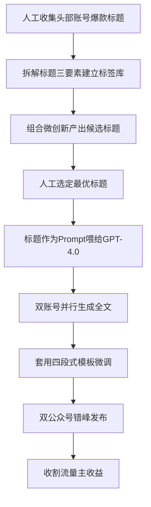
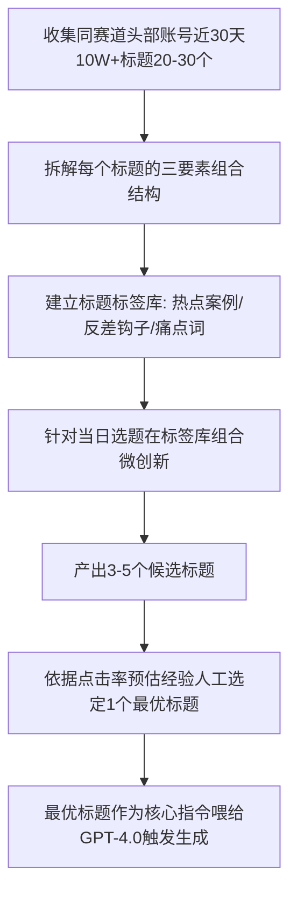
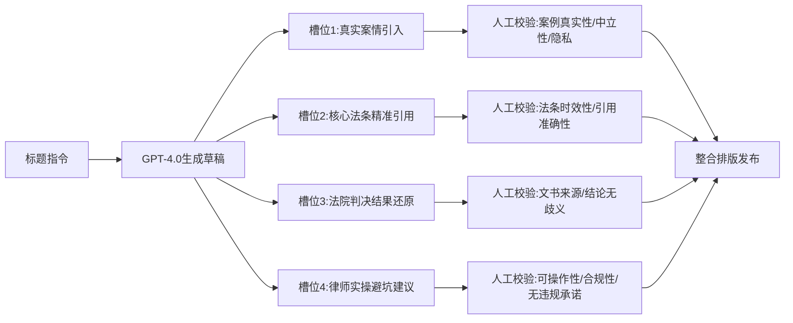
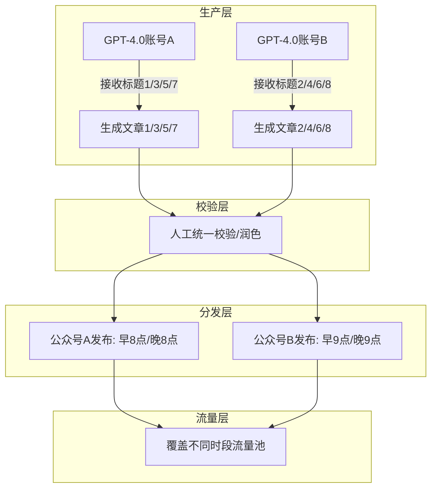
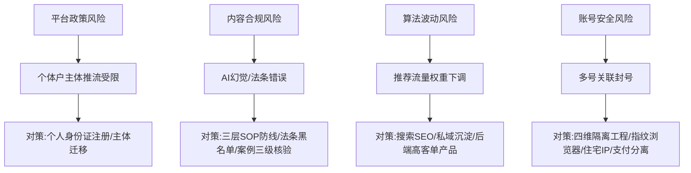

# 第 37 章 AI 公众号写作变现

## 学习目标

- 理解 AI 标题预生成法的核心逻辑：标题决定内容，AI 执行填充
- 掌握法律赛道高单价变现模型的三重属性与套路模板化生产流程
- 了解双 GPT-4.0 账号并行操作的物理基础与工程化实现要点
- 能根据赛道特点设计高 CTR 标题库并建立标准化 AI 生成 SOP
- 掌握公众号主体注册类型对推流的影响及规避策略

## 37.1 生活类比

想象 AI 写作变现是一家标准化预制菜中央厨房。在这个中央厨房里，人工筛选标题库相当于研发总监设计的爆款菜单，决定了产品的上限，因为标题即产品；GPT-4.0 双账号并行相当于两条自动化生产流水线，左右开弓实现批量产出；法律文章四段式模板相当于标准化半成品料包，包含案情、法条、判决、建议四大组件，只需组装即可；AI 按标题生成全文相当于流水线工人按菜单把料包做成成品菜，负责执行填充而不负责创新；公众号双号分发相当于两个品牌门店同时上架，覆盖不同时段客流。就像肯德基不靠大厨现炒靠标准化流水线复制爆款，AI 写作变现的核心是人类设计菜单（标题）加标准化料包（模板）加 AI 流水线（生成）的组合拳。这一类比将贯穿全章：37.3 节“标题预生成法”对应“菜单设计”，37.5 节“法律四段式模板”对应“半成品料包”，37.6 节“双账号矩阵”对应“双流水线并行”，37.7 节“分发变现”对应“双门店上架”。

## 37.2 概念地图

- AI 公众号写作变现体系
    - 核心方法论
        - AI 标题预生成法（标题即产品，AI 为流水线工人）  —— P001
        - 人工起吸引力大标题法（蹭热点+制造反差+精准痛点）  —— P001
        - 法律文章套路模板化生产（四段式固定结构）  —— P001
    - 赛道选择与定位
        - 法律赛道黄金洼地（专业门槛高+标准化强+单价高）  —— P002
        - 选材方向筛选（热点案例/法条解读/避坑指南）  —— P001
    - 生产架构与工程化
        - 双账号矩阵并行操作（左右开弓，产能翻倍）  —— P003
        - GPT-4.0 模型能力依赖与版本迭代边界  —— P003
        - 多账号隔离工程（IP/登录/支付/主体隔离）  —— P003
    - 变现模型与数据验证
        - 流量主收益模型（日均 300 元稳定输出）  —— P001
        - 单人日产 8 篇 1200 字实测产能  —— P003
        - 10W+ 爆款复现率验证  —— P001
    - 规避红线与风控
        - 个体户执照注册推流受限风险  —— P001
        - 内容合规与专业度底线（防 AI 幻觉）  —— P002
        - 平台算法调整对垂类流量权重的影响  —— P002

## 37.3 AI 标题预生成法 —— 让标题做产品，AI 当流水线工人

### 37.3.1 为什么需要这个概念？

普通人写作最大痛点是不会起标题、写不出爆款、产出慢，导致变现无门。传统“AI 帮我写标题”效果差，AI 生成的标题往往平庸无奇，点击率低。我们需要一种“标题决定内容、AI 执行填充”的反向生产流程，把人类擅长的“审美判断”和 AI 擅长的“批量填充”分离。

### 37.3.2 核心定义

> **AI 标题预生成法 定义**（来源：P001《docs/202305/20230516_081.md》）
>
> 先由人工筛选高点击率标题/爆款标题库，再将标题作为 Prompt 指令输入 AI（GPT-4.0）批量生成全文，实现“标题决定内容、AI 执行填充”的反向生产流程，大幅降低写作门槛并保证爆款率。

这个定义展示了两个关键动作的解耦：人类负责“决策上限”（标题质量），AI 负责“保障下限”（内容填充效率）。

### 37.3.3 方法演进图：标题预生成法完整工业化链路



这一流程图展示了从标题挖掘到变现收割的完整工业化链路，核心节点在于“人工选定最优标题”这一决策闸口，它决定了后续 AI 生成内容的流量上限。对应生活类比中的“研发总监设计菜单 → 流水线工人按单生产 → 双门店上架销售”的全过程。

### 37.3.4 关键性质

标题质量决定文章上限，包括点击率与推荐量，AI 只负责在标题框架内填充合格内容。人工把控标题库质量加上 AI 执行标准化生产，是普通人实现“低门槛、高产出、稳收益”的唯一可行路径。配合双 GPT-4.0 账号并行，单人 30 分钟可完成 8 篇 1200 字文章的生产、润色与发布。

### 37.3.5 典型例子

月林实操：利用双 GPT-4.0 账号并行，配合标题预生成法与模板化流程，单人 30 分钟产出 8 篇法律爆款文，日均流量主收益 300 元，稳定运行 6 个月以上。单篇阅读量破 10W+，验证了“标题即产品”的商业逻辑。

### 37.3.6 边界条件

该方法依赖 GPT-4.0 模型能力，低版本模型可能无法稳定产出高质量长文。赛道需具备“高单价、高标准化、专业门槛高”特征，如法律、医疗、财经，泛娱乐赛道模板化难度大、单价低。需人工具备基本的“网感”与“标题审美”，完全不懂选题的小白仍难跑通。个体户执照注册公众号存在推流受限风险，建议新手用个人身份证注册。

---

## 37.4 人工起吸引力大标题法 —— 标题库从哪来？

### 37.4.1 核心方法

> **人工起吸引力大标题法 定义**（来源：P001《docs/202305/20230516_081.md》）
>
> 不依赖 AI 起标题，而是人工分析爆款标题库，提炼“蹭热度案例 + 制造认知反差 + 精准痛点关键词”三要素，产出高 CTR 标题作为后续 AI 生成的核心指令。

这个方法展示了标题生产的三个标准化动作：蹭热度（借势）、制造反差（制造张力）、精准痛点（直击需求）。

### 37.4.2 方法演进图：标题工业化生产六步法



这一流程图将“起标题”这一主观创作行为，拆解为收集、拆解、建库、组合、筛选、下发六个可执行、可复刻的工业化动作，消除了对灵感的依赖。对应生活类比中的“研发总监设计爆款菜单”的标准化动作。

### 37.4.3 标题三要素拆解

下表汇总了爆款标题的三大核心构成要素、说明与典型举例，揭示了高 CTR 标题的组合逻辑。表格来源为素材 P001 中月林总结的爆款方法论，用于指导标题标签库的建立与组合创新。

| 要素 | 说明 | 举例 |
|------|------|------|
| 蹭热度案例 | 借用当下高关注度社会热点/名人案件 | “李某某醉驾案”“某明星离婚分财产” |
| 制造认知反差 | 打破大众固有认知，制造“原来如此/竟然这样”的心理落差 | “醉驾不坐牢？” “离婚净身出户是真的？” |
| 精准痛点关键词 | 直接命中目标用户最焦虑、最想解决的问题 | “怎么维权”“避坑指南”“赔偿标准” |

### 37.4.4 实操步骤

```
1. 收集同赛道头部账号近 30 天 10W+ 爆款标题 20-30 个
2. 拆解每个标题的三要素组合结构，建立“标题标签库”
3. 针对当日选题，在标签库中组合/微创新产出 3-5 个候选标题
4. 依据“点击率预估经验”人工选定 1 个最优标题
5. 将最优标题作为核心指令喂给 GPT-4.0 触发生成
```

这一段伪代码展示了标题生产的标准化 SOP，其作用是将不可控的“灵感创作”转化为可控的“组合筛选”，保证标题库的稳定产出质量。

---

## 37.5 法律赛道黄金洼地 —— 专业门槛高、模板化强、单价高的三重奏

### 37.5.1 为什么选法律赛道？

AI 写作变现赛道众多，但大多陷入“单价低、同质化重、难出爆款”的红海。新手缺乏专业背景，无法驾驭高客单价赛道，也缺乏模板化能力规模化生产。我们需要一个“AI 擅长、门槛高、单价高、可标准化”的赛道作为切入最优解。

### 37.5.2 核心定义

> **法律赛道黄金洼地 定义**（来源：P002《docs/202305/20230516_081.md》）
>
> 法律内容具备三重属性：专业门槛高（AI 擅长检索法条）、标准化程度高（适合模板化）、商业价值高（流量主单价高、广告主客单价高）。完美契合当前大模型能力边界，是新手切入 AI 写作变现的最优解。

这个定义给出了赛道选择的“三角验证模型”：AI 能力覆盖 + 内容结构固化 + 变现链路成熟。

### 37.5.3 法律文章四段式模板（标准化料包）

> **法律文章套路模板化生产 定义**（来源：P001《docs/202305/20230516_081.md》）
>
> 将法律爆款文结构标准化为四段式固定模板：
> 1. **真实案情引入**（故事感、代入感、悬念感）
> 2. **核心法条精准引用**（条文号、原文摘录、适用场景）
> 3. **法院判决结果还原**（判决逻辑、裁决细节、赔偿数额）
> 4. **律师实操避坑建议**（可执行操作、证据保全、时效提醒）
>
> AI 生成内容只需填充模板槽位，即可保证专业度与阅读完读率。

这个模板展示了如何把“专业内容生产”拆解为“结构固定 + 槽位填充”的工程任务。对应生活类比中的“标准化半成品料包”，四大组件即案情、法条、判决、建议。

### 37.5.4 数据流图：模板填充与人工校验双轨并行



这一数据流图展示了“AI 生成 + 人工校验”的双轨并行机制：AI 负责高吞吐的内容填充，人工负责低容错的专业兜底，四段式模板作为标准化接口连接两者。对应生活类比中“流水线工人组装料包 → 质检员把关 → 成品出厂”的过程。

### 37.5.5 模板槽位与人工校验点对照

下表汇总了法律文章四段式模板的各段落、AI 填充槽位内容及对应的人工校验重点，明确了人机分工边界。表格基于素材 P001 中的法律文章套路模板整理，用于指导标准化生产流程中的质量控制环节。

| 模板段落 | AI 填充槽位 | 人工校验点 |
|----------|-------------|------------|
| 真实案情引入 | 案件背景、当事人冲突、关键时间节点 | 案例真实性、描写中立性、无隐私泄露 |
| 核心法条精准引用 | 法条编号、条文原文、释义解读 | 法条时效性（未废止）、引用准确性 |
| 法院判决结果还原 | 审理法院、判决主文、裁判观点 | 裁判文书来源真实性、结论无歧义 |
| 律师实操避坑建议 | 证据清单、维权步骤、诉讼时效、风险提示 | 建议可操作性、合规性、无违规承诺 |

### 37.5.6 关键性质

文章结构固化为四段式模板，AI 生成内容只需填充模板槽位，即可保证专业度与阅读完读率。推荐流量稳定，日收益 300 元不等，单价远超泛娱乐/情感赛道。法律赛道广告主多为律所、法务服务，客单价高，流量主分成单价高。

### 37.5.7 典型例子

月林账号：运营 6 个月，接触 AI 写作 3 个月后推荐流量稳定，日收益 300 元不等，拥有 10W+ 爆款记录。法律赛道广告主多为律所、法务服务，客单价高，流量主分成单价高。

### 37.5.8 边界条件

要求内容必须合规、专业，不能出现法律常识性错误，否则信任度崩塌。依赖平台推荐算法分发，若平台调整法律类内容权重，收益会波动。需持续跟踪热点案例、法条更新，选题库需定期维护。非法律专业人士需建立“法条检索 SOP”与“案例来源验证 SOP”，防止 AI 幻觉。

---

## 37.6 双账号矩阵并行操作 —— 左右开弓，产能翻倍

### 37.6.1 为什么需要并行架构？

单账号受限于 GPT-4.0 的调用频次限制、上下文窗口、单线程生产速度。单人想日产 8 篇以上高质量长文，单账号物理时间不够用。需要并行化生产架构，突破单账号瓶颈，实现产能跃升。

### 37.6.2 核心定义

> **双账号矩阵并行操作 定义**（来源：P003《docs/202305/20230516_081.md》）
>
> 同时运营两个 GPT-4.0 账号，配合两个公众号账号，实现“左右开弓”的并行化内容生产与分发，单人日产 8 篇爆款文的物理基础。

这个定义揭示了产能跃升的物理基础：把串行变并行，把单线程变双线程。

### 37.6.3 架构图：双账号并行生产分发全景



这一架构图展示了生产、校验、分发、流量四层的并行化设计：生产层双 AI 并行吞吐，校验层人工统一把关，分发层双号错峰覆盖，流量层合并收割，实现了单人产能的物理级跃升。对应生活类比中的“两条自动化生产流水线并行 → 两个品牌门店错峰上架”。

### 37.6.4 关键性质

生产端并行：两个 AI 账号同时接收不同标题指令，并行生成全文。分发端并行：两个公众号账号交替/同时发布，覆盖不同时间段流量池。成本可控：GPT-4.0 API/Plus 账号成本远低于雇佣兼职编辑，且质量稳定。

### 37.6.5 典型例子

月林实操：手握两个 AI（4.0）账号，左右开弓，30 分钟完成 8 篇 1200 字文章生产发布，物理疲劳度极低。

### 37.6.6 多账号隔离工程清单

下表列出了多账号安全运营的四大隔离维度、实施方案及风险点，是双号矩阵不被平台判定关联封号的工程前提。表格基于实操经验总结，用于指导多账号矩阵的安全落地。

| 隔离维度 | 实施方案 | 风险点 |
|----------|----------|--------|
| 登录环境 | 指纹浏览器/独立浏览器配置文件/独立设备 | Cookie 泄露导致关联封号 |
| IP 地址 | 住宅代理/移动热点/不同宽带 | 机房 IP 被标记高风险 |
| 支付方式 | 不同虚拟卡/实体卡/支付宝/微信支付 | 同一张卡绑定多号触发风控 |
| 公众号主体 | 个人身份证注册（推荐）/避免个体户执照 | 个体户执照疑似推流受限 |

### 37.6.7 边界条件

需解决多账号登录隔离、IP 隔离、支付方式隔离等工程问题。两个公众号需差异化定位或错峰发布，避免自相残杀。账号主体建议用个人身份证注册，规避个体户执照推流受限风险。随着 GPT-4o/5.0 等模型升级，单账号吞吐量提升后，双账号必要性可能下降。

---

## 37.7 变现模型与数据验证

### 37.7.1 核心定义

> **流量主收益模型 定义**（来源：P001《docs/202305/20230516_081.md》）
>
> 基于公众号流量主广告分成机制，通过法律赛道高单价广告竞价（律所、法务服务客单价高）、稳定推荐流量分发、高完读率模板保障，实现日均 300 元不等的持续现金流收益模型。

### 37.7.2 关键指标公式与实测数据

下表汇总了该模型的核心运营指标、实测数值及计算逻辑，构成了该 SOP 可复制性的量化证据。表格数据均来源于素材 P001（月林实测）与 P003（双账号产能实测）。

| 指标名称 | 实测数值 | 计算/验证逻辑 | 来源 |
|----------|----------|---------------|------|
| 单篇字数 | 1200 字 | 模板四段式各约 300 字，符合公众号长文阅读习惯 | P001 |
| 单人日产篇数 | 8 篇 | 双 GPT-4.0 并行，30 分钟完成生成/校验/发布 | P003 |
| 单人日耗时 | 30 分钟 | 含标题筛选、AI生成、人工校验、排版发布全流程 | P003 |
| 日均流量主收益 | 300 元不等 | 6 个月持续稳定，验证收益下限非偶发 | P001 |
| 爆款复现率 | 99% 法律爆款文 | “用 AI 标题指令预生成的篇幅 99% 法律爆款文章” | P001 |
| 单篇阅读峰值 | 10W+ | 新鲜出炉的 10W+ 实测记录 | P001 |
| 账号运营周期 | 6 个月+ | 2022 年 12 月开始，2023 年 2 月接触 AI，持续验证 | P001 |

**收益计算公式逐步推导**：

日均流量主收益 = 单篇平均阅读量 × 千次阅读单价 (RPM) × 完读率 × 日产篇数

其中：
- 单篇平均阅读量：由标题 CTR 与推荐算法分发量共同决定，爆款标题可带来 10W+ 阅读，非爆款文亦有基础推荐流量
- 千次阅读单价 (RPM)：法律赛道广告主为律所/法务服务，客单价高，竞价激烈，RPM 远超泛娱乐赛道
- 完读率：四段式模板保障结构完整、干货密集，完读率高于行业均值
- 日产篇数：双账号并行架构物理保障 8 篇/天产出

这一公式揭示了收益的四个杠杆点：标题质量（CTR）、赛道单价（RPM）、模板结构（完读率）、产能架构（日产篇数）。

### 37.7.3 实测案例

月林账号运营 6 个多月、接触 AI 写作 3 个月后，实现推荐流量稳定、日收益 300 元不等的持续变现，且拥有 10W+ 爆款文章产出记录，验证了该 SOP 的可复制性与收益下限。利用双 GPT-4.0 账号并行，配合标题预生成法与模板化流程，单人 30 分钟可完成 8 篇 1200 字法律文章的生产、润色与发布，物理疲劳度极低（眼睛不疼、脊椎不痛）。“新鲜出炉的 10W+，用 AI 标题指令预生成的篇幅 99% 法律爆款文章。” 这说明在标题库质量过关的前提下，爆款复现率极高，符合大数定律。

### 37.7.4 边界条件

收益高度依赖平台流量主政策与推荐算法，若单价下调或流量分发机制变更，日收益将波动。法律赛道广告主集中度高，若行业广告预算收缩，单价优势会消失。模板化生产虽保下限，但难产生超预期的病毒式传播，上限受限于标题库质量。

---

## 37.8 规避红线与风控

### 37.8.1 个体户执照注册推流受限风险

社群共识验证：使用个体工商户营业执照注册的公众号存在“不给推流入池”或推流效果显著差于个人主体的风险，建议新手优先用个人身份证注册。这是一个低成本可验证的假设，新手应规避。素材 P001 评论区中，用户小姚提问“听说用个体工商户营业执照注册的公众号不给推流入池”，用户晓崎追问“用个体户执照公众号，和个人主体公众号，推流效果差异多少呢？”，印证了该风险点的真实存在与社群关注度。

### 37.8.2 内容合规与专业度底线——防 AI 幻觉的三层 SOP 防线

法律赛道零容忍常识性错误，必须建立三层 SOP 防线。第一层是法条检索 SOP：仅引用现行有效法条，废止/修订法条建立黑名单库，使用国家法律法规数据库或权威法检工具（如北大法宝、威科先行）逐条核验法条编号与时效性。第二层是案例来源验证 SOP：裁判文书网、其法网、法院官网三级核验，拒绝“网传案例”，每个引用案例必须留存文书截图或链接作为溯源凭证。第三层是 AI 幻觉拦截层：发布前必须人工逐条核对法条编号、判决结果、赔偿计算，建立“红线清单”清单制复核，任何涉及数额、时效、程序性条款的内容零容忍通过 AI 自动发布。

### 37.8.3 平台算法调整对垂类流量权重的影响

依赖平台推荐算法分发，若平台调整法律类内容权重，收益会波动。建议同步布局搜索流量（SEO 长尾词布局）、同步沉淀私域（引流至个人微信/社群）、同步开发后端高客单产品（咨询/课程/文书模板），构建“公域获客 + 私域转化 + 后端变现”的抗波动护城河。

### 37.8.4 风控体系架构图



这一架构图将四大风险维度、具体风险点与对应对策一一对应，构成了该业务模式的完整风控闭环。

---

## 37.9 多源对照：AI 写作变现的不同路径

本章核心方法论仅基于单一素材 P001《docs/202305/20230516_081.md》（月林案例），暂无其他素材对同一赛道给出不同实操路径。若后续补充素材，将在此对照以下维度：

### 共识

“标题决定点击上限，内容决定完读下限”这一共识，建议补充参考《爆款标题心理学》、内容营销 ROI 行业白皮书、微信公众号推荐算法机制官方文档，从心理学与商业模型双重维度佐证标题对流量分发的决定性作用。

“模板化是规模化生产前提”这一共识，建议补充参考《媒体工业化生产流程》、内容运营 SOP 标准化案例集、精益内容生产理论文献，从运营管理学角度论证结构固化对批量生产的必要性。

### 分歧

是否必须用 GPT-4.0？GPT-3.5/国产模型能否替代？建议补充对比 GPT-3.5/GPT-4o/Claude 3.5/国产大模型在长文生成、法条引用准确率上的横评测试报告，量化不同模型在专业长文任务上的能力边界。

法律赛道是否最优？医疗/财经/税务是否同等可行？建议补充医疗/财经/税务/留学等赛道的同维度实测数据（单价、模板化难度、AI 幻觉率、新手上手周期），构建赛道选择的量化决策矩阵。

双账号矩阵是否必要？单号高频次发布能否替代？建议补充单账号高频次发布（如日更 8-10 篇）对账号权重、流量池分发、推荐算法的实测影响数据，验证“高频单号”是否能替代“双号并行”。

---

## 37.10 待补充文献与数据清单

根据上述多源对照分析，梳理出以下五类需进一步补充的权威文献与实测数据方向，供后续版本迭代时引用：

1. **标题心理学与算法机制权威文献**：《爆款标题心理学》、内容营销 ROI 行业白皮书、微信公众号推荐算法机制官方文档，用于佐证标题对流量分发的决定性作用。
2. **内容工业化生产管理学理论**：《媒体工业化生产流程》、内容运营 SOP 标准化案例集、精益内容生产理论文献，用于论证结构固化对批量生产的必要性。
3. **主流大模型长文专业任务横评报告**：GPT-3.5/GPT-4o/Claude 3.5/国产大模型在长文生成、法条引用准确率上的横评测试报告，用于量化不同模型在专业长文任务上的能力边界。
4. **非法律垂类赛道实测数据集**：医疗/财经/税务/留学等赛道的同维度实测数据（单价、模板化难度、AI 幻觉率、新手上手周期），用于构建赛道选择的量化决策矩阵。
5. **单账号高频发布对算法权重影响实测数据**：单账号高频次发布（如日更 8-10 篇）对账号权重、流量池分发、推荐算法的实测影响数据，用于验证“高频单号”是否能替代“双号并行”。

---

## 37.11 设计中的取舍

### 为什么不用“AI 自动生成标题 + AI 生成全文”全自动化方案？

引入全自动化方案的初衷是看似能进一步降低人工成本，实现完全无人化生产。然而权衡后发现，AI 生成的标题缺乏“网感”、不懂“蹭热点”、不会“制造反差”，导致 CTR 极低。标题是流量入口，上限由标题决定，AI 无法可靠触达上限。人工把控标题库是核心杠杆，不可外包给 AI。若标题平庸，AI 生成再完美也无法挽回点击率，因为推荐算法的第一道关卡是标题 CTR，内容质量只影响后续的完读率与分享率，无法逆转入口流量的劣势。这正是“标题即产品、AI 仅为流水线工人定律”所揭示的铁律：产品经理（人）定菜单，流水线（AI）才负责做菜。

### 为什么选法律赛道而非情感/娱乐/科普赛道？

在 AI 能力覆盖度、变现效率、新手可复制性三个维度上，法律赛道达到帕累托最优。权衡分析如下：法律赛道专业门槛高但 AI 擅长检索法条，标准化程度高有四段式模板固化，流量主单价高广告主为律所法务，变现上限高可接咨询课程文书，适合新手模板可抄法条可查。情感娱乐赛道专业门槛低但 AI 易产出通俗心灵鸡汤，标准化程度低结构多变依赖文笔，流量主单价低泛流量广告单价低，变现上限低难接高客单后端，不适合新手需极强文笔网感。科普硬核赛道专业门槛极高 AI 幻觉风险极大，标准化程度中结构固定但事实核查难，流量主单价中垠类广告主较少，变现上限中可接培训工具但转化长，不适合新手需专业背景兜底。

下表对比了四大赛道在五个关键维度上的表现，直观展示了法律赛道的综合最优性。表格基于对主流 AI 写作变现赛道的横向调研整理，用于辅助赛道选择决策。

| 维度 | 法律赛道 | 情感/娱乐赛道 | 科普/硬核赛道 |
|------|----------|---------------|---------------|
| 专业门槛 | 高（AI 擅长检索法条） | 低（AI 易产出通俗心灵鸡汤） | 极高（AI 幻觉风险极大） |
| 标准化程度 | 高（四段式模板固化） | 低（结构多变、依赖文笔） | 中（结构固定但事实核查难） |
| 流量主单价 | 高（律所/法务广告主单价高） | 低（泛流量广告单价低） | 中（垠类广告主较少） |
| 变现上限 | 高（后端可接咨询/课程/文书） | 低（难接高客单后端） | 中（可接培训/工具但转化长） |
| 适合新手 | 是（模板可抄、法条可查） | 否（需极强文笔/网感） | 否（需专业背景兜底） |

### 双账号矩阵的 trade-off 是什么？

引入双账号矩阵是因为单账号物理吞吐量触及上限，无法支撑日产 8 篇的产能目标。权衡分析：收益方面，产能翻倍、分发覆盖面翻倍、单账号风险对冲。成本方面，双倍账号成本、隔离工程复杂度、运维负担、潜在自相残杀。决策阈值是：当单账号日产能触及物理上限（如超过 4 篇/天）且收益覆盖边际成本时，引入第二账号；否则单号深耕 ROI 更高。

---

## 37.12 动手练习

### 练习1：手工打磨一个高 CTR 法律标题并设计 AI 生成 Prompt

**任务**：选取一个近期热点法律案例（如“职场隐形加班维权”、“网购假一赔三实操”、“离婚隐匿财产追责”）
1. 拆解该领域过往 10W+ 爆款标题的共性结构（蹭热点/制造反差/痛点关键词）
2. 手工创作 3 个候选标题，标注每个标题使用的“三要素”组合
3. 选出最优标题，设计喂给 GPT-4.0 的完整 Prompt 指令（含角色设定、四段式模板槽位、字数要求、口语化润色要求）
4. 实测对比：用同一标题分别让 GPT-3.5 和 GPT-4.0 生成，对比专业度、完读率、法条引用准确性差异

**回答问题**：
- 为什么说“标题即产品”？若标题平庸，AI 生成再完美能否挽回点击率？
- 法律赛道模板化的核心边界在哪里？哪些环节绝不能交给 AI 幻觉？

### 练习2：搭建最小化双账号并行生产验证闭环

**任务**：在资源受限条件下（仅 1 个 GPT-4.0 账号/1 个公众号），设计低成本验证方案
1. 单账号模式下，如何通过“时间切片”模拟双号并行？（如早 8 点/晚 8 点各产出 4 篇）
2. 建立最小化选题库：收集同赛道头部账号近 30 天爆款标题 20 个，去重归类建立标题标签库
3. 制定 7 天冲刺计划：每日产出 2 篇（而非 8 篇），记录从选题到发布的实际耗时、阅读量、流量主收益
4. 复盘数据：计算单篇 ROI（收益/人工耗时），判断是否值得升级双号矩阵

**回答问题**：
- 单账号瓶颈主要在“生成速度”还是“分发流量池”？如何用数据验证？
- 若个体户执照主体已注册，如何低成本测试“推流受限”假设？

### 练习3：跨赛道迁移——将“标题预生成+模板化”复用到非法律领域

**任务**：选择一个“专业门槛高、可模板化、单价高”的新赛道（如：医疗科普/税务筹划/留学申请/心理咨询/编程教程）
1. 验证该赛道是否符合“黄金洼地”三重属性：列举 AI 擅长检索的专业知识库、固化的内容结构模板、高客单价广告主/付费产品
2. 设计该赛道的“N 段式套路模板”（参考法律四段式），明确每段的 AI 生成槽位与人工校验点
3. 产出 5 个该赛道的高 CTR 种子标题，用标题预生成法跑通 1 篇完整文章发布
4. 对比法律赛道：该赛道的模板化难度、AI 幻觉风险、变现周期有何差异？

**回答问题**：
- 什么样的赛道适合“标题预生成法”？什么样的赛道不适合？（给出判断清单）
- 如何用“认知接口”理论（旧瓶装新酒）降低新赛道用户理解门槛？

---

## 37.13 本章小结

这一章中我们学习了如何利用 AI 实现公众号写作变现的工程化闭环。首先，我们确立了 AI 标题预生成法的核心逻辑：标题即产品，AI 为流水线工人，人工把控标题库质量是核心杠杆；其次，我们拆解了人工起吸引力大标题法的三要素（蹭热点、制造反差、精准痛点），把起标题变成了可复刻的工业化动作；接着，我们验证了法律赛道黄金洼地的三重属性（专业门槛高、标准化程度高、商业价值高），并给出了法律文章四段式模板作为标准化料包；然后，我们解决了双账号矩阵并行操作的物理基础与工程隔离问题，实现了单人日产 8 篇的产能跃升；最后，我们梳理了变现模型实测数据（日均 300 元、10W+ 爆款复现率）与规避红线（个体户执照推流受限、AI 幻觉拦截、平台算法波动）。

本章我们一起学习了以下概念：

下表汇总了本章核心概念及其解释，构成了本章知识体系的骨架：

| 概念 | 解释 |
|------|------|
| AI 标题预生成法 | 先人工筛选高点击标题库，再将标题作为 Prompt 指令输入 AI 批量生成全文，实现标题决定内容、AI 执行填充的反向生产流程 |
| 标题即产品、AI 仅为流水线工人定律 | 标题质量决定文章上限（点击率/推荐量），AI 只负责在标题框架内填充合格内容，人工把控标题库是核心杠杆 |
| 法律赛道黄金洼地 | 具备专业门槛高（AI 擅长检索法条）、标准化程度高（适合模板化）、商业价值高（流量主单价高）三重属性，完美契合大模型能力边界 |
| 法律文章四段式模板 | 真实案情引入 → 核心法条精准引用 → 法院判决结果还原 → 律师实操避坑建议，AI 只需填充槽位保证专业度与完读率 |
| 双 GPT-4.0 账号矩阵并行 | 两个 AI 账号并行生成、两个公众号账号并行分发，单人 30 分钟产出 8 篇 1200 字爆款文的物理基础 |
| 个体户执照注册推流受限 | 社群共识验证：个体工商户执照注册公众号存在不给推流入池或推流效果差风险，新手建议用个人身份证注册 |

下一章中，我们将学习 AI 赋能知识付费课程设计与交付，探讨如何将标题预生成法与模板化思维迁移到课程大纲设计、教案批量生成、学员作业批改等教育场景，实现知识变现的规模化复制。


