# 第 32 章 👸号运营体系与变现阶梯 —— 情感IP起号、引流造势IP强信任、四阶梯进阶
作者：龙哥

## 学习目标

- 理解👸号冷启动的核心逻辑：情感IP号为何是新手最优赛道
- 掌握变现倒推定位法：从变现方式反向定制内容方向
- 建立引流-变现双轮模型：流量造势与信任留量的分工协作机制
- 熟练设计钩子理论：用利益交换构建精准获客漏斗（兼职函+征稿函双钩子）
- 执行账号注册与后台核心配置清单：规避不可逆决策陷阱，标准化基建
- 应用排版黄金参数标准：以工业化规格书保障阅读体验与品牌视觉统一
- 实施外部引流找车/上车成本控制法：建立记账复盘体系，筛选高ROI投放渠道
- 搭建社群分层运营体系：读者群/任务群/打卡群三层架构实现分级转化
- 打造个人IP强标签：总分结构输出人设文，建立认知护城河提升溢价能力
- 遵循变现四阶梯进阶定律：技能点依次点满，不可跨级（L1/L2靠引流，L3/L4靠IP）
- 执行内容生产黄金节奏：1原创+1征稿+1转载，冷启动期低成本高频次供给模型
- 判断留言功能迁移ROI：满足三条件（粉丝基数+优质内容+互动规则）后再投入

## 32.1 生活类比

想象你正在筹备一家「内容超市」：**情感IP号**就是选址在女性消费力最强的商业街核心铺面，自带天然大客流；**变现倒推定位**是先确定卖什么货——广告、课程还是带货，再决定装修风格和进货渠道；**引流轮**像雇人发传单、搞促销造声势，把人拉进店；**IP轮**靠店员专业推荐、会员制服务、口碑裂变，把人留下来复购；**钩子**是门口的「扫码送鸡蛋/体验课」，低成本筛选高意向客户；**白名单互推**像邻店联合发优惠券，互导客流零成本；**排版参数**是统一货架高度、价签字体、灯光色温，标准化体验建信任；**找车/上车**是自己谈代言还是参加商圈联合大促，成本账必须算清；**社群分层**对应散客大厅、团购微信群、VIP休息室，分级服务精准收割；**强标签**打造「全城最懂女性心的情感专家」，一提到类想到人，一提到人想到类；**四阶梯**遵循先卖平价日用品(L1/L2)，再做自有品牌高端系列(L3/L4)，能力不够别碰高端；**内容节奏**是自产爆款(原创)+代销畅销书(征稿)+调拨邻店货(转载)三管齐下；**留言迁移**像装修加装「顾客留言墙」：投入大、需排队、仅成熟店才划算。

## 32.2 概念地图

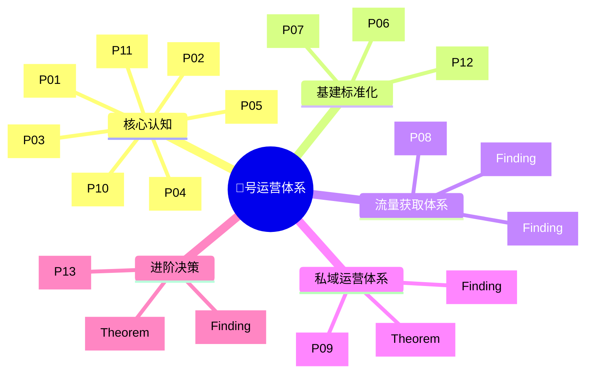

## 32.3 情感IP号 —— 新手👸号变现的“黄金赛道”

### 为什么需要这个概念？

👸号赛道众多，新手极易选错方向耗尽精力。情感内容自带高粘性、高女性占比、高购买力三大商业属性。创作素材源自生活，门槛最低，最易坚持产出。

### 核心定义

以真实情感经历为核心内容，面向成年女性群体，打造强人设标签。变现路径平滑：广告变现(L1/L2) → 分销佣金(L3) → 自有产品(L4)。兼具“引流易、留存强、报价高”三重优势。

### 关键性质

受众画像锁定：成年女性占比高、购买决策权强。内容生产低成本：素材来自自身/读者真实故事，无需专业知识储备。算法友好度高：情感类内容天然适配推荐机制，易产生爆款。

### 典型例子

作者早期情感号：阅读过千、单价250-450元、月接5-6条广告。案例“失重限期”：7w粉、均阅1300+、广告报价0.5-0.7元/阅、变现“广告+课程社群”。

### 边界条件

仅靠情感内容无强IP，变现天花板锁死在广告分成(L1/L2)。需警惕“兼职号/科研号/医学号”等高成本/难长久的伪赛道。内容同质化风险高，必须建立“强标签人设”构建护城河。

> "根据长期发展和变现能力来看，情感IP号是比较适合新手小白做的类型。"
> 
> ——《👸号运营实战指南 VjTFdmoIhoOIuhx4wYUcc1XGn8g.md》 P01

> "情感IP号从受众上来说，成年女性比例高；在价值内容上，情感IP号能写的内容非常多...成本上，情感内容和围绕自己的经历、真实感受是比较容易进行创作的"
> 
> ——《👸号运营实战指南 VjTFdmoIhoOIuhx4wYUcc1XGn8g.md》 P01

> "综上所述，情感IP类型账号是新手小白想要变现，比较合适做的类型。"
> 
> ——《👸号运营实战指南 VjTFdmoIhoOIuhx4wYUcc1XGn8g.md》 P01

### 情感IP号赛道选择演进路径

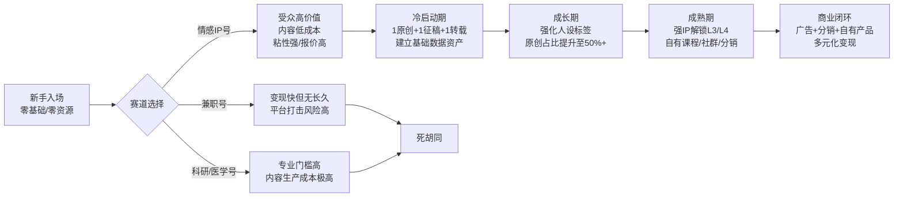

**图解说明**：该流程图展示了新手在👸号赛道选择上的演进逻辑。起点是零基础入场，面临三类典型赛道选择。兼职号与科研/医学号虽各有特点，但均存在不可跨越的结构性缺陷（风险高或成本高），最终陷入死胡同。情感IP号凭借受众高价值、内容低成本、粘性强报价高三大核心优势，成为唯一可行的最优解。随后进入标准化的成长路径：冷启动期通过组合拳内容策略建立数据资产，成长期强化人设提升原创占比，成熟期凭借强IP跨越变现阶梯解锁高客单价产品，最终形成多元化商业闭环。

## 32.4 变现倒推定位法 —— 让变现方式反向定制内容方向

### 为什么需要这个概念？

绝大多数新手犯“为内容而内容”的错误，产出大量无法变现的自嗨文字。内容方向应服务于商业目标，而非自我表达。只有明确“靠什么赚钱”，才能决定“写什么、写给谁”。

### 核心定义

先确定变现方式(广告/分销/自有产品/引流池) → 再推导定位受众 → 最后决定内容方向。思考顺序：怎么变现 → 定位/受众人群 → 写什么内容。避免陷入“内容生产—无变现—放弃”的死循环。

### 关键性质

战略先行，战术跟随：变现模式是内容策略的“北极星”。动态调整机制：判断项目赚钱 → 定位服务项目 → 赚钱后升级定位。适用性普适：马云、雷军、腾讯皆通过变更定位实现跃迁。

### 典型例子

情感号想接广告 → 定位“成年女性情感痛点” → 内容产出“情感故事/避坑指南”。想卖课程 → 定位“考公/考证/职场技能”人群 → 内容产出“干货/方法论/案例”。

### 边界条件

变现方式选错(如强行做高客单课程但无交付能力)会导致全盘崩塌。需具备“认知接口”能力：在用户既有认知框架内植入新工具/新场景。前期可“蹭势”(借风口/行业/渠道势)，但长期必须建立自有护城河。

> "要确定👸号写什么内容，主要看两点：定位、受众人群。要确定我们的定位和受众人群，我们就要明确变现方式。所以我们的思考顺序应该是：怎么变现，依靠什么变现——定位、受众人群——写什么内容。"
> 
> ——《👸号运营实战指南 VjTFdmoIhoOIuhx4wYUcc1XGn8g.md》 P02

> "动态定位：定位服务于变现，而非长期主义信仰。判断项目赚钱 -> 定位服务项目 -> 赚钱后升级定位。"
> 
> ——《👸号运营实战指南 VjTFdmoIhoOIuhx4wYUcc1XGn8g.md》 P02

### 变现倒推定位法逻辑流

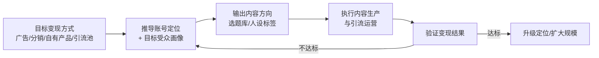

**作用解释**：该流程图展示了变现倒推定位法的核心逻辑闭环。起点是明确的商业目标（变现方式），中间层是基于商业目标推导的定位与受众决策，终点是可执行的内容生产指令。关键在于“验证变现结果”到“推导账号定位”的反馈回路，体现了“动态定位”的本质——定位不是一成不变的信仰，而是服务于当下变现目标的战略选择，随业务跃迁而迭代升级。

## 32.5 引流-变现双轮模型 —— 流量造势与信任留量的分工协作

### 为什么需要这个概念？

👸号高度闭塞，单靠内部推荐无法规模化冷启动。单纯引流不维护用户导致粉丝流失、活跃度低、无法转化高客单。单纯做IP无流量输入则“巧妇难为无米之炊”。

### 核心定义

引流轮：负责“造势”——数据好看、冲阅读量、提高广告报价、接CPA广告。IP轮：负责“留量”——筛选高信任粉丝、提高转化率、承接高客单价产品(L3/L4)。先有流量(引流)，IP才能变现；无IP仅靠引流天花板极低。

### 关键性质

先后依赖关系：引流是前置条件，IP是放大器。广告主表面看数据(阅读/粉丝)，根本看购买概率(信任度)。数据好拼“人多”(引流)，IP强拼“购买概率高”(信任)。

### 典型例子

“某可复制情感号”：8w粉、千阅、月入四五位数，纯靠广告/CPA，IP弱、粉丝粘性低，无法进阶高客单。“失重限期”：7w粉、均阅1300+、广告0.5-0.7元/阅，强IP解锁“广告+课程社群”，3000粉产30单 vs 1万粉产5单。

### 边界条件

引流钩子性质决定粉丝画像：兼职钩子吸引兼职粉，征稿钩子吸引写手粉。前两阶段(L1/L2)广告收入主要靠引流量级，IP强弱影响溢价不影响上限。必须跨越“信任门槛”才能解锁L3/L4高客单价变现阶段。

> "👸号变现最重要在于两点：引流、IP。有一个先后关系，先要有流量，IP才能让流量变成留量。有了流量，我们的IP才能实现变现。"
> 
> ——《👸号运营实战指南 VjTFdmoIhoOIuhx4wYUcc1XGn8g.md》 P03

> "广告主表面看的是数据，但根本上关注的是粉丝购买的概率。数据好，拼的是人多...IP强，拼的就是购买概率高"
> 
> ——《👸号运营实战指南 VjTFdmoIhoOIuhx4wYUcc1XGn8g.md》 P03

> "数据好，拼的是人多，1万个粉丝里可能会有5个购买；IP强，拼的就是购买概率高，3000粉丝可能就有30个成交。"
> 
> ——《👸号运营实战指南 VjTFdmoIhoOIuhx4wYUcc1XGn8g.md》 P03

### 引流-变现双轮模型架构图

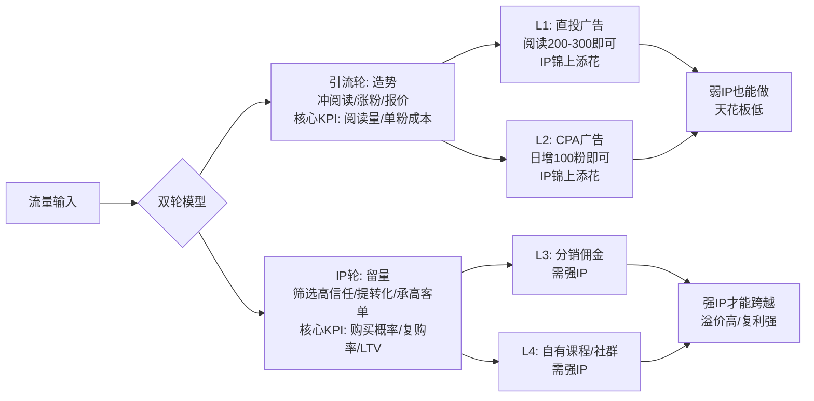

**图解说明**：该架构图直观呈现了双轮模型的分工协作机制。流量输入端分流至引流轮与IP轮，引流轮聚焦量级指标（阅读量、单粉成本），直接支撑L1直投广告与L2 CPA广告两个低门槛变现层级，此时IP仅为锦上添花；IP轮聚焦质量指标（购买概率、复购率、LTV），是跨越至L3分销佣金与L4自有产品高客单价变现阶段的必要条件。图中虚线标注的“弱IP也能做”路径天花板低，而“强IP才能跨越”路径虽门槛高但溢价高、复利强，清晰界定了两轮在不同变现阶段的边界条件与核心作用。

## 32.6 钩子理论 —— 用利益交换设计精准获客漏斗

### 为什么需要这个概念？

公域流量不主动“钓鱼”不会自动上钩。硬广引流易违规、成本高、粉丝质量低。必须设计“钩子”以利益交换吸引目标用户主动添加/关注。

### 核心定义

钩子：征稿函、兼职函、资料包、电子书等“利益诱饵”的统称。钩子性质决定引来粉丝的质量与画像(如兼职钩子吸引兼职粉)。双钩子设计：兼职函“广撒网”(低门槛任务) + 征稿函“精筛选”(高标准稿费≥30元)。

### 关键性质

利益互换本质：用户付出关注/微信，换取稿费/兼职/资料/成长。筛选门槛机制：稿费>25元显著提升粉丝质量，设置30元打底为经验阈值。漏斗分层：外部投放兼职函 → 内部沉淀征稿函 → 留存高意向写手/粉丝。

### 典型例子

兼职函包含：征稿/找错别字/点在看/转发等低门槛任务，对外广撒网。征稿函详细规定：投稿规范/选题方向/稿费标准/排版要求，精筛选。

### 边界条件

无钩子引流 = 无效动作，纯靠内容被动涨粉极慢。钩子设计过于功利(如直接发广告)易触发平台风控封号。稿费定价过低(<25元)引来低质粉丝，反增加后续运营成本。

> "那么我们怎么“勾引”呢？需要一个钩子。征稿函、兼职函就是钩子，当然什么样的钩子，勾到什么样的粉丝。"
> 
> ——《👸号运营实战指南 VjTFdmoIhoOIuhx4wYUcc1XGn8g.md》 P04

> "兼职和征稿能大量吸引到流量...但对👸号小白来讲，征稿函和兼职函是能吸引人最多的钩子，也是能在短时间让我们马上拿到广告收入的引流钩子。"
> 
> ——《👸号运营实战指南 VjTFdmoIhoOIuhx4wYUcc1XGn8g.md》 P04

> "稿费可以按情况自行设置，大于25引流的质量会相对高一些，一般我们设置30打底"
> 
> ——《👸号运营实战指南 VjTFdmoIhoOIuhx4wYUcc1XGn8g.md》 P04

### 双钩子漏斗模型

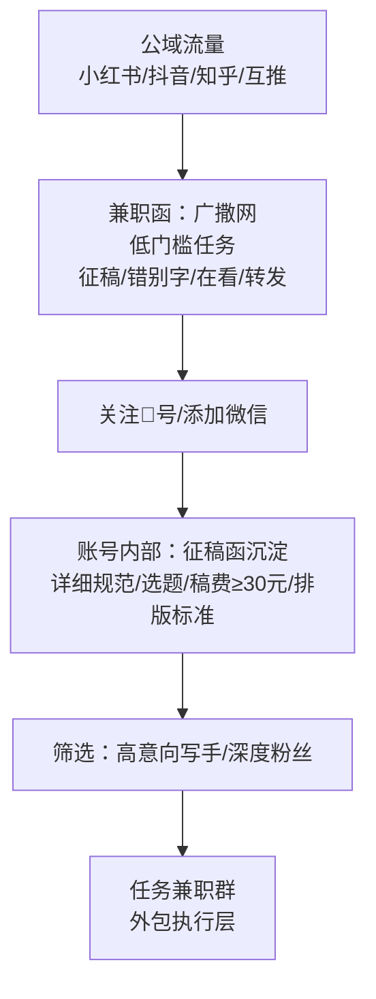


## 32.7 白名单互推机制 —— 公域内容免费互换的“隐形流量池”

### 为什么需要这个概念？

新号原创内容产能有限，无法维持高频更新。付费投放成本高、风险大，新手难以承担。利用生态规则免费获取优质内容、实现粉丝跨账号流动。

### 核心定义

双方开通原创白名单后，可免费转载对方文章且不显示来源。实现内容互补(补频次/蹭热度)与粉丝跨账号流动。零成本、高信任、强合规的内容分发协议。

### 关键性质

号主普遍愿意互开白名单(互利互惠，扩大分发)。转载不显示原来源，视同原创，保护账号垂直度与权重。解决冷启动期“1原创+1征稿+1转载”中的“转载”环节。

### 典型例子

作者早期通过白名单转载大号情感文章，维持周更2-3频次。白名单互推配合征稿/原创，构建“低成本高频次”内容供给体系。

### 边界条件

必须双方均具备原创权限(原创保护开通)。转载内容需垂直匹配本账号定位，否则稀释标签导致推荐精度下降。长期依赖转载无法建立自有IP，必须逐步提升原创占比。

> "我们平时的内容，除了征稿以及自己原创之外，还可以转载。我们找到其他号主给我们开白名单，这样就可以免费转载其他号主的文章了。号主都是非常愿意互开白名单的...开白名单就不会在转载的时候显示原来的账号来源"
> 
> ——《👸号运营实战指南 VjTFdmoIhoOIuhx4wYUcc1XGn8g.md》 P05

> "账号刚刚起步可以一周2-3更，可以以1原创+1征稿+1转载的形式"
> 
> ——《👸号运营实战指南 VjTFdmoIhoOIuhx4wYUcc1XGn8g.md》 P05

### 白名单互推执行流程

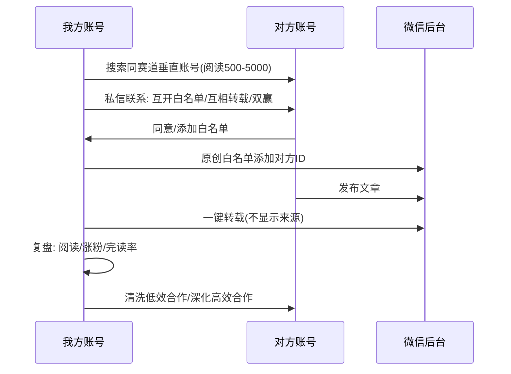

**作用解释**：该时序图标准化了白名单互推的全流程执行动作。从同赛道垂直账号筛选（阅读500-5000为最佳合作区间），到私信沟通达成互利共识，再到后台技术配置（添加白名单ID）、内容转载执行（一键转载不显示来源），最后以数据复盘驱动合作优化（清洗低效/深化高效）。这一流程将非标准化的人际协作转化为可复制、可迭代的标准化作业程序（SOP），是冷启动期零成本获取优质内容与精准流量的核心操作手册。

## 32.8 账号注册与后台核心配置清单 —— 避坑指南与基建标准化

### 为什么需要这个概念？

注册环节决策失误(主体/类型/邮箱/微信号)不可逆或修改成本极高。后台核心功能未开启(白名单/自动回复/菜单/水印)直接影响运营效率。新手极易踩“名称/头像/微信号修改次数限制”等隐形坑。

### 核心定义

注册铁律：个人主体 + 订阅号类型 + 唯一邮箱 + 管理员实名绑定银行卡。修改限制策略：头像月改5次/名称年改2次/微信号年改1次/简介可随时改。后台必开清单：原创白名单、自动回复三件套、自定义菜单、合集标签、用户画像、流量主、隐私设置可搜索、水印设置不添加。

### 关键性质

订阅号日更1次适配个人IP运营节奏，服务号月更4次不适合内容型账号。自动回复(关键词/被关注/收到信息)是私域承接的“无人值守前台”。隐私设置“可搜索”+ 水印“不添加”是流量获取与用户体验的基础配置。

### 典型例子

作者因不知“微信号一年仅能设置一次”导致账号ID非品牌词，长期影响搜索引流。未开“图片水印不添加”导致转载图片带水印，严重降低阅读体验与转发率。

### 边界条件

企业主体注册需营业执照，审核周期长，非新手首选。已认证账号迁移留言功能需“个人号→企业号→有留言权限老号”两次迁移，成本高。名称/微信号修改极其慎重，建议注册前完成品牌词库检索与商标查重。

> "我们一般选择的是个人为主体的订阅号...订阅号每天能够群发一次，适用于个人"
> 
> ——《👸号运营实战指南 VjTFdmoIhoOIuhx4wYUcc1XGn8g.md》 P06

> "头像（一个月只能修改5次...）；👸号名称（一年只能修改2次...）；微信号设置（一年只能设置一次）"
> 
> ——《👸号运营实战指南 VjTFdmoIhoOIuhx4wYUcc1XGn8g.md》 P06

> "自动回复分为：关键词回复、收到信息回复、被关注回复...自定义菜单...合集标签...用户分析...流量主...隐私设置要设置为能够搜索到👸号。图片水印设置为不添加"
> 
> ——《👸号运营实战指南 VjTFdmoIhoOIuhx4wYUcc1XGn8g.md》 P06

### 账号注册铁律与后台配置执行清单

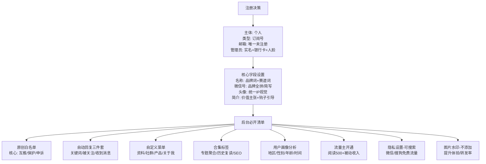

**作用解释**：该流程图将账号注册与后台配置的全链路决策点标准化为可执行的清单。从注册层的四大铁律（主体/类型/邮箱/管理员），到核心字段的品牌化设置策略（名称/微信号/头像/简介），再到后台八大必开功能的逐项落地，每一节点都标注了核心作用与避坑要点。这不仅是基建检查表，更是规避不可逆决策陷阱的“防错器”执行工单。

## 32.9 排版黄金参数标准 —— 阅读体验的“工业化规格书”

### 为什么需要这个概念？

排版混乱直接导致完读率暴跌、转发率归零、粉丝流失。缺乏统一标准导致协作混乱、品牌视觉无记忆点。移动端阅读场景对字号/行距/缩进极其敏感。

### 核心定义

硬性参数：正文15号字、两端缩进8、字间距1、行间距1.75。结构五段式：封面统一风格 + 头图强IP + 标题分割标识 + 插图控节奏 + 底图引互动。色系统一：全文建立账号主题色，图片风格/配色/字体高度统一。

### 关键性质

15号字兼顾阅读舒适度与单屏信息密度的黄金平衡点。行间距1.75消除移动端拥挤感，显著提升完读率。统一视觉风格 = 专业信任感 = 更高广告报价与转化率。

### 典型例子

木子田PPT IP：统一封面大字报风格后主页转粉率从个位数提升至10%+。作者账号确立主题色后，粉丝形成“看到这色系就知道是你”的品牌认知。

### 边界条件

过度设计(花哨动效/多字体/乱配色)反而破坏阅读沉浸感。图片宽度必须适配微信编辑器自适应，避免两侧留白或溢出。代码块/长图/视频等特殊元素需单独制定排版规范。

> "正文字号15 两端缩进8 字间距1 行间距1.75"
> 
> ——《👸号运营实战指南 VjTFdmoIhoOIuhx4wYUcc1XGn8g.md》 P07

> "推文中的图片分为这几个部分：1、封面图 2、头图 3、标题、分割标识 4、插图 5、底图...图片和颜色和风格最好能够统一，有一个账号主题色"
> 
> ——《👸号运营实战指南 VjTFdmoIhoOIuhx4wYUcc1XGn8g.md》 P07

### 排版黄金参数可视化规范

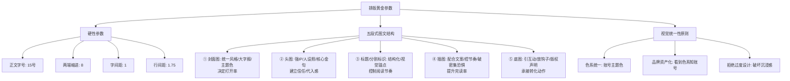

**图解说明**：该可视化规范将排版标准拆解为三个维度的工业化参数。硬性参数层（15号字/缩进8/字间距1/行间距1.75）是移动端阅读体验的物理基线，经大量实测为黄金平衡点；五段式图文结构层定义了每个图片位置的功能性使命（封面定打开、头图建信任、标题控节奏、插图破恐惧、底图促转化），形成内容生产的结构化模板；视觉统一性原则层确立主题色制度，将零散排版动作升级为品牌资产积累过程。三层规范共同构成了“所见即所得”的内容生产质量保证体系。

## 32.10 外部引流“找车/上车”成本控制法 —— 付费投放的“记账复盘”铁律

### 为什么需要这个概念？

公域付费投放(小红书/抖音/知乎)成本不透明、效果波动大、易被坑。无记录无复盘 = 盲目烧钱，无法沉淀高ROI投放经验。必须建立“找车(自找博主) > 上车(拼车)”的优先级执行原则。

### 核心定义

建立引流记录表：记录单车成本、涨粉数、单粉成本、阅读带动比。找车优先：自找博主占首位宣传位、成本可控、数据真实。上车次之：拼车按位置分价、尾部位置性价比低、易遇“刷量车”。数据复盘：筛选高ROI博主类型，建立“白名单投放库”。

### 关键性质

成本控制核心：单粉成本 = 核心KPI，而非单纯涨粉数。阅读带动比 = 引流带来的自然阅读增量 / 投放成本，衡量流量质量。执行纪律：每车必记、周复盘、月清洗低ROI渠道。

### 典型例子

作者通过表格复盘发现：按百阅5-8元计价的征稿号性价比 > 一口价大号。同量级互推免费且精准，但前提是自身已有基础数据(阅读/粉丝)。

### 边界条件

联合红包抽奖虽涨粉快但违规风险高、泛粉多、后续转化极低。社群/星球引流粉丝质量高但量少、运营成本高，不适合冷启动期。新号无数据无法互推，必须先跑通“自找车”积累初始数据资产。

> "引流记录是用来干嘛的？第一，我们找车、上车会产生一定费用，需要表格记录来控制我们的上车成本；第二，我们需要根据表格记录上车的效果，来根据数据分析上哪些类型的账号效果更好"
> 
> ——《👸号运营实战指南 VjTFdmoIhoOIuhx4wYUcc1XGn8g.md》 P08

> "自己找“车”，相当于自己找博主，可以免费占据第一个宣传位。“上车”“找车”部分有号主圈自己的规则...几个号主一起到公域宣传的动作就是“上车”"
> 
> ——《👸号运营实战指南 VjTFdmoIhoOIuhx4wYUcc1XGn8g.md》 P08

### 引流记录表结构定义

以下为标准化引流记录表模板，每一次投放实验必填：

| 字段 | 说明 | 核心KPI |
|------|------|---------|
| 渠道名称 | 博主账号/平台 | - |
| 投放形式 | 单推/互推/拼车/红包 | - |
| 花费(元) | 实际支付金额 | 成本控制 |
| 新增粉丝 | 后台数据 | 效果量化 |
| 单粉成本 | 花费/新增粉丝 | **核心KPI** |
| 阅读带动比 | 引流带来自然阅读增量/投放成本 | 流量质量 |
| ROI | 变现收入/花费 | 商业闭环 |
| 备注 | 博主类型/合作细节 | 经验沉淀 |

**作用解释**：该记录表是外部引流成本控制法的核心数据资产。每一次投放都是一次实验，记录表将主观决策转化为客观数据资产。单粉成本是核心KPI，但阅读带动比才是流量质量的试金石——低单粉成本但阅读带动比极低的渠道，往往带来的是僵尸粉或泛流量，无法支撑后续变现；反之，单粉成本稍高但阅读带动比高的渠道，带来的往往是高意向精准粉丝，长期ROI更优。周复盘筛选高ROI博主类型，月清洗低效渠道，最终沉淀出专属的“白名单投放库”，这是账号最核心的护城河之一。

### 找车 vs 上车 优先级决策树

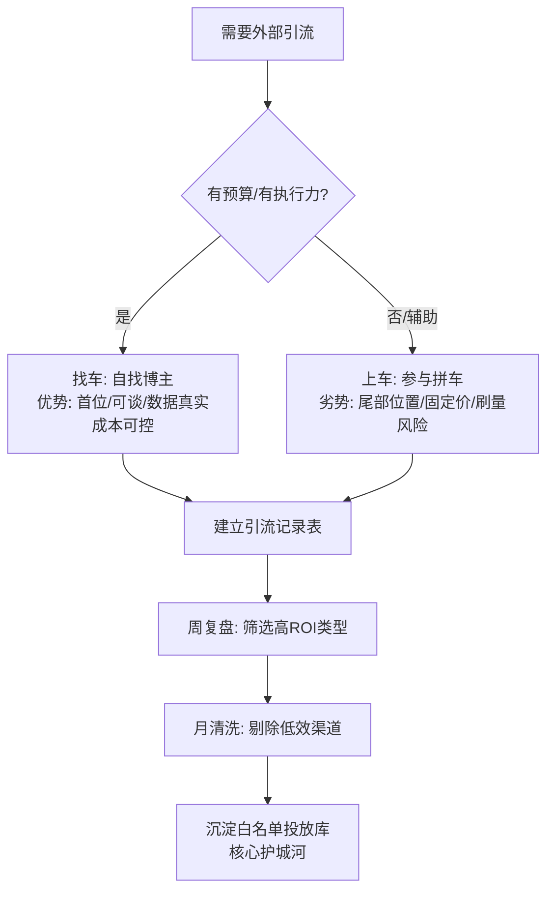

**图解说明**：该决策树确立了外部引流的执行优先级与复盘闭环。有预算有执行力时，首选“找车”（自找博主），优势在于占据首位宣传位、价格可谈、数据真实可控；预算不足或作为辅助时，选择“上车”（参与拼车），但需警惕尾部位置性价比低、刷量车风险。无论哪种路径，汇聚至“建立引流记录表”这一强制动作，再通过“周复盘筛选—月清洗剔除”双频次复盘机制，最终沉淀“白名单投放库”这一核心数据资产。这套机制将非标准化的媒介采买转化为可量化、可复用、可资产化的投放能力模型。

## 32.11 社群分层运营体系 —— 私域流量的“蓄水池/执行层/转化池”三层架构

### 为什么需要这个概念？

将所有用户扔进一个大群 = 广告刷屏、有效信息沉底、信任崩塌、转化为零。不同深度用户需求完全不同：泛连接/协作执行/深度成长。必须按参与深度分层，实现分级运营、精准触达。

### 核心定义

L1 读者群：大容量、弱连接、蓄水池、日常通知/福利分发/氛围维护。L2 任务/兼职群：中容量、强协作、外包执行层(征稿/改稿/排版/引流)。L3 打卡/自律群：小容量、高粘性、高客单价转化前置池(课程/社群/咨询)。

### 关键性质

用户可跨层流动：读者群活跃/产出 → 邀入任务群 → 成交高客单 → 升级打卡群。群规模与运营成本反比：大群靠规则自治，小群靠高频服务。每层群对应不同变现产品：读者群→广告/CPA，任务群→低价资料/工具，打卡群→高价课程/咨询。

### 典型例子

作者建立“任务兼职群”外包征稿/排版/引流，实现“用钱买时间换体量”。“打卡群”成员高频互动、高信任度，直接转化“失重限期”式高客单课程。

### 边界条件

规则先行原则：入群前必须设定准入门槛/发言规范/违规处罚/活动节奏。规则越细致，运营介入成本越低，混乱概率越小，信任感越强。严禁在读者群硬广推销，严禁任务群讨论无关闲聊，严禁打卡群灌水。

> "1、读者群 2、任务兼职群 3、打卡群...我们做社群的目的就是为了拉近和粉丝的距离，提高粉丝粘性，或者让粉丝参与到👸号的运营中来"
> 
> ——《👸号运营实战指南 VjTFdmoIhoOIuhx4wYUcc1XGn8g.md》 P09

> "社群运营最重要的，就是自己制定好社群规则，规则制定好了，就能少出现社群混乱的现象。"
> 
> ——《👸号运营实战指南 VjTFdmoIhoOIuhx4wYUcc1XGn8g.md》 Theorem

### 社群三层架构流动模型

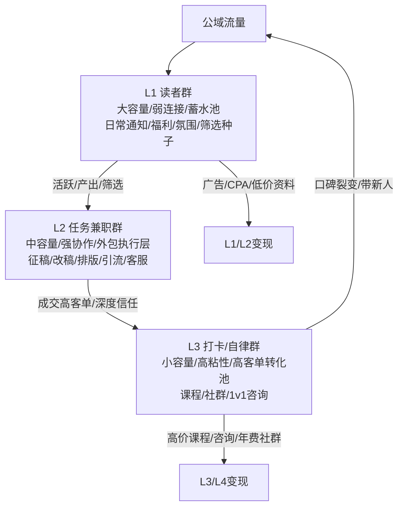

**图解说明**：该模型展示了私域流量的分层蓄水与转化闭环。公域流量首先沉淀至L1读者群（大容量蓄水池，承接广告/CPA变现），通过活跃度与内容产出筛选种子用户流入L2任务兼职群（中容量外包执行层，产出征稿/排版/引流等运营杠杆），深度信任用户再升级至L3打卡/自律群（小容量高客单转化池，承接课程/咨询/年费社群等高利润产品）。L3用户通过口碑裂变反哺公域流量，形成飞轮效应。三层群规模递减、粘性递增、客单价递增，实现了运营成本与转化收益的最优匹配。

### 社群规则前置原则执行清单

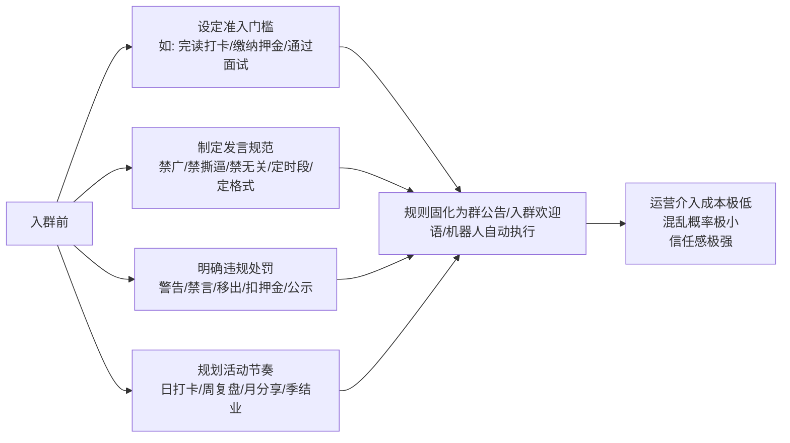

**作用解释**：该执行清单将“规则先行”原则落地为入群前必须完成的四大标准化动作：准入门槛（筛选同频人）、发言规范（维护讨论质量）、违规处罚（建立秩序预期）、活动节奏（提供确定性陪伴）。规则固化为群公告/欢迎语/机器人自动执行后，运营介入成本极低、混乱概率极小、信任感极强。反面案例：无规则的大群必然演变为广告灌水场，有效信息沉底，核心用户流失，最终群死活死。

## 32.12 个人IP强标签 —— 让用户“一提到X就想到你，一提到你就想到X”

### 为什么需要这个概念？

无标签 = 无记忆点 = 无溢价 = 无复购 = 纯流量贩子。强标签是突破广告报价天花板、解锁高客单价变现的核心杠杆。只有“可被瞬间联想的关键词”才能建立认知护城河。

### 核心定义

基于账号定位提炼的核心人设关键词(如“自律、搞钱狂魔”)。通过高频人设文输出建立：总述版画像(总) + 分项深度展开(分)。标准：一提到人想到特质，一提到特质想到人。

### 关键性质

认知护城河：降低用户决策成本，直接提升广告溢价与产品转化率。内容生产指南针：所有内容围绕强标签展开，拒绝偏离定位的“流量贪婪”。商业资产化：强标签账号可估值、可转让、可授权、可矩阵化复制。

### 典型例子

“失重限期”彩卉：强标签“女性成长/自律/搞钱”，7w粉实现广告+课程双变现。对比“某可复制情感号”：无强标签、纯引流、8w粉仅靠广告/CPA、变现上限封死。

### 边界条件

标签必须真实源于创作者经历/优势，虚构人设必翻车(如“假大款/假专家”）。早期内容垂直度要求极高：发非垂直内容(日常/染发)数据极差、算法打标偏移。强标签建立需长周期：作者建议“总分结构”系统性输出人设文，而非零碎碎片。

> "只要一提起你，就会让人想到这个强标签...你一提到这个人，就能想起他的特质，或者一提到这个特质，就能想到这个人，这就是我们打强标签的意义"
> 
> ——《👸号运营实战指南 VjTFdmoIhoOIuhx4wYUcc1XGn8g.md》 P10

> "我们打造人设的一个思路：从总到分。首先有一篇对你个人特点进行概括的文章...再去抓取我们想要展示的鲜明特点，对应写针对特点的详细文章"
> 
> ——《👸号运营实战指南 VjTFdmoIhoOIuhx4wYUcc1XGn8g.md》 P10

### 个人IP强标签总分结构输出法

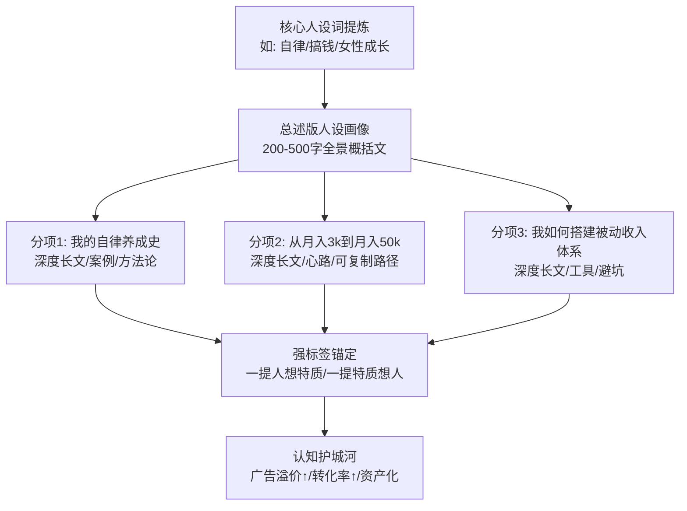

**图解说明**：该图展示了强标签构建的“总分结构”内容生产范式。起点是提炼核心人设词（需真实源于创作者经历），输出一篇总述版人设画像文（200-500字全景概括），再拆解为3-5个分项深度展开长文（各聚焦一个鲜明特点，含案例/方法论/可复制路径）。这种结构化输出而非零碎碎片，能在用户心智中快速锚定“强标签”，形成“提人想特质、提特质想人”的双向认知链接，进而转化为广告溢价提升、转化率提升、账号资产化的商业护城河。

## 32.13 变现四阶梯进阶定律 —— 👸号商业化的“技能点依次点满”铁律

### 为什么需要这个概念？

新手妄想跨级变现(如刚起号就想卖课)，必死无疑。不同阶段核心能力、资源需求、风险容错完全不同。必须明确当前所处阶段，集中资源攻克当阶段关键指标。

### 核心定义

L1：阅读200-300 → 接直投广告(引流即可，IP锦上添花)。L2：日增100粉 → 接CPA广告(引流即可，IP锦上添花)。L3：强IP → 分销他人产品赚佣金(需强IP，不可跨级)。L4：强IP → 售卖自有课程/社群(需强IP，终局形态)。

### 关键性质

阶梯锁死顺序：技能点必须依次点满，不可跳级(如L1直接上L3必翻车)。前两阶段(L1/L2)核心能力是“引流”，IP仅为锦上添花。后两阶段(L3/L4)核心能力是“IP/信任”，引流仅为前置条件。IP强弱不影响L1/L2广告收入上限，但决定能否跨越至L3/L4。

### 典型例子

“某可复制情感号”：卡在L2，8w粉、千阅、月入四五位数，纯广告/CPA，无IP无法进阶。“失重限期”：跨越L3/L4，7w粉、均阅1300+、广告0.5-0.7元/阅，解锁课程社群变现。

### 边界条件

L1/L2门槛低、上限低、抗风险弱(平台规则变动/广告主减预算即死)。L3/L4门槛高(需强IP/标准化交付/售后体系)，但上限高、复利强、抗风险。判断“强IP”标准：粉丝购买概率高(3000粉产30单 vs 1万粉产5单)。

> "👸号的变现进阶之路：（1）阅读达到200-300可接直投广告（IP锦上添花，引流可达到）（2）日增100粉可接cpa（IP锦上添花，引流可达到）（3）个人IP强，分销别人的产品赚取佣金（需要强个人IP）（4）个人IP强，自己有课程产品，可销售自己的产品（需要强个人IP）从1到4技能点依次点满。"
> 
> ——《👸号运营实战指南 VjTFdmoIhoOIuhx4wYUcc1XGn8g.md》 P11

> "强个人IP，能够使广告报价提升（粉丝信任，购买概率高），但不够强的话，对于只想通过广告赚取收入的号主来说差别不大。"
> 
> ——《👸号运营实战指南 VjTFdmoIhoOIuhx4wYUcc1XGn8g.md》 P11

### 变现四阶梯进阶路径图

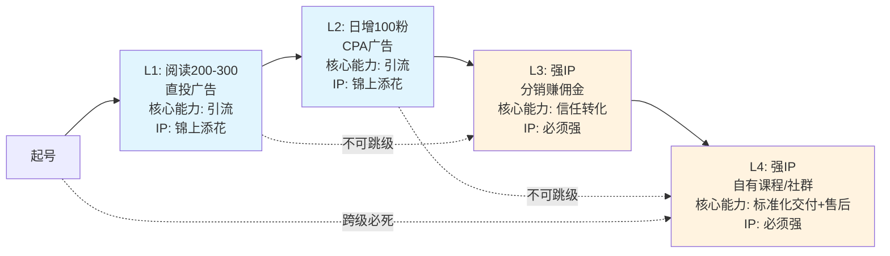

**图解说明**：该路径图以颜色区分标注了变现四阶梯的能力边界。蓝色区域（L1/L2）为“引流驱动区”，核心能力是流量获取，IP仅为锦上添花，门槛低但天花板低、抗风险弱；橙色区域（L3/L4）为“IP驱动区”，核心能力是信任转化与标准化交付，门槛高但上限高、复利强、抗风险强。红色虚线标注的跨级路径均标注“必死”，强制执行“技能点依次点满”的铁律。判断强IP的量化标准（3000粉产30单 vs 1万粉产5单）给出了跨越L2→L3的硬性门槛。

### 广告报价双决定因子定律

> "直投广告报价高低，主要看的是阅读量、粉丝粘性（购买的概率）、粉丝数量以及购买力女性粉丝占比。cpa广告收入主要和外部涨粉（公域平台...引流来的粉丝数量）有关"
> 
> ——《👸号运营实战指南 VjTFdmoIhoOIuhx4wYUcc1XGn8g.md》 Theorem

> "强个人IP，能够使广告报价提升（粉丝信任，购买概率高），但不够强的话，对于只想通过广告赚取收入的号主来说差别不大。"
> 
> ——《👸号运营实战指南 VjTFdmoIhoOIuhx4wYUcc1XGn8g.md》 Theorem

**定律表述**：直投广告报价 = f(阅读量, 粉丝粘性/购买力女性占比)；CPA广告收入 = f(外部引流涨粉量)。IP强弱不影响前两阶段广告收入上限，但决定能否跨越至L3/L4高客单价变现阶段。

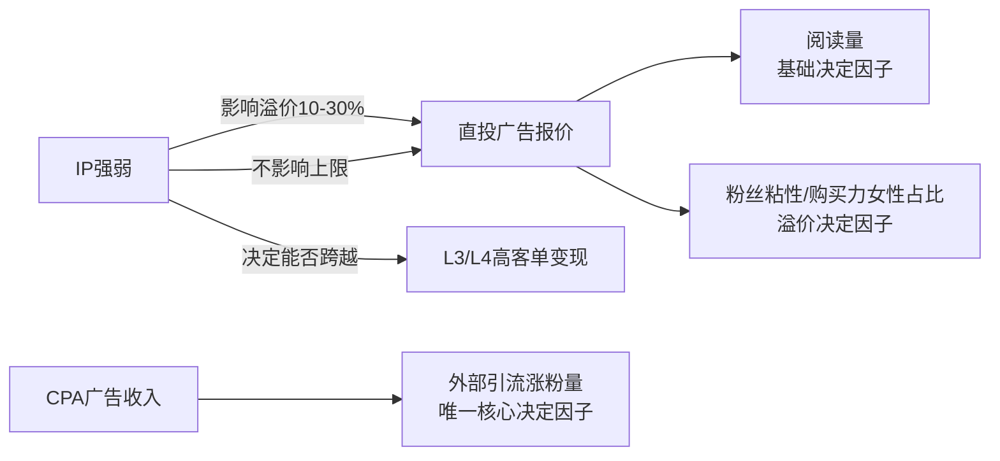

**图解说明**：该图解析了广告报价的双决定因子机制。直投广告报价由“基础决定因子”（阅读量）与“溢价决定因子”（粉丝粘性/购买力女性占比）共同决定，IP强弱仅作用于溢价层面（影响幅度10-30%），不改变广告收入的基础上限；CPA广告收入则完全由“外部引流涨粉量”这一单一因子决定，与IP强弱无关。IP强弱的真正战略价值在于“决定能否跨越至L3/L4高客单变现”——这是质变的分水岭，而非量变的调节器。

## 32.14 内容生产“1原创+1征稿+1转载”黄金节奏 —— 冷启动期的“低成本高频次”供给模型

### 为什么需要这个概念？

新号原创产能极低(作者仅能周更1篇)，无法满足算法活跃度要求。全原创成本太高、周期太长、抗风险弱(一篇爆款撑不起账号)。需要一套“可控成本、可控频次、可控质量”的内容供给组合拳。

### 核心定义

1原创：建IP/建信任/跑调性/打标签，核心资产。1征稿：降成本/存量内容/筛选写手/建素材库，现金流。1转载(白名单)：补频次/蹭热度/维持活跃/零成本，流量兜底。合成周更2-3频次，平衡质量/成本/算法活跃度。

### 关键性质

三者缺一不可：无原创无IP、无征稿累死、无转载断更。征稿稿费≥30元是筛选优质写手、保证内容质量的关键阈值。白名单转载不显示来源，视同原创，不稀释账号垂直标签。

### 典型例子

作者早期严格执行此节奏，单人运营维持周更3篇，成本可控、数据稳健。木子田PPT IP：对标拆解建库 → 爆款四要素制作 → 单条视频引流300+精准粉。

### 边界条件

随账号成长需动态调整：IP强后原创占比必须提升至80%+。征稿稿件必须严格审核(三审制)：价值观/专业度/排版规范，防翻车。转载内容必须高度垂直匹配，泛娱乐/营销号内容严禁转载。

> "账号刚刚起步可以一周2-3更，可以以1原创+1征稿+1转载的形式，仅供大家参考，按照自己节奏调配就好啦。"
> 
> ——《👸号运营实战指南 VjTFdmoIhoOIuhx4wYUcc1XGn8g.md》 P12

> "我们找到其他号主给我们开白名单，这样就可以免费转载其他号主的文章了。"
> 
> ——《👸号运营实战指南 VjTFdmoIhoOIuhx4wYUcc1XGn8g.md》 P12

### 内容生产黄金节奏动态调整机制

```mermaid
graph LR
    A[冷启动期 0-3个月] --> B[1原创: 33%<br/>建IP/打标签<br/>深度≥2000字]
    A --> C[1征稿: 33%<br/>降成本/存量/筛选写手<br/>稿费≥30元/三审制]
    A --> D[1转载: 33%<br/>补频次/蹭热度/零成本<br/>白名单/高度垂直]
    B --> E[成长期 3-12个月]
    C --> E
    D --> E
    E --> F[原创占比 50%+<br/>征稿 30%<br/>转载 20%]
    F --> G[成熟期 12个月+]
    G --> H[原创占比 80%+<br/>征稿 15%(优质筛选)<br/>转载 5%(仅蹭大热点)]
```

**图解说明**：该动态调整机制图揭示了内容生产策略随账号生命周期的演进规律。冷启动期（0-3个月）三元结构均衡（各33%），以组合拳对抗单一产能瓶颈；成长期（3-12个月）原创占比提升至50%+，征稿转载比例下降，开始确立自有内容护城河；成熟期（12个月+）原创占比80%+，征稿仅保留优质筛选，转载仅蹭大热点，完全转向自有IP驱动模式。每个阶段标注的关键执行标准（深度≥2000字、稿费≥30元/三审制、白名单/高度垂直）构成了该阶段的质量红线。

## 32.15 留言功能迁移获取决策树 —— 个人号开通留言的“唯一合规路径与ROI判断”

### 为什么需要这个概念？

2018年后注册个人订阅号永久失去留言功能，严重限制互动与转化。留言区是“高信任/高转化/高复购”评论生态的核心阵地。迁移成本高(需专业机构/多次迁移/费用不菲)，必须计算ROI再决策。

### 核心定义

唯一合规路径：个人订阅号 → 迁移至企业号 → 迁移入具留言权限的老订阅号。前置条件：需专业机构操作、有费用、耗时、存在迁移失败风险。建议决策树：变现稳定后再开通，且需满足“有粉丝基数+有优质内容+有互动规则设计”三条件。

### 关键性质

企业号可与个人号互迁，但个人号不可互迁(政策红线)。留言功能 = 互动率提升3-5倍 + 转化率提升2-3倍 + 用户画像精准度质变。迁移成本通常在数千-万元级，属于“规模化阶段”基建投入。

### 典型例子

作者建议：资金不足/刚起步的小白“先不考虑开留言”，专注内容与引流。成熟IP号(如“失重限期”)开通留言后，评论区成为高价值UGC内容库。

### 边界条件

迁移后原账号粉丝/文章/数据全量继承，但需重新绑定开发者工具/商户号。迁移期间账号不可操作(通常1-3天)，需提前预告粉丝。留言区必须配套“互动规则设计”(置顶精选/关键词回复/定期活动)，否则沦为广告灌水区。

> "2018年3月之后我们注册的👸号都不再具备留言功能，所以我们想要开设留言功能，就需要找到一个具有留言功能的账号进行迁移。迁移的逻辑是：企业号可以和个人号相互迁移，但是个人号不能和个人号相互迁移。"
> 
> ——《👸号运营实战指南 VjTFdmoIhoOIuhx4wYUcc1XGn8g.md》 P13

> "我个人建议现在的小白宝子，如果资金不是很支持，或者刚刚起步，开了留言功能也用不上，那可以先不考虑开留言。"
> 
> ——《👸号运营实战指南 VjTFdmoIhoOIuhx4wYUcc1XGn8g.md》 P13

### 留言功能迁移唯一合规路径

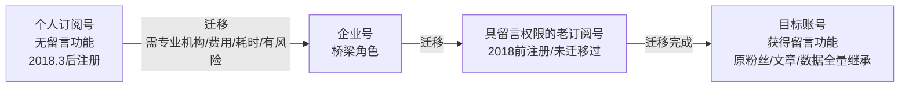

**图解说明**：该流程图揭示了个人订阅号获取留言功能的唯一合规技术路径。受限于微信政策“个人号不可互迁”红线，必须借助企业号作为桥梁，完成“个人号→企业号→有留言权限老号”两次迁移。全程需专业机构操作，涉及费用、耗时、迁移失败风险，迁移后数据全量继承但需重新绑定开发工具。这是一项典型的“规模化阶段基建投入”，非冷启动期所需。

### 留言功能开通决策树

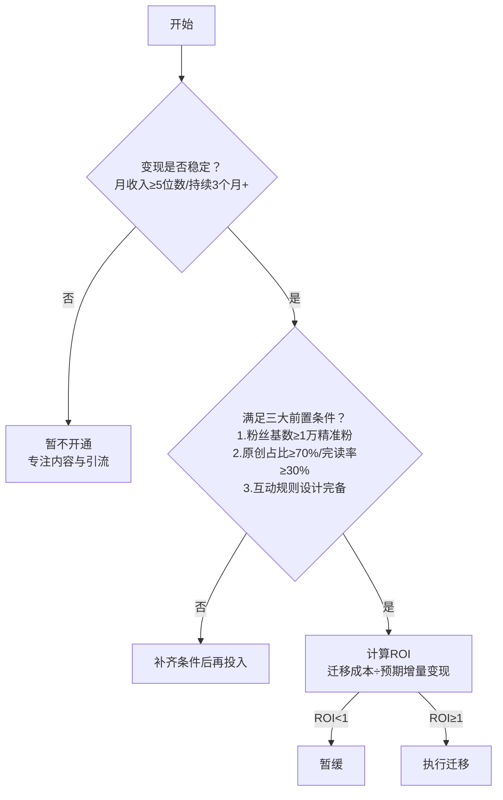

**图解说明**：该决策树建立了留言功能开通的ROI导向判断标准。首节点判断变现稳定性（月收入≥5位数持续3个月+），未达标直接终止；次节点验证三大前置条件（粉丝基数/内容质量/互动规则），缺一不可；终节点计算ROI（迁移成本÷预期增量变现），仅当ROI≥1时执行迁移。这套决策树杜绝了“为了开留言而开留言”的冲动性基建投入，将功能获取纳入商业投资回报的理性评估框架。

## 32.16 多源对照：不同实战派对“👸号变现”的共识与分歧

本章核心方法论主要基于王大牙（VjTFdmoIhoOIuhx4wYUcc1XGn8g.md）一篇约1.3万字的系统性实战指南。结合生财有术社群内其他实战派（如龙哥SUMMARY.md、根源041.md、芷蓝等）的观点，形成以下多源对照：

### 共识

以下表格汇总了各实战派在核心方法论上的高度共识：

| 核心观点 | 王大牙 | 龙哥(SUMMARY) | 芷蓝/根源 | 共识强度 |
|----------|--------|---------------|-----------|----------|
| 新手赛道首选情感IP | ✅ 详细论证三大维度 | ✅ 推荐为唯一最优解 | ✅ 隐含认可 | ⭐⭐⭐⭐⭐ |
| 变现倒推定位 | ✅ 核心策略框架 | ✅ 先定变现再定内容 | ✅ 动态定位服务变现 | ⭐⭐⭐⭐⭐ |
| 引流+IP双轮驱动 | ✅ 系统性定义双轮分工 | ✅ 引流造势+IP留量 | ✅ 暴力交付/选客户即IP建设 | ⭐⭐⭐⭐ |
| 钩子设计利益交换 | ✅ 双钩子漏斗模型 | ✅ 征稿函/兼职函/资料包 | ✅ 付费即筛选/信任源于交换 | ⭐⭐⭐⭐ |
| 四阶梯不可跨级 | ✅ 严格L1→L2→L3→L4 | ✅ 技能点依次点满 | ✅ 认知接口/暴力交付对应L3/L4 | ⭐⭐⭐⭐ |
| 标准化SOP执行 | ✅ 全流程表格化/清单化 | ✅ 执行力>创意/认知 | ✅ 核心三件事/外包杠杆 | ⭐⭐⭐⭐ |

### 分歧

以下表格梳理了各派系在执行细节与策略取舍上的分歧本质：

| 议题 | 王大牙 | 其他派系 | 分歧本质 |
|------|--------|----------|----------|
| 征稿稿费阈值 | ≥30元为经验阈值 | 部分派系主张50-100元起步 | 筛选门槛vs获取成本的权衡 |
| 白名单互推依赖度 | 冷启动核心手段(1/3内容) | 部分派系主张全原创、拒绝转载 | 内容产能vs账号权重的博弈 |
| 留言功能必要性 | 建议变现稳定后再迁移，ROI导向 | 部分派系视为标配、早期必争 | 基建投入时机的阶段性判断 |
| 社群分层颗粒度 | 三层（读者/任务/打卡） | 部分派系细分至5-7层 | 管理成本vs精准转化的边际收益 |
| 广告避坑红线 | 列举7类高风险类别 | 部分派系接“擦边广告”赚快钱 | 长期主义vs短期现金流的价值观差异 |

## 32.17 设计中的取舍

### 问：为什么不用“全原创”而是“1原创+1征稿+1转载”？

全原创看似高大上，实则是新手的“自杀式冲锋”。单人产能上限：周更1篇已是极限，算法判定低活跃 → 权重衰减 → 流量枯竭。成本不可控：一篇深度原创需4-8小时，机会成本极高（这8小时可做3次引流、谈2个广告主）。抗风险为零：一篇爆款撑不起账号，一篇违规毁掉账号。组合拳的工程化逻辑：原创打标签（质量）、征稿补数量（成本）、转载蹭热度（流量）→ 三角稳固结构。征稿稿费≥30元 = 用钱买时间买质量买写手资产。白名单转载 = 零成本获取已验证爆款内容 + 算法友好。

### 问：为什么“L1/L2靠引流，L3/L4靠IP”不能颠倒？

广告主买的是“曝光量”，只要阅读/粉丝达标，IP强弱只影响溢价10-30%，不影响能否接单。用户买课程/咨询买的是“确定性结果”，无信任背书 = 购买概率趋近于0。跨级的代价：L1直接上L3，无信任积累 → 转化率极低 → 退款投诉 → 账号信誉破产 → 连L1也做不了。

### 问：为什么“找车 > 上车”且必须建表复盘？

信息不对称是最大成本：博主报价通常含50-200%溢价，自己找车可谈至成本价。数据资产化：每一次投放都在积累“渠道-人群-转化”的私有数据模型，这是核心护城河。不建表 = 赌博，建表 = 投资。作者通过表格复盘发现征稿号按百阅5-8元性价比最高，这类洞察只能来自数据沉淀。

## 32.18 动手练习

### 练习 1：👸号定位与变现路径倒推演练

假设你是一名考公上岸的应届生，想做👸号副业：

2. 对每种方式，倒推所需的账号定位、目标受众画像、核心内容方向
3. 根据你的时间/精力/资源现状，判断哪种方式最适合作为 L1/L2 起步目标？为什么？

**回答问题**：
- 为什么说“变现方式决定内容方向”而非“内容方向决定变现方式”？

### 练习 2：引流钩子设计与成本核算实战

为上述考公账号设计双钩子体系：

1. 设计一份“兼职函”：包含 3-5 个低门槛任务（如纠错、转发、在看、投稿、找资料），定价策略如何平衡“广撒网”与“筛选质量”？
2. 设计一份“征稿函”：规定投稿选题方向、字数要求、排版标准、稿费标准（≥30元）、审核流程
3. 制作引流记录表模板：字段含渠道名称/投放形式/花费/新增粉丝/单粉成本/阅读带动比/ROI/备注

**回答问题**：
- 为什么说“稿费 < 25 元引来的粉丝质量参差不齐”？这背后的筛选心理机制是什么？
- 若某渠道单粉成本 8 元但阅读带动比极低，另一渠道单粉成本 12 元但阅读带动比高，你会如何决策？依据是什么？

### 练习 3：内容生产节奏与社群分层模拟

模拟账号冷启动前 4 周运营计划：

1. 制定 4 周内容排期表：每周安排 1 篇原创（定选题/大纲/初稿/定稿/排版/发布节点）、1 篇征稿（发函/收稿/审核/排版/发布节点）、1 篇白名单转载（对接号主/获文/排版/发布节点）
2. 规划社群分层启动时间表：第几周建读者群？第几周招募任务群写手？第几周筛选打卡群种子用户？各层群规则核心条款各 3 条
3. 设计“个人IP强标签”提炼练习：写出你的“总述版人设画像”(200字) 与 3 个“分项深度展开”标题

**回答问题**：
- 冷启动期为何必须“1原创+1征稿+1转载”三管齐下？缺一不可的边界条件是什么？
- 社群规则“越细致，运营介入成本越低”的底层逻辑是什么？请举一反面例子说明规则缺失的后果。

### 练习 4：变现阶梯自测与广告避坑演练

假设你的账号运营 3 个月，现状：粉丝 5000，均阅 800，日增粉 50，已接 3 条直投广告(单价 300 元)，无 CPA 经验，无自有产品：

1. 根据“变现四阶梯”判断你当前处于 L1 还是 L2？跨越到下一阶梯的关键指标缺口在哪里？
2. 列举素材中“7 类高风险广告红线”，结合考公赛道特性，分析哪 2 类最容易误触？如何识别规避？
3. 计算：若你想在 6 个月内跨越至 L3(分销他人课程)，需要达成的“强IP”量化标准是什么？(参考：3000粉产30单 vs 1万粉产5单)

**回答问题**：
- 为什么“IP强弱不影响 L1/L2 广告收入上限，但决定能否跨越至 L3/L4”？
- 如果某广告主出价 0.8 元/阅读，但要求“后台回复引流 🐧 群”，你会接吗？依据素材中的哪条红线拒绝？

## 32.19 本章小结

这一章中我们系统学习了👸号从0到1的完整运营体系与变现进阶路径。首先我们确立了**情感IP号是新手最优赛道**的公理，从受众购买力、内容成本、粉丝粘性三维度论证了其不可替代性。其次我们掌握了**变现倒推定位法**——先定怎么赚钱，再定写什么、写给谁，避免“为内容而内容”的无效产出。接着我们建立了**引流-变现双轮模型**：引流轮负责造势冲数据（支撑L1/L2广告变现），IP轮负责留量筛选高信任粉丝（解锁L3/L4高客单变现），两轮分工明确、先后依赖。然后我们深度拆解了**钩子理论**（双钩子漏斗）、**白名单互推机制**（零成本内容分发）、**账号注册与后台配置清单**（防坑基建）、**排版黄金参数**（工业化规格书）、**找车/上车成本控制法**（数据化投放）、**社群分层运营体系**（三层架构分级转化）、**个人IP强标签**（认知护城河）、**变现四阶梯进阶定律**（技能点依次点满不可跨级）、**内容生产黄金节奏**（1原创+1征稿+1转载）、**留言功能迁移决策树**（ROI导向的基建投入）。最后通过多源对照、设计取舍分析、动手练习，将理论内化为可执行的标准化操作流程（SOP）。

本章我们一起学习了以下概念：

| 概念 | 解释 |
|------|------|
| 情感IP号 | 新手👸号变现最优赛道：女性受众高购买力、内容成本低、粘性强、广告报价高 |
| 变现倒推定位法 | 先定变现方式(广告/分销/自有产品/引流)→推导定位受众→决定内容方向，避免为内容而内容 |
| 引流-变现双轮模型 | 引流造势(数据好看冲阅读提报价)，IP留量(筛选高信任粉丝承接高客单)，先有流量IP才能变现 |
| 钩子理论 | 用征稿函/兼职函/资料包等利益诱饵交换用户关注；钩子性质决定粉丝画像(兼职钩子吸兼职粉) |
| 白名单互推机制 | 双方开原创白名单免费转载不显来源，零成本实现内容互补与粉丝跨账号流动 |
| 账号注册核心配置 | 个人主体+订阅号+唯一邮箱+实名绑定；后台必开白名单/自动回复/菜单/合集/用户画像/流量主/隐私可搜/水印不加 |
| 排版黄金参数 | 正文15号字/两端缩进8/字间距1/行间距1.75；五段式结构(封面/头图/标题/插图/底图)+色系统一 |
| 找车/上车成本控制 | 建引流记录表(单车成本/涨粉/单粉成本/阅读带动比)；找车(自找博主)优于上车(拼车)；数据复盘筛高ROI渠道 |
| 社群分层运营 | L1读者群(大容量弱连接蓄水池) L2任务群(中容量强协作外包层) L3打卡群(小容量高粘性高客单转化池) |
| 个人IP强标签 | 提炼核心人设词(如自律搞钱狂魔)，总分结构输出人设文，建立认知护城河直接提升广告溢价与转化率 |
| 变现四阶梯 | L1阅读200-300接直投广告→L2日增100粉接CPA→L3强IP分销赚佣金→L4强IP卖自有课程/社群；技能点依次点满不可跨级 |
| 内容生产黄金节奏 | 冷启动期周更2-3：1原创建IP+1征稿降成本存量+1白名单转载补频次蹭热度 |
| 留言功能迁移决策树 | 个人号→企业号→有留言权限老号(需专业机构/有费用)；建议变现稳定后再开通，需满足粉丝基数+优质内容+互动规则三条件 |

下一章中，我们将学习 **闲鱼无货源电商体系** —— 从「捡漏心理」到「矩阵霸屏」的全周期实战SOP，揭示二手平台独特的「捡漏/占便宜」用户心理如何重塑选品、定价、文案、图片的全链路标准化打法，以及「反养号论」「一机一卡一号」「垂直店铺专业度信任模型」「三维选品法」「爆款上架八要素」「矩阵霸屏策略」等颠覆认知的核心方法论。


