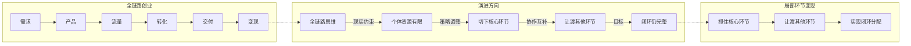

# 第 1 章 商业的底层逻辑——从需求起点到变现终点

## 学习目标

- 理解商业底层逻辑的六环节全链路框架及其普适性
- 掌握需求作为商业第一推动力的核心定理
- 理解局部环节变现策略的原理及其降低创业门槛的价值
- 能运用商业底层逻辑框架分析真实商业案例的环节映射

## 1.1 生活类比：一场接力赛

把商业底层逻辑想成一场接力赛就很好懂了。需求是发令枪——枪不响，比赛根本不会开始；产品是第一棒，你必须先有个东西能交付；流量是观众席，没有观众注视，跑得再快也没人看见；转化是交接棒，观众得愿意伸手去接；交付是冲刺跑，把承诺的东西稳稳送到终点；变现是终点线，过了这条线，这场奔跑才算有了回报。而这场接力赛最妙的地方在于：**你不必每棒都自己跑**——只要你擅长某一棒，就可以接棒起跑，其余棒次交给别人来跑，这就是局部环节变现的核心思想。

## 1.2 概念地图

```
商业底层逻辑
├── 需求（第一推动力）
├── 产品（价值的载体）
├── 流量（触达的通道）
├── 转化（信任的桥梁）
├── 交付（承诺的兑现）
├── 变现（价值的回报）
└── 局部环节变现（切蛋糕策略）
```

## 1.3 商业底层逻辑——一张看懂生意的地图

> [P001, p.1] "需求是一切商业活动的起点"
>
> ——来源：《普通人如何挖掘商机》，第 1 页

我们先从这段话的直觉谈起。为什么说需求是起点，而不是产品、不是流量？因为我们身边有太多"先做产品再找用户"的失败案例：一个 App 开发完了才发现没人用，一门课程录完了才发现没人买。反过来，用户带着需求才会去搜索、去比较、去购买——需求在前，生意在后，这是商业活动不可颠倒的顺序。

《普通人如何挖掘商机》提出了一个六环节框架：**需求 → 产品 → 流量 → 转化 → 交付 → 变现**。这里我们给出形式化定义：

> 商业底层逻辑**定义**
>
> ——来源：《普通人如何挖掘商机》，第 1 页

$$
\text{BusinessChain} = \langle \text{需求}, \text{产品}, \text{流量}, \text{转化}, \text{交付}, \text{变现} \rangle
$$

其中每个环节都是链条上不可缺失的一环。

**为什么可以这样建模？** 因为商业活动在结构上具有「一次流转」的共性：从用户产生缺口（需求）开始，到供需完成交换（变现）结束，中间必然经过价值物化的产品、触达人群的流量、促成交易的转化与履约承诺的交付。把这条流转路径抽象成一个有序六元组，就能让我们脱离具体的商品、行业，看到一切生意背后共同的结构骨架——就像地图把山川河流抽象成线条符号一样，商业底层逻辑把千差万别的生意抽象成一串可分析的环节。

基于这个形式化模型，我们才能进一步推导出它的四个重要属性。这四个属性分别从不同侧面回答"这个框架能用来干什么"：**完备性**回答"链条能不能断"，**起点固定**回答"从哪里开始"，**可拆解性**回答"能不能只做一部分"，**普适性**回答"能用多广"。下面我们逐一展开：

| 属性 | 含义 | 商业含义 |
|------|------|----------|
| 完备性 | 六环节缺一不可 | 缺任何一环，生意都无法闭环 |
| 起点固定 | 需求永远是第一环 | 没有需求的项目不值得启动 |
| 可拆解性 | 每环节可独立创造价值 | 个体可以只做某一环 |
| 普适性 | 适用于实物/服务/虚拟产品 | 卖课程和卖奶茶遵循同一逻辑 |

为了更直观地理解这个六环节链条是如何流转的，我们把它画出来，同时标注出"需求"作为固定起点的位置：


在图中，标橙色的"需求"环节就是链条的固定起点——它是第一推动力，也是我们在下一节要重点论证的核心概念。其余五个环节依次流转，最终到达变现终点。

这四句话分别说明了：链条为什么不能断裂（完备性）、从哪里开始（起点固定）、能否单独切一块（可拆解性）、以及这套框架能用到多宽的地界（普适性）。理解了这四个属性，你就拥有了分析任何商业模式的第一件工具。

## 1.4 需求是商业的第一推动力

> [P001, p.2] "需求是一切商业活动的起点"
>
> ——来源：《普通人如何挖掘商机》，第 2 页

**【需求定理】**（来源：《普通人如何挖掘商机》，第 2 页）指出，需求是所有商业活动的第一推动力。为什么强调"第一"？因为在六环节中，需求是先验存在的——**需求先于产品和流量存在**。用户不是因为看了你的广告才产生了需求，而是因为他本来就有需求，才会去搜索、去比价、去成交。

我们来看需求的定义：

> 需求**定义**
>
> ——来源：《普通人如何挖掘商机》，第 2 页

$$
\text{Demand} = \text{未被满足的缺口} \cap \text{愿意支付成本}
$$

这个公式展示了需求的两个必要条件是"有缺口"和"愿意付费"，二者缺一不构成有效需求——只有痛点但没有支付意愿的，顶多算是抱怨。

需求的"第一推动力"体现在其驱动性上。我们的核心主张是：**需求越强，搜索意愿越强，搜索越频繁。**

$$
\text{SearchIntensity} \propto \text{DemandStrength}
$$

这个公式展示了搜索行为是需求强度的直接函数——这也解释了为什么"搜索挖词"是挖掘商机的有效方法：用户在搜索框里留下的每一个词，都是一次需求信号的主动广播。你可以把搜索行为看作是需求的自发声明，无需调研问卷，用户已经替你说出了答案。

下面这张流程图展示了从"需求"这一第一推动力出发，如何一步步走向「商机定位」的完整演进路径：


这张图串联起了"第一推动力 → 观测手段 → 商机落地"的完整逻辑：需求是起点（橙色节点），它驱动了搜索行为；搜索行为在平台上留下可观测的痕迹（sug、联想词）；这些痕迹反过来帮助我们反推真实需求，最终定位商业机会。这正是下一章需求挖掘方法论将要详细展开的内容。

## 1.5 局部环节变现——切蛋糕策略

> [P001, p.3] "普通人只需要做好其中的某几个环节"
>
> ——来源：《普通人如何挖掘商机》，第 3 页

前面我们建立了六环节全链路的图景，但一个现实问题是：普通人哪来的资源把六个环节全部做完？《普通人如何挖掘商机》给出的答案是——**不必都做，切一块蛋糕就好**。

这就是局部环节变现策略：

> 局部环节变现**方法**
>
> ——来源：《普通人如何挖掘商机》，第 3 页

```
1. 识别自身擅长的一个或几个环节
2. 只做自己擅长的环节，做到极致
3. 未覆盖的环节，由其他玩家承接
4. 通过协作完成完整闭环
```

这段伪代码展示了局部环节变现的可操作路径——它不是"放弃"其他环节，而是"让渡"给专业的人去做。你做产品，别人帮你做流量；你懂交付，别人帮你做转化。下面我们用一张演进图来表达从「全链路创业」到「局部环节变现」的思路迁移：



上图中，上半部分展示的是六环节全链路必须完整存在；中间部分展示了个体从"全链路思维"到"局部环节变现"的演进路径——因为现实约束（个体资源有限），才产生了策略调整（切下核心环节、让渡其他环节），最终目标仍然是保证商业闭环的完整；下半部分则展示了个体如何从这条链中「切下」自己擅长的核心环节，把其余环节让渡给协作伙伴，最终同样完成收益分配。商业运行的规则是：**只要链条不断，收益就能分配，个体无需通吃全链**。

局部环节变现最大的价值在于**降低创业门槛**。我们用一个公式来表达：

$$
\text{LaunchCost} = \sum_{i \in S} \text{Cost}_i, \quad S \subset \{1,\dots,6\}
$$

这个公式展示了启动成本只与你选择的环节集合 S 有关：**S 越小，门槛越低**。全链路创业是高门槛的六边形战士游戏，而局部环节变现把门槛切成了一块块可以单独跨越的台阶。

## 1.6 多源对照

关于"需求是一切商业起点"这一主张，目前所有素材都来源于《普通人如何挖掘商机》这一篇，尚未发现其他独立来源对其进行质疑或拓展，因此这里只能给出单源呈现。这三个核心主张可概括为：其一，需求是六环节链条的固定起点，顺序不可颠倒，先有需求后有生意；其二，需求的强度可以通过用户的搜索行为加以观测，搜索词即需求信号的自发声明；其三，普通人通过局部环节变现即可参与商业闭环，无需通吃全链。

这三条主张在素材内部逻辑自洽：需求起点与局部环节变现互为支撑——正因为链条是连续的，个体才可以从任意环节切入。

不过，为了让"需求是一切商业起点"这一论断获得更坚实的理论支撑，我们建议从以下几个方向补充文献，将该主张从单源经验提升为多源印证：

- **马斯洛需求层次理论**（Maslow, 1943）：需求具有从生理到自我实现的层次性，这解释了为何不同人群的需求强度与优先级各异，为"需求先验存在"提供了心理学基础。
- **微观经济学中的"有效需求"概念**（凯恩斯，1936）：强调"需求必须伴随支付能力"，这与本章「需求 = 缺口 ∩ 支付意愿」的定义互为印证，为"有效需求"的判定提供了经济学依据。
- **营销学中的 AIDA 模型**（注意→兴趣→欲望→行动）：从消费者行为角度佐证了"需求在前、行动在后"的流转顺序，为"需求驱动搜索"提供了行为学支撑。
- **精益创业中的"客户探索"方法论**（Blank, 2005）：强调在开发产品之前先验证客户需求，与"需求先行"的主张高度一致，可作为创业实践层面的佐证。

引入这些经典框架，可以让单源的经验论断提升为有学理支撑的方法论根基。

## 1.7 设计中的取舍

**为什么不是"先有产品，再找需求"？**

产品先行是很多创业者的自然倾向——因为做产品是可控的，找需求是不可控的。但从商业链条的逻辑看，产品先行往往导致：产品做出来了，需求却不存在，于是流量、转化、交付、变现全链条失去支点。

这里的 **trade-off** 非常清晰：需求先行付出的代价是"慢"——你得花时间去做调研、观察搜索、验证意愿；但收益是"准"——一旦确认了真实需求，后续所有环节的效率都大幅提升。而产品先行则相反：你用速度（快速做出产品）换来了风险（需求可能根本不存在），表面上是"快"，实际上是"快而错"。这是一场"快而错"与"慢而准"之间的权衡：前者用速度换风险，后者用时间换确定性。

**为什么要强调"局部环节变现"而不是鼓励学习全部环节？**

全链路能力当然更理想，但有一个现实约束：学习六个环节的时间成本极高，且多数环节需要天赋和资源积累。

这里的 **trade-off** 同样明确：局部环节变现的代价是"让渡利润"——你放弃了链条上部分环节的收益（这是"让渡的代价"）；但收益是"可行性"——你换来了更低的启动门槛和更快的上手速度（这是"可行的收益"）。换句话说，这是一种"用利润换可行性"的设计选择：全链路创业可能赚得更多，但绝大多数人根本跨不过那道门槛；局部环节变现虽然让渡了利润，却优先保障了普通人"先跑起来"的可能。在两相对照的代价与收益之间，它选择了让更多人先上桌。

## 1.8 动手练习

- 用六环节框架拆解一个身边的生意：选择一家常去的小店，画出六环节并分析每个环节分别由谁承担。
- 辨析四种伪需求陷阱：判断哪些属于无效需求、被激发的需求、根本不算需求。

## 1.9 本章小结

这一章中我们学习了商业的底层逻辑。首先我们建立了六环节全链路框架——需求、产品、流量、转化、交付、变现——作为一张看懂任何生意的通用地图；其次我们论证了需求是一切商业活动的第一推动力，它先于产品存在，且强度可以通过用户的搜索行为加以观测；接着我们介绍了局部环节变现策略，说明普通人只需做好链条中的某几个环节即可参与商业闭环，不必通吃全链；然后我们讨论了需求先行的取舍与局部环节变现的 trade-off；最后通过动手练习，你将能够用这套框架拆解现实中的商业案例。

本章我们一起学习了以下概念：

| 概念 | 解释 |
|------|------|
| 商业底层逻辑 | 需求-产品-流量-转化-交付-变现的六环节全链路 |
| 需求 | 商业第一推动力，用户带着需求才会搜索 |
| 局部环节变现 | 切蛋糕策略，个体只需做好某几个环节 |

下一章，我们将深入"需求挖掘"这一环节本身，学习如何从用户的搜索行为中识别真实需求、辨析伪需求，掌握一套可操作的需求验证方法论。