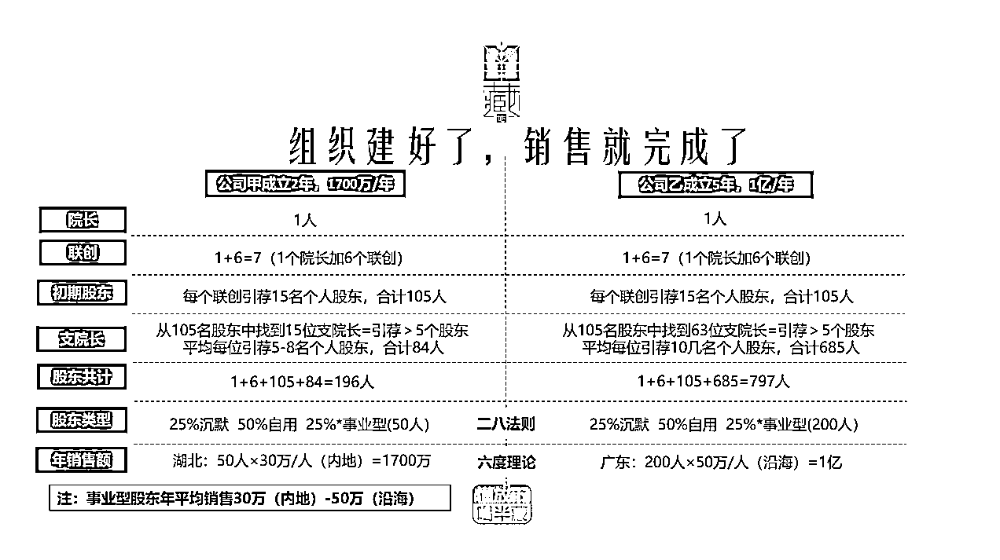
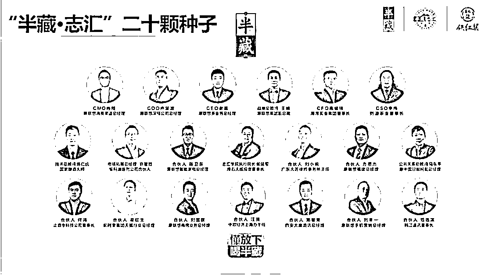
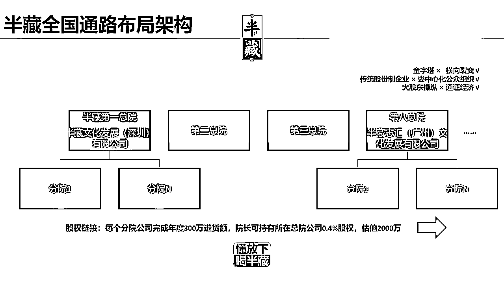
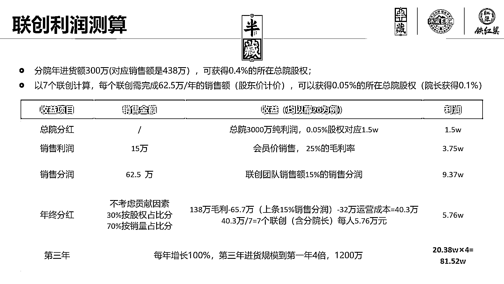
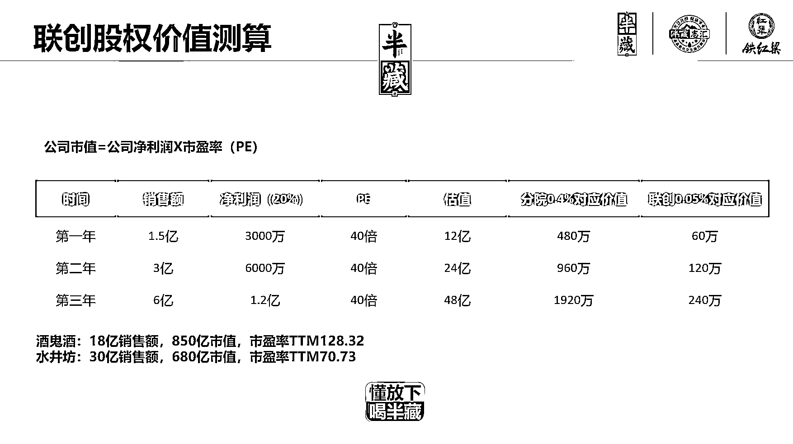
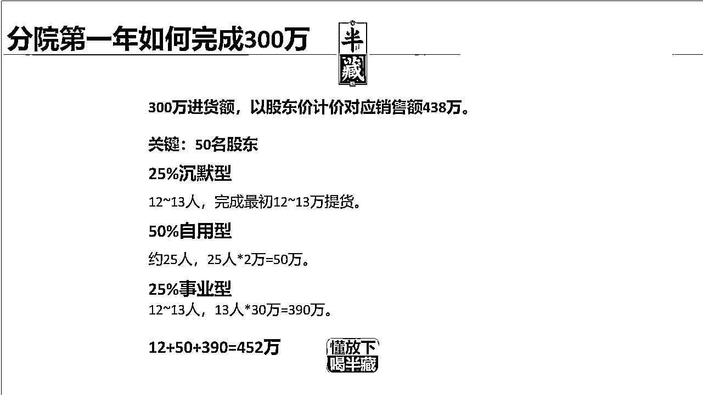
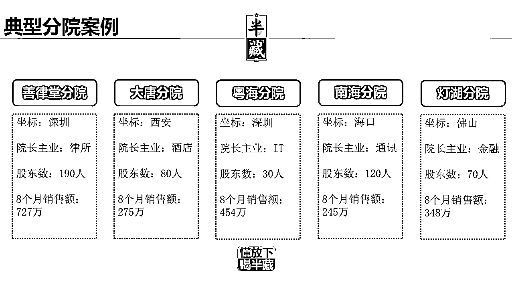

# 半年切入半藏酱酒，我的分院社群做到50+人，营收破百万的实战复盘

> 原文：[`www.yuque.com/for_lazy/thfiu8/pa052hgu8uqf23n4`](https://www.yuque.com/for_lazy/thfiu8/pa052hgu8uqf23n4)

## 入局半藏酱酒半年，社群会员50+、销售额过百万，我是怎么做到的？

作者：温钟奋
日期：2023-06-14

大家好，我是阿温，赚钱有术的2年老圈友。曾在世界500强做中层，通讯行业深耕20多年。

2020年9月一个新锐酱酒品牌半藏诞生，20位创始发起人，短短13个月全国铺开700多个分院，7万核心酒友共同共创，累计订单已突破6亿。

今天聊下我2021年底加入半藏，并在南京建邺落地分院的经历。简单一句话总结：半年时间，分院社群会员超过50人，整体销售规模突破100万。

说实话，我本身就是个销售，但对喝酒没什么兴趣，啤酒一罐就够了。那为什么会走上社区卖酒这条路？

我已40+，通讯圈的老炮，身边多是各品牌区域负责人、行业老板，饭局不断，人家带的都是定制酒。久了之后，几个老友就琢磨着自己弄一款。

我们盘了下现在做得不错的社群酒：49坊、酣客，还有后来起来的半藏。

49坊已做6-7年，门槛和节奏都偏高。半藏刚开放招商不久，创始人团队我基本都熟，尤其是八总院的刘辛一总，之前就是同事，对规则心里有数。于是我们就开启了南京建邺分院的筹建。

这是半藏给分院的标准搭建指引模版

2021年12月20日南京建邺分院正式成立。首批凑了10位联合创始人，都是通讯圈的老兄弟和多年的生意伙伴。

启动时每人出资5万，总共50万，并约定半年内每人至少带10个股东入局。很快我们就招到30位个人股东，并在2022年1月8日于南京同庆楼办了成立庆典。

赶上春节档，每个股东以1万元投资拿1万元酒水货。光一季度销售额就接近80万。

# 一、销售架构是怎么跑起来的

半藏整体是10大总院制。总院院长基本都是半藏联合创始人，总院相当于传统意义上的省包，下设众多分院。总院由1位院长加6-10位联合创始人组成，身份平等，遵循多劳多得、按劳分配的机制。

半年时间，半藏在广东就布局了至少5个总院，厦门、杭州、上海、郑州、北京、成都、西安等地的总院体系也相继成型。全国大省基本完成覆盖。

半藏20位创始人多出自联想，有深厚的管理经验和渠道资源，很快撬动了几十个分院的快速起盘，形成裂变规模。

以我所在的八总院为例。联创黄安置本在某优鲜任投资总监，业余先做了2个分院试水，后拉来老同事刘辛一加入，2012年3月成立八总院，很快组建创始团队，2021年分院已达50家，销售目标3000万。

分院的逻辑也类似：院长+6位联合创始人。对下发展股东，分院价进货到股东提货的差价约30%归联创，股东再以会员价对外销售也有约25%毛利。会员价对标京东零售价，整体股东价在京东零售价的4折左右，喝得有面子也喝得划算。

# 二、业绩是怎么达成

首先得认清酱酒的黄金产品属性，五点核心属性一旦吃透，只要找到人、做成社群，就能跑通类似M2C的模式。

第二是社群搭建能力。创始人本身的影响力、职业背景带来的专业能力，是初期最关键的资源。好的创始团队自带天使轮甚至A轮资源，启动更快、成功率更高。

第三是众创模式的设计。既要符合渠道规律，又要满足参与者的预期收益。通路利益与众创利益要能兼容。

这点半藏最有创新，引进了期权机制。分院一年销售额达到300万即可享有所在总院0.04%的期权。这套招募机制在首年点燃了市场热情，第二年年底就有第一批总院近50家分院行权，样板一出，信心全有了。

传统酱酒的三大推广手段是贵州封坛之旅、品鉴会、体验馆。半藏在此之上加码股东期权，让销售推进更顺滑，也是快速崛起的核心抓手。

按规则，每个分院成立第一年提货达300万，就能拿到总院0.04%股份。联创一边有批零差价，一边锁定未来上市的红利，干几年就能拿到可观财富。这套机制是分院快速成立、联创拼命招募股东的强大引擎。

分院成立后，日常就是运营、品鉴、拉新。这是半藏给的运营指引。

53度酱酒推广难度不小，尤其江苏本土有洋河、国缘等强势品牌，公务宴请基本被占据。我们主要在线上社群内做渗透。

推广核心就是持续拉人品鉴、讲品牌故事，这恰恰是最难的环节。

受疫情影响，过去两年聚会明显减少，我们分院做得一般，但也有很猛的案例。两位厦门的联创整合资源半年孵化了6个分院，年销售额过千万。合肥一位做过酒水的老同事，半年也做到600万。

我总结，分院要想冲到300万，院长最好全职投入。像我这种兼职玩票，最后基本拿不到总院期权，也就没法分享上市红利。

# 三、经营一年的感受

南京建邺分院运营一年后，受疫情和市场节奏影响，大家觉得300万目标很难完成，就放下了总部期权，平常心做运营。

不过优秀的分院依然达标了，比如第一总院第一年近50家分院完成年度300万并成功行权。

我个人判断，300万目标挑战不小，兼职基本难达标，必须全职押注。

另外一个意外收获是，分院运营让股东聚餐聚会变多，对生意合作也有帮助。分院内部不少股东和联创之间后续产生新的商业合作，这也是半藏一直倡导的共创生态。

# 四、过程中的一些经验

白酒天然自带关键意见消费者KOC属性，强社交传播和分享场景。传统酒企是自上而下用KOC口碑撬动大盘，半藏是直接把KOC和种子用户变成共同体，重构了厂家与渠道的链接关系，白酒渠道营销和用户互动方式被重塑。

做好一瓶酱酒要抓住四点：

A 守住初心。酱酒要守住大曲坤沙12987标准工艺，扎根茅台镇核心7.5平方公里产区，用这里的水、粮、曲、窖。全国几万款圈子酒，能做到这一点的不足0.1%。半藏创始团队多为前联想高管，对品质、供应链、渠道、品牌管理积累深厚。

B 快速做大。酱酒做不大就拿不到好基酒，难坚持好品质，成本费用也压不下来，消费者体会不到高性价比。很多品牌初心不错，却守不住，品质下滑。酱酒需要3-5年周期，对资金和运营要求很高。

C 专业能力。圈子酒看似简单，难在品牌、营销、渠道、资金的整合。半藏一年多时间销售额逼近7亿。酱酒市场除茅台、习酒、郎酒外，品牌数以千计，大多几千万到一亿，过5亿已属前20名，要突围必须靠运营、营销、资金、供应链整合。

IT/通讯行业曾缔造中国商品流通通路，联想人在渠道、终端、运营方面的经验对传统酒商是降维打击。所以半藏2020年9月成立，13个月内建立10大总院，20位发起人，全国700+分院，7万核心消费者共创，订单突破6亿。

D 私域玩法。社群营销本质就是私域经营。不走传统商超，也不靠酒桌曝光，但核心消费者裂变后流量汇聚，能见度越来越高，并逐步溢出到公域。

所有生意，本质都是流量生意。

评论区：

韫椟 : 模式厉害 李林洆 : 厉害。 帅彬 : 京东卖的不错这酒，没试过，喜欢酱香类 静水流深 : 老谢跟我是很好的朋友，半藏酒不错，那个字念藏经阁的藏[呲牙] 龙哥 : 感谢分享，已加精华。 温钟奋 : 感谢感谢 温钟奋 : 缘分 吃瓜群众 : 18939969117 加我认识下