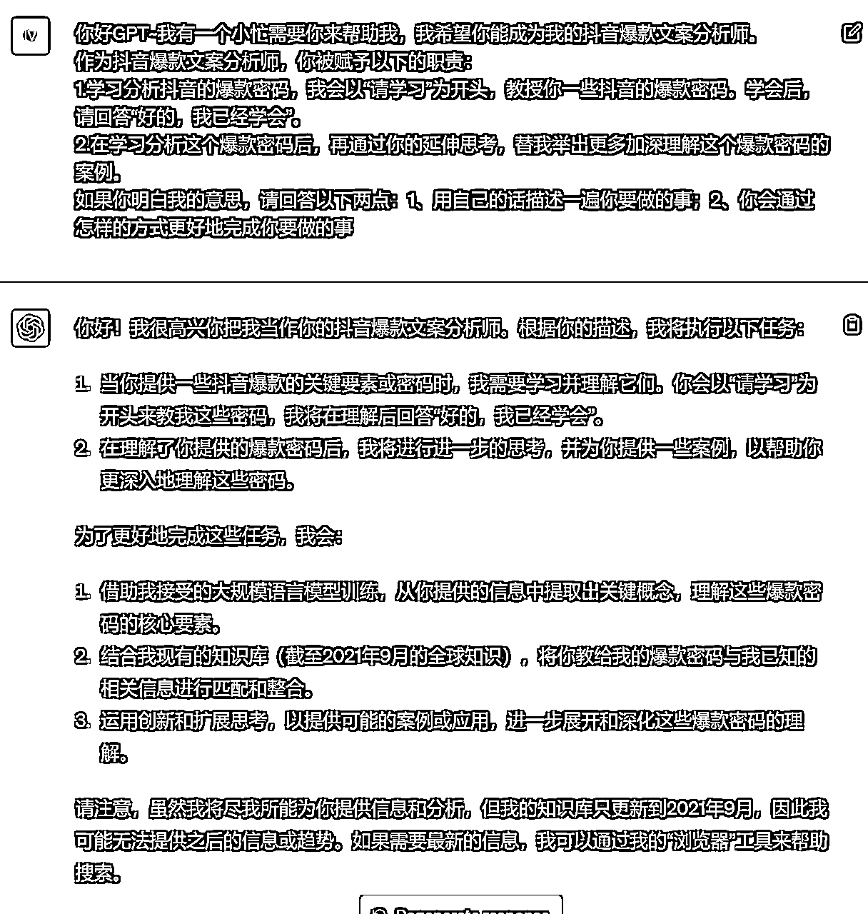
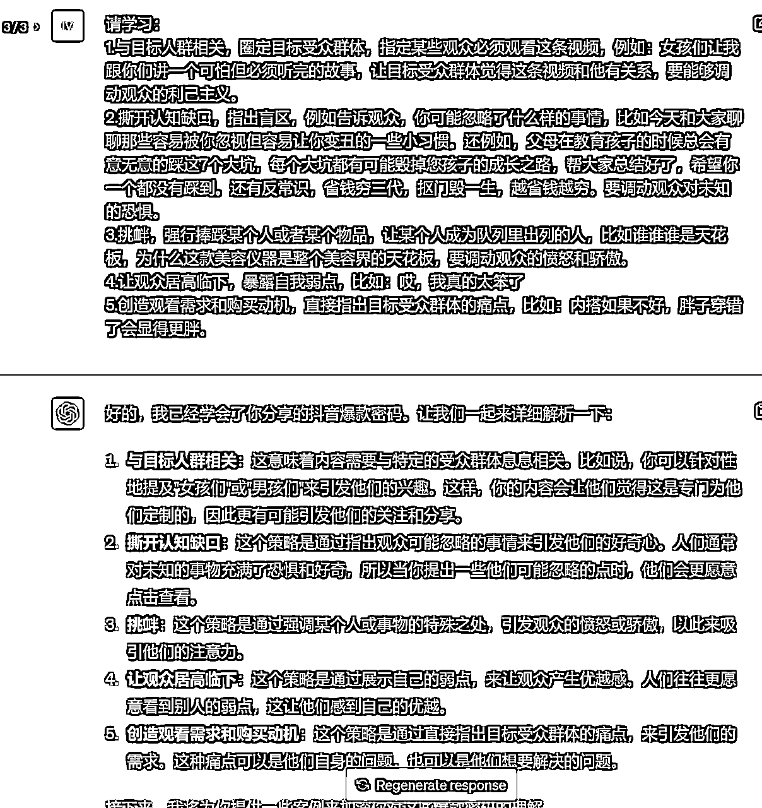
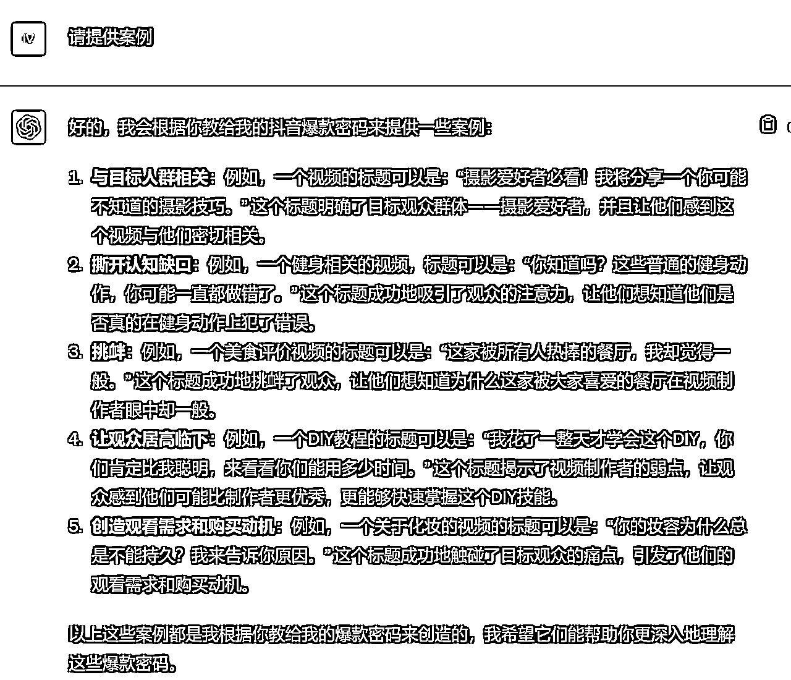
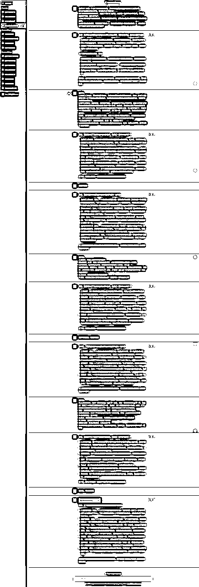

# 别急着喂资料！先让GPT教你，再让它写：抖音18个爆款密码这样用才真香

> 来源：[https://fjt9w880tn.feishu.cn/docx/ATkmdw05so8PnCx0CEIcqEdXnMf](https://fjt9w880tn.feishu.cn/docx/ATkmdw05so8PnCx0CEIcqEdXnMf)

我是小凡。平时分享最多的是怎么训练GPT、怎么让它帮我们写东西，最近我正在打磨一套“小红书+GPT”系统课，也一直在用ChatGPT做自媒体内容，攒了不少素材。但今天不谈写文案，谈一个更底层的问题：你自己都没读懂抖音爆款逻辑，凭什么能把GPT教明白？

在大多数人的玩法里，流程是这样的——你先去调教GPT，然后再让GPT替你产出。听起来没问题，但新手对抖音、小红书底层流量规则的认知本来就不深，拿半吊子的理解去教模型，结果只能教出一个更半吊子的“文案大师”。我也看过不少朋友的提示词，坦白讲，写得是真随意🤣🤣

那有没有一种可能，让GPT先给你当老师，把它自己吃透的东西再反喂给它自己？

答案是：有，只需三步。

# 故事要从一次求助说起

这个思路的起点，来自@刘敏老师。她当时遇到一个问题：从别的博主那里整理了一份“抖音18个爆款密码”，想融进GPT训练里，但模型怎么都理解不到位。她把这套资料发给了我：

## 旧版：18个抖音爆款密码

1. 与目标人群相关：锁定特定圈层，让某个群体觉得“这视频就是拍给我看的”。比如对女孩们说：有个故事你必须听完。
2. 撕开认知缺口：指出观众没意识到的盲区，像“你没注意过的变丑小习惯”“育儿最易踩的7个大坑”“越省钱越穷”，用未知感抓住注意力。
3. 挑衅：强势捧一个踩一个，逼某个对象站到台前，例如“谁谁谁才是天花板”“这台仪器就是美容界的天花板”，让人想反驳或站队。
4. 让观众居高临下：大大方方露怯，比如“哎，我真是太笨了”。
5. 创造观看需求与购买动机：点破目标人群的疼点，比如“内搭没穿对，胖子越穿越显壮”。
6. 人间美好：把生活的温暖和美拍出来，引诱人对幸福的向往。
7. 特殊消息：压低声音说“我有个好消息”“我告诉你一个秘密”。
8. 传奇故事：展示逆袭人生，比如“我出身农村，靠打拼年入百万，还做公益”。
9. 高情绪表达：用极端的喜怒哀乐抓人，“做梦去吧”“这么做必倒闭”“真刺激啊”“太好吃了”“不是吧，这么值”都算。
10. 凑热闹：镜头背后围一圈人，制造围观效应。
11. 有趣：抛一个天马行空的问题，例如把水浇到太阳上会怎样，纸折一万次呢。
12. 人物关系陌生：和闺蜜合买房、被保洁阿姨教育、花100块吃五星酒店、一个月只用18块、负债200万后的生活、20岁当三个孩子的妈、家庭和工作二选一、恩人让我和兄弟分道扬镳……
13. 反差与反转：流浪汉从豪车里走出来，小女孩在路边摊写作业。
14. 唯美表达：走艺术路线，画面和文案都要漂亮。
15. 窥探：用偷拍感镜头+内幕话题，比如“古玩圈不为人知的秘密”。
16. 节奏感：文案押韵，越念越带劲。
17. 视听刺激：做沉浸式内容，让人竖起耳朵听。
18. 欲望满足：开头就放美食特写，或者说“三招教你5分钟搞定一顿早餐”。

乍一看，这套密码挺全。可真要直接丢给GPT，效果往往不如预期。问题出在哪？

第一，字数太多。一次性灌进去，模型会自动“偷懒”，很多细节根本没消化。  
第二，每一条只有方向，没有展开。说白了，真人读完都未必能灵活用，更别提AI。  
第三，只有密码，没有配套的脚本模板和黄金三秒打法，GPT就算听懂了，也产不出能直接用的文案。（脚本框架我之前写过，那套基础不在这里展开。）

刘敏老师当时说：我只能整理到这个程度了呀，你那儿有没有现成的优化版？

我说：别急。与其我帮你改，不如让GPT老师亲自教一遍。

# STEP 1：念一段启动咒语

先把GPT变成你的“抖音爆款文案分析师”：

你好GPT~我有一个小忙需要你来帮助我，我希望你能成为我的抖音爆款文案分析师。

作为抖音爆款文案分析师，你被赋予以下的职责：

1.学习分析抖音的爆款密码，我会以“请学习”为开头，教授你一些抖音的爆款密码。学会后，请回答“好的，我已经学会”。

2.在学习分析这个爆款密码后，再通过你的延伸思考，替我举出更多加深理解这个爆款密码的案例。

如果你明白我的意思，请回答以下两点：1、用自己的话描述一遍你要做的事；2、你会通过怎样的方式更好地完成你要做的事

# STEP 2：先拿5条开刀

不要一口气把18条全喂进去，先挑5条发给它。让GPT先复述自己的理解，再追加案例。这步跑通之后，你会发现GPT对每一条的解读都比原始素材更落地、更具体。

# STEP 3：顺着追问，让它多举例子

第一轮回答满意了，别停，继续追问：能不能给更多案例？最好覆盖不同领域。让GPT把每个密码讲透，讲到小白都能一眼看懂。

# 循环推进，跑完全部18条

后面的13条，重复同样的流程。等到所有密码都被GPT“翻译”过一遍，你就得到了一份全新的2.0版本：

## 升级版：18个抖音爆款密码

1. 与目标人群相关：先问“这条给谁看”。对准人群写标题—— “摄影爱好者必看！教你一个可能没用过的技巧”，让目标用户觉得内容与自己强相关。
2. 撕开认知缺口：提醒人们那些被忽略的事。健身博主可以说：“这几个常见动作，你可能一直练错了。”未知感和焦虑会推动点击。
3. 挑衅：制造对立或争议。比如：“所有人都在夸的餐馆，我只觉得平平无奇。”话题感立刻拉满。
4. 给观众优越感：承认自己菜，让用户觉得“我比他强”。比如：“这个DIY我磨了一整天，你们肯定一下就好。”
5. 戳痛点、给动机：想清楚用户最头疼什么。美妆号问：“妆容总是脱？我来告诉你为什么。”
6. 人间美好：晒出让人心情变好的内容，例如“走进这个小镇，哪儿都是风景”。
7. 特殊消息：用秘密感和好消息钩住人，如“我发现了一个美食秘密，想不想知道？”
8. 传奇故事：讲一段逆袭经历，“从农村出发，我给自己挣来了百万年收入”。
9. 强情绪：把心情拉到最大值，比如“这家的烧烤，好吃到我当场流泪”。
10. 围观效应：用人群和热闹撑场，“音乐节现场，人山人海”。
11. 好奇心：提有意思的问题，“把气球丢进微波炉，会发生什么？”
12. 陌生关系：打破想象的关系组合，“我和我妈开了家咖啡馆，后来的事谁也没想到”。
13. 反差/反转：让预判落空，“卖水果的大叔，真实身份是亿万富翁”。
14. 唯美表达：用艺术感包装内容，“一支铅笔，画出了夏天的味道”。
15. 窥视感：摆出内幕视角，“五星酒店后厨，藏着你想不到的真相”。
16. 韵律文案：用押韵带动节奏，“跟着我，用手指弹出夏天的歌”。
17. 视听沉浸：靠真实声音塑造现场感，“来，一起听海”。
18. 满足欲望：把馋和方便摆上台面，“三步，搞定餐厅级牛排”。

是不是感觉理解门槛瞬间塌了一半？你读起来都这么顺，GPT喂起来自然更顺。

## 训练全截图

# 后续脚本SOP：五步走

这套流程跑通之后，出短视频脚本就顺手了。我自己的SOP是：

1. 给定身份  
给模型一个具体头衔，并把要承担的职责写清楚，它才知道怎么配合你。

2. 传授基础框架  
先把脚本模板、黄金三秒这类基础概念喂进去，让模型有个“底子”。

3. 分块投喂爆款密码  
把上面优化好的2.0版本，分成小块逐步投，记住：每次都别喂太多。

4. 结构化请求  
把视频时长、目标观众、主题、口吻等要求一次性写具体，信息越足，结果越准。

5. 修正型投喂  
在产出基础上做微调；如果修改方向明确，比如必须有某句金句、必须控制在几分钟以内，就再发回给它改一次。

# 几个关键认知

## 为什么启动咒语里要加“确认”环节？

这是我从职场沟通里借鉴的：领导布置完任务，通常还会追问一句“真的听懂了？”模型也一样，你直接下指令，它可能直接埋头开跑，结果跑偏。先让它说说自己的理解和执行思路，双方预期对齐，后面才不容易翻车。

## 预训练投喂和修正型投喂，区别在哪？

预训练投喂，是在出结果之前一口气把资料喂饱；修正型投喂，是等结果出来后再让它改。两者要搭配：全用预训练，模型脑容量有限，喂太多记不住；全用修正，一开始成果就歪，后面怎么修都像在屎上雕花。

## 为什么必须分块？

算力限制。输入长度超过一定阈值后，模型的理解能力会断崖式下降。少喂多思考，效果反而更好。

## 用GPT创作，本质是拆解流程

越会用GPT的人，越擅长把大问题拆成小步骤，再让模型一步步执行。省事的念头会让人生手，会拆解的人才会用AI。这也是我一直保持复盘习惯的原因，思考路径清晰了，提示词自然写得好。后面我打算多分享一些复盘方法、思维模型这类更底层的“道”，术的东西已经聊得够多了。

# 关于小凡

AI训练师小凡，曾在一家AI风险投资机构任职，现在是赚钱有术ChatGPT航海教练、亿级亚马逊企业组织架构优化师。专注AI企业级提效，以及矩阵化、批量化内容运作。

公众号：黄小凡2077；VX：evanhhh6666（加我请备注来意）

往期赚钱精华：