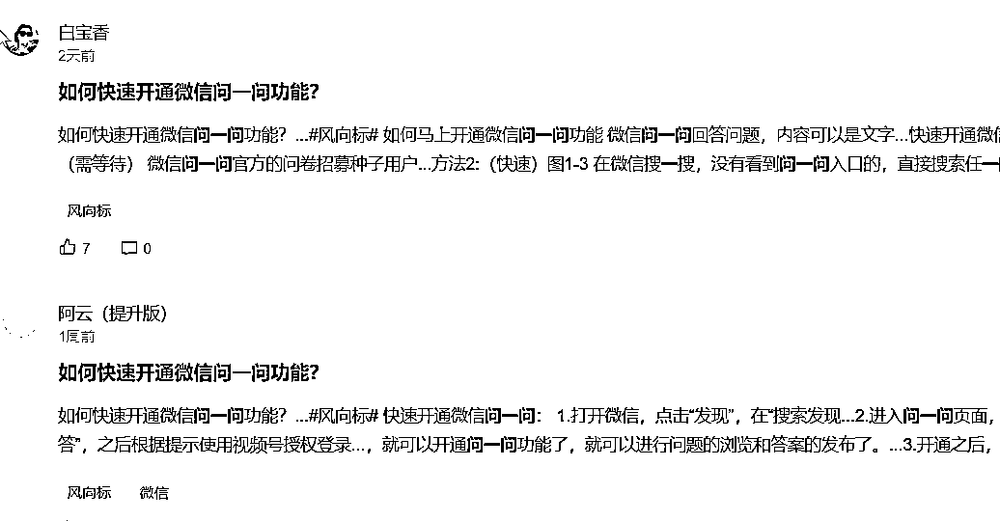
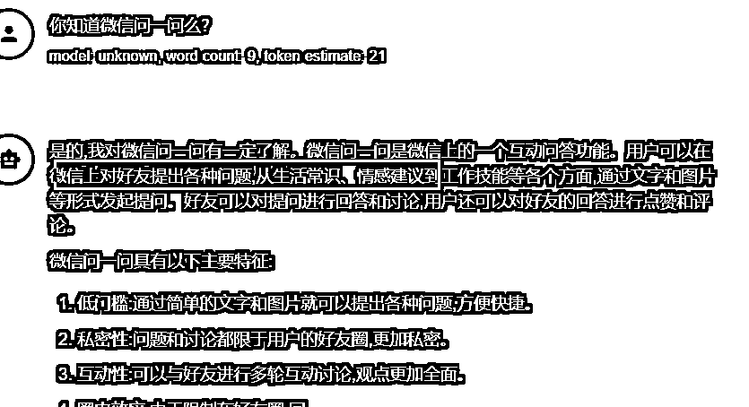
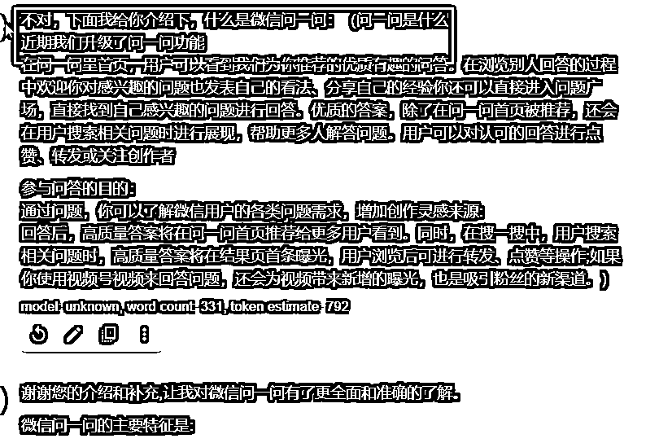
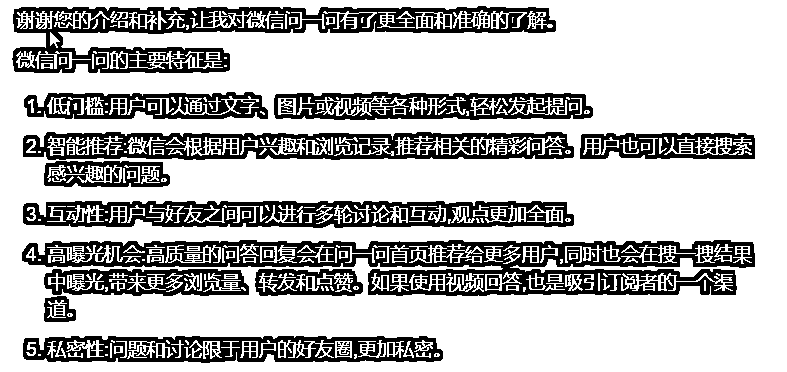
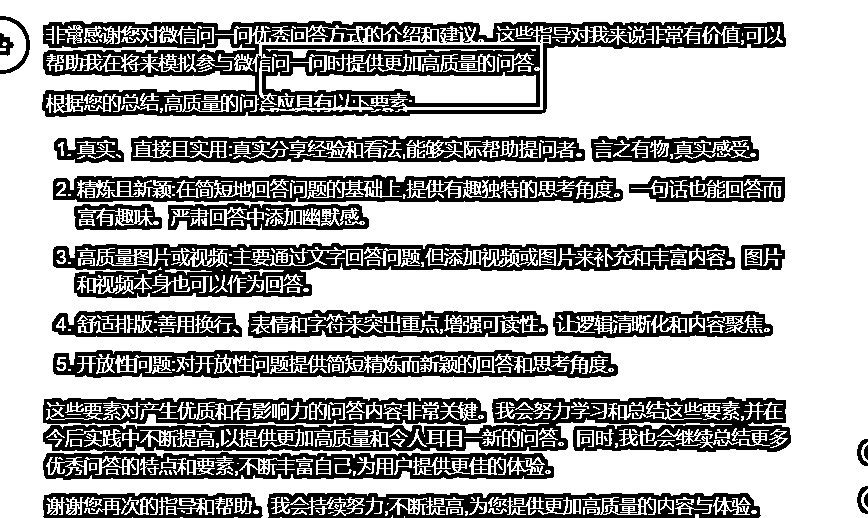
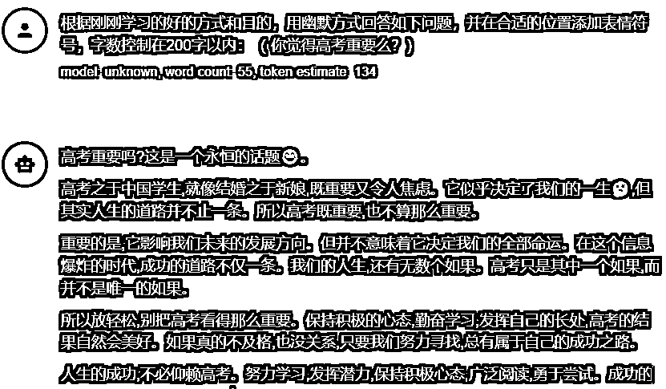
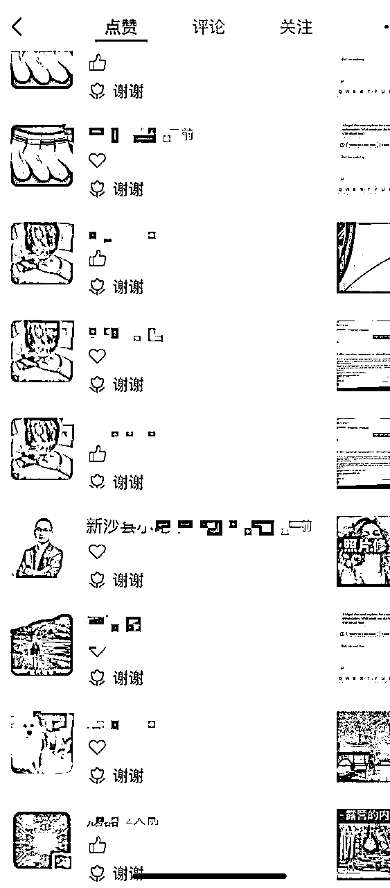
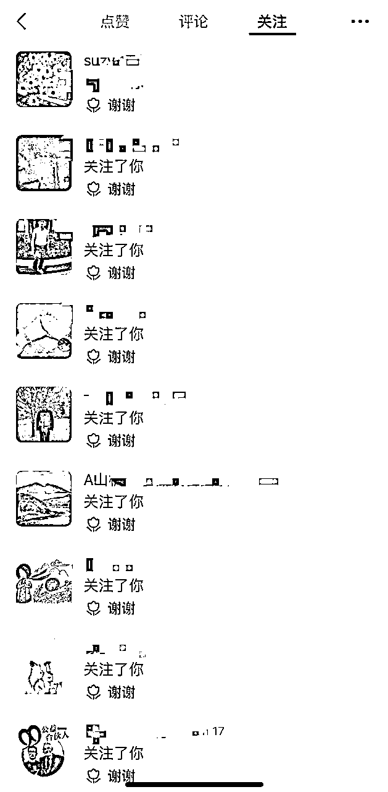

# ('快速生成问一问的回答+视频号流量入口', (2, 20))

老朋友们好，我是小叉。最近总有人问：微信“问一问”发回答老是被打回，咋回事？别慌，这坑我也踩过——早期直接从ChatGPT复制文字，基本都过不了审核。后来一步步摸清了规则，今天就把这套方法完整讲讲。

先弄明白“问一问”是个啥。有人觉得它像知乎，我的感受是：它介于知乎和小红书之间，阅读节奏很快，用户没耐心看长篇。官方描述也差不多：首页推荐优质问答，你可以刷别人的回答，也可以对感兴趣的题开启回答、分享经验；进问题广场就能按兴趣找题。高质量的答案，除了在问一问首页被推荐给更多用户，还会在微信“搜一搜”里出现——用户搜相关问题时，首条可能就是它，而且可以点赞、转发、关注创作者。如果还没开通入口，别愁，在微信里搜“问一问”能看到很多开通方法，赚钱的圈子里也有大量现成资料（回看第一篇，不炒冷饭了）。

为什么值得认真做？第一，它是视频号流量的重要来源。特别是想积累正反馈的号主，这里几乎零门槛。第二，回答问题的过程能帮你摸清楚微信用户在关注什么，创作灵感源源不断。比如写公众号时，在问答区看到一个点，就能顺手变成选题，还能顺便理清文章框架。第三，优质回答能曝光，用视频号视频答题的话，新增曝光直接给视频号导流，也是吸粉的新路子。

那怎么写出又过审又讨喜的回答？很简单——把ChatGPT当实习生，你得先“喂”它。

第一步，告诉它“问一问”是什么。不喂资料的时候，它给出的内容完全跑偏。 将提示词丢给它，说清楚平台定位和目标后再看，结果就靠谱多了：```
不对，下面我给你介绍下，什么是微信问一问和其目的：
（微信问一问是什么：
在问一问里首页，用户可以看到我们为你推荐的优质有趣的问答。
在浏览别人回答的过程中欢迎你对感兴趣的问题也发表自己的看法、分享自己的经验你还可以直接进入问题广场，直接找到自己感兴趣的问题进行回答。优质的答案，除了在问一问首页被推荐，还会在用户搜索相关问题时进行展现，帮助更多人解答问题。用户可以对认可的回答进行点赞、转发或关注创作者
参与问答的目的：
通过问题，你可以了解微信用户的各类问题需求，增加创作灵感来源:
回答后，高质量答案将在问一问首页推荐给更多用户看到。同时，在搜一搜中，用户搜索相关问题时，高质量答案将在结果页首条曝光，用户浏览后可进行转发、点赞等操作;如果你使用视频号视频来回答问题，还会为视频带来新增的曝光，也是吸引粉丝的新渠道。）
```  这是返回的效果：

第二步，投喂好案例。直接给它一份优质总结文档，下面这组提示词可以照抄：```
非常好，请继续学习下面是好的问答方式和优秀案例：

1\. 真实、直接且有效的回答，对真正抱有这个问题的人有帮助
真实经验，言之有物
真实感受，分享观点

2\. 开放性的问题下，简短但精炼的表述能在回答问题的基础上提供新颖有趣的思考角度
一句话也能回答问题，给人回味或提供趣味
在严肃回答的基础上，用幽默的方式丰富观点

3\. 添加高质量的图片或视频让答案更加清晰
主要通过文字回答问题但视频图片给到有价值的补充
视频图片本身回答问题

4\. 舒适的排版让内容变得易读
善用换行、表情、字符分隔文字，让逻辑清晰、重点突出
``` 学完之后再生成，效果完全不一样： 如果手头没有适合的素材，就花30分钟去刷问一问里的高赞回答，复制下来作为训练资料。

第三步，正式开工。赚钱里全是这类话题的教程和提示词，我直接分享一个案例：```
根据刚刚学习的好的方式和目的，用幽默方式回答如下问题，并在合适的位置添加表情符号：（ 你觉得高考重要？）
``` 这是训练后的成品效果：

最后更新一下我的实测数据：我一共答了10道题，每题花2-4分钟，给视频号带来了超过100个赞和差不多10个粉丝。要是你有产品，还能在视频号下方挂公众号链接，变现路子不少。我目前还没跑通变现闭环，所以先把流量做起来，内容尽量垂直。虽然我自己号的内容也不算垂直，效果还是不错的 。

别只收藏不动手，立个Flag：每天固定回答3个问题。有疑问欢迎评论区聊。