# 龙哥在赚钱里提到，人人都有机会赚到一百万。读完这篇关于信息不对等的万字梳理，你就能明白他为何如此笃定。

整理自：飞书文档

---

# 长文提示

1. 建议用电脑或平板打开，阅读体验明显更好。
2. 正文篇幅很长，不必通读，也不可能一天读完。

初次阅读，可先从操作部分开始，打开思路。

其余章节，按自己的兴趣挑选，每次看两三篇即可。

建议先收藏，后续遇到具体问题再回来看，不必硬啃一遍。

如果你也想像我一样一次性把这些内容压进脑子里，让商业思维升级？

那就做好用两周时间来啃的心理预期。

---

# 作者介绍

我叫七小，99年生，深圳人，从事知识管理相关的工作。

擅长检索、抓取、内容整理、关键词挖掘，最拿手的是把零碎信息拼成体系化的知识产品再变现。

圈内大家叫我赚钱课代表，专门帮赚钱新人解决各种困惑，希望能把赚钱有术的价值真正发挥出来。

微信：rickea150，加好友请备注：赚钱圈友

欢迎同频交流，朋友圈可围观，也欢迎有缘人请我喝杯咖啡。不提供免费答疑。

公众号：七小的人生游戏攻略

---

# 开场

大家好，我是赚钱课代表七小。

赚钱的信息量有多大，老用户心知肚明，帖子多到刷不完。我刚加入赚钱时，正好做了不少精华帖的整合工作，帮圈友省下找帖和学习的时间，于是有了赚钱课代表这个称号。

最近几个月，我参与了几个项目：案例库拉新、GPT社群、418拉新……所以产出以项目复盘为主，很久没做整合贴了。

最近空闲下来，正赶上五月研究AI，整理效率提升不少。按现在的状态，我基本能做到每周稳定产出一篇整合。

另外我还有个比较大的设想：想把赚钱第五期知识库里的内容，按主题全部梳理一遍。

不一定能完全实现，但我想试试。预计今年我会在赚钱再发15到20篇帖子，最后成什么样，一起拭目以待。

这次整合的主题是信息差。

起因很简单：在赚钱里我无数次听到靠信息差赚钱的说法，但一直没有真正弄清——到底什么是信息差变现？怎么操作？

为了搞清楚，我在赚钱站内搜索相关关键词，一口气打开上百篇精华帖，逐页翻看。

当时浏览器里挂着几十个标签，大致是这个样子，部分截图：

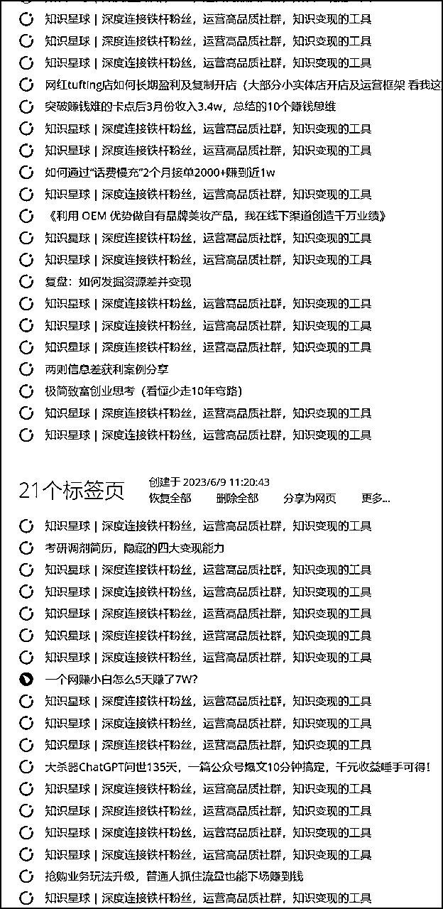

看完之后，我主要有两点直觉：

1. 这哪是辛苦赚钱？分明是低头就能捡钱。
2. 视角一换，机会无处不在。

这个专题的内容在阅读时冲击很大。看完后，我才真正理解龙哥那句话：在赚钱，人人都有机会赚到百万。

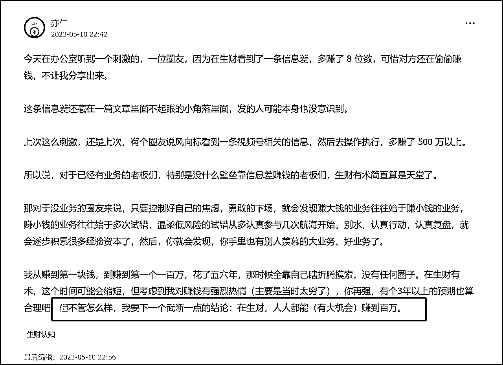

希望你今晚读完也能有所顿悟，早日找到属于自己的百万机会。

---

# 一、底层逻辑

## 1）信息不对等的获利原则

把核心提炼成三点：

1. 价值的流通本身就是价值。
2. 多泡在不同的圈子里。
3. 跨圈搬运需求。

先说第一点：信息不对等为何能赚钱？

很多人其实没认真想过。

我们熟知的商人形象，就是把南方货物运往北方，再把北方特产运回南方，来回赚取差价。这看似理所当然。

问题是：过去商人要走完丝绸之路才能赚钱，为什么现在普通人坐在家里也能靠信息差赚钱？

你可能会回答：因为有了互联网。

这个答案只对一半。

“商人”一词源自商朝。商朝人爱经商，所以经商者被称作商人。

史书里的商朝，印象是暴戾奢侈，确实有活人祭祀。但商朝也有浪漫的一面：他们带着青铜器、纺织品交易到东海、南海、新疆，商业非常发达。

商朝之后周朝起，中国长期重农抑商。为何？

因为整体生产力不足，很多人吃不饱，流通带来的价值就不明显。

所以生产力是信息差变现的基础。生产力越充足，流通价值越大。

看最近的电商直播为何爆发？

多年工业发展后，国内很多制造能力已出现溢出。疫情后，外贸工厂也开始转向内销。

当大量低价优质产能找不到出口时，流通需求变得迫切。

但矛盾的是：生产力越旺盛，流通反而越困难。

举个例子：上世纪九十年代，产品触达用户最有效的方式是什么？

央视黄金时段广告。

1995年央视黄金广告开始招标，随后几年标王全都大卖。

孔府宴1994年销售额3.5亿，花3000万拿下标王后两个月卖了2.7亿。

秦池1995年全年销售额1亿，花6666万买标王后1996年销售额飙到9亿。

为何效果如此好？

那个年代，无论贫富，黄金时间都在看央视，大家看到的广告高度一致。

现在再让产品无脑去央视打广告试试，可能亏到只剩底裤。

生产力提升后，生活质量上升，社会开始分层。

不同地域、收入、兴趣的人被拆成无数小圈子。富人与穷人难以同频，甚至富人与富人之间也合不来。

社会被切碎，触达难度增大，流通价值也随之放大。

信息差里的“差”，就差在这。

社会越发达，圈层越多，差值越大，信息差越好做。

所以别把这种赚钱方式当成投机倒把。让价值流动起来，本身就是价值。

信息不对等本质是圈层不对等。不懂圈层，就不懂信息差。

## 2）套利思路

套利三要素：信息不对等、低投入、可复制。

信息不对等等于蓝海思维，避开竞争，我知道别人不知道。

比如十年前跨境电商就是典型蓝海。很多成功的老板都是蓝海偏执狂。

低投入，就是压缩启动成本，包含时间与资金。

比如跨境电商一键铺货代发，就是当年典型。十年前可低成本无脑起步，现在基本不可能，只有专业打法能接近。

可复制有两层：确定赚钱，利润空间大；确定有人跑通了。

因此尽量避免自创模式，多复制成熟模式。

可复制最好同时满足信息差与低投入两个条件。信息差越大投入越小，确定性越高。

那网红tufting店是否符合这套套利逻辑？

tufting信息差最早在2021年12月的小红书爆发。当时差值巨大，2021年底到2022年初第一批在中大城市抢先开店的，基本1-2个月回本，连预付半年房租都算进去了。

启动成本：房租3000-6000即可开业，设备软装投入约1万，这在实体里属于低投入。

物料成本10-20元，客单价200-400元，盈利确定性明显。

第一批成功案例也提供了模式确定性。

外行看品，外行看模式。先专业，再赚钱。

生意底层很多时候相近。所以中小创业者记住：没有套利就不创业。

—— 来源跨境杨少

---

# 二、操作篇

## 1）如何挖掘机会

① 项目来源的11个渠道

1. 朋友圈
2. 向同行要项目
3. 平台热榜
4. App下载平台
5. 平台数据
6. 保持好奇
7. 中外结合，全球流通
8. 投诉网站、防骗博主
9. 保持敏感
10. 各大平台付费栏目
11. 圈子

太阳底下无新鲜事，同行永远是找项目的第一来源。

善假于物虽被说烂，但好用。

几个实操方法：

一、先找导航站

有时候不用直接找垂类网站，先找导航站。导航站往往能打开几百上千个分类站。

如猎手导航，界面简洁。用导航找导航，再进入分类，基本能覆盖国内大部分网络。

二、看别人花钱花时间的地方

人在哪里投入时间和金钱，那类客户价值越高。

三、保持数据敏感

若竞品或同类词出现明显数据异常，就要在警惕中保持兴奋。

查异动原因：对手是否在小红书投放、在抖音直播、在微博信息流，或做促销？

然后完整体验对手营销动作，对比销售与传播数据，估算投产正负。

为正就跟上，为负更好，省了试错成本，相当于对手帮你探路。

一抄二改三复制四改命。

记住截字诀：看到赚钱项目就截过来。

重点看四个方向：

1. 看他们在开发什么
外包大厅里有人愿花几千上万做的，多半有钱赚。
互站这类买卖源码的网站，最新求购需求常是新风口。
2. 看小程序外包
小程序外包网逛一圈，思考哪些能用。
3. 看广告
站长论坛、网赚论坛、薅羊毛论坛、网盟广告、电视购物广告、竞价广告、各类网站小广告，都是富矿。加上联系方式，亲自体验操盘流程，没准找到适合自己的路子。
4. 看媒介
关注同行在抖音、快手、视频号、知乎、贴吧的账号，看投放、矩阵、广告、带货，观察可模仿的产品、服务、引流方式，用于自己。

—— 来源老成

② 关键词挖掘法

评论区里直白的需求表达如求图、跟团、怎么领，往往对应着商机满满的笔记。

找到这些笔记，找到对应产品，摸清变现方式，评估收益，就能挖到正在低调变现的项目。

我把这三个需求词放到千瓜数据，按笔记评论搜索，顺藤摸瓜找到笔记和对应产品。

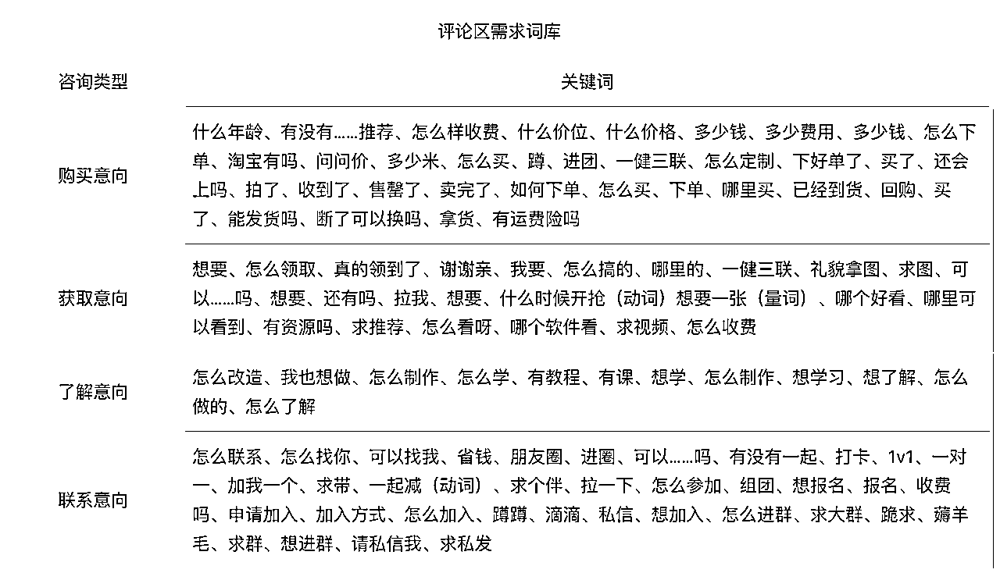

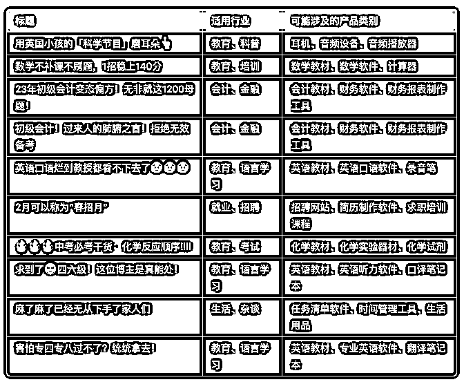

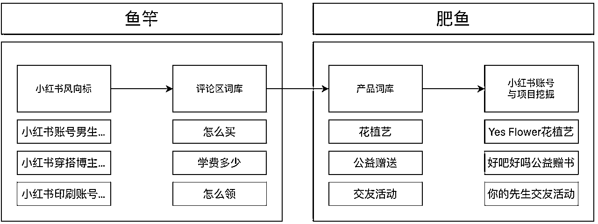

—— 来源梨云

③ 资源检索术

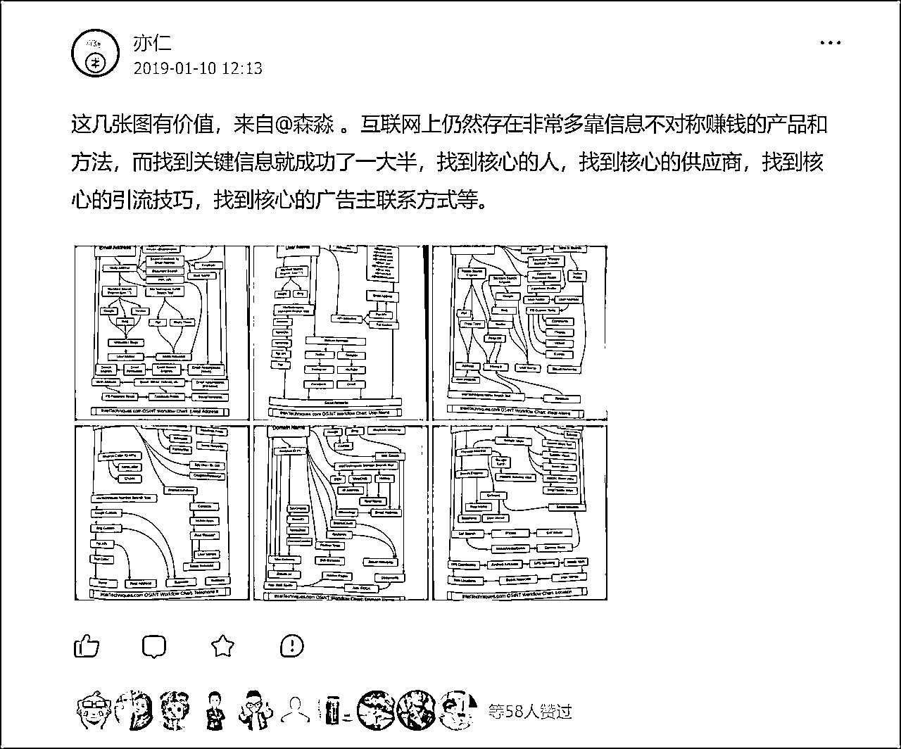

—— 来源淼淼

④ 机会多，如何把握与控风险

什么机会值得上？什么人能把握什么机会？怎么上岸？

先看看自己枪的射程。

上面说了很多，其实核心围绕机会本身。

任何猪都需要风口。大到股市楼市，小到红包封面、支付宝拉新、Clubhouse，每个人都像猎人盯着机会。

但机会再多，你接不住也白搭。

无论向失败学习还是向成功学习，关键是学完后重新出发。

希望本文能帮你认识自己：看到优质机会时，能匹配合适项目，保持冷静坚持，走到想去的地方。

路千万条，安全第一条。对商业模式，最大的风险是不盈利；最大的机会是你能把握的机会。

赤条条来赤条条去，认知谁也拿不走送不掉。

—— 来源胖猫

## 2）如何利用信息差赚钱

① 三类信息与价值输出方式

分享的本质是让看到的人改变思维与行动，减少不必要成本，节省时间金钱精力。

每个人都有独特经历，所以每个人都有可分享的信息。关键是如何封装成合适内容传递给合适的人。

第一类：提供信息know-what

小白也能分享的，就是信息差。

信息差常见原因有三：

1 我知道你不知道，我看过你没看过，我告诉你——消除信息垄断
2 我知道你也知道，但专业领域与知识结构不同，从同一信息里解读不同。我把你没发现的价值指出来——消除认知垄断
3 我知道你也知道，但信息分散你没空找整理——帮你省时间

该做什么？整合信息，让信息有序。用心整理，让信息易被接收。

第二类：提供知识know-how

能解决问题、指导达成结果的信息才是真知识。

每个人都有擅长的细分领域。但因太熟悉自己的事，容易误以为别人也是专家，或误以为常识别人也懂。

结果要么分享太多造成理解压力，要么分享太少缺乏步骤细节，别人无法上手。

跨界讲清楚的前提是把接收者放在心里，心里要有具体沟通对象。根据对象决定信息颗粒度。

第三类：提供知识架构structure与规律模式pattern

在实战派扎堆的圈子，大家不缺动力不缺钻研精神不缺执行力。但专注做事的人容易忽略全局。

所以既有实战又有长期研究的人，最有价值的内容是全局观。

知识架构与规律总结属于这一类。

知识架构在专业书和经典教材里都有。客观规律前人早就总结过。收集起来讲懂即可。不难。

—— 来源白一喵

② 信息搬运与聚合

背景：

1 快手火山上有大量有趣的十几秒短视频，看一个切一个体验碎
2 微信用户与快手用户重合度不高
3 微信用户有猎奇心理

思路：

1 找到有趣视频，联系快手作者获取授权
2 将作者几十条短视频拼接成长视频
3 上传到腾讯平台
4 写文章介绍作者并内嵌视频
5 分享传播文章
6 每篇文章介绍一个快手玩家

—— 来源龙哥

③ 聚合APP拉新任务

CPA拉新即APP拉新，帮APP厂商拉一个新用户拿一笔佣金。

如推荐办信用卡得150元，推荐注册快手极速版得20元，推荐注册下单美团优选小程序得22元奖励，都是拉新任务。

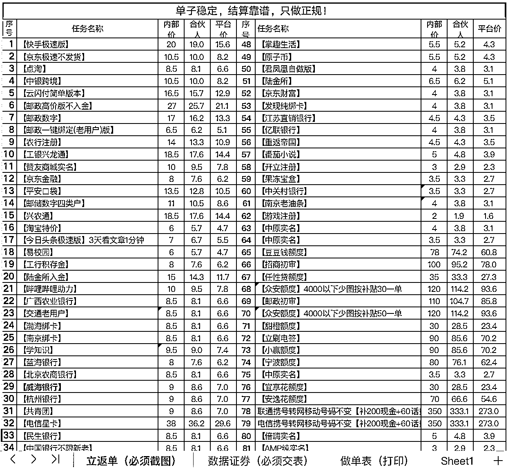

打开列表，可能有人会问：别人快手极速版不是70元吗，怎么这里20元？后续再细说，和渠道及任务难度有关。

目前汇集市面上200多个优质正规拉新任务，总佣金保持3000以上。平台统一管理，非悬赏非商家模式，对接结算审核由商务客服团队负责，保证结算审核稳定。

—— 来源三米

## 3）什么信息差能多赚钱

① 具备时代红利的信息差

把认知差拆成三要素：资源差、技术差、信息差。对大多数人而言，资源技术门槛高，只能靠信息差。

我身边赚钱的人无一例外靠信息差。

我的第一桶金：卖淘客软件。当时朋友做淘宝客，我去找相关软件，找到后没买，而是付费成为代理商，后续又代理了几款。

月卡赚大几十，年卡赚大几百，正处市场红利期。

淘客生意本质也是信息差，无非知道软件、知道淘宝联盟，一层窗户纸，却造就一批千万富翁。

想快速致富两步：

1 找到红利赛道
红利赛道是流量聚集地，易获取，大家都认为机会大
2 找到赛道里的信息差
不需要下场，只需找到信息差卖给新进场的人

举例：培训行业赚钱吗？现在最赚钱的是抖音培训。因为抖音是红利赛道，掌握玩法信息差的人站在风口赚钱。

红利市场两种机会：稳赚不赔，盈亏参半。

稳赚不赔是卖信息差：卖软件、服务、培训，不亲自做，教育市场服务想入场的人，稳赚不赔。

盈亏参半是主动下场正面厮杀，有可能赢，输的概率更大。

赚到的钱只是时代红利，与努力有关，更与选择有关。

抖音上靠卖信息差发家的人太多。近期热的有云蹦迪、光盘修复。之前热的有音乐U盘、老照片修复。

玩法是一时的，贩卖信息差是长久的。快速致富离不开时代红利和信息差。

—— 来源低调

② 价格不透明的二手产品

闲鱼兼职可基于自身需求选方向：

1 高客单价赚利润，如数码、电器、奢侈品、文玩、名牌鞋
2 高转化低竞争
3 低消耗控制时间精力

---

梳理到此。内容密集，建议收藏慢慢消化。祝你早日找到自己的百万机会。

你有没有想过，同一条街上的两家店，一家挤破头，一家冷清清，差别往往不在产品，而在“你知道别人不知道的事”。说白了，赚钱的底层逻辑就四个字：信息差。

先别急着反驳，听我讲完这些真实发生过的故事，你会发现，所有“突然赚到钱”的人，本质上都是抢先看到了信息不对等的缝隙。

什么是赚钱的势能？就是时机、热点、政策变动里藏着的那个窗口。风口一旦起来，一波人冲进去，需求被流量放大，产品跟上了，转化率跟上，钱自然进兜。可窗口期通常很短，能抓住的人，往往不是运气好，而是早就把风向研究透了。

比如有人发现，杭州商场的折扣店货真价实，但外地人根本不知道，也没机会来买。于是他做起“国内代购”，把折扣童装、母婴用品倒腾给身边需要的妈妈们。这里的关键不是代购本身，而是他问了自己三个问题：替谁买、买什么、去哪买。看似简单，背后全是信息差。

再比如早年做U盘生意的学生。学校门口卖一百多，淘宝只要几十块，他就靠这个差价，白天到货，晚上贴传单，一晚上卖空几十个。后来拉上室友组队，成立数码联盟，再发展其他学校的代理，先发货后收钱，再往上游谈价格，一年赚了小十万。他说，这段经历教会了他几个道理：信息差能赚钱，但靠信息差赚的钱不长久；想赚更大的钱得往上游走、得建团队；还得有品牌意识，让人一提到买数码就想到你。

游戏圈里也藏着类似的机会。有人玩《剑灵》，发现时装分解的高级衣料能卖出比时装本身更高的价格，166%的利润，别人没看出来，他看出来了，迅速赚了三万。后来又给氪金大佬代抽宝箱、代肝任务，每个月几万进账。再后来发现游戏方和超市联动的兑换码活动，只要买够15元可乐就能抽码，他打印了三千块的购物小票，一个码能卖两三千，但他没全抽，只抽了十几张，剩下的低价卖掉。为什么没All in？因为钱被挥霍了，也没有完整的赚钱体系。但这里有个重要启示：帮别人偷懒，就是最好的生意。

还有会计行业的例子。每年继续教育要挂机100小时、答题、考试、审核，麻烦得要命。他找淘宝代办，100元一条龙。后来淘宝下架了相关服务，他意识到自己手里的代办渠道成了稀缺资源，于是在大学会计群里发了一条消息：150元代办，包发票包审核。当晚加了一百多人，后来建了18个500人大群，每单赚50差价，只花三分钟转发资料。

电话被标记这事，也有人能赚钱。淘宝上“取消手机标记”标价10元，实际收23元。但你知道吗，这些标记其实可以自己去平台免费申请解除，官方有专门的服务系统。有人把教程做成2.99元卖，月销五十多单，照样有人买单。

闲鱼上卖老物件也一样。旧货市场里几十块收来的东西，拍照识物一查，同款网上能卖几百甚至上千。有人专挑市面上卖得好的品类，从淘宝找到低价货源，再挂到闲鱼卖，小单198、298、398地走量，蹭上了平台早期红利。

就连代购、电影票、春节租车，背后全是同一个逻辑：信息差。低价电影票来源五花八门，平台活动、会员福利、企业福利、内部供货商，你只要知道一个别人不知道的渠道，就能当中间人赚差价。春节租车，有人发现网约车公司过年车闲置，2800一个月租来自己开，还有人专门做二手电器生意，专挑比价困难的品类，比如冰箱、洗衣机，避开同行价格战。

说到这，你大概明白了：商业机会往往从信息差开始，早期入局的人圈资源、做规模，然后阶段性垄断细分市场。再往后，从资源垄断升级到品牌垄断，让市场形成共识，最后参与制定行业规则。能做到制定标准和规则的公司，已经是巨无霸了。

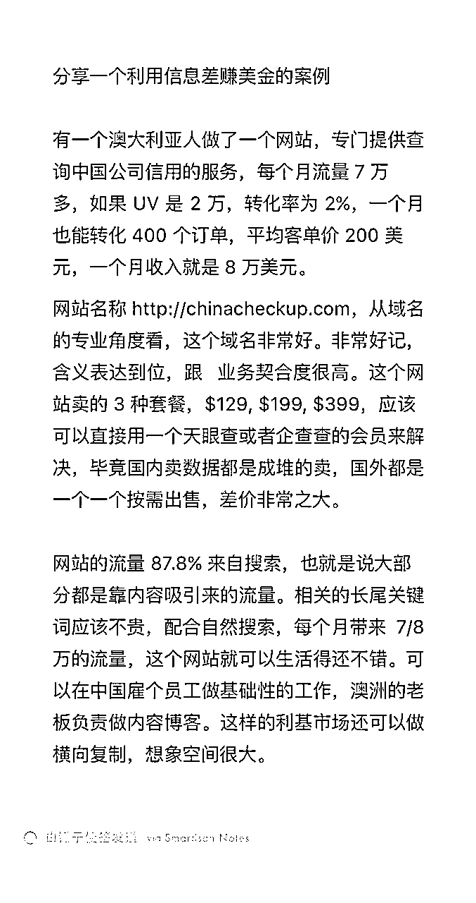

所以，别总觉得赚钱需要多大的本金或人脉。很多时候，你只是需要比别人多看一眼、多想一步。信息差永远存在，就看你是做那个发现缝隙的人，还是做那个被赚走差价的人。那些执行力强的人，早就把方法原样照做，0成本开干了。你要不要也试试？

最近，一类短视频在平台疯狂刷屏：老照片里的先人被AI唤醒，会眨眼，会微笑，衬着一曲低回的音乐，评论区写满思念。多数人划过就忘了，少数人却看见了生意——这股风潮，最早是从一个付费社群传开的。

我认识两位浙江大学毕业的创业者，早在好几年前就开始做一件很细碎的事：把用户公开发布的照片与状态收集起来，免费整理成精致的数字书册，再引导用户为实体印刷本付费。用户加来私人号后，机器人扫描内容、自动排好版面，全程不过一分钟，谈不上技术多深，妙在服务细致。据我所知，其中一家平台流水将近两千万，毛利空间约有一半。按每单一百多块的定价，市场规模不难想象。

还有个让人拍案叫绝的做法：有人利用消费者平台认知的盲区，在A平台展示商品，B平台完成发货，两侧价差和佣金同时落袋。店铺等级随单量快速攀升，最后连店铺本身都可以卖出好价钱。这套模式不算精巧，却是典型的认知套利。

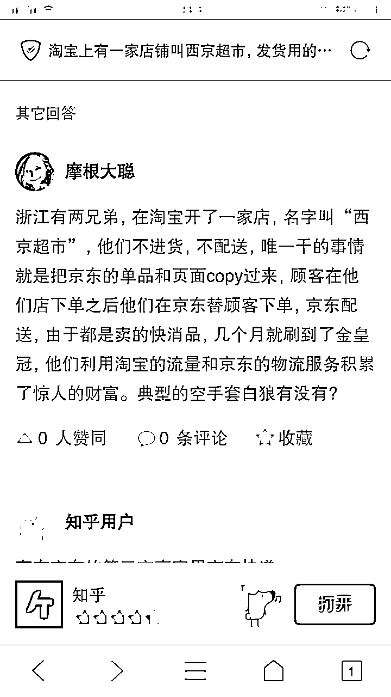

再聊一个离普通人最近的：手机话费慢速充值。打开购物软件搜索“话费”，会看到一类标着慢充的商品，付款后延迟到账。有人从春季开始做这门小生意，两个月下来成交两千多单，平均每日几十单，每单赚几块钱，累计到手一万元上下。供应链的逻辑很简单——运营商和银行、企业常年发放优惠话费，一部分被机构以低折扣收走，再到二手交易平台慢慢卖给用户。中间那几块钱的差价，就是信息折价。这种生意人人能做，也几乎不挑技能。

另一个典型的“代服务”案例，围绕知名火锅品牌的学生优惠展开。有人专门帮不满足核验条件的食客代下单，从中收取一点手续费。本质上，他做的是把别人找得到的资源，送到找不到的人面前。

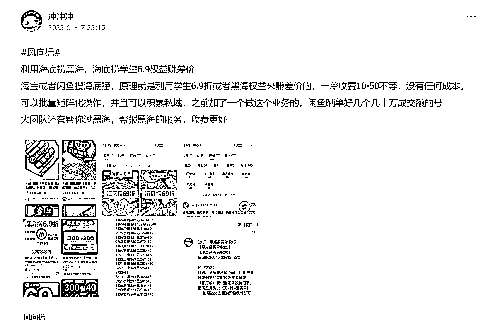

跨境电商的中介生意也值得一看。海外客户希望进入中国市场时，往往需要中国化的名字、品牌标识、配音和文案，甚至一份漂亮的手写签名。我们这边恰好有庞大的生产供应链和服务平台，于是有人在国际外包网站接单，再派单给国内团队，赚取中间差价。早年流传很广的“外国小孩举牌送祝福”定制视频，也是这个模式下的产物。

一个关于数据价值的真实故事：某大学生入职一家小型调研机构，每天的工作是给方便面行业两家头部公司的区域销售主管打电话。开口先谈条件——聊半小时，赠送五百元话费。对方欣然接受，随后在电话里报出各种产品的区域出货数据：酸菜口味多少件、茶饮料多少件、乳味饮品多少件。这些数字被录入电子表格。月末，全部数据汇成一张覆盖全国的市场热力图，两大品牌在全国的销售结构一目了然。而这份情报的唯一买家，是一支管理巨额资金的顶级投资机构。拿到数据后，它便在资本市场提前布局，一边押注一方崛起，一边做空另一方。投入的不过百来万话费、实习生的工资和一些咨询费用，回报却是几十亿资金的方向确定性。信息值多少钱？在这个故事里，它值几十亿。

还有一种传统的低买高卖：每逢平台大促，不少商品都会跌出价格低谷，有人专职盯着优惠券和活动价下单，囤积之后按行情价售出。覆盖的品类相当宽：演出门票、手机电脑、名庄白酒、限量玩具、贵金属与邮品、护肤美妆、普洱茶饼、宠物周边，以及最近两年兴起的数字收藏品。这行和过去跑码头倒货的商人没什么区别，只是今天的操盘手用的是券、算法和会员体系，而非蛮力。

浙江出现过一出利用合规焦虑的套利戏码：一家服务公司拿着主管部门公示的名单，逐个联系那些年度审核逾期的企业。话术非常标准——“您的资质审核缺步骤，限期不补会进入异常名单，后面的合作都要受阻，代办费用五千元。”不少老板在紧张中直接付款。其实补交材料本身并不难，难的是企业不知道自己忘了。按数千家遗漏企业、每百户成一单来算，单省营收就能达到二十多万元，几乎是纯利。

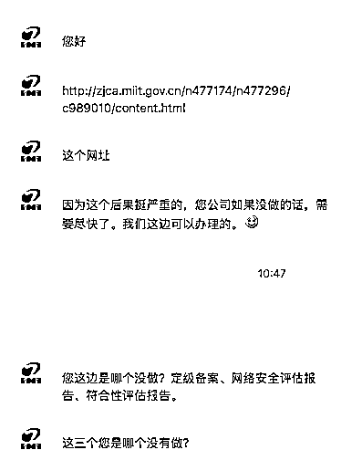

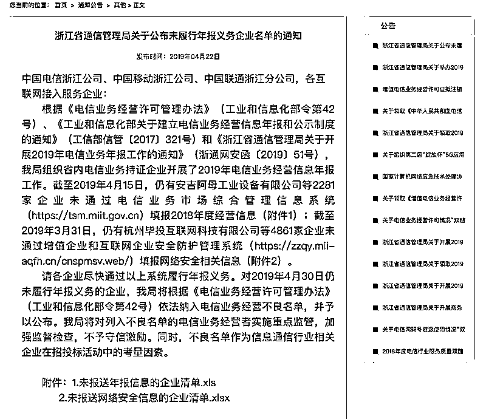

还有一次极具时效性的流量操盘：某国民级聊天软件推出重大版本，更新包并非同时向所有用户开放，先上线的只有部分机型。全网都在热议新功能，另一边的人群却只能眼馋。有人第一时间找到适配非官方渠道的安装包，写成一篇教程，投放到大型问答社区，再引导读者前往私域账号回复指定词索取地址。次日复盘时，他觉得覆盖不足，又把内容分发到其他几家公众平台。短短几天，新增关注者突破一万。由于事先与品牌方约定按粉丝数量结算，这一波直接带来一万五千元的收入；这些关注者的长期商业价值，更是一笔难以估量的资产。每当版本迭代出现时间差，这套打法就可以复制。

这些案例看得多了，背后的规律会自己浮出来。

第一，交易是一切商业的原点。多数人没有能力从零创造，那就做中间层——低价拿货，加价出手。

第二，认知的不对等本身就是商品。你知道某件事的答案而别人不知道，把答案打包成课程或工具出售，就是一份生意。

第三，别人觉得麻烦透顶的事，你可能因为有趁手工具而轻松完成；把这份“轻松”变成服务，差价自然产生。

第四，信息跟着管道走。你订阅的站点、加入的社群、装过的软件，决定你看见什么。想拓宽视野，不需要玄妙方法，每天大量阅读就对了。

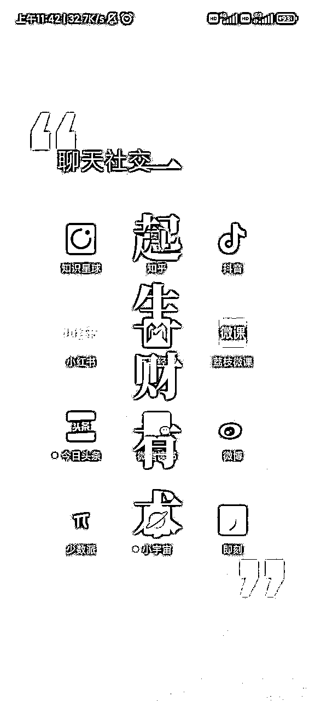

第五，管制在哪里，商机就在哪里。强制要做的事——比如骑车戴安全帽；强制不能做的事——比如某应用被下架，都会导致资源重新洗牌，洗牌之处便有新的需求出现。

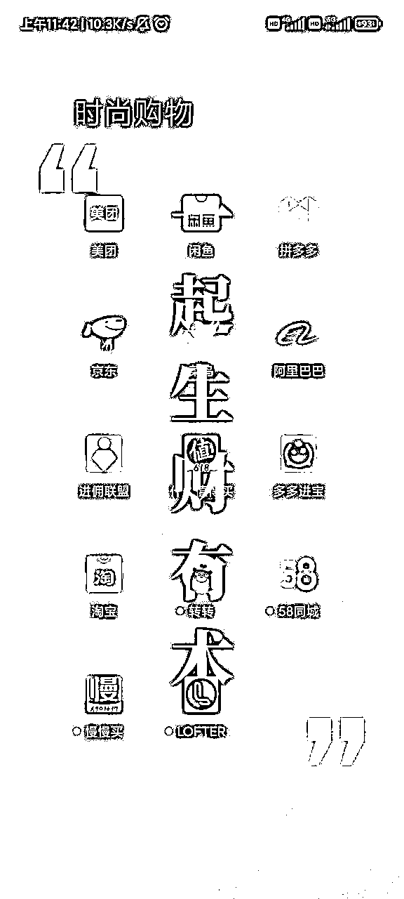

第六，留意那些关键词。凡是带“代”字的服务，带“破解”字眼、“免登录”功能的软件，基本都在贩卖渠道优势。

第七，语言是隐性护城河。中文世界的机会，换到英文世界往往可以重跑一遍；懂编程语言，则能用脚本代替重复劳动。

第八，世上不存在所有人都知道的事。经验、手艺、常识，在另一群人的眼里都是稀缺品。

还有一类更高级的玩法，是数据先行、认知套利。

有人在电商运营后台的数据工具里，早于资本市场发现了优质公司。输入一个产品关键词，排名第一的品牌往往众所周知，但他更多留意第二名的增速；顺着数据再去研究那家公司的定位与区域优势，等待市场反应过来，股价已经走出陡峭曲线。用同样的方法搜索小家电、乳制品等品类，也能找到一些产品线被严重低估的隐形冠军。资本市场常常等到财报发布才反应，而消费数据是实时的，这就是时间差。

历史上，巨头无暇顾及的角落也常常长出新巨头。当老牌电商平台全力整治假货时，低价社交电商悄无声息地切入下沉市场；当某中国短视频应用成为出海标杆又遭封禁时，另一款同类应用迅速填补了空白。替代品的机会，总是在旧王者露出破绽时出现。

说到底，可卖的不止是实物，还有你知道而别人不知道的信息；机会也不是没有，而是多数人看不见。所谓风向标，不在别处，就在你对于身边事物差异的敏感度里。希望这些玩法，能帮你打开一点点新的思路。

我现在的主业是做国内电商，阵地在京东，主要负责大家电这一块。坦白说，这条赛道已经让我觉得很疲惫了。

第一是钱赚得少。作为代理分销商，毛利经常就卡在15%左右徘徊。平台流量见顶后获客成本只涨不跌，利润被一层层挤掉，稍有波动，团队开销都可能覆盖不了。

第二是回报周期长。要想拿到厂家给的规模返点，就得先砸几百万上千万去堆销量，否则一年下来就真的白忙活了，典型的亏本做规模。

这种模式跟我心里对好生意的想象差太多了，也受够了国内电商那种一轮又一轮的价格绞杀，同质化就是直接把利润给吃掉的存在。

我心里认为的好生意，至少要同时满足下面这5点里的3点：获客成本低、品类少、转化率高、对手少、毛利率高。圈子里常说的蓝海，大概就是这个意思。

问题是主业已经趋于稳定，没有验证就贸然转向，等于拿公司、合伙人和员工的饭碗开玩笑。所以我选择在2023年另起炉灶搞副业，结合过往的经验，我给自己定了一个寻找方向：做有垄断、有壁垒、人家做不了的生意，而不是人人都有的生意。

原文链接：https://t.zsxq.com/0eoXX3SBO

作者：knight

# 七、把信息差变成工具

## 1）大数据平台

看完老黄牛前辈的那篇分享，你就知道数据到底有多值钱了。

用数据赚钱，拼的本质是认知差。能不能从一堆数字里读出趋势、读出机会，这门槛其实很高。

标题：【通过金子发现金矿| 我如何从一条信息发掘3个金矿】

1、apptopia：用移动端数据来指导营销、产品和投资决策的应用

2、七麦数据：专注移动数据的分析与监控平台

3、199it：互联网数据共享的平台

原文链接：https://t.zsxq.com/0erzP0dpM

作者：老黄牛

我相信在数万人的赚钱星球里，肯定有人能把这事做到极致。顺手放一个大数据导航站，万一能帮到你。

大数据平台导航：https://bigdata.ttdh.cn/

## 2）航海工具包

第四部分我也提到过，任何软件、任何工具本身都可以变成商品。

如果你带着“卖工具、靠工具提供服务”的视角再去看航海工具包，你会发现它变了。

这已经不是一个工具包，而是一个商品库，一个现成的金矿。

注意，我不是让你去倒卖航海工具包，而是从里面挑几个你觉得有潜力的工具拿来做生意。

1.点击链接：赚钱有术实战活动

2.打开你感兴趣的活动

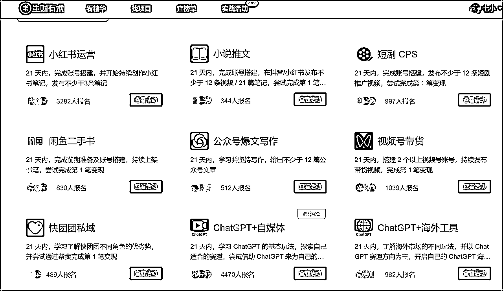

3.打开实用工具

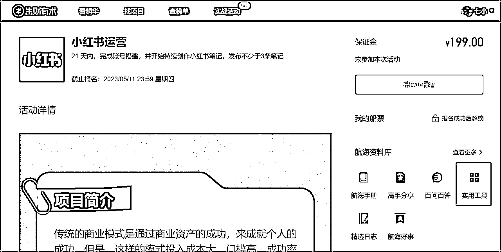

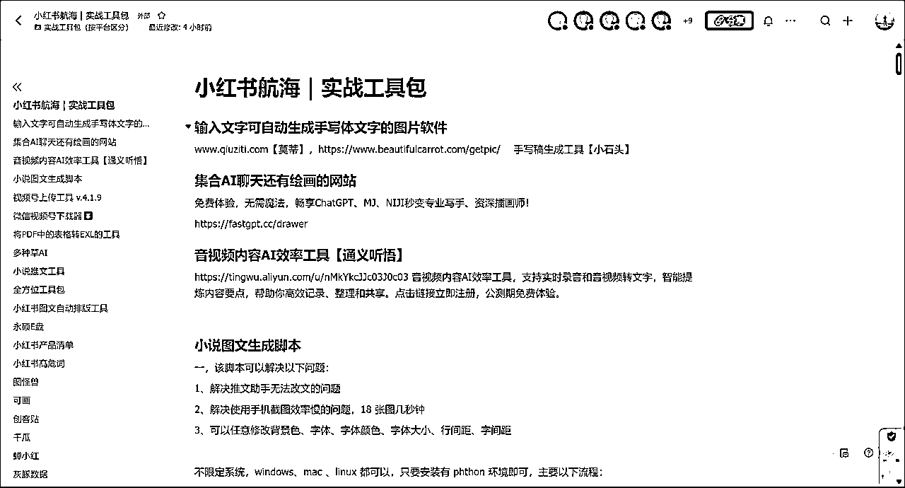

# 八、最后的碎碎念

1.我第一次系统翻完这个信息差专题，脑子里只有震撼两个字。

文章开头我就说过这个感受，当时大家可能没太懂。

现在看到结尾，应该能明白我说的这两句话了：

1、卧槽、卧槽、卧槽... 这哪是费力赚钱？这分明是弯腰就能捡钱。

2、视角一换，机会就无穷。

如果你也被震到，觉得太强了，欢迎去评论区打卡：赚钱有术,yyds！

2.最近在赚钱交付群里聊起，我自称是赚钱精华区选手。写精华只要认真写，基本都不会翻车。但我不是风向标选手，每次发完几个标进群，下个月又因为没上风向标被踢出来[笑哭]。参加航海，要么是送钱的活动，要么是打水卡，每次都认真报名，最后都变成划水hhh。

所以啊，每个人在赚钱里都有自己的用法。我刷帖写帖就很顺手，换个玩法就不行了。

如果你看帖看得头晕，被我的帖子整焦虑了，那你可能更适合航海区或风向标区。不一定非要靠刷大量帖子来提升和赚钱。

总之，一起赚钱有术吧。希望每个人都能找到最适合自己的赚钱方式，早点抓住属于自己的100W机会！

最后送一张壁纸，点开大图就能保存~

