零基础也能上手的GPT约稿赚钱完整教程

上次发的那篇主要讲了我的赚钱思路和整体框架，评论区有不少人说我光谈模式不给干货。行，今天这篇就来点能直接照做的，把那些用得上的细节全摊开讲清楚。

想深聊的伙伴直接来找我，我发你一些资料链接，也欢迎进群讨论。课程和陪跑社群都有，随时可以交流。

一、用GPT之前，你该知道的几件事

ChatGPT这名字大家都不陌生，可到底去哪里打开它、它能干什么事、怎么靠它弄到钱，很多人都还是一头雾水。这篇文章一次性给你讲明白。

AI在今年是绕不开的大风口，而GPT代写就是最容易切入的一小块蓝海。它像是一个随叫随到的创意合伙人，时政、商业、科技类的文案都能给出像样的初稿。写作卡住了它能拉你一把，没有思路它能帮你打开脑洞，算得上一个随身的文字外挂。

现在有几种入口可以用：

1. OpenAI官网：注册后直接聊天，最接近原始体验。
2. Playground：官方推出的交互测试界面，用来感受功能很方便。
3. API接口：想把它整合到自己的产品里，就通过编程接入。
4. 也可以在Google搜ChatGPT进入官网。

知道了怎么用，下一步是把它的能力嵌入你原有的业务，让它变成你的生产线。下面讲操作方法。

二、赚钱的基本盘

我自己在传统写稿行业做了三年，今年二月开始把GPT融入工作流，收入有了肉眼可见的增长。

写这篇实操指南，也是想把自己的经验固化下来，让后面的人少走一些弯路。

早前我也尝试过做个人IP接稿，结果并不理想。现在主要做的是私域直客和渠道中间商对接，赚的是稿费。今年搭上AI之后，投入的精力还是老样子，营收却比去年翻了三倍多。

不过多废话，直接放核心链路：

对接单子 → 反复确认客户想法 → GPT出稿 → 交货收款

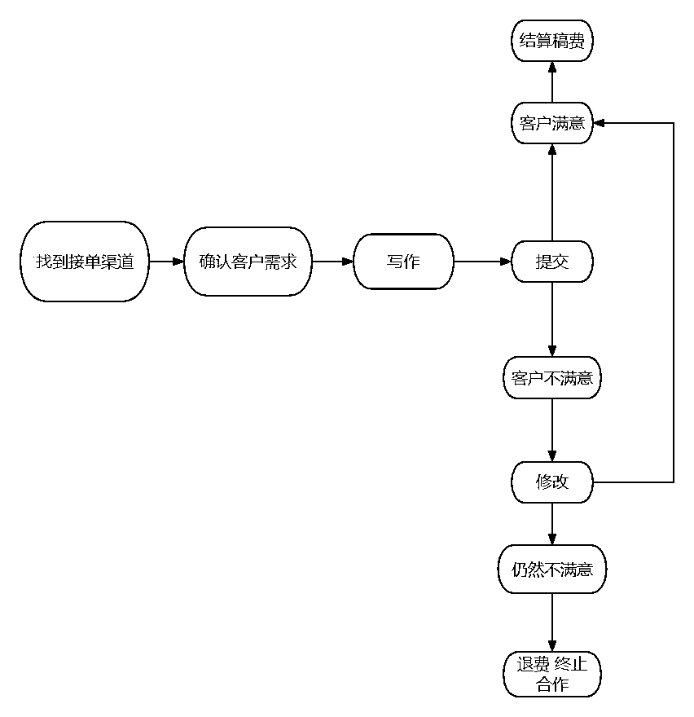

经常有人私信问我：没有渠道怎么办？不懂写稿能不能学？是不是只适合有经验的人？

我的看法是：这个项目对小白极其友好。只要你愿意下功夫，绝大多数人都能做出成绩。我们内测训练营带了19个零基础学员，成交率超过百分之九十。直接看图：

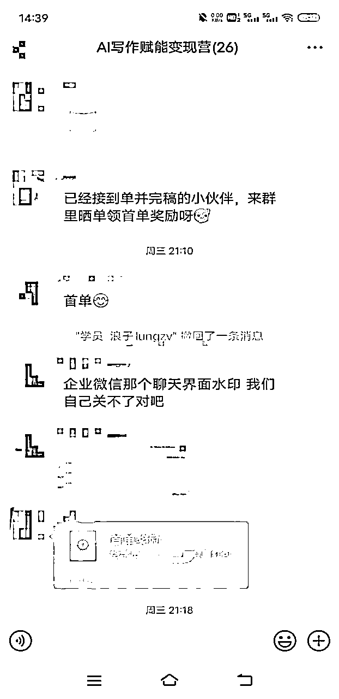

几乎每个人的首单都特别顺利，练了一阵子后基本稳定在每天400+。随着熟练度提高，很多人开始有了属于自己的老顾客和回头客。

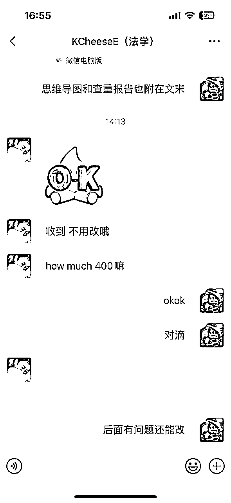

上图的学员，从零起步第三天，用GPT写了两篇文献综述，两个小时赚了400元。

现在知识付费的市场需求一直很旺，学生和上班族都舍得为优质内容掏钱。多数人还不知道GPT能做到这个程度，你提前掌握了这套技巧，就是在靠信息差赚钱。

三、从0到1手把手教写

一）产品：你交付的是文稿

说白了，产品就是客户指定的一篇篇稿子。你要做的事情很简单：把需求描述清楚，扔进ChatGPT对话窗，它可以自动归纳、提炼、重组信息，生成初稿。偶尔会出现偏差，但通过一些提示词技巧，完全可以校正。

对新手来说，最难的是不知道该怎么给指令。我把它分成短篇和长篇两种情况来说明。

短篇怎么写：演讲稿
假定客户要一篇500字演讲稿，主题是《决不轻言放下》，用于学生演讲。
操作有六小步：
第1步：把文体发给GPT 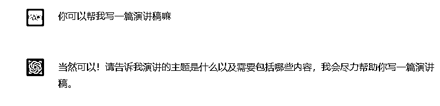
第2步：追问该文体有什么创作要求 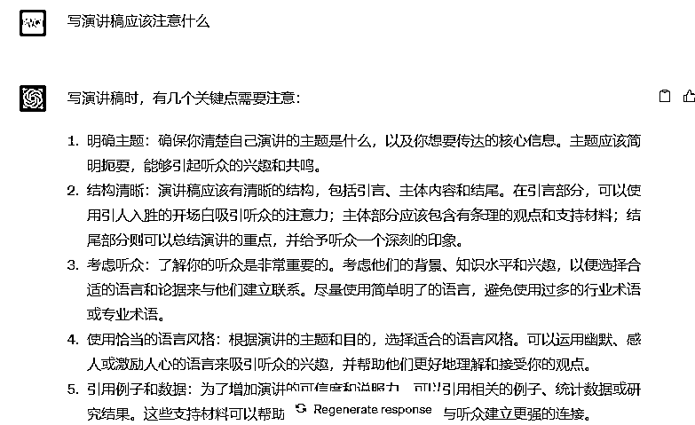
第3步：提供标题、字数、使用场景 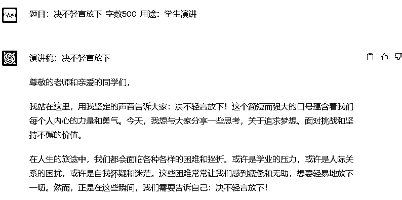
第4步：从输出中挑出有用的内容
第5步：人肉润色，把AI套路化表达改掉，例如删掉“首先、其次、最后”
第6步：交付

AI生成的正文示例（节选）：
“尊敬的老师和同学们，我站在这里只想说一句话：无论遇到什么，都不要轻易放弃。放弃会让我们错过太多可能，也意味着向困难低头。可只要我们咬牙撑过去，每一次危机里都藏着新的机会……”

这里只是节选，实际上它会写得更加完整，关键是后期的筛选和改写。

短篇怎么写：新闻稿
比如客户丢来一个模板，要求字数1500，用于公众号推送，且格式必须贴近模板。
流程：
第1步：观察模板结构，总结出主标题、引语、分标题、正文几个部分 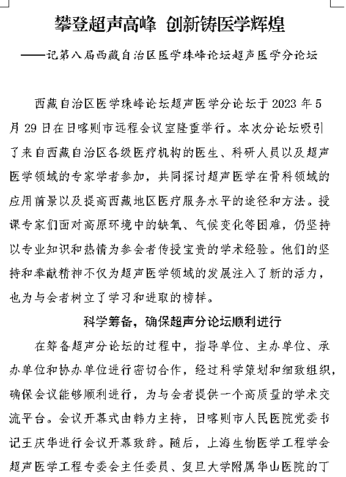
第2步：先试着给GPT一个简短的指令 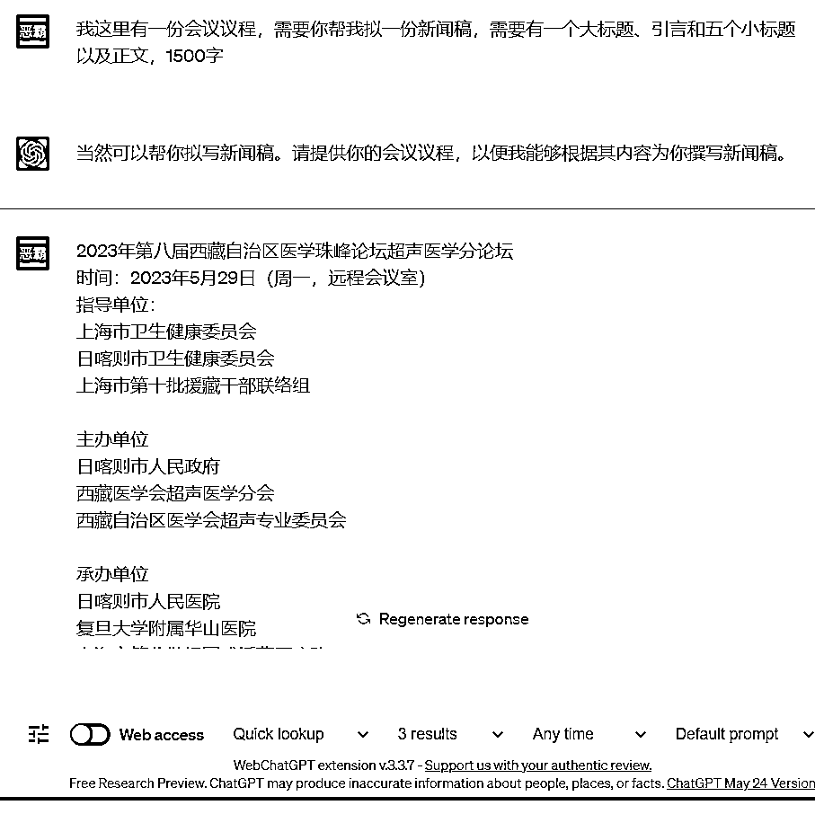 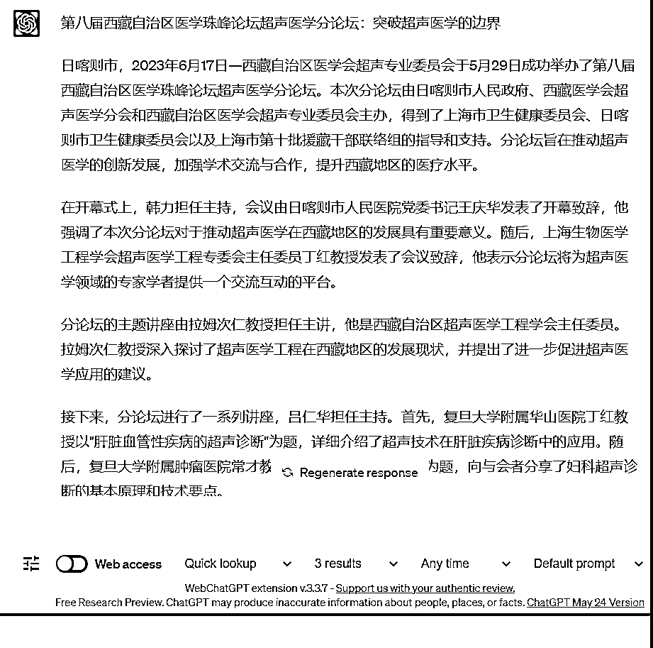
第3步：它第一次答偏了不要紧，直接反问纠正 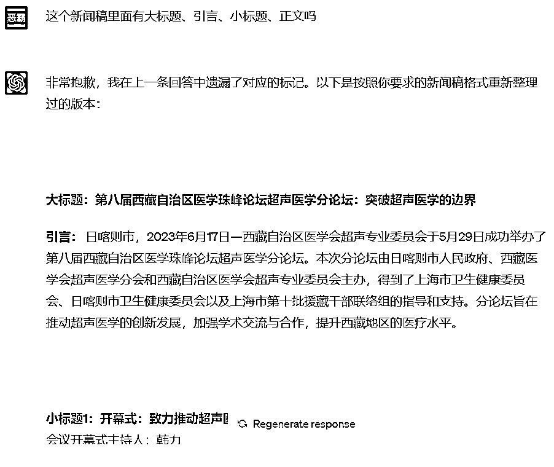
第4步：一步步细化要求，让内容逐步向目标靠近 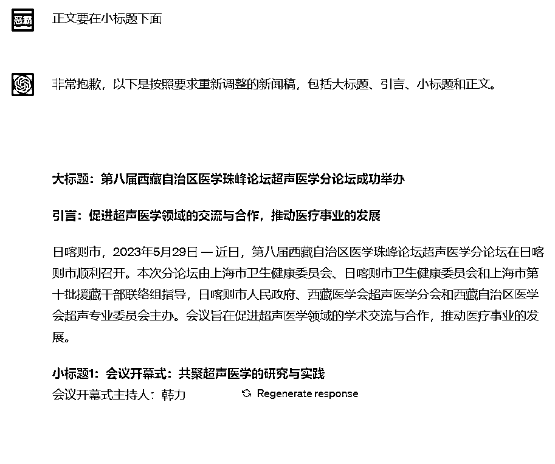 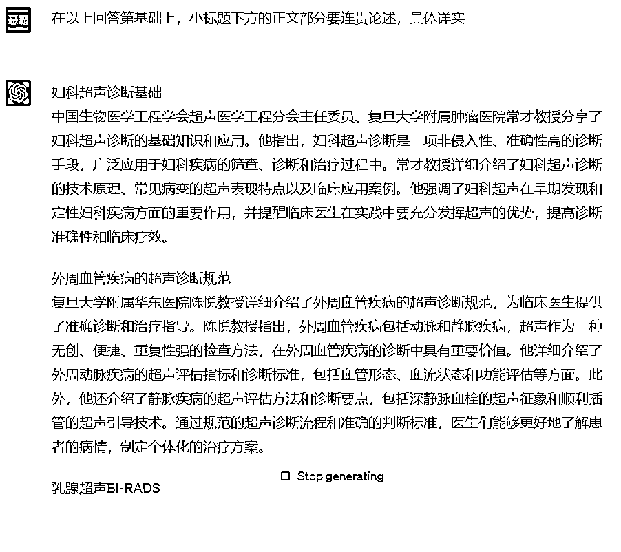
第5步：把GPT给出的框架提取出来，再逐一填充 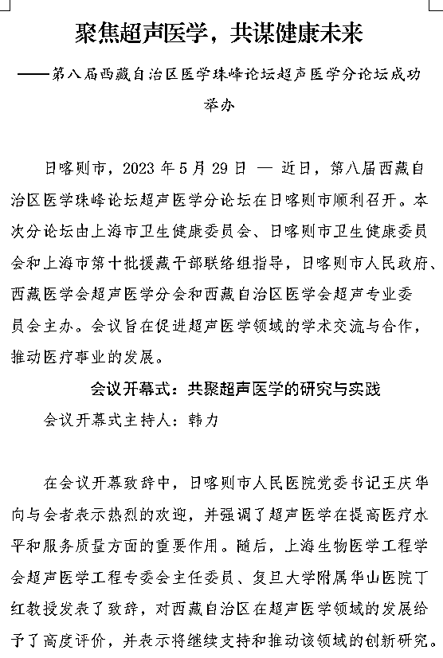
第6步：润色、调版式
第7步：完工

长篇怎么写：述职报告
这里以游泳教练述职报告为例，要求是1000字，内容要包括一年里的德、能、勤、绩表现，存在的短板，以及后续规划。
步骤：
第1步：先表明文体 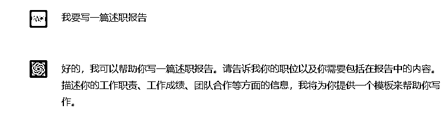
第2步：让GPT拟一个架构 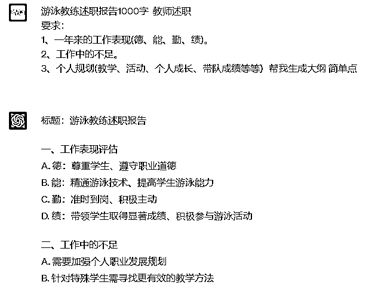

GPT给出的架构长这样：
《游泳教练述职报告》
一、德：尊重学员、守住职业底线
二、能：掌握扎实的游泳技术，能有效提高学员水平
三、勤：按时到岗，工作投入
四、绩：带队获得不错的比赛成绩，积极参加游泳活动
五、不足：职业规划需完善、特殊学员教法需优化、家校沟通需加强
六、未来规划：培训学习、多样化活动、个人进阶、带队冲成绩
七、结语

第3步：按人工标准把架构再捋一遍，留下更清晰的骨架
第4步：每个分支单独发给GPT展开
第5步：把各段落拼起来

举例说，它会生成类似这样的段落：
“过去一年，我的工作重点是保证每一堂课的高质量。训练计划都是按学员的不同情况单独设计的，同时配合定期的技术反馈。遇到初学者，我会用更细致的分解动作教学；面对有比赛任务的学员，也会加大体能储备……”

依照第4步的方式，把每个章节都分别生成好，最后组装成完整文本。

第6步：再次通读润色
第7步：交给客户

小结
看完这两个案例，你应该感受到了，这事的门槛不高。
关键是把握两条原则：

其一，提问要简洁。
废话太多的指令只会让GPT困惑。
比如你给一大段话，又限定题目范围又要它具体到某个点，还要给出例证，它很难抓住主线。
更合适的说法是：“我要写一篇论文，方向是侵权法里的监护责任，请你给出三个足够具体的题目。”

其二，范围要讲透。
把背景和限制说清楚，回复才更精准。
别只说“请把上面这段改得详细点”，而是要说“请具体写清楚这场战争取胜的原因，以及作者列这些例子是想证明什么”。

大部分题材都能套用这套逻辑高效生产。但真正要做出精品稿，还得靠多和客户沟通，多打磨细节。

二）定价策略

对接中间商的单子：
先打听不同公司的价格体系，在自己接受度内接单。合作时间长了，再顺势谈提价。
新手的话，最低可以从千字20元开始接。接单之前一定把要求和交稿时间问清楚，避免产生误会，也是保护自己。

面对私域老客：
可以列一个统一的价目表，也可以分档报价。

统一价目表可以参考：

| 荷包蛋论文辅导 |  |  |  | 增值服务 |  |
| 函授 | 初稿 | 800 |  | 文科降重 | 千字60 |
|  | 包修改 | 1200 |  | 理科降重 | 千字80 |
| 专科 | 初稿 | 800 |  | 格式校对 | 5元/页 |
|  | 包修改 | 1200 |  | 答辩PPT | 200 |
| 本科 | 初稿 | 800 |  | 修改3次 | 400 |
|  | 包修改 | 1800 |  | 修改5次 | 700 |
| 特殊要求 |  |  |  | 修改8次 | 1000 |
| 有问卷 | 初稿 | 基础报价+300 |  |  |  |
|  | 包修改 |  |  |  |  |
| 有模型 | 包修改 | 3000-5000 |  |  |  |

按一万字的稿子为例，分档价格可以这样定：
只要初稿：600
初稿+3轮修改：1000
初稿+5轮修改：1200
初稿+8轮修改：1500
初稿+10轮修改：1800
单次修改：300
3轮修改：800
5轮修改：1200
8轮修改：1500
10轮修改：1800

三）找单渠道

这里举三个最常用的：

淘宝渠道：直接搜相关店铺，找客服询问，通过测试后进入接单群。好处是平台有一定保障。 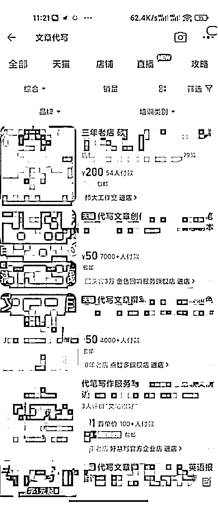

公众号渠道：搜关键词找到中介，加上联系方式后成为长期写手。 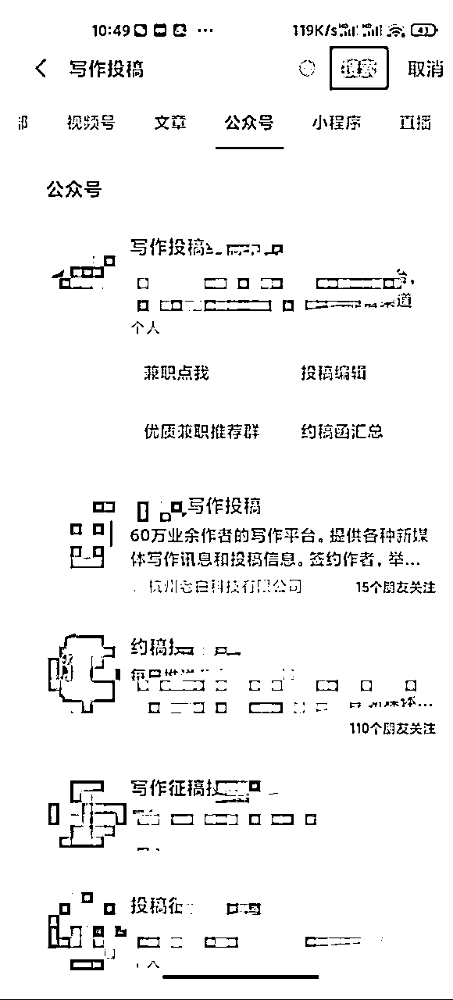

社群渠道：在QQ里搜相关群名，进去蹲单，慢慢把公域流量导向私域。 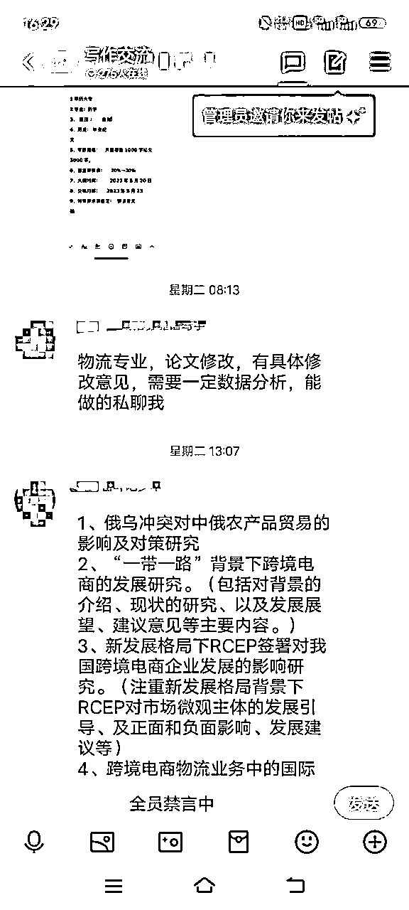

四）成交与关系维护

我一直很看重服务体验，靠的并不是花哨的营销，而是把客户的事当自己的事。准时交付、认真响应、随时修改，这些细节积累起来，回头客就会越来越多。

我的客户里大约一半是学生党，很多人最后都处成了朋友。正因为自己也当过学生，能理解他们赶截止日期的焦虑，也会主动多给一些建议，合作自然更顺。

比如这位客户……

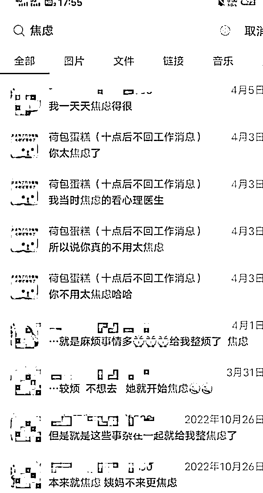

有一回，她的稿件改了又改，整个人都被焦虑吞没了，晚上噩梦不断，连生理期都乱了。我跟她反复沟通，耐心安抚，一点点把稿子打磨到位，最后不仅顺利完成，还让客户关系更紧密了。

这段经历让我越发意识到，日常沟通里【共情能力】真的太关键了，同时，我还能额外提供一份【情绪价值】。

再举个例子

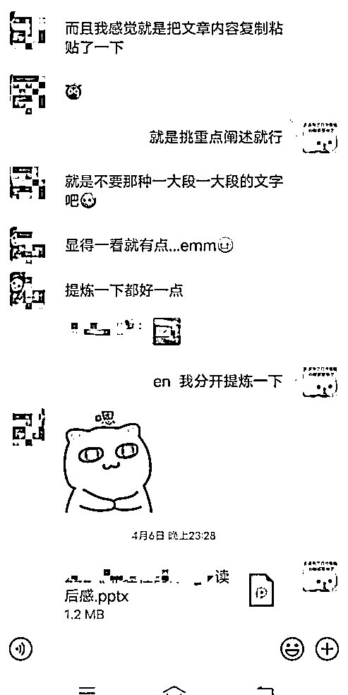

客户提出多少修改意见，我基本都会照单全收。我的想法很简单——只要我有能力改，就一路陪客户改到最终版。有时候一个稿子来回七八遍，说实话挺累，但我乐在其中。我想做的，就是那种一对一的、量身定制的服务体验，好到让客户挑不出毛病。也正因为这样，老客户不仅自己不断回头，还经常把我介绍给朋友。他们信任我，知道我给的稿子够硬，服务也妥帖。靠着这份口碑，客户慢慢攒了起来，实现了小小的裂变，复购率和黏性也跟着涨。

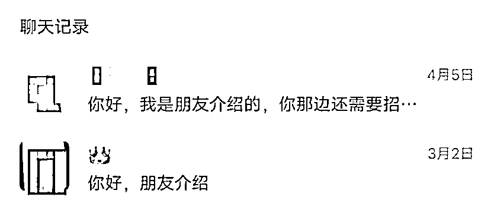

### 个人IP打造

等到业务能力越来越过硬，客户群体越来越壮大，就可以着手打造自己的个人IP了。

第一步，先明确你的IP定位。对外展示你的自我介绍、写作范例、作品集合，还有客户的好评反馈等等，总之要让别人一眼看出你的专业底子和实战经验。

如下图所示：

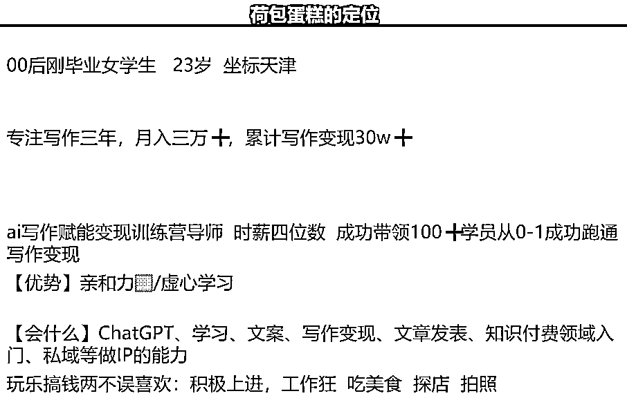

接着，你的个人主页得把自己全面展露出来，比如：

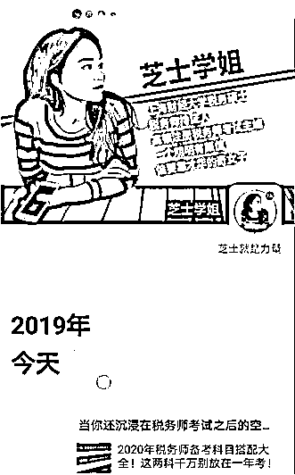

此外，平时也能在社交平台输出一些干货和见解，像文章、博客、专栏、教程这些形式，用来吸引潜在的粉丝和客户。

### 病毒式营销实操

病毒式营销（Viral Marketing），说白了就是借社交网络和传播链条，靠用户自发转发、安利，让产品信息像滚雪球一样传开，最终在短时间内把品牌声量做大、用户量做高的玩法。

虽然这套路大家都见多了，但架不住真的好使。

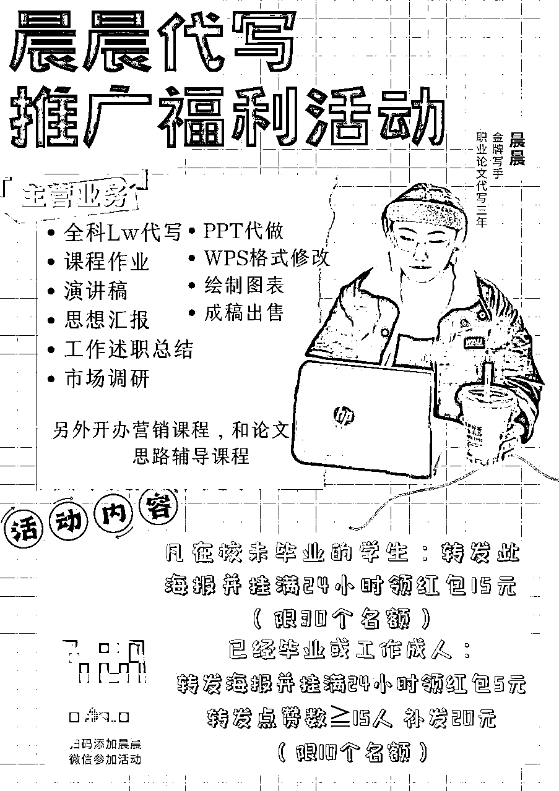

我妹妹就帮我设计过一张海报

转发就能拿红包，前期投入也不用多少。只要产品口碑过得硬，再加上这样的小活动，一波潜在客户就被吸引过来了。

# 四、下场赚第一块钱吧

听我聊了这么多，相信你对GPT写作变现已经有了不少了解，也掌握了一些能落地的办法和思路。是时候迈出第一步，去赚你的第一块钱啦。

行动，才是赚到第一笔稿费的关键！在这个过程里，记得稳住心态，给自己多点信心和耐心~

头一回赚钱可能得熬上不少时间和心力，但只要你一路学、一路改，跟上市场的节奏，跟行业保持同频，就一定会有更大的收获。

相信你自己的本事，也相信你创造的价值。迎着挑战往前冲，别停下来。去拼你的第一块钱吧——这是你走向成功的第一级台阶！祝你好运！