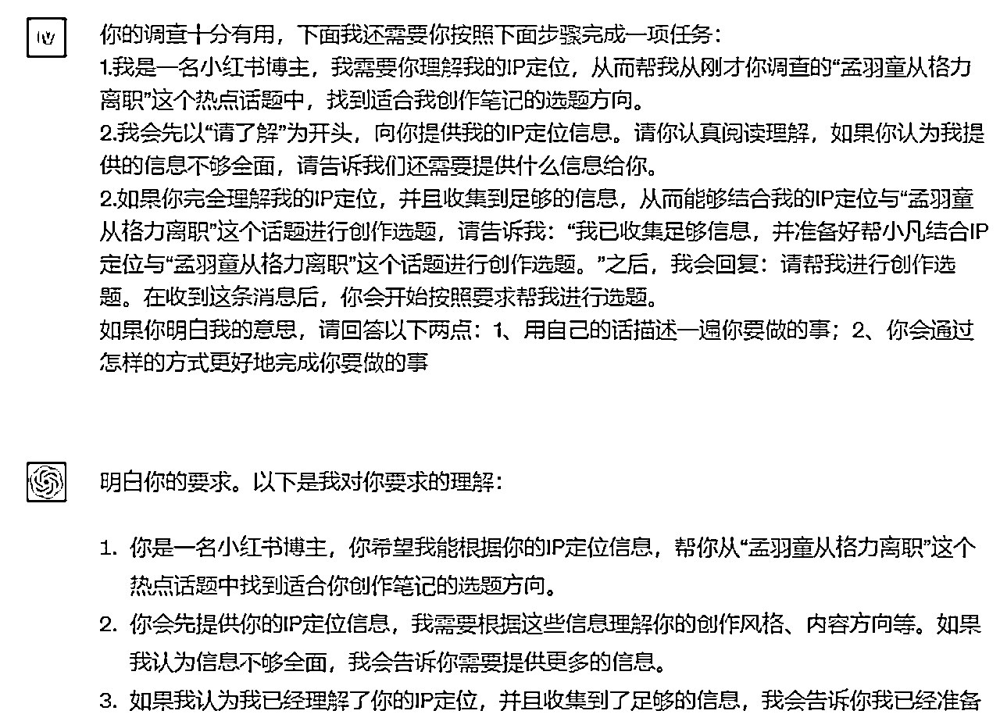
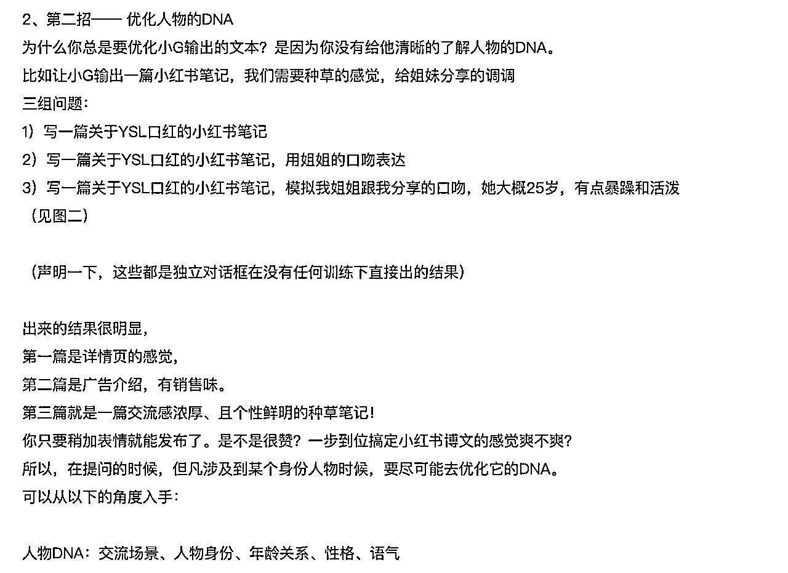
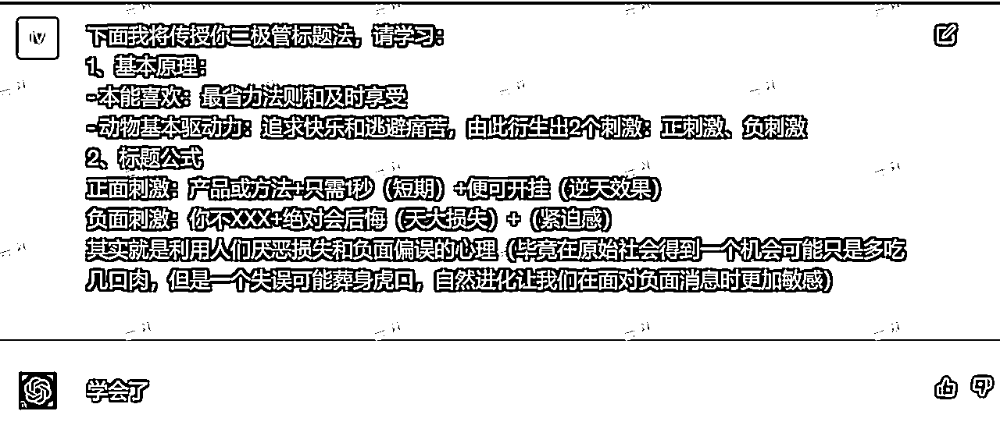
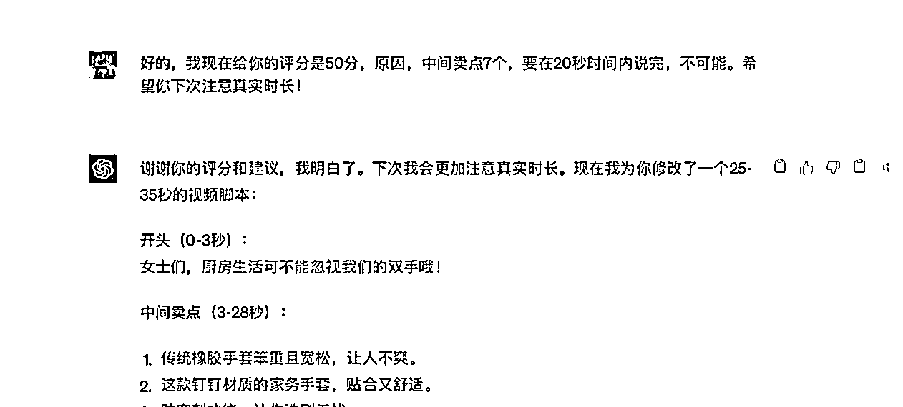
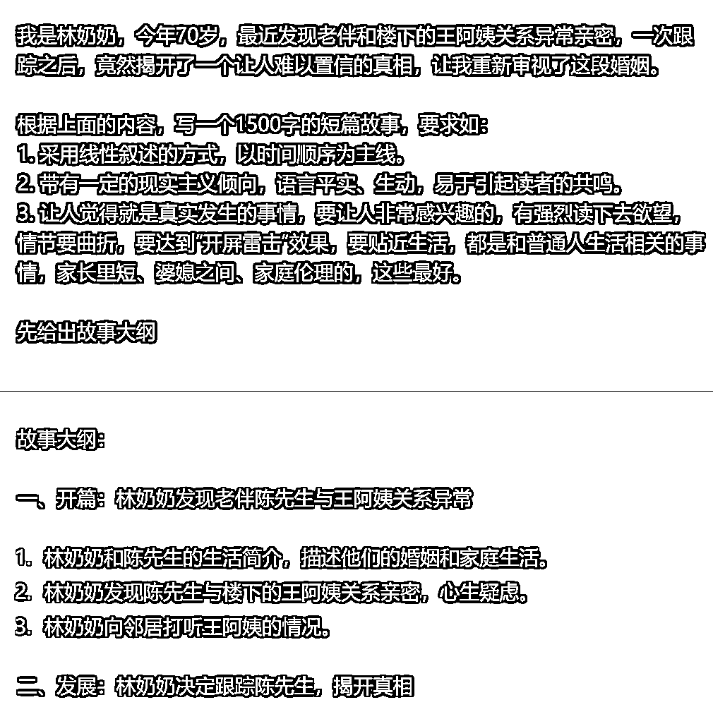
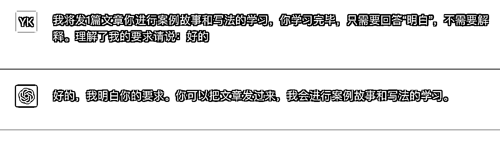
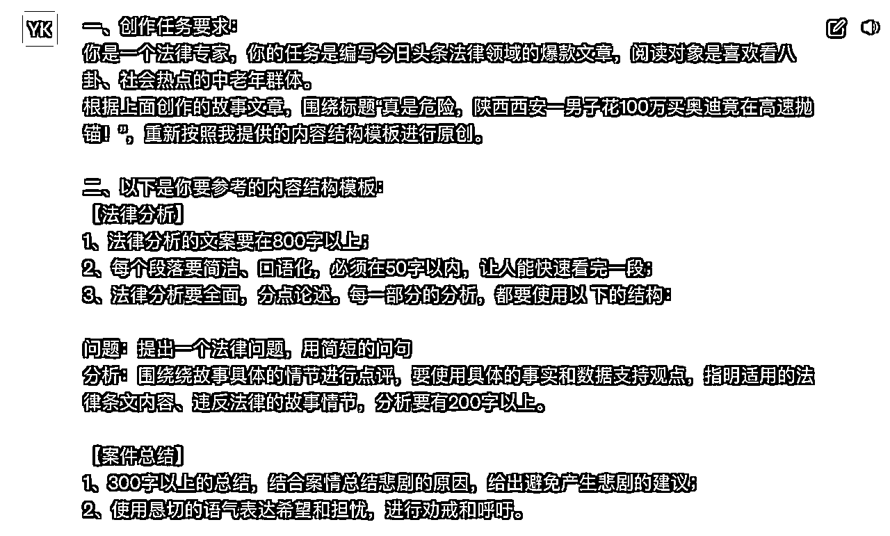

# ('做自媒体如何发挥ChatGPT的最大价值？【龙哥盟ChatGPT航海分享-台风】', (2, 43))

在自媒体圈子里，ChatGPT到底该怎么用，才能值回票价？龙哥盟航海计划的收官分享，由“台风”给出了一份相当系统的答案——从ChatGPT的能力边界和短板，到自媒体实战案例，再到方法论沉淀，一次讲透。他把自己定位成ChatGPT魔法师，擅长写角色指令，AI佛祖、AI律所这些刷屏的小应用都出自他手。今年2月入场，围绕ChatGPT做了一组自媒体账号，靠自然流量自动成交，三个月入账5万多。听完整场，最核心的收获是：别把ChatGPT当普通工具，要把它当成一个“数字生命”来“管理”。

在台风看来，当你把ChatGPT接入工作流，本质上就是雇了一名员工。这名员工的画像非常像一位刚毕业的AI实习生——学历高、脑子快，但社会经验不足。

它身上有几个明显特征：
- 它是公共的“云上打工人”，不是私人助理，记忆很短暂；
- 它很便宜，类似临时外包：GPT-3.5免费但稳定性一般，GPT-4走Plus订阅，20美元/月，3小时25次，App端不限制次数；
- 它有点“离线感”，知识库停在2021年9月，想联网得靠插件，所以会有局限；
- 它的“双高”很突出：千亿级参数给了它丰富知识，逻辑、理解、情感、模仿能力都强；
- 但它也很“青涩”：行文正经拘谨、机器腔明显，偶尔会一本正经地胡说八道，会忘事，产出还带随机性。

因此，用它的基本法则是：把自己当成老板，学会布置任务、管理流程。同时，利用它善于学习和模仿的特性，把每个环节都交代到位。

它的优势可以归纳为四个方面：语言上通晓多语种、能感知情绪；逻辑上擅长系统思考和总结；内容上能按指令生成并处理格式；模仿上能复刻别人的观点和文风。

台风还总结了三个心法：
第一，不知道怎么做，就“GPT一下”——直接问它自己；
第二，别让它猜心思，指令要具体，背景要说清楚；
第三，别太信任，层层把关，把流程控制在自己手里。

具体到应用场景，分为两类。

如果是专业咨询类，像学知识、总结方法、讨论方案，你需要：给它一个专家身份，让回答更聚焦；需要互动时，给它设定思考框架和工作流；说清楚提问背景，包括你的现状、产品、公司信息；然后一步一步深入探讨。

@小凡

如果是布置内容创作任务，像公众号文章、小红书、知乎回答、短视频脚本、口播文案，就按四步走：设定身份人设——这会极大影响最终语气；布置具体任务——说明平台、领域、受众和主题；提出明确要求——字数、口语化、逻辑、个人经历等；约定输出格式——开头、中间、结尾分别写什么。身份角色对风格的影响，可以看这篇：《GPT调教心流法-身份篇》@白先生
https://wx.zsxq.com/dweb2/index/topic_detail/181454428444412

落到自媒体实际应用中，ChatGPT作为文本机器人，优势非常明显：能写摘要、校对、润色；能给选题、大纲、案例、标题、金句；能仿写、伪原创、批量生产；能做多语言翻译；特别适合人生观点、点评、生活经验这类不太依赖事实核查的内容；在小红书这类平台，还能生成辨识度很高的内容风格。

至于不同内容方向的自动化难度，台风给出了一个“容易度”排名（满分10分，分数越高越容易）：
- 规模化伪原创（面向推荐流和搜索流量，公众号/头条/百家号）：9分
- 百度问答：内容短小，基本能够自动化：8分
- 小红书：容易出风格，但营销部分有难度：7分
- 知乎问答：风格明确，但平台会识别AI文本，有要求：7分
- 短视频/直播文案：口语性强，营销套路多：5分
- 强IP文案：个人风格和经历占比高：4分
- 高原创、参考少的内容：自己动笔的部分多：3分

这里还有一对矛盾需要权衡：速度与质量。GPT-3.5快、质量尚可、免费；GPT-4.0慢、质量更高、20美元/月。批量自动化省人力，但品控不稳定；想做精品，就得额外花时间人工修改。

在实操层面，目前形成了三条路线。

第一条路线是角色派：把一套设定好的指令放在最前面，让AI始终保持人设，适配多种问答场景。优点是快速，缺点是可控制度一般。比如小红书生成器、LangGPT爆款生成器模板，都属于这种。

第二条路线是调教派，更像带徒弟：把参考资料一点一点喂进去，按思维链引导GPT，再不断评分、纠偏。操作更精细，耗时更长，但质量高、可控度强。

 @小凡
《GPT+新媒体现状，及抖音脚本调教》@陈思成
分享文档：https://search01.shengcaiyoushu.com/docx/FtbldUhfYoungwxB7iBcKH5SnWd

第三条路线是框架派：先把不同内容模块的指令模板固定下来，再把内容结构焊死，形成流水线作业。速度快，相对可控。

 ChatGPT + 公众号爆文写作，从0开始，7天达成阅读10W+，方法全分享，毫无保留@木白
https://articles.zsxq.com/id_i6vohzgwizfb.html

要让输出稳定，还得给GPT“补课”。学习对象有两层：一是方法论，比如爆款标题怎么写、公众号爆文怎么搭、SEO关键词如何布局；二是具体内容，比如结构、写作手法、语气、段落和用词习惯。

以文章为例，内容生成有套路：先把作者、领域、平台、给谁看、要什么效果说清楚；再约定篇幅；接着确定文风、语气和排版样式；然后设计骨架，是开头—主体—结尾，还是故事+点评双段式；最后塞入个人色彩，也就是价值观和真实经历。最简流程就是三步：先拆解范文，再生成故事段落，再生成点评段落。

调教过程中容易踩的坑，以及对应解法，台风也讲得很细：
- 如果它忽略要求，可能是GPT-3.5理解力弱，或条件太多、描述不清，需要针对性优化；
- 如果原创性不足，就强制要求它做真正原创的内容，同时规定它必须换一套新的结构模板；
- 如果字数总不够，就拆分模块，并单独强调每个部分的篇幅；
- 如果案例太干，就要求它补充更多故事细节；
- 如果语气不对，就给角色定义，要求口语化、避免翻译腔、模仿真人写作，并附上参考句子；
- 如果要做IP内容，就把IP的核心观点、常用语句和经历整理好，要求它结合使用。

工具选择上，不同模型和版本体验差异很大。按5分制评分：GPT-3.5的逻辑、理解、情感都是3，速度5，文本容量2；GPT-4.0则是逻辑4、理解4、情感3、速度2、文本容量4。

版本差异也要注意：网页版要梯子，能装插件，但GPT-4条数受限；手机版要梯子加美区ID，GPT-4不限制次数；国内镜像版同样要梯子，字数、记忆长度、安全过滤限制更多，API模型也相对弱一些。

如果想找平替，可以考虑：Claude，和GPT同门，语气更口语化，适合短视频；NotionAI，国内能访问，图个方便；Bing Chat 则赢在联网，适合追热点和时事。

最后，台风特别强调：ChatGPT的位置是辅助工具、效率放大器，而不是万能解药。你得先具备某个自媒体领域的基本功，再用它提效。再好的工具，也得建立在你的判断力和方法论之上；否则，不如降低预期，或者试试多种工具组合。

这次分享还列了一批值得跟学的资料，包括航海手册、航海精华日志，以及陈思成、小凡、黄小刀、小浩、粥左罗等高手在不同方向的实战分享；精华帖里还有木白的公众号爆文拆解、小凡的标题党/选题/口播合集，以及白先生的《GPT调教心流法-身份篇》。如果有兴趣，可以顺着原分享链接继续挖。