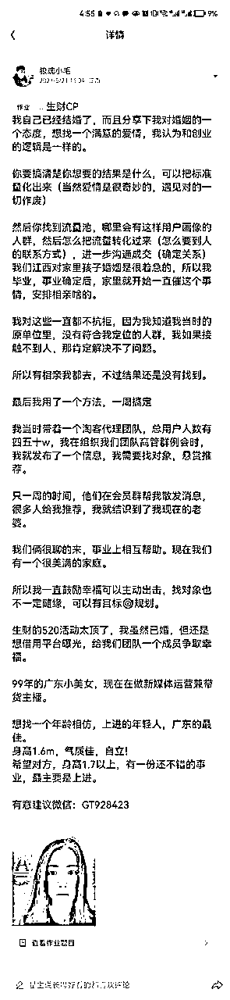

# 在赚钱找对另一半，比做项目更值得押注

> 来源：[https://fcf4a0devm.feishu.cn/docx/KBlWdtwzOo1B2hxB11BcXoeGnJc](https://fcf4a0devm.feishu.cn/docx/KBlWdtwzOo1B2hxB11BcXoeGnJc)

大家好，我是小毛。

之前在自媒体上分享的都是创业方法、项目思路，所以标题也一直是这套路子。

~but

今天换个身份来聊。

大家好，我是小毛。

23岁谈恋爱，24岁领证，25岁迎来了第一个宝宝，26岁又迎来了第二个宝宝，三年抱俩。

现在29岁，我和伴侣一起经营着现在这家公司，她是我事业上最可靠的搭档。用本金乘欲望来算财富自由，我们欲望不高，日子过得踏实，也算是一种自由。

前两天是520，赚钱搞了个征对象活动，我也去打了卡，顺便把我们团队的小姑娘安利了一下，结果反响出乎意料，好多人直接加她。

看到这个效果，我“月老人格”有点压不住了，赶紧来写一篇真诚的交友观，发动大家一起加把劲。

下面就从三件事展开，比讲项目更带劲。

# 一、选对伴侣，胜过大三创业

我一直觉得，最稳的创业方向，就是找一个合适的人共度一生。我们能为一个项目耗尽无数个日夜，为什么要在婚姻这件事上草率收工？

先问清楚：我们创业到底图什么。大致分两种。

第一种，图钱。让物质生活更宽裕。
第二种，图一种情绪价值。成就感、满足感，愿意把人生往更高处走，常说的渴望伟大。

而一段好的婚姻，恰好能同时满足这两件事。

**1. 物质层面**

如果对方家庭条件不错，资源直接叠加，起步线就被拉高了。注意，这里说的是在感情基础上，不是空谈物质。
举个常见例子：一个单身的网红想更进一步，和一个粉丝量差不多的网红组队，往往就是加速器。

另一种情况，对方经济条件一般，但能与你同进退、一起出主意。遇到瓶颈也能被鼓励、被拉一把。老话说得好，好女人旺三代。
我就是后一种情况。双方家庭都普通，但三观对齐，都愿意往前冲。她是我坚实的后盾，在公司里给了很多支持。

2016年华盛顿大学有一项研究，分析了上千对伴侣的性格对工作的影响，维度包括外向、友善、尽责、情绪稳定、开放。结果发现，唯一显著影响工作表现的是伴侣的责任心。不论性别，伴侣责任感越强，你的收入越高、晋升机会越大、职业满意度越高。

**2. 情绪层面**

人这一辈子，真正能做到事业到底的人很少，但有一件事几乎要用半辈子去经营，那就是与伴侣的关系。

按时间算，影响你情绪最多的，往往就是身边的那个人。
电影《万箭穿心》里，马学武事业上看着顺利，却被糟糕的家庭氛围压垮，最后出轨离婚、下岗自杀。观众对谁对谁错有分歧，但那种长期的压抑和难熬，大家都共情。
所以怎么看，选对伴侣都比一次创业成功更有分量。

# 二、为什么赚钱圈子是找对象的优质池

把找对象当成做项目，也是一样的逻辑。
先要搞清目标用户是谁，有哪些特征。
再找到这些人聚集的流量池在哪。

**1. 用户画像**
每个人对另一半的外貌、条件、背景要求不同，但大多数人都绕不开三点：聊得来、看对眼、频率相同。
在一个付费的赚钱圈子里，至少有几个共同属性：想上进、愿意为价值付费、有共同的话题。
我太太就是在做一个项目时认识的，有共同目标，很快就确定关系。
圈里已经有好几对是因项目结缘的。
现实中最尴尬的就是：你的世界她融不进。赚钱里认识的就可以直接说：我们在同一个圈子认识的，很自然。

**2. 流量池大小**
知乎上曾经讨论过，人生一辈子能认识多少人。从幼儿园到工作生活算下来，普遍认同是2000人以内。
靠线下缘分找，池子太小了。
现在交友网站的出现，就是在解决流量问题。
赚钱有4万人在线上，而且官方还开了自我展示的入口，公众号还推过一波。这么大且精准的免费曝光，错过了太可惜。

# 三、怎么把想法变成结果

画像清楚了，流量池也有了，接下来就是把转化做起来。
我们那边结婚节奏比较快，毕业工作后父母就开始催。我自己也比较主动，相亲一场没落。
没有合适的就自己发动资源找。说实话，我老婆就是我当时发征婚帖找来的。当时我做社交淘客，带几十万人团队，直接让团队帮忙，一个星期就认识了。
到现在我都感谢那个不矫情的自己。

具体打法有四种：

**1. 航海自我介绍做曝光**
参加航海时有个自我介绍环节，大家都会写现状和履历。可以在里面自然加上单身状态。
一个航海群400人，一年参加24场，曝光就是400*24=9600人次，说不定就有对你有感觉的人。

**2. 发帖做软性植入**
赚钱发帖大多是经验分享和搞钱认知。一篇写得好的帖子，能看出一个人的做事态度。可以在开头或结尾轻轻点一下自己的单身状态，就是软广。
要是被评上精华，曝光量就更高了。

**3. 线下见面会必到**
同城圈友会、龙珠见面会、年度大会，能去就去。名义上是学习交流，实际上能面对面看到人。颜值这关先过，很多人都是颜控。看对眼了就用交流的名义加个好友，后续慢慢了解。

**4. 官方交友活动别错过**
520、七夕这种官方组织的交友活动，是最精准的官方流量。准备好几张最佳照片，把自己的情况清晰展示出去。

分享就到这里了，可能有点出格，但出发点是好的。

最后送大家两句话：
一生之重不过饱餐与被爱
一生所求不过温暖与良人

祝所有单身的圈友，都能找到对的人！