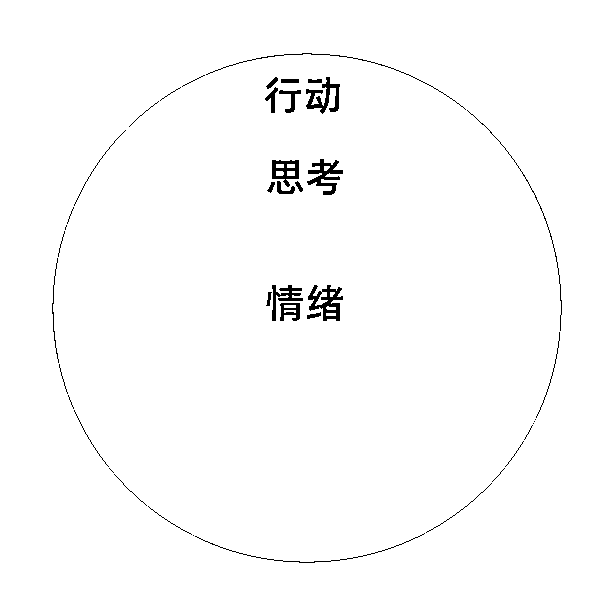

# ('自己独自做项目，如何消除内耗、焦虑', (2, 19))

在这个时代，不焦虑的人反而少见。很多人问：为什么我总在自我消耗？为什么越想改变越动弹不得？这篇文章不给你打鸡血，只把背后的真相一层层剥开。

先抛一个观点：焦虑不是坏事。至少说明你还没认命。

你身边一定也有这样的人：上班就等下班，抱怨菜价涨、工资不涨；体制内一边开会一边摸鱼；年轻人“当一天和尚撞一天钟”，及时行乐不想明天。他们不焦虑，因为他们接受了“人生就这样”。而你呢，你不想接受。你开始惶恐，是因为你看到了未来的可能性，也看到了自己还差得很远。眼界打开之后，焦虑就跟着来了。

于是有的人困在想法里，天天构思、夜夜盘算，始终没有动作；有的人动了两步，但追求完美，一步没做完美就觉得自己是废物，干脆退缩；还有的人索性关掉所有信息，不看就不烦，逃回短视频和游戏里。但有另一种人，把焦虑当成信号，走通了这条路：焦虑→行动→优化→赚钱→找高手学→赚更大的钱。

问题到底出在哪？

内耗，就是你不满意现状，脑子里演了一百出大戏，现实中却一步没走。你给自己打分，现在是2分，想成为5分、10分、100分。可你做不到，就骂自己废物，心情变差，吃火锅短暂开心，第二天又看到别人晒成果，又被刺激，再次陷入“想改变—做不到—自责—摆烂”的死循环。这就是内耗。

为什么会这样？你以为是因为智商不够、意志力不行？都不是。别人能做到的，你也能做到。你做不成，说明中间缺了几个关键环节，你还没摸到本质。

人的行为由三层构成：最外层是行为，中间是思想，最核心是情绪。内耗发生在哪里？在脑子里，不是在现实里。你会看到有人一边干一边焦虑吗？不会。因为你一直在想“我还没准备好、需要很多手机号、要垫资、每天至少三四个小时……”于是行动永远是零。

你到处搜答案，搜出一堆文章，还是觉得不对。因为大多数人都停在思想和行为层面找原因，真正的底层是情绪。

思想只能描述世界，不能改变世界。你脑子里想自己有一百块钱，不代表口袋里真的有一百块。人的任何行动，底层都是情绪驱动。想恋爱，是想要开心的感受；刷短视频，是为了舒服的情绪；不想分手，是因为快乐的预期压过了伤心的恐惧。理性只是给剧本配音，情绪才是导演。

你为什么会想改变？不是逻辑推导出来的，是因为你烦透了现状——上班的苦，成绩的差，看着别人风生水起而自己灰头土脸的痛。这股痛逼出“我要变”的念头。然后你在脑子里搭了一个完美未来，从2跳到100。真到行动前，你慌了：这也太复杂了，我做不到，万一失败我就是垃圾。

你被“一步登天”的静止思维卡死了。这个世界的真相是：所有人都是一步步走的。马斯克不是一步造出火箭，马云也是一家家公司谈出来的，赚钱和航海也是逐年试错、一路修出来的。你以为100分是空中跳上去的？不，是从3、4、5……一点点爬上去的。

你怕的从来不是事情本身，而是“做不到就证明我是废物”的那种恐惧。恐惧挡住了行动。如果换成快乐呢？那怎么让改变变快乐？

很简单：别给太大压力，别逼自己从2直接蹦到100。你得学会迭代。允许自己失敗10次、100次。一次失败概率高，但如果有100次机会，成功率早就让你笑出声了。先成为3，再成为4，慢慢往上走，每天进步一点点。

不是嘴上的鸡汤——我自己就这么过来的。以前我从不看书，第一次拿起一本短篇集，5分钟没看懂第一页，硬着头皮看了30分钟还是懵。但我没骂自己，看不懂就翻下一篇。结果呢？慢慢就看进去了，三四天读完一本，那种成就感是我装不出来的。后来四年读了300本，我再也没羡慕过谁。

我认识一个考研三年没上岸的朋友，还背着几万贷款。我跟她说，你去写知乎，不用想太多，挑那种浏览量高但回答少的问题写。她第一篇就拿了七百多赞，一大群人留言催更。后来她的小说被盐选收录，有了被动收入，还进了文案行业，往编剧方向走。这事妙就妙在：她之前想了太多年，真动手只用了几天。

解决内耗的办法，我给你三个：

第一，学会制造“垃圾”。你写了个脚本？扔出去。剪了个烂视频？发出去。不用杰作，只要出来一个东西，你就已经比躺着的自己强了一分。发完别蹲反馈，当它不存在。哪天突然有人点赞，你会觉得“这破玩意也有人喜欢？”这不就是惊喜？情绪的正向循环一下就启动了。

第二，允许自己失败。把你脑子里那个完美的“100分”扔掉。现实条件永远不可能等齐。你只要起步，就会发现那些你想过的困难也就那么回事。把“失败100次”改个说法吧，叫“修正100次”。每次修正都在涨分。

第三，目标切成小块。别一进圈子就瞄着“月入5w、10w”的大神帖子，然后被细节吓跪。人家那些文字，是把几个月一个一个解决小问题的过程汇总给你看的。你的任务不是一天跑完全程，而是今天只定一个近得有点丢人的小目标——比如：先注册个账号，先看5篇文章，先写200字评论。步子越小，情绪越不害怕。

最后一句：你阻止不了情绪，但你能哄着它往前走。别和自己对抗，抱抱那个焦虑的自己，然后丢一个小目标给他。做成一个，再丢一个。路，就是这样走出来的。

你哄好了情绪，情绪就会转头来托举你。

想要把事做成，没必要想得太玄。就是把一个目标拆成 x + y + …… = z，那个 z，就是你要拿下的项目。

很多人上班时能交出漂亮的成绩单，一旦自己单干就开始焦虑，差别就在这。打工时有流程、有上级、有指标，目标是被切好的；自己做项目时没人帮你切，于是一股脑想把所有事同时做好。结果是什么？焦虑、内耗，这些毛病全来了。

举个很实在的例子：你参加短剧CPS航海，心里想的是“今天不把手册读完、不把视频发出去，我就是个废物”。或者你一口气花三四个小时憋了好几个视频，结果一发布，播放量500，点赞个位数，评论区安静得像深夜的图书馆。挫败吧？觉得自己花这么多时间，换来这点成绩，凭什么？

问题就出在你用力太猛，猛到对自己的作品期待过高。可是你明明才刚起步，却期待一出手就是爆款，这本身就是拧巴的。如果你能坦然告诉自己，现阶段做出来的就是垃圾，反而能轻松地坚持发下去。

做不到这一点，项目基本就废了。废了以后你还得找个理由安慰自己：我都这么努力了，还赚不到钱，肯定是项目不行，赛道太卷了，不是我的问题。然后下次遇到好机会，继续用力过猛、继续期待过高、继续成绩平平，然后又陷入新一轮循环。

人的心理防御机制很有意思，为了不让自己难受，它会让你觉得吃亏都是外界的错，永远不会承认自己卡在哪。

那我们该怎么办？跟着手册一步步来。

比如手册一共六大步：账号、平台、选剧、剧情、去重、发布。

你不要想着一晚上全消化掉。一天只做一件事，今天就解决账号，注册就完事了。难吗？不难。明天再把平台搞定。也不难。里面最花时间的是剧情和去重，那就把这俩再拆成更小的单元，继续细抠。

重点是：别想着一步考到100分，别幻想自己今晚做出来的视频就能跑出20万播放。那不叫目标，那叫幻想。

你说剪辑好难，不想学。行，不用学。你就打开剪映，把素材拖进去，用剃刀工具随便切两刀。切完，播放一下，看看画面动没动。完事，关掉电脑，去玩。

这叫剪辑吗？不算。但这让你碰了软件，动起来了，情绪开了个口子。

第二天熟悉去重方法。一看教程，好繁琐，得学一堆东西。我们不学全套，就学一个最简单的：添加一个纯色图片，透明度调到2%、3%，随便你。做完，收工，休息。

第三天，再试另外一个很小的技巧。每天就啃掉一个小点，一点也不多。

有意思的是，当你第一天真正打开剪映、划拉素材的时候，你的情绪已经变了。你动手了，你就发现“好像也没那么难”，于是你可能多剪了一分钟。学去重也一样，把一个蒙版弄明白了，你可能会想：这挺好玩的嘛，再看看别的。结果不知不觉，所有去重方法你都过了一遍，还觉得挺轻松的。

情绪就是这么个东西。它不是靠想变好的，是靠做变好的。你越动手，它越积极；你做得越轻，它越不会反抗。

想想你平时收拾屋子，是不是这样？屋子乱得像猪圈，你一直想“我要大扫除”，但一想到那个工作量、那个复杂度，立刻懒得动了。直到有一天实在忍不了，你说算了，我不全收，我就把那一小堆垃圾捡一捡。结果捡着捡着，身体开始行动了，脑子里也不纠结了，你发现“似乎也不费劲”，于是顺手又把桌子擦了，把地扫了。最后整个屋子反而被收拾干净了。

你看，逼自己从100分开始的，往往0分收场；允许自己从0.1分开始的，反而走完了一整程。

为什么万事开头难？因为大多数人一想到目标，直接就跳到终点。自己明明只有2分的水平，却想象自己已经站在100分的山顶。一个人但凡有点正常判断力，都知道2和100之间隔着什么，于是还没起步，就被那种巨大的落差吓退了。

这背后藏着一个更根本的问题，人生的主轴到底是什么？

情绪。

每个人都有情绪，而社会是由人组成的。这个世界运行的原动力，恰恰是欲望和感受，而不是冷冰冰的理性。传统教育教我们要理性思考，可如果你只在逻辑层面转圈，注定四处碰壁。

那些看起来很厉害的人，不过是看透了本质，懂得照料自己的感受。快乐的人之所以能持续前进，是因为他们在行动中尝到了甜头。而尝到甜头的前提是——事情够轻，轻到你愿意迈步。

所以，要让事情容易一点，不要给自己设置一百分的标准。你要做一个迭代型的人，给自己100次、1000次、一万次修正的机会。每次只进步一点点，允许自己走得慢，但绝不停在原地。

传统的理性框架，会让人在想象中反复兜圈，还误以为自己想得很清楚。而情绪，才是水面下那股真正的洋流。许多人总说“我们要理性，不要情绪”，其实完全是迷人眼的说法。没有情绪，你连起床的动力都没有，饿了要吃东西、尿急了要上厕所，哪一个不是因为受不了，才立刻去解决？

理性不过是欲望的工具和仆人。

马克思早就说过，这个世界是非理性的，人在为利益交锋。思想不养活人，实打实地生存才是第一要务——这才是马克思真正厉害的地方。别把高中课本里的那些定义当马克思的全部，要真想听懂他，去看王德峰老师的课。

回到我们自己。

每个不想当垃圾的人，都在渴望往上走。这是人性本身的上升动力，是情绪在推着你前进。可你一想到自己还是个小菜鸟，幻想中那个成功的自己又那么耀眼，恐惧就铺天盖地地涌过来。你害怕自己一旦迈出那一步，若没有达成想象中的完美，就证明自己是个废物。

你要做的，是扔掉那股失败的情绪。

承认自己现在就是垃圾。承认成功需要100次、1000次、一万次地试错和修正。你带着这样的心态迈出第一步时，你早就知道这步大概率会惨不忍睹，那还有什么好怕的？

然后，牢牢记住这个真相：情绪才是万物的地基。人活着是怕死、是求生的情绪；人和人靠近，是为了爱的感觉。世界是非理性的，抓住这一点，你就只需要做一个动作——照顾情绪。

照顾情绪就是别让任务难到令自己痛苦。难度一高，痛苦就来了；痛苦一来，人就想逃。与其这样，不如把任务切到最小，切到跟玩似的，切到让你忍不住就想试一下。

当你迈出那个看似非常“弱智”的第一步，你会立刻得到一个反馈——原来没我想象中那么可怕。

一步，再一步，就这么走起来，你会发现那个曾经把你吓住的终点，好像不远了。

加油鸭~

这篇稿子是我自己的思考，结合一个让我特别有共鸣的视频写出来的。里面很多话我从原视频搬了思路，因为它们真的击中了我，觉得终于有人把事情讲透了。如果你也想听更多，推荐听听视频原版。

【《改变人生命运》第一课】https://b23.tv/rMwvQGp