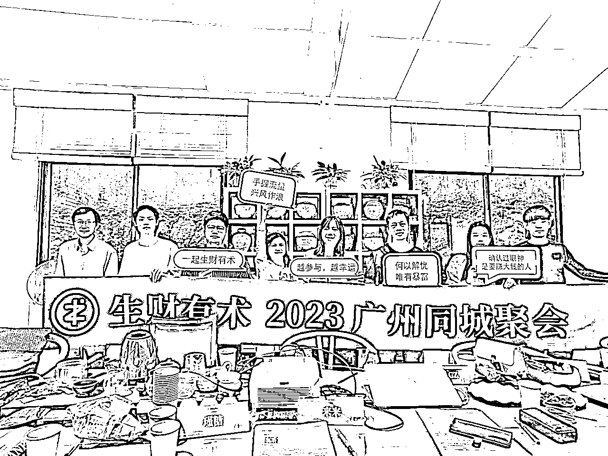
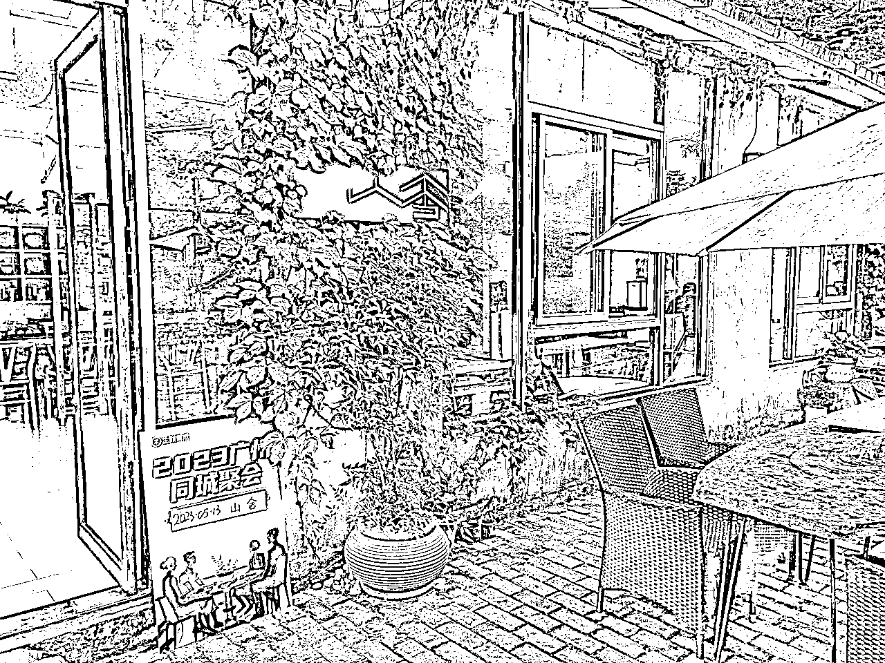

# ('阿墨05/13广州线下聚会：AIGC赚钱局交流心得', (2, 27))

5月13日，赚钱在广州搞了一场AIGC赚钱局线下茶局，地点在火炉山艺术园里的山舍。这个地方确实有格调，环境舒服，老板贴心，场地也足够开阔，体验我能给五星。唯一不足是进山的路有点绕，但跟着百度导航开车还算顺畅，算是“好店藏在深山里”吧。

这趟最想见的人是来来。群里聊得再热闹，也不如线下见到真人来得有感觉。AIGC这件事我确实研究不深，能贡献的观点有限，更多是抱着学习的心态去听。来来的分享对我来说挺新鲜，算是补了一课。到场的伙伴里，英卡和瑾糖是第二次碰上，其他几位都是初次见面。自我介绍环节大家聊得很high，展开得也很多，互相碰撞出不少火花。每个人都有自己的闪光点，听别人的经历就像照镜子，有人被警醒，有人被启发，有人被激励。

一、从自我介绍里收获的东西

每个人都有属于自己的节奏：年轻人敢想敢干，有家有娃的则求稳。年龄、生活经历和认知层次都不一样，所以存在大量信息差和资源差，也让我对职业、副业、家庭、资产配置有了更多思考。具体收获：

- 出书的流程、目的、运作方式——感谢来来、大牙；
- 海南封关运作带来的启发，包括财税、茶馆、公司注册等方向——感谢Kane、来来，我还顺手想了个名字：徐海驿站；
- 打造百万信用卡额度这件事，可以做成教程做知识付费，比如在赚钱发帖试需求、建群运营——感谢瑾糖、墨鱼；
- 偏门、投机的事，短期赚的钱干不过人性，最终大概率靠实力亏回去——感谢所有交流的伙伴。

二、一点感悟

线下茶局依然是链接人的有效方式，但需要更精准、更高效，而且时间成本不低，一次至少花半天，组局官还要提前准备很多物料，确实辛苦。后面我打算重点吃透赚钱里的帖子资源，沉淀之后再去链接有结果的前辈。毕竟上班族还要带娃，一天能剩下给自己的时间实在太少；而赚钱精华帖动辄上万字，好像不写够长就上不了精华。如何在有限时间里做到高效输入，是一个时间管理问题，也是我目前最需要解决的课题。如果读者里有心得的朋友，欢迎来赚钱私信阿墨指导，先谢谢。也许还有另一条路：先让自己成为有结果的人，自然吸引别人来链接，前提是先把商业模式跑通、拿到结果，再写成精华帖被看到。

三、拿到的一些点子

每个点子不一定能落地、适合落地，更不一定值得ALL IN，但它本身总有发光的一面，也藏着商业潜力。我比较青睐的商业模式关键词是：轻运作、能自运转、能积累、互联网化、可放大。现场伙伴的贡献包括：抖音视频有查重软件（来来）、ChatGPT-4体验、文I（虚拟女友）、5人小而精团队（赛马机制+阿米巴模式）、结合AI做活体认证视频（500块成本搏5000收益）。

四、后续计划

如果时间没冲突，5/27的航海线下组局我会担任组局官，计划把市面上ChatGPT的变现模式、思路和实操拆解整理出来，作为主题分享。也希望来参与的人已经有实践基础，这样才能碰出更多火花。再次感谢来来组局，也谢谢大牙、瑾糖的支持。认识一班在不同轨道上向前跑的小伙伴，真好。以下是我的赚钱自我介绍，阿墨在龙哥盟知识星球等大家。

【昵称/姓名】Mo.gz（星球昵称阿墨）
【所在地】广州海珠区客村
【自我介绍】
- 还在企业上班，软件开发10年+，接触过各类开发项目；
- 19-20年搞了500个香港券商账号打新股，收益接近翻倍；
- 运营太极音乐网站，用SEO做虚拟资源变现。
【可提供】
- 100T网课资源；
- 软件开发团队（小到UI设计建站，大到政府大型业务系统）；
- 港股打新（开户、资金处理等）。
【可分享】
- 互联网交付项目的坑；
- 打造个人信用卡百万额度（低成本融资经验）。
【需要】
- 结识赚钱大佬（1颗以上龙珠），深入链接；
- 解决第一桶金和建立多管道收入的问题；
- 在海珠客村附近找一个能办公/喝茶交流的地方，玩富爸爸现金流游戏、孵化赚钱好友项目、办线下茶局；
- 海南2025封关运作，去海南需经过我家乡湛江徐闻县徐闻港，欢迎海南人或新海南人，以及有相关业务的朋友一起搞钱。