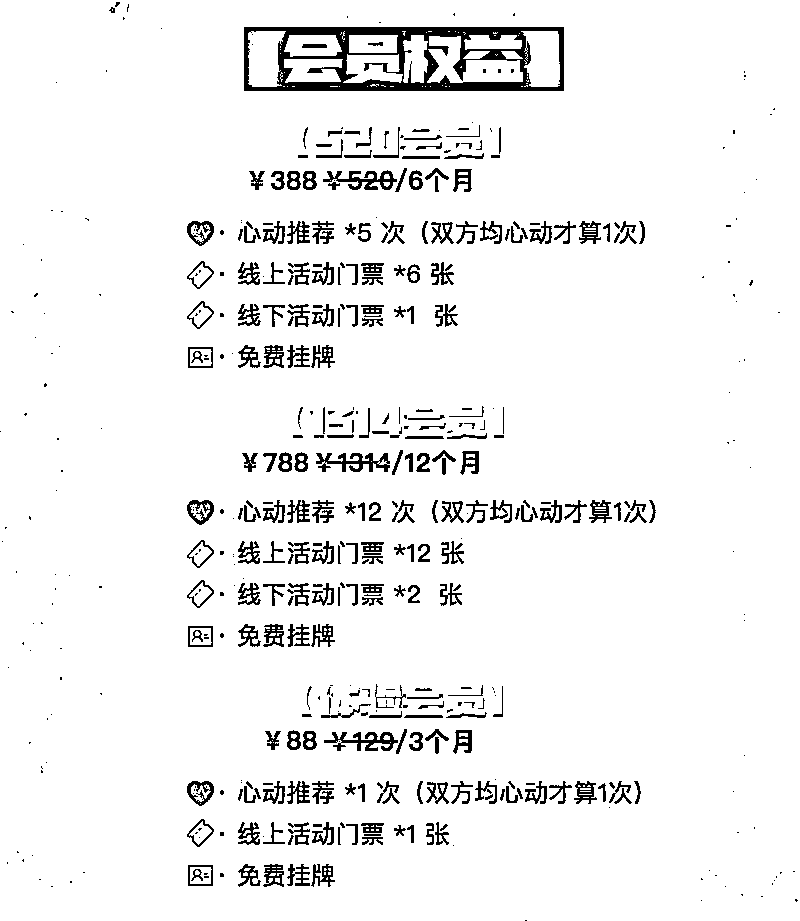
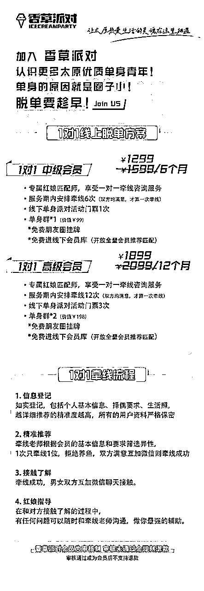
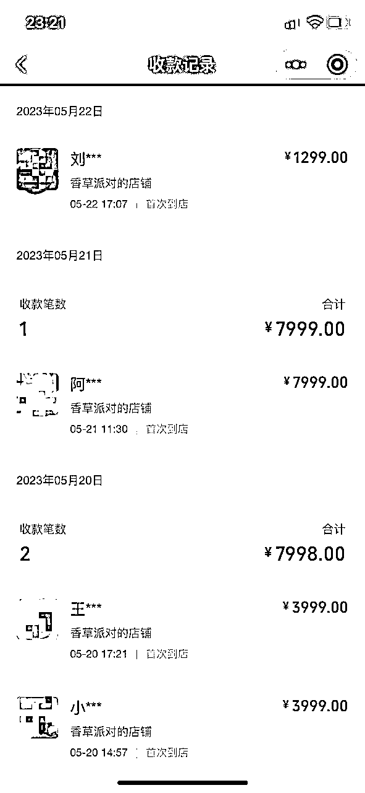
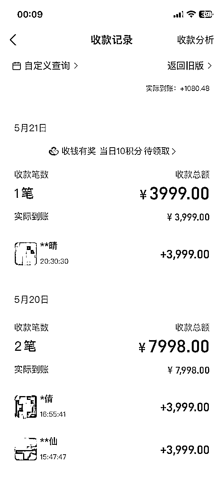

# ('同城相亲月入10W+，现在入局还有机会吗？', (2, 23))

从上海大厂离职回老家，我靠同城相亲月入10W+，今天聊聊：现在入场还有机会吗？

大家好，我是孟宝。真名就是孟宝，爸妈当年起名很用心，公司小伙伴都喊我孟老师。

2019年我从上海一家互联网大厂辞职，回到太原。上了一年多班，心里始终有个声音：这辈子就这样了吗？收入缩水只是一方面，更难受的是成就感和精神状态都开始掉线。后来在21年加入赚钱，刷了不少精华帖，特别要感谢两位引路人——@唐大 和 @杜总，正是看了他们的分享，我才下定决心做同城相亲。

一、这两年我是怎么趟出来的？

1. 先把同行摸了个遍

21年夏天，我用了一周时间，把本地做同城相亲的机构都扫了一圈，大连锁、小婚介，加微信、打电话，把价格和玩法都问了一遍。因为本身是互联网出身，加上圈友的帖子启发，当时就定了先走私域成交的轻模式起盘，只做线上。

那会儿调研主要围绕两块：一是【线上牵线】产品的细节，比如定价、服务时长、介绍几次、流程怎么走；二是【相亲活动】，像活动形式、频次、报名费、每场多少人。现在回想，调研也许不算深入，但结论很明确：机会很大。

后来转线下，又做了一轮调研。毕竟同城生意，不懂本地现状不行。所以调研和学习一样，得长期持续。不过建议大家别把同行当对手，这行业根本没有绝对的竞品——就像你办了爱奇艺会员，照样可能去优酷充会员。相亲也是这个道理，格局一开，路就宽了。我今年初甚至零成本接手了一个本地红娘的个人资源，这故事改天细聊。

2. 产品是这么设计的

先说线上牵线。最初没底气，定价88元就能服务，但没两天我就赶紧调价了。现在回头看，当初真是定得太低了！目前线上业务还在，但已经变成1299元起步。

线上牵线这个产品，我现在卖得很少，销售也明白，一单线下抵好几单线上。但如果你手里还没有1000个精准资源，建议先靠线上模式过渡。我也知道有个团队专做纯线上，一个月照样跑10W+，客单价1000元，每月成交100单，相当猛。

再说线下活动。这是早期快速吸粉、建立信任最好的方式。

羊群效应很明显——你前期吸引来的是什么样的人，后面同类的人就会越聚越多，所以一开始就要想清楚目标用户。另外，活动一定要让人看到参与者的素质、感受到你的用心，最重要的是积累素材，用于传播！

活动形式以轻社交为主，比如羽毛球、飞盘、饭局、酒局、狼人杀这类交流多的局。规模上，我现在基本每月8场，每场12到20人，至少有一场30人以上的中型派对。门票的话，狼人杀这种小活动四五十块；有门槛的专场，比如体制内、硕博专场，价格可以适当上浮。如果有场地费、餐食费，我会把成本控制在40%以内。

说白了，活动本身不赚钱，利润太薄。但年轻人一上来就接受“相亲”这个设定，需要教育；而我所在的城市传统婚介居多，没人像我这样用心做活动。那活动就是我的差异化。混沌大学李善友老师有句话：“与其更好，不如不同。”我就想，哪怕不赚钱，品牌收益和口碑收益也是赚的。

还有一点：有时候人比形式更重要。来相亲的人，就算活动再好玩，现场没有合适的人，还是觉得白来。所以即使是无门槛活动，报名时也要做基础筛选，不合适的人就别放进来。

最后是线下一对一，这是最核心、利润率最高的产品。我是21年8月起盘的，跑了半年左右，纯线上业务稳定在月入3到4W，攒到1000个资源后，才开展线下1对1。说好听点是稳扎稳打，说直白点就是慢了半拍——结果4月就赶上第一波疫情封控，整整封了一个月。

做相亲两年，我越来越觉得这不是赚快钱的生意。想入局的朋友一定要想清楚，一旦开始就很难停下来。我经常跟团队开玩笑：这是幸福的行业，是积德的工作。你的一次推荐，可能就是别人一辈子的相守。所以招服务售后岗位时，我特别看重价值观正不正、成长环境幸福不幸福。看到别人幸福，自己也由衷欣慰。谁不想既有成就感，又有钱赚呢？

撮合和匹配，真的比想象中难得多。男不上娶、女不下嫁，几十年形成的观念很难打破；优秀的男生越来越少，要求高的女生越来越多，这本身就是一对矛盾。客户的心理教育也费劲——有人一次恋爱没谈过，有人相亲几十次都不成功，什么人都能遇到。

于是，除了基础匹配推荐，还延伸出了很多增值服务，这些甚至可以单独做成业务，也是提升服务差异化的关键。毕竟服务才是口碑的来源。单身的原因无外乎几种：资源圈子窄、心态不自信、形象不佳、不会聊天沟通。这些问题如果你都能帮客户解决，那你绝对是领军团队。

补充一句：和每个会员做朋友，一定不会错。

3. 引流渠道怎么打

抖音我试过好几种号，总结如下：

【口播号】引流效果最好，但漂亮女生口播，吸来的几乎都是男粉。最近有个神奇现象：我红娘口播号好好讲内容，数据一般；随手拍个特效歪头视频，配几句简单配音文字，反而至少100+点赞。管他呢，只要同城流量知道你是干什么的，就行。

【街坊号】来的人大部分只对被采访嘉宾感兴趣，严格说是泛流量，少部分精准相亲粉，需要养。

【活动号】颜值高的用户来得比较多。

【嘉宾自我介绍】对相亲活动感兴趣，属于精准用户。

【图文资料】效率极高，但封号也快。

小红书方面，整体用户颜值和素质更高，虽然体量不如抖音，但只要持续做，一定有回报。我最近好几个快速成交，都是从小红书的活动招募内容来的，本来只是报名活动，聊着聊着直接转成了线下会员。

4. 一点小结

想尝试这个项目的伙伴，起盘方法应该都清楚，我不多啰嗦。说说我自己的感受——如果以现在的状态回看当时，准备不充分的地方其实很多，但依然能做成，最关键的就是执行力。

我很欣赏赚钱价值体系里的【空杯】心态。不管以前多牛、在某领域多擅长，听人分享或学案例时，一定要忘掉自己那点“本事”，重新吸收、琢磨别人这么决策背后的逻辑。我以前做管理做运营，习惯想很久——方案要完整、数据要漂亮，生怕leader不满意。但做同城相亲时，我基本是看到一个好点子就立刻落地、马上测试。好不好用，试了才知道；永远停在想的阶段，一定走不到前面。这也是航海价值大的原因。

二、现在入局还有机会吗？

先看两个数字吧——上周末两天，微信和支付宝的收款截图：

相亲这个盘子的体量，不用我多说。未来几年肯定还有机会，关键看你能否坚持、长久地干。现在仍有很多个人创业者，随便做做线上、推推微信，也能赚到钱——因为做流量永远比做服务简单。但我也见过很多个体创业者，半年不到就放弃了。我觉得任何生意，只要能坚持、能长久、是利他的，都值得持续做下去。

其实创业和找对象，心态上是通的：没有100%完美匹配的人，也没有100%完美的项目。我常跟会员说，要做“成长心态的人”，而不是“固定心态的人”。

固定心态的人认为事物一成不变，觉得最重要的努力就是寻找和追求，不惜花大量时间和金钱去找那个所谓100%匹配的人；找到后，以为幸福就来了，结果相处中一出问题，就怪当初选错了人。

成长心态的人则相信事物可以改变。每个人有优点也有缺点，没有100%完美匹配。随着缺点和困难越来越多暴露，固定心态的人会反复质疑当初的选择；成长心态的人会去磨合性格、发现问题、解决问题。

项目和创业也一样。别因为一个项目暂时做不下去，就觉得项目不对。你该做的，是不断发现问题、解决它、搞定它！要自信且乐观。就算你找不到特别喜欢的那只水杯，也不妨碍它帮你盛水解渴。

共勉。