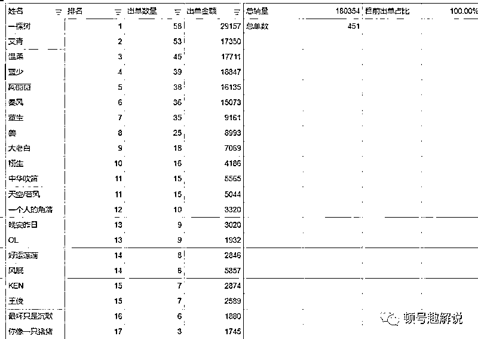
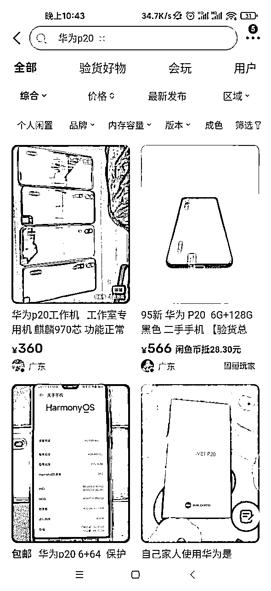
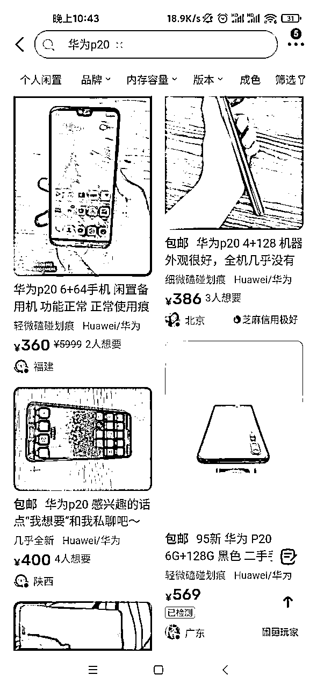
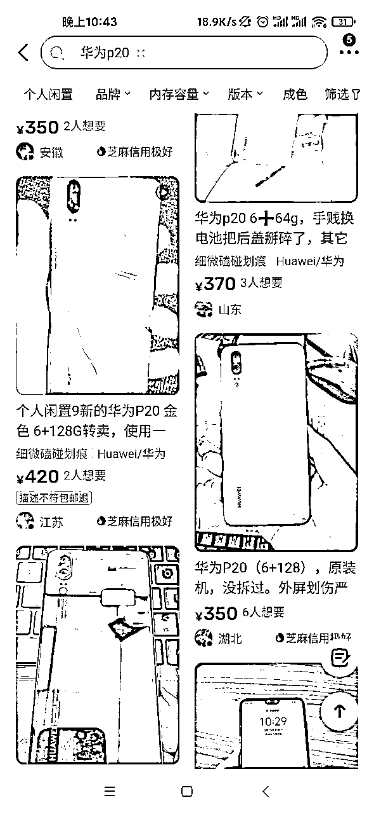
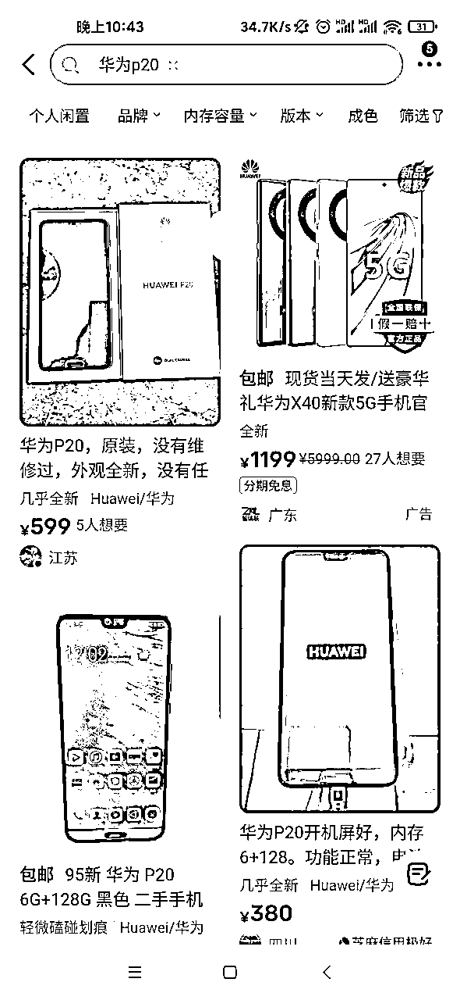
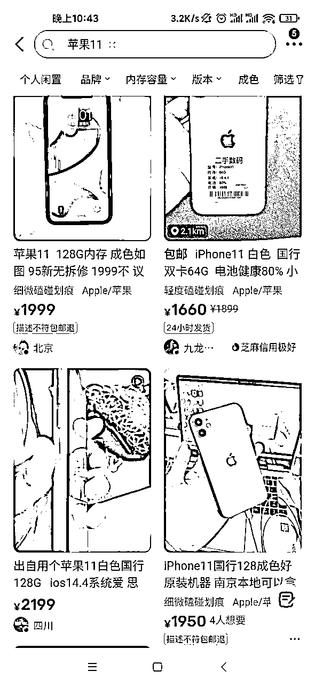
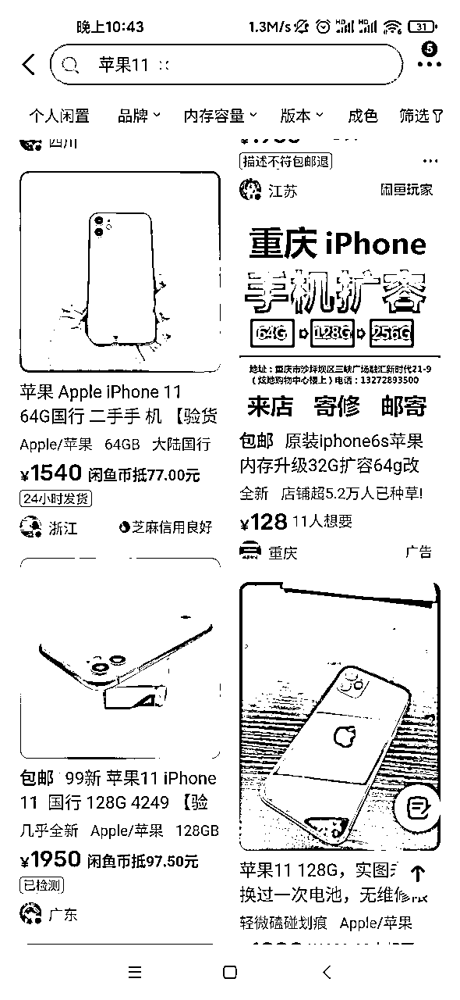
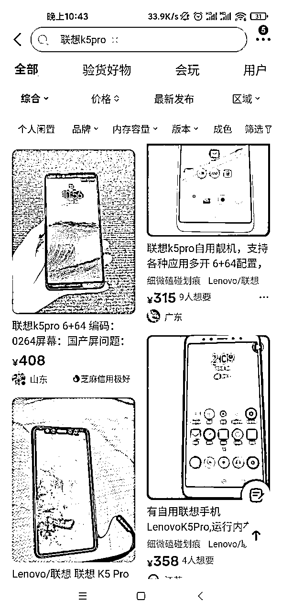
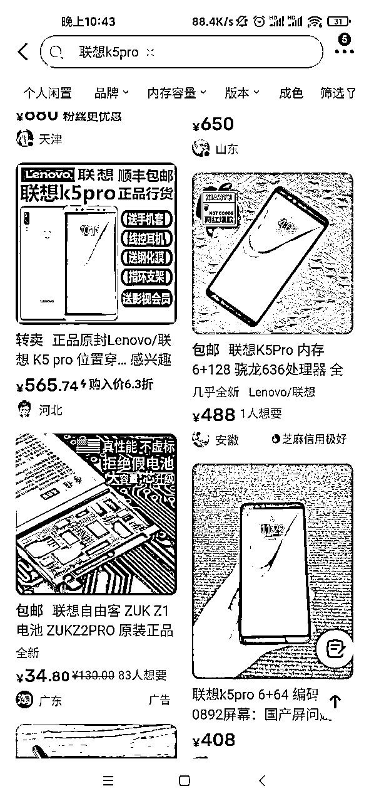

# ('闲鱼图书引流创业粉，我用钱砸出来的经验', (2, 21))

用真金白银换来的闲鱼图书引流经验：一本旧书，让我引来上千创业粉

做项目的朋友，不知道你有没有认真想过：闲鱼上的低价书，可能不只是书，而是一枚精准引流钩子。我是顿号，重庆人，一个在闲鱼折腾了八年的95后，目前做无货源，手上有点二手手机和宠物类产品资源。今天这篇，全是用钱砸出来的实战复盘，希望能给你一点不一样的启发。

说实话，我最初并不想碰图书，也没打算教别人玩闲鱼。学历不高，总觉得自己讲不过社群里那些高学历大佬。直到去年在别的社群学了一整套闲鱼数码电商打法，才把思路捋顺。数码这个赛道我泡了七年多，闲鱼也混了八年，平台规则和选品逻辑早就烂熟于心了。年初我带了一期训练营，20个人做到20万销售额，学员总利润也将近20万，其中七成都是淘金社群的小伙伴。

这一点，真的得感谢狗哥。

至于图书类目，我一开始是抗拒的。早前试过教辅，封号加卖不动，投了三千多只回来六百多，挫败感拉满；而且图书资料麻烦，资质也不容易开通。但训练营结束后，有个学员对图书特别感兴趣，我想了想，就当舍命陪君子，再试一把。二月底资质下来，说干就干。

头两个月，数据惨到没法看。我最初做的是幼儿启蒙类、学生读物类，像POINTS OF VIEW、FANCY NANCY，卷到不行，自己也没找到合适的蓝海赛道。4月10号之前，一个月收入只有200块，互刷订单倒是有上百单，心态基本上崩了。转机来自一本被我冷落很久的书——老板以前送我的《哈佛商学院》。我不爱看书，也一直没翻过，干脆挂上闲鱼，市场价10块，我就挂了10块，很快就卖掉了。书卖出后，意外收获了一个粉丝。更巧的是，4月10号下午，就在我准备去淘金线下会的时候，这位粉丝突然找我拿了30台苹果7。一台利润50，小赚了1500。那天我坐在那儿想了很久：闲鱼低价获客引流创业粉，是不是根本没什么人认真做？

当时大家聊创业粉，第一反应都是小红书、抖音，很少有人会想到闲鱼。但这个念头一冒出来，我整条引流逻辑就通了。

先看一组数据对比。很多朋友都问过我：你手里明明有手机货源，为什么不去闲鱼上卖苹果、华为？我直接把当时三组数据拉出来。

华为P20的数据：

苹果11的数据：

联想K5PRO的数据：

看出来区别了吗？欢迎评论区聊聊。我看到的区别是：P20、苹果11这类热销机，搜出来主图几乎不重复；但K5PRO这型号，有好几张图完全一样。这里的底层逻辑就是一句话：竞争大于需求。我们总说找蓝海，蓝海在哪？像K5PRO这种需求还在、竞争还没卷起来的单品，就是蓝海。引流也一样，想做得比别人猛，就要去找需求力大于竞争力的池子，而不是一头扎进红海里硬拼。

从0到1学完之后，更重要的问题是：收益怎么持续？1怎么变成2？我之前跟着淘金学了一个月细分引流，连续两个月数据都不好，复盘之后觉得是水土不服。小红书的细分赛道也真的太卷了，新手根本卷不过。于是我又把目光放回图书，用图书做精准粉引流。

有人觉得我傻，为了每个月1000多粉丝，压着十来万的流水。但在我眼里，这笔账非常划算。这1000多粉丝不但是实打实成交过的客户，有信任基础；而且会买创业类、管理类成人书的人，本身就是小老板、创业初期者、管理者——这不就是现成的精准创业粉吗？五月我阳了，躺了将近15天，就是这些人里，有100多个新增用户直接下单买手机，几乎没人砍价，不少人直接先款。这种客户质量，在公域里真的难找。剩下的人转化只是时间问题，因为我们卖的是“铲子”：无论是创业干活、日常使用，还是送人，手机都是刚需。

先引流，交个朋友。赚钱这事，不用急。不管是卖铲子、卖产品还是卖情绪价值，只要价值到位，总会有人愿意买单。我做图书，目标本来就不是靠书赚钱，就是引流。

所以这篇真正想说的，不是闲鱼怎么做，而是：如果你的引流一直没效果，先别急着换项目，回头想想，是不是鱼饵和池子压根不匹配。

传统闲鱼引流，大家翻来覆去就那么几招：在标签上直接写+V；把微信号P到图片上；卖资料时把联系方式混进文件；找借口说产品复杂，要语音沟通，再顺势把人引到微信；或者开小号去留言板自问自答留微信。这些招我全部实测过，早期确实有点效果。可现在闲鱼管控越来越严，老套路买家也早看腻了，有时候一眼就识破，根本懒得加。卖虚拟课程的更是一抓一大把。能让人上钩的钩子，从来都是因为勾起了好奇心。

我自己在动手之前，会先想两个问题：这么做的人多不多？上手门槛高不高？想清楚了，差异化自然就出来了。

举个例子：你是卖猫粮的，可以在闲鱼上老老实实卖猫粮；也可以去卖宠物玩具，顺手把精准客源捞回来；还可以混进猫粮交流群，靠分享专业知识聚拢粉丝。卖周边需求的“铲子”，只要能起量，就是一个很不错的引流路子。这个铲子可以送，也可以卖，具体怎么运营，就看个人功夫了。

引流这件事，说白了无非两条路：优化内容和花钱投流。我自己更偏爱内容，因为我真的没钱。市面上的引流方法大体相似，就像第一次玩拼多多砍红包，不知道套路时还愿意参与；第二次知道了，只剩下麻烦。公域流量也是如此，第一次没成交，后面再激活就难了。直球不是不好，但满地都是直球时，绕到周边做服务，围绕核心需求去布局，反而容易打开新局面。

关于选品，我自己总结成五条：第一，别当观众，亲自下水干；第二，干起来之后，胆子放大，多试错；第三，试错之后把整个闭环跑通，再回头研究蓝海品；第四，多看、多想、多优化，选品前中后整条链路都要想明白；第五，一旦找准赛道，就集中火力All in。

图书类目大家问得最多的几个问题，我也一次说清：
问：没有资质能硬上吗？
答：别赌。就算平台当下没抓到，后续也大概率被清理。
问：办证要多久？
答：普遍得等两周往上，进度主要看办证方；一个月没消息也正常，安安静静等。
问：图书类目好做吗？
答：我自己是看好的：有门槛，平台也给流量倾斜，图书本身赛道够大，里面藏着不少蓝海。
问：没资质上图书导致封号了怎么办？
答：初犯可以找官方写保证书；再犯基本无解。一个身份名下最多三个实名支付宝账号，号没了就是没了，有新解法我会发到驿站。
问：现在上架什么图书比较好？
答：暑假马上到，补习资料是个不错的切入方向。我也在铺这个品，这几天卖得一般，但暑假大概率会冲一波；夏季用品同理，现在进场正合适。

作为赚钱新人，发这篇帖也不知道该说啥，就希望它真能对你有用。我是顿号，一个在闲鱼折腾八年、数码折腾七年的重庆小白。今年还惦记着争取搞到一颗龙珠。就这样，继续干活去。