# 从设计岗到闲鱼到30万+，这两年副业路我踩了哪些坑（上）

> 来源：[https://p2ls2mp3ij.feishu.cn/docx/XmpOd4X0Qos10mxeT3pccrKvnad](https://p2ls2mp3ij.feishu.cn/docx/XmpOd4X0Qos10mxeT3pccrKvnad)

# 一、我是谁

大家好，我叫青志，福建人，白天在一家互联网公司做设计师。

副业这条线，我前后试过不下六种互联网玩法。

换赛道、撞墙、迷茫、焦虑，样样经历过。

从0收入到第一笔，到破百单，用了两年时间，副业累计收入超过30万。

我就是个农村出身的普通人，没背景没资源，也不是什么从负债百万逆袭到年入千万的传奇。

只是想把自己的真实经历和正在赚钱路上打拼的普通人聊聊，共勉。

# 二、一次职场的顿悟

年轻时对设计充满热情，一头扎进了这个行业。

可我不是科班出身，始终觉得底气不足，周末也不敢放松，总想回公司加班自学。

说白了，打工人的思维太重，一直想当个“打工皇帝”。

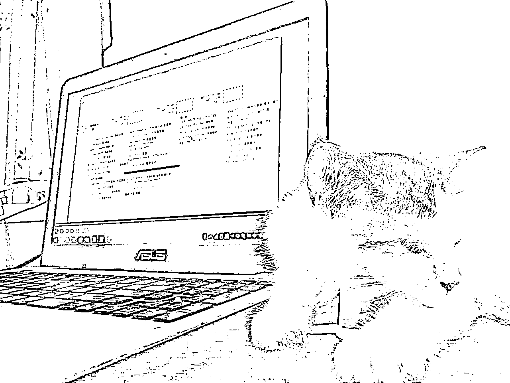

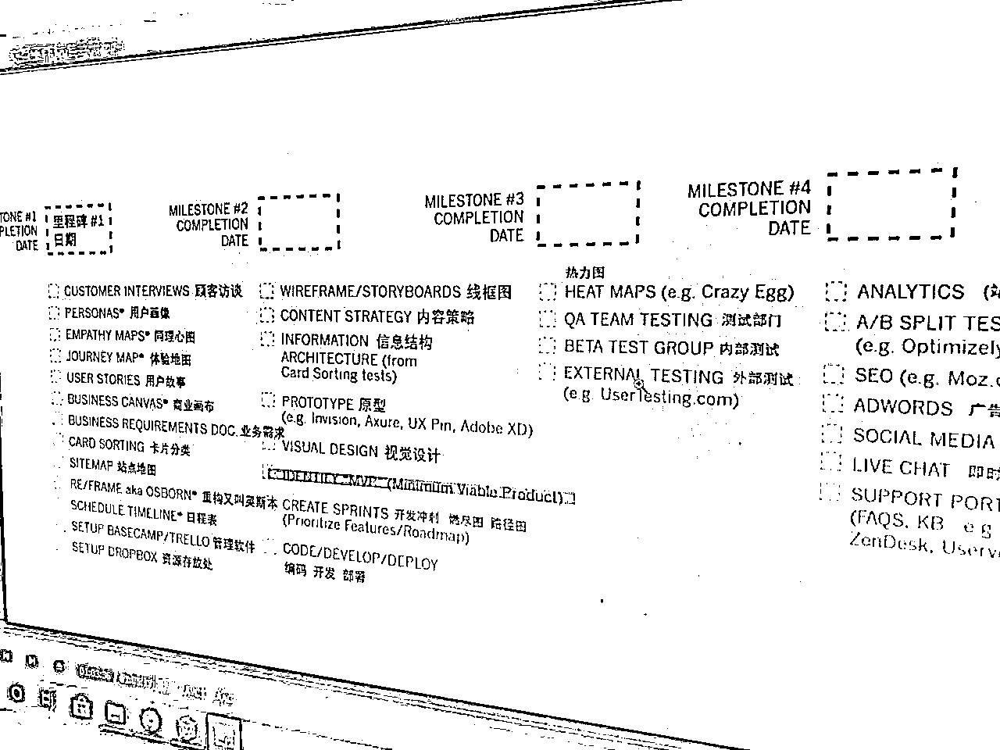

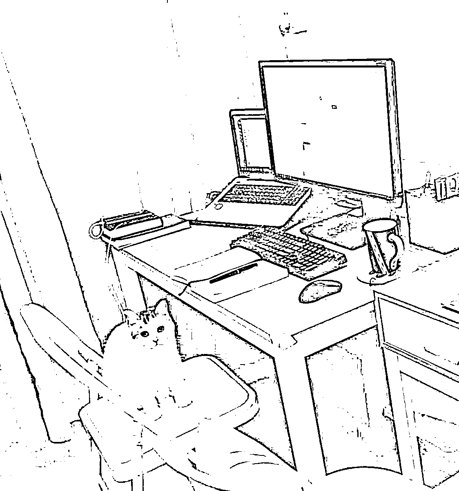

（主要是来报个到，顺便秀一下主子）

三年换了四家，终于混到一间还算满意的公司，设计部11个人，薪资年包近25万，在教培行业算是不错了。

按常理想着再干两年，下份工作冲大厂，BAT好像在招手了。

结果还没转正，“双减”政策就砸了下来。

被裁员是什么体验？周五还在对需求，周一早上发通知，下午就让走人。一天打包完事，高效得让人猝不及防。

入职不到两个月，又得重新找工作。

找工作的过程中我慢慢明白，打工的收入天花板太明显了。

频繁跳槽换来的涨薪，看似体面，其实经不起推敲。

就算进了大厂，裁员阴影永远在，稳定性还是个问号；

（技术和人品我觉得还行......

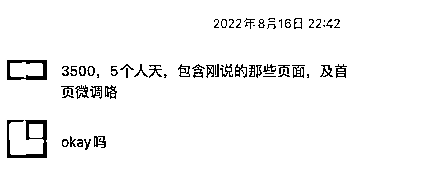

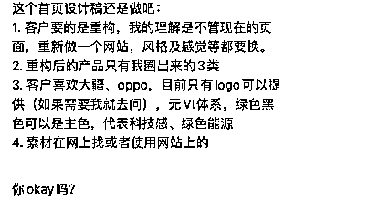

之前在几家公司混个脸熟，偶尔接点外包私活，一个月也能赚个万把块。

可这始终不稳。我跟自己说，职场不该是终点站。

再看自己，十几年教育，从里到外就学会了好好打工。

难道去摆摊？日入9000？日子就能甜起来？

除了会画图，我还能干什么？抬头一看，头皮发麻，离开公司好像啥也不会。

于是我给自己降了目标，不谈创业，至少先靠自己的能力赚到第一桶金，哪怕一分钱也行。

# 三、开始掘金

就从这一刻，我正式开启了副业折腾期。

结合日常习惯，我在网上猛搜“副业”“兼职”“如何赚钱”。最后让我找到了赚钱平台，当时用的是和朋友合并的账号。

进来一看，信息爆炸。月入数万、日入数千的项目铺天盖地，兴奋和焦虑一起上头。

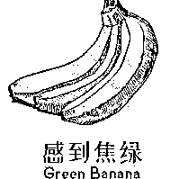

我几乎熬了两晚，最后把目光锁在了外卖CPS上。看的是黄海老师的教程，步骤清晰，能快速获得正反馈，成本也低。

想都不想，直接上车干。底层逻辑网上能搜到，这里就不展开了。

# 四、外卖CPS

## 4.1 先说结果

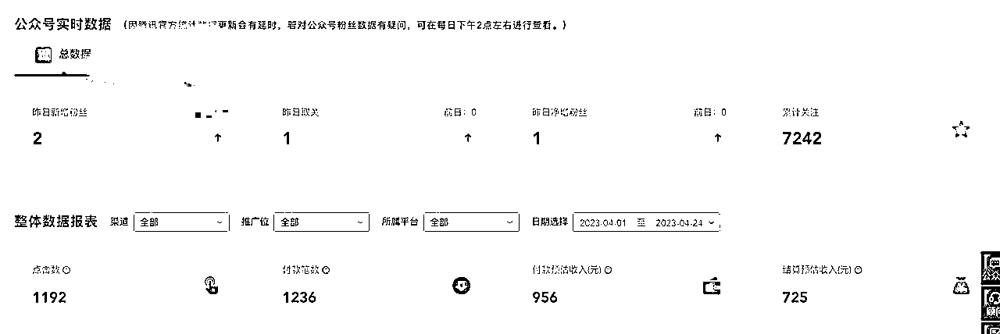

别觉得赚得少，纯被动收入，躺着也能进账，香不香自己知道。

## 4.2 我到底做了什么

从设计物料，到朋友圈第一条广告；从办第一张营业执照，到搭公众号变现闭环......

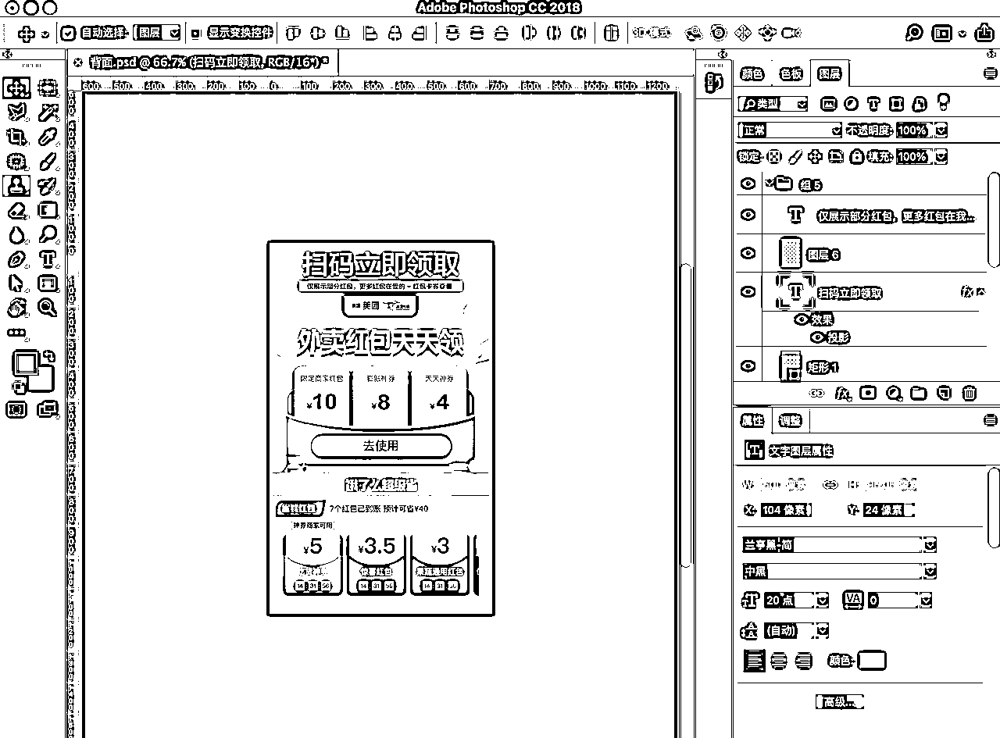

线上引流也在同步做，线下更是跑到厕所贴卡片。

白天去面，我晚上骑电动车穿巷子拜访店家...

【基本把美团外卖周边榜前十的老板都加进了微信，面谈意向，巷子里做外卖的店基本都愿意见面聊】

谈妥后就寄卡片让他们分发，后面全线上跟进。

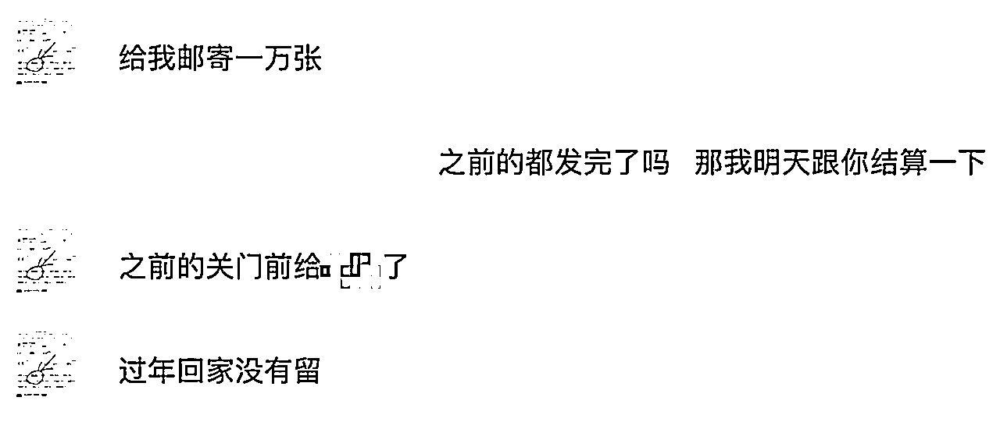

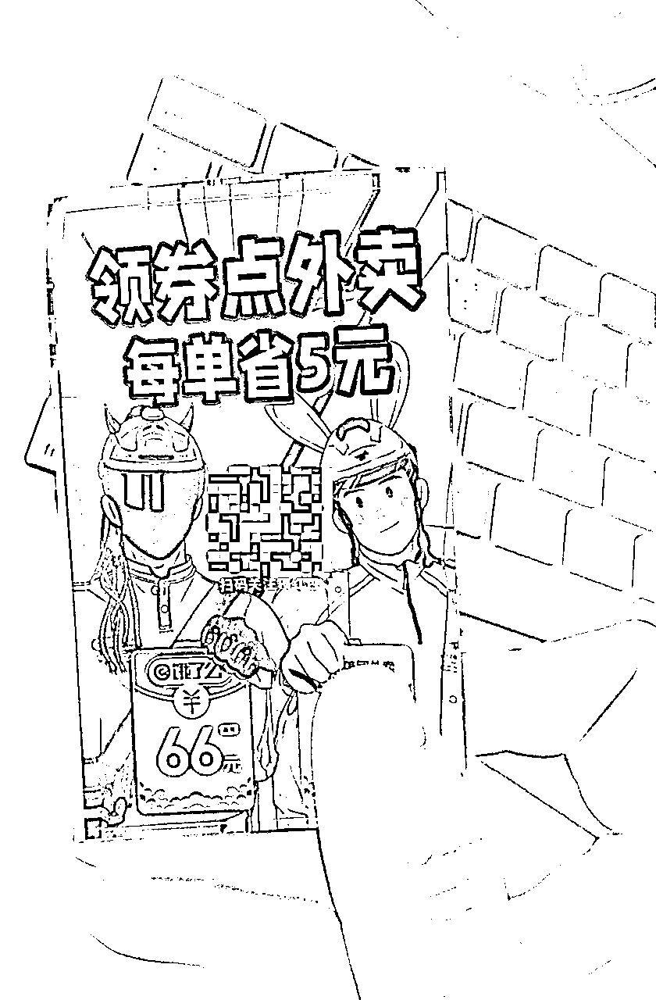

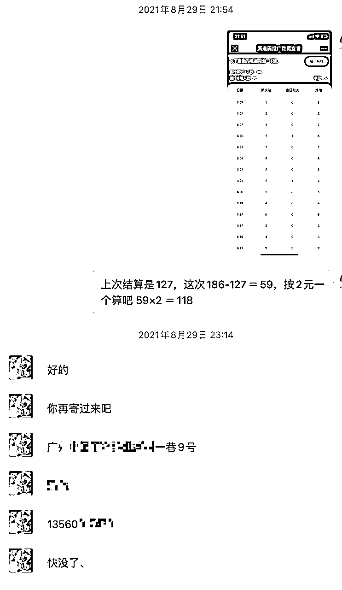

写出来好像就几十秒的事，听起来也不难，但对我而言全是第一次。

第一次做朋友圈推广，第二天就有收益。越做越多，饭点就忍不住刷新后台，看订单从一天七八单涨到上百单。

第一桶金带来的那种踏实感，到现在都记得清。

这笔钱是靠自己挣的，虽然比不上工资，但和打工的钱完全不一样。

## 4.3 复盘

到2022年中，平台调低佣金，和不少店家陆续终止合作后，我就没再主动引流了。

可即便如此，每个月仍有笔睡后收入在持续。

这是我第一次真正all in的互联网项目，没花十几万投流，靠执行硬赚下来了。

顺带说个小插曲，我跟一个想搞钱的朋友介绍了这个项目，被人家当场嘲讽...他到现在还在挑项目。

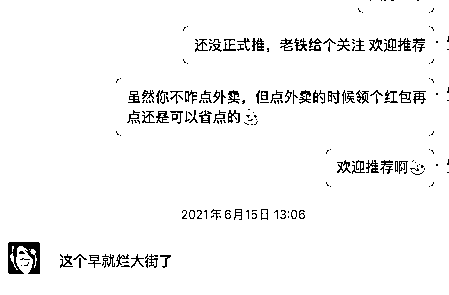

其实，哪个项目做的人多、没空间、做不了的说法，从来都存在。做多了你就知道，这都是话术。

适不适合能不能做，只有自己做了才知道。

大多数人只是在等、看、抱怨，永远不开始，也就谈不上坚持。

很多项目根本不需要高认知，执行到位就能赚钱。

如果现在你也想试外卖CPS，给三点参考：

1. 前期引流要花钱，线上线下都得投入，回本周期一般要半年以上，不是想快钱的。
2. 现在纯佣金被压得很惨，平台也在抢流量，建议搭配淘客做二次变现。
3. 零基础小白不建议直接入。

# 五、做设计IP

## 5.1 IP的初探

本职是高级设计师，工作上也算小有成绩，跳槽都是一个月内搞定，薪资也一直往上走。再加上报了个自媒体IP课，觉得能沉淀点东西。带过几个应届生，又有点好为人师，表达欲也强，工作里常做技术分享。

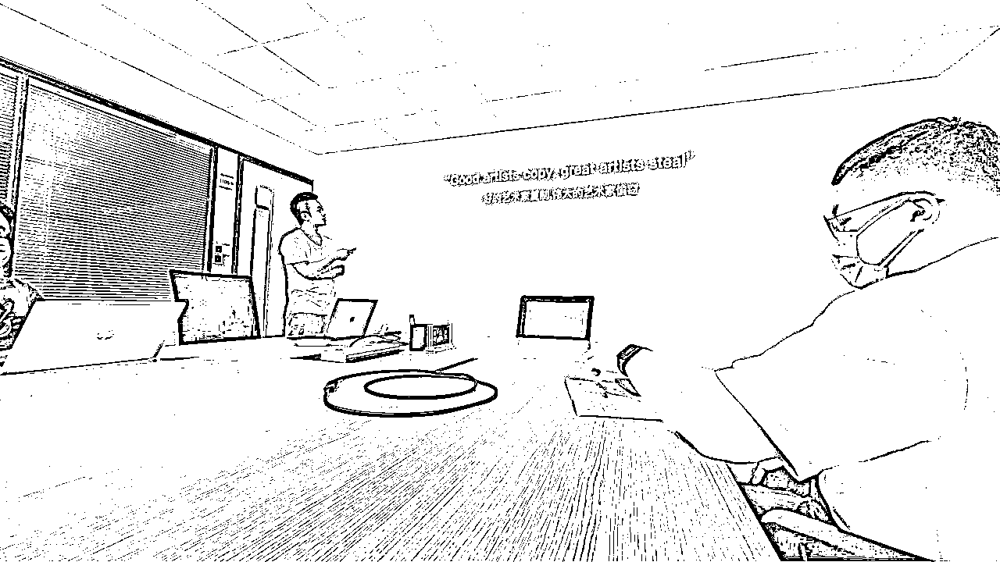

于是我规划了一个IP闭环：为设计新手提供简历指导和职场咨询。用“80分教70分，70分带60分”的思路，加上“确定了就干”的决心，物料准备好就冲了...

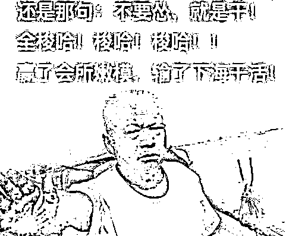

这是当时输出的一些截图。

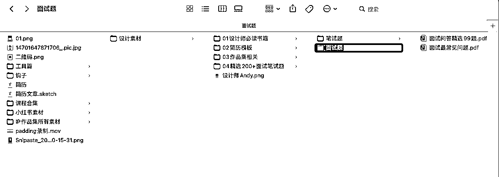

公众号也发了几篇，其中一篇被优设首页转载了，优设是设计师圈知名社区，百万+用户。

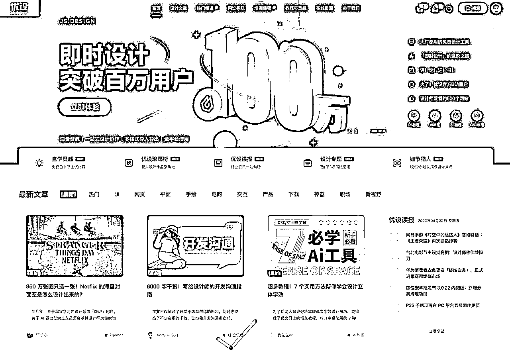

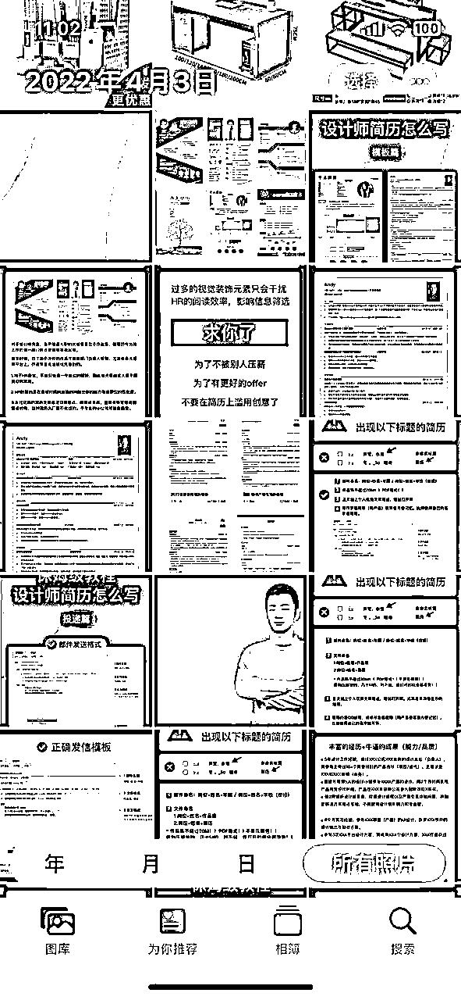

到现在偶尔还有设计师来加我。

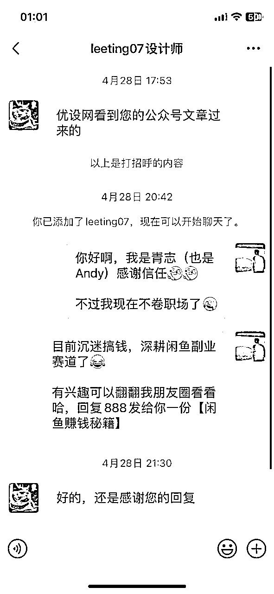

做了一个半月的数据：小红书导私域200+、公众号粉丝300+、变现0。

然后就没下文了。

后来换了新工作，来了个大改版项目，主业忙到飞起不敢折腾。引流来的用户我也不知道怎么承接，当时连产品都没做就开始跑了。

更关键的是心态急了，IP变现太慢，我想快点看到钱。

## 5.2 复盘

没赚钱，但学到了不少。

小红书搭建、图文制作、私域引流、公众号运营、写作，这些以前都没碰过。

同时我也发现，我对设计这份职业的热情在减退。

商业的本质是产品+流量，有卖有买就能赚钱。设计在这个链条里，离钱有点远。

而且国内设计师的现状多半是这样的。

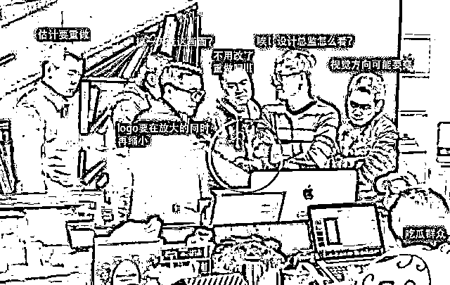

（设计师都懂的痛点）

做设计IP，最后不还是教人打工？我内心拒绝。

我的目标是帮普通人赚到第一笔非打工收入，没做出成绩就不敢乱建议。

好吧，下一项目。

# 六、视频号带货

## 6.1 传说中的红利

做过视频带货的都知道，22年4月，全网都在搬运。

朋友圈、社群到处喊：红利、捡钱、错过后悔、猪都能飞，再不进场黄花菜凉了！

我也扛不住诱惑，正好在找项目，于是入局。

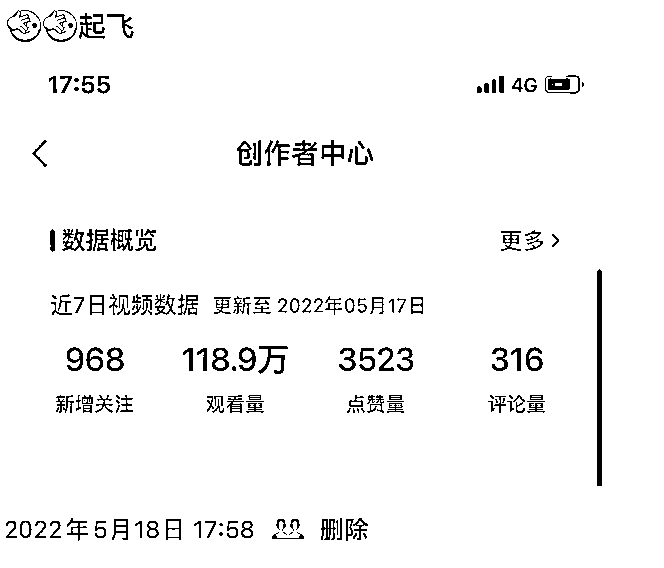

流量确实猛。我一口气注册了6个号，每天下班剪视频到凌晨一两点。早上六点自然醒，总觉得睁眼就有账号爆了。

那段时间满脑子都是选品和数据，半个月每天只睡四五个小时。

有钱进账的时候，真的不想睡觉。

我也觉得自己拼了，结果扎针了。又赶上618，公司要做大屏...

很好，吊瓶画图，酸爽。

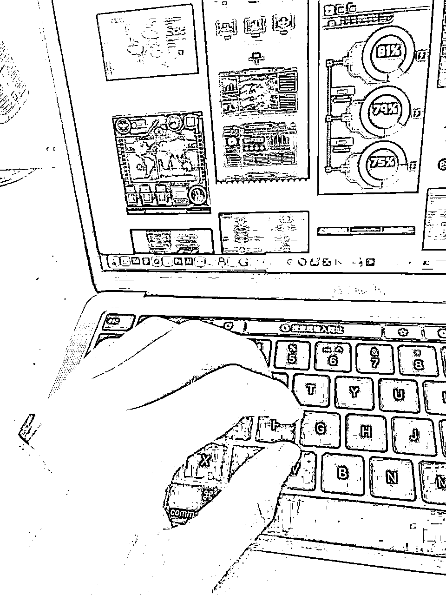

（身体是本钱，多锻炼）

说实话，当时最赚钱的是擦边品，营销点偏壮阳的那种，势头很猛。

当然，封号迟早的事。

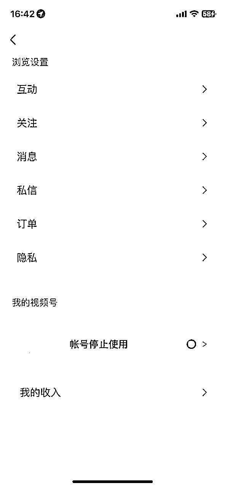

后面我搬了监控、女装、老人用品、母婴绘本，都没怎么起来。心态被“红利”带偏了。

平台规则越来越严，流量下滑，红利消失。白天上班晚上剪视频太耗成本，副业形式根本扛不住。

如果你想入局短视频带货，建议：

1. 爆了能月入几万十几万，不爆就是纯内耗。高度依赖选品和剪辑能力，前期重投入。
2. 视频电商绕不开剪辑，自己先学基础剪几个感受下流程，再决定。

## 6.2 复盘

做久了才懂，真正吃到红利的都是头部电商玩家。他们有经验、有选品方法论、有小团队，几个人带十几个号冲量。

这东西看似是红利，其实是概率+体量的游戏，普通人玩不过。

成绩好不一定是课程厉害，更多是个人过往经验。运气爆单的也有，但凤毛麟角。

红利是真的，但普通人想一个月赚几十万不现实。

我也就捞了几万，来的快去的也快。

能沉下去深耕的人，才能做大。

到这会儿我才意识到，项目一直换不是办法。要找一个能长期死磕的。

# 七、闲鱼无货源

前面分享偏“道”，这一块说说“术”。

闲鱼其实在我做设计IP时就开始玩了。它随手能捡起来，随时能变现。停更多久，只要姿势对，上新就能拉权重。

操作自由度高，坐地铁、吃饭、洗头都能做。跟我的主业时间错位很契合。

## 7.1 成绩

从一单赚5块的走量品，到10块利润的单。到一机一号，到多机多号，再到带朋友、甚至让年过半百的爸入局。

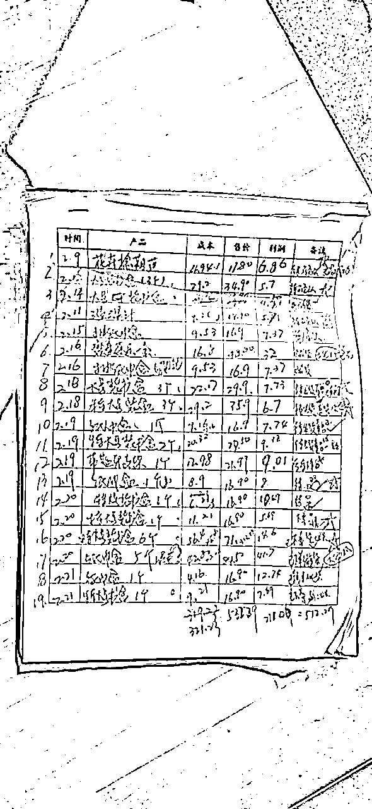

这是他手写的订单记录，电脑不会用。

后来做到高客单100+利润，偶尔一单1000+。从月入1000、2000到1万+。

接近两年，多个账号总利润20万+。

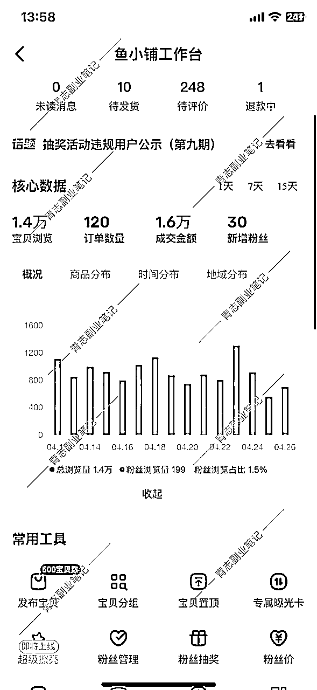

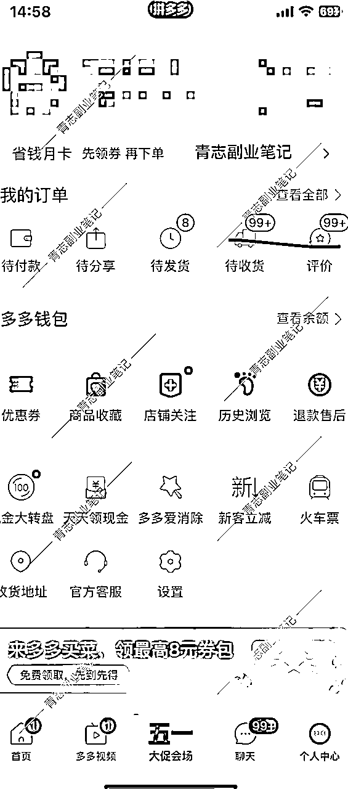

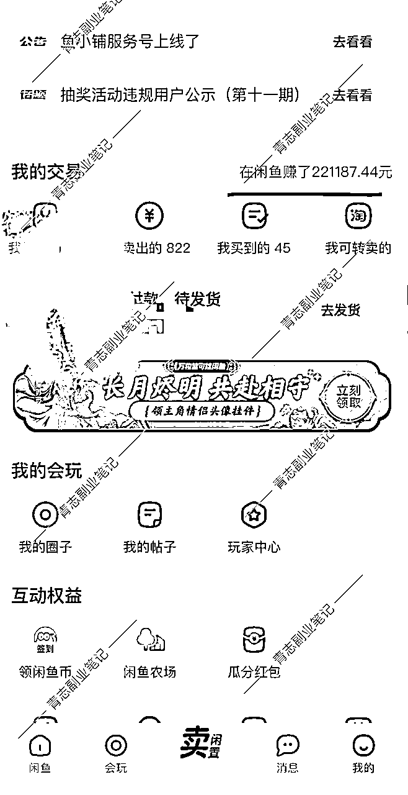

现在还在做。

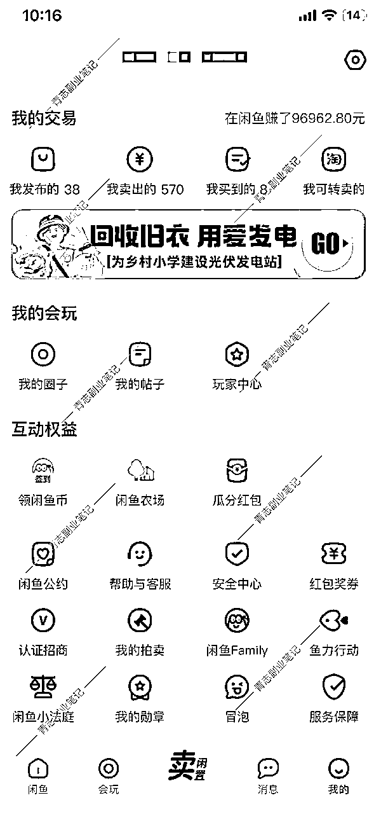

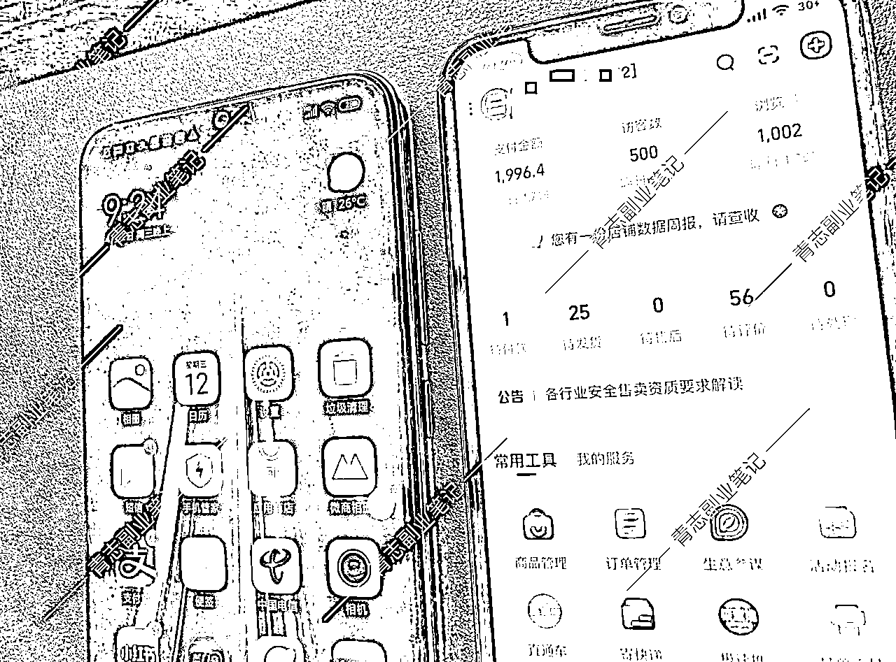

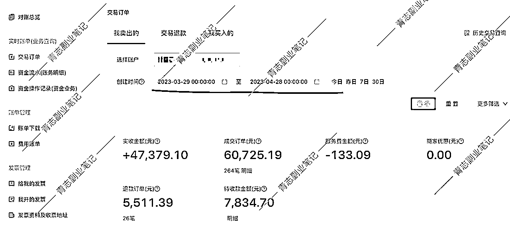

2024年更新，仍在深耕。

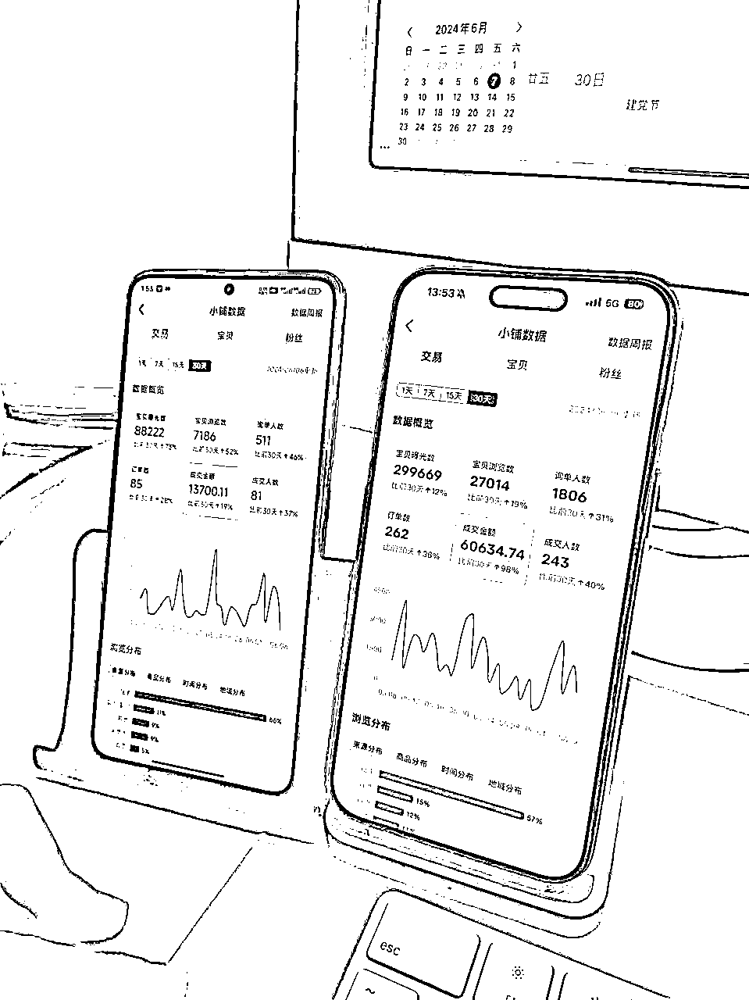

（部分账号收益截图）

加上其他项目，副业总收入已超30万。两年多时间，不算惊艳也不算差。

但要说副业形式稳定月入三四十万？小白能做到？两字，梦里。

## 7.2 看待闲鱼

电商都一个逻辑，选品是地基，玩法都能套用。

细节大家都说过，我从另一个角度聊聊。

### 7.2.1 选品上新，执行为王

起号期每天上3-5个新品就行，时间错开，别一次性发完。编辑好先存草稿，定时发布。

类目别太散，最好半垂直。三天为一轮，没反馈就换类目换品测。刚开始当杂货铺，先把权重养起来。

正常品别太差，保证图文质量。快则3天，慢则两周，就会有询盘出单。运气好一周就能爆。

最核心的就是：每天坚持上新，且质量在线。

很多人上不到十个品没单就放弃了，后面自然看不到。

怎么区分素人和同行？看标题、文案、产品图是否会改定位、是否会薅同城流量。

数据不错的适当干预，刷1-2单真实搜索下单。

QA1：多久出单？

看上新质量和数量曲线，坚持下去总会来的。

QA2：一个月能赚多少？

总利润 = 单品利润 × 销量 × 账号数。

闲鱼要兼顾客单和量都不容易，靠选品。

想知道能赚多少，先坚持上新两周，执行完结果自现。

赚多赚少，自己说了算。

这套打法换到哪个赛道都成立：爆款不止是冲一时的热度，更要把能吃的旧红利尽量吃干抹净。

先给爆款下个定义：第一，搜索权重要够高，用户输完关键词，首屏前几条就能看到你；第二，曝光量要大。两个条件都满足，订单自然会稳定掉下来。

持续上新品，最后只会出现两种情况。

A. 一直没跑出爆款。所有商品页都表现平平，没一个能冒头。原因一般只有三个：没扛住、品没选对、图片和文案细节不到位。解法只有一条：反复打磨，继续筛，继续上，别的没有。

B. 出现了爆款。参考下面的趋势示意图。
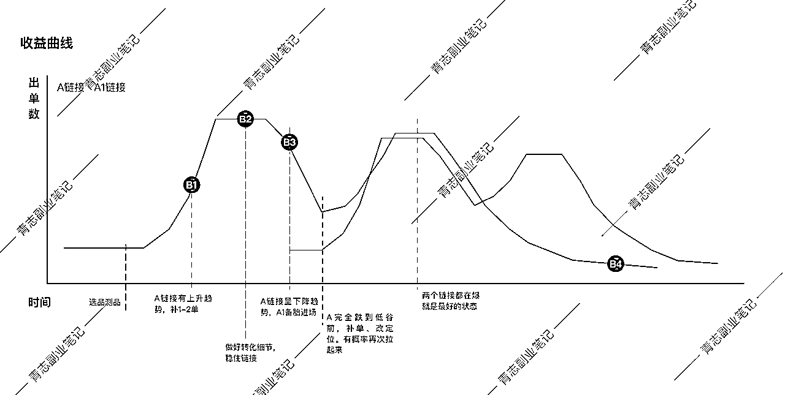
这张图是顺风局里打得最顺的样子，真实操作里还得应付很多变数。

B1 起量前兆。爆款通常有迹可循：同一条商品链接，成交量和咨询量连续往上爬。比如2单、3单、5单、8单一点点涨上去。此时最要紧的是抓住访客，尤其是前几单，就算利润薄一些，也要先把客户留住。

B2 爆了。只要客户来了你没把人气走，至少能连续稳定出一周单。策略就一个：求稳。暂停上新，把重心放在客服和转化上，顺手记录访客和成交的走向——因为很快链接就会进入B3。

B3 热度回落。每一条商品链接都逃不开降温，这是必然的生命周期。但我们可以人为介入，让这口热乎气多续一阵子。

当商品页差不多走到B3这个点位时，最明显的信号就是咨询和订单双双走低。这时不能再一味求稳，得立刻把备胎推出来。
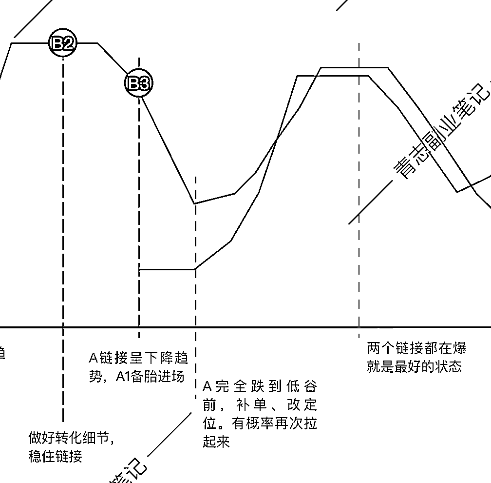
具体操作：同款产品再上一个新商品页，叫备胎1号，也就是A1。A1要换一套图文、换一个定位发布。再把老链接那边成交过的客户，分流一部分去A1下单。同款产品，系统给的标签天然精准，这实际上就是刷单的一种。等A1有了自然流量成交或咨询，它也会慢慢接棒起爆，后面又可以安心做客服了。等A1开始衰退，用同样方法上备胎2号A2，继续轮换。这套路的核心逻辑是：只要爆，就往死里加码，直到把它的剩余价值榨干。这和当年玩视频号的路数很像，放到小红书一样走得通。我以前有个账号，同款产品爆了差不多四个月，前后推了6个备胎，每个备胎都还在不同阶段出过力。
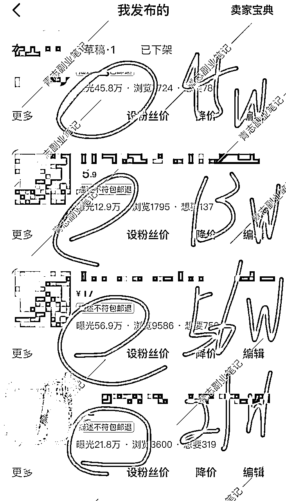
热销期内，客服响应、转化、售后、回复率都要守住。旧红利吃越久，这个店上新品的压力就越小；最好的情况是，省下时间去经营其他账号，把空窗期补上。

B4 彻底熄火。如果补单、改定位、加子链接都救不回来，两个星期都没人光顾，基本上就没救了。钟形曲线到哪个平台都一样。
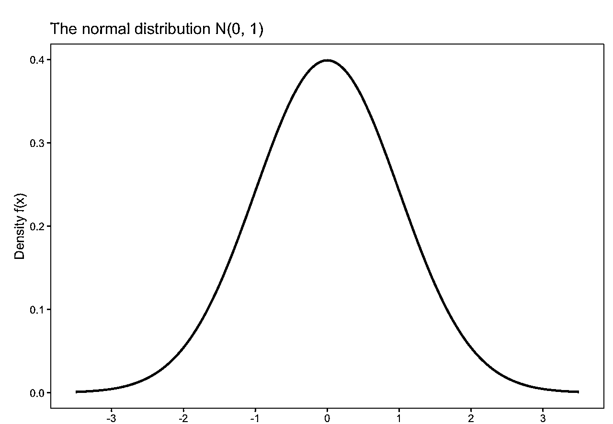
所以，果断放手，去看最后一点。

最后，也是整个循环最核心的一点：看到这里，你应该能拼完整幅图了。一个爆款从起势到衰退，大体就是这条路。因此最关键的一条，请回到7.2.1去看第一条。

接下来聊挑品。闲鱼上几乎什么都能卖，关于挑品，帖子已经很多。我只讲两个自己用过、觉得好用的方法。

第一个，条件反射式挑品。本质上是在生活里练挑品，直到变成下意识：平时多看多琢磨，遇到任何东西，第一反应都是“这玩意能不能拿来卖”。如果你能把挑品磨成早上睁眼就要刷牙那样的习惯，找品也就不会太难。

举个例子。一名普通上班族的一天，从起床到睡前，每个环节都有对应的东西：起床睁眼要用眼罩、被子；出门要穿衣洗漱、骑电动车、备雨具；办公室里有绿植、办公椅、插排、充电器、会议桌椅；午休要折叠床和耳塞；吃饭要餐桌椅；下班在家要书桌、电竞桌；洗澡睡觉又和浴室、床品相关。把这些词拿去对照闲鱼搜索下拉推荐、拼多多垂直类目排行榜，光“上班”一个场景，就能衍生出大量可做的品。

别小看这些带下划线的词，我靠其中一个品，赚到过上万的利润。

第二个，拼多多后台类目挑品。这工具相当能打。注册一家拼多多店，上架商品的时候，后台会列出非常细的类目，几乎把一级类目下的挑品词全部铺开。把这些类目词拿去闲鱼再搜一轮，还能继续发散出不少新品类。
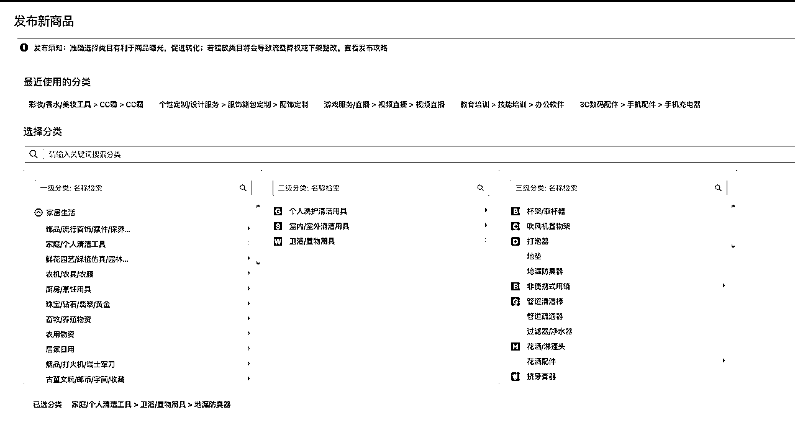
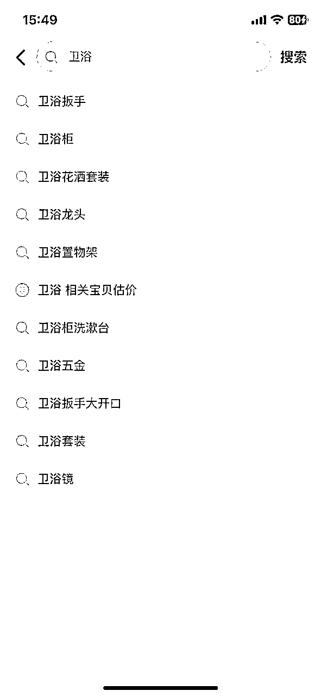

第三个，搜索引擎关键词挑品。公式很简单：类目关键词+官网。比如我搜“办公家具”，家具向来是高客单价的典型品类。
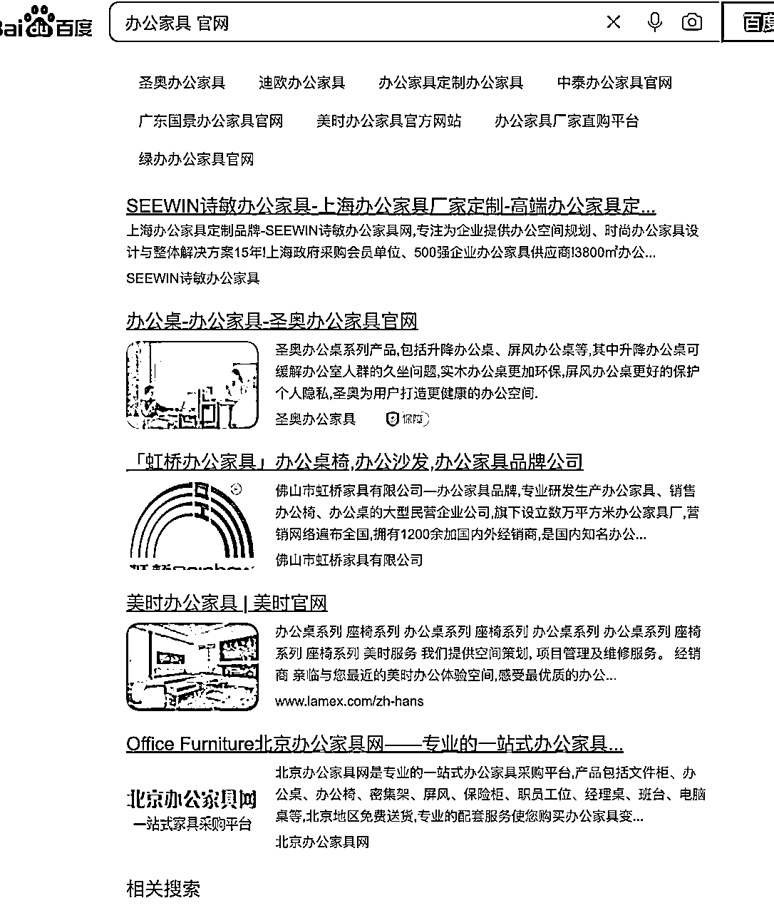
用Google效果也差不多。
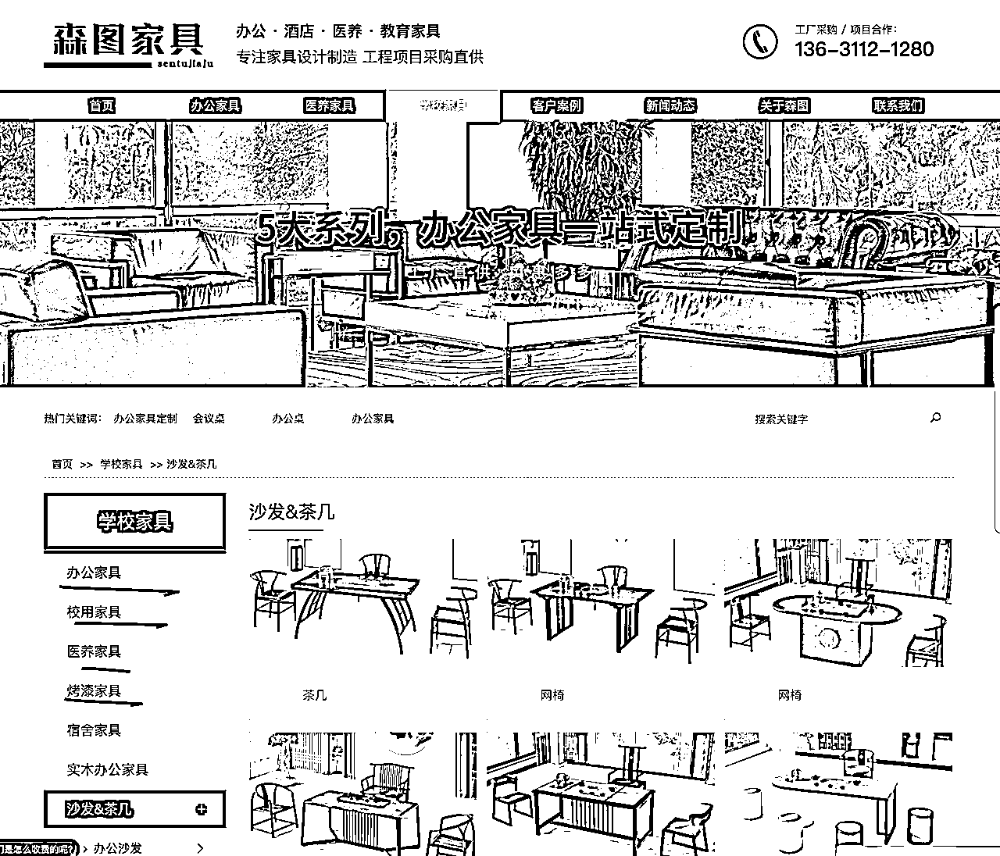
还有一种网站，专门围绕整条供应链列出产品，发现一个就相当于挖到蓝海词矿。
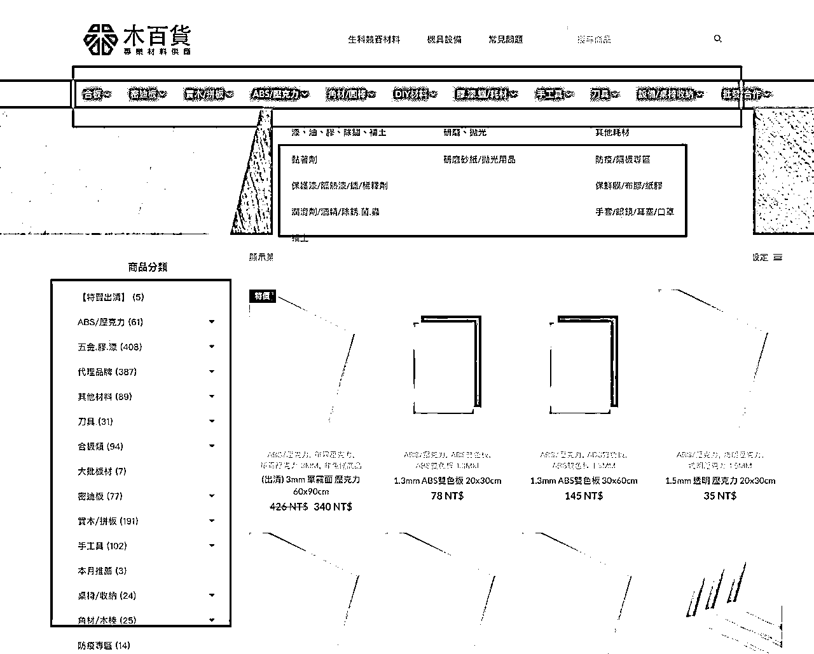
没事多搜搜，这类官网经常藏着你意想不到的冷门品。光看上面那张图，就能找出不少可以试水的方向。

关于挑品的好坏，我不太认同“能跑量就是好品”这个标准。适合自己的品类才是最好的。一提这个，大家都会想起闲鱼上最热闹的电子产品；我也做过投影仪、手机这些。
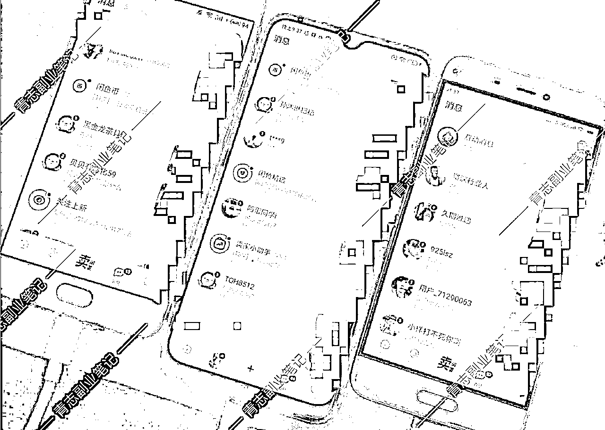
这类目的访客量确实远超普通类目，不少店铺能拿到成百上千的订单。但我的体会是，钱能赚，可售前售后服务太磨人，成交率也低，做了万把块我就停了。当然，纯属个人偏好。鞋好不好，只有上脚才知道。

挑品是电商最底层的功课：运营最多占三成，挑品要占七成。你必须练出自己的眼光，不能总靠别人供应货源。刚开始仿着别人卖也没关系，总得自己站起来。挑品重要，重要，重要到不能更重。与其直接给鱼，不如教人打鱼；给你再多货，也不如教会你挑品。这是一种可迁移的能力，有了它，你才算握住电商的通用钥匙。想走得更远、把盘子做得更大，挑品永远绕不过去。

再聊放大收益。能从0做到1，就可以考虑从1复制到100。第一条路：复制打法，店群开起来，客服招起来，利润自然放大。但段位越高，成本和管理复杂度也越高，普通人其实不用想那么远，先干了再说。第二条路：打造个人IP，这也是我目前准备冲的方向。我的愿望是，让刚入门的小白都能赚到第一桶金。

最后做个总结。这两年我折腾过不少副业，篇幅有限，没法全部展开，只说两点心得。

第一，怎么选方向。赚钱里的帖子，多数是把生意做到相当规模才出来分享的；像我这样把失败过程摊开写的，反而少。没办法，人性就是爱看“一夜暴富”“被动收入”这样的词。看多了会产生错觉：好像别人随便做什么都能轻松赚大钱。还没开始，就已经觉得自己要逆袭了。

结果，一部分人不断换方向，哪篇帖子说赚钱就冲去哪；另一部分人总在担心，这个不敢做，那个不合适，给自己设了一堆卡点。真动手以后会发现，大多数障碍都是想象出来的。我自己就从设计师一路跨界到各种副业，除了前面写的，还碰过小红书带货和淘客。方向会一直变，但人不能跟着飘；哪里有火就往哪里跑，最后只会变成陪跑。韭菜当久了，也只是更老的韭菜。更麻烦的是，你会一直困在找方向的阶段。选方向当然要试错，可一旦选定，就该给自己定下底线期限；不然回头看，每个方向都只碰了皮毛，又都怨不得别人。

第二，关于知识付费。说句很多人不爱听的话：不管什么课程，8020法则和721法则永远都在，最后能成事的永远是少数。
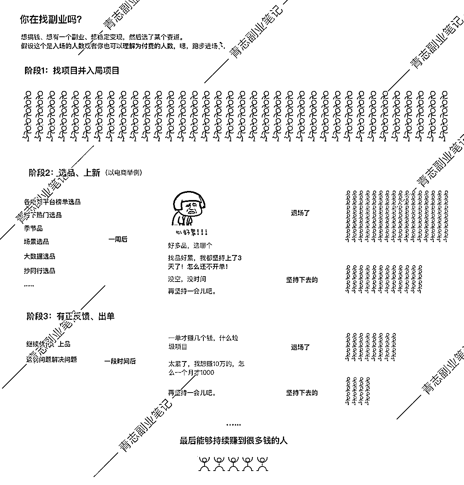
这少数人的成绩，都是用无数个失败的黑夜换来的。哪怕大佬的课再牛，也不例外。大佬牛，不代表你报了他的课就一样牛。教和做是两件事。名师不一定出高徒，高徒也未必出自名师门下；这两句话，自己品。能不能成，能赚多少，永远取决于你自己。幸存者偏差让我们只看得见成功的那批人；他们或许经历了无数次80分，却只告诉你自己终于进了20%。（这不是废话吗？把失败拿出来吆喝才是傻，写着写着我好像把自己也骂了。）

为什么我敢这么讲？因为前面这些项目，我几乎都是付费学的。
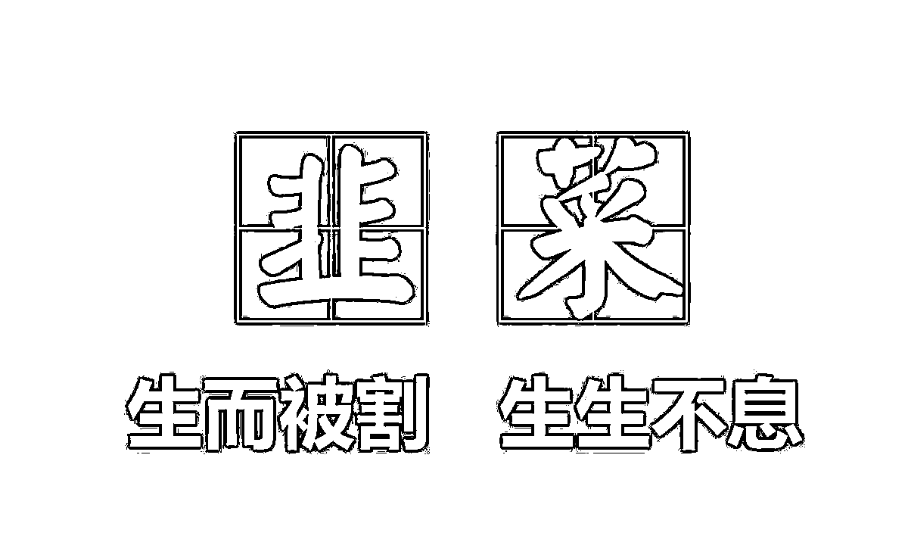
我从来不怕被人叫韭菜，付钱付得心甘情愿。如果你也能像我这样，那我觉得这件事：

开个玩笑。付费没什么不好，很多时候它只是进一个行业最快的方式。

第三，人为什么会付费。答案很简单，看完这张图就明白了。
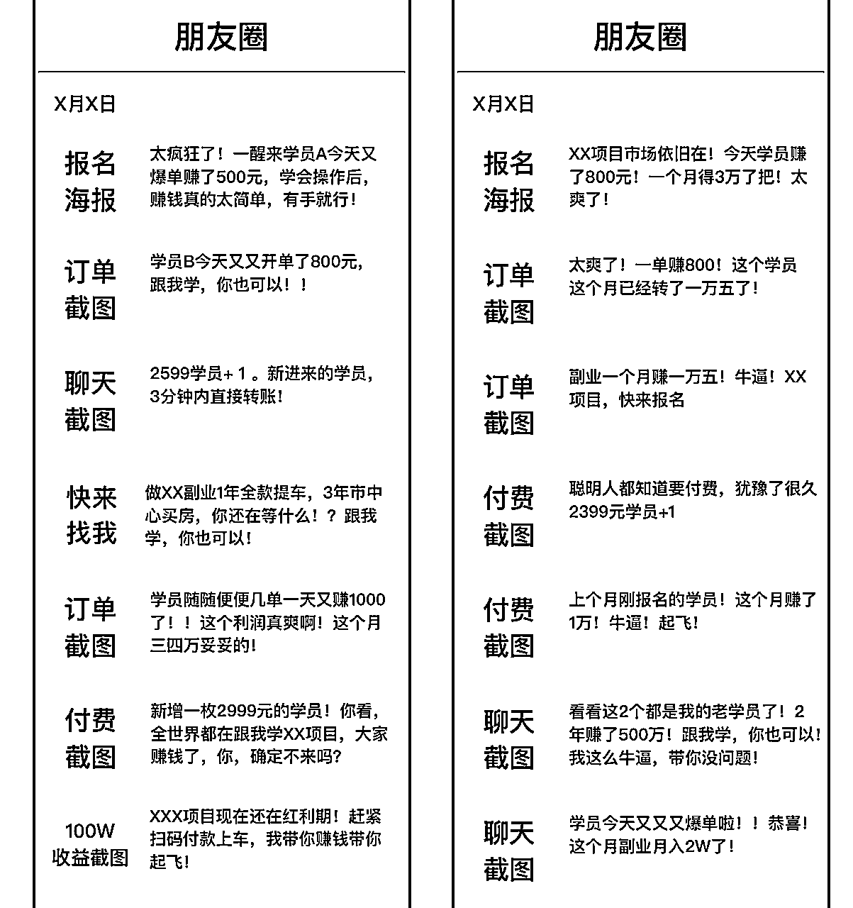
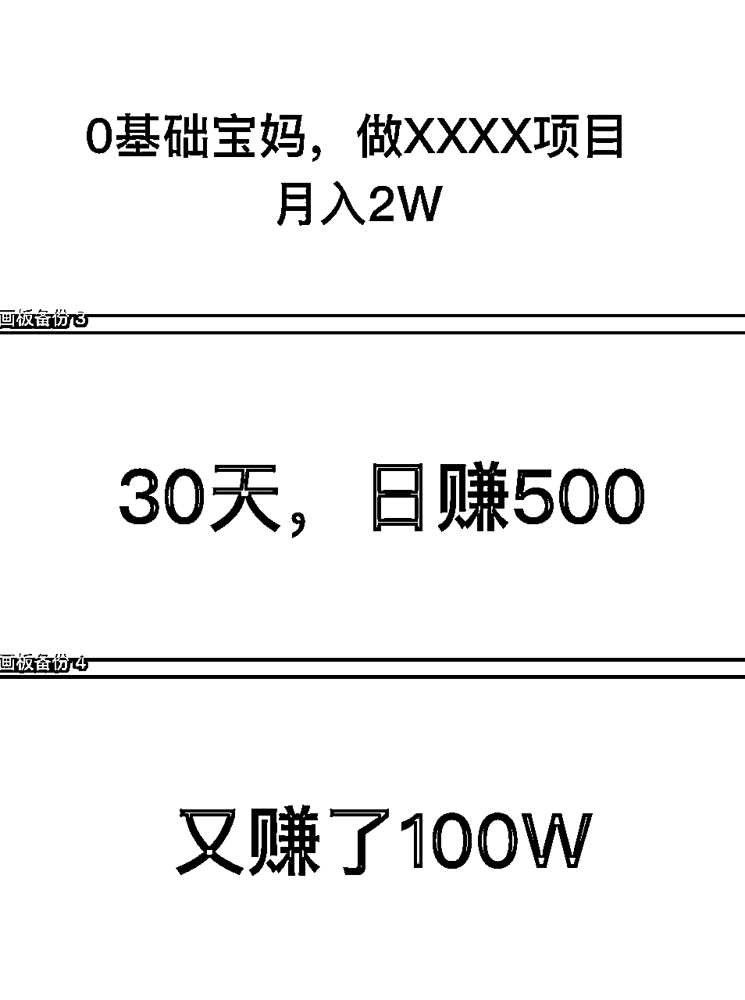
回想一下，你每次掏钱，是不是都被类似的画面打动过？好了，先说到这。如果这篇点赞能过50，我拼了命也会再整理一篇，聊聊我一个设计师是怎么一路交学费做副业的，顺便把知识付费的明面和暗面都揭开。
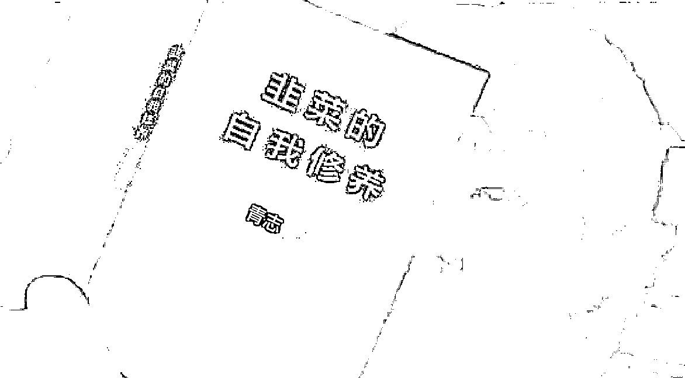
所有人都是从零起步的新手，我水平也有限，写这些只求有点启发。搞钱路上不孤单，一起加油，祝各位看官天天爆单。

最后，感谢赚钱，感谢圈友们的陪伴和帮助。

穷且益坚，不坠青云之志。我是青志，谢谢你能看到这里。本文是【上】，若有机会，两年内再见【下】。本篇到此结束。