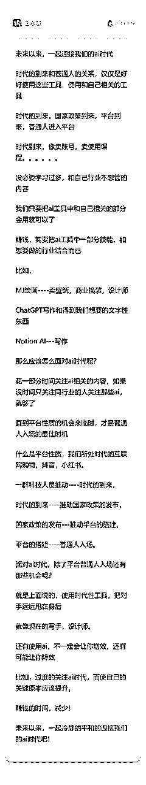
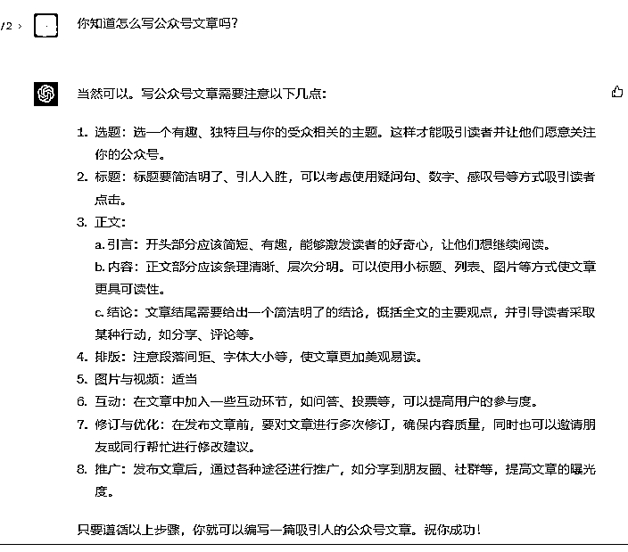
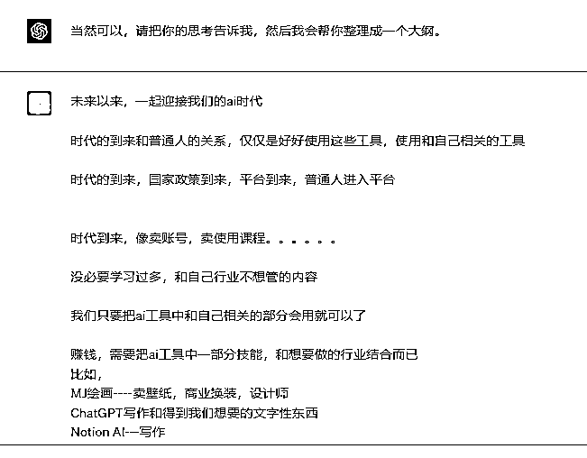
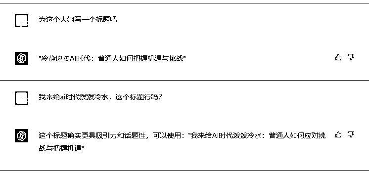
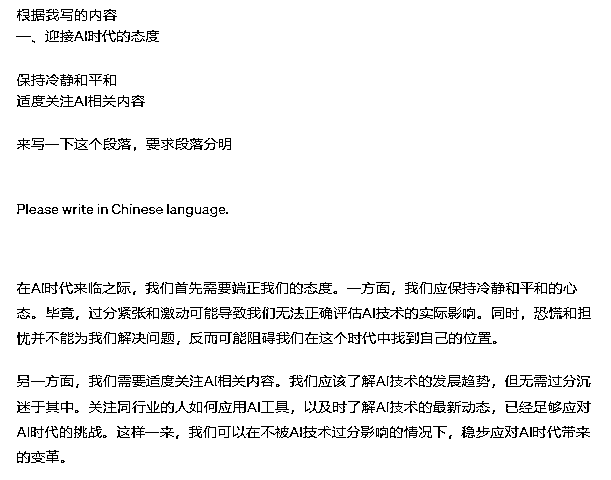

# ('ChatGPT写的文章《我来给AI泼泼冷水：普通人如何应对挑战与把握机遇》', (2, 39))

给AI狂欢泼盆冷水：普通人的机会到底藏在哪？

眼看着AI话题一天比一天热，隔三差五就是“某某又被AI取代了”“某某靠AI月入十万”。要说心里不慌，那是假的。可越是这样，越需要有人站出来说句实在话：普通人真正的出路，不是被浪潮推着跑，而是知道自己在浪潮里该站在哪。

先摆正心态：别慌，也别魔怔

对待AI，最舒服的状态其实是淡定。整天紧张兮兮、兴奋过度，都会让你误判形势。焦虑不能解决任何问题，反而会干扰判断。你只要做到“适度关注”就够了——看看同行在用哪些AI工具、怎么用；再留意一下行业最新动态；发现跟自己领域相关的工具，立马用起来。做到这些，已经足够你在时代里站稳脚跟。

AI到底是洪水猛兽，还是机会？

对普通人来说，AI既是压力，也是红利。压力在于，你不学习就可能被会用它的人甩开；红利在于，它给了你快速成长的可能。比如设计师可以用AI绘画增强灵感，写手可以用ChatGPT提高产出，Notion AI也能帮你整理思路。

甚至，还有人抓住“大众无脑追AI”的心理赚快钱：卖ChatGPT账号就是典型。很多人买了账号根本不会用，新鲜劲一过就扔了。这类生意确实来钱快，但也消失得快。

真正能走得远的，是让AI和你的本行发生化学反应。别人还在手动磨流程，你已经用AI把效率翻倍，这就是竞争优势。设计师用AI生成素材，做别人想不到的作品；写手靠AI辅助，出稿又快又好。落到赚钱上，也能找到很多具体玩法：MJ绘画做壁纸、商业换装，ChatGPT写小红书笔记，Notion AI同样能写，多个AI组合还能做数字人、做漫画。

AI时代是怎么被一步步推着走的？

很多人以为AI是突然爆发的，实际上背后有清晰的发展链条。

一开始，是科技人员冲锋，用热情和聪明才智把AI产品打磨出来。接着，国家看到这股力量的潜力，陆续出台政策，为技术健康发展定方向。然后，政策催生平台，各种AI应用像雨后春笋一样冒出来，这和当年互联网时代的淘宝、抖音、小红书是同一个逻辑。最后，平台搭好了，普通人涌入，有人靠平台赚钱，有人靠平台创业。如果能力强，你甚至可以搭建新平台，带着一群人一起赚。

普通人到底该怎么接招？

第一，看懂平台级机会。平台级机会往往有一个共性：把本来就在的行业和新趋势嫁接，然后放大。当年淘宝做的是生意，抖音做的是戏剧。现在的ChatGPT已经能把AI和购物、订机票、点外卖连起来，但这类大机会，普通人暂时进不了场，等就行。眼下实在的做法，是先把这些工具用起来，让自己工作更高效、生活更便捷。

第二，适度关注同行圈里的AI风向。不用天天泡在资讯里，偶尔扫一眼同行的玩法，知道别人怎么用AI，就足够了。这样既不会掉队，也有机会发现新商机。

第三，选对工具，而不是选“好”工具。设计师就选绘画AI，写手就选写作AI。别看到一个热门AI就忍不住下载，工具是拿来用的，不是拿来收藏的。

AI是放大器，也是绊脚石

AI确实能大大提升生产力。MJ绘画省去不少手绘时间，ChatGPT快速出稿，Notion AI辅助写作，以前几个小时的事，现在可能几分钟就搞定。这是非常实在的效率红利。

但AI也有坑——容易让人沉迷于工具本身，反而把该打磨的本事给荒废了。现在AI信息量太大了，很多人不是在用工具，而是在“追”工具。今天试一个，明天换一个，最后真正该提升的本职技能反而被晾在一边。就拿小红书来说，一款写作工具加一款绘图工具，基本就够用了。可有人偏要不断测试新工具，结果工具换了一大堆，收入也没见涨。大公司可以安排专人去试工具，普通人真没必要这么卷。就像涛哥那话：别抢着当第一只吃螃蟹的，做个第一批吃螃蟹的就行了。

两个很实在的策略

一是用一点点精力看全局。这里我想起龙哥老大的话：关键的事，总会反复提醒你。所以你不用绷紧神经，只要保持一点关注，就很难错过重要信号。

二是把好用的AI工具发挥到位，用它去超越同行。写手靠AI提升文章质量和速度，设计师靠AI创作独特作品。工具选得对，比选得多重要得多。请时刻记得：你选择AI是为了提高效率，不是为了集邮。

怎么用ChatGPT写出这篇文章？其实很简单

聊到这儿，顺便说说这篇文章的诞生过程。

起初，我也觉得AI这种大话题轮不到小人物来聊。但有一天突然有了警醒，就随手记了一堆零散想法。当时用的是涛哥推荐的Effie，想到哪儿写到哪儿，内容很乱（要是没思路，也可以先问ChatGPT）。之后我把这些碎片扔给ChatGPT，让它列个大纲。本来想套用赚钱的精华帖模板，但ChatGPT不知道，就改成了公众号模板。它起的标题也不合我意，我随便写了一个，然后让它帮忙加工，一下就完善了。再往后，就是让它按大纲一步步展开写，写完我再用自己的话顺一遍。靠谱姐说过，加一点人的场景，文章才有共鸣。整个过程，从突然警醒到成稿，只用了差不多两个小时，质量我还挺满意。

AI确实能让有想法的人，快速把想法变成看得见的东西。这篇文章最初写在4月底，后来AI热度一波高过一波，大家早就麻了。于是5月中旬，我又把它改成了“如何用ChatGPT写文章”的分享。最后想说的是：AI加上具体的使用场景，真的值得好好关注一下。