# 我在闲鱼做露营装备一年，月入过万的冷门赛道全复盘

> 来源：[https://vb5bdj4t4a.feishu.cn/docx/ZbxHdt8nRoi64KxjkEvcuHQNn8g](https://vb5bdj4t4a.feishu.cn/docx/ZbxHdt8nRoi64KxjkEvcuHQNn8g)

大家好，我是吉良吉颖。去年捕捉到龙哥聊到的露营经济信号后，我开始在闲鱼深耕露营装备这个品类。

项目启动是在去年4月初，直到5月底才真正起量。起初一个号一天也就百来块的进账，后面做到5个号同时跑，每天稳定800到1000。算下来这一年到手快20万了，而且我至今只做闲鱼这一个细分品类，没碰过别的。

就连当时一起跟我入局的几个小伙伴，只要肯执行，月入8k基本是起步线。如果你也在闲鱼上迷茫不知道卖什么，这个方向值得一试。

本以为露营热度撑不过去年的，今年依然很稳。

先上今年的实战数据给你看：

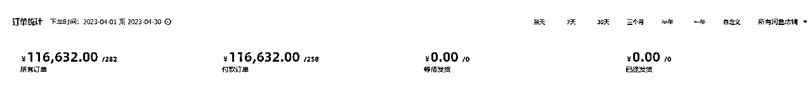

这是4月份的整月战绩，扣除退款后的净利超过2万。那段时间赶上五一假期，需求集中爆发，数据非常漂亮。

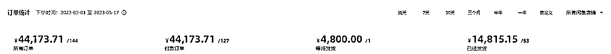

这是5月的数据，我写稿时是17号，扣完退款净利已经9000+。而且今年我白天在上班，只用两个号运营了，投入的时间比去年少很多，依然能吃到肉。

成绩过完，直接上干货。整个操盘思路我拆成五块来讲：

## 本文目录

1.账号打造

2.选品&货源

3.文案配图思路

4.如何快速冷启动

5.闲鱼之外的变现——私域&小红书

6.结语

## 1.账号打造

闲鱼本质是个人对个人交易，想长期做下去，人设包装是必须的。尤其做垂直赛道，账号调性要和商品匹配，这样信息才有说服力。

我给你看两个闲鱼上只卖露营装备、销量很猛的账号案例：

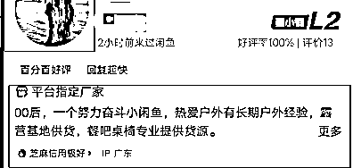

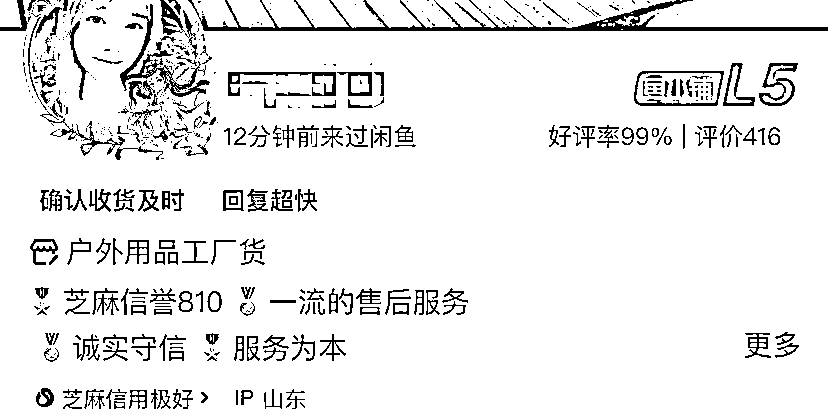

核心就三处要打理好：

### 一、背景墙
选一张有户外露营氛围的图就行，第一眼就能让访客知道你卖什么。

### 二、头像
强烈建议用女生头像，不管你实际性别如何。线上交易里，颜值高的女性头像天然转化更好，这是实操验证过的。

### 三、个人介绍
简单描述一下自身背景，比如线下店主、品牌工厂出身、营地主理人等，也能展示芝麻信用分来增强信任。

年龄、地址、学校这些次要信息随便填，关键是把资料完整度拉满。买家对你和商品的信息越透明，下单越安心。

## 2.选品&货源

露营品类繁杂，材质、尺寸、款式不同价格差很大，新手最容易在这里翻车。我刚开始就因为没搞清楚材质，直接多亏了上百块运费。

先说材质。露营装备的支架普遍就四种：实木、铝合金、碳钢、铁。价格从高到低排列，实木最容易辨认，铝合金和钢、铁需要提前问清楚商家确认。

然后把品类分成刚需和非刚需两类。

### 一、刚需品【必须全上】
指露营活动中不可替代的核心装备。

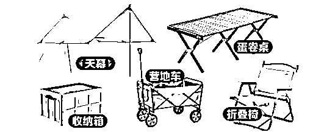

天幕、折叠桌、收纳箱、露营车、折叠椅、帐篷。

每个大类下面的细分款式和尺寸非常多，能满足不同玩家场景需求。爆款基本都出自这几类，我第一个月入1万就是靠桌子打出来的，也有同行只靠天幕或椅子就能月入破万。

刚需品一定要做全，要成套上架，钢的、铝的、实木的都要有。客户来买一件，大概率还会顺带别的，组合成交单笔利润才会上去。

### 二、非刚需品【适当补充】
是提升体验但非必需的周边。

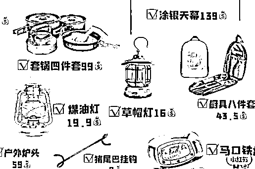

马灯、锅碗瓢盆、卡式炉、铁盘、地毯、氛围灯、充气床、睡袋、置物架、水壶等等。

品类很多，用来补利润即可，按时间精力自行选择。

### 三、货源渠道

我们走的是无货源模式，闲鱼接单后直接在源头下单代发。

#### 1.拼多多
非常适合新手入门。同样商品对比天猫、淘宝、京东，PDD价格最低，而且很多人不习惯在上面买单，信息差就是利润。

PDD售后也做得完善，商品出问题平台兜底，只要发货不出错基本很稳。平台还会因物流问题发放0门槛券。

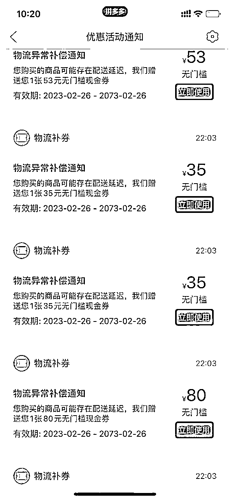

我这一年光是PDD送的券就接近2000元。

缺点是需要把买家电话中间一位数字改掉，防止短信提示导致退单。一般改中间四位，不要改尾号，改尾号去驿站取不了。PDD面单会有平台提示，被发现概率大概3%左右，最差也是退货退款，有运费险兜底。

另外PDD价格波动大，要多找几家备货防涨价。总体来说新手过渡很合适。

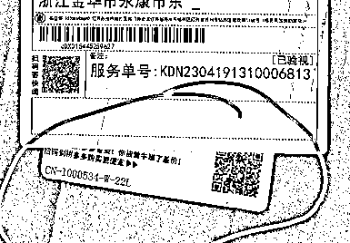

#### 2.厂家直发
优势是品类全、价格稳定，谈好基本只降不涨。发货面单干净，没有奇怪短信。

价格对比我给你看一组：

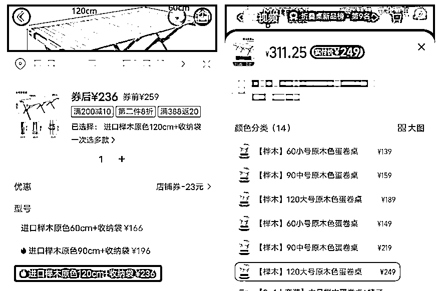

榉木大号蛋卷桌，淘宝均价230-270，PDD200-230，闲鱼普遍200-240，我合作的厂家能做到170包邮。

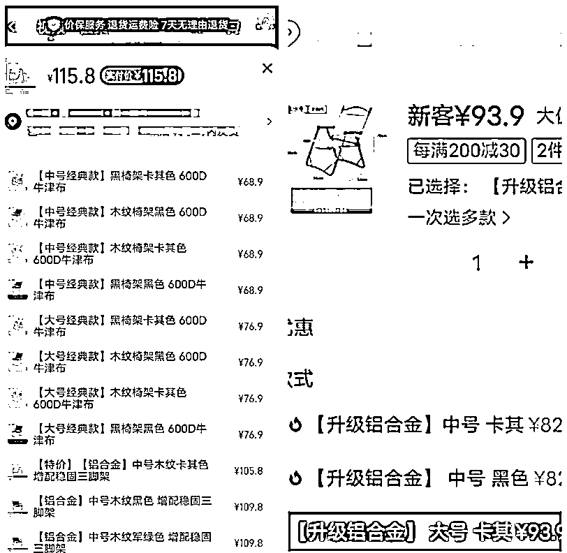

铝合金折叠椅大号，淘宝110-125，PDD95-105，厂家发货大号76，小号66。

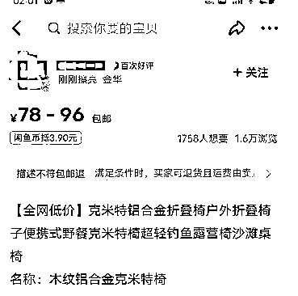

有时候用PDD的价格在闲鱼就能卖得不错，我自己则是用淘宝价在闲鱼出售。

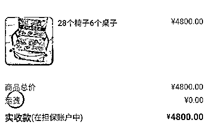

4月接的一笔定制单，销售额4800，净利润1300，这种高利润单只有厂家能做。

厂家缺点是多数不支持无理由退，退货运费需要协商。厂家需要自己在PDD、闲鱼、阿里上一个个找，辨别真假厂家费时间，谈价格也需要沟通技巧。

## 3.文案和选图

品类和货源确定后，就要准备上架素材。文案和配图是除价格外影响决策的第二大因素，做得好可以卖得更贵还能多下单。

一个标准的商品文案结构是：标题+功能点+材质+尺寸+价格，再加一段对买家的推荐语。

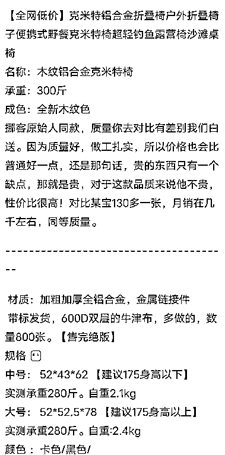

我会再挖掘产品的背景故事和厂家背景作为卖点补充，这需要大量客户沟通经验，新手先写基础版即可。

配图一定要用实拍图。

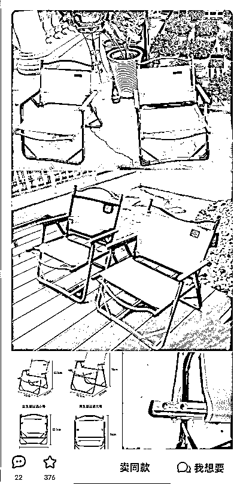

最好是那种朴实但带点精致感的画面，在闲鱼很抓眼。类似图去小红书、淘宝评论区就能大量找到。

不要用电商白底图，太假不搭调。

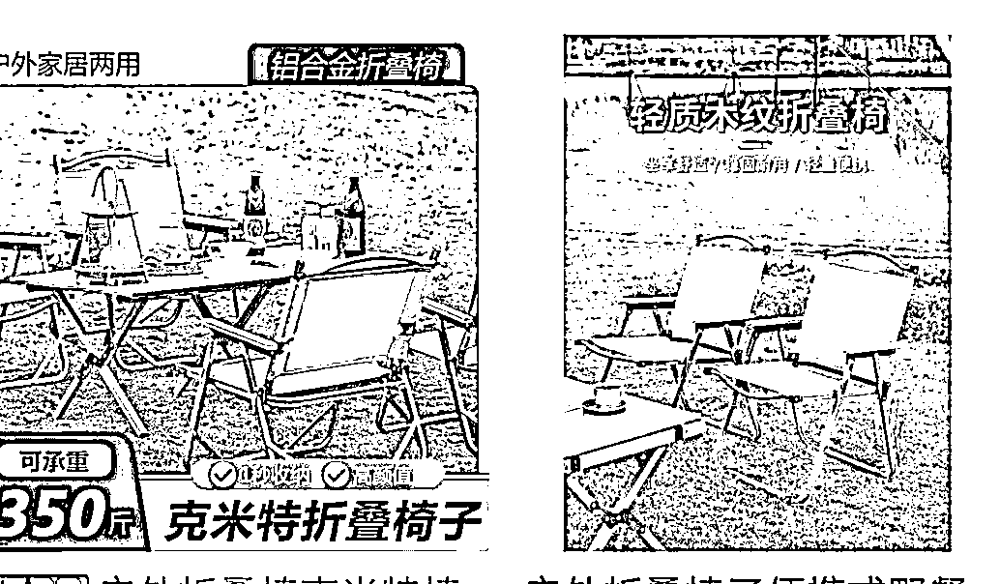

提醒一点，文案和图片可以参考同行，但不要照抄，闲鱼有查重机制，重合度高会影响推流。

文案配图是精细活，垂直店铺必须精细化运营，每个细节都关系到成交。我为了找一张满意的图片，经常花两三个小时。

## 4.如何快速起号

商品上架后，闲鱼会先给一波初始曝光，再根据浏览、收藏、成交数据决定是否继续推流。

一个常用技巧是标出最低价来引导“我想要”。

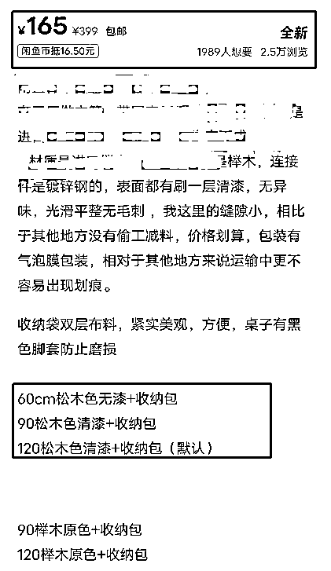

比如实木折叠桌分大中小三个规格。假设成本140/160/180，目标利润45，正常标价是185/205/225。但市场反馈小号几乎没人买，基本都是中大号。

这时就可以把小号价格压到165甚至155，来做展示价吸流量。首图放最大号，文案不写明价格，引导买家点“我想要”询价。进来后看到大号价格合适，成交率很高。

起号方法很多，受篇幅限制就不展开。长期稳定推流的核心还是运营数据：及时回复、好评率、成交率、售后率稳定，平台才会持续给你流量。

## 5.闲鱼之外的延伸——私域&小红书

搞定了货源后，业务完全可以延伸。露营项目最容易接到大单，比如露营地老板会一次性批量采购，我每个月基本都有1-2个大单。

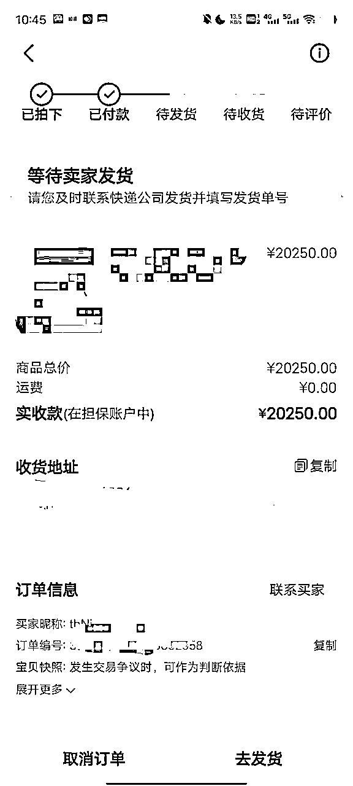

今年最大一单销售额2万，净利润3000+。

除了露营地，餐厅、酒吧、咖啡、奶茶店、路边摊也都在做露营风格，这些大客户值得沉淀到微信，复购会很顺。

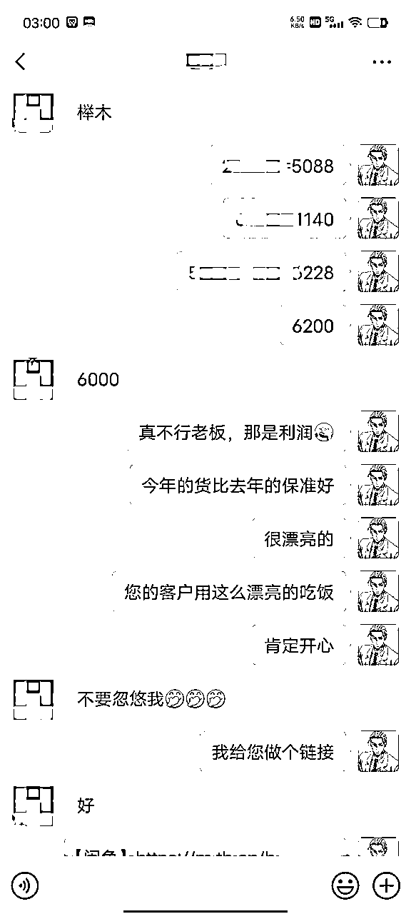

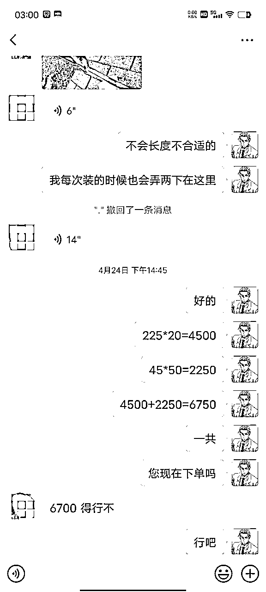

我微信里沉淀了上百个大客户，节假日前总会来复购，偶尔发个新品朋友圈也能带来意外成交。

注意闲鱼对引流抓得很严，不要直接留微信电话。我的做法是下单后复制买家电话去微信搜，搜不到就打电话要微信，只加大客户。

小红书我也一直在做，去年主要做引流到微信成交，赚了大几万。今年开了小红书店铺，消费能力比闲鱼高，可以卖得更贵。缺点是平台对回复及时性要求高，容易限流。

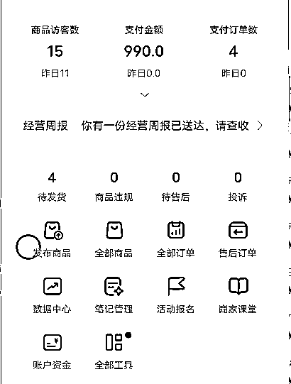

## 6.结语

目前露营赛道依然在高峰期，市场需求大，闲鱼上做这个品类的玩家大部分还在拼价格，专业度不高。

按我测算，新手只要肯花时间，月入3000-6000完全现实。目标月入3000，每天100，一张桌椅一套就能完成。月入6000，每天卖两套，一个号不行就开第二个。

马上进入暑假，又是一波小高潮，家长带娃露营需求会明显上升。

这个项目前期最花时间在产品研究和售后应对上，很多新手卡在这里放弃了，但一旦度过去就很稳。

这是我第一份副业，从一开始啥都卖，到最后聚焦露营深耕一年，也正好是我加入赚钱的一年，回报很可观。

想入局的、正在做的朋友欢迎交流。普通人发财可能难，但赚点小钱、发点小财的机会一直都在。

最后感谢赚钱团队搭建了这么好的搞钱圈子，让普通人能接触到这些实操信息。