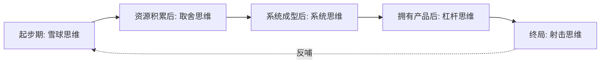
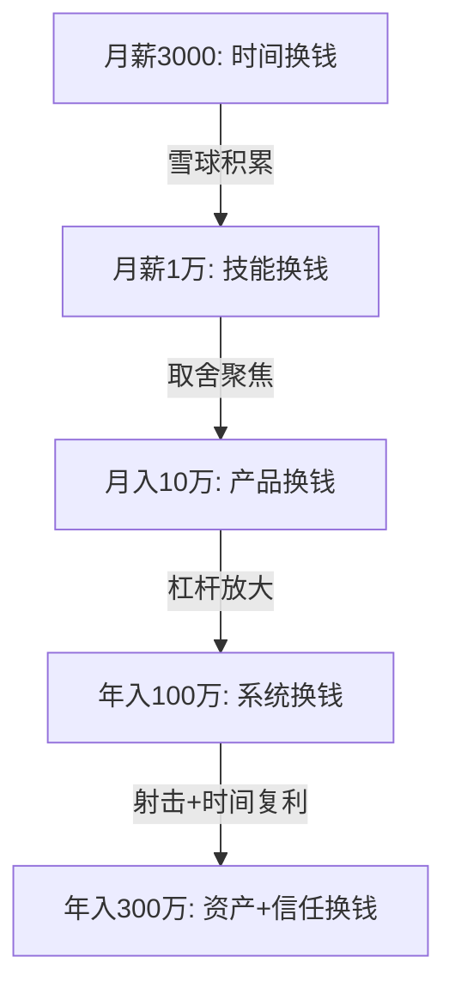

# 第 1 章 思维升级 —— 从月薪3000到年入300万的底层密码

## 1.1 学习目标

我们将从这里启程，你将带着以下七个明确的学习目标迈进本章：

- 理解个人成长的本质是思维升级
- 掌握10个思维模型全景图
- 能区分各阶段适用模型
- 理解思维模型适用边界
- 理解AI工具不等于赚钱项目
- 掌握流量获取与业务结合法
- 能识别割韭菜陷阱

## 1.2 生活类比

我们不妨把个人成长想象成给电脑更换操作系统。当你还在"月薪3000"的旧系统里，你运行的是"打工者"这套软件——它的逻辑是：用时间换报酬，每一份努力都直接兑换成金钱，系统资源被琐事占满，运转缓慢且容易死机。而年入300万的人，运行的是一套完全不同的操作系统——它内置了"雪球积累""杠杆放大""系统自驱"这些底层驱动程序。换系统并不意味着你删除了努力工作这个文件，而是改变了所有程序运行的底层规则：同样的输入，会产出完全不同的输出。在本书的另一个场景中，我们也会看到 AIGC 变现的批判性视角——那里我们用的类比是"用锄头种庄稼"：AI 工具就像一把崭新的锄头，锄头本身再锋利，也不会自动长出庄稼。你必须把它插进真实的业务土壤，翻土、播种、浇灌（获取流量、完成转化），才能收获粮食。那些只买锄头不种地的人，最终只会收获一堆闲置的钢铁。这就是两套核心叙事的关键：**先换操作系统，再选好工具**。

## 1.3 概念地图

```text
个人成长与思维升级
├── 本质：思维升级与迭代
│   ├── 换操作系统类比
│   └── 思维是结果的上游
├── 10个思维模型全景图
│   ├── 起步期：雪球思维（量积累势能）
│   ├── 成长期：取舍思维（对与对之间选择）
│   ├── 系统期：系统思维（可持续运行）
│   ├── 放大期：杠杆思维（外部资源撬动）
│   └── 终局期：射击思维（有意瞄准无意击发）
├── 实证：从3000到300万
└── 边界：不是万能药，须结合场景
AIGC变现批判性审视
├── 现实：技术热潮vs赚钱现实
├── 定义：AI工具不等于赚钱项目
└── 方法：流量获取与业务结合法
```

## 1.4 个人成长的本质：思维升级与迭代

> [SUP001, 10个思维模型]
> "核心是思维升级与迭代。"

这句简短的话，是整个十章教程中最重要的一句。当你读到"精髓""底层""本质"这类词时，我们实际上在谈一个决定性的事实：**你赚到的钱，是你认知水平的镜像；你的收入，是思维方式的外显值。**

我们先把这句话拆开来看。它包含两个关键动作：**升级**（从低维到高维的跃迁）与**迭代**（持续的小步快跑）。升级意味着质变——就像 2G 网络升级到 5G，不是快了两倍，而是传输逻辑发生了根本改变；迭代意味着量变——每天反复修正一个微小的 bug，最终换来系统的稳定运行。

让我们用一个类比来理解"为什么思维是结果的上游"。设想一条河流：**思维是源头，行为是河道，结果是水流**。如果你只在下游筑坝（试图直接改变结果），水还是会绕道流走；但如果你在上游改变水源（更新思维），整条河的走向都会改变。这就是底层性——思维不是众多因素之一，它是一切因素的上游。

以下是这一单元的核心定义：

> **个人成长**定义（来源：《10个思维模型》）

$$Growth = f(\text{Thinking}_{\text{upgraded}}) + \epsilon_{t}$$

这个公式展示了个人成长（Growth）是（f）升级后思维（Thinking_upgraded）的函数，外加随机的时代误差项（epsilon）。其中 f 代表"输出转化率"（执行力、机遇、资源），而 epsilon 代表不可控的宏观变量。这个公式告诉我们：**你无法控制 epsilon（时代红利、市场波动），但你可以无限优化 f 和 Thinking——这是成长的全部抓手。**

让我们用一个布尔表达式来强化这个观念：

```text
if 思维方式 == "打工者模式":
    执行路径 → 时间 → 线性收入
elif 思维方式 == "创业者模式":
    执行路径 → 系统 → 指数收入
```

这段伪代码展示了两种核心模式的路径分岔：打工者模式把**时间**作为唯一输入，产出是线性收入（月薪），且受限于每日 24 小时的上限；创业者模式把**系统**作为输入，产出是指数收入（资产、被动收益），不受时间约束。深度学习中的"模型能力取决于数据与架构"，类比到这里就是：**收入能力取决于你的行为与思维架构**。

## 1.5 10个思维模型全景图

> [SUP001, p.1] "提炼10个思维模型。"

作者从医学生到年入300万的经历，被压缩成 10 个思维模型。从教育学视角看，这 10 个模型并非孤立的"知识点"，而是一个按成长阶段排列的序列。

我们可以把 10 个思维模型想象成一个 RPG 游戏的技能树，每个阶段解锁新的技能。这非常重要，因为不同阶段适用的模型完全不同，如果你在起步期就使用"杠杆思维"，你会因为地基不稳而崩盘。

以下是这个技能树的完整构造：

```text
阶段一（起步期 0-1）：
    ├── 雪球思维（靠量积累势能）
阶段二（成长期 1-10）：
    ├── 取舍思维（在正确选项之间聚焦）
阶段三（系统期 10-100）：
    ├── 系统思维（构建可持续运行的系统）
阶段四（放大期 100-1000）：
    ├── 杠杆思维（用外部资源撬动）
阶段五（终局期 1000+）：
    ├── 射击思维（依靠时间积累概率优势）
```

> **思维模型**定义（来源：《10个思维模型》）

$$M = \{m_1, m_2, ..., m_{10}\}, \quad \text{s.t.} \quad \text{Stage}(m_i) = f(\text{Resource}_i)$$

这个公式展示了思维模型的集合论定义：全部 10 个模型构成集合 M，其中约束条件（s.t.）表明每个模型 m_i 的应用阶段（Stage）取决于当前资源量（Resource）的函数 f。这意味着：**每个模型都有其"适宜窗口期"**——在资源不足时强行使用高阶段模型，效果等同于用一发狙击枪子弹去打近处的蚊子，不是工具不好，而是场景不对。

通过下面的数据流图，你可以更直观地看到这些模型之间的流转关系：



数据流图展示了思维的"爬坡与回流"结构：从雪球起步积累原始资源，逐步升级到杠杆放大，最终进入射击的长期主义轨道——而射击思维带来的持续收益又会反哺到雪球起点，形成复利闭环。这正是一种完善的"成长操作系统"应有的样子。

不过，正如作者反复强调的，这一套模型存在一个天然的陷阱——**模型收集癖**。请听清楚这个警告：

> [SUP001, p.6] "思维模型必须结合具体场景。"

如果你只是收藏这 10 个模型的名字并能背出定义，而从不投入实践，那么你只是获得了"知识的幻觉"——就像下载了一个 App 却从未点开。**模型的真正价值不在存储，而在调用**。这与深度学习中的"参数与计算"关系类似：一个拥有海量参数的模型如果不在真实数据上推理，就永远只是随机权重的堆砌。

## 1.6 雪球思维

> [SUP001, p.2] "雪球思维：靠量积累势能。"

雪球思维是整个体系的地基。它的本质是：**在起步期，数量比质量更重要——你需要先让雪球滚起来。**

> **雪球思维**定义（来源：《10个思维模型》）

$$E_{\text{potential}} = \sum_{i=1}^{n} w_i \cdot t_i$$

这个公式展示了势能（E_potential）等于每一份微小投入（w_i）与时间（t_i）的乘积之和。它的含义比表面看起来深得多：**势能不是求解瞬时速度，而是累加过程——前 100 次的笨拙积累，恰恰决定了第 101 次能否产生质的跳跃。** 这就是为什么起步期"数量优先于质量"：因为只有在量足够大的时候，你才有机会筛选出真正有效的路径。

我们可以这样理解：如果刚起步的你要写文章，你的目标不是写出一篇 10w+ 爆文，而是写出 100 篇哪怕只有 100 阅读量的文章。因为每一篇都在积累你的写作势能，也在积累你对读者喜好的数据采样。当 n 足够大时，你自然会在分布中找到那个成功概率更高的"最佳响应"。

> **雪球积累算法**（来源：《10个思维模型》）

```python
def snowball(start_energy, iterations):
    E = start_energy
    for i in range(iterations):
        # 每次迭代都新增一点投入（量）
        delta = random.uniform(0.1, 1.0)  # 每次增量
        E += delta * momentum_factor(E)
        # 势能越大，惯性越大，雪球越容易滚
    return E
```

这段伪代码展示了雪球思维的迭代机制：循环执行"新增投入—积累势能—获得更大惯性"的闭环。关键点在于**momentum_factor(E)** ——它的灵感来自于物理学中的动量守恒：当 E 增大时，后续积累的加速度也在增大。这就是复利的力量：**前期进展缓慢，但在某个临界点后，增长开始指数化。**

## 1.7 取舍思维

> [SUP001, p.4] "取舍思维：在对与对之间选择。"

人最大的痛苦，不是"对与错"的选择，而是"对与对"的选择。因为选错，你可以通过学习纠偏；但选对另一个对的选项，意味着你放弃了同样可能成功的路径。

> **取舍思维**定义（来源：《10个思维模型》）

$$\text{Choose}(A,B) = \arg\max_{x \in \{A,B\}} \text{LongtermValue}(x) - \text{OpportunityCost}(x)$$

这个公式展示了取舍思维的决策函数：在面对两个选项 A 和 B 时，我们不是选择短期收益最大的那个，而是选择"长期价值（LongtermValue）减去机会成本（OpportunityCost）"后剩余净值最大的那一个。它的核心洞察是：**正确的取舍，不是放弃错的，而是甘愿放弃一个"也很好"的选项，以换取另一个方向的深层积累。**

这里我们引入一个深度学习中的概念来辅助理解——**Dropout**。在神经网络训练中，Dropout 会随机丢弃一部分神经元，表面上看是"损失了表达能力"，实际却防止了过拟合，提升了泛化性能。取舍思维也是同理：**主动放弃部分可能性，恰恰是你建立差异化优势（护城河）的唯一路径**。什么都要，等于什么都平庸。

## 1.8 系统思维

> [SUP001, p.3] "构建可持续运行的系统。"

单点爆发可以带来一次性的成功，但只有系统才能带来持续的成功。这是从"做事者"到"成事者"的分水岭。

> **系统思维**定义（来源：《10个思维模型》）

$$\text{Output}(t) = \int_{0}^{t} \text{System}(\text{Input}(s)) \, ds, \quad \text{where System is self-driving}$$

这个公式展示了系统思维的数学抽象：一条可持续系统的总输出（Output），是系统对输入（Input）在时间维度上的积分。关键约束条件是 **System is self-driving（系统自驱）**——这意味着，它不依赖你这个"创始人"的每次手动介入，而是像一台设定好程序的机器，在离开你的直接控制后依然持续运转。对时间积分这个概念非常重要：它体现了**可复制性**与**反脆弱性**。可复制是系统可以授权他人运转；反脆弱是系统在冲击下不仅不崩溃，反而因为吸收了扰动而变得更强（就像肌肉在撕裂后修复得比原来更粗壮）。

如果你经营的是一个个人 IP 账号，单靠你每天苦思冥想发帖，那是"单点爆发"；但如果你建立了一套选题库、一套内容 SOP，并且能让实习生按照标准执行后依然产出优质内容，那你就拥有了一个**可持续运行的内容系统**。

## 1.9 杠杆思维

> [SUP001, p.5] "利用影响力、内容、团队放大。"

杠杆思维的核心是一句话：**单点能力有限，外部资源无限。你的天花板，取决于你能撬动多少外部资源。**

> **杠杆思维**定义（来源：《10个思维模型》）

$$\text{Output}_{\text{total}} = \text{Ability}_{\text{single}} \times (1 + \text{Leverage}_{\text{influence}} + \text{Leverage}_{\text{team}} + \text{Leverage}_{\text{content}})$$

这个公式展示了杠杆思维的多维乘积结构：单点能力（Ability_single）是系数，外部杠杆包括影响力（IP 信任）、团队（人群放大）、内容（一旦发布永久留存）。这个公式揭示了杠杆的本质——**乘法效应**。没有杠杆时你的输出是 1（只有单点能力）；有影响力杠杆等于 1+10；有团队杠杆等于 1+50；有内容杠杆等于 1+1000。

但请记住，杠杆是一把双刃剑：放大收益的同时也放大风险。如果你把全部杠杆押注在一个没有验证的假设上，一旦判断失误，你失去的不仅是本金，还有信誉资产。在金融学中，这就是**杠杆的非对称风险**——收获时是 1.2 倍，损失时是 0.8 倍甚至清零。**稳妥的做法是：先用雪球建立基本面，再用杠杆放大已验证的路径。**

## 1.10 射击思维

> [SUP001, p.7] "有意瞄准，无意击发。"

这句话直接取自射击运动的要诀。它的深意在于：**努力瞄准是你可以控制的，而是否击中是概率事件,你无法完全控制。所以，你要把全部注意力放在"瞄准"这一个动作上，然后把击发的权利交给概率。**

> **射击思维**定义（来源：《10个思维模型》）

$$P(\text{Success}) = \lim_{n \to \infty} \left(1 - (1 - p)^n\right)$$

这个公式展示了长期概率累积的极限定理：如果每一次"射击"（尝试）成功的概率是 p（假设很小，比如 5%），那么当你执行 n 次高质量的"瞄准—尝试"循环后，至少成功一次的概率趋近于 1。这在概率论中被称为**重复试验的保底原理**：只要单次成功率不为零，且你的尝试次数趋向无穷，则总体成功率逼近 100%。这就是长期主义者与短视者的数学分水岭：**短视者只算一次击中的概率（5%），觉得太低就放弃；长期主义者计算 100 次的累计概率（99.4%），于是坚定地执行下去。**

射击思维的关键在于"过程导向"而非"结果导向"：你要专注的是每一次"有意瞄准"是否足够标准（做正确的事），而不是"这次是否命中"（因为每次命中与否包含随机性）。当你的对手在为一次失误懊悔时，你已经在准备下一次瞄准。

## 1.11 从3000到300万：思维转变的实证

> [SUP001, p.8] "从3000元到300万。"

这组数据极具冲击力：3000 元的月薪，与 300 万的可支配收入，差了整整 1000 倍。如此巨大的差距，不可能仅靠"更努力"填补——因为努力的上限只是线性增长。**必然存在着层级不同的"底层算法"：3000 元走的是时间换钱，300 万走的是系统加杠杆。**

我们可以用一张阶段跃迁曲线来直观理解：



这张图展示了从 3000 到 300 万的完整跃迁路径。值得注意的是，这并非一蹴而就，而是每个阶段通过特定思维模型驱动跃迁：雪球思维让你从打工者变成熟练工，取舍思维让你从熟练工变成专家，系统思维让你从专家变成产品拥有者，杠杆思维放大器让你从产品拥有者变成资产持有者，射击思维让你在时间维度上复利累积。

这一实证最重要的可模仿性在于：**它不是天才式的一夜暴富，而是一条可以拆解、可以复盘的阶段性路径**。每一步都对应一个清晰的思维升级动作——这比抽象的鸡汤更有教学价值。

## 1.12 思维模型不是万能药：适用边界

对于任何模型，我们必须同时讨论它的边界。作者本人也明确警告：

> [SUP001, p.9] "思维模型必须结合具体场景。"

这句话批判的正是**模型收集癖**——那些把思维模型当作知识藏品，以为"记住了就等于掌握了"的人。从认知科学的角度看，这正是"惰性知识"的典型表现：信息存进了大脑，却从未在真实决策中被调用。

思维模型的适用边界的本质，在于**情境依赖性**：雪球思维在最需要的是"休整期"就不适用（此时强行输出只会消耗心理能量）；杠杆思维在你的能力尚未验证时就是危险的（没有已验证的基本面，杠杆只会加速失败）；射击思维对于处在需要"尽快看到反馈"的生存期的人则过于奢侈（连续 100 次无反馈的尝试会让生存都难以为继）。

因此，模型不是真理，而是**"条件有效"的策略**。它们像是一把瑞士军刀——每一个工具都是在特定场景下才锋利。盲目的"模型套用"，在心理学上被称为"单一工具偏见"。**真正成熟的学习者，应该像警觉的医生一样判断"此情此景，用哪个模型最优"，而不是像狂热的信徒一样只使用唯一福咒。**

## 1.13 多源对照：思维转型的两个分野

当我们把"个人成长"与"AIGC变现"两套素材放在一起对比时，会发现它们共享了同一条底层逻辑，却导向了两个不同的应用方向。

### 共识

两套素材都认为：**技术/工具本身不具备价值，只有应用到具体系统中才产生价值。**个人成长素材告诉我们"思维是结果的上游"；AIGC 素材告诉我们"AI是工具，不是商业模式"。本质上，它们都在强调同一个观点：**工具（思维模型/AI工具）是被放大器，不是发动机；发动机永远是"你的业务系统"或"你的认知升级"。**

### 分歧

两套素材的分歧在于"矛头指向"。个人成长素材的矛头指向**自我能力提升的内部路径**——它关心的是如何改变你自己的操作系统；AIGC 素材的矛头则指向**外部市场的批判性审视**——它关心的是如何识别那些包装成"赚钱项目"的陷阱。

在个人成长领域，作者的默认假设是"你拥有的能力系统越强，变现越多"；但在 AIGC 领域，作者的警惕恰恰相反："技术越热门，割韭菜的镰刀越锋利。"这两个方向的互补，构成了本教程的完整画像：**对内，升级思维系统；对外，警惕工具幻觉。**

## 1.14 AI工具不等于赚钱项目

> [SUP002, p.1] "AIGC真的不是一个好的赚钱项目。"

这句话与我们前面看到的无数AIGC暴富神话背道而驰。我们要先听懂它的准确含义，它不是否定AIGC的价值，而是指出了市场上的一种**典型的误区**。

> **赚钱项目**定义（来源：《AIGC三剑客赚钱机会》）

$$\text{ProfitableProject} = f(\text{BusinessModel}, \text{UserValue}, \text{TrafficChannel}), \quad \text{AI} \notin \text{components}$$

这个公式展示了判断一个项目是否"值得投入"的完整评估函数（f）：一个可赚钱的项目 = 清晰的商业模式（BusinessModel） × 真实用户价值（UserValue） × 可靠的流量渠道（TrafficChannel）。注意约束条件（notin）：**AI 不是其中的必要组成成分。** 这意味着：如果一个项目宣称"只要你有AI工具，就能月入十万"，那它是在用一个"非核心组件"替代了真正的核心要素（商业模式、用户价值、流量渠道），这是典型的变量偷换——就像宣称"只要有电钻，就能盖出大楼"一样荒谬。

>AIGC 项目的完整评估漏斗如下：

```text
1. 你的 AI 工具能解决什么真实问题？ （用户价值）
2. 谁为此付费？付费频率如何？ （商业模式）
3. 你用什么渠道触达他们？ （流量获取）
4. AI 是否只是效率放大器，而非唯一卖点？ （定位检验）
```

这个评估漏斗的价值在于：它会强制你去回答"AI 之外的部分"在哪里。那些真正赚到钱的 AIGC 项目，无一例外地发现：**AI 只占成本的 10%，流量和转化的执行力占 90%。** 这再次验证了"AI 是锄头，不是庄稼"的类比。

## 1.15 流量获取与业务结合法

> [SUP002, p.2] "将重点放在流量获取和真实业务结合。"

如果 AI 工具不是赚钱项目本身，那么正确的方法是怎样的？AIGC素材给出了明确的答案：**把AI当作业务基础设施，把核心精力投放到流量获取和真实转化上。**

> **业务结合法**方法（来源：《AIGC三剑客赚钱机会》）

$$
\begin{aligned}
\text{Revenue} &= \text{Traffic} \times \text{ConversionRate} \times \text{ARPU} \\
\text{where} \quad \text{Traffic} &= \text{Content}_{\text{human-designed}} \times \text{AI}_{\text{production}} \\
\text{ConversionRate} &= f(\text{Trust}, \text{ValueDemonstration})
\end{aligned}
$$

这个公式展示了完整的商业闭合模型：收入（Revenue）由三个核心因子相乘——流量（Traffic）、转化率（ConversionRate）和客单价（ARPU）。第二行展示了流量本身的结构：**流量 = 人工策划的内容主题 × AI 辅助的内容生产。** 关键在于人工策划（human-designed）是可比较的核心——AI 承担的是"生产提速"，而不是"创意起源"。第三行说明了转化率取决于信任（Trust）和价值展示（Value Demonstration），这又回到了"系统思维"中提到的长期信任积累。

这个公式明确了**真正的分工**：AI 是效率杠杆（它把单篇内容的产出时间从 4 小时缩短到 40 分钟），但它无法替代"选题的洞察力"和"用户的信任建设"。那些把 AI 当成"自动印钞机"的人，正是因为误读了这一分工而失败。

以下是一个具体的执行流程：

```text
1. 明确业务场景（例如：面向职场新人的简历优化服务）
2. 用 AI 批量生成内容（标题、初稿、案例）
3. 将核心时间投入到平台分发与社群互动（流量）
4. 用真实服务完成转化闭环（业务落地）
5. 从用户反馈中提炼下一轮选题（迭代）
```

这段执行流程展示了一个标准的"业务结合法"闭环：AI 只在第 2 步介入，而 1、3、4、5 步全部依赖人类的业务判断和执行。这印证了前面"AI 是基础设施"的判断——它服务于业务，但不替代业务。

## 1.16 设计中的取舍

**为什么不能靠"纯 AI 自动化"赚钱？**
因为没有任何一个系统可以完全脱离人的判断而自动实现转化。机器可以生成内容，但无法理解"人的信任阈值"；它可以制造话题，但无法洞察"社群的心理时差"。这就是自动化的幻觉：你省下了内容生产的成本，却把流量获取和客户信任这两个最关键的环节交给了运气。而商业的残酷在于，**运气不是一种可靠的生产资料。**

**AI 作为效率工具 vs 作为商业模式，真正的 trade-off 是什么？**
把 AI 当成商业模式，你省去了"打地基"（业务设计、用户价值定位）的时间，但你得到的是空中楼阁——看似宏大，一推即倒。把 AI 当成效率工具，你需要多付出"业务设计"的成本，但你换来的是可持续的收入结构。取舍的代价是前期速度的降低，而收益是终局安全的提升——这与我们在"杠杆思维"中看到的"风险非对称性"完全相同：**前期慢，后期稳；前期快，后期险。**

**为什么不用"杠杆思维"直接放大 AIGC？**
因为杠杆的前提是"存在一个已验证的基本面"。若你的业务模型还未跑通，你的内容还没有获得过自然流量的正向反馈，此时加入杠杆只会放大失败的速度。正确的顺序是：先用雪球思维小规模验证业务模型，再确认用户的真实付费意愿，最后才考虑用 AI 内容批量化和团队扩张来放大——**先找到 1，再复制 100。**

## 1.17 动手练习

- 练习1：绘制个人成长阶段地图
  - 回顾自身经历，划分出 2-3 个成长阶段
  - 分析每个阶段的主要瓶颈，并匹配本章中一个适用的思维模型
- 练习2：AIGC 项目冷静评估清单
  - 挑选一个市面上宣称"AI赚钱"的项目
  - 用商业漏斗（用户价值+商业模式+流量渠道）评估其可行性
- 练习3：杠杆模拟
  - 列出自身"单点能力"
  - 写下三种可撬动它的外部杠杆，并评估其风险

## 1.18 本章小结

这一章我们完成了从"个人成长本质"到"AIGC变现批判"的一次完整的思想航行。首先，我们明确了个人成长的本质不是技能叠加而是思维升级，并用"换操作系统"的理解方式给出了底层框架。其次，我们全局浏览了 10 个思维模型的全景图，并分阶段详解了雪球思维、取舍思维、系统思维、杠杆思维和射击思维——它们分别对应从起步到终局的五个不同阶段。接着，我们通过作者从 3000 到 300 万的实证，看到了思维升级如何实际驱动财富跃迁。然后，我们转向了一个批判性的审视领域——AIGC 变现：我们论证了"AI 工具不等于赚钱项目"这一核心论断，并给出了正确的"流量获取与业务结合法"。最后，我们讨论了思维模型的适用边界，区分了"工具"与"发动机"的差别。

本章我们一起学习了以下概念：

| 概念 | 解释 |
|------|------|
| 思维升级与迭代 | 个人成长本质是思维升级 |
| 雪球思维 | 起步期靠量积累势能 |
| 取舍思维 | 在对与对之间聚焦核心 |
| 系统思维 | 构建可持续运行的系统 |
| 杠杆思维 | 利用外部资源放大单点能力 |
| 射击思维 | 有意瞄准，无意击发 |
| 思维模型适应边界 | 模型不是万能药，须结合具体场景 |
| AI工具不等于赚钱项目 | AI须结合业务场景落地 |
| 流量获取与业务结合法 | 将核心精力投流量获取与真实转化 |

下一章中，我们将带着这套"批判性审视"的视角，深入拆解 AIGC 领域的三大赚钱机会——看看它们如何从热潮走向落地，并教你如何识别那些包装精美的"割韭菜"套路。
