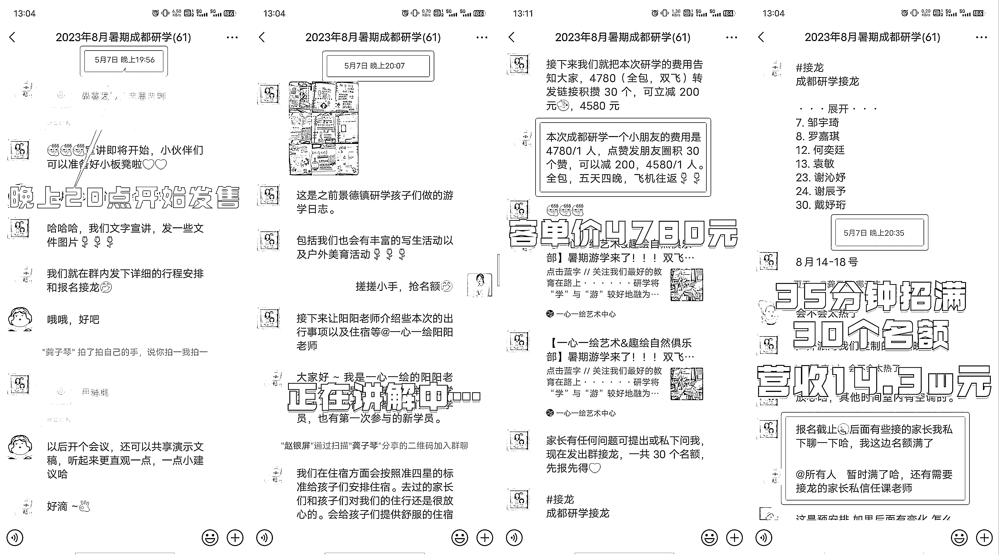
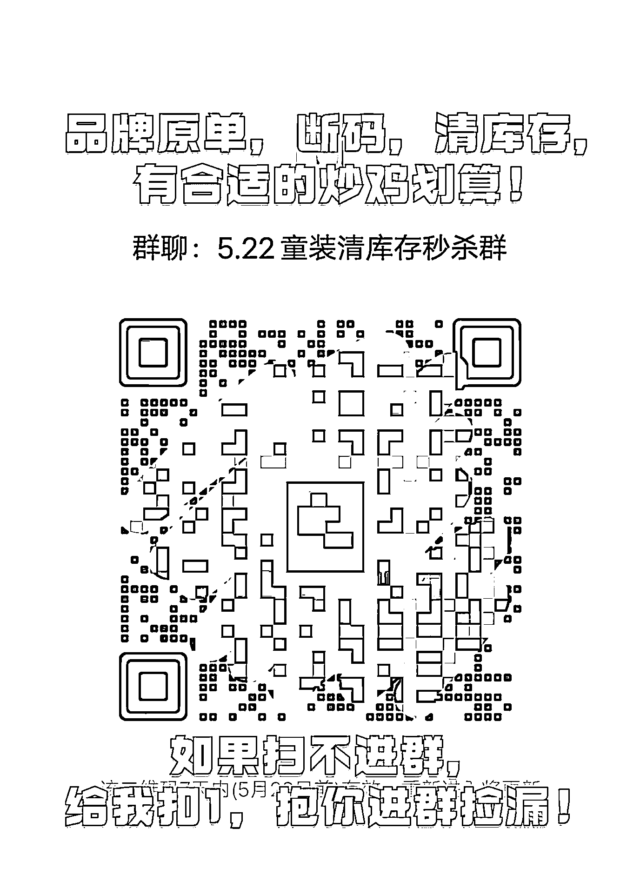
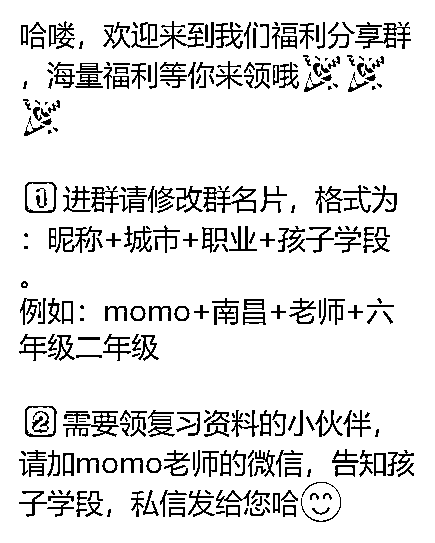
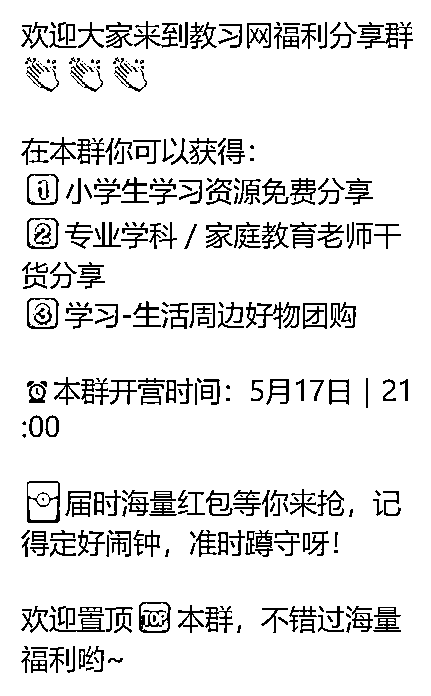
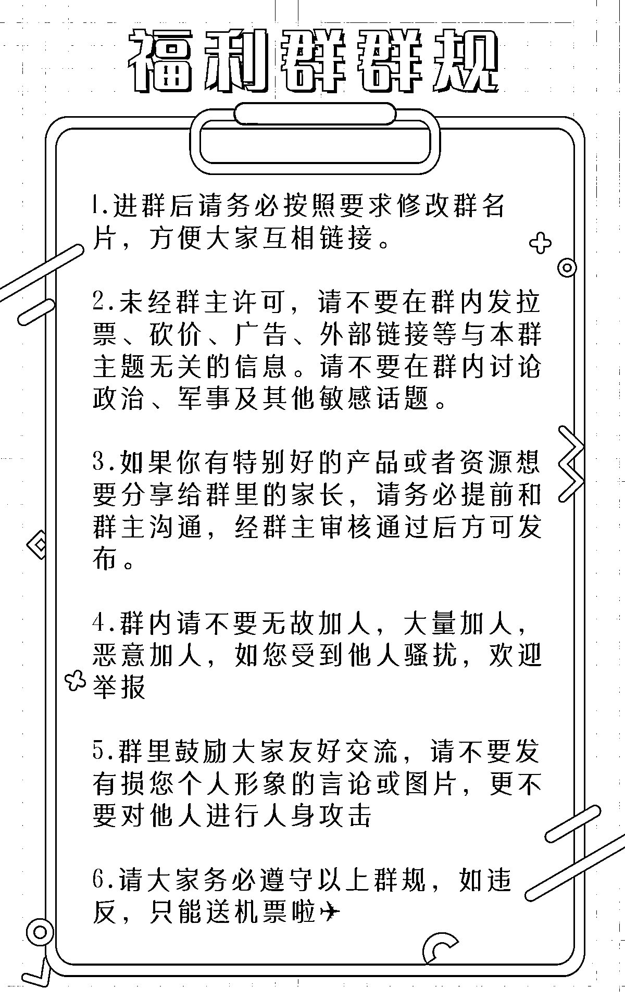
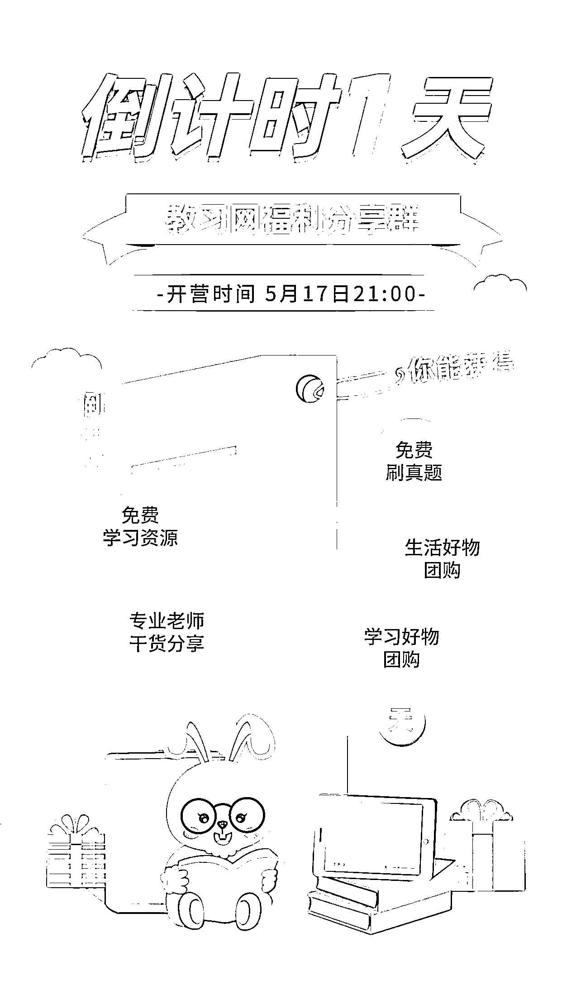
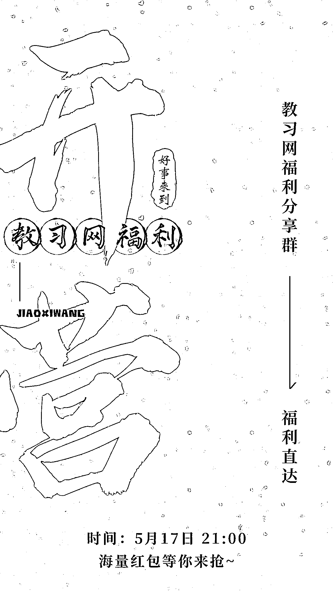
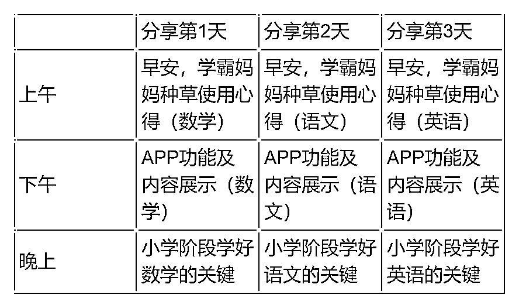
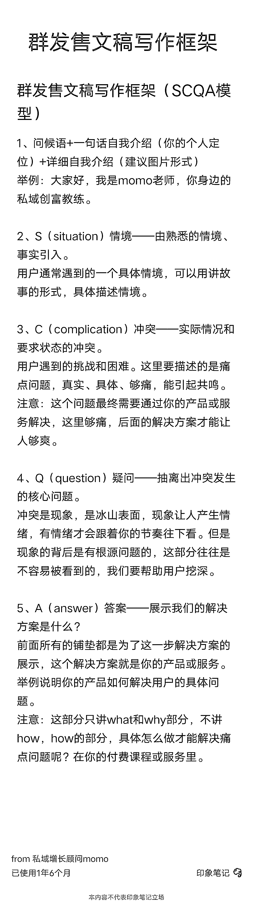

# 打造高成交快闪群的实战打法

> 原文：[`www.yuque.com/for_lazy/thfiu8/kfugpv7k0t5edw4i`](https://www.yuque.com/for_lazy/thfiu8/kfugpv7k0t5edw4i)

## 如何做一场高转化率的快闪活动

作者： momo 

日期：2023-07-05 

6 月 1 日《如何做一场高转化率的快闪活动？》@momo6 月 1 日《如何做一场高转化率的快闪活动？》@momo大家好，我是 momo，十年私域实操者。白天是中学老师，晚上是私域增长顾问。靠微信私域自己赚了几百个 W，也带过几千位素人小白做副业变现，其中上百人副业月入破万。感谢赚钱团队的信任，担任本次社群运营航海的教练，也受邀做这次主题分享。本次航海我们定了一个小目标：实操一次 7 天快闪群。我翻了下往期的精华，有一篇讲课程类快闪群的干货比较细，我置顶在：https://t.zsxq.com/0eR0aVC1G供大家对照。今天我从整体操盘设计的视角，拆解一下高转化快闪群怎么做。本次内容会围绕三块展开：一、快闪适合什么场景二、快闪的标准流程：拉群 → 开营 → 分享 → 发售 → 解散三、提升转化的核心要点

一、快闪活动的适用场景
快闪常被拿来宣传高转化单场高营收，很多人跃跃欲试。但没有成熟操盘手落地，效果往往不如预期。别人的案例是假的吗？宣传难免夸张，却也并非造假。我自己就做过一天收几十万、转化超 30% 的场子。关键在于选对场景，并不是所有品类都适合快闪。以下几类场景相对更容易打透：

1、课程服务类：以 9.9 元这类超低门槛引流，转化 500 元以内的产品
2、日用百货类：当季刚需、适用人群广的商品，限时限量、价格给足
3、生鲜食品类：最好绑定节日节点，如中秋月饼、端午粽子、情人节鲜花
4、服装鞋帽类：断码清仓节点，直播+社群联动，快闪售罄为止

总体来看，低客单快闪更占优，用户决策门槛低，容易形成冲动下单，尤其对陌生用户有效。高客单也可以做，但前提是用户已养护一段时间，信任基础已建立。比如我之前做的成都研学项目，客单 4780 元，35 分钟售罄 30 个名额，转化率 50%，营收 14.3 万。这场快闪之所以能成，是因为前期信任已铺垫到位。

所以快闪玩好了，对收钱帮助很大。在启动前，先把目标想清楚：你要转化多少人？转化抓手是什么？靠哪个点去撬动购买？这些都要提前设计进流程里。以研学案例为例，目标转化 20-30 人，抓手是研学带来的美学成长体验，与家长因工作忙无法陪伴孩子深度游学的痛点冲突。只要把孩子在活动中的内容、过往学员的美学产出作品极致展示，就能让家长产生渴望，再对比自己很难复制这种丰富度，购买动机自然被点燃。促进转化的核心逻辑是限时限量制造稀缺。无论是提前约好意向用户接龙，还是安排群托带节奏，都是常用手法。这里有个细节：如果预估有 15 人会下手，放出名额最多 12 个，永远要让一部分人抢不到，才会形成火爆势能，后续活动会越做越热。有人担心抢不到的人不转化，其实完全可以通过返场、补录等灵活方式收尾。

下面按时间线拆解完整操盘路径：

二、快闪活动的基本流程
1、拉群
第一步是建群并完成引流。拉群阶段要解决两个问题：人从哪来？进群后说什么？

问题一：人从哪里来？
公域引流
如果你有小红书、抖音、视频号、公众号等渠道，可发引流帖明确时间、事项和用户收益。具体避险操作不展开，总之让公域粉丝知道何时发什么福利即可。

私域引流
没有公域就从现有私域起步，利用微信好友及好友的熟人圈。两种高效方式：
① 滚动发朋友圈
优点是覆盖面广又不显得刷屏。做法是用同一文案配图，每隔一段时间发一次，抓住上网高峰期半小时滚动一次。实测直接放进群二维码的图片比精美海报进群效率更高，但海报信息承载量更大、冲击力更强，所以两种物料可轮换使用。
② 精准私发二维码
转化要高，精准度是关键。先筛出符合画像的好友，把写好关键信息的二维码图私发过去，让对方自助扫码。示意参考

裂变
别人的私域就是我们的公域。可以设计裂变激励，让已进群的人邀请身边精准人群。常见形式是送资料、抽奖，成本要控制好，优先用零边际成本的电子资料或优惠券来驱动下单。

问题二：进群说什么？
物料提前准备好：
① 入群欢迎语
这是用户进群后第一触点，把最想传达的核心信息写出来，越简洁越好。若进群集中，避免高频刷屏导致退群，可间隔发送。示例
② 群公告
群公告每次发送会 @所有人，避免无效打扰，一般早中晚各发一次即可。核心是告知活动内容、时间、用户收益。示例
③ 群规
群规是降本增效工具。发过群规后踢违规者还能起到教育剩余成员的作用。建议做成图片，避免大段文字刷屏。示例

2、开营
开营仪式并非必备。想做低客单转高客单、需要价值沉淀的建议做；纯快消卖货、无需铺垫的可以直接卖，比如前面提到的库存清仓快闪群就不需要。

如果要做开营，准备工作如下：
开营前物料准备
① 倒计时海报
通常准备 1 天、10 小时、6 小时、3 小时、1 小时、30 分钟共 7 张。要素包含倒计时时间、活动开始时间、核心价值。图片比纯文字更抓眼球。不会设计可用创客贴、稿定设计等模板工具快速完成。示例
② 开营海报
③ 开营文稿
开营要说明接下来几天要做什么，用户能得到什么。通常会先深挖本次发售产品的痛点，再给希望，引导用户留在群里听分享即可解决。案例参考：https://kwj3fkh7ymf.feishu.cn/docx/Oq8OdjYLgoBJTNxwA3WcM52kn4i?from=from_copylink 这是与赚钱小伙伴合作的一个私域变现项目福利群的开营，并非快闪群开营。

开营期间运营
① 预热
任何社群活动预热都决定参与率。方法就是群公告+倒计时海报+红包，设闹钟定时发即可。
② 开营活动
一般安排在第 2 天晚间进行，白天预热，晚上按文稿流程执行，视情况邀请负责人或分享嘉宾发言。开营做好的两大关键点：一是红包要多，把想说的话拆到红包文案里逐条发送，金额不必大，1 元 10 个包一轮，整场二三十个甚至更多，营造氛围感；二是安排群托，群托是社群氛围的灵魂，要积极呼应主持人发言。

快闪群运营期：分享价值
价值输出一般落在第 3、4、5 天，每天安排内容分享持续种草，形式可为专家讲解、产品介绍、用户证言等。若卖课程，可穿插用户体验感强的互动环节。三天的核心是建立链接，让用户感受到足够的好处，并想象之后还能获得更多，从而产生购买欲。举例：我们做过《学霸养成记》快闪群，目标转化学习类 APP 会员，4 个 400 人群转化 500 多单，客单 398。

快闪群运营期：发售
收网通常在第 6 天。经过三天种草，价值已充分沟通，用户需要一个即买理由。逻辑只有两个：限时或限量，突出“现在不下手就亏”。最关键的是发售文案的撰写，要让人产生心痒感。推荐用 SCQA 模型来搭建框架。 另外提供一个群内发售文案实操案例：https://kwj3fkh7ymf.feishu.cn/docx/SucvdzswloVe1txIrbDchCZDnvb 欢迎交流。发售阶段可叠加福利，如限时抽奖、赠品、早鸟价或阶梯涨价，具体以促进出单为准。

快闪群结束期：解散
第 7 天可做一次追单。比如向公司申请少量名额返场，给还在纠结的用户一个最终窗口。但注意名额必须控制，不能无限放量。可先预估有多少人想买未成交，再放出少于预期值的名额，提前通知，让他们在群内抢。看热闹的人是主力，必须让他们看到大家在抢、有人抢不到，商品才会越卖越热。第 7 天后，群要么引导成员迁移到新群，要么直接解散，一定不要放养，悬而不决会产生负面影响。

三、高转化快闪活动的关键点
1、拉群前先想清楚群的用途，做好基础准备再开群，否则体验受损
2、开营和发售都重度使用红包，把想说的话拆到红包文案里。红包金额不大没关系，关键是要多，满屏橙色冲击力很强
3、发售一定要有稀缺感，不能给用户“随时都能买”的错觉。没有紧迫感，用户为什么要现在买？现在不买，过阵子要么放弃，要么去别家买了

社群运营细节很多，一个点就能写很久。听再多不如亲手操盘几次。祝大家在本次航海中收获满满！

评论区： 

芷蓝 : 好详细，快闪群真的是需要根据场景、行业和人群来做具体规划～ momo : 嗯嗯是的，蓝总经验丰富👍 下页小峰 : 写的很棒，非常有收获 momo : 🌹