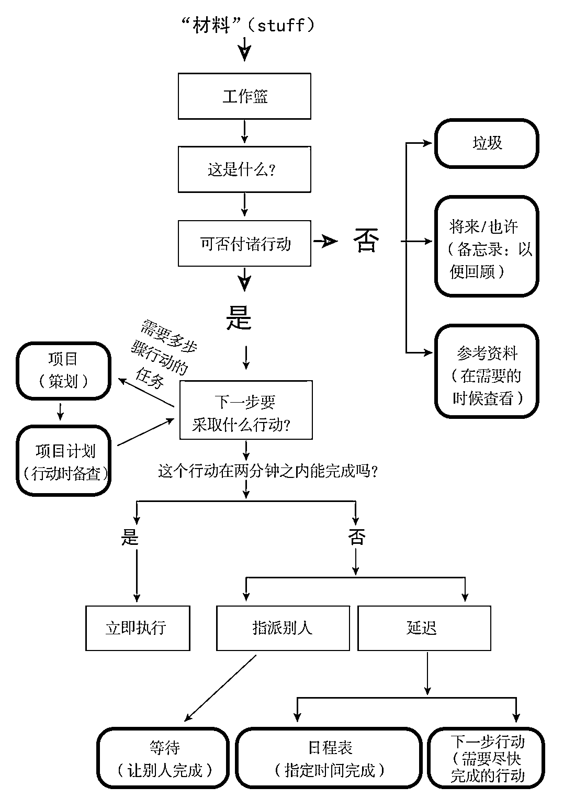
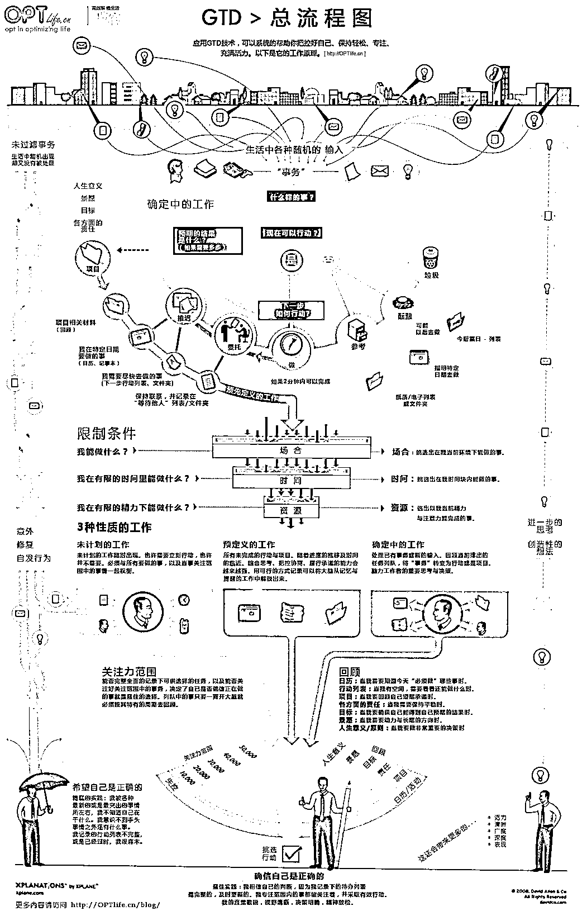
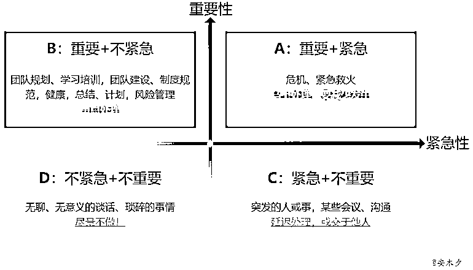
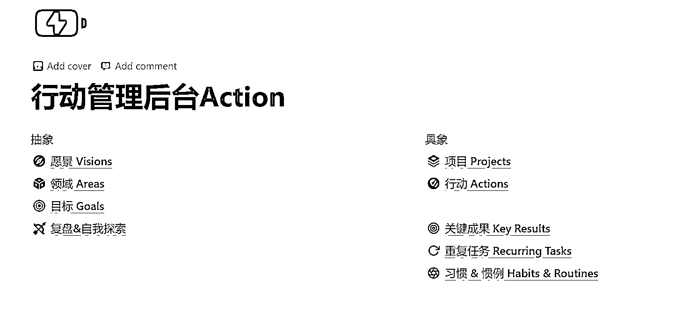

# 给时间管理小白的极简行动管理入门课

> 原文：[`www.yuque.com/for_lazy/thfiu8/rx4iogsrr9yt7o72`](https://www.yuque.com/for_lazy/thfiu8/rx4iogsrr9yt7o72)

## 给新手入门的极简“行动管理”指南

作者：饭先生

日期：2023-06-29

5 月 30 日《给新手入门的极简“行动管理”指南》@饭先生

大家好，我是阿饭，一个在赚钱有术潜水四年才浮出水面的老友。17 年还在校园时我就开始接触个人成长，先后研究过时间管理与目标管理；工作后几乎每天做记录，周复盘也坚持三年以上。工具上从有道云笔记、印象笔记一路折腾到 Notion、Obsidian，各种时间管理思路都试过一遍。还因为在产品社区写了几篇时间管理工具的拆解，被邀参与过时间管理类产品的创业。作为时间管理课的助教，我也帮不少人设计过个人 OKR 与自我管理方案。

经过多年的学习与踩坑，我现在用一套自己的知识加行动管理打法，配合一套模板，已经稳定运行。即使长期远程办公、同时操盘多个项目，也能保持清晰的产出感。需要说明的是，这个流程不一定适合所有人，我始终认为没有放之四海而皆准的时间管理法。今天分享的重点不是照搬一套方法，而是提供一套思考框架，帮你自己搭建适配的系统。

一、心态与思维的三个转换

1.1 先定要成什么事，再谈怎么用时间

我们常说在管理时间，但我更认同先管理目标再管理时间。多年实践让我越来越觉得「目标的优先级高于方法论」。时间是客观流动的，它无法被真正控制，只能被感知。我们真正能掌控的，是自己要做什么和怎么做。

对自由职业者或以结果为导向的人来说，时间管理可以大幅简化为三步：想清楚要什么、拆成能做的任务、给任务排上时间。与其用时间节点倒逼里程碑，不如用目标倒推任务安排，心态会更稳。

我们学时间管理，本质上只是想让好钢用在刀刃上，把有限的精力投入到想做的事上。大多数人能做到每天完成预设目标，剩下的时间自然就是自由支配。找到适合自己的节奏，比追求所谓标准答案更重要，这就引出第二个转变。

1.2 以自己为中心，用甲方思维选方法

市面上时间管理的流派很多，判断一个方法合不合用，唯一的裁判是你自己。很多人之前用过某个体系，跑着跑着就卡 bug 了，然后归咎于自控力差，于是放弃、换方法、再放弃，形成循环。其实差别在于个人特质与外部环境不同。

我的情况就比较特殊：远程工作、斜杠身份、同时并行多个处于不同阶段的项目，时间自主度高、任务并发量大。照搬我的做法给生活状态不同的人，极可能水土不服。

所以时间管理必须主体化、因地制宜。当某个技巧用不了，就当成方案与问题不匹配，而不是自己不行。对新手来说，最好的起点是先跑起来，在实践中理解原理，再根据自身情况迭代方案。

1.3 把时间管理当成无限游戏，练系统思维

时间管理强调效率，但更要关注可持续性。学习时间管理是为了过更好的生活，它是手段不是目的。用有限游戏思维只盯着赢一次目标，容易完成后空虚；用无限游戏思维搭建并持续优化系统，反而更持久。

万维钢的那句话我很认同：“凡夫畏果，菩萨畏因，佛畏系统”。有了系统，单个目标只是输出项。关键不是这次能不能达成，而是系统是否健康运转。

比如竞技目标是夺冠，系统则是身体状态、训练方法、心理素质的持续优化。冠军只是系统变好的结果。同样，在赚钱小航海里，有人定目标是打卡 X 次、变现 Y 元，但目标完成后是终点吗？更好的状态是把每日学习到的有效做法内化到自己的系统里，用来应对新的挑战，并在问题出现时持续调整。

关注目标背后的前置条件，思考改变一个变量会触发哪些连锁反应。当你进入不断优化系统的状态，结果自然会到来。

二、时间管理常见流派与使用场景

1.1 GTD 搞定

Getting Things Done 核心是把脑中的待办外化，五个环节：收集、处理、整理、回顾、执行。先把所有事项统统记录下来，避免遗漏，再分类组织，方便后续执行。

这套体系是时间管理里的经典，也是我现在行动系统的基石。特别适合事情多、注意力容易被打断的人。先记录再行动，能有效降低大脑负载。

1.2 艾森豪威尔矩阵

用紧急与重要两个维度划分任务，分为紧急且重要、紧急不重要、重要不紧急、不重要不紧急四个象限，帮助厘清优先级，优先处理最重要的事。

这个工具更适合管理者或需要频繁协作的场景。核心是做重要的事而不是紧急的事，避免把重要事拖成紧急事。不重要的事要么舍弃要么授权。

1.3 帕累托法则

80% 的结果来自 20% 的投入，聚焦在少数关键任务上。难点在于识别哪 20% 真正关键。需要结合日常复盘，找到反复出现问题的根因，常与四象限结合使用，思考为什么重要事总被拖到变紧急。

1.4 吃青蛙法则

先做最难最关键的那件任务。先啃硬骨头，后续其他事会变得更顺畅，也能减少拖延。适合容易想多做少、陷入分析瘫痪的人。

这四种思路其实是大多数时间管理法的源头，理解原理后就能组合出自己的行动方案。

三、我常用的极简行动闭环

整体框架来自 GTD，分为收集-分类-排序-行动-复盘五个环节。

Step 1：清空大脑，做外部收集

“第二大脑”的本质是认知卸载。初期用白纸或手机备忘录做一个收集箱，把脑中所有冒出来的待想待办全部倒出来：从长期规划到周末约朋友吃什么，一律先外化。大脑保持空白，才能更清晰思考。

Step 2：分类处理，清空收集箱

固定一个时间，比如早晚，对收集箱做处理。能立即完成的就现在做，剩下的评估后归类。我现在的操作系统会把收集箱的想法具体化后放到不同位置：

可以简化为四个标签：任务、项目、目标、资料。

任务：一次可完成、产出明确，比如做 PPT、写文章、完成打卡。

项目：由多个任务组成、满足 SMART 标准的行动集合，比如完成小航海。

目标：长期方向、想成为什么样的人，需要多个项目支撑。

资料：只需保存参考，不需行动。

Step 3：排序

排序要结合外部环境和自身状态。可以参考：

- 紧急且重要的待办
- 最让你抗拒的、最难的任务，先吃青蛙
- 反复出现问题的根因
- 协作链条中的前置环节

排序没有标准答案，关键是与长期目标和价值观一致。

Step 4：行动

思考与行动要分离。前期想透，确认穷尽可能性后就不要再内耗，直接干。执行过程中以产出为导向，持续累积可复用的认知，让流程越走越顺。

Step 5：复盘迭代

我习惯每日复盘一次，每周或每月及项目结束后复盘一次，最大化复用过去经验。复盘问题参考 KPT：

K Keep：今天做得好的地方有哪些？可以沉淀成经验或 SOP。

P Problem：遇到了哪些障碍？

T Test：下次可以尝试怎样的小改进？

复盘既是细节优化，也是系统优化。用实操获得的第一手经验，逐步替换掉不适用的环节，让系统越来越贴合自己。

以上就是我的分享，希望你能想清楚下一步最具体的第一步是什么，以及当前行为系统里有哪些可以立刻微调的地方。欢迎大家分享自己喜欢的复盘模板，一起交流。