# 从二手书的售后烦恼里，挖到一个不用发货的副业：大学英语激活码

> 原文：[`www.yuque.com/for_lazy/thfiu8/thfcb4gdr8vcmyl8`](https://www.yuque.com/for_lazy/thfiu8/thfcb4gdr8vcmyl8)

## 二手书卖家意外撞上的无物流项目——大学英语激活码实操拆解

作者：小嵩
日期：2023-07-17

各位好，我是小嵩。
看过我 3 月 6 日那篇《加入龙哥盟一年，终于实现副业月入过万》的朋友应该对我有些了解了。今天这篇要聊的，是在经营二手书的过程中顺手摸到的一条需求线，大学英语激活码，并且把从上架到成交的完整打法梳理出来。

做二手书的老朋友都懂，售后是件麻烦事。上家寄来的品相可能不达标，买家一句话就要求退货，回头费和心情全亏进去。那有没有一种产品，既不用打包发货，也不用担心售后扯皮呢？这次分享的这个品类就是，在做二手书时偶然被我撞见的，它是纯数字交付，零物流零退货。

起因是来了一个比较特别的买家，如图。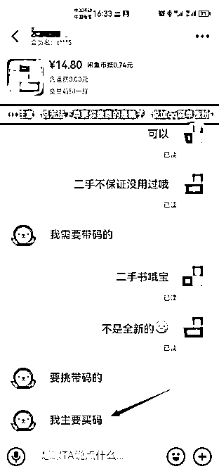

一开始我也没当回事，结果接下来几天陆续有人来问这个码。我好奇去淘宝一查，发现供给还不少，而且销量看起来很健康！

这些就是淘宝和拼多多上在做激活码的同行。剔除暑假寒假这两个淡季，其他时间段里，各大平台上激活码的月销规模都相当可观。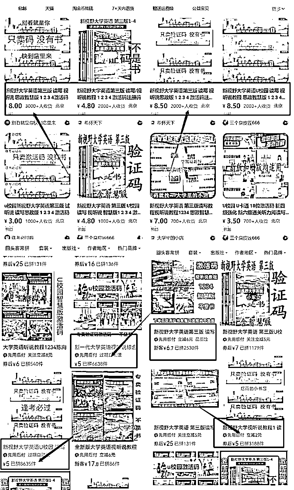

于是我就在闲鱼上试水。先去孔夫子文轩找了几张教材实拍图，简单加了点说明文字就上架了。定价直接参考了淘宝同行的价格再加上自己的利润空间。没想到第二天就有询盘，并且当天就成交了，净利润大概在 50% 左右。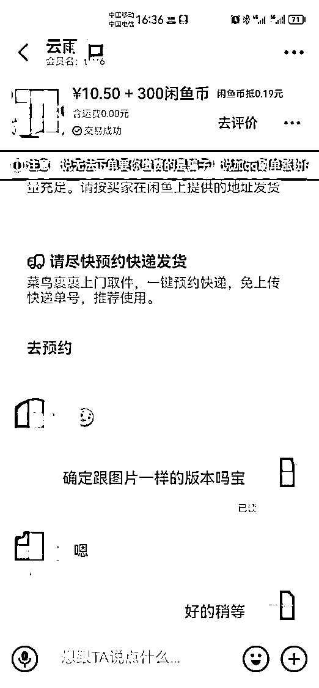

下面这张图是我用两个闲鱼小号测试一个月的数据，期间甚至还不是旺季。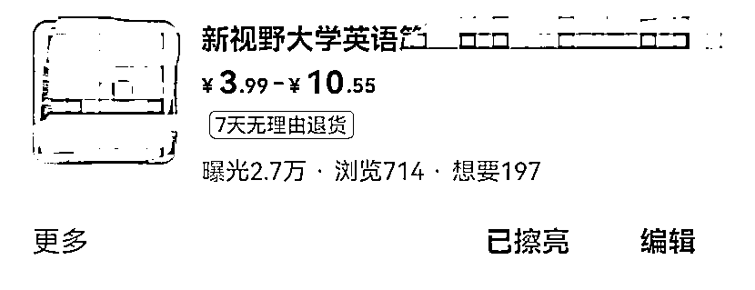

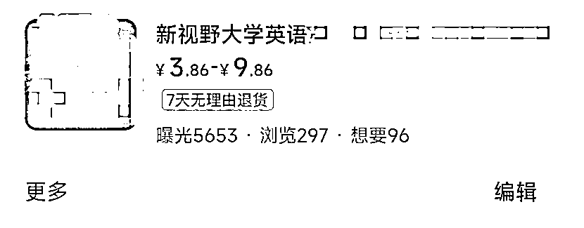

对比卖二手书，激活码这门生意有几个明显的好处：
1. 需求非常精准，不用像书那样到处找图、描述品相。
2. 来咨询的客户本身需求明确，成交效率高。
3. 交付只是把一串码发过去，属实后售后问题几乎为零。
4. 资金回笼快，当天成交当天到账。

另外，收码的环节也比收书简单得多。书的品相品种太多，激活码的品类相对集中，找货也更直接。

拿货成本关键看有没有渠道

我也试过联系在校大学生，但体验很差。不是联系不上，就是收来的码已经被用过、过期或根本不可用。

一般收码的方式是直接把书后页的刮刮码裁下来：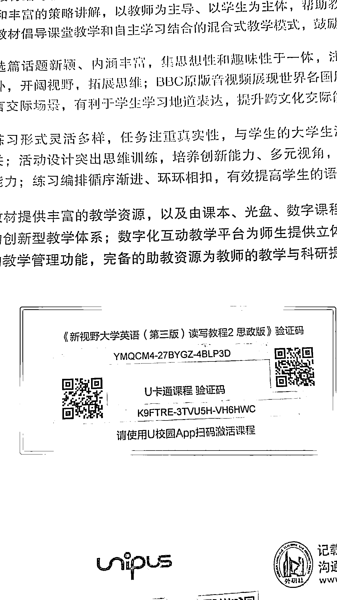

核心教材是外研社出版的《新视野大学英语》第三版。目前国内绝大多数高校都在用这套书。

这套书一共分四个册，每册又分为读写和视听说两个方向。

每本教材后面都附带一个在线学习平台的激活码。

这个码的作用是激活U校园里的配套学习资源，用来提交作业、积累学分。

问题在于，激活码只有一学期有效。很多同学上学期用过，这学期发现过期了，就必须重新买码激活课程才能交作业。

所以从需求面看，激活码一直是供不应求的状态。

下面是详细的上架实操

1. 登录闲鱼商家后台 —> 商品管理 —> 新建商品
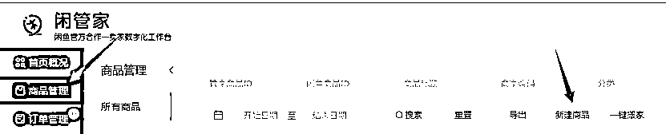

类目选择图书 —> 学习考试
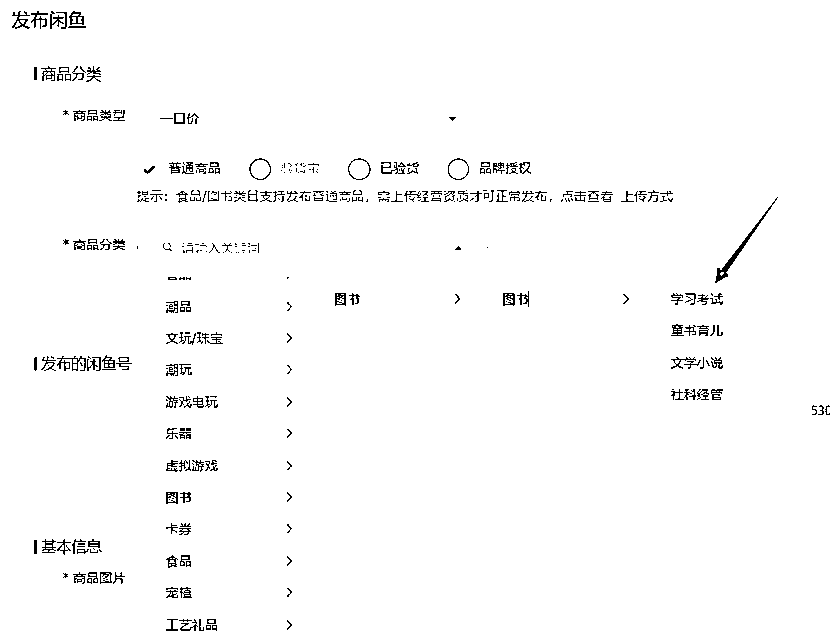

建议去孔夫子或淘宝找一张原版教材图，自己叠加文字说明。更推荐自己找不同角度的图片，避免同质化。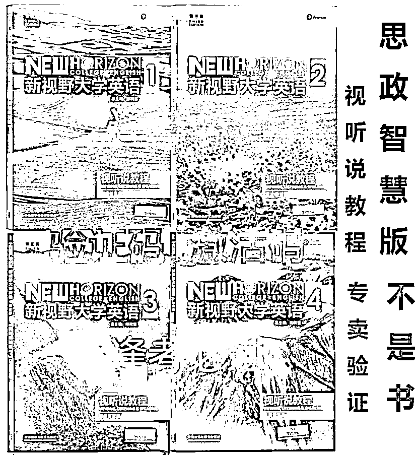

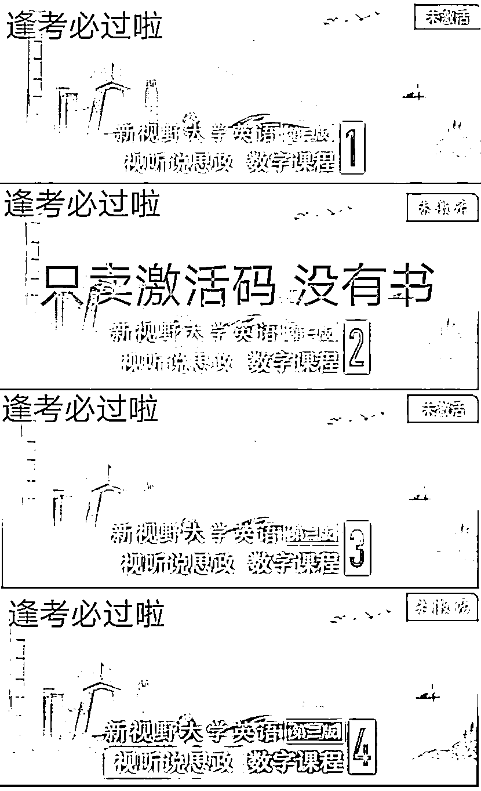

标题可以这样写：
新视野大学英语第三版 读写 视听说 思政智慧版 1 2 3 4 激活码 新视野大学英语第三版思政智慧视听说读写综合训练激活码注册码 新视野大学英语第三版 读写思政版 1 2 3 4 激活码 U 校园 智慧版 新视野大学英语 U 校园 读写 视听说教程 思政智慧版 1 2 3 4 激活码

新视野大学英语 U 校园 读写 视听说教程 “思政智慧版” “智慧版” “U 卡通” 第 1 2 3 4 册验证码 激活码 不是书，下单后联系客服在线发送，无需物流

说明里要写清楚：
确定好版本，保证注册，无效退货 激活码拍下后在线发送，无需快递，保证激活，放心下单， 下单前务必核实清楚，若您知道用什么码，请直接拍下。

若不知道，请将课程中心带有“未激活”字样的可成图片截图给客服 否则拍错不支持退换。收到激活码后请立即激活，超出 7 天不售后。 下单后 请联系客服。 激活码刮开后不支持退换，谢谢理解

5. 图书信息里的 ISBN 填新视野大学英语的 ISBN 即可
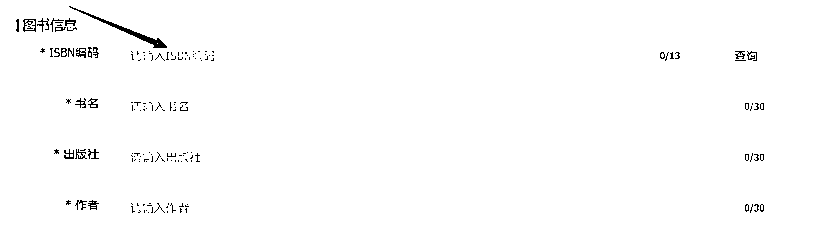

这里可以设置多个 SKU
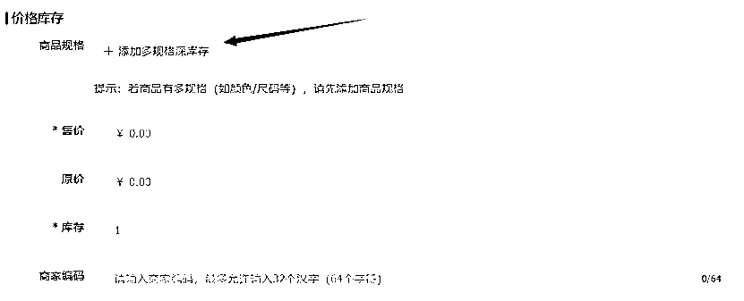

填完后点立即发布—>确认
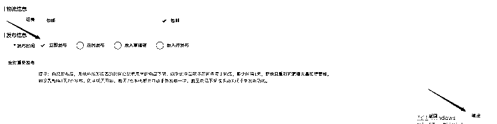

特别提醒！！！

激活码主要分「智慧版」和「思政智慧版」两大体系，每个体系下又分「读写」和「视听说」两种课型，价格也不同。

再细分还有 1、2、3、4 册之分，发送时一定要对准版本。刚开始容易混，建议让客户先发截图确认版本。

这是 U 校园未激活页面的截图和已刮开码的书后页实拍，供参考：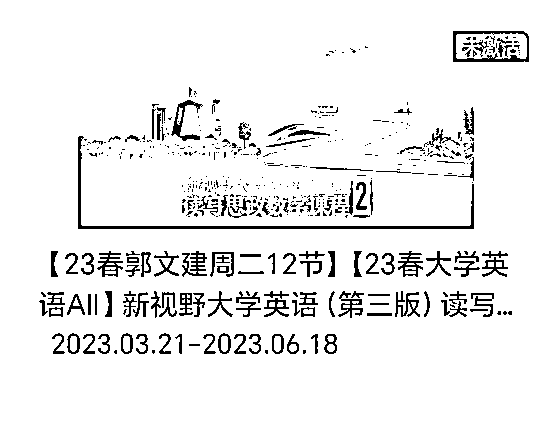

1. 价格策略
上架后可以用 3.8-10.8 元做低价引流，也可以直接开 SKU 把各版本真实价格标出来。实测低价引流效果更好。

2. 交易话术
为了避免发错，请让客户先截图 U 校园未激活页面，确认版本后再报价格。 激活码全新，不含书本，包激活，不激活则退款。

3. 交付方式
闲鱼聊天不支持直接发带二维码的图片。可以用视频形式把图片录屏发过去，或者直接把激活码数字串复制给客户。

4. 售后技巧
码有有效期限制，卖出后要提醒客户尽快激活交作业。 客户要砍价时，可以适当优惠一到两元，多买多优惠，转化会明显提升。 激活成功后点“无需寄件发货”完成交易。

5. 引导好评
激活成功后，礼貌推荐给需要的同学，并请求一个好评，祝学习进步学业有成，感谢支持！

1 激活码应该挂到哪个类目？
建议挂到学习考试类目。ISBN 统一用新视野大学英语的编码即可，比如 9787513588188。所有版本都归到同一本书下，相对不容易被判定违规。

方案一：价格标到最低 3.88 元左右，不要过低以免被判定引流。 方案二：开启多规格 SKU，把每个版本的价格都写清楚。

两种方案都可以选。详情图建议去淘宝、拼多多等平台找不同卖家的素材，自己组合使用，避免一张图到处用被限流。

2 到底拍哪个版本？
下单时务必让客户提供书本照片或 U 校园未激活截图，按照版本报价。看不懂的可以把图发给淘宝或拼多多的客服确认。

买家付款后，可以去淘宝下单同版本，再把激活码转发给买家。

注意：闲鱼聊天无法直接发送带二维码的图片，会被判定违规，切记不要发。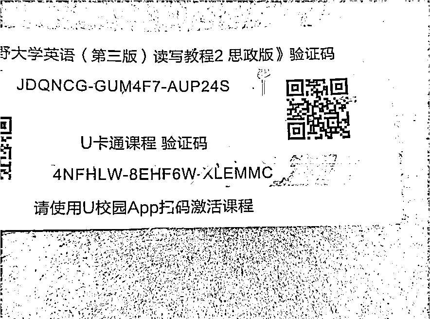

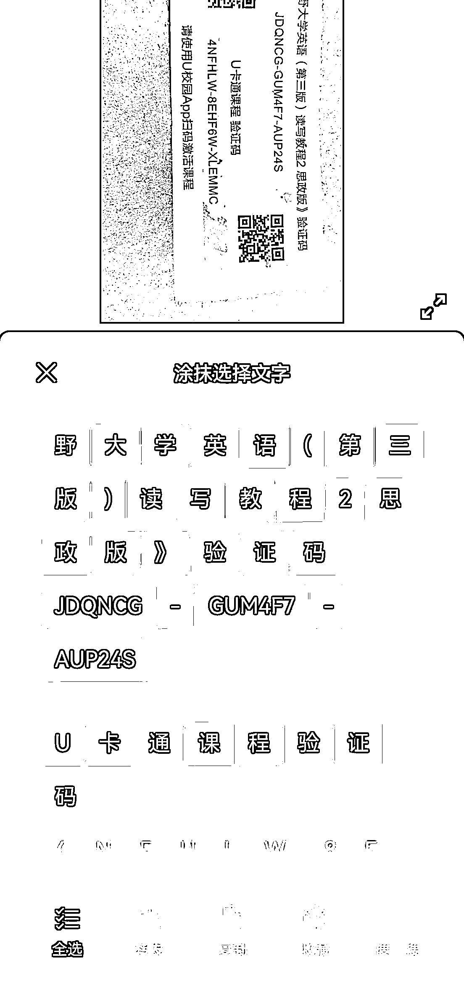

3 沟通时的建议话术

客户付款后可以先说：为避免激活码过期，我们的码都是现刮现发，请耐心等待，包激活，请放心。
发完码后顺带发一条引导好评的消息。

以上就是我在闲鱼上做大学英语激活码的完整分享。

最后补充一个小缺点，闲鱼上架教材类商品有时会被系统抽检下架，概率问题。如果手里有稳定货源，淘宝上的天花板更高，已经有大卖做到单日 2k+ 的水平。

另外我也整理了一份之前做二手书的流程，有兴趣的朋友可以一起参考。（）
希望对大家有帮助，感谢观看~

评论区：
张耑一 : 直接上传就行嘛？需不需要什么图书出版许可证明之类的东西
小嵩 : 发教材类目是需要的
